# 재난관리 사회연결망 연구총서 (Chapters 1 ~ 7 통합 학술 서브노트 & 소방 실증 프로토콜)

**원전 총서**: *Social Network Analysis of Disaster Response, Recovery, and Adaptation* (Edited by Eric C. Jones & A.J. Faas, Elsevier, 2017)  
**구성 범위**: Part I (이론 및 방법론: 제1장 ~ 제4장) & Part II (재난 대응 실증 연구: 제5장 ~ 제7장) 전 7개 챕터 완전판  
**포함 특집**: 박사학위 논문 선행연구 9단계 분석 템플릿 + 소방 조직·현장 대응 실증 연구 설계(NetMiner 프로토콜, 법령 매핑 KPI, 5인 가상 시뮬레이션)

---

## [총괄 요약] 전 7개 챕터 핵심 아키텍처 및 소방 연구 연계 일람

| 장 (Chapter) | 원제 및 저자 | 핵심 학술 이론 및 분석 모형 | 소방 조직·현장 대응 실증 적용 주제 |
| :---: | :--- | :--- | :--- |
| **제1장** | *An Introduction to Social Network Analysis in Disaster Contexts*<br/>(Eric C. Jones & A.J. Faas, pp. 3–9) | 은유적 vs 공식적 SNA, 대인망-조직망 결합, 잠재적 연계(Potential) vs 실현된 연계(Realized), 네트워크 존재론과 물신화 경계 | 평시 신뢰 잠재망($M_{	ext{potential}}$)과 출동 무전 실현망($M_{	ext{realized}}$)의 이중 네트워크(Dual Network) QAP 일치도 및 정보 왜곡 분석 |
| **제2장** | *Social Network Analysis Focused on Individuals Facing Hazards and Disasters*<br/>(A.J. Faas & Eric C. Jones, pp. 11–23) | 결속형·교량형·연계형 사회적 자본, **밀도의 역설(Paradox of Density)**, 코뮤니타스와 원조 자격의 정치, 표층 구조 vs 심층 구조 | 소방 조직 내 기수·연고 결속망의 부작용(안전 침묵) 규명을 위한 SNA 하위집단 분석 및 주관성 연구(Q방법론) 결합 모델 |
| **제3장** | *Interorganizational Networks in Disaster Management*<br/>(Naim Kapucu & Qian Hu, pp. 25–41) | 다층적 거버넌스(NRF-NIMS-ICS-ESF), 공식·비공식 대비망-대응망 전이, 협업 저해 4대 장벽, **5×5 메타 매트릭스(Meta-Matrix)** | 긴급구조통제단 다기관(소방·경찰·지자체·군·의료) 상호운용성 진단 및 행위자·지식·자원·과업·조직 5×5 메타 매트릭스 분석 |
| **제4장** | *Social Network Research Strategies for Disaster Response, Recovery, and Mitigation*<br/>(Danielle M. Varda, pp. 43–59) | **IOSP 프레임워크**(In/Out × Seeker/Provider), 다이론 다수준(MTML) 모델, QAP 및 ERGM($p^*$), 결측치(20% 임계점), 네트워크 취약성 | 의령소방서 119구조대 안전 책무성 4대 다중 매트릭스 설계, 넷마이너 7단계 프로토콜 및 **가상 소방관 5인 전 과정 시뮬레이션** |
| **제5장** | *Sensemaking and Evaluation in Incident Response Networks*<br/>(Branda Nowell & Toddi Steelman, pp. 63–74) | 성과 평가 5대 원칙, **실재론적 객관주의 vs 성과 다원주의(Pluralism)**, 21개 산불 HLM 실증(사건 내 개인 간 변량 83~97%), 지각-의미구성-평가 | 지휘부(IMT) 나홀로 고평가 편향 타파, 계급 간(지휘층-중간층-일선대원) 안전 인식 격차(SD 합의지표) 및 HLM·넷마이너 실증 |
| **제6장** | *Interorganizational Resilience: Networked Collaborations in Communities After Superstorm Sandy*<br/>(Jack L. Harris & Marya L. Doerfel, pp. 75–91) | 사회적 회복탄력성, **민츠버그의 다원 부문(Plural Sector)**, 시계열 진화(Times 1~4), 로컬 브로커리지(OEM & Cares), 잉여적 자원 클러스터 | 태풍·수해 시 소방서-의용소방대-자생단체 간 시계열(Times 1~4) 구호 네트워크 진화 및 의용소방대 로컬 브로커리지 KPI 도출 |
| **제7장** | *Shifting Attention: Modeling Follower Relationship Dynamics Among US Emergency Management-Related Organizations During a Colorado Wildfire*<br/>(Carter T. Butts et al., pp. 93–113) | 온라인 주의(Attention) 이동 동학, **동적 네트워크 로지스틱 회귀(DNR)**, 단기(1~3일) 도태 vs 장기(4~7일) 고착화 대칭 전환, 사전 고착화(Lock-in) | 대형 산불 시 재난관리 유관기관 간 시계열 상황전파·주의 네트워크 동학(DNR) 분석 및 발화 후 72시간 내 골든타임 주의 연결 KPI |

---

## [전체 상세 목차] Chapters 1 ~ 7 통합 서브노트 목차 (Table of Contents)

| 구분 | 챕터 제목 | 주요 절(Section) 및 특집 구성 |
| :---: | :--- | :--- |
| **제1장** | **제1장 재난 맥락에서의 사회연결망 분석 서설 (Sub-Note)** | • 1. 서론 (Introduction)<br/>• 2. 도서의 내용과 구성 체계 (The Content and Layout of the Book)<br/>• 3. 핵심 하이라이트 및 주요 주목 사항 (Highlights and Things to Watch for)<br/>• 4. 재난과 네트워크 존재론의 문제 (Disasters and the Question of Network Ontologies)<br/>• 5. 결론 (Conclusions)<br/>• [부록] 박사학위 논문 선행연구 분석 템플릿 연계<br/>• 6. 소방 조직 및 현장 대응 적용 연구 주제 및 방법론 (Application to Fire Services) |
| **제2장** | **제2장 위험과 재난에 직면한 개인 중심 사회연결망 분석 (Sub-Note)** | • 1. 서론 (Introduction)<br/>• 2. 사회적 지원, 사회적 자본 및 연계 유형 (Social Support, Social Capital, and Types of Ties)<br/>• 3. 네트워크 구성에서의 동질선호와 다양성 (Homophily and Diversity in Network Composition)<br/>• 4. 사회연결망 구조: 사회적 자본과 코뮤니타스를 넘어서<br/>• 5. 표층 구조와 심층 구조 (Surface Structure and Deep Structure)<br/>• 6. 재난 단계에 따른 네트워크 내 개인 (Individuals in Networks Across Phases of Disaster)<br/>• 7. 결론 (Conclusions)<br/>• [부록] 박사학위 논문 선행연구 분석 템플릿 연계<br/>• 8. 소방 조직 및 현장 대응 적용 연구 주제 및 방법론 (Application to Fire Services) |
| **제3장** | **제3장 재난 관리에서의 조직간 네트워크 (Sub-Note)** | • 1. 서론 (Introduction)<br/>• 2. 조직간 네트워크 (Interorganizational Networks)<br/>• 3. 재난 관리에서의 조직간 네트워크 (Interorganizational Networks in Disaster Management)<br/>• 4. 효과적인 조직간 재난 네트워크 (Effective Interorganizational Disaster Networks)<br/>• 5. 조직의 재난 네트워크 형성 시 협업을 저해하는 요인 (Factors Hindering Collaboration)<br/>• 6. 사회연결망 분석의 적용 (Applications of Social Network Analysis)<br/>• 7. 결론 (Conclusions)<br/>• [부록] 박사학위 논문 선행연구 분석 템플릿 연계<br/>• 8. 소방 조직 및 현장 대응 적용 연구 주제 및 방법론 (Application to Fire Services) |
| **제4장** | **제4장 재난 대응, 복구 및 완화에서의 사회연결망 연구 전략 (Sub-Note)** | • 1. 서론: 왜 사회연결망 분석 방법론인가? (Introduction: Why Social Network Analysis Methodologies?)<br/>• 2. 재난 맥락을 위한 네트워크 패러다임 (A Network Paradigm for Disaster Contexts)<br/>• 2.1 IOSP 프레임워크 (In/Out/Seeker/Provider Framework)<br/>• 2.2 분석 단위: 개인, 집단, 지역사회 (Units of Analysis: Individuals, Groups, and Community)<br/>• 2.3 분석 수준: 개인, 전체, 다수준 네트워크 (Levels of Analysis)<br/>• 3. 연계의 개념화 및 데이터 수집 (Conceptualizing Ties and Collecting Data)<br/>• 3.1 네트워크 연계(Ties)의 조작적 정의<br/>• 3.2 재난 연구의 5대 핵심 관계 범주 (Kapucu, 2005; Carley, 2002)<br/>• 3.3 데이터 수집 방법론<br/>• 4. 재난 네트워크 분석 방법론 (Analyzing Disaster Networks)<br/>• 4.1 기술적 분석 (Descriptive Analysis of Networks)<br/>• 4.2 네트워크 통계적 비교 및 추론 (Statistical Comparison of Networks)<br/>• 5. 재난 네트워크의 동태적 특성 (The Dynamic Nature of Disaster Networks)<br/>• 5.1 동태적 네트워크의 4대 범주<br/>• 5.2 시계열적 진화 단계와 네트워크 밀도 변화<br/>• 6. 재난 네트워크 연구의 도전 과제 (Challenges)<br/>• 6.1 네트워크 경계 설정 (Bounding the Network)<br/>• 6.2 연구 질문의 정의 및 설문 설계 (Defining the Research Questions)<br/>• 6.3 설문조사 집행 및 관리 (Survey Administration)<br/>• 7. 결론 및 향후 연구 방향 (Conclusions)<br/>• [부록] 본 챕터 핵심 인용 문헌 매핑 (Key References)<br/>• [부록] 박사학위 논문 선행연구 9단계 분석 템플릿 (Chapter 4)<br/>• 8. ★ [내 연구 적용] 소방공무원 안전 책무성·협력 네트워크 실증 분석 (SNA & 넷마이너 7단계 프로토콜 및 5인 가상 시뮬레이션) |
| **제5장** | **제5장 관점의 중요성: 산불 대응 네트워크의 성과 측정 과제 (Sub-Note)** | • 1. 서론 (Introduction)<br/>• 2. 네트워크 성과 평가: 선행문헌의 원칙들 (Assessing Performance in Networks: Principles From the Literature)<br/>• 2.1 네트워크 성과(Network Performance)의 개념 정의<br/>• 2.2 선행문헌이 제시하는 전체 네트워크 성과 평가 5대 원칙<br/>• 3. 산불 재난 시 네트워크 성과 측정 (Measuring Network Performance During Wildfire Disasters)<br/>• 3.1 산불 재난과 사건대응 네트워크의 특수성<br/>• 3.2 5대 원칙의 실제 연구 적용 프로세스<br/>• 4. 사건대응 네트워크 성과평가 내 다원주의 조사 (Investigating Pluralism)<br/>• 4.1 실재론적(Realist) 객관주의의 한계와 비판<br/>• 4.2 2대 핵심 연구 질문 (Research Questions)<br/>• 5. 연구방법 (Methods)<br/>• 5.1 연구 대상 및 표본 설계<br/>• 6. 연구결과 (Results)<br/>• 6.1 사건 간(Between-Incidents) 네트워크 성과 변량<br/>• 6.2 사건 내(Within-Incidents) 네트워크 성과 변량: 제도적 소속(하위집단)의 영향<br/>• 7. 논의 (Discussion)<br/>• 8. 성과 측정에 대한 시사점: 인지 이론 기반 3대 프로세스 (Performance Measurement Implications)<br/>• 9. 연구의 한계 및 향후 연구 방향 (Limitations and Future Research)<br/>• 10. 사사 및 핵심 참고문헌 (Acknowledgments & Key References)<br/>• [부록] 박사학위 논문 선행연구 9단계 분석 템플릿 (Chapter 5)<br/>• 11. ★ [내 연구 적용] 소방공무원 안전 책무성·협력 네트워크 실증 분석 (SNA & 넷마이너 7단계 프로토콜) |
| **제6장** | **제6장 조직 간 회복탄력성: 슈퍼스톰 샌디 이후 지역사회 내 네트워크화된 협력 (Sub-Note)** | • INTRODUCTION (서론) `[원문 pp. 75–76]`<br/>• ORGANIZATIONAL NETWORKS IN THE FABRIC OF COMMUNITIES FACING DISASTERS (재난에 직면한 지역사회 구조 내의 조직 네트워크) `[원문 pp. 76–78]`<br/>• POSTDISASTER CASE STUDY: OCEANPORT, NEW JERSEY (재난 후 사례 연구: 뉴저지주 오션포트) `[원문 pp. 78–80]`<br/>• LOCAL STAKEHOLDER NETWORKS IN OCEANPORT, NEW JERSEY (뉴저지주 오션포트의 지역 이해관계자 네트워크) `[원문 pp. 80–88]`<br/>• BUILDING INTERORGANIZATIONAL RESILIENCE THROUGH NETWORKED COLLABORATION (네트워크화된 협력을 통한 조직 간 회복탄력성 구축) `[원문 pp. 88–91]`<br/>• CONCLUSIONS (결론) `[원문 p. 91]`<br/>• 7. ★ [내 연구 적용] 태풍·수해 시 소방서-의용소방대-지역 자생단체 간 시계열적(Times 1~4) 구호 네트워크 진화 분석 (다원 부문 모형과 넷마이너 8대 표준 프로토콜)<br/>• [부록] 박사학위 논문 선행연구 9단계 분석 템플릿 (Chapter 6) |
| **제7장** | **제7장 주의의 이동: 콜로라도 산불 당시 미국 재난관리 유관 조직 간 팔로워 관계 동학 모델링 (Sub-Note)** | • INTRODUCTION (서론) `[원문 pp. 94–95]`<br/>• LITERATURE REVIEW (문헌 검토) `[원문 pp. 95–97]`<br/>• MECHANISMS OF ATTENTIONAL INTERACTION DURING A DISASTER (재난 시 주의 상호작용의 메커니즘) `[원문 pp. 97–98]`<br/>• DATA (데이터) `[원문 pp. 98–103]`<br/>• METHODS (연구 방법) `[원문 pp. 103–107]`<br/>• RESULTS (분석 결과) `[원문 pp. 107–109]`<br/>• DISCUSSION (논의) `[원문 pp. 109–111]`<br/>• SUMMARY (요약) `[원문 pp. 111–112]`<br/>• ACKNOWLEDGMENTS (사사) `[원문 p. 112]`<br/>• [부록] 박사학위 논문 선행연구 9단계 분석 템플릿<br/>• 8. ★ [내 연구 적용] 대형 산불 시 재난관리 유관기관 간 온라인 주의(Attention) 네트워크 동학과 정보 고착화 연구 (동적 네트워크 회귀 DNR & 넷마이너 8대 표준 프로토콜) |

---

# 제1장 재난 맥락에서의 사회연결망 분석 서설 (Sub-Note)

**원제**: CHAPTER 1 AN INTRODUCTION TO SOCIAL NETWORK ANALYSIS IN DISASTER CONTEXTS  
**저자**: Eric C. Jones¹ (University of Texas Health Science Center at Houston), A.J. Faas² (San Jose State University)  
**출처**: *Social Network Analysis of Disaster Response, Recovery, and Adaptation* (Elsevier, 2017, pp. 3–9, http://dx.doi.org/10.1016/B978-0-12-805196-2.00001-7)  

---

## [개요] 챕터 목차 체계 (Chapter Outline)

1. **서론** (Introduction, p. 3)
2. **도서의 내용과 구성 체계** (The Content and Layout of the Book, p. 4)
   * 표 1.1: 실증 연구 챕터들의 분석 접근법 및 연구 초점 (Table 1.1, p. 5)
3. **핵심 하이라이트 및 주요 주목 사항** (Highlights and Things to Watch for, p. 6)
   * 역할 (Roles, p. 6)
   * 네트워크의 분석 수준 (Levels of Networks, p. 6)
   * 학제간 융합 연구 (Interdisciplinarity, p. 6)
   * 잠재적 연계 대 실현된 연계 (Potential Versus Realized Ties, p. 7)
   * 취약 인구 명명에 수반되는 연구 윤리 (The Ethics of Naming Vulnerable People, p. 7)
   * 정책 및 실무 적용 (Applications, p. 8)
4. **재난과 네트워크 존재론의 문제** (Disasters and the Question of Network Ontologies, p. 8)
5. **결론** (Conclusions, p. 8)

---

# 1. 서론 (Introduction)

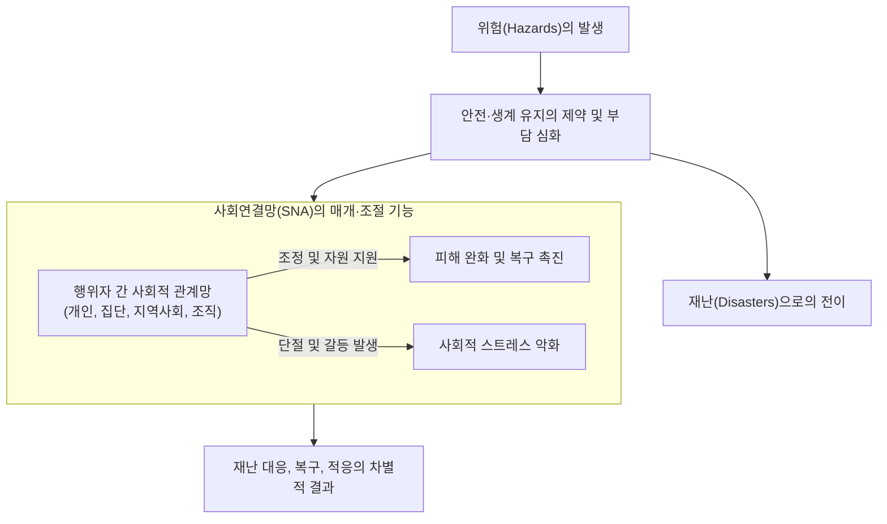

### 1. 위험(Hazards)에서 재난(Disasters)으로의 전이 메커니즘
- **재난의 본질**: 위험(hazard)은 사람들이 안전하고 안정적인 삶과 생계를 유지하기 위한 기회와 제약이 심각한 한계에 부딪힐 때 비로소 ‘재난(disaster)’으로 비화됩니다.
- **사회적 상호작용의 이중성**: 사회적 상호작용은 재난으로 인한 스트레스와 부담을 완화(mitigate)할 수도 있고, 반대로 악화(exacerbate)시킬 수도 있습니다.
- **연구의 필요성**: 집단, 지역사회, 조직 내부 및 조직 간 연계(ties)가 위험과 재난에 어떻게 반응하고 영향을 받는지를 체계적으로 규명하는 지적 노력이 필수적입니다.

### 2. 사회과학에서 사회연결망(Social Networks)을 다루는 2대 접근법
사회과학 연구에서 사회연결망은 크게 두 가지 방식으로 다루어집니다:

| 구분 | 1. 은유적·발견적 접근법 (Metaphorical / Heuristic) | 2. 공식적 측정 시스템 (Formal System of Measurement) |
| :--- | :--- | :--- |
| **개념적 성격** | 특정 맥락에서 연구자가 인지한 관계나 상호작용 패턴을 요약하는 서술적·분석적 개념 | 그래프 이론(graph theory)에 기반한 엄밀한 수학적·통계적 측정 체계 |
| **주요 연구 방식** | 관계적 관찰을 위한 정성적 가이드, 개념적 틀거리(Heuristics)로 활용 | 밀도(density), 중앙성(centrality), 집중도(centralization), 교량화(bridging), 복잡성 및 네트워크 변화 측정 |
| **본 도서의 위치** | 기여 저자들이 개념과 경험적 트렌드를 풍부하게 차용함 | **본 도서가 핵심적으로 지향하는 주된 분석 틀** |

### 3. 본 도서의 학술적 차별성과 의의
- **분절된 학문 분과 간의 통합**: 기존 재난 연구와 연결망 분석은 여러 분과 학문(행정학, 사회학, 인류학 등)의 경계 속에 흩어져 있었습니다. 본서는 이를 집대성한 최초의 저작입니다.
- **대인 네트워크와 조직간 네트워크의 결합**: 상호 교류가 극히 드물었던 **‘대인 재난 네트워크(interpersonal disaster networks)’** 연구와 **‘조직간 재난 네트워크(interorganizational disaster networks)’** 연구를 한자리에 모아 이론적 간극을 탐색합니다.
  - *예시 (교량화/Bridging의 상이한 의미)*:
    - 대인 네트워크 연구: 교량(bridging) 연계는 주로 **권력(power), 취약성(vulnerability), 자산 및 부채(assets/liabilities)**를 분석하는 렌즈로 활용됨.
    - 조직간 네트워크 연구: 교량 연계는 주로 **커뮤니케이션의 효과성(effectiveness of communication)**과 **목표 일치도(goal alignment)**를 평가하는 렌즈로 활용됨.
- **이원적(Dyadic) 관계를 넘어 전체 관계망(Whole Web of Relationships)으로의 확장 요구**:
  - 연구들이 특정 개인·역할·기관 간의 쌍방 교환(dyadic data)에 머무르지 않고, 전체 네트워크 내 다른 개인, 이항 쌍, 클리크(cliques)에 대한 의존성을 종합적으로 파악할 것을 촉구합니다.

---

# 2. 도서의 내용과 구성 체계 (The Content and Layout of the Book)

본서는 이론적 기초에서 출발하여 실증적 사례 연구, 그리고 실무 적용에 이르는 5개 부(Part), 17개 장으로 구성되어 있습니다:
- **Part I: 기초 이론 및 방법론 (1~4장)**: 개인 및 조직 수준의 이론적 오리엔테이션과 포괄적 방법론 프레임워크 제공.
- **Part II: 재난 대응 (Response, 5~7장)**: 산불, 허리케인 등 긴급 대응 네트워크의 실증 분석.
- **Part III: 재난 복구 (Recovery, 8~12장)**: 장기 복구 과정에서의 사회적 자본, 정신건강, 취약성 분석.
- **Part IV: 적응 및 완화 (Adaptation and Mitigation, 13~16장)**: 가뭄, 지진, 태풍 등 만성적·주기적 위험에 대한 사회적 적응망 분석.
- **Part V: 적용 (Applications, 17장)**: 재난 정책 및 실무 현장 개선을 위한 실천적 제언.

### 표 1.1 실증 연구 챕터들의 분석 접근법 및 연구 초점 (Table 1.1)

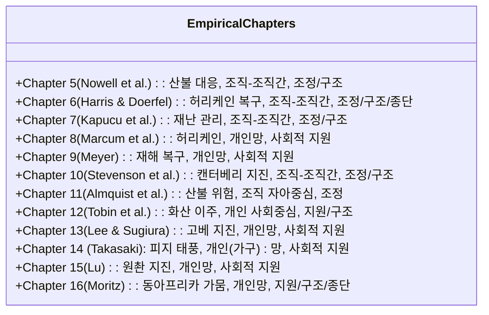

  
*TABLE 1.1: Approaches and Foci of Empirical Chapters (원문 p. 5 표 1.1 스캔본).*

| 장 (Chapter) | 네트워크 분석 수준 및 행위자 유형 | 사회적 지원 (Social Support) | 조정 (Coordination) | 구조적 지표 (Structure) | 종단적 설계 (Longitudinal) |
| :---: | :--- | :---: | :---: | :---: | :---: |
| **제5장** | 사회중심(Sociocentric) — 조직(Organizations) | | **X** | **X** | |
| **제6장** | 사회중심(Sociocentric) — 조직(Organizations) | | **X** | **X** | **X** |
| **제7장** | 사회중심(Sociocentric) — 조직(Organizations) | | **X** | **X** | |
| **제8장** | 자아중심(Egocentric) — 개인(Individuals) | **X** | | | |
| **제9장** | 자아중심(Egocentric) — 개인(Individuals) | **X** | | | |
| **제10장** | 사회중심(Sociocentric) — 조직(Organizations) | | **X** | **X** | |
| **제11장** | 자아중심(Egocentric) — 조직(Organizations) | | **X** | | |
| **제12장** | 사회중심(Sociocentric) — 개인(Individuals) | **X** | | **X** | |
| **제13장** | 자아중심(Egocentric) — 개인(Individuals) | **X** | | | |
| **제14장** | 자아중심(Egocentric) — 개인/가구(Households) | **X** | | | |
| **제15장** | 자아중심(Egocentric) — 개인(Individuals) | **X** | | | |
| **제16장** | 자아중심(Egocentric) — 개인(Individuals) | **X** | | **X** | **X** |

> [!NOTE] **도표 1.1이 시사하는 재난 연결망 연구의 학술적 불균형**
> 1. **행위자 유형과 분석 수준의 고착화**: 12개 실증 챕터 중 단 2개 챕터(제11장, 제12장)를 제외하고는 모두 **"개인 연구 = 자아중심 네트워크(Egocentric)"**, **"조직 연구 = 사회중심 전체 네트워크(Sociocentric)"**라는 이분법적 공식에 머물러 있습니다.
> 2. **구조 분석(Structure) 및 종단적 분석(Longitudinal)의 절대적 부족**: 네트워크 구조 지표(밀도, 응집력, 경로 거리 등)를 정밀 측정하거나 시간에 따른 변화를 종단적으로 추적한 연구는 여전히 극소수에 불과합니다.

---

# 3. 핵심 하이라이트 및 주요 주목 사항 (Highlights and Things to Watch for)

저자들은 재난 네트워크 연구가 기존 한계를 극복하고 학문적 도약을 이루기 위해 주목해야 할 6대 핵심 쟁점을 제시합니다.

### 1) 역할 (Roles)
- **조직망 속 대인 관계의 존재**: 조직 간 네트워크 연계 중 상당수는 실제로는 **개인 간 인간관계(interpersonal relationships)**에 뿌리를 두고 있습니다.
- **세 가지 관계적 층위**:
  1. *순수 인간관계*: 개인적 성향, 친분, 공통의 역사에 기반한 우정적 관계.
  2. *역할 간 관계(Interrole relations)*: 직위나 역할에 묶여 있어, 담당자가 바뀌어도 직책 승계자를 통해 지속되는 공식적 관계.
  3. *비인격적 제도 간 거래(Impersonal interinstitutional relations)*: 금융기관 간의 자금 이체와 같이, 개인이나 역할의 고유한 성격과 무관하게 기계적으로 일어나는 상호작용.

### 2) 네트워크의 분석 수준 (Levels of Networks)
- 고정된 수준 구분을 넘어, **개인 수준 네트워크와 지역사회 수준 네트워크의 다층적 결합(joining levels)**이 필요합니다.
  - 예: 개인 행동에 영향을 미치는 자아중심 네트워크들을 모아 지역사회 전체의 대푯값 네트워크로 결합함으로써 구조적 맥락을 풍부화함 (제5장 Nowell et al. 참조).
- 개인 수준 사회연결망 연구와 조직간 네트워크 연구 사이의 통합 결여를 극복해야 합니다.

### 3) 학제간 융합 연구 (Interdisciplinarity)
- 단일 저자 혹은 단일 분과 중심 연구의 한계를 벗어나 학제간 시각을 교차시켜야 합니다:
  - 행정학(Public Administration): 3, 4, 5, 10장
  - 사회학(Sociology): 7, 8, 9장
  - 커뮤니케이션학(Communication): 6장
  - 인류학(Anthropology): 2, 12, 13, 16, 17장
  - 지리학(Geography): 11장
  - 경제학(Economics): 14, 17장

### 4) 잠재적 연계 대 실현된 연계 (Potential Versus Realized Ties)
- **잠재적 연계(Network Potential)**: 정서적 친밀도나 평상시 지향성에 기초한 기존 관계망. 재난 이후의 결과 예측에서 불분명한 예측력을 보임.
- **실현된 연계(Network Activation / Realized Ties)**: 재난 발생 시 도구적(instrumental)으로 실제 작동하고 지원을 주고받은 관계망. 사후 성과 및 메커니즘을 보다 명확히 설명함.
- **연구적 과제**: 잠재적 관계가 어떤 조건 하에서 실제 활성화된 연계로 전환되는지 그 간극을 규명해야 함.

### 5) 취약 인구 명명에 수반되는 연구 윤리 (The Ethics of Naming Vulnerable People)
재난 및 사회연결망 연구는 일반 사회과학 연구보다 훨씬 엄중한 윤리적 책무를 요구합니다:
1. **취약성의 증폭**: 재난 피해자들은 심리적·물리적으로 극히 취약하여 인터뷰 동의 과정에서 유도되기 쉽고, 응답 내용이 개인의 치명적 취약점을 드러낼 수 있음.
2. **동의 없는 제3자 지명(Name Generator의 문제)**: 응답자(Ego)가 조사에 참여하지도 않은 타인(Alter)의 이름, 종교, 소득, 정치 성향, 건강 상태, 사적 상호작용 내역을 연구자에게 노출함.
   - *보호 조치*: 고유 식별자(Unique ID) 부여를 통한 철저한 비식별화(de-identification) 필수.
3. **거울 보기(Self-evaluation)와 부작용 통제**: 분석 결과를 응답자 공동체에 환류할 때, 상호 비교나 서열화, 갈등을 유발하지 않도록 상호 협력적 방식으로 관리해야 함.

### 6) 정책 및 실무 적용 (Applications)
- 국제 인도주의 기구들의 관심: IFRC(2014) *World Disasters Report*와 UNISDR(2011) 보고서는 사회연결망을 재난 대응과 복구의 핵심 동력인 **‘지역사회 역량(community competence)’**으로 규정함.
- **만족화(Satisficing)를 넘어서는 정밀성**: 단순히 "네트워크나 사회적 자본이 부족해서 실패했다"는 식의 피상적 결론(satisficing; Simon, 1957)을 지양하고, 구체적 지원, 교환, 조정, 자생적 동태성을 정책에 정밀하게 매핑해야 함.

---

# 4. 재난과 네트워크 존재론의 문제 (Disasters and the Question of Network Ontologies)

> [!IMPORTANT] **네트워크의 존재론적 성격 (저자들의 핵심 선언)**  
> **"엄밀히 말해 사회연결망은 공식 조직 외부에서는 '객관적 실체(objective things)'로 존재하지 않는다."**

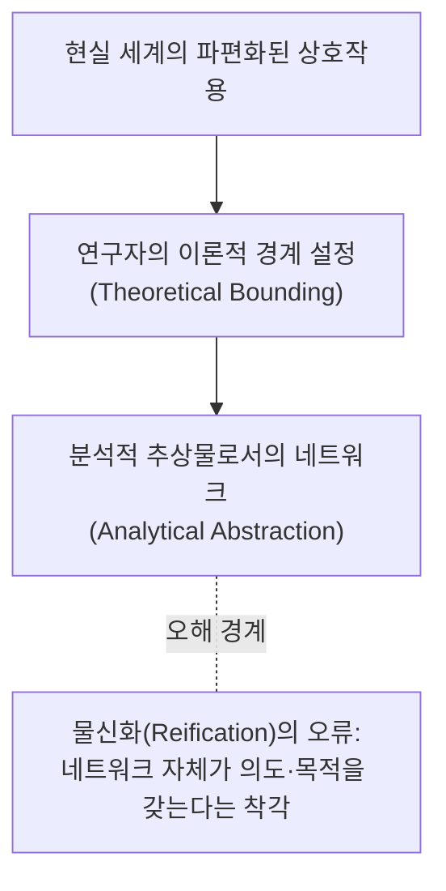

### 1. 분석적 추상물(Analytical Abstractions)로서의 네트워크
- 네트워크는 스스로 움직이는 객관적 실체가 아니라, **연구자가 이론적으로 도출한 경계(boundaries)를 바탕으로 특정 관계들을 규정한 ‘분석적 추상물’**입니다.
- 네트워크는 공식 조직 구조, 행동 계획, 인지 모델, 또는 과거 상호작용의 흔적으로만 식별될 수 있습니다.

### 2. 네트워크의 행위성(Agency)과 목적성(Telos)의 부재
- 앤드루 피커링(Andrew Pickering, 1995)의 '물질적 행위성(material agency)' 개념을 빌려 "세상에서 무언가를 수행한다"는 느슨한 의미를 부여할 수는 있으나, **네트워크 자체에는 고유한 목적(telos)이나 의도성(intentionality)이 존재하지 않습니다.**
- 행위와 의도를 지닌 주체는 개별 행위자(개인 또는 조직)이며, 네트워크는 이들의 연결 패턴을 통해 행위를 촉진하거나 제약할 뿐입니다.

### 3. '흐름(Flow)' 개념에 대한 비판적 재검토
- 네트워크 연계를 통해 "정보가 흐른다(flow)"고 당연시하는 관점을 비판합니다.
- 실제 현실에서 정보는 파이프라인처럼 온전히 흐르는 것이 아니라, 네트워크 내의 중개자(brokers)와 제약 요인에 의해 **격상(upgraded), 격하(downgraded), 왜곡·수정(revised), 모호화(obfuscated)**됩니다.

---

# 5. 결론 (Conclusions)

- 본서는 재난 환경 속에서 인간, 집단, 지역사회의 상호작용 및 자원 교환 행동의 다양한 변이(variation)를 규명하는 통합적 학술 기반을 구축하고자 합니다.
- 재난은 일상성이 무너지고 경계가 모호해지는 **임계 공간(liminal space)**을 형성합니다. 비록 일상이 멀어 보일지라도 사람들은 매일매일 사회연결망을 통해 그 일상성을 다시 끌어당깁니다(reeled in daily through social networks).
- 연결망 분석은 이처럼 덧없고(ephemeral) 동태적인 재난 현장의 사회적 상호작용을 가장 심층적으로 포착해낼 수 있는 강력한 통찰을 제공합니다.

---

# [부록] 박사학위 논문 선행연구 분석 템플릿 연계

| 순서 | 분석 항목 | 제1장 핵심 요약 및 연구자 통제 관점 |
| :---: | :--- | :--- |
| **1** | **연구배경** | 재난은 사회 인프라와 관계망을 급격히 해체·교란함. 재난 피해의 완화와 악화는 사회적 관계망의 구조적 배치에 의해 결정되나, 대인망과 조직망 연구가 심각하게 분절되어 있음. |
| **2** | **이론적 개념** | 은유적 네트워크 vs 공식 측정 네트워크; 이원적(Dyadic) 관계 vs 전체망(Whole Network); 잠재적 연계(Potential) vs 실현된 연계(Activation); 네트워크 존재론(분석적 추상물). |
| **3** | **연구목적** | 분과 학문별(행정학, 사회학, 인류학 등)로 분산된 재난 연결망 연구를 집대성하고, 대인망과 조직망을 아우르는 체계적 이론·방법론적 분석 틀을 정립함. |
| **4** | **연구방법** | 문헌 고찰 및 도서 수록 12개 실증 연구 매트릭스 분석 (분석 수준, 행위자 유형, 지원, 조정, 구조, 종단 연구 여부 교차 검토). |
| **5** | **연구결과** | 대부분의 연구가 '개인-자아중심망' 또는 '조직-사회중심망'의 이분법에 갇혀 있으며, 구조적 지표 측정 및 종단적 분석이 절대적으로 부족함을 실증적으로 제시함 (표 1.1). |
| **6** | **핵심 발견** | 1) 네트워크는 객관적 실체가 아닌 연구자의 분석적 추상물임.<br/>2) 조직간 연계의 기저에는 대인적 관계와 역할 관계가 혼재함.<br/>3) 정보는 온전히 흐르는 것이 아니라 매개자에 의해 왜곡·변형됨. |
| **7** | **연구의 한계** | 수록된 실증 챕터 다수가 단일 분과 학문 중심이며, 잠재적 연계와 실제 활성화된 연계 간의 전이 메커니즘을 규명하는 데 데이터의 한계가 존재함. |
| **8** | **이론적 시사점** | 네트워크 물신화(Reification)를 경계하고, 행위자의 의도성과 구조적 제약의 변증법적 상호작용으로 재난 네트워크를 파악해야 함을 입증. |
| **9** | **후속 연구 시사점** | 개인망과 조직망을 연계하는 다수준(Multilevel) 네트워크 모델링의 도입, 취약 인구 연구 윤리의 제도화, 종단적 네트워크 데이터 구축 필요. |

---

# 6. 소방 조직 및 현장 대응 적용 연구 주제 및 방법론 (Application to Fire Services)

> [!TIP] **학습 지도노트 연계**: AI 활용 성과지표(KPI) 도출 7대 원칙 및 박사학위 연구모델 확장  
> 제1장의 핵심 이론인 **(1) 대인망 vs 조직망 이원론 극복**, **(2) 잠재적 연계 vs 실현된 연계**, **(3) 정보 흐름의 왜곡(격상·격하·모호화)**, **(4) 네트워크 비물신화(분석적 추상물)** 개념을 소방 현장에 실증적으로 접목합니다.

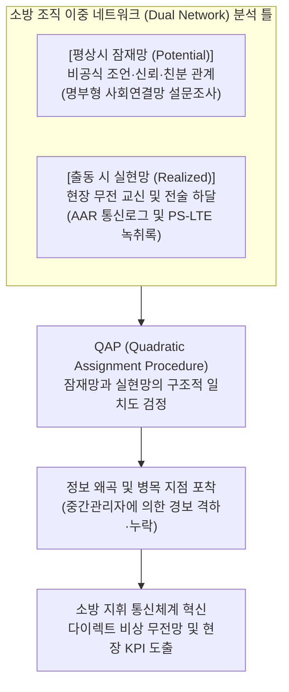

### 1. 연구질문 (Research Questions)
- **RQ 1 (잠재망과 실현망의 구조적 괴리)**: 평시 비공식 신뢰/조언 잠재망($M_{\text{potential}}$)과 출동 시 무전 교신 실현망($M_{\text{realized}}$) 간의 구조적 상관성(QAP Matrix Correlation)은 얼마나 일치하는가?
- **RQ 2 (정보 흐름의 왜곡 및 병목 노드)**: 무전 지휘선에서 현장 대원의 위험 보고가 최고지휘관에게 전달될 때, 특정 중간관리자(소방위·소방장)에 의해 정보가 격하(downgraded), 수정(revised), 또는 묵살(obfuscated)되는 병목(Bottleneck) 현상이 발생하는가?
- **RQ 3 (공식 ICS 지휘망 vs 비공식 자문망)**: 화재안전 현장에서 공식 계통망(ICS)과 비공식 전문 조언망의 불일치가 현장 진입 후 초진 시간 및 대원 안전사고에 미치는 영향은 무엇인가?
- **RQ 4 (동태적 전이와 잠재 연계 활성화)**: 평시 잠재망에서 높은 중심성을 가진 대원이 실제 출동 현장(실현망)에서 핵심적인 상황 전파자 및 중개자로 온전히 활성화(Activation)되는가?
- **RQ 5 (네트워크 성과 및 안전 책무성)**: 잠재망과 실현망 간의 정합도(Alignment)가 높은 팀일수록 아차사고 보고율이 높고 현장 안전수칙 위반율이 낮은가?

### 2. 확인한 연구결과 (Key Findings from Literature)

| 이론 및 챕터 출처 | 선행연구 핵심 실증 결과 | 본 소방 안전 네트워크 연구로의 연계 시사점 |
| :--- | :--- | :--- |
| **대인망 vs 조직망 이원론 극복<br/>(Chapter 1; Quarantelli & Dynes, 1977)** | 대부분의 재난 연구가 개인 수준 또는 조직 수준 중 하나에 편중되어 양자 간 배태성을 놓침. | 소방서라는 공식 조직(조직 수준) 내에서 개별 대원 간의 비공식 대인망(개인 수준)이 상호작용하는 다수준(Multilevel) 분석 틀 구축. |
| **잠재적 연계 vs 실현된 연계<br/>(Chapter 1; Table 1.1)** | 평상시 형성된 사회적 자본(잠재망)이 재난 충격 시 실제로 활성화(실현망)되지 못하면 무용지물이 됨. | 평시 비공식 조언망(잠재망)과 출동 시 무전 교신망(실현망)의 불일치도를 QAP 행렬 상관으로 정량화하여 유휴 자본 발견. |
| **정보 흐름 왜곡 메커니즘<br/>(Chapter 1; Pickering, 1995 비판)** | 정보는 파이프라인처럼 온전히 흐르지 않고 매개자에 의해 격상, 격하, 수정, 모호화됨. | 현장 대원이 보고한 급격한 연소 위험 신호가 중간 지휘관에 의해 묵살·격하되어 지휘관에게 미도달하는 병목 노드 식별. |
| **네트워크 비물신화<br/>(Chapter 1; Ontological Stance)** | 네트워크는 스스로 움직이는 실체가 아니며 연구자의 목적에 따라 경계가 획정되는 '분석적 추상물'임. | '재난 대응 네트워크'라는 추상적 개념을 의령소방서 출동 대원들의 구체적 무전 통화 및 Roster 설문으로 정밀 조작화. |

### 3. 연구절차 (Research Procedure: 6단계 표준 프로세스)

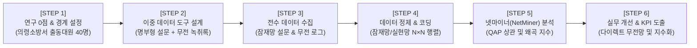

### 4. 네트워크 분석단위 및 분석지표 (Units & Network Metrics)

1. **노드 수준 (Node-level)**:
   - **개별 소방공무원 노드 ($N \approx 40$명)**:
     - **In-Degree Centrality (인입 연결정도)**: 평시 대원들로부터 안전 조언/도움을 요청받는 빈도 $\to$ 신뢰받는 안전 리더 지수.
     - **Out-Degree Centrality (인출 연결정도)**: 출동 시 무전 지시 및 보고를 적극적으로 발신하는 빈도.
     - **Betweenness Centrality (매개 중심성)**: 지휘부와 현장 대원 사이에서 통신을 독점하는 소통 교량(Bridge) 또는 정보 차단 병목(Bottleneck).
     - **Information Distortion Index (정보 왜곡 지수)**: 하위 발신 정보와 상위 수신 정보 간 누락·격하율.
2. **하위집단 수준 (Subgroup-level)**:
   - **계급별(지휘관리층, 중간관리층, 일선대원층) 및 부서별(구조대, 진압대, 구급대)**:
     - **E-I Index (External-Internal Index)**: 집단 내부 무전 교신 vs 집단 간 교신 비율 산출 ($-1$에 가까울수록 부서 간 소통이 단절된 폐쇄적 무전, $+1$에 가까울수록 개방적 합동 교신).
3. **전체망 수준 (Whole-level)**:
   - **의령소방서 출동부서 전체망**:
     - **Network Density (네트워크 밀도)**: 잠재망 밀도 vs 실현망 밀도의 전이율.
     - **Network Centralization (집중도)**: 무전 교신이 현장지휘관 1인에게 지나치게 집중되어 과부하가 발생하는지 측정.
     - **Reciprocity (호혜성)**: 명령과 복명복창(피드백)의 상호 교환 비율.

### 5. 네트워크 데이터 구조 및 코딩처리 방식 (Data & Coding Method)

| 구분 | 데이터 형식 | 변수 구성 및 코딩 기준 |
| :--- | :--- | :--- |
| **노드 속성 데이터<br/>(Node Properties)** | 1-mode 엑셀 테이블<br/>(행 = 소방관 $i$) | • **ID**: 고유 식별코드 (Fire-01 ~ Fire-40)<br/>• **Rank (계급)**: 1=지휘관리층(령·경), 2=중간관리층(위·장), 3=일선대원층(교·사)<br/>• **Team (부서)**: 1=119구조대, 2=현장대응단 진압대, 3=구급대<br/>• **Role (직무)**: 지휘, 진압, 구조, 구급, 운전<br/>• **Radio_CH**: 주 사용 무전 채널 (지휘망, 작전1망, 작전2망) |
| **잠재망 행렬<br/>($M_{\text{potential}}$)** | $N \times N$ 정방 행렬 | "평상시 고위험 현장 출동을 앞두고 가장 신뢰하고 전술 조언을 구하는 동료는 누구인가?"<br/>1점(전혀안함) ~ 5점(매우자주). 4점 이상을 연계 존재(1)로 이진화(Binarization) 병행. |
| **실현망 행렬<br/>($M_{\text{realized}}$)** | $N \times N$ 정방 행렬 | 대형 화재 현장 무전 교신 녹취록(PS-LTE/소방무전) 내용분석: 소방관 $i$가 소방관 $j$를 호출하여 위험/지시를 하달한 총 발화 횟수 코딩. |

> [!NOTE] **코딩 정제 및 결측치 관리 원칙**  
> 1. **대각선 요소 처리**: 자기 자신과의 관계($i = j$)는 모두 `0`으로 처리합니다.  
> 2. **결측치(Missing Data) 통제**: Valente et al.(2008) 기준에 따라 비번/출장 대원에 대해 3회에 걸친 대면 추적 조사를 실시하여 결측률을 10% 미만으로 강제 통제합니다.  
> 3. **무전 녹취록 코딩 신뢰도**: 2인의 분석자가 독립적으로 무전 녹취록을 코딩하여 크립펜도르프 알파(Krippendorff's $\alpha$) 0.85 이상 확보 후 불일치 항목 상호 합의.

### 6. 자료수집 및 설문조사/녹취록 집행 전략 (Data Collection)
- **사전 명부 방식(Prepared Roster Method) 전면 채택**: 자유 명명생성법의 철자 오류 및 과소보고를 방지하기 위해 관내 출동대원 40명의 성명·직책이 인쇄된 표준 명부형 설문지 배포.
- **사후보고서(AAR) 및 무전 녹취록 연계**: 최근 발생한 대형 공장·산불 화재 2건의 공식 소방활동 검토보고서(AAR)에 첨부된 무전 교신 녹취록 전수 텍스트 마이닝.
- **연구 윤리 및 비문책 보증**: 설문 및 교신 분석 결과가 감찰이나 징계에 일체 활용되지 않음을 보증하는 기관장 협약서 및 연구윤리 서약서 체결.

### 7. 넷마이너(NetMiner) 4단계 정밀 분석 프로토콜
- **Step 1: 데이터 모델링 (Import)**: 노드 속성 테이블과 $M_{\text{potential}}, M_{\text{realized}}$ 행렬을 넷마이너 4에 임포트하여 이중 네트워크 레이어 구축.
- **Step 2: 토폴로지 시각화 (Visualization)**: Spring-Embedder 알고리즘을 적용하여 평시 잠재망과 출동 실현망의 구조적 배치를 나란히 2D 매핑. 링크 굵기 = 교신 빈도.
- **Step 3: 중심성 및 병목 노드 분석 (Analysis)**: In/Out-Degree, Betweenness 산출. 잠재망에서는 중심에 있으나 실현망에서 고립되는 노드(유휴 자원) 및 정보 왜곡 병목 노드 적출.
- **Step 4: 통계적 추론 검정 (Inference)**: NetMiner QAP Correlation 모듈(Permutations = 5,000회)을 실행하여 잠재망과 실현망 간의 상관계수 검정. MRQAP 회귀분석으로 계급 및 부서 일치도가 교신 빈도를 설명하는지 검증.

### 8. 최종 실무·정책 환류: 소방 안전관리 KPI 도출 및 법적 근거

#### 1) 소방 실무 개선 및 KPI 도출
- **다이렉트 비상 무전 채널(Direct Emergency Channel) 신설**: 중간 지휘관의 자의적 정보 필터링을 방지하기 위해 현장 대원이 긴급 위험 직면 시 최고지휘관에게 즉각 보고하는 비상 채널 공식화.
- **소방 고유 KPI(70%)**: **'현장 안전교신 상호운용성 및 잠재-실현망 일치도 지수'**를 신설하여 일선 소방서 안전관리 종합평가에 반영.

#### 2) 관련 법적 근거 매핑 (조문 강제 연계)
- **소방기본법 제16조의2(소방지원활동)** 및 **제16조의3(소방활동에 대한 방해의 배제)**
- **재난 및 안전관리 기본법 제52조(긴급구조통제단장의 현장지휘)**: 현장지휘관의 명확한 지휘 통일성과 정보 왜곡 방지 의무화 규정.
- **소방청 현장소방활동 안전관리 로드맵**: 현장 대원의 위험 상황 보고권(Safety Voice) 보장 및 무전 통신망 상시 모니터링 규정.

---

# 제2장 위험과 재난에 직면한 개인 중심 사회연결망 분석 (Sub-Note)

**원제**: CHAPTER 2 SOCIAL NETWORK ANALYSIS FOCUSED ON INDIVIDUALS FACING HAZARDS AND DISASTERS  
**저자**: A.J. Faas¹ (San Jose State University), Eric C. Jones² (University of Texas Health Science Center at Houston)  
**출처**: *Social Network Analysis of Disaster Response, Recovery, and Adaptation* (Elsevier, 2017, pp. 11–24, http://dx.doi.org/10.1016/B978-0-12-805196-2.00002-9)  

---

## [개요] 챕터 목차 체계 (Chapter Outline)

1. **서론** (Introduction, p. 11)
2. **사회적 지원, 사회적 자본 및 연계 유형** (Social Support, Social Capital, and Types of Ties, p. 12)
   * 결속형 사회적 자본: 친족 및 기타 긴밀한 연계 (Bonding Social Capital: Kin and Other Close Ties, p. 13)
3. **네트워크 구성에서의 동질선호와 다양성** (Homophily and Diversity in Network Composition, p. 14)
   * 유사성을 통한 결속 (Bonding Through Similarities, p. 14)
   * 차이를 가로지르는 교량화 (Bridging Across Differences, p. 15)
   * 사회적 위계를 통한 연계 (Linking via Social Hierarchy, p. 16)
   * "우리는 모두 같은 배를 탔다": 공동체 결속 (Community Bonding Because “We’re All in the Same Boat”, p. 16)
4. **사회연결망 구조: 사회적 자본과 코뮤니타스를 넘어서** (Social Network Structure: Moving Beyond Social Capital and Communitas, p. 17)
   * 밀도 (Density, p. 17)
   * 구조적 다양성 (Structural Diversity, p. 18)
5. **표층 구조와 심층 구조** (Surface Structure and Deep Structure, p. 19)
6. **재난 단계에 따른 네트워크 내 개인** (Individuals in Networks Across Phases of Disaster, p. 20)
7. **결론** (Conclusions, p. 22)

---

# 1. 서론 (Introduction)

### 1. 연구 목적 및 문제의식
- **연구 질문**: 재난 맥락에서 개인의 행동, 지각(perception), 웰빙(well-being)을 연구할 때 사회연결망 데이터를 수집하고 분석하는 것이 재난 이론에 어떤 기여를 하는가?
- **개인 중심 분석의 위치**: 제3장이 집단과 공식 조직망에 초점을 맞추는 반면, 제2장은 **개인(individuals)과 지역사회(communities)**를 중심으로 이원적 관계(dyadic ties)가 재난 대비, 대응, 복구, 적응, 완화에 미치는 영향을 개념적으로 조망합니다.

### 2. 챕터의 핵심 구성 논리
- 재난 연구의 출발점인 **사회적 지원(Social Support)**에서 시작하여, 행위자들의 특성인 **네트워크 구성(Composition)**, 연결 형태인 **네트워크 구조(Structure)**로 심화됩니다.
- 후반부에서는 **재난의 시간적 단계(Phases)**와 인간의 무의식적 관계 패턴을 다루는 **심층 구조 대 표층 구조(Deep vs Surface Structure)**라는 고난도 이론적 쟁점을 다룹니다.

---

# 2. 사회적 지원, 사회적 자본 및 연계 유형 (Social Support, Social Capital, and Types of Ties)

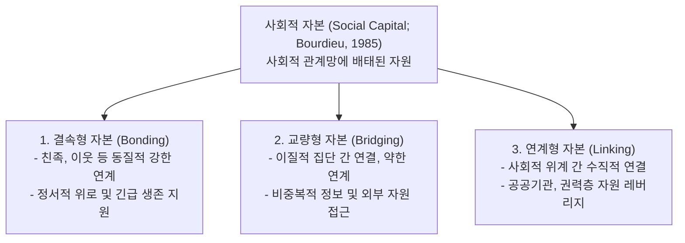

### 1. 사회적 지원의 양면성과 계층적 격차
- **제도적 원조의 보완재/대체재**: 사회적 지원은 공식 기관의 원조를 보완하거나 대체하여 개인 및 집단의 회복을 촉진합니다 (Ibañez et al., 2004; Kaniasty, 2012).
- **자원 접근의 불평등**: 빈곤층은 부유층에 비해 실제 지원 접근성과 지각된 지원 수준이 낮지만 (Norris et al., 2005; Jones et al., 2011), 허리케인 앤드루(Andrew) 연구에 따르면 일자리 탐색과 같은 비공식 정보 지원에서는 빈곤층이 비공식 망을 더 활발히 활용하는 특성을 보였습니다 (Hurlbert et al., 2001).

### 2. 결속형 사회적 자본: 친족 및 기타 긴밀한 연계 (Bonding Social Capital: Kin and Other Close Ties)
- **일반화된 호혜성(Generalized Reciprocity)**: 살린스(Marshall Sahlins, 1972)는 친족 관계가 즉각적인 반대급부를 계산하지 않고 베푸는 일반화된 호혜성과 밀접하게 결합되어 있음을 밝혔습니다.
- **친족 연계의 강점**:
  - 허리케인 앤드루 생존자 연구에서 친족 비율이 높은 개인망을 가진 이들이 비공식 지원을 훨씬 자주 획득했습니다 (Hurlbert et al., 2000).
  - 태즈메이니아 태스먼 다리 붕괴 사고(Lee, 1980) 및 케냐 투르카나 가뭄(Juma, 2009)에서도 지리적 분리 시 친족 연계가 비친족 연계보다 훨씬 강인하게 유지되었습니다.
- **친족 연계의 명확한 한계와 역설 (The Kinship Trap)**:
  - **지원 유형의 분화**: 걸프전 당시 하이파 시민 연구(Shavit et al., 1994) 및 미 중서부 홍수 연구(Casagrande et al., 2015)에서 신체적 위협 상황에서는 가족을 찾았으나, 정서적 위로 및 일상 복구 시에는 친구, 이웃, 자원봉사자, 전문가를 찾았습니다.
  - **제도적 자원 단절**: 친족 중심 네트워크는 일상적 삶의 만족도를 저하시키거나(Acock & Hurlbert, 1993), **공식 기관의 제도적 원조(institutional support)를 획득하는 데 역효과(음의 상관관계)**를 낳습니다 (Tausig, 1992; Hurlbert et al., 2001).

---

# 3. 네트워크 구성에서의 동질선호와 다양성 (Homophily and Diversity in Network Composition)

### 1. 유사성을 통한 결속 (Bonding Through Similarities)
- **동질선호(Homophily)**: 인종, 계급, 성별 등 유사한 속성을 가진 사람들과 교류하려는 사회학적 경향 (McPherson & Smith-Lovin, 1987). 동질선호는 신뢰 형성을 촉진합니다 (Burt, 1992).
- **실전 재난 현장에서의 괴리 (계획 대 실제)**:
  - 노웰과 스틸먼(Nowell & Steelman, 2015)의 산불 대응 연구: 소속 기관의 동질성은 소통 빈도를 높였으나, **직접적인 개인적 친분이 없는 동질적 연계는 오히려 소통 장애를 초래**했습니다.
  - 파스 등(Faas et al., 2016)의 산불 교량 행위자 연구: 사전 설문에서는 동일 기관 소속(동질선호)을 신뢰할 수 있는 교량자로 지명(약 50%)했으나, **실제 대형 화재 현장에서 활성화된 교량자 중 동질선호 원칙에 부합한 비율은 단 3%에 불과**했습니다 (운영상의 필요와 전문성이 동질성을 압도함).
- **위험 지각(Risk Perception)의 사회적 확산**:
  - 위험 지각은 개인 내면의 인지 과정을 넘어, 네트워크 내 타인의 지각 및 강한 연계(strong ties)를 통해 집단적으로 구성되는 '사회적 인지(social cognition)' 현상입니다 (Gordon et al., 2012; Scherer & Cho, 2003).

### 2. 차이를 가로지르는 교량화 (Bridging Across Differences)
- **자원의 비중복성과 적응력**: 약한 연계(weak ties)를 통한 네트워크 다양성은 비중복적 정보와 이질적 자원을 제공하여, 기후변화 및 재난에 대한 집단 의사결정과 적응 역량을 강화합니다 (Granovetter, 1973; Newman & Dale, 2005).
- **폐쇄적 네트워크의 위험 (Cheong, 2012)**:
  - 2007년 한국 서해안 허베이 스피리트호 기름유출 사고 연구: 높은 결속형 자본(친족 및 동질적 연계)은 지역사회 내부 결속에는 기여했으나, **외부 전문가와의 지식 교류를 가로막고 혁신적 방제 기술의 도입을 저해하는 높은 장벽(high barriers)**으로 작용했습니다.

### 3. 사회적 위계를 통한 연계 (Linking via Social Hierarchy)
- **권력층과의 수직적 연결**: 알드리치와 마이어(Aldrich & Meyer, 2015)는 지역사회 주민과 상위 스케일의 권력자를 잇는 연계를 '연계형 사회적 자본'으로 명명했습니다.
- **성별과 연계형 자본의 변동 (Faas et al., 2014, 2015)**:
  - 에콰도르 퉁구라우아 화산 이주민 정착지 분석: 이주 초기 파편화된 도시 정착지에서는 여성이 정보 지원의 주된 제공자였으나, 2년 후 공식 기관과 소통하는 창구로 누구를 선호하느냐는 질문에는 **남성이 여성을 압도(도시 정착지 7:1, 농촌 2:1)**했습니다. 외부 권력과의 실질적 연계는 여성이 수행했더라도, 명성과 사회적 대표성은 남성이 독점하는 젠더 불평등이 확인되었습니다.

### 4. "우리는 모두 같은 배를 탔다": 공동체 결속
- **알드리치(Aldrich, 2011)의 고베 지진 비교 연구**: 인구당 비영리단체 수가 많아 공동체 사회적 자본이 높았던 지역은 주민들이 자발적으로 결속하여 화재를 진압하고 상호 구호에 성공했으나, 사회적 자본이 낮았던 인근 동네는 불길이 번지는 것을 무력하게 방관했습니다.

---

# 4. 사회연결망 구조: 사회적 자본과 코뮤니타스를 넘어서

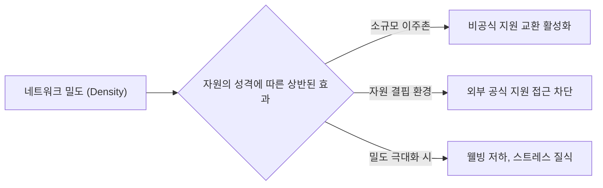

### 1. 밀도 (Density)의 역설과 원조 자격의 정치
- **밀도의 긍정적 측면**: 구성원 간 연계가 촘촘할수록 비공식 지원을 주고받는 빈도가 증가합니다 (Faas et al., 2014, 2015).
- **밀도의 어두운 면 (Dark Side of Density)**:
  - 허리케인 앤드루 연구: 촘촘한 고밀도 망에 갇힌 개인들은 외부 공식 원조를 가장 적게 받았습니다 (Hurlbert et al., 2001).
  - 멕시코 이주민 연구: **가장 밀도가 높은 네트워크를 가진 집단이 가장 열악한 웰빙 수준**을 보였습니다 (Jones et al., 2014).
- **코뮤니타스(Communitas)의 함정과 '원조 자격의 정치(Politics of Deservingness)' (★핵심 발견)**:
  - 마이클 세르니아(Michael Cernea, 1996, 1997)는 이주 시 전통적 연대망 유지를 권장했으나, 끈끈한 네트워크를 지나치게 이상화하면 **기존의 인종, 계급, 젠더 위계가 고착화**됩니다.
  - 파스(Faas, 2012, 2015a)의 에콰도르 연구: 정부와 NGO가 전통 공동노동(*mingas*) 참여를 주택·관개용수 지원의 '필수 조건'으로 내걸자, 임금 노동자 가구는 참여가 불가능해져 지원 대상에서 배제되었습니다. 지역 엘리트들은 이를 악용하여 **누가 원조를 받을 자격이 있고(deserving) 없는지(undeserving) 낙인찍는 폭력적 배제 정치**를 자행했습니다.

### 2. 구조적 다양성 (Structural Diversity)
- **응집된 하위집단(Cohesive Subgroups)의 정신건강 영향**:
  - 연구자들의 초기 가설: 하위집단이 존재하면 고립되지도 않고 과도하게 질식되지도 않아 웰빙에 긍정적일 것으로 기대함.
  - 실증 분석 결과: **하위집단을 가진 개인망에 속한 이주민 여성이 가장 열악한 정신건강 점수**를 보였고, 남성은 우울증 기능 장애 점수가 가장 높았습니다 (Jones et al., 2014).
  - 멕시코 ABC 어린이집 화재 사례(Jones & Murphy, 2015): 희생자 부모와 부상자 부모, 사법 정의 추구파와 온건파로 하위집단이 분열·갈등하며 네트워크가 파편화되었습니다.

---

# 5. 표층 구조와 심층 구조 (Surface Structure and Deep Structure)

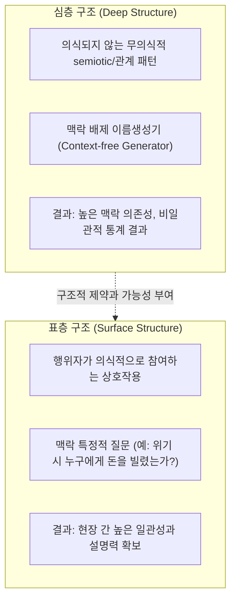

- **이론적 기원**: 레비스트로스(Lévi-Strauss, 1969)의 심층 기호 구조, 호프만(Susanna Hoffman, 1999)의 문화적 심층 구조(보이지 않는 규칙) 대 표층 구조(일상의 관습과 실천).
- **심층 구조(Deep Structure) 접근법**:
  - 특정 맥락을 주지 않고 자유롭게 지인을 나열하게 하는 방식(맥락 배제 이름생성기; McCarty et al., 2007)으로 도출된 전체 잠재망.
  - *한계*: 460개에 달하는 멕시코-에콰도르 횡단 표본 분석 결과, 심층 구조는 결과 변수(웰빙 등)와의 관계에서 일관성이 극히 낮았으며, 문화와 역사에 과도하게 좌우되었습니다.
- **표층 구조(Surface Structure) 접근법**:
  - 재난 상황에서 의식적으로 자원을 주고받은 관계를 측정하는 방식(Hurlbert et al., 2001; Casagrande et al., 2015).
  - *성과*: 재난 현장 간에 훨씬 일관되고 예측 가능한 결과를 도출했습니다.
- **학술적 결론**: 심층적 연결망 구조는 인간 행위를 완전히 규정하는 문법(grammar)이 될 수 없으며, 역사적 맥락과 문화적 레퍼토리에 의해 매개됩니다.

---

# 6. 재난 단계에 따른 네트워크 내 개인 (Individuals in Networks Across Phases of Disaster)

### 1. 선형적 단계 모형에 대한 비판과 대안
- **앤서니 월리스(Anthony Wallace, 1956)의 '재난 증후군(Disaster Syndrome)' 4단계**:
  1. 충격 및 무기력(Stunned) $\rightarrow$ 2. 피암시성 및 이타주의 $\rightarrow$ 3. 극도의 행복감 및 구호 참여 $\rightarrow$ 4. 정상화 및 비판·무관심.
  - *비판*: 미국적 맥락에 치우쳐 있으며 선형적이지 않고 후퇴·생략·장기화가 빈번함.
- **호프만(Hoffman, 1999)의 3단계 동태 모델**:
  - 개인적 경험(Individual experience) $\rightarrow$ 집단적 상호 지원(Collective support) $\rightarrow$ 파벌 경쟁 및 가계 복귀(Factional competition & household affairs).
  - 올리버-스미스(Oliver-Smith, 1979, 1992): 계급과 민족의 분열이 일시적으로 사라지는 '이타주의의 물결'은 단명하며, 외부 원조가 유입되거나 고갈되면 즉각 구 분열과 갈등이 재발함.

### 2. 사회적 시공간(Social Time and Space)과 지지망의 진화
- **카사그란데 등(Casagrande et al., 2015)의 중서부 홍수 실증 연구**:
  - 물리적·연대기적 시간이 아닌, 행위자의 체감에 기초한 '사회적 시공간' 개념 도입.
  - **생명 위협 단계(Vital phase)**: 친족(Kin)의 지원이 다른 모든 출처를 압도함.
  - **비위협 대비 및 장기 복구 단계**: 제도적 전문 지원(공공기관, 전문가) 및 친구·이웃의 기여 비중이 증가함.
- **종단 연구의 필요성과 희소성**:
  - 종단적 네트워크 조사는 물류적·재정적 난관으로 인해 극히 드묾[^1].
  - 멕시코 ABC 어린이집 화재 망(Jones & Murphy, 2015): 1년 차에 2개 연합(사망자 부모 vs 부상자 부모)에서 2년 차에 4개 그룹(정치적 접근 vs 비정치적 접근)으로 파편화되는 동태성을 확인.

---

# 7. 결론 (Conclusions)

- 개인 수준의 재난 연결망 연구는 촘촘함(tight-knit)과 연대라는 낭만적 통념에 비판적 메스를 가해야 합니다.
- **네트워크의 이중적 얼굴**: 조밀한 결속망은 즉각적 위기 생존에는 귀중하지만, 만성적 결핍과 정보 중복, 제도적 원조 배제라는 질식 효과를 초래합니다.
- 성별에 따른 교량자 역할과 명성의 괴리, 응집된 하위집단이 초래하는 정신건강 악화 등은 맥락 중심적(context-sensitive)이고 비판적인 연결망 분석이 왜 필요한지를 웅변합니다.

---

# [부록] 박사학위 논문 선행연구 분석 템플릿 연계

| 순서 | 분석 항목 | 제2장 핵심 요약 및 연구자 통제 관점 |
| :---: | :--- | :--- |
| **1** | **연구배경** | 재난 상황에서 개인의 생존, 정신건강, 복구 역량을 규명하기 위해 개인 수준의 사회연결망 데이터 분석이 필수적이나, 낭만화된 사회적 자본 이론의 한계가 노정됨. |
| **2** | **이론적 개념** | 결속형/교량형/연계형 자본; 일반화된 호혜성; 동질선호; 코뮤니타스와 원조 자격의 정치; 표층 구조 vs 심층 구조; 사회적 시공간. |
| **3** | **연구목적** | 개인 및 지역사회 수준에서 대인 연결망의 구성(composition)과 구조(structure)가 재난 대응 및 복구 성과에 미치는 복합적 인과 메커니즘 규명. |
| **4** | **연구방법** | 다지역 횡단 비교(멕시코 2개 지역, 에콰도르 5개 정착지 총 460개 개인망 표본 분석) 및 장기 인류학적 민족지학(Ethnography) 결합. |
| **5** | **연구결과** | 1) 친족망은 생존 지원에 유용하나 제도적 원조를 저해함.<br/>2) 화재 시 실제 교량자는 동질선호와 무관하게 전문성으로 작동(3%만 일치).<br/>3) 가장 밀도가 높은 망에서 웰빙이 가장 낮게 나타남. |
| **6** | **핵심 발견** | 공동체 결속의 강요는 '원조 자격의 정치'를 낳아 취약 계층을 합법적으로 배제하는 부작용을 초래하며, 무의식적 심층 구조보다 의식적 표층 구조가 높은 예측력을 지님. |
| **7** | **연구의 한계** | 대규모 횡단 조사에도 불구하고 문화적·지역적 맥락에 따라 통계적 일관성이 크게 흔들리며, 개인망의 종단적 추적 조사가 제한적임. |
| **8** | **이론적 시사점** | 사회적 자본의 '어두운 면(Dark side)'을 실증적으로 증명하고, 연대성의 규범 뒤에 숨은 권력 관계와 젠더 위계를 가시화함. |
| **9** | **후속 연구 시사점** | 현장 밀착형 위험 지각 측정, '원조 자격의 정치'를 통제할 수 있는 제도적 배분 가이드라인 수립, 사회적 시공간 기반 단계별 지표 설계. |

---

# 8. 소방 조직 및 현장 대응 적용 연구 주제 및 방법론 (Application to Fire Services)

> [!TIP] **학습 지도노트 연계**: AI 활용 성과지표(KPI) 도출 7대 원칙 및 Q방법론 실증 연구 확장  
> 제2장의 핵심 이론인 **(1) 결속형 자본의 어두운 면(The Dark Side of Bonding Capital)**, **(2) 밀도의 역설과 최악의 웰빙**, **(3) 코뮤니타스의 함정과 '원조 자격의 정치(Politics of Deservingness)'**, **(4) 위험 지각의 사회적 인지**를 소방 안전문화에 정밀하게 접목합니다.

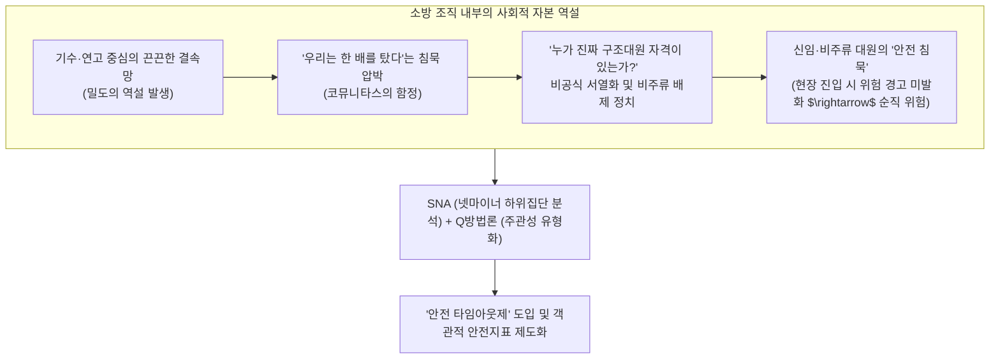

### 1. 연구질문 (Research Questions)
- **RQ 1 (밀도의 역설과 안전 침묵)**: 소방 팀 내 기수·동향 중심 결속망 밀도(Density)가 극단적으로 높을수록 신임·비주류 대원의 **'안전 침묵(Safety Silence)'**과 직무 스트레스(웰빙 악화)가 통계적으로 심화되는가?
- **RQ 2 (원조 자격의 정치와 비공식 배제)**: 결속망 내부에서 누가 "진짜 목숨 걸고 진입할 자격이 있는 구조대원인가(Deserving)"를 판별하는 비공식 서열화가 소방 장비/전술 정보 공유에서의 소외로 이어지는가?
- **RQ 3 (코뮤니타스의 함정과 위험 불감증)**: "우리는 끈끈한 한 팀이다"라는 강한 동료애 규범이 화재 현장에서 붕괴 징후 직면 시 지휘관에게 '작업 중지(Safety Time-out)'를 건의하는 정당한 이의제기를 어떻게 질식시키는가?
- **RQ 4 (주관적 안전 인식의 유형화)**: 결속망과 조직 안전 책무성에 대한 일선 소방관들의 주관적 인식은 Q방법론을 통해 어떤 하위 유형(전통 신봉형, 제도 프로토콜형, 소외 회의형)으로 분류되는가?
- **RQ 5 (네트워크 구조와 Q-유형의 교차 정합성)**: SNA 상의 고립 대원(Isolates)과 높은 중심성 대원은 각기 어떤 Q-인식 유형에 집중적으로 분포되어 있는가?

### 2. 확인한 연구결과 (Key Findings from Literature)

| 이론 및 챕터 출처 | 선행연구 핵심 실증 결과 | 본 소방 안전 네트워크 연구로의 연계 시사점 |
| :--- | :--- | :--- |
| **밀도의 역설과 최악의 웰빙<br/>(Chapter 2; Beggs et al., 1996)** | 연계 밀도가 가장 높은 집단에서 응답자의 정신건강 및 웰빙 점수가 가장 열악하게 나타남. | 기수·연고 결속망이 가장 강한 팀일수록 상호 감시와 동조 압력으로 인해 신임 대원의 우울감과 아차사고 은폐율이 높아짐을 실증. |
| **결속형 자본의 어두운 면<br/>(Chapter 2; Portes, 1998)** | 강한 내부 결속은 외부인에 대한 배제(Outsiders exclusion)와 개별 구성원에 대한 과도한 자유 제약을 유발. | 비공채, 타 지역 출신, 구급특채 대원을 배제하는 소방 내부 카르텔의 부정적 효과를 정량화. |
| **코뮤니타스의 함정 & 원조 자격의 정치<br/>(Chapter 2; Cox & Perry, 2011)** | 재난 직후 강한 유대감이 형성되나, 자원 배분 시 "누가 진정한 피해자인가"를 가르는 배제의 정치 발현. | "진짜 구조대원"과 "행정/구급 대원"을 차별하는 비공식 낙인 메커니즘을 밝혀내어 현장 안전 소통 저해 요인 입증. |
| **위험 지각의 사회적 인지<br/>(Chapter 2; Douglas & Wildavsky)** | 개인이 감지하는 위험은 객관적 확률이 아니라 자신이 속한 사회적 네트워크의 공유 규범에 의해 구성됨. | 대원이 현장에서 느끼는 붕괴 공포를 비공식 집단이 "나약한 소리"로 치부하여 위험 신호를 묵살하는 인지적 경로 규명. |

### 3. 연구절차 (Research Procedure: 6단계 표준 프로세스)

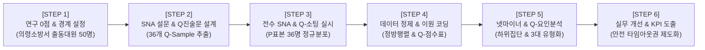

### 4. 네트워크 분석단위 및 분석지표 (Units & Network Metrics)

1. **노드 수준 (Node-level)**:
   - **개별 소방공무원 노드 ($N \approx 50$명)**:
     - **In-Degree (인입 연결정도)**: 비공식 사적 친분 및 기수망에서 지목받는 빈도.
     - **Out-Degree (인출 연결정도)**: 팀 내 사적 결속망에 손을 뻗치는 활동성.
     - **Isolate Status (고립 여부)**: 결속망에서 인입 연결이 전혀 없는 완전 고립 대원 여부.
     - **Q-Factor Loading (요인 적재치)**: 각 소방관이 3대 주관적 인식 유형에 얼마나 강하게 소속되는지를 나타내는 계수.
2. **하위집단 수준 (Subgroup-level)**:
   - **기수별, 임용경로별(공채/구조특채/구급특채), 출신지역별**:
     - **E-I Index (External-Internal Index)**: 집단 내부 친분 vs 집단 외부 친분 비율 산출 ($-1$에 가까울수록 특정 기수·특채 중심의 폐쇄적 카르텔).
     - **K-core & 파벌(Cliques)**: 핵심 비공식 이너서클(Inner Circle) 경계 획정.
3. **전체망 수준 (Whole-level)**:
   - **의령소방서 출동부서 전체 결속망**:
     - **Network Density (밀도)**: 전체 대원 대비 사적 결속 형성 비율 $\to$ 과도한 밀도 시 '밀도의 역설' 경보 발령.
     - **Network Centralization (집중도)**: 특정 베테랑 1~2인에 사적 영향력이 집중된 정도.

### 5. 네트워크 데이터 구조 및 코딩처리 방식 (Data & Coding Method)

| 구분 | 데이터 형식 | 변수 구성 및 코딩 기준 |
| :--- | :--- | :--- |
| **노드 속성 데이터<br/>(Node Properties)** | 1-mode 엑셀 테이블<br/>(행 = 소방관 $i$) | • **ID**: 고유 식별코드 (FF01 ~ FF50)<br/>• **Rank**: 1=지휘관리층, 2=중간관리층, 3=일선대원층<br/>• **Path (임용경로)**: 1=공채, 2=구조특채, 3=구급특채<br/>• **Hometown**: 1=관내(의령/경남), 2=타 시·도<br/>• **Tenure**: 소방 실근무 연수 |
| **결속망 행렬<br/>($M_{\text{bonding}}$)** | $N \times N$ 정방 행렬 | "근무 외 사적 시간(식사, 술자리, 경조사)을 함께하며 속마음을 털어놓는 동료는 누구인가?" (1=전혀없음 ~ 5=매우자주). 4점 이상 이진화(1). |
| **침묵망 행렬<br/>($M_{\text{silence}}$)** | $N \times N$ 정방 행렬 | "위험을 직감했을 때 비난이나 눈총이 두려워 감히 의견을 제기하지 못하는 상대는 누구인가?" (0=없음, 1=있음). |
| **Q-소팅 데이터<br/>(Q-Dataset)** | $N_{\text{sample}} \times N_P$<br/>($36 \times 36$ 행렬) | 36개 Q-진술문에 대해 36인의 P-표본이 강제정규분포 9점 척도(-4 가장 부정 ~ +4 가장 긍정)로 배치한 점수 행렬. |

> [!NOTE] **코딩 정제 및 결측치 관리 원칙**  
> 1. **대각선 요소 처리**: 자기 자신과의 관계($i = j$)는 모두 `0`으로 처리합니다.  
> 2. **Q-소팅 강제정규분포 검증**: 각 응답자의 카드 배치(-4, -3, -2, -1, 0, 1, 2, 3, 4 점수별 정해진 칸 수) 정합성을 100% 검증 후 코딩.  
> 3. **결측치 관리**: 비번 교대 주기를 활용하여 결측률 0% 전수 조사를 원칙으로 함.

### 6. 자료수집 및 설문조사/Q-소팅 집행 전략 (Data Collection)
- **사전 명부 방식(Prepared Roster) 전면 채택**: 관내 대원 50명의 성명·계급이 인쇄된 표준 명부형 설문지 배포.
- **플래시카드 기반 대면 심층 Q-소팅(Q-Sorting)**: 36개 Q-Sample 카드를 제작하여 대원들이 1:1 대면 방식으로 정규분포 판 위에 직접 카드를 분류(Sorting)하도록 지도.
- **철저한 익명성 보장**: 지휘관 및 동료의 입회가 차단된 독립된 상담실에서 조사를 진행하여 솔직한 주관성 진술 보장.

### 7. 넷마이너 & Q방법론 정밀 분석 프로토콜
- **Step 1: 데이터 임포트 & 모델링**: 넷마이너에 노드 속성과 $M_{\text{bonding}}, M_{\text{silence}}$ 행렬 구축.
- **Step 2: 하위집단 및 밀도의 역설 분석**: NetMiner Subgroup 모듈을 통해 파벌(Cliques) 및 E-I Index 산출. 사적 결속망 밀도와 침묵망 인입 간의 상관관계 도출.
- **Step 3: Q-요인분석 (PQMethod / QUANL)**: P-표본 36명의 Q-소팅 데이터를 주성분 분석(PCA) 및 배리맥스(Varimax) 직교 회전하여 아이겐밸류(Eigenvalue) 1.0 이상의 유의미한 3개 요인(Factor) 추출.
- **Step 4: 주관적 인식 3대 유형 도출 및 SNA 연계**:
  - **제1유형 [전통적 동료애 신봉형]**: "의리와 기수가 현장의 생명선이다. 선배를 믿고 돌진해야 한다." (높은 인입 결속망 중심성 대원 집중).
  - **제2유형 [제도적 안전 프로토콜 요구형]**: "끈끈함은 질식일 뿐이다. 감정에 기대지 말고 공식 안전 매뉴얼로 통제하라." (중간관리자 집중).
  - **제3유형 [소외·고립 회의형]**: "주류 카르텔에 못 끼면 위험 경고도 늦게 받는다. 차별과 침묵이 두렵다." (SNA 고립 대원 집중).

### 8. 최종 실무·정책 환류: 소방 안전관리 KPI 도출 및 법적 근거

#### 1) 소방 실무 개선 및 KPI 도출
- **안전 타임아웃(Safety Time-out) 발동권 제도화**: 계급이나 기수와 상관없이, 현장 위험 징후를 발견한 대원은 누구나 즉각 작업을 일시 중지시킬 수 있는 법적 권리 보장.
- **소방 고유 KPI(70%)**: **'신임·비주류 대원 멘토링 네트워크 연결성 지수'** 및 **'계급 간 E-I Index 개방도'**를 소방관서 안전문화 핵심 지표로 반영.

#### 2) 관련 법적 근거 매핑 (조문 강제 연계)
- **소방공무원 보건안전 및 복지 기본법 제8조(소방공무원의 안전관리 권리와 의무)**: 위험 상황 시 현장 활동 중지 요구권.
- **소방기본법 제16조(소방활동)** 및 **동법 시행규칙 제6조**: 소방대원의 안전장구 착용 및 현장 안전관리 기준의 객관적 표준화.
- **국가공무원법 제56조(성실 의무)** 및 **제57조(복종의 의무)**의 현대적 재해석: 맹목적 복종을 넘어선 '합리적 안전 이의제기권' 보장.

---

# 제3장 재난 관리에서의 조직간 네트워크 (Sub-Note)

**원제**: CHAPTER 3 INTERORGANIZATIONAL NETWORKS IN DISASTER MANAGEMENT  
**저자**: Naim Kapucu¹ (University of Central Florida), Fatih Demiroz² (Sam Houston State University)  
**출처**: *Social Network Analysis of Disaster Response, Recovery, and Adaptation* (Elsevier, 2017, pp. 25–40, http://dx.doi.org/10.1016/B978-0-12-805196-2.00003-0)  

---

## [개요] 챕터 목차 체계 (Chapter Outline)

1. **서론** (Introduction, p. 25)
2. **조직간 네트워크** (Interorganizational Networks, p. 26)
3. **재난 관리에서의 조직간 네트워크** (Interorganizational Networks in Disaster Management, p. 26)
   * 네트워크의 네트워크: 다층적 재난 네트워크 (Networks of Networks: Multilayered Disaster Networks, p. 27)
   * 그림 3.1: 오렌지 카운티 긴급지원기능(ESF) 소속 네트워크 (Figure 3.1, p. 29)
4. **효과적인 조직간 재난 네트워크** (Effective Interorganizational Disaster Networks, p. 29)
   * 커뮤니케이션 (Communication, p. 31)
   * 그림 3.2A~C: 오렌지 카운티의 친구망, 대비망, 대응망 비교 (Figures 3.2A–C, pp. 32–34)
   * 신뢰와 사회적 자본 (Trust and Social Capital, p. 34)
   * 재난 네트워크에서의 학습과 적응 (Learning and Adaptation in Disaster Networks, p. 35)
5. **조직의 재난 네트워크 형성 시 협업을 저해하는 요인** (Factors Hindering Collaboration in Forming Disaster Networks of Organizations, p. 36)
   * 그림 3.3: 재난 관리 조직간 네트워크 영향 요인 개념도 (Figure 3.3, p. 37)
6. **사회연결망 분석의 적용** (Applications of Social Network Analysis, p. 37)
   * 표 3.1: 조직간 네트워크 메타 매트릭스 (Table 3.1, pp. 38–39)
7. **결론** (Conclusions, p. 38)

---

# 1. 서론 (Introduction)

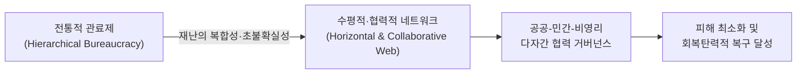

### 1. 파국적 재난(Catastrophic Disasters)과 네트워크의 필연성
- **일상적 비상사태와의 근본적 차이**: 파국적 재난은 사회 전체를 심각하게 교란하며, 정부 단독의 역량과 자원만으로는 결코 감당할 수 없습니다.
- **서비스 전달 방식의 패러다임 전환**: 과거 정부 중심의 수직적 관료제에서 공공, 민간, 비영리 부문을 아우르는 **‘교차 부문 파트너십(cross-sector partnerships)’**으로 행정 환경이 구조적으로 전환되었습니다.
- **재난 거버넌스의 표준**: 재난 관리에서 다기관 간의 수평적·협력적 조직망은 예외적 수단이 아니라 **‘기본 규범(the norm)’**으로 자리 잡았습니다.

### 2. 본 챕터의 목적
- 다수준(Multilevel), 다부문(Multisector)의 협력적 성격을 지닌 재난 관리 조직망의 이론적 지형을 종합적으로 개관합니다.
- 네트워크의 구조적 특성, 효과성 결정요인, 협업의 촉진 및 장애 요인, 그리고 연결망 분석(SNA) 도구의 실천적 적용 방안을 제시합니다.

---

# 2. 조직간 네트워크 (Interorganizational Networks)

### 1. 미국 정부 시스템에서의 네트워크의 진화
- 네트워크라는 용어 자체는 비교적 최근에 정립되었으나, 정부 간 관계(IGR)와 부처 간 상호작용은 오랜 역사를 지닙니다.
- 오늘날의 조직간 네트워크는 전통적 관료제가 축소되는 과정에서 등장한 민영화, 서비스 외주화, 비영리 부문의 팽창, 복합적 난제 해결을 위한 파트너십을 의미합니다.

### 2. 네트워크 형성의 동기: 자발적 참여 대 법적 의무화
- **자발적 네트워크(Voluntary)**: 강제나 인센티브 없이 기관들이 공동의 목표를 위해 자율적으로 결성.
- **법적 의무화 네트워크(Mandated)**: 상위 정부의 법령이나 자금 지원 요건에 따라 강제됨.
  - *예시*: 미국 연방재난관리청(FEMA)은 지방정부가 연방 기금을 수령하기 위한 전제 조건으로 국가대응체계(NRF)와 국가재난복구체계(NDRF)를 채택하고 교차 부문 파트너십을 의무적으로 구축하도록 규정함.

---

# 3. 재난 관리에서의 조직간 네트워크 (Interorganizational Networks in Disaster Management)

### 1. '전체 지역사회(Whole Community)' 접근법과 지역사회 탄력성(Resilience)
- **전체 지역사회 접근법 (Kapucu, 2009)**: 단일 기관이나 공무원 집단의 자원만으로는 대형 재난을 해결할 수 없으며, 공공, 민간, 비영리, 그리고 시민 전체가 유기적으로 결합해야 한다는 철학.
- **지역사회 재난 탄력성 (Norris et al., 2008)**: 지역사회의 자원(사회적 자본, 조직망, 인적 자본, 경제적 활력 등)을 일련의 **‘적응 역량(adaptive capacities)’**에 연결하는 동태적 과정.
- **재난 생애주기별 네트워크의 차별성 (★핵심 원칙)**:
  - **대응 네트워크(Response Networks)**: 짧은 시간 동안 즉각적·동시다발적 상호작용, 의사결정 지원 시스템, 신속한 정보 흐름에 의존함.
  - **완화 네트워크(Mitigation Networks)**: 건축 법규 개정, 홍수 보험, 고위험군 이주 등 수년에서 수십 년에 걸친 장기적 제도 집행 파트너십에 의존함.

### 2. 네트워크의 네트워크: 다층적 재난 네트워크 (Networks of Networks)

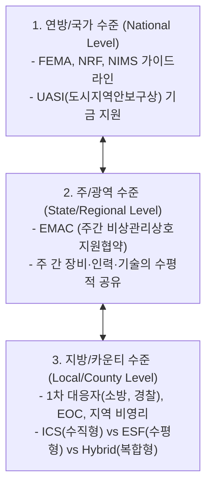

- **국가 수준 (UASI 기금과 권력 불균형; Jordan, 2010)**:
  - UASI(Urban Area Security Initiative) 기금은 대도시와 주변 농촌 지역 간의 협업을 촉진했으나, 이는 공통의 지역적 요구보다는 **"도시와 농촌 간의 권력 불균형 및 자금 쟁탈전"**에서 기인한 측면이 큼.
- **주 수준 (EMAC 상호원조협약; Kapucu et al., 2009)**:
  - 카트리나 및 리타 허리케인 대응 분석 결과, 주 간 수평적 지원 협약(EMAC)이 행정적 감독과 신속한 문제 해결 기술 자원을 제공하는 핵심 축임을 입증.
- **지방 수준의 3대 구조 모델 (Kapucu & Garayev, 2014)**:
  1. *수직적·계층적 모델 (ICS)*: 현장지휘체계에 기반한 일사불란한 상명하복.
  2. *수평적·분권적 모델 (ESF)*: 긴급지원기능별 책임 부서 중심의 협력체계.
  3. *복합 하이브리드 모델*: 수직적 통제와 수평적 기능 연계를 결합한 형태.

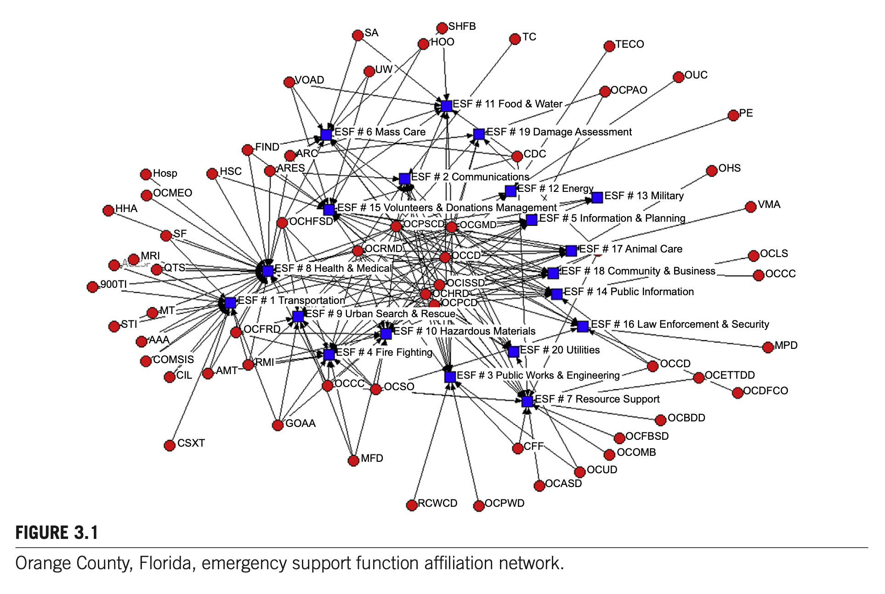  
*FIGURE 3.1: Orange County, Florida, emergency support function affiliation network (오렌지 카운티의 17개 긴급지원기능을 중심으로 공공·민간 기관들이 클러스터링된 2모드 소속 네트워크).*

---

# 4. 효과적인 조직간 재난 네트워크 (Effective Interorganizational Disaster Networks)

### 1. 네트워크 효과성(Network Effectiveness)의 3단계 평가 체계 (Turrini et al., 2010)

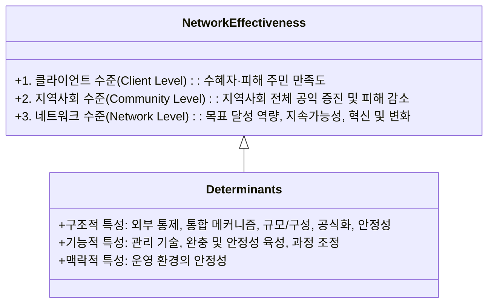

### 2. 재난 대응 네트워크의 특수성: 자생성과 인지적 정확성
- **자생적(Emergent) 성격**: 재난 대응망은 사전 계획대로 완벽히 작동하지 않으며, 혼돈 속에서 자생적으로 형성됨 (Nowell & Steelman, 2014).
- **최상옥 & 브라워(Choi & Brower, 2006)의 인지적 정확성 4대 유형**:
  - *Type I (완전 일치망)*: 계획서상 주도기관 = 참여자 지각 주도기관 = 실제 중심성 최고 기관.
  - *Type II & III (부분 일치망)*: 계획-지각 또는 지각-실제 간에만 일치.
  - *Type IV (비일치 혼란망)*: 세 차원이 전혀 일치하지 않아 참여자들의 작전 인지도가 극히 왜곡된 상태.
- **동질성 대 이질성 가설 (Faas et al., 2016)**:
  - 산불 현장에서 평상시 지향(동질선호)과 달리, 실제 작전 시에는 **운영상의 전문성과 필요에 따른 이질적 연계(dissimilarity thesis)**가 교량 행위자를 형성함.

### 3. 커뮤니케이션과 상호운용성 (Communication & Interoperability)
- **상호운용성(Interoperability)의 중요성 (Kapucu, 2006a)**:
  - 9/11 테러 당시 뉴욕 소방국(아날로그 무전기)과 경찰국 간의 통신 시스템 불일치로 인해 치명적인 지휘 혼선과 인명 피해가 발생함.
- **대비망 vs 대응망 vs 친구망 (Hu & Kapucu, 2014; Figs. 3.2A–C)**:
  - **대비 단계의 공식 협업**은 실제 재난 대응 협업을 가장 강력하게 예측하는 변수임 (사적 친분망보다 우위).
  - 정보통신기술(ICT) 활용도는 대비망의 중심 조직에서 높게 나타났으나, 실제 긴급 대응 단계에서는 이메일, 유무선 전화, 대면 접촉 등 전통적 소통 방식이 여전히 결정적 역할을 수행함.

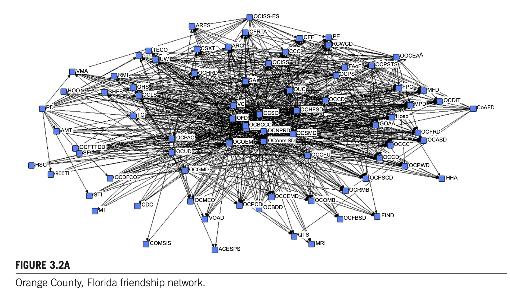  
*FIGURE 3.2A: Orange County, Florida의 친구망(Friendship Network).*

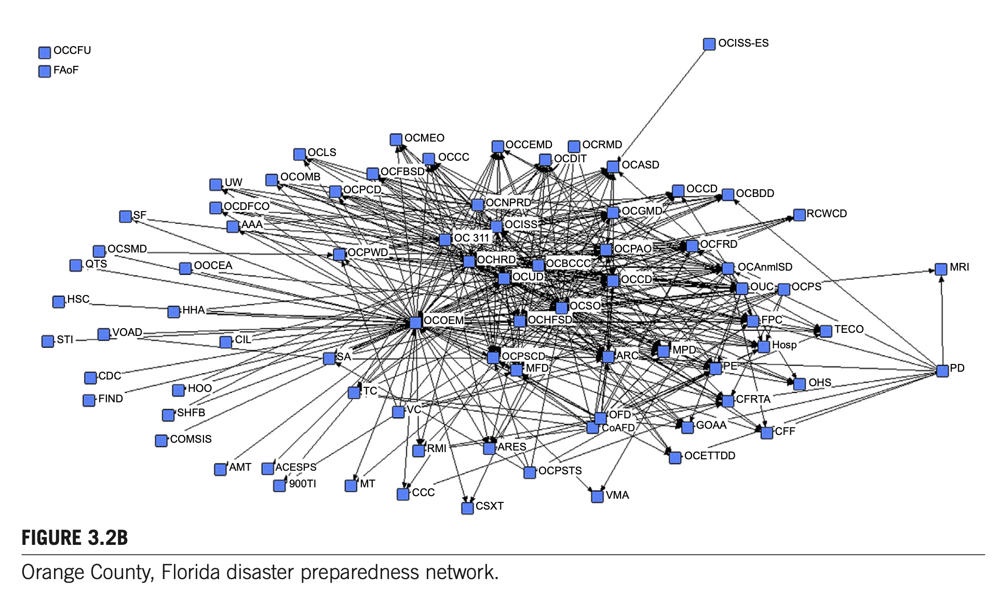  
*FIGURE 3.2B: Orange County, Florida의 재난대비망(Disaster Preparedness Network).*

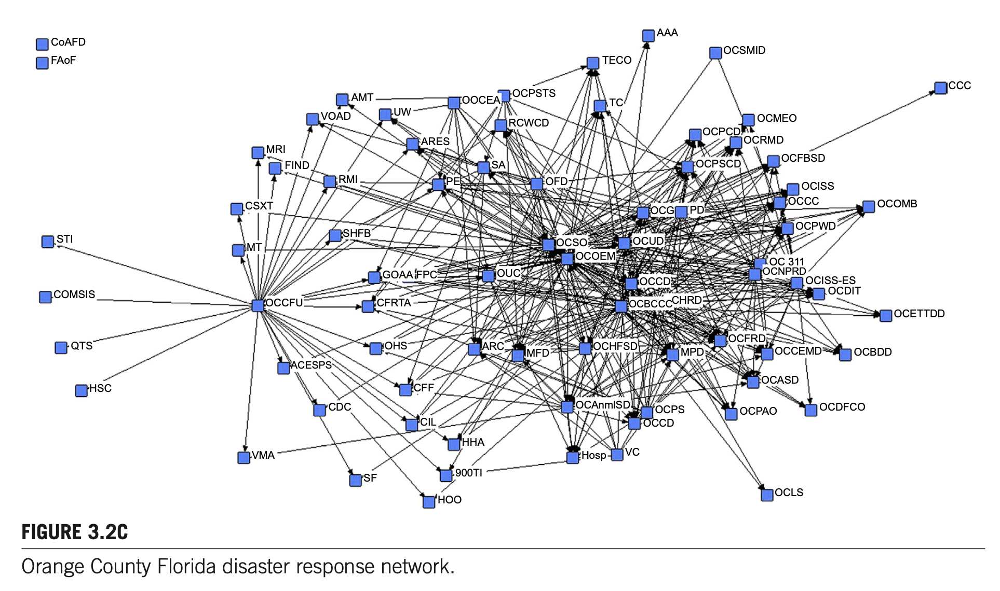  
*FIGURE 3.2C: Orange County, Florida의 재난대응망(Disaster Response Network).*

### 4. 신뢰와 사회적 자본 (Trust and Social Capital)
- **공식 연계와 비공식 연계의 상호보완**: MOU 등 공식 협약은 자원 공유의 틀을 제공하며, 관리자의 개인적 사회적 자본과 신뢰는 긴급 상황 시 신속한 작동을 보장함 (McGuire & Silvia, 2010; Kapucu et al., 2009).
- **동질적 뭉침과 추이성의 증명 (Siciliano & Wukich, 2015)**:
  - 카트리나 대응 분석 결과, 정부 자원 접근이 차단된 상황에서 **비영리단체는 다른 비영리단체와, 지방정부는 다른 지방정부와만 결속**하는 강한 부문별 동질선호 현상을 보임.
  - '공통의 친구'를 공유하는 닫힌 삼각관계(transitivity) 속에서 신뢰를 유지하려는 경향 확인.

### 5. 위기 학습과 적응 (Learning and Adaptation; Moynihan, 2008)
- **가금류 뉴캐슬병(Exotic Newcastle Disease, 2002–2003) 1년 장기 대응 사례**:
  - 급성 재난(지진, 토네이도)과 달리, 1년간 지속된 위기는 참여 조직 간의 상호작용과 의미구성(sensemaking), 적응적 학습을 가능케 함.
- **위기 네트워크 학습의 6대 도구**:
  1. *가상 경험(Virtual experience)*: 사전 기획, 시뮬레이션, 훈련.
  2. *타 조직으로부터의 학습(Learning from other organizations)*.
  3. *정보 시스템을 통한 학습(Information systems)*: 상황 인식 공유.
  4. *학습 포럼(Learning forums)*: 열린 토론 플랫폼.
  5. *SOP 메모리 구축(Creating memory from SOPs)*: 루틴의 제도화.
  6. *과거로부터의 학습(Learning from the past)*.

---

# 5. 조직의 재난 네트워크 형성 시 협업을 저해하는 요인 (Factors Hindering Collaboration)

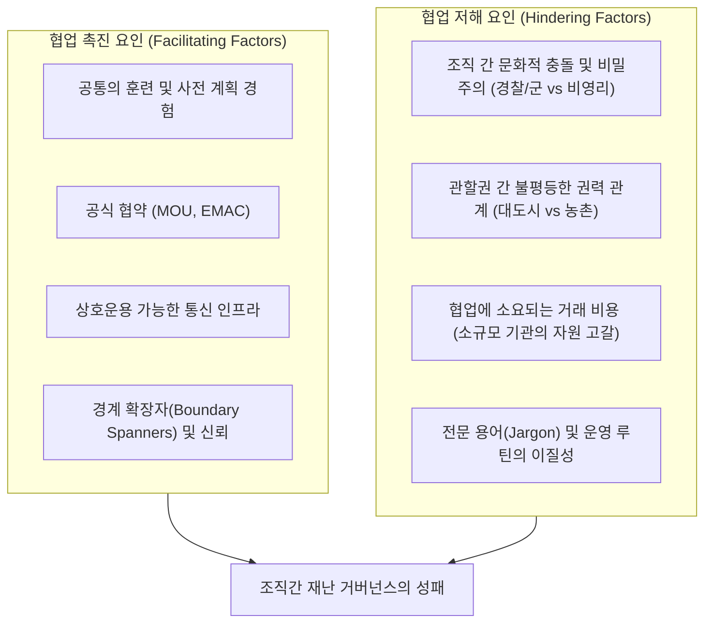

1. **조직 문화의 충돌과 비밀주의**:
   - 비밀주의와 중앙집권적 통제를 중시하는 정보·경찰·군사 조직(총을 든 집단)과 자원봉사자 활용 및 개방적 분권을 지향하는 비영리 조직(총이 없는 집단) 간의 근본적 갈등 (Waugh, 2003).
   - 국토안보부(DHS) 창설 당시 22개 이질적 기관의 기계적 통합이 낳은 극심한 불협화음.
2. **협업의 비용과 자원 결핍**:
   - 소규모 농촌 기관은 협력 회의에 참석할 인력과 예산조차 없어 네트워크에서 배제됨.
3. **권력 불균형(Power Imbalances)**:
   - 자원을 독점한 중심 도시가 주변부 관할권을 일방적으로 지배하거나, 반대로 소외시키는 현상.

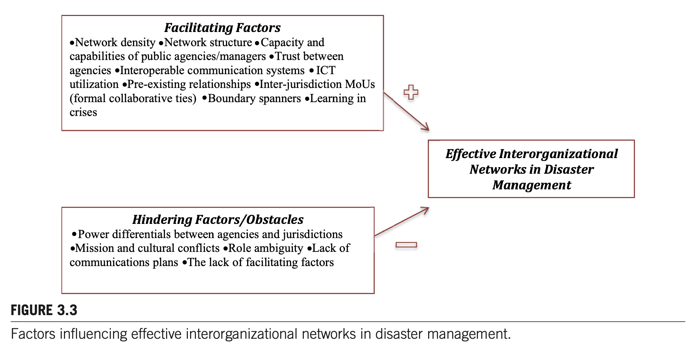  
*FIGURE 3.3: Factors influencing effective interorganizational networks in disaster management (재난 관리 조직간 네트워크에 영향을 미치는 촉진 및 저해 요인 개념 모델).*

---

# 6. 사회연결망 분석의 적용 (Applications of Social Network Analysis)

### 표 3.1 조직간 네트워크 메타 매트릭스 (Interorganizational Network Meta-Matrix)

재난 후 사후검토보고서(AAR)나 정책 문서의 내용분석을 통해 다차원적 서브네트워크 데이터를 추출하는 표준 프레임워크입니다 (Kapucu, 2006a; Comfort & Kapucu, 2006).

| 구분 | 행위자 (Agents) | 지식 (Knowledge) | 자원 (Resources) | 과업 (Tasks) | 기능 (Functions) |
| :--- | :--- | :--- | :--- | :--- | :--- |
| **행위자<br/>(Agents)** | **커뮤니케이션 네트워크**<br/>*(누가 누구를 아는가)* | **지식 네트워크**<br/>*(누가 무엇을 아는가)* | **역량 네트워크**<br/>*(누가 어떤 자원을 가졌는가)* | **과업 할당 네트워크**<br/>*(누가 어떤 과업을 수행하는가)* | **소속 네트워크**<br/>*(누가 어떤 기능에 책임이 있는가)* |
| **지식<br/>(Knowledge)** | — | **정보 네트워크**<br/>*(무엇이 공유 정보를 알리는가)* | **기술 네트워크**<br/>*(어떤 지식이 어떤 자원 활용에 필요한가)* | **필요 지식 네트워크**<br/>*(과업 완수에 어떤 지식이 필요한가)* | **역량 기준 네트워크**<br/>*(특정 기능 수행에 어떤 지식이 필요한가)* |
| **자원<br/>(Resources)** | — | — | **대체 네트워크**<br/>*(어떤 자원이 상호 대체·공유 가능한가)* | **자원 의존 네트워크**<br/>*(과업 완수에 어떤 자원이 필요한가)* | **공동체 자본 네트워크**<br/>*(특정 기능에 어떤 자원이 투입되는가)* |
| **과업<br/>(Tasks)** | — | — | — | **우선순위 네트워크**<br/>*(어떤 과업이 선행되어야 하는가)* | **부문 책임 네트워크**<br/>*(과업이 어느 기능에 배정되는가)* |
| **기능<br/>(Functions)** | — | — | — | — | **조직간 협력 네트워크**<br/>*(누가 어떤 기능을 위해 협력하는가)* |

---

# 7. 결론 (Conclusions)

- 재난 관리는 냉전 시대의 상명하복형 관료제 통제 모델에서 벗어나, 현대 사회의 복합 위험을 극복하기 위해 필수적인 **협력적 공공관리(Collaborative Public Management)**로 진화했습니다.
- 성공적인 재난 네트워크는 재난 발생 순간에 즉흥적으로 만들어질 수 없으며, **평상시 재난 대비 훈련, 사전 협약(MOU/EMAC), 상호운용 가능한 통신 장비, 경계 확장자(Boundary Spanners) 육성**을 통해 축적된 신뢰 인프라가 뒷받침되어야 합니다.
- 연구자와 실무자는 네트워크의 낭만적 환상을 버리고, 부문 간 권력 불균형, 문화적 비밀주의, 소규모 기관의 참여 비용 등 협업을 저해하는 구조적 장벽을 정밀하게 통제하고 완화하는 정책적 설계를 주도해야 합니다.

---

# [부록] 박사학위 논문 선행연구 분석 템플릿 연계

| 순서 | 분석 항목 | 제3장 핵심 요약 및 연구자 통제 관점 |
| :---: | :--- | :--- |
| **1** | **연구배경** | 대형 재난은 단일 정부 관료제의 자원 한계를 초월하므로, 공공·민간·비영리 부문을 아우르는 수평적 조직간 네트워크 거버넌스가 필수불가결함. |
| **2** | **이론적 개념** | 조직간 네트워크; 전체 지역사회(Whole Community); 다층적 재난 네트워크(NRF-EMAC-ICS/ESF); 네트워크 효과성 3수준; 상호운용성; 위기 학습. |
| **3** | **연구목적** | 다부문·다수준 재난 관리 네트워크의 구조적 특성, 효과성 결정요인, 협업 촉진 및 저해 요인을 규명하고 SNA 실무 분석 틀(메타 매트릭스)을 확립함. |
| **4** | **연구방법** | 이론적 메타분석, 오렌지 카운티 ESF 소속망 및 대응망 실증 분석, 재해 보고서 내용분석(Content Analysis) 기반 메타 매트릭스 설계. |
| **5** | **연구결과** | 1) 평상시 대비망 참여가 실제 대응 협업의 가장 강력한 예측 요인임.<br/>2) 9/11 당시 통신 비호환이 참사를 키움.<br/>3) 정부 지원 단절 시 비영리는 비영리끼리 뭉치는 고립적 동질선호 발현. |
| **6** | **핵심 발견** | 재난 네트워크는 계획대로 작동하지 않는 자생적 성격이 강하며, 총을 든 집단(보안)과 총이 없는 집단(복지) 간 문화적 충돌 및 대도시-농촌 간 권력 불균형이 주요 저해 요인임. |
| **7** | **연구의 한계** | 네트워크 수준의 효과성에 집중되어 있어 서비스 수혜자(이재민) 체감 관점의 효과성 연계가 부족하며, 주관적 의미구성(sensemaking) 척도 결합이 요구됨. |
| **8** | **이론적 시사점** | ICS(명령통제)와 ESF(수평협력)를 절충한 하이브리드 거버넌스의 필요성을 실증하고, 위기 학습 6대 도구를 통한 조직 적응 메커니즘을 규명함. |
| **9** | **후속 연구 시사점** | 카운티 및 소방·경찰 단위 현장 밀착형 지표 발굴, 메타 매트릭스 기반 2모드 네트워크 분석, Q방법론을 활용한 주관적 협업 인식 유형화 연계. |

---

# 8. 소방 조직 및 현장 대응 적용 연구 주제 및 방법론 (Application to Fire Services)

> [!TIP] **학습 지도노트 연계**: AI 활용 성과지표(KPI) 도출 7대 원칙 및 거버넌스 네트워크 확장  
> 제3장의 핵심 이론인 **(1) 다층적 재난 네트워크(NRF-EMAC-ICS/ESF)**, **(2) 상호운용성(Interoperability)과 9/11의 교훈**, **(3) 협업 저해 4대 장벽(총을 든 집단 vs 총이 없는 집단)**, **(4) 5×5 메타 매트릭스(Meta-Matrix)**를 소방 중심 다기관 복합대응에 정밀하게 접목합니다.

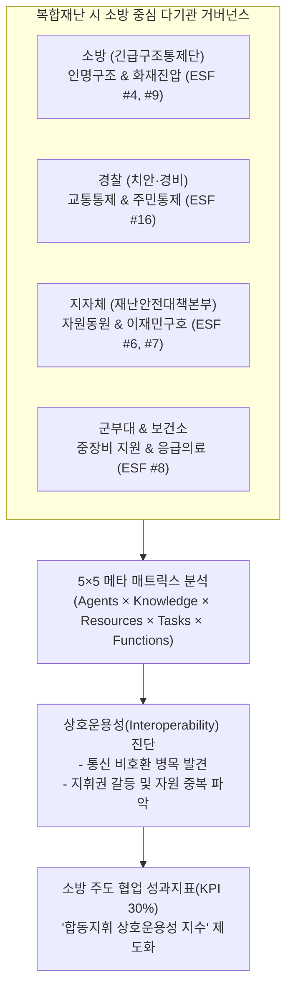

### 1. 연구질문 (Research Questions)
- **RQ 1 (5×5 메타 매트릭스 상호운용성)**: 소방(통제단), 경찰, 지자체, 군, 응급의료기관 간 **행위자(Agents) $\times$ 지식(Knowledge) $\times$ 자원(Resources) $\times$ 과업(Tasks) $\times$ 기능(Functions)** 매핑에서 가장 심각한 단절(Gaps)과 중복(Redundancy)은 어디서 발생하는가?
- **RQ 2 (문화적 충돌 및 전문용어 장벽)**: 상명하복 명령통제 조직(소방·경찰·군)과 행정지원 협력 조직(지자체·보건소) 간의 전문용어(Jargon) 및 운영 루틴 차이가 현장 협업 밀도를 얼마나 저해하는가?
- **RQ 3 (평시 대비망 vs 출동 대응망 전이)**: 평상시 긴급구조종합훈련(대비망)에 활발히 참여한 유관기관일수록 실제 대형 재난 현장(대응망)에서 유의미하게 높은 자원 공유와 공통 무전 채널 참여도를 보이는가?
- **RQ 4 (다기관 네트워크 효과성 3수준)**: 다기관 네트워크의 구조적 특성(지휘 집중도, 상호운용성 지수)은 클라이언트 수준(구조 완료율), 지역사회 수준(2차 피해 방지), 네트워크 수준(지휘 통일성) 효과성에 어떻게 차별적으로 기여하는가?
- **RQ 5 (배타적 현장지휘권 준수 여부)**: 재난안전법 제52조에 명시된 소방서장(통제단장)의 현장지휘에 대한 타 기관의 순응도 및 협조 수준을 결정하는 네트워크 요인은 무엇인가?

### 2. 확인한 연구결과 (Key Findings from Literature)

| 이론 및 챕터 출처 | 선행연구 핵심 실증 결과 | 본 소방 안전 네트워크 연구로의 연계 시사점 |
| :--- | :--- | :--- |
| **다층적 재난 네트워크<br/>(Chapter 3; NRF-EMAC-ICS/ESF)** | 재난 대응은 단일 계통이 아니라 전국적 협약(EMAC)과 현장 지휘(ICS), 기능별 협력(ESF)이 다층적으로 맞물림. | 소방 긴급구조통제단을 중심에 두고 15대 긴급지원기능(ESF)별 타 기관 협력 관계를 다층적으로 모델링. |
| **상호운용성 결핍의 교훈<br/>(Chapter 3; 9/11 Commission)** | 9/11 당시 소방과 경찰의 무전기 주파수 비호환으로 세계무역센터 붕괴 경보를 전달받지 못해 대규모 소방관 순직 발생. | 소방-경찰-지자체 간 재난안전통신망(PS-LTE) 공통 통화그룹(Talk Group) 교신 빈도 및 단절 지점 정밀 계측. |
| **협업 저해 4대 장벽<br/>(Chapter 3; Waugh, 2003)** | 비밀주의·명령통제를 중시하는 보안조직(소방/경찰/군)과 개방·조정을 중시하는 비영리/행정조직 간의 문화적 충돌. | 현장지휘권을 가진 소방과 자원동원권을 가진 지자체(군청) 간의 용어 불일치 및 권력 갈등 병목 실증. |
| **네트워크 효과성 3수준<br/>(Chapter 3; Turrini et al., 2010)** | 네트워크 효과성은 단일 차원이 아니며 클라이언트 수준, 지역사회 수준, 네트워크 수준의 3단계로 분리 평가해야 함. | 1) 구조 완료율(클라이언트), 2) 연소확대 저지율(지역사회), 3) 지휘 통일성 지수(네트워크)의 3수준 성과지표 체계 수립. |
| **5×5 메타 매트릭스<br/>(Chapter 3; Table 3.1; Kapucu)** | 행위자, 지식, 자원, 과업, 기능의 5개 엔티티 간 상호작용 행렬을 통해 조직 간 사각지대를 포착. | AAR 사후보고서 및 무전 녹취록 텍스트 분석을 통해 5×5 메타 매트릭스를 구성하고 유휴 자원 발굴. |

### 3. 연구절차 (Research Procedure: 6단계 표준 프로세스)

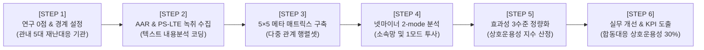

### 4. 네트워크 분석단위 및 분석지표 (Units & Network Metrics)

1. **노드 수준 (Node-level - 조직 단위)**:
   - **소방서, 경찰서, 육군 부대, 군청(지자체), 보건소**:
     - **In-Degree Centrality**: 타 기관으로부터 자원 지원 및 정보 요청을 받는 빈도 (소방의 현장 지휘 허브 지수).
     - **Betweenness Centrality**: 타 기관 간의 협업을 중개하는 문지기(Gatekeeper) 및 병목(Bottleneck) 식별.
2. **하위집단 수준 (Subgroup-level - 기능 단위)**:
   - **긴급지원기능(ESF) 15개 분과별 (화재진압, 수색구조, 교통통제, 응급의료, 이재민구호 등)**:
     - **ESF 참여 밀도 (Bipartite Density)**: 각 기능별 참여 기관 수 및 독점/고립 분과 식별.
     - **이종 조직 간 E-I Index**: 명령조직(소방/경찰) vs 지원조직(지자체/보건소) 간의 기능 간 협업 개방도.
3. **전체망 수준 (Whole-level - 거버넌스 단위)**:
   - **지역 복합재난 통합 지휘 거버넌스 전체망**:
     - **지휘 집중도 (Centralization)**: 소방 긴급구조통제단 중심의 지휘 통일성(Unity of Command) 유지 정도.
     - **통신 상호운용성 비율 (Interoperability Ratio)**: PS-LTE 공통 통화그룹 전체 교신 중 이종 기관 간 교신 비중.

### 5. 네트워크 데이터 구조 및 코딩처리 방식 (Data & Coding Method)

| 구분 | 데이터 형식 | 변수 구성 및 코딩 기준 |
| :--- | :--- | :--- |
| **조직 속성 데이터<br/>(Node Properties)** | 1-mode 엑셀 테이블<br/>(행 = 참여 기관 $i$) | • **ID**: ORG01(소방서), ORG02(경찰서), ORG03(군청), ORG04(보건소), ORG05(군부대)<br/>• **Sector**: 1=소방, 2=경찰, 3=행정, 4=보건의료, 5=군<br/>• **Jurisdiction**: 1=기초관할, 2=광역관할, 3=국가관할<br/>• **Authority**: 1=명령통제(ICS 지휘), 2=행정지원(ESF 지원) |
| **기능 소속망<br/>($M_{\text{Agency} \times \text{ESF}}$)** | $N_{\text{org}} \times N_{\text{ESF}}$<br/>(2-mode 행렬) | 각 기관이 15대 긴급지원기능(ESF) 중 실제로 인력과 자원을 투입하여 임무를 수행했는지 여부 (0=미참여, 1=참여). |
| **자원 의존망<br/>($M_{\text{Agency} \times \text{Resource}}$)** | $N_{\text{org}} \times N_{\text{res}}$<br/>(2-mode 행렬) | 굴삭기, 헬기, 덤프트럭, 텐트, 구호물자 등 8대 핵심 재난 자원의 보유 및 상호 공유 여부. |
| **합동 교신망<br/>($M_{\text{comm}}$)** | $N_{\text{org}} \times N_{\text{org}}$<br/>(1-mode 정방 행렬) | PS-LTE 공통 통화그룹 녹취록 상에서 기관 $i$와 기관 $j$ 간에 오간 공식 지시·협조 발화 빈도. |

> [!NOTE] **코딩 정제 및 결측치 관리 원칙**  
> 1. **대각선 요소 처리**: 기관 자체 교신($i = j$)은 제외하고 이종 기관 간 교신만 추출.  
> 2. **텍스트 내용분석 신뢰도**: 사후보고서(AAR) 및 통화 녹취록 코딩 시 2인의 평가자가 독립적으로 코딩하여 일치도(Krippendorff's $\alpha \ge 0.80$) 검증 후 확정.  
> 3. **2-mode 투사(Bipartite Projection)**: 소속망($M_{\text{Agency} \times \text{ESF}}$)을 넷마이너에서 1-mode 기관 간 동시출동망($M_{\text{Agency} \times \text{Agency}}$)으로 정규화 변환.

### 6. 자료수집 및 다기관 데이터 정제 집행 전략 (Data Collection)
- **공식 사후보고서(AAR) 전수 수집**: 대형 산불 및 복합 붕괴 사고의 정부 합동 사후검토보고서, 소방활동 검토회의 자료 확보.
- **재난안전통신망(PS-LTE) 통화 녹취록 내용분석**: 재난안전대책본부와 긴급구조통제단 간 가동된 공통 통화그룹(Talk Group)의 녹취 텍스트 전수 분석.
- **다기관 사전 협약(MOU) 대장 교차 검증**: 평시 체결된 상호응원협정 및 자원동원 계획서와 실제 출동 기록을 매핑.

### 7. 넷마이너 4단계 정밀 분석 프로토콜
- **Step 1: 5×5 메타 매트릭스 모델링**: 넷마이너 4에서 2-mode 모듈을 가동하여 기관-기능 및 기관-자원 행렬 입력.
- **Step 2: 2-mode 네트워크 시각화**: Bipartite Layout 알고리즘으로 기관 노드(원형)와 기능 노드(사각형)의 연결 지형도 시각화.
- **Step 3: 상호운용성 병목 및 구조적 공백 분석**: Structural Hole 모듈을 통해 특정 기관 간 연계가 단절된 '기능적 사각지대(Structural Gaps)' 도출.
- **Step 4: 네트워크 효과성 3수준 평가 (Turrini et al.)**:
  1. **클라이언트 수준**: 현장 구조 요청 건수 대비 완료율.
  2. **지역사회 수준**: 연소 확대 저지 시간 및 재산 피해 경감률.
  3. **네트워크 수준**: 지휘 통일성(Centralization) 지수 및 공통 무전 채널 상호운용성 비율.

### 8. 최종 실무·정책 환류: 소방 협업 KPI 도출 및 법적 근거

#### 1) 소방 실무 개선 및 KPI 도출
- **소방 긴급구조통제단 중심 합동지휘 체계 강제**: 재난 초기 지자체와 경찰이 소방의 지휘 통일선(ICS)에 신속히 편입되도록 PS-LTE 통화그룹 표준 가이드라인 정립.
- **소방 주도 협업 KPI(30%)**: **'다기관 합동대응 상호운용성 지수'**를 신설하여 지자체 및 유관기관 재난관리평가 시 소방 협력 실적으로 반영.

#### 2) 관련 법적 근거 매핑 (조문 강제 연계)
- **재난 및 안전관리 기본법 제50조(긴급구조기관)** 및 **제52조(긴급구조통제단장의 현장지휘)**: 재난 현장에서 소방서장의 총괄·조정 및 지휘권에 대한 타 기관의 절대적 복종 의무.
- **재난안전통신망법 제9조(재난안전통신망의 활용 등)**: 소방-경찰-지자체-군 간 공통 통화그룹(Talk Group) 의무 운용 및 상호운용성 표준화.
- **소방기본법 제16조의2(소방지원활동)**: 유관기관 간 인력 및 장비의 상호 응원과 현장 자원 공유 의무 명시.

---

# 제4장 재난 대응, 복구 및 완화에서의 사회연결망 연구 전략 (Sub-Note)

**원제**: CHAPTER 4 STRATEGIES FOR RESEARCHING SOCIAL NETWORKS IN DISASTER RESPONSE, RECOVERY, AND MITIGATION  
**저자**: Danielle M. Varda (University of Colorado Denver, Denver, CO, United States)  
**출처**: *Social Network Analysis of Disaster Response, Recovery, and Adaptation* (Elsevier, 2017, pp. 41–57)  
*(Excerpts: Varda, Forgette, Banks, & Contractor, 2009, Population Research and Policy Review, 28(1), 11–29 기반 인용 포함)*

---

## [개요] 챕터 목차 체계 (Chapter Outline)

1. **서론: 왜 사회연결망 분석 방법론인가?** (Introduction: Why Social Network Analysis Methodologies?)
2. **재난 맥락을 위한 네트워크 패러다임** (A Network Paradigm for Disaster Contexts)
   * 분석 단위: 개인, 집단, 지역사회 (Units of Analysis: Individuals, Groups, and Community)
   * 분석 수준: 개인, 전체, 다수준 네트워크 (Levels of Analysis: Personal, Whole, and Multilevel Networks)
     * 자아중심 또는 개인 네트워크 (Egocentric or Personal Networks)
     * 사회중심 또는 전체 네트워크 (Sociocentric or Whole Networks)
     * 다수준 네트워크 (Multilevel Networks)
3. **연계의 개념화 및 데이터 수집** (Conceptualizing Ties and Collecting Data)
4. **재난 네트워크 분석** (Analyzing Disaster Networks)
   * 네트워크의 기술적 분석 (Descriptive Analysis of Networks)
     * 대표성/다양성 (Representation/Diversity)
     * 호혜성 (Reciprocity)
     * 집중도 (Centralization)
     * 다중성 (Multiplexity)
   * 네트워크의 통계적 비교 (Statistical Comparison of Networks)
     * 지수 랜덤 그래프 모형 (Exponential Random Graph Models; ERGM / p*)
     * 이차 배정 절차 및 자기상관 (Quadratic Assignment Procedure and Autocorrelations; QAP)
     * 다수준 모형화 (Multilevel Modeling; MLM)
5. **재난 네트워크의 동태적 특성** (The Dynamic Nature of Disaster Networks)
6. **도전 과제** (Challenges)
   * 네트워크 경계 설정 (Bounding the Network)
   * 연구 질문 정의 (Defining the Research Questions)
   * 설문조사 집행 및 관리 (Survey Administration)
7. **결론** (Conclusions)

---

# 1. 서론: 왜 사회연결망 분석 방법론인가? (Introduction: Why Social Network Analysis Methodologies?)

### 1. 재난 충격과 사회적 인프라의 해체
* **사회적 관계의 분산과 임시성**: 재난이 지역사회에 닥치면 기존의 사회적 관계망이 급격히 분산(dissipated)되거나 임시적(ad hoc) 관계로 재편됩니다. 이로 인해 사회연결망을 식별하고 규명하는 새로운 연구적 질문들이 대두됩니다.
* **전체 사회 인프라의 교란**: 재난은 사회 인프라 전체를 무질서화(disorganize)하는 파괴력을 지닙니다. 사람들이 관계를 맺는 기존의 방식, 조직의 행동 양식, 사회적 자원 및 지원 체계 전체가 근본적으로 흔들리게 되며, 이를 정확히 이해하는 것은 재난 피해 수습 및 대응 역량에 직결됩니다.

### 2. 다차원적 척도와 혁신적 연구 방법론의 요구
* **다양한 규모(Scale)의 네트워크 발생**: 재난 네트워크는 개인 단위에서부터 지역사회 전체 단위에 이르기까지 상이한 스케일에서 동시다발적으로 발현됩니다.
* **혁신적 연구 설계의 필요성**: 따라서 모든 수준에서 재난이 사회연결망에 미치는 영향을 규명하기 위해서는 독특한 사회 구조와 그에 수반되는 동태적 변화를 포착할 수 있는 혁신적인 연구 설계(innovative research designs)와 정밀한 방법론적 도구가 필수적입니다.

### 3. 본 챕터의 핵심 프레임워크 및 구성
* 본 장에서는 재난 네트워크 연구 설계를 위한 포괄적 방법론 프레임워크를 제시합니다.
* 구체적으로 **분석 단위(units of analysis)**, **분석 수준(levels of analysis)**, **네트워크 연계의 유형(types of network links)**, **분석 접근법(approaches to analysis)**, **네트워크 동태성(network dynamics)**, 그리고 재난 네트워크 연구가 직면하는 **핵심 과제(challenges)**를 체계적으로 다룹니다.

---

# 2. 재난 맥락을 위한 네트워크 패러다임 (A Network Paradigm for Disaster Contexts)

## 2.1 IOSP 프레임워크 (In/Out/Seeker/Provider Framework)
Danielle Varda, Rich Forgette, David Banks, Noshir Contractor(2009)는 다수준 조사 및 분석을 위해 네트워크의 다양한 측면을 식별·측정하는 **IOSP 프레임워크**를 제안했습니다.

* **프레임워크의 목적**: 재난 상황에서 네트워크에 미치는 영향(impacts on the networks)과 네트워크가 미치는 영향(impacts to the networks)을 다각도로 이해하기 위한 틀입니다.
* **행위자 중복 가능성**: 모든 행위자(개인, 집단, 지역사회)는 상황에 따라 둘 이상의 범주에 동시에 속할 수 있습니다.

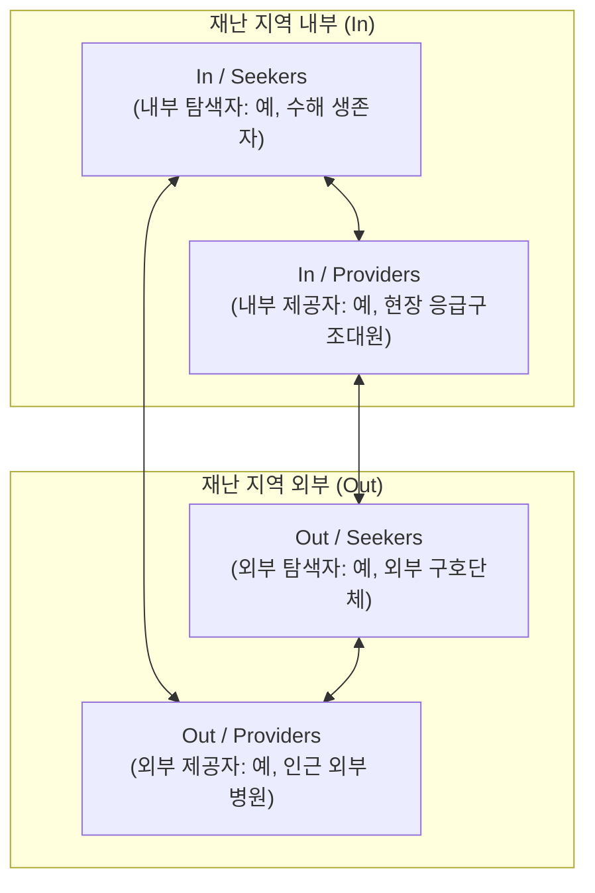

### IOSP 4대 행위자 범주 상세

| 분류 범주 | 위치 (Location) | 역할 성격 (Role) | 대표적 행위자 예시 |
| :--- | :--- | :--- | :--- |
| **In / Seekers** | 재난 지역 내부 (In) | 지원 탐색 (Seeker) | 재난 현장의 피해 주민, 침수 피해 생존자 (flood survivors) |
| **Out / Seekers** | 재난 지역 외부 (Out) | 자원 탐색 및 외부 지원 제공 (Seeker) | 재난 외부 지역에서 활동하며 자원·정보를 모색하는 외부 구호기구 (outside relief organizations) |
| **In / Providers** | 재난 지역 내부 (In) | 현장 지원 제공 (Provider) | 피해 지역 내에서 즉각 구호 활동을 펼치는 응급 구조인력 (emergency workers) |
| **Out / Providers** | 재난 지역 외부 (Out) | 원거리 전문 지원 제공 (Provider) | 재난 발생지 외곽에서 이송 환자를 수용하는 권역 외 대형병원 (hospitals) |

  
*FIGURE 4.1: Social network actors in a postdisaster setting, based on the in/out/seekers/providers (IOSP) framework.*

* **프레임워크의 연구적 기능**:
  1. 네트워크 경계 설정 (Bounding)
  2. 분석 단위 및 분석 수준의 확립
  3. 행위자 간 연계(Ties)의 조작적 정의 옵션 도출
  4. 연구 질문(RQ)의 구체적 구조화
  5. 설문 도구(Instrument) 개발 및 데이터 수집 표준화

---

## 2.2 분석 단위: 개인, 집단, 지역사회 (Units of Analysis: Individuals, Groups, and Community)

재난 연구의 선구자들은 네트워크의 분석 단위를 다층적으로 바라보아야 함을 일찍이 강조했습니다.

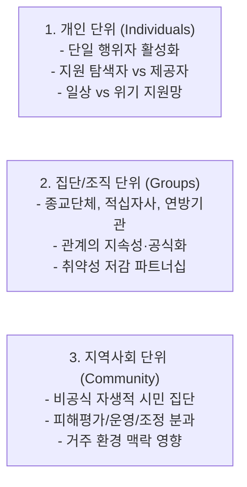

### 1. 개인 단위 (Individuals)
* **초점**: 소속 집단과 독립된 단일 행위자(single actors)로서, 개인이 사회연결망을 활성화(activate)하는 방식 및 네트워크 내에서 수행하는 역할.
* **주요 연구 질문 (Quarantelli & Dynes, 1977; Shavit, Fischer, & Koresh, 1994)**:
  * 비상 상황에서 사회적 지원을 요청하는 자는 누구인가?
  * 실제로 지원을 제공하는 자는 누구인가?
  * 재난 참여자(탐색자와 제공자 모두)의 위기 시 지원 패턴은 일상생활의 지원 패턴과 어떻게 비교되는가?
* **연구 흐름**: 개인의 일상적 지원망 구조, 사회적 연계의 동원 및 활성화 메커니즘, 다양한 사회적 지원 배치(configuration)가 미치는 영향 파악.

### 2. 집단/조직 단위 (Groups & Organizations)
* **초점**: 종교 소모임, 미국 적십자사(Red Cross), 연방 구호 기관 등 조직체를 분석 단위로 설정.
* **주요 연구 질문 (Comfort & Haase, 2006; Farmer, Tierney, & Kung-McIntyre, 2003; Kapucu, 2006a; Perrow, 1999; Robinson, Berrett, & Stone, 2006)**:
  * 위기 속에서 맺어진 관계가 재난 이후에도 지속되고 공식화(formalized)될 확률은 얼마인가?
  * 안정적인 관계는 규범적 격차(norm gaps)를 유발하는가, 아니면 소통과 상호작용을 촉진하는가?
  * 어떤 조직 간의 어떠한 관계 조합이 비상 상황에서 취약성을 감소시키는 데 기여하는가?
* **재난 환경 조직 연구의 난점과 SNA의 기여**:
  * 재난 대응 조직들은 다중 조직 유형을 넘나들며, 공식 조직의 고전적 구조를 갖추지 않는 경우가 많습니다(예: 적십자의 탈중앙화된 자원봉사자 구조, 자생적 종교 자원봉사 네트워크).
  * 사회연결망 분석(SNA) 기법은 이러한 유동적이고 비공식적인 조직 간 상호작용 연구의 한계를 극복하는 유용한 분석 도구를 제공합니다.

### 3. 지역사회 단위 (Community Context)
* **맥락적 배태성 (Embeddedness)**: Valerie Haines, Jeanne Hurlbert, John Beggs (1996, p. 261)는 개인의 지원 제공이 개인 특성, 개인 네트워크 특성(집단), 거주 지역사회 특성(지역사회)의 3가지 분석 단위 모두에 의해 영향을 받는다는 점을 실증했습니다(허리케인 대비 및 단기 복구 단계).
* **자생적 시민 집단 (Emergent Citizen Groups)**: Robert Stallings, Henry Quarantelli (1985)는 공식 조직 정체성 없이 집합적 재난 대응 목표를 위해 결성된 비공식 자생적 시민 집단을 3가지 유형으로 분류했습니다:
  1. **피해 평가 집단 (Damage assessment groups)**
  2. **운영 집단 (Operations groups)**
  3. **조정 집단 (Coordinating groups)**

---

## 2.3 분석 수준: 개인, 전체, 다수준 네트워크 (Levels of Analysis)

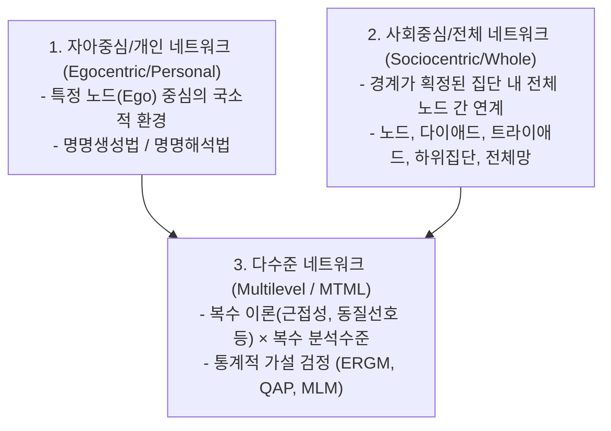

---

### 2.3.1 자아중심 또는 개인 네트워크 (Egocentric or Personal Networks)

* **개념 정의**: 자아(Ego)를 둘러싼 국소적 사회 환경(local social environment)에 대한 데이터. 특정 네트워크 구조가 초래하는 결과를 예측하는 데 주로 활용됩니다(예: 자아중심망이 조밀하게 연결되어 있으면 의사소통 효율성이 증대됨).
* **자아(Ego)의 범위**: 단일 개인에 국한되지 않으며, 특정 구조적 특성을 지닌 단일 조직, 기관 노드도 자아가 될 수 있습니다.

#### 데이터 수집 방식: 명명생성법과 명명해석법
1. **명명생성법 (Name Generator Approach)**: 응답자(Ego)에게 특정 관계 기준에 부합하는 타자(Alters)의 명단을 나열하도록 요청 (예: "지원해 주는 7명", "함께 일하는 5명", "돈을 빌려준 모든 사람").
2. **명명해석법 (Name Interpreter)**: 추출된 타자(Alters)들의 속성 및 알터 간의 관계(Alter-Alter ties)에 대해 추가 질문.
3. **응답자 부담(Respondent Burden)의 문제**:
   * 타자가 50명일 경우, 알터 간 쌍(Alter-alter pairs)의 수는 $\frac{50 \times 50 - 50}{2} = 1,225$개 문항.
   * 타자가 100명일 경우 문항 수는 $4,950$개로 기하급수적으로 폭증.

#### Christopher McCarty의 표본 추출 대안 (McCarty, 2002b; McCarty et al., 2007)
* **방법**: 응답자에게 60명의 알터를 자유 나열(free list)하게 한 후(예: "지난 2년 동안 알고 지낸 사람 60명"), 무작위 표본추출을 통해 **30명의 알터 서브셋**만 선정.
* **효과**: 평가해야 할 연계 수가 **1,770개에서 435개로 대폭 감소**하면서도 전체 개인 네트워크 구조의 분산과 구조적 대표성을 완벽히 재현함을 검증.
* **실무적 기준**: 통상 **40~60명의 알터를 수집한 후 20~30명을 무작위 추출**하여 이들 간의 연계를 측정하면 정확한 구조적 대표성을 확보할 수 있음.

#### 완전 네트워크(Complete Network)로부터의 자아중심 지표 구축
* 전체 네트워크 데이터를 이미 확보한 경우, 개별 노드의 직접 연결선과 이웃 노드 간 연결선(경로 거리 path distance = 1)만 추출하여 자아중심 지표를 계산할 수 있습니다.

#### 자아중심 연구의 주요 질문 예시
* **Q1**: 비일상적(재난) 상황에서 자원을 배분하는 일상적 네트워크의 유형은 무엇인가? (Hurlbert, Haines, & Beggs, 2000)
* **Q2**: 심각한 개인적 위기 시 동원되는 비공식 조력자 네트워크의 규모는 어느 정도인가? (Chatters, Taylor, & Neighbors, 1989)
* **Q3**: 치명적인 생명 위협 상황에서 사람들은 사회연결망을 어떻게 활용하는가? (Casagrande, McIlvaine-Newsad, & Jones, 2015; Shavit et al., 1994)
* **Q4**: 배태된 연계망 속에서 식별된 브로커(중개자)를 활용해 효과적인 조정 체계를 어떻게 동원할 수 있는가? (Saban, 2014)

---

### 2.3.2 사회중심 또는 전체 네트워크 (Sociocentric or Whole Networks)

* **개념 정의**: 명확히 경계가 설정된 행위자 집단(bounded group of actors) 내부의 모든 노드 간 연계 특성을 파악하는 분석.

#### 5단계 분석 층위
1. **노드 수준 (Nodal Level)**: 전체망 내에서 특정 단일 노드의 위치 분석. 인입/인출 연결 정도(In-/Out-degree), 교량(Bridges) 또는 문지기(Gatekeepers) 역할 여부, 하위집단 소속 여부, 네트워크 접근 용이성.
   * *Q4*: 네트워크 내 중심 행위자가 정보 전파 증대의 수단으로 기능할 수 있는가? (Kapucu, 2004)
   * *Q5*: 적시 정보 소통의 효율성을 높이기 위해 네트워크 연계의 중복성(redundancy)을 줄일 수 있는가? (Comfort & Haase, 2006)
2. **이원 수준 (Dyadic Level)**: 두 행위자 간의 쌍방 관계 분석 (예: 재난 후 상호 지원하는 두 생존자 간 관계).
3. **삼원 수준 (Triadic Level)**: 세 노드 간의 관계 구조 분석. 이행성(Transitivity; $A \to B$, $B \to C$ 일 때 $A \to C$)과 정보 흐름 검증.
4. **하위집단 수준 (Subgroup Level)**: 파벌(Cliques), 결속 집단, 분파 구조 분석.
5. **전체망 수준 (Global/Overall Level)**: 전체 네트워크의 밀도, 중심화도, 직경 등 포괄적 특성.

#### 전체망 연구의 주요 질문 예시
* **Q6**: 자생적 네트워크는 재난 후에도 지속되는가, 시간에 따라 어떻게 진화하는가? 복구 이후 공식화되어 계속 기능하는가?
* **Q7**: 비상 조정 및 의사소통 네트워크에서 호혜성(Reciprocity)은 얼마나 중요한가? 정보/자원의 일방적 전파로 충분한가, 아니면 상호 응답이 필수적인가?
* **Q8**: 의사결정 네트워크의 집중도(Centralization) 수준은 구성원들의 적시 의사결정 역량과 어떤 관련이 있는가?
* **Q9**: 구조적 동치(Structurally equivalent) 관계에 있는 네트워크 구성원들은 재난 전후 유사한 소통 패턴을 보이는가?

---

### 2.3.3 다수준 네트워크 (Multilevel Networks)

* **MTML 모델 (Multitheoretical, Multilevel Model)**: Peter Monge, Noshir Contractor (2003)가 개발한 이론적 틀로, 복수의 실질 이론(전염, 사회적 지원, 근접성, 동질선호, 자원 및 교환, 집합행동, 진화 이론 등)을 에고 및 사회중심 수준 전체에 걸쳐 복합 적용합니다.
* **통계적 도구 활용**: 관측값 간 종속성(관련성)을 보정하는 $p^*$ 모델(ERGM) 및 이차 배정 절차(QAP)를 적용하여 이론적 가설을 검정.

#### 다수준 연구 질문 예시
* **Q10**: 자원 제공자의 개인 특성, 그들의 개인 네트워크 특성, 그리고 그들이 거주하는 지역사회 맥락은 지원 제공 능력을 어떻게 촉진하거나 저해하는가? (Haines et al., 1996)
  * 매개변수 추정치를 통해 가설화된 구조적 속성(호혜적 링크, 이행적 삼원, 네트워크 집중도, 밀도)이 통계적으로 유의미하게 발현되는지 검증 가능.

#### MTML의 핵심 전제와 메타이론의 필요성
* **경쟁 이론(Competing Theories)의 동시 검증**:
  * 근접성 이론(Proximity theory): 인접 지역 피해자끼리 상호 탐색.
  * 동질선호 이론(Homophily theory): 유사한 피해 요구를 가진 자들끼리 상호 탐색.
  * ERGM 등의 통계 기법(Contractor, Wasserman, & Faust, 2006)을 통해 어떤 구조적 기제가 네트워크 형성을 지배하는지 식별.
* **상황적 메타이론(Contextual Meta-theory)의 필요성**:
  * 아이디어 탐색, 기존 자원 착취, 집합행동 동원, 경계 확장, 결속적 사회적 지원, 신속한 활성화(swarming) 등 재난 상황별로 작동하는 사회적 동인(social drivers)이 상이함.
  * 비상 대응기에는 신속한 동원(mobilizing)과 군집 활성화(swarming)가 지배적일 수 있으므로, 어떤 조건에서 특정 이론 세트가 우세해지는지 설명하는 메타이론 정립이 요구됨.

---

# 3. 연계의 개념화 및 데이터 수집 (Conceptualizing Ties and Collecting Data)

## 3.1 네트워크 연계(Ties)의 조작적 정의
* 실세계에 관계가 존재하더라도, 연구자가 연구 목적에 맞게 네트워크의 경계, 구성원, 연계 유형을 **조작적으로 정의(operationalized)**해야 합니다.
* 연계 유형: 소통, 조언, 친족, 친구, 직업(업무), 소속 기반(동호회, 헬스장, 학교), 종교, 근접성(이웃), 자원 공유 등.

## 3.2 재난 연구의 5대 핵심 관계 범주 (Kapucu, 2005; Carley, 2002)

| 관계 범주 | 핵심 질문 (Research Questions Addressed) |
| :--- | :--- |
| **1. 인적/행위자 관계 (People/agent relations)** | 누가 누구를 아는가? 누가 무엇을 아는가? 누가 어떤 자원을 가지고 있는가? 누가 무엇을 하는가? 누가 어디서 일하는가? |
| **2. 지식 관계 (Knowledge relations)** | 어떤 지식이 어떤 지식에 정보를 주는가? 특정 자원을 사용하는 데 어떤 지식이 필요한가? 해당 과업을 수행하는 데 무엇이 필요한가? 특정 지식은 어디에 존재하는가? |
| **3. 자원 관계 (Resource relations)** | 어떤 자원이 다른 자원을 대체할 수 있는가? 특정 과업 수행에 어떤 자원이 필요한가? 가용 자원은 어디에 위치해 있는가? |
| **4. 과업 관계 (Task relations)** | 어떤 과업이 다른 과업보다 먼저 선행되어야 하는가? 어떤 과업이 어디서 수행되는가? |
| **5. 조직 관계 (Organizational relations)** | 어떤 조직이 어떤 조직과 공식적·실무적으로 협력하여 일하는가? |

---

## 3.3 데이터 수집 방법론

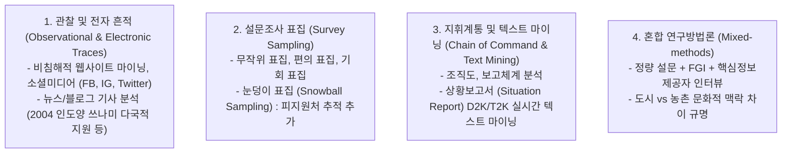

### 1. 관찰 데이터 및 전자적 흔적 (Electronic Traces)
* **웹 마이닝 및 SNS 활용**: 웹사이트 링크, 텍스트 마이닝, 소셜 미디어(Facebook, Instagram, Twitter) 데이터를 활용하여 재난 전·중·후의 네트워크 데이터를 실시간 포착.
* **비침해적 뉴스/블로그 분석**: 2004년 인도양 지진해일(쓰나미) 다국적 구호 활동 분석처럼, 신속하고 비침해적인 데이터 수집이 가능하나 전문가적 판단(expert judgment)과 도메인 지식 의존도가 높음.

### 2. 설문조사 데이터 수집
* **표집 기법**: 무작위 표집, 편의 표집, 기회 표집, 눈덩이 표집(Snowball sampling) 활용.
* **눈덩이 표집의 장단점**: 재난 후 지원을 받은 대상(Alters)을 지속적으로 샘플에 추가하여 네트워크의 전체 그림을 완성하기 용이하지만, 무작위 표집을 제외한 비확률 표집은 통계적 속성이 복잡하여 일반화(generalizability)에 제약이 따름.

### 3. 지휘계통(Chain of Command) 데이터 및 상황보고서 텍스트 마이닝
* **조직도와 보고 구조**: 공식 계통도를 바탕으로 연계를 식별하며 이메일 및 통신 텍스트 마이닝(Diesner & Carley, 2005) 병행.
* **상황보고서(Situation Report; SitRep) 마이닝**: 재난 대응 기관들이 웹에 게시하는 표준 보고서를 **D2K(Data-to-Knowledge)** 및 **T2K(Text-to-Knowledge)** 도구로 마이닝하여 준실시간(near real time)으로 네트워크를 비침해적으로 추론.

### 4. 혼합 연구방법론 (Mixed-methods)
* **결합 도구**: 설문, 포커스 그룹 인터뷰(FGI), 핵심 정보제공자(Key informant) 면담, 데이터 마이닝, 소셜 미디어 코딩(Islam & Walkerden, 2014)의 융합.
* **맥락적 차이 규명**: 농촌(Rural)과 도시(Urban) 공동체 간 서비스 탐색 패턴 차이처럼, 문화적·환경적 맥락이 상이한 경우 정량 데이터의 왜곡을 방지하고 풍부한 해석을 제공.

---

# 4. 재난 네트워크 분석 방법론 (Analyzing Disaster Networks)

네트워크 데이터는 노드 간 상호의존성(relational dependency)을 가지므로, 고전 통계학의 '관측의 독립성(independence of observations)' 가정을 충족하지 못합니다. 따라서 기술적 통계와 특화된 예측적 통계 기법이 요구됩니다.

```mermaid
flowchart TD
    A["재난 네트워크 분석 기법"]
    A --> D["기술적 분석 (Descriptive Analysis)"]
    A --> S["통계적 비교 및 추론 (Statistical Comparison)"]
    
    D --> D1["대표성/다양성 (Representation/Diversity)<br/>- 동질선호 vs 이질성"]
    D --> D2["호혜성 (Reciprocity)<br/>- 상호 지원 지명 비율"]
    D --> D3["집중도 (Centralization)<br/>- 매개/고유벡터, 결측치 20%"]
    D --> D4["다중성 (Multiplexity)<br/>- 복합 관계 중첩 (친구+협력)"]

    S --> S1["지수 랜덤 그래프 모형 (ERGM / p*)<br/>- R statnet, 종속구조 추정"]
    S --> S2["QAP & 자기상관<br/>- 행렬 상관, Geary, Barriers 2.2"]
    S --> S3["다수준 모형 (MLM)<br/>- 중첩 데이터, REML 추정"]
```

---

## 4.1 기술적 분석 (Descriptive Analysis of Networks)

### 1. 대표성 및 다양성 (Representation/Diversity)
* **동질선호 (Homophily)**: 행위자 간 유사성에 기반한 연계 형성 경향 (McPherson, Smith-Lovin, & Brashears, 2001). 반대 개념은 이질성(Heterogeneity).
* **재난 적용**: 다문화 공동체에서 재난 피해자들이 자신과 유사한 집단(내부)만을 찾는가, 아니면 외부 지역사회에도 도움을 요청하고 신뢰하는가 분석 (Messias, Barrington, & Lacy, 2012).

### 2. 호혜성 (Reciprocity)
* **정의**: 전체 이원 관계(dyads) 중 상호 지명(reciprocal nominations)이 이루어진 쌍의 비율.
* **재난 적용**: 응급실(Emergency Department) 내 의사소통 연구에서 특정 핵심 인물에게 도움 요청이 집중되면서도, 의료진 전반에서 상호 간에 지원을 주고받는 호혜적 구조가 병존함을 실증 (Creswick, Westbrook, & Braithwaite, 2009).

### 3. 집중도 및 중심성 (Centralization & Centrality)
* **집중도 (Centralization)**: 네트워크 차원의 지표. 소수의 행위자가 연결선을 독점하는 정도 (높은 점수 = 소수 독점 고도 집중, 낮은 점수 = 분산 네트워크).
* **중심성 (Centrality)**: 개별 노드 차원의 지표.
  * **매개 중심성 (Betweenness Centrality)**: 네트워크 내 문지기(gatekeeping), 교량(bridging), 병목(bottleneck) 기능 포착.
  * **고유벡터 중심성 (Eigenvector Centrality)**: 많은 연계를 가진 핵심 노드들과 잘 연결된 노드 식별.
  * **브로커리지와 정보 전파**: 재난 네트워크 내 조직들의 브로커리지 및 전파 역할 식별 (Moore, Eng, & Daniel, 2003).
* **🚨 결측 데이터(Missing Data) 경고**:
  * 중심성 지표는 무작위 결측 데이터가 **20%를 초과할 경우 급격한 성능 저하(degradation)**가 발생 (Valente et al., 2008).
  * 결측치를 최소화하도록 연구 설계를 보정하거나, 결측치에 덜 민감한 지표를 신중히 채택해야 함.

### 4. 다중성 (Multiplexity)
* **정의**: 두 노드 간에 존재하는 상이한 관계 유형의 수(복합 관계의 공존도).
* **재난 적용**: 네트워크 내 사적 친분(friendships) 수준이 재난 대응 네트워크에서 조직의 참여 수준을 유의미하게 예측 (Kapucu & Hu, 2014).

---

## 4.2 네트워크 통계적 비교 및 추론 (Statistical Comparison of Networks)

### 고전 통계 추론과의 차이점
* 고전 통계학은 관측치의 독립성을 가정하므로 표준오차를 과소추정(훨씬 작게 계산)합니다. 네트워크의 관계적 종속성을 다루기 위해 부트스트랩 및 특화된 통계 기법이 필수적입니다.
* **주요 비교 기준 3가지**:
  1. 이론적으로 결정된 기댓값과의 비교
  2. 다중 네트워크 간 비교 (예: 친구망과 도움요청망을 비교하여 구조적 특성이 구성 차이를 설명하는지 검증)
  3. 다수 시점에서의 동일 네트워크 비교 (시계열 동태성)

### 1. 지수 랜덤 그래프 모형 (Exponential Random Graph Models; ERGM / p* 모형)
* **개념**: 관측된 네트워크 구조를 형성하는 잠재적 종속성(dependence) 및 이질성(heterogeneity)의 원천을 확률론적으로 모형화 (Frank & Strauss, 1986; Robins et al., 1999; Wasserman & Pattison, 1996).
* **분석 도구**: R 통계 소프트웨어 환경의 **`statnet`** 패키지 (Handcock et al., 2008).

### 2. 이차 배정 절차 (QAP) 및 자기상관 (Autocorrelations)
* **QAP 원리**: 행위자-행위자 이원 행렬(Dyadic variable)이 다른 이원 행렬 또는 노드 속성 벡터(Monadic variable)와 상관되어 있는지 비모수적 순열 검정으로 분석.
* **재난 적용 사례**: '누가 누구를 돕는가(이원 변수)'와 '각 노드가 재난으로 피해를 입은 정도(단일 노드 속성)'의 상관을 분석하여, 피해가 극심한 대상에게 지원이 집중되는지 검증.
* **소프트웨어**:
  * **UCINET**의 **Geary autocorrelation** (p-값이 작을수록 유의미한 자기상관; Varda, 2011)
  * **Barriers 2.2** 소프트웨어의 Monmonier 알고리즘을 통한 행렬 자기상관 계산 (Manni, Guérard, & Heyer, 2004)

### 3. 다수준 모형 (Multilevel Modeling; MLM)
* **중첩 구조 보정**: 조직 내부에 중첩된 다이애드(dyads nested within organizations)처럼 데이터의 다층 위계 구조를 다룸 (Gooty & Yammarino, 2011).
* **분석 기법**: 제한된 최대우도법(Restricted Maximum Likelihood; REML) 접근법을 활용하여 조직 수준(상위) 예측 변수가 1:1 관계 결과(하위 다이애드 수준)의 변량을 어떻게 설명하는지 추정 (Raudenbush & Bryk, 2002).

---

# 5. 재난 네트워크의 동태적 특성 (The Dynamic Nature of Disaster Networks)

재난 전 기간에 걸친 네트워크의 동태성은 측정을 복잡하게 만들지만, 재난 네트워크의 본질 그 자체입니다.

```mermaid
flowchart TD
    T1["1. 재난 전 네트워크 (Predisaster)<br/>- 기존 일상 관계<br/>- 느리고 비의도적인 '채워넣기(In-filling)'"]
    T2["2. 임시적/애드혹 네트워크 (Ad hoc)<br/>- 대피소 등에서 급속 형성<br/>- 강한 상호이해·신뢰 후 복구기 소멸"]
    T3["3. 자생적 네트워크 (Emergent)<br/>- 새로운 연계 + 새로운 기능/과업<br/>- 정상화로 가는 경로이자 협력 기회"]
    T4["4. 정체적/불변 연계 (Stationary Ties)<br/>- 환경 파괴에도 불변하는 친족/가족 연계<br/>- 위기 시 최우선 활성화"]
```

## 5.1 동태적 네트워크의 4대 범주

1. **재난 전 네트워크 (Predisaster Networks)**: 재난 발생 이전의 일상적 네트워크. 변화가 매우 느리고 특별한 목적성이 없으며, 친구의 친구가 친구가 되는 완만한 **‘채워넣기(in-filling)’** 과정 중심 (Banks & Carley, 1996).
2. **임시적/애드혹 사회 네트워크 (Ad hoc Social Networks)**: 재난 발생 중 내부/외부 탐색자와 제공자 사이에서 신속하게 결성되는 관계. 대피소(shelters) 등에서 연결되어 상호 이해와 신뢰를 바탕으로 강한 유대를 형성하나, 복구 단계를 거치며 빠르게 소멸(dissipate)함.
3. **자생적 네트워크 (Emergent Networks)**: **새로운 연계(new ties)**와 **새로운 기능/과업(new functions/tasks)**으로 정의됨 (Stallings & Quarantelli, 1985). 기존 네트워크를 상실한 개인에게는 일상 회복의 통로가 되며, 조직에게는 새로운 협력 파트너십의 기회가 됨.
4. **정체적/불변 연계 (Stationary Ties)**: 재난의 충격, 공간적 이동, 통신 두절에도 불구하고 훼손되지 않고 지속되는 연계. 주로 **친족 연계(kinship ties)**가 해당되며, 재난 피해자들은 위기 시 친족 연계를 최우선으로 가동함 (Chatters et al., 1989; Haines et al., 1996; Shavit et al., 1994).

---

## 5.2 시계열적 진화 단계와 네트워크 밀도 변화

```mermaid
flowchart LR
    P1["[1. 대비 단계]<br/>높은 밀도<br/>(가옥 보강 등 상호부조)"] --> P2["[2. 생명위협/피난 단계]<br/>극도로 희소한 밀도<br/>(친족 연계로 축소)"]
    P2 --> P3["[3. 복구 단계]<br/>취약한 자생망 형성<br/>(즉각적 필요 기반, 다양성 낮음)"]
    P3 --> P4["[4. 재건/적응 단계]<br/>밀도 회복 및 재건<br/>(원래 망 복원 or 새로운 고다양성 망)"]
```

  
*FIGURE 4.2: Evolution of a network pre, during, and post disasters.*

### 개인 수준과 조직 수준의 진화 동학 비교

| 진화 단계 | 개인 차원의 네트워크 변화 | 조직 차원의 네트워크 변화 |
| :--- | :--- | :--- |
| **대비 단계 (Preparation)** | 가옥 보강(boarding up), 피난 행렬 형성 등 일상 지원망을 통한 상호부조 (밀도 유지) | 가용 자원을 사전 비축하기 위해 기존 관계(preexisting ties)를 집중 활성화 |
| **생명위협/난민 단계 (Life-threat / Refugee)** | 극도로 희소(sparse)해지며, 친족 연계를 제외한 대부분의 연계가 일시 단절됨 | 피지원자들에 대한 새로운 연계의 폭발적 급증(explosion of ties), 현장 지원 집중 |
| **복구 단계 (Recovery)** | 즉각적 생존 필요에 의해 주도되는 취약한(fragile) 자생적 네트워크 형성 (다양성은 낮음) | 타 기관 간 경쟁(competitive) 또는 협력(cooperative) 관계 전개, 분파(종교, 연방, 지역) 형성 |
| **재건/적응 단계 (Reconstruction)** | 원래의 네트워크를 복원하거나, 새로운 지역에서 구조적·구성적 다양성을 갖춘 견고한 망 구축 | 공식적 다기관 협력 파트너십의 제도화 및 장기 지속 네트워크로의 정착 |

* **비재난 연구와의 결정적 차이**: 일반 네트워크 동태 연구는 정적 네트워크의 '채워넣기(in-filling)'에 집중하지만, 재난 연구는 **외생적 충격에 의해 강제된 네트워크의 희소화(thinning out)**와 이에 적응하여 자원을 확보·배분하려는 **적응적 반응(adaptive responses)**에 집중합니다.

### 동태적 네트워크 연구의 3대 발전 방향
1. **시각화 영화 도구 (Visualization "Movies")**: 혼란 속에서 소규모 네트워크가 어떻게 연계를 잃고 얻는지를 동영상 형태로 가시화 (Moody, McFarland, & Bender-DeMoll, 2005).
2. **수학적 진화 모형 (Mathematical Models)**: 재난 사건 진행에 따른 연계의 진화 궤적을 수학적으로 정식화 (Phan & Airoldi, 2014).
3. **통계적 가설 검정 도구 (Statistical Tools)**: 네트워크 변화 모델이 실제 수집 데이터에 의해 뒷받침되는지 통계적으로 적합도 검정 (Sanil, Banks, & Carley, 1995).

---

# 6. 재난 네트워크 연구의 도전 과제 (Challenges)

```mermaid
flowchart TD
    C["재난 네트워크 연구의 3대 도전 과제"]
    C --> C1["1. 네트워크 경계 설정 (Bounding)<br/>- 잠재 구성원의 모호성<br/>- 명명생성법의 한계 vs 사전 명단(Prepared List)"]
    C --> C2["2. 연구 질문 정의 및 설문 설계 (Defining RQ)<br/>- 설문 문항 과다로 인한 피로도 방지<br/>- 관계 척도화 (1~5점) 및 속성 단순화"]
    C --> C3["3. 설문 집행 및 관리 (Administration)<br/>- 다단계 응답 부담 및 실무자 대리응답 왜곡<br/>- PARTNER Tool, 스킵 로직, 응답률 제고"]
```

---

## 6.1 네트워크 경계 설정 (Bounding the Network)
* **경계 불명확성**: 재난 발생 지역사회 내 잠재적 네트워크 구성원은 매우 방대하고 비정형적입니다. 누구를 조사 대상에 포함하고 누구를 배제할지 명확한 경계를 긋는 것이 극히 어렵습니다.
* **고민 요인**: 활성 구성원만 포함할 것인가? 고립자(isolates)도 포함할 것인가? 한 조직 내 여러 부서를 포함할 것인가, 대표자 1인의 응답으로 갈음할 것인가?
* **엔티티 추가의 비용**: 조사 대상이 늘어날수록 프로젝트의 복잡성, 참여 협조 유도 비용, 설문 관리 부담이 기하급수적으로 증가합니다.
* **명명생성법의 한계와 대안**:
  * 비자아중심 전체망 연구에서 자유 명명생성법을 사용하면 신뢰도가 떨어지고(응답자마다 파트너 명단이 상이함), 실제 존재하는 연계를 과소보고(underestimate)하며, 철자 불일치로 데이터 정합 비용이 급증합니다.
  * **해결 대안**: 사전에 준비된 조직·구성원 명단(**Prepared list**)을 제공하고 이름을 추가/삭제할 수 있도록 설계하는 방식이 효과적입니다.

---

## 6.2 연구 질문의 정의 및 설문 설계 (Defining the Research Questions)
* **설문 개발의 딜레마**: 검증된 기존 온라인 설문(예: 재난 복원력 네트워크 설문; Eisenman et al., 2014)을 수정하여 사용할 수도 있고 처음부터 자체 개발할 수도 있으나, 가장 큰 난관은 **너무 많은 문항을 묻지 않도록 자제하는 것(refraining from asking too many questions)**입니다.
* **의미 있는 관계에 집중**: 단순한 '인지 여부(who knows whom)'를 넘어 실질적인 관계를 포착하되, 응답자 피로도를 줄여야 합니다.
  * *핵심 RQ 예시*: 어떤 전문 영역에서 활동하는가? 자금 이전의 영향은 무엇인가? 핵심 행위자 이탈 시 영향은 어떠한가? 서비스 공백(gaps)은 어디에 존재하는가? 취약성을 줄이기 위해 활용 가능한 강한 유대는 어디인가?
* **단일 질문을 통한 관계 변량 확보 (응답 부담 경감 기법)**:
  * 여러 문항을 나열하는 대신, "A와 B의 관계 강도는 1~5점 중 몇 점인가?"처럼 척도화하거나,
  * "A와 B는 친구, 업무, 종교, 지역봉사, 친족 중 어떤 관계인가?"와 같이 질적 범주를 단일 문항으로 질문.
* **방법론적 구분**: 조직 간 네트워크 구조를 밝히는 연구와 시민(수혜자)이 네트워크를 경험하는 서비스 이용 경험(customer experience) 연구는 방법론적으로 엄격히 구분되어야 함.

---

## 6.3 설문조사 집행 및 관리 (Survey Administration)
* **다단계 설문 구조의 극심한 부담**:
  1. 본인에 관한 질문 응답
  2. 사전에 주어진 명단에서 관계가 있는 대상을 선택
  3. 선택된 각 대상과의 관계 성격에 대해 개별 심층 문항 응답
* **조직 내 대리 응답의 위험성**: 조직 리더가 외부 파트너십을 잘 모르는 하위 실무자 1인에게 설문 작성을 위임할 경우 응답 왜곡 및 가치 저하가 발생.
* **응답률과 미응답 처리**:
  * 한쪽 행위자의 보고만 신뢰하는 방식은 파트너가 응답하지 않아도 연계를 추정할 수 있으나, **호혜성(Reciprocity)이나 상호 지각(perceptions)을 측정할 수 없는 치명적 한계**가 존재함.
* **실무적 해결 방안**:
  * **PARTNER Tool (Danielle Varda, 2008)**: 설문 응답 시간을 최소화하도록 설계·검증된 전문 도구(Program to Analyze, Record, and Track Networks to Enhance Relationships) 활용.
  * 정교한 설문 건너뛰기 논리(Skip logic) 적용.
  * 통계적 검정력을 유지하는 타깃 표본추출.
  * 응답률 제고를 위한 대면 인터뷰, 반복 접촉, 인센티브(추첨 등), 초기 지역사회 참여 유도(Buy-in).

---

# 7. 결론 및 향후 연구 방향 (Conclusions)

```mermaid
flowchart TD
    CON["결론 및 학술적 기여"]
    CON --> CON1["1. 사회적 적응 및 본능 규명<br/>- 비공식 개인/집단 관계망의 결정적 역할 실증<br/>- 정부 원조 및 개인 조건과 독립적인 구호 기능"]
    CON --> CON2["2. 새로운 취약성 측정<br/>- 전통적 물리적/인구통계적 취약성 탈피<br/>- 사회적/네트워크 취약성 (Social/Network Vulnerability) 확립"]
    CON --> CON3["3. 방법론적 미래 혁신 방향<br/>- 공간/지리적 상관성 (Spatial correlates) 통합<br/>- 민·관 및 지역-외부 시너지 (Synergies) 포착"]
```

### 1. 사회과학적 가치와 비공식 연계망의 실증
* 재난은 인간의 사회적 적응과 본능이 가장 극명하게 드러나는 분석의 장을 제공합니다.
* 사회연결망 연구는 정부의 공식 지원금이나 생존자의 개인적 조건(소득, 학력, 피해 규모)과 독립적으로, **비공식적인 개인 및 집단 관계망이 재난 구호에 핵심적인 역할을 수행함**을 일관되게 보여줍니다.

### 2. '사회적/네트워크 취약성(Social/Network Vulnerability)'의 규명
* **기존 취약성 측정의 한계**: 전통적으로 취약 인구는 인구사회학적 속성(소득, 고용, 장애, 연령)이나 물리적 속성(주택 품질, 개인 교통수단 유무)으로만 정의되었습니다.
* **네트워크 취약성의 대두**: 사회연결망 연구는 **'사회적으로 고립된 생존자(socially isolated disaster survivors)'**일수록 재난 후 적응 및 복구 가능성이 현저히 낮아진다는 새로운 차원의 취약성 지표를 제공합니다.

### 3. 향후 연구의 2대 방법론적 혁신 과제
1. **공간적/지리적 상관성과의 결합 (Spatial Correlates)**:
   * 고립된 생존자들의 공간적·지리적 배치를 네트워크 분석과 통합함으로써, 공공 및 민간 응급관리 팀이 긴급 구호 활동을 보다 정밀하게 표적화(targeting relief efforts)할 수 있도록 지원.
2. **민·관 및 지역-외부 간 시너지(Synergies) 포착**:
   * 공공-민간(Public-Private) 및 지역-외부(Local-External) 간의 협력적 시너지를 포착하여, 재난 대응·복구·적응 전반의 속도(speed), 조정(coordination), 포괄 범위(breadth of coverage)를 획기적으로 향상.

---

## [부록] 본 챕터 핵심 인용 문헌 매핑 (Key References)

* **Varda, D. M., Forgette, R., Banks, D., & Contractor, N. (2009)**. *Social network methodology in the study of disasters: issues and insights prompted by post-Katrina research*. Population Research and Policy Review, 28(1), 11–29. (IOSP 프레임워크 원천)
* **Quarantelli, E. L., & Dynes, R. R. (1977)**. *Response to social crisis and disaster*. Annual Review of Sociology, 3, 23–49. (개인/조직 분석 단위)
* **Haines, V. A., Hurlbert, J. S., & Beggs, J. J. (1996)**. *Exploring the context of personal networks: An introduction*. Social Networks, 18(4), 261–266. (개인-집단-지역사회 3대 분석단위 배태성)
* **Stallings, R. A., & Quarantelli, E. L. (1985)**. *Emergent citizen groups and emergency management*. Public Administration Review, 45, 93–100. (자생적 시민 집단 3유형)
* **McCarty, C. (2002b); McCarty, Killworth, & Rennell (2007)**. (자아중심망 표본추출 기법: 60명 중 30명 추출을 통한 응답부담 경감)
* **Monge, P. R., & Contractor, N. S. (2003)**. *Theories of communication networks*. Oxford University Press. (MTML 다이론 다수준 모델)
* **Contractor, N. S., Wasserman, S., & Faust, K. (2006)**. *Testing multitheoretical multilevel networks*. Academy of Management Review, 31(3), 681–703. (ERGM 가설검정 기법)
* **Kapucu, N. (2005, 2006a); Comfort & Haase (2006)**. (조직 간 네트워크, 중심성, 5대 연계 범주)
* **Valente, T. W. et al. (2008)**. (중심성 측정 시 결측 데이터 20% 임계점 경고)
* **Varda, D. M. (2008)**. *PARTNER Tool (Program to Analyze, Record, and Track Networks to Enhance Relationships)*. (네트워크 설문 최적화 도구)


---

## [부록] 박사학위 논문 선행연구 9단계 분석 템플릿 (Chapter 4)

| 단계 | 분석 항목 | 제4장 (Varda, 2017, pp. 43–59) 핵심 내용 |
| :---: | :--- | :--- |
| **1** | **연구배경** | 허리케인 카트리나 이후 재난 대응·복구·완화 연구에서 전통적 속성(인구통계·물리적 취약성) 중심 접근의 한계가 드러남에 따라, 비공식·공식 관계망을 실증적으로 규명할 체계적 사회연결망(SNA) 방법론 전략이 요구됨. |
| **2** | **이론적 개념** | **IOSP 프레임워크**(In/Out × Seeker/Provider), **개인-집단-지역사회 3대 분석단위의 배태성(Embeddedness)**, **자아중심망(Egocentric)·전체망(Sociocentric)·다수준망(Multilevel)**, **5대 관계 범주**(인적·지식·자원·과업·조직), **다이론 다수준(MTML) 모형**, **사회적/네트워크 취약성(Social/Network Vulnerability)**. |
| **3** | **연구목적** | 재난의 특수한 맥락(시간 압축성, 경계 모호성, 종단적 재편성)에 적합한 사회연결망 연구 설계, 데이터 수집(명명생성법 vs 사전 명부), 통계적 추론(QAP, ERGM/p*), 설문 행정 전략을 종합 제시함. |
| **4** | **연구방법** | 문헌 메타 검토 및 방법론적 프레임워크 구축. 자아중심·전체·다수준 네트워크별 핵심 연구질문(Q1~Q10) 도출, PARTNER Tool 설계 원리, 결측치(20% 임계점) 및 회상 편향 통제 기법 제시. |
| **5** | **연구결과** | • **시간에 따른 네트워크 진화(Fig 4.2)**: 재난 발생 직후 비공식 연결망이 친족·핵심 연계 중심으로 급격히 **희소화(Thinning-out)**된 후 장기 복구기에 점진적으로 재건됨.<br/>• **결측치 민감성**: 무작위 결측이 **20%를 초과**하면 중심성·밀도 지표가 심각하게 왜곡됨(Valente et al., 2008). |
| **6** | **핵심 발견** | 정부의 공식 원조나 개인의 사회경제적 조건과 독립적으로 **비공식 관계망이 재난 구호와 복구에 결정적 역할**을 수행하며, **'사회적으로 고립된 생존자(Socially Isolated Survivors)'**가 가장 치명적인 네트워크 취약 집단임. |
| **7** | **연구의 한계** | 재난 직후 현장 접근성 제약, 사후 회상(Recall) 설문에 따른 기억 왜곡, 다단계 네트워크 설문의 높은 응답 피로도 및 조직 대리 응답으로 인한 호혜성 측정 한계. |
| **8** | **이론적 시사점** | 재난 연구의 패러다임을 '개별 행위자 속성'에서 **'관계적 구조와 다수준 상호의존성(MTML)'**으로 전환하고, 전통적 물리적 취약성을 넘어 **'네트워크 취약성'** 개념을 정립함. |
| **9** | **후속 연구 시사점** | (1) 네트워크 고립 노드의 **공간적·지리적 상관성(Spatial Correlates)** 결합을 통한 정밀 구호 표적화, (2) 공공-민간(Public-Private) 및 지역-외부(Local-External) 네트워크 시너지 실증. |

---

# 8. ★ [내 연구 적용] 소방공무원 안전 책무성·협력 네트워크 실증 분석 (SNA & 넷마이너 7단계 프로토콜 및 5인 가상 시뮬레이션)

본 장(Chapter 4)의 사회연결망 연구 전략(SNA)을 **[의령소방서 119구조대 및 관내 현장 출동부서의 안전 리더십, 안전 책무성(Accountability) 및 다기관 협업 네트워크 분석]**에 직접 적용하기 위해, 순수 사회연결망 분석 및 넷마이너(NetMiner) 실증 절차 7단계와 가상 소방관 5인 시뮬레이션으로 체계화한 방법론 설계입니다.

### 1. 연구질문 (Research Questions)
Chapter 4에서 제시된 자아중심망, 전체망, 다수준망 연구 질문(Q1~Q10)의 논리를 소방 현장 안전 관리 맥락에 투영하여 5대 핵심 연구 질문을 도출합니다.
- **RQ 1 (구조적 중심성 & 중개자 - Centrality)**: 의령소방서 119구조대 및 출동부서의 안전 소통망에서 **핵심 안전 정보 중개자(Broker/Bridge; 매개 중심성)**와 **고립 대원(Isolates; 인입 연결정도 최하위)**은 누구이며, 계급(지휘관리층, 중간관리층, 일선대원층)별로 중심성 분포는 어떻게 차이를 보이는가?
- **RQ 2 (하위집단 & 동질선호 - Subgroups)**: 안전 소통 및 전술 조언망 내에서 비공식적 군집(Cliques)이나 동질선호(Homophily; 동일 계급·동일 팀 편중) 현상이 존재하는가? 이것이 상하 계급 간 **'안전 침묵(Safety Silence)'**이나 정보 전달 병목(Bottleneck)을 유발하는가?
- **RQ 3 (관계의 다중성 - Multiplexity)**: 공식 업무 지시망(Command), 전문 지식/전술 조언망(Advice), 비상 장비 공유망(Resource), 아차사고(Near-Miss) 신뢰망(Trust) 간의 구조적 상관성(QAP Matrix Correlation)은 어떻게 나타나는가?
- **RQ 4 (출동 생애주기별 동태성 - Dynamics)**: 출동 생애주기(평시 대비기 $
ightarrow$ 현장 진입/대응기 $
ightarrow$ 초진/철수기 $
ightarrow$ 사후 디브리핑기)의 진행에 따라 안전 네트워크의 밀도(Density)와 집중도(Centralization)는 어떻게 축소·재편(Thinning-out & Rebuilding)되는가?
- **RQ 5 (네트워크 성과 & 취약성 - Vulnerability)**: 네트워크 내 고립도 및 중심성 격차는 현장 대원의 안전사고(아차사고 은폐, 안전수칙 위반) 및 조직의 안전 책무성(RAA 삼원조 정합성) 성과와 어떠한 통계적 인과관계를 갖는가?

### 2. 확인한 연구결과 (Key Findings from Literature)

| 이론 및 챕터 출처 | 선행연구 핵심 실증 결과 | 본 소방 안전 네트워크 연구로의 연계 시사점 |
| :--- | :--- | :--- |
| **IOSP 프레임워크<br/>(Chapter 4; Varda et al., 2009)** | 재난 네트워크 행위자를 공간(In/Out)과 역할(Seeker/Provider)로 분리 측정. 상호의존적 자원 탐색과 제공 구조화. | 현장 진입 대원(In/Seeker; 작업중지권), 지휘관/안전점검관(In/Provider; 위험성평가·RIT), 상황실(Out/Seeker), 통제단 유관기관(Out/Provider) 매핑. |
| **5대 관계 범주<br/>(Chapter 4; Kapucu, 2005)** | 인적(People), 지식(Knowledge), 자원(Resource), 과업(Task), 조직(Organizational) 관계의 다차원적 분리 측정. | 소방 안전 책무성(RAA 삼원조)의 책임-권한-책무성과 정합하는 4대 매트릭스(의사소통, 조언, 장비차용, 신뢰망) 분리 설계. |
| **동태적 진화 모델<br/>(Chapter 4; Fig 4.2)** | 재난 충격 시 네트워크가 극도로 희소화(Thinning-out)되어 친족·핵심 연계로 축소된 후 복구기 점진적 재건. | 출동 시 2인 1조(Buddy) 연계로의 축소 및 Mayday 비상탈출망 가동 $
ightarrow$ 귀소 후 아차사고 자발적 등록을 통한 다원적 망 재건 모델 입증. |
| **사회적/네트워크 취약성<br/>(Chapter 4; Valente et al., 2008)** | 물리적 취약성보다 네트워크 내 '사회적으로 고립된 노드(Isolates)'의 복구 지체 및 사고 위험이 극심함. 결측치 20% 초과 시 지표 왜곡. | 조직 내에서 안전 조언과 소통이 단절된 **'네트워크 고립 소방관(Isolated Firefighter)'**의 위험성 선제 스크리닝 및 결측치 15% 이하 통제. |
| **다원주의 & HLM 실증<br/>(Chapter 5; Nowell et al., 2017)** | 성과 평가 변량의 **83%~97%가 사건 간이 아닌 개인 간(Within-incident)에 존재** (Table 5.4). 중앙지휘팀(IMT) 나홀로 고평가 편향. | 단일 리커트 평균점수 비교를 지양하고, 다층 위계 조직(계급별) 내부의 소통 격차 및 지휘부 편향을 통계적으로 분리 검증. |

### 3. 연구절차 (Research Procedure: 6단계 표준 프로세스)
1. **[STEP 1] 연구 0점 & 경계 설정**: 의령소방서 119구조대 및 현장출동부서 전수 정의
2. **[STEP 2] 설문 도구 설계**: 사전 명부(Prepared Roster) 기반 다중 관계 측정 도구 설계
3. **[STEP 3] 전수 데이터 수집**: 교대근무 주기를 반영한 모바일/서면 병행 전수 조사
4. **[STEP 4] 데이터 정제 & 코딩**: 1-mode 정방행렬($N 	imes N$) 및 노드 속성 테이블 구축
5. **[STEP 5] 넷마이너(NetMiner) 분석**: 시각화, 중심성, 하위집단(E-I 지수), QAP/MRQAP 검정
6. **[STEP 6] 결과 해석 & 정책 제언**: 고립 대원 멘토링 및 선행 안전 KPI 도출

### 4. 네트워크 분석단위 및 분석지표 (Units & Network Metrics)
- **노드 수준 (Node-level, 미시 분석)**: 개별 소방공무원 노드($N pprox 50$명)의 **In-Degree Centrality**(신뢰받는 안전 리더 지수), **Out-Degree Centrality**(자원 요청 활성도), **Betweenness Centrality**(소통 교량 Bridge 또는 병목 Bottleneck), **Eigenvector Centrality**(핵심 인력 연계 영향력).
- **하위집단 수준 (Subgroup-level, 중범위 분석)**: 계급별(지휘층·중간층·일선대원층) 및 팀별(1·2·3팀) 집단의 **E-I Index**(집단 내부 vs 외부 연계 비율; $-1$에 가까울수록 계급 간 소통이 단절된 폐쇄적 파벌), **Cliques 및 K-core 분석**.
- **전체망 수준 (Whole-level, 거시 분석)**: 의령소방서 출동부서 전체망의 **Network Density**(네트워크 밀도), **Network Centralization**(특정 지휘관 독점 집중도), **Reciprocity**(상호 호혜적 안전 지원 비율).

### 5. 네트워크 데이터 구조 및 코딩처리 방식 (Data & Coding Method)

| 구분 | 데이터 형식 | 변수 구성 및 코딩 기준 |
| :--- | :--- | :--- |
| **노드 속성 데이터<br/>(Node Properties)** | 1-mode 엑셀 테이블<br/>(행 = 소방관 $i$) | • **ID**: 고유 식별코드 (FF01 ~ FF50)<br/>• **Rank (계급)**: 1=지휘관리층(령·경), 2=중간관리층(위·장), 3=일선대원층(교·사)<br/>• **Team (근무팀)**: 1팀, 2팀, 3팀 / **Role (직무)**: 1=구조, 2=진압, 3=구급, 4=운전<br/>• **Tenure (경력)**: 소방 근무 연수(연 단위 연속형 변수) |
| **관계 매트릭스 1<br/>(현장 소통망 $M_{	ext{comm}}$)** | $N 	imes N$ 정방 행렬 | "현장 출동 시 안전 정보 및 작전 상황을 얼마나 자주 소통하는가?" (1점~5점, 4점 이상 이진화 병행) |
| **관계 매트릭스 2<br/>(전술 조언망 $M_{	ext{advice}}$)** | $N 	imes N$ 정방 행렬 | "비정형 고위험(산악·수난) 현장에서 위험 판단 및 구조 전술에 대해 누구에게 조언을 구하는가?" |
| **관계 매트릭스 3<br/>(장비 차용망 $M_{	ext{resource}}$)** | $N 	imes N$ 정방 행렬 | "긴급 상황 발생 시 특수 장비, 유압장비, 로프 등을 상호 융통하고 지원받는 관계는 누구인가?" |
| **관계 매트릭스 4<br/>(신뢰/아차사고망 $M_{	ext{trust}}$)** | $N 	imes N$ 정방 행렬 | "현장에서 겪은 아차사고(Near-Miss)나 실수를 문책 걱정 없이 솔직하게 털어놓고 의논할 수 있는 동료는 누구인가?" |

### 6. [실전 적용 시뮬레이션] 가상 소방관 5인 데이터로 보는 네트워크 데이터 수집부터 넷마이너 분석까지의 전 과정

> [!TIP] **일반 설문조사(R방법론) vs 네트워크 분석(SNA)의 결정적 차이**  
> • **일반 설문조사 (R방법론)**: "당신은 현장 안전수칙을 잘 지킵니까? (1~5점)" $
ightarrow$ 개인 점수의 단순 평균만 산출하여 조직 내 소통 혈관의 막힘을 볼 수 없음.  
> • **네트워크 분석 (SNA)**: "당신은 현장에서 위험에 직면했을 때 **동료 중 누구에게** 무전을 치고 전술 조언을 구합니까?" $
ightarrow$ 사람과 사람 사이에 흐르는 **관계(화살표) 데이터**를 수집하여 소통 병목과 고립 대원을 정밀 진단함.

#### [Step 1] 현장에 배포되는 실제 설문지 양식 (명부형 Roster 방식 예시: 응답자 = D. 최대원)

| 대상 동료 (Alters) | 전혀 안 함 (0점) | 가끔 의논 (1점) | 보통 (2점) | 자주 의논 (3점) | 매우 자주 의논 (4점) |
| :--- | :---: | :---: | :---: | :---: | :---: |
| **A. 김서장 (지휘관리층)** | [ V ] | | | | |
| **B. 이팀장 (중간관리층)** | | | [ V ] | | |
| **C. 박주임 (구조주임/베테랑)** | | | | | **[ V ]** |
| **D. 최대원 (본인)** | - | - | - | - | - |
| **E. 정신임 (신규 임용 구조대원)** | | [ V ] | | | |

#### [Step 2] 설문 응답의 엑셀 관계 매트릭스(Adjacency Matrix, $5 	imes 5$) 변환

| 보내는 사람 $\downarrow$ \ 받는 사람 $
ightarrow$ | A. 김서장 | B. 이팀장 | C. 박주임 | D. 최대원 | E. 정신임 | 해석 요약 |
| :--- | :---: | :---: | :---: | :---: | :---: | :--- |
| **A. 김서장 (지휘관리)** | 0 | **4** | 0 | 0 | 0 | 서장은 공식 보고 라인인 이팀장(B)에게만 지시/소통 |
| **B. 이팀장 (중간관리)** | **4** | 0 | **4** | **3** | 0 | 팀장은 서장(A), 주임(C), 대원(D)과 활발히 연결 |
| **C. 박주임 (구조베테랑)** | 0 | **4** | 0 | **4** | **4** | 주임은 팀장(B), 대원(D), 신임(E) 모두에게 조언 제공 |
| **D. 최대원 (일선대원)** | 0 | **2** | **4** | 0 | **1** | 대원은 위험 시 베테랑 박주임(C)에게 전적으로 의존 |
| **E. 정신임 (신규임용)** | 0 | 0 | **4** | **1** | 0 | 신임은 박주임(C) 외에는 거의 아무와도 소통하지 못함 |

#### [Step 3] 넷마이너(NetMiner)가 계산해 낸 3대 핵심 발견 및 진단 비교
1. **실질적 현장 안전 리더 발견 (In-Degree 1위 = C. 박주임)**: 계급장과 무관하게 대원 전원이 실제 위기 시 가장 신뢰하고 조언을 구하는 핵심 안전 리더가 박주임임을 데이터로 입증.
2. **소통 병목(Bottleneck) 발견 (Betweenness 1위 = C. 박주임, 80% 이상 독점)**: 지휘부(A, B)와 일선 대원(D, E)을 연결하는 다리가 박주임 1명뿐이므로, 박주임 부재·사고 시 지휘 소통망이 단절되는 구조적 취약성 포착.
3. **순직·사고 위험 고립 대원 발견 (Isolates 경고 = E. 정신임)**: 박주임 외에는 누구와도 연결되지 못한 고립 상태로, 현장 진입 시 위험 경고를 받지 못할 위험이 가장 높음 $
ightarrow$ **(1) 박주임을 공식 현장 안전 코디네이터로 지정, (2) 신임 대원 전담 멘토링 매칭, (3) 지휘부-대원 다이렉트 비상 무전 채널 신설**이라는 즉각적 정책 환류 도출.

---

# 제5장 관점의 중요성: 산불 대응 네트워크의 성과 측정 과제 (Sub-Note)

**원제**: CHAPTER 5 PERSPECTIVE MATTERS: THE CHALLENGES OF PERFORMANCE MEASUREMENT IN WILDFIRE RESPONSE NETWORKS  
**저자**: Branda L. Nowell, Toddi A. Steelman, Anne-Lise K. Velez, Sherrie K. Godette  
*(North Carolina State University & University of Saskatchewan)*  
**출처**: *Social Network Analysis of Disaster Response, Recovery, and Adaptation* (Elsevier, 2017, pp. 59–74)  
**지원 연구 과제**: National Science Foundation (NSF # CMMI-1161755), Joint Fire Science Program (JFSP L12AC20571), USFS Northern Research Station (Fire Chasers Project)

---

## [개요] 챕터 목차 체계 (Chapter Outline)

1. **서론** (Introduction)
2. **네트워크 성과 평가: 선행문헌의 원칙들** (Assessing Performance in Networks: Principles From the Literature)
3. **산불 재난 시 네트워크 성과 측정** (Measuring Network Performance During Wildfire Disasters)
   * 원칙 1: 단일 기관이 단독으로 달성할 수 없는 기능적 결과의 반영
   * 원칙 2: 단일 지표가 아닌 전체론적(Holistic) 다차원 척도 구성 (**Table 5.1**)
   * 원칙 3: 행위자 수준 성과와 전체 네트워크 수준 성과의 동시 고려
   * 원칙 4: 네트워크가 작동하는 외생적 조건에 대한 보정
   * 원칙 5: 단일 정보제공자가 아닌 전체 네트워크 구성원의 지각 고려
4. **사건대응 네트워크 성과평가 내 다원주의 조사** (Investigating Pluralism Within Incident Response Network Performance Assessments)
   * 실재론적(Realist) 관점의 비판과 다원주의(Pluralism)의 대두
   * 2대 핵심 연구 질문 (RQ1, RQ2)
5. **연구방법** (Methods)
   * 대상 사건 및 표본 선정
   * 하위집단별 설문 응답 현황 (**Table 5.2**)
   * 위계선형모형(HLM / 다수준 모형) 분석 기법
6. **연구결과** (Results)
   * 사건 간(Between-Incidents) 네트워크 성과 변량 (**Table 5.3, Table 5.4**)
   * 사건 내(Within-Incidents) 네트워크 성과 변량 및 하위집단 영향 (**Table 5.5**)
7. **논의** (Discussion)
   * 다원주의는 측정 오차가 아닌 네트워크의 고유한 실재(Endemic Reality)
8. **성과 측정에 대한 시사점: 인지 이론 기반 3대 프로세스** (Performance Measurement Implications)
   * 지각/감지(Sensing), 의미구성(Sense-making), 평가(Assessing/Evaluating)
   * 현장관리팀(IMT) 고평가 메커니즘 규명
9. **연구의 한계 및 향후 연구 방향** (Limitations and Future Research)
   * '합의 수준(Level of Agreement; 표준편차)' 기반 성과 지표
   * 극단 사례 비교(Extreme Case Comparison) 방법론
10. **사사 및 핵심 참고문헌** (Acknowledgments & Key References)
11. **★ [내 연구 적용] 소방공무원 안전 책무성·협력 네트워크 실증 분석 (SNA & 넷마이너 7단계 프로토콜)**

---

# 1. 서론 (Introduction)

### 1. 재난 대응의 본질과 사건대응 네트워크(Incident Response Network)
* **단일 기관 역량의 한계**: 재난 사건 대응은 고도로 복잡하며, 어떤 단일 기관이나 조직도 단독으로 감당할 수 있는 자원의 범위를 넘어섭니다.
* **네트워크적 접근의 필연성**: 재난 대응 단계에서 활성화되는 수많은 기관 간의 조정되고 일관된 대응(coordinated, coherent response)을 달성하기 위해, 참여 행위자 집단을 **'사건대응 네트워크(incident response network)'**로 개념화하고 사회연결망 관점에서 구조와 기능을 분석해야 합니다 (Nowell & Steelman, 2013; Steelman et al., 2014).

### 2. 네트워크 성과의 4단계 분석 수준과 상호의존성
네트워크 내 성과는 다음의 4가지 수준에서 분석될 수 있습니다:
1. **개인 성과 (Performance of individuals)**
2. **조직/기관 성과 (Performance of organizations/agencies)**
3. **하위집단 성과 (Performance of subgroups)**
4. **전체 네트워크 성과 (Performance of the whole network)**

> [!IMPORTANT]
> **하위 수준 성과와 상위 수준 성과의 불일치 (Mandell & Keast, 2008)**  
> 특정 수준에서의 높은 성과가 반드시 상위 수준의 높은 성과로 이어지지 않습니다. 네트워크 내부의 복잡한 상호의존성으로 인해 **어느 한 수준에서의 높은 성과가 오히려 다른 수준의 성과를 저해하는 결과**를 초래할 수 있습니다.

### 3. 네트워크 성과 평가 과학의 초기성
* 성과 측정 및 평가는 일반 행정학에서는 오랜 역사를 가진 분야이지만, 사회연결망이나 조직 네트워크의 제약 속에서 성과를 평가하는 과학은 아직 **초기 단계(infancy)**에 머물러 있습니다 (Kenis & Provan, 2009; Mandell & Keast, 2008; O’Toole, 2015).
* 특히 재난 맥락에서 네트워크 성과를 다룬 실증 연구는 극히 드뭅니다 (Magsino, 2009). 본 연구는 산림-도시 접경지역(WUI; Wildland-Urban Interface)의 대형 산불 사건을 대상으로 전체 네트워크 성과를 실증적으로 규명합니다.

---

# 2. 네트워크 성과 평가: 선행문헌의 원칙들 (Assessing Performance in Networks: Principles From the Literature)

## 2.1 네트워크 성과(Network Performance)의 개념 정의
* **다차원적 구성개념 (Multidimensional Construct)**:  
  *"네트워크가 작동하는 맥락의 제약 하에서 과정 목표(process goals)와 결과 목표(outcome goals)를 달성하는 정도"* (Kenis & Provan, 2009; Mandell & Keast, 2008; Turrini et al., 2010).
* **네트워크 효과성(Network Effectiveness)의 정의 (Turrini et al., 2010, p. 529)**:  
  *"네트워크 전체에 의해 생산되어 개별 참여 조직을 넘어 귀속되는 효과, 결과, 영향 및 편익으로서, 효율성 증대, 고객 만족, 정당성 확보, 자원 획득, 비용 절감 등을 포괄하는 것."*

```mermaid
flowchart TD
    subgraph Def["네트워크 성과 평가의 3대 구성 축"]
        F["1. 결과적 기능 (Outcome Functionality)<br/>- 네트워크만이 수행 가능한 상호의존적 과업<br/>- 조직 고유 기능과 엄격한 분리"]
        P["2. 과정적 관계 (Process Relationships)<br/>- 신뢰, 관계의 강도, 호혜성, 참여도 등<br/>- 상호의존적 기능을 가능케 하는 윤활유"]
        C["3. 작동 맥락 (Contextual Conditions)<br/>- 거버넌스 구조, 의무성/자발성, 발전 단계 등<br/>- 외생적 제약 조건 보정"]
    end
    F --- P
    P --- C
    C --- F
```

* **네트워크 기능성과 조직 기능성의 엄격한 분리**:
  * **조직 기능성(Organizational functionality)**: 자신의 명령-통제 체계 외부의 다른 행위자와 조정할 필요 없이 효과적으로 실행 가능한 기능.
  * **네트워크 기능성(Network functionality)**: 오직 복수 행위자 간의 상호의존적 협력을 통해서만 달성 가능한 과업.
* **다중 측정 및 다중 관점(Multimeasure, Multiperspective Approach)의 필요성 (Provan & Milward, 1995)**:
  * 네트워크의 다양한 이해관계자 집단은 저마다 중요하게 여기는 목표와 선호가 다릅니다. 따라서 단일 지표나 단일 정보원에 의존해서는 네트워크 성과를 완전하게 평가할 수 없습니다.

---

## 2.2 선행문헌이 제시하는 전체 네트워크 성과 평가 5대 원칙

```mermaid
flowchart LR
    P1["원칙 1<br/>상호의존적<br/>기능적 결과"] --> P2["원칙 2<br/>전체론적 다차원<br/>척도 구성"]
    P2 --> P3["원칙 3<br/>행위자 수준과<br/>네트워크 수준 병행"]
    P3 --> P4["원칙 4<br/>외생적 맥락 조건에<br/>맞춘 보정"]
    P4 --> P5["원칙 5<br/>전체 구성원의<br/>지각(다중 관점) 반영"]
```

1. **원칙 1**: 네트워크 수준 지표는 단일 조직이 단독으로 달성할 수 없고 복수 행위자의 상호의존적 행동을 필요로 하거나 그에 의해 영향을 받는 **기능적 결과(functional outcomes)**를 반영해야 한다 (Provan & Milward, 1995; Turrini et al., 2010).
2. **원칙 2**: 네트워크 성과는 단일 지표 평가가 아닌 **전체론적(holistic)**으로 개념화되어야 하며, 협력적 과정과 집합적 결과 모두에 초점을 맞추어야 한다 (Koliba, 2014; Mandell & Keast, 2008).
3. **원칙 3**: 네트워크 목표 달성을 향한 **행위자 수준의 기여 성과**와 네트워크 자체의 **전체 수준 목표 달성 성과**를 모두 고려해야 한다.
4. **원칙 4**: 네트워크 결과는 네트워크가 운영되고 있는 **외생적 조건(exogenous conditions)**에 적합하도록 보정(calibrated)되어야 한다 (Kenis & Provan, 2009; Raab et al., 2015).
5. **원칙 5**: 네트워크 성과 평가는 단일 정보제공자(single informants)가 아닌 **모든 네트워크 구성원의 지각(perceptions of all network members)**을 고려해야 한다 (Mandell & Keast, 2008).

---

# 3. 산불 재난 시 네트워크 성과 측정 (Measuring Network Performance During Wildfire Disasters)

## 3.1 산불 재난과 사건대응 네트워크의 특수성
* **산림-도시 접경지역(WUI; Wildland-Urban Interface)**: 인간의 거주지와 산림이 만나는 경계 지대로, 기후변화, 과거 토지 관리 관행, 주거지 팽창으로 인해 대형 산불의 위험과 취약성이 급격히 고조되는 공간.
* **현장지휘체계(ICS)와 현장관리팀(IMT)의 구조**:
  * ICS는 단일 지휘관(Incident Commander)과 IMT를 중심으로 중앙집권화된 조직 구조를 제공하며 화재 진압 작전(fire operations)에 대한 지휘권을 가짐 (Irwin, 1989).
  * **수평적 조정의 필연성**: 그러나 주민 대피(evacuation), 도로 통제(road closure), 임시 대피소 운영(sheltering), 대민 공보(public information) 등 다수의 핵심 재난 대응 기능은 관할권이 중첩된 지방자치단체, 주 정부, 경찰, 소방 등과 **수평적·측면적 조정(lateral coordination)**을 해야만 함 (Fleming et al., 2015; Moynihan, 2009).
* **사건대응 네트워크의 정의 (Nowell & Steelman, 2013, p. 235)**:
  > *"재난 기간 동안 지속적인 관여를 유지하며 재난으로 인한 피해를 최소화하고 대처하는 데 있어 지역사회에 봉사하는 것을 목표로 하는 개인, 조직, 기관들의 집합체."*

---

## 3.2 5대 원칙의 실제 연구 적용 프로세스

### 원칙 1의 적용: 정밀 현장 관찰 및 핵심 인터뷰
* 미국 서부 대형 산불 7개 현장 관찰 수행.
* 24명의 핵심 정보제공자(Key informants) 심층 반구조화 면담 (누적 646년의 경력, 총 824건의 대형 산불 대응 경험 보유자 대상 스노우볼 표집).
* 단일 조직 과업과 구별되는 '상호의존적 네트워크 성과'의 본질 추출.

### 원칙 2의 적용: 30개 문항 도출 및 탐색적 요인분석(EFA)
* 질적 분석을 통해 30개 평가 문항 도출 -> 전문가 검토 -> 2013년 여름 4개 주(오레곤, 워싱턴, 아이다호, 몬태나) 21개 대형 산불 현장 대응자 대상 배포.
* **탐색적 요인분석(EFA)** 결과 5개 하위척도(Subscales) 확립:
  1. 피난 관리 (Evacuation Management; 6문항, $\alpha = 0.91$)
  2. 공공정보 관리 (Public Information Management; 4문항, $\alpha = 0.84$)
  3. 조정 및 화재 대응 (Coordination and Fire Response; 9문항, $\alpha = 0.90$)
  4. 도로 통제 조정 (Road Closure Coordination; 3문항, $\alpha = 0.88$)
  5. 대피소 및 대규모 구호 (Sheltering and Mass Care; 5문항, $\alpha = 0.91$)

---

### [집중 분석] Table 5.1 네트워크 성과 측정 기준 척도


#### [원문 데이터] Table 5.1 척도별 상세 문항 (5점 리커트 척도)

| 척도 명칭 | 문항 수 및 신뢰도 | 세부 평가 문항 내용 |
| :--- | :---: | :--- |
| **피난 관리 성과**<br/>(Evacuation) | 6문항<br/>($\alpha = 0.91$) | 1. 협력 기관들은 기존 대피 계획을 활용하여 신속하게 조정된 대피 전략을 수립할 수 있었다.<br/>2. 주민들은 명확하고 사전에 확립된 용어(대피 경고 vs 대피 공고)를 통해 대피 현황을 적시에 통보받았다.<br/>3. 대피는 시의적절하고 질서 있는 방식으로 집행되었다.<br/>4. 협력 기관들은 대피 지역으로의 재진입(reentry)이 어떻게 조정될지에 대한 사전 계획을 가지고 있었다.<br/>5. 대피 지역 재진입 개시를 위한 발화점(trigger points)이 대중에게 명확히 소통되었다.<br/>6. 재진입은 조직화되고 질서 있는 방식으로 수행되었다. |
| **공공정보 관리**<br/>(Public Information) | 4문항<br/>($\alpha = 0.84$) | 1. 공공정보의 적시 보급을 보장하기 위해 지역 자원이 효과적으로 활용되었다.<br/>2. 메시지의 일관성을 보장하기 위해 협력 기관 간에 공공정보가 잘 조정되었다.<br/>3. 화재 현황에 대한 적시 대민 업데이트를 제공하기 위해 소셜 미디어가 효과적으로 사용되었다.<br/>4. 공공정보의 시의적절한 보급을 위해 언론과의 소통 시스템이 적절히 구축되었다. |
| **조정 및 대응 성과**<br/>(Coordination and Response) | 9문항<br/>($\alpha = 0.90$) | 1. 영향을 받는 모든 관할권 간에 조정된 화재 관리 목표 세트가 합의되었다.<br/>2. 관련된 모든 관할권은 기관 간 양호한 소통 유지를 우선시하였다.<br/>3. 공개 회의 및 언론 행사에서 성공과 노력에 대한 공로(credit)가 기관 간에 공유되었다.<br/>4. 타 기관이나 타 관할구역에 기꺼이 지원을 제공하려는 일반적 의지가 기관 전반에 존재했다.<br/>5. 지원 기관의 부담을 최소화하기 위해 '차용된 자원(borrowed resources)'이 적시에 반환/해제되었다.<br/>6. 산불로 인해 위험에 처한 지역사회 가치가 신속하게 식별되었다.<br/>7. 가용 자원과 소방관 안전 위험을 고려할 때 지역사회 가치를 보호하기 위한 노력이 적절했다.<br/>8. 이 화재를 관리하는 데 취해진 전반적인 전략이 적절했다.<br/>9. 현장 관리 작전에 지역 자원이 적절히 통합되었다. |
| **도로 통제 조정**<br/>(Road Closure) | 3문항<br/>($\alpha = 0.88$) | 1. 모든 협력 및 화재 관리 기관은 도로 통제 현황에 대해 적시 인식을 유지했다.<br/>2. 도로 통제 결정 기준이 되는 발화점(trigger points)이 지역사회에 선제적으로 소통되었다.<br/>3. 도로 통제 현황에 대해 대중에게 일관된 메시지가 제공되었다. |
| **대피소 및 대규모 구호**<br/>(Sheltering & Mass Care) | 5문항<br/>($\alpha = 0.91$) | 1. 대피자들에게 대피소 옵션이 명확히 전달되었다.<br/>2. 대피자들을 수용하기 위한 적절한 대피소 옵션이 준비되었다.<br/>3. 대피자들을 위한 기부물품이 잘 조정되었다.<br/>4. 대피자들의 부수적 돌봄 필요(음식, 식수, 의복, 교통, 영적·정신건강 지원 등)가 적절히 제공되었다.<br/>5. 반려동물 및 가축(pets and livestock)을 대피시키기 위한 적절한 대피소 옵션이 제공되었다. |

---

> [!NOTE]
> ### 🔍 [심화 내용해석 및 해설: Table 5.1의 학술적·실무적 의미]
> 1. **재난 거버넌스 생애주기의 상호의존성 포착**:  
>    * 본 척도는 단순히 '불을 껐는가'라는 전통적 물리적 지표를 완전히 배제하고, **화재 진압 외곽에서 발생하는 다기관 협업의 상호의존적 생애주기**를 다룹니다.
>    * 피난(Evacuation)의 경우 대피 명령뿐 아니라 **'재진입(Reentry)' 단계**까지 포괄하고 있으며, 대피소(Sheltering)의 경우 인간 대피뿐 아니라 농촌/산간 지역의 특성을 반영하여 **'반려동물 및 가축 대피(Item 5)'**와 구호물품 배분까지 포함하고 있습니다.
> 2. **조정 및 대응(Coordination)의 사회적 자본 측정**:
>    * 특히 조정 지표의 3번 문항(**"성공과 노력에 대한 공로 공유"**) 및 5번 문항(**"차용 자원의 적시 반환"**)은 네트워크 문헌에서 강조하는 상호 신뢰와 비공식적 규범 유지를 실증하는 핵심 KPI로 기능합니다.
> 3. **높은 내적 일관성($\alpha \ge 0.84$)**:
>    * 모든 하위척도의 신뢰도 계수가 0.84~0.91로 매우 높게 나타나, 복잡한 재난 현장에서도 다기관 협력 성과가 5개의 뚜렷한 기능적 차원으로 안정적으로 범주화됨을 입증합니다.

---

### 원칙 3, 4, 5의 연구 적용 상세
* **원칙 3 (행위자 및 조직 수준 병행)**: 전체 네트워크 성과 외에, 명부(roster) 설문을 통해 개별 대응자 간의 조정 효과성 및 IMT가 로컬 대응자에게 보인 민감성(responsiveness)을 별도 측정.
* **원칙 4 (외생적 조건 보정)**: 본 연구 대상인 21개 사건은 모두 ICS 단일 거버넌스 구조, 자발적 네트워크, 동일한 발전 단계(대응기)에 위치하여 외생적 제도 조건이 통제됨.
* **원칙 5 (전수 조사 원칙)**: 21개 사건별 IMT 연락관 인터뷰 -> 셰리프(보안관) 및 카운티 응급관리자 검증 -> 핵심 코디네이터 전수 식별 방식으로 표본 누락 방지.

---

# 4. 사건대응 네트워크 성과평가 내 다원주의 조사 (Investigating Pluralism)

## 4.1 실재론적(Realist) 객관주의의 한계와 비판
* **전통적 성과 평가의 가정**:
  * 객관적이고 정확하며 평가 대상자가 통제 가능한 지표를 우선시 (Neely et al., 1997).
  * 모든 행위자가 비교적 동등하게 이해하고 평가할 수 있는 **'단일한 객관적 실재(objective reality)'**가 존재한다는 실재론적 관점에 기반.
* **복잡계 재난 현장에서의 실패**:
  * 재난 환경은 행위자가 통제할 수 없는 수많은 외생 변수가 얽혀 있는 '혼란스러운 문제 영역(messy problem domains)'입니다 (Provan & Kenis, 2008).
  * **정량 지표의 치명적 부작용 사례 (소실 면적 지표)**:
    * 산불 정책에서 성과를 단순히 **'불탄 면적(acres burned)의 최소화'**로 측정하자, 생태학적으로 주기적 연소가 필요한 산림에 가연성 목질 연료(woody fuels)가 비정상적으로 축적되어(Mutch, 1970) 장기적으로 훨씬 파괴적인 초대형 산불을 유발하는 역효과를 초래함 (Williams, 2013).
* **규범적 판단과 다원주의(Pluralism)의 필연성**:
  * 객관적 지표가 부재한 상황에서 성과 평가는 필연적으로 **"무엇을 더 가치 있게 여길 것인가"에 대한 규범적 가치 판단(normative value judgments)**에 의존합니다 (Simon, 1976).
  * 따라서 네트워크 내부의 다양한 행위자 집단이 지닌 다양한 관점, 즉 **'다원주의(Pluralism)'**를 체계적으로 수용해야 합니다 (Mandell & Keast, 2008; Turrini et al., 2010).

## 4.2 2대 핵심 연구 질문 (Research Questions)
1. **RQ1**: 성과 평가의 변량은 **네트워크 간(Between-networks)** 대 **네트워크 내(Within-networks)**에서 각각 얼마나 발생하는가?
2. **RQ2**: 네트워크 내 변량(Within-network variation)은 **제도적 소속(Institutional affiliations; 하위집단)**과 어느 정도 연관되어 있는가?

---

# 5. 연구방법 (Methods)

## 5.1 연구 대상 및 표본 설계
* **표본 선정 기준**: 2013년 여름 아이다호, 몬태나, 오레곤, 워싱턴 4개 주에서 발생한 산림-도시 접경(WUI) 산불 중 (1) 연방/광역 IMT 파견이 요구되는 복합 재난, (2) 인구 및 인프라를 직접 위협한 대형 산불 21개 사건 선정.
* **설문 대상**: 21개 사건대응 네트워크의 369개 기관/조직, 총 885명의 핵심 대응 인력에게 설문 배포.
* **최종 표본**: 551명 응답 완료 (전체 응답률 **58%**).

---

### [집중 분석] Table 5.2 하위집단별 설문 응답률 현황


#### [원문 데이터] Table 5.2 하위집단별 응답 분포

| 집단 분류 (Subgroup) | 표본 배포 및 응답자 수 | 응답률 (Response Rate) |
| :--- | :---: | :---: |
| **현장관리팀 (Incident Management Teams; IMT)** | 103명 | **93%** |
| **카운티 대응 기관 (County organizations)** | 207명 | **45%** |
| **미 산림청 지구 사무소 (Forest Service Districts)** | 79명 | **62%** |
| **미 산림청 감독관 사무소 (Forest Service Supervisor’s Office)** | 94명 | **69%** |
| **기타 토지 관리 기관 (Other host agencies: BLM, 주 산림청 등)** | 28명 | **51%** |
| **전체 합계 (Total)** | **511명\*** | **58%** |

*\*주: 원문 본문 상 551명 응답, 표 5.2의 서브그룹 분류 확정치는 511명으로 집계됨.*

---

> [!NOTE]
> ### 🔍 [심화 내용해석 및 해설: Table 5.2의 응답률 불균형이 갖는 의미]
> 1. **IMT(93%)의 압도적 응답률의 배경**:  
>    * 현장관리팀(IMT)은 파견된 전문 소방 관제 조직으로서 연구팀의 조사 취지에 대한 제도적 이해도가 높고 설문 참여를 공식 임무의 연장선으로 인식하여 93%라는 경이적인 응답률을 기록했습니다.
> 2. **카운티 로컬 기관(45%)의 상대적 저조 이유**:
>    * 보안관(Sheriff), 카운티 응급관리국, 의용소방대 등 지역 행위자들은 재난 직후 일상 복귀와 민원 대응에 매몰되어 응답 부담이 가중되었음을 보여줍니다.
> 3. **다수준 분석(HLM) 적용의 필수성**:
>    * 이처럼 집단 간 표본 크기와 응답률이 불균등한 중첩 데이터(Nested data) 구조에서는 일반 OLS 회귀분석을 사용할 경우 표준오차가 왜곡되므로, 위계선형모형(HLM)의 적용이 방법론적으로 절대적으로 요구됩니다.

---

# 6. 연구결과 (Results)

## 6.1 사건 간(Between-Incidents) 네트워크 성과 변량

### [집중 분석] Table 5.3 성과 하위척도 기술통계


#### [원문 데이터] Table 5.3 5대 성과 차원별 기술통계치

| 성과 차원 (Dimension) | 평균 (Mean) | 표준편차 (SD) | 최소값 (Min) | 최대값 (Max) |
| :--- | :---: | :---: | :---: | :---: |
| **피난 관리 (Evacuation)** | 3.99 | 0.91 | 1.00 | 5.00 |
| **공공정보 (Public Information)** | 4.34 | 0.77 | 1.00 | 5.00 |
| **조정 및 대응 (Coordination and Response)** | **4.44** | 0.73 | 1.00 | 5.00 |
| **도로 통제 (Road Closure)** | 4.13 | 0.95 | 1.00 | 5.00 |
| **대피소 및 구호 (Sheltering and Mass Care)** | 4.00 | 0.91 | 1.00 | 5.00 |

---

> [!NOTE]
> ### 🔍 [심화 내용해석 및 해설: Table 5.3 기술통계의 분포 특성]
> 1. **부적 편포(Negative Skew)와 높은 평균 점수**:  
>    * 전반적인 성과 점수 평균이 3.99~4.44로 매우 높게 나타나, 재난 대응자 전반이 자신의 네트워크 성과를 긍정적으로 평가하는 '천장 효과(Ceiling effect)' 또는 관대화 경향이 존재함을 시사합니다.
> 2. **조정 및 대응 성과의 최고점(4.44)**:
>    * 관할권 간 의사소통과 상호 지원 의지를 묻는 '조정 및 대응' 차원이 가장 높게 평가되었습니다.
> 3. **충분한 개인 간 변량(SD $\approx$ 0.73~0.95)**:
>    * 평균은 높지만 표준편차가 1점 안팎으로 관측 범위(1~5점) 전체에 걸쳐 있어, 응답자 개인 간에는 평가에 상당한 불일치와 변량이 존재함을 알 수 있습니다.

---

### [집중 분석] Table 5.4 위계선형모형(HLM) 분석: 사건별 성과 점수 (Null Model)


#### [원문 데이터] Table 5.4 사건 간 변량과 급내상관(ICC)

| 성과 하위척도 차원 | 절편 공분산 추정치 (Covariance Estimate) | 표준오차 (Std. Error) | **급내상관 (ICC)** | p-value |
| :--- | :---: | :---: | :---: | :---: |
| **피난 관리 (Evacuation)** | 0.147 | 0.076 | **0.174 (17.4%)** | .053^ |
| **공공정보 (Public Information)** | 0.001 | 0.001 | **0.048 (4.8%)** | .142 |
| **조정 및 대응 (Coordination & Response)** | 0.001 | 0.001 | **0.034 (3.4%)** | .201 |
| **도로 통제 (Road Closure)** | 0.026 | 0.024 | **0.028 (2.8%)** | .287 |
| **대피소 및 구호 (Sheltering & Mass Care)** | 0.053 | 0.065 | **0.063 (6.3%)** | .416 |

*^p < .10 (한계적 유의)*

---

```mermaid
pie title 피난 관리(Evacuation) 성과 변량의 귀속 분포
    "사건 간 차이 (Between Incidents)" : 17.4
    "개인 간 차이 (Between Individuals)" : 82.6
```

```mermaid
pie title 공공정보(Public Info) 성과 변량의 귀속 분포
    "사건 간 차이 (Between Incidents)" : 4.8
    "개인 간 차이 (Between Individuals)" : 95.2
```

---

> [!IMPORTANT]
> ### 🔍 [심화 내용해석 및 해설: Table 5.4가 던지는 충격적 학술적 발견]
> 1. **급내상관(ICC; Intra-Class Correlation)의 핵심 의미**:  
>    * ICC는 전체 성과 평가 변량 중 **"사건 간(Between-incidents)의 실제 차이"**에 의해 설명되는 비율을 의미합니다.
> 2. **사건 간 차이의 통계적 부재 (83%~97%가 개인 내 변량)**:
>    * 전통적인 상식은 "어떤 산불은 대응 네트워크가 훌륭했고, 어떤 산불은 엉망이었다"라고 사건 간 성과를 나눌 수 있다고 믿었습니다.
>    * **그러나 HLM 분석 결과, 성과 평가 변량의 83%~97%는 동일한 산불 안에서 대응자 개인들끼리 다르게 평가한 것(Within-incident variation)이었습니다!**
>    * 오직 피난 관리($17.4\%, p=.053$)만이 한계적 유의성을 보였을 뿐, 공공정보(4.8%), 조정(3.4%), 도로통제(2.8%), 구호(6.3%)는 **사건 간 차이가 통계적으로 완전히 무의미(indistinguishable)**했습니다.
> 3. **학술적 결론**: "고성과 네트워크"와 "저성과 네트워크"를 외형적 사건 단위로 단순 구분하려는 시도는 네트워크 내부의 거대한 주관적 시각차(다원주의)에 의해 무력화됩니다.

---

## 6.2 사건 내(Within-Incidents) 네트워크 성과 변량: 제도적 소속(하위집단)의 영향

연구진은 *"그렇다면 같은 산불 안에서 개인들이 왜 이렇게 다르게 평가하는가? 혹시 소속 기관(IMT vs 로컬 카운티 vs 산림청)이 달라서 집단별로 평가가 갈린 것인가?"*를 검증하기 위해 하위집단 소속을 1수준 고정효과로 투입했습니다.

### [집중 분석] Table 5.5 응답자 표본 집단별 성과 점수 (Fixed Effects)


#### [원문 데이터] Table 5.5 HLM 분석 결과: 제도적 하위집단별 계수 및 잔차 설명력

| 성과 하위척도 | 카운티 대응자 (County) | USFS 지구사무소 (District) | USFS 본부 (Supervisor) | **현장관리팀 (IMT)** | 잔차 설명변량 변화 ($\Delta R^2$) |
| :--- | :---: | :---: | :---: | :---: | :---: |
| **피난 관리** | 0.35 (0.30) | 0.29 (0.33) | 0.16 (0.34) | **0.63 (0.32)\*** | **< 3%** |
| **공공정보\*\*\*** | 0.01 (0.04) | 0.05 (0.05) | 0.04 (0.05) | **0.11 (0.05)\*\*** | **< 3%** |
| **조정 및 대응\*\*\***| 0.01 (0.04) | 0.03 (0.04) | 0.02 (0.04) | 0.07 (0.04) | **< 3%** |
| **도로 통제** | 0.37 (0.22) | 0.42 (0.24) | 0.17 (0.24) | **0.64 (0.23)\*** | **< 3%** |
| **대피소 및 구호** | **-0.73 (0.37)\***| -0.43 (0.41) | -0.15 (0.42) | **0.92 (0.42)\*** | **> 3%** |

*\*p $\le$ .05; \*\*p < .10; 기준집단(Referent class) = 기타 비-USFS 호스트 기관.*  
*\*\*\*공공정보 및 조정 척도는 정규화를 위한 역변환(reflected transformation) 후 절대값으로 보고됨.*

---

> [!NOTE]
> ### 🔍 [심화 내용해석 및 해설: Table 5.5의 통계적 계수가 밝혀낸 사실]
> 1. **설명변량 증가의 미미함 ($\Delta R^2 < 3\%$)**:  
>    * 소속 기관(하위집단) 변수를 모델에 투입했음에도 불구하고, 개인 간 평가 불일치를 설명해 주는 비율은 **고작 3% 미만**에 불과했습니다.
>    * 즉, 개인들의 시각차는 "내가 소방청 소속인가, 카운티 경찰 소속인가"라는 공식적 소속만으로 설명되지 않는 훨씬 더 깊은 개인적 요인에 기인함을 뜻합니다.
> 2. **IMT(현장관리팀)의 일관된 '나홀로 고평가' 경향**:
>    * 통계적으로 유의미한 차이를 보인 거의 유일한 집단은 IMT였습니다. IMT는 피난($+0.63^*$), 공공정보($+0.11^{**}$), 도로통제($+0.64^*$), 대피소($+0.92^*$) 등 전 영역에서 타 집단 대비 **유의미하게 더 긍정적인 평가**를 내렸습니다.
> 3. **카운티 기관의 대피소/구호 불만족 ($-0.73^*$ 계수의 의미)**:
>    * 카운티 로컬 기관들은 유독 '대피소 및 구호' 영역에서 통계적으로 유의하게 부정적인 평가($-0.73^*$)를 보였습니다. 이는 이재민 대피소 설치, 구호물품 배분, 반려동물 수용 등 현장 복지 부담이 고스란히 로컬 지자체에 전가되어 발생하는 현실적 갈등을 정확히 반영합니다.

---

# 7. 논의 (Discussion)

### 1. 실재론적 측정관의 붕괴
* 전통적 성과 평가는 측정자 간 신뢰도(interrater reliability)를 중시하며, 동일 사건 내 응답자 간의 평가 불일치를 단순한 **'측정 오차(measurement error)'**로 치부했습니다 (Sandström & Carlsson, 2008).
* 그러나 복잡한 재난 현장에서 이러한 시각차는 오차가 아니라 **'네트워크의 고유한 실재(endemic reality)'**입니다 (Koliba, 2014; Mandell & Keast, 2008).

### 2. 다수 정보제공자(Multi-informant) 접근법의 성립 조건
사건 간의 뚜렷한 성과 차이를 규명하려면 다음 두 가지 조건이 동시에 충족되어야 합니다:
1. 네트워크 내부 구성원들이 해당 성과 차원에 대해 **유사한 평가 관점을 공유**해야 함.
2. 이 공유된 평가가 다른 네트워크의 평균 평가와 비교하여 **실질적으로 더 긍정적이거나 부정적이어야 함**.
* 본 연구에서는 공공정보와 피난 관리만이 이 조건을 근소하게 충족했을 뿐, 전반적으로 네트워크 내부의 평가 합의가 매우 낮았습니다.

---

# 8. 성과 측정에 대한 시사점: 인지 이론 기반 3대 프로세스 (Performance Measurement Implications)

연구진은 동일한 네트워크 안에서 왜 이토록 평가가 극명하게 갈리는지, 특히 **왜 IMT는 일관되게 네트워크 성과를 높게 평가했는지**를 규명하기 위해 **인지 이론(Cognitive Theory)**을 도입했습니다.

```mermaid
flowchart TD
    subgraph Cog["인지 이론 기반 3대 주관성 형성 프로세스"]
        S["1. 지각 / 감지 (Sensing)<br/>- 네트워크 중심적 위치<br/>- 접하는 정보의 원천 및 시야 차이"]
        M["2. 의미구성 (Sense-making)<br/>- 과거 대형 산불 경험/경력 필터<br/>- 동일한 자극에 대한 상이한 해석"]
        E["3. 평가 (Assessing/Evaluating)<br/>- 규범적 기준점의 차이<br/>- 조직적 편향 및 집단 극화(일일 토론)"]
    end
    S --> M --> E
```

### 1. 지각/감지 (Sensing)
* **네트워크 위치와 정보 접근성**: IMT는 네트워크의 중앙 지휘 본부에 구조적으로 위치하므로 전체 상황판과 거시적 정보를 접합니다. 반면 로컬 행위자들은 특정 도로, 대피소 등 국소적 병목 현상을 주로 목격합니다.

### 2. 의미구성 (Sense-making; Weick, Sutcliffe, & Obstfeld, 2005)
* **과거 경험의 차이**:
  * 로컬 대응자에게 이번 산불은 **"생애 최악의 대참사"**일 수 있습니다.
  * 반면 매년 수십 건의 대형 산불을 지휘하는 베테랑 IMT 요원들에게 이번 산불은 **"평이하게 통제된 상위 20위에도 못 미치는 일상적 사건"**일 수 있습니다.
  * 동일한 현상을 바라보더라도 각자의 경험적 필터에 따라 의미를 다르게 구성합니다.

### 3. 평가 (Assessing/Evaluating)
* **기준점(Scale Calibration)의 격차**: 경험의 차이는 성과를 측정하는 내적 잣대(스케일) 자체를 다르게 보정하게 만듭니다.
* **이해관계 편향(Self-interest bias)**: IMT는 작전 조정을 총괄했기 때문에, 전체 네트워크의 성공을 곧 자신들의 성공으로 동일시하는 암묵적 편향을 갖기 쉽습니다.
* **집단 의미구성과 집단 극화 (Moscovici & Zavalloni, 1969)**:
  * IMT는 매일 밤 모여 일일 상황 브리핑과 전략 회의를 치열하게 진행합니다.
  * 연구에 따르면 집단 내 토론은 아이디어를 더 극단적이고 긍정적인 방향으로 강화하는 경향이 있습니다. 이러한 집단 역학이 IMT의 높은 성과 확신을 낳았을 수 있습니다.

---

# 9. 연구의 한계 및 향후 연구 방향 (Limitations and Future Research)

### 1. 연구의 한계
* 산림-도시 접경(WUI) 산불이라는 특정 재난 맥락에 국한되어 타 재난으로의 일반화에 주의 필요.
* 공식 소속 외에 미검증된 대안적 하위집단(직능별 역할: 공보관 vs 경찰 vs 소방; 현장 출신 vs 외부 출신)의 영향 가능성.

### 2. 향후 연구를 위한 2대 유망 방법론적 경로

```mermaid
flowchart LR
    F1["방향 1: 합의 수준 기반 성과 측정<br/>(Level of Agreement)<br/>- 평균값 대신 '표준편차(SD)' 분석<br/>- 공유된 이해/참조틀 형성 여부"]
    F2["방향 2: 극단 사례 비교 방법론<br/>(Extreme Case Comparison)<br/>- 21개 전체 분산이 아닌 최하위 사건 식별<br/>- 현저히 실패한 네트워크의 질적 심층 분석"]
```

1. **'합의 수준(Level of Agreement)'을 고성과의 척도로 활용 (Mandell & Keast, 2008)**:
   * 평균 점수(Mean) 대신 **표준편차(SD)**를 성과 지표로 채택.
   * 네트워크 구성원 간에 평가 불일치가 크다면(높은 SD), 그 네트워크는 공유된 정체성과 공동의 기준점을 구축하는 데 실패한 저성과 네트워크로 판정하는 대안적 모델.
2. **극단 사례 비교(Extreme Case Comparison) 방법론**:
   * 21개 전체 사건에서는 유의미한 차이가 없었지만, 데이터상 몇몇 문제적 사건(problematic incidents)은 전 대응자에게서 현저히 낮은 점수를 받음.
   * 이 극단적 저성과 사례와 고성과 사례 간의 정밀 질적 비교를 통해 네트워크 실패 요인을 규명.

---

# 10. 사사 및 핵심 참고문헌 (Acknowledgments & Key References)

* **지원 기관**: 미국 국립과학재단(NSF), 합동 화재과학 프로그램(JFSP), 미 산림청(USFS) 북부연구소.
* **연구팀**: Branda Nowell 박사 및 Toddi Steelman 박사가 이끄는 **Fire Chasers Project** (`firechasers.ncsu.edu`).

### 핵심 학술 문헌 매핑
* **Turrini, N., Cristofoli, D., Frosini, F., & Nasi, G. (2010)**. *Networking, context and evaluation in public management research: a review of the literature*. Public Administration, 88(2), 528–545. (네트워크 효과성 정의)
* **Mandell, M., & Keast, R. (2008)**. *Evaluating the presence, characteristics, and functioning of collaborative networks: who has the answers?* (다수준 성과 불일치 및 다원주의 원천)
* **Provan, K. G., & Milward, H. B. (1995)**. *A preliminary theory of interorganizational network effectiveness*. (다중 측정·다중 관점 원칙)
* **Nowell, B., & Steelman, T. (2013, 2015)**. (사건대응 네트워크의 개념화 및 재난 관리 연구)
* **Weick, K. E., Sutcliffe, K. M., & Obstfeld, D. (2005)**. *Organizing and the process of sensemaking*. (의미구성 이론)
* **Moscovici, S., & Zavalloni, M. (1969)**. *The group as a polarizer of attitudes*. (집단 극화 및 평가 편향)
* **Williams, J. (2013); Mutch, R. W. (1970)**. (산불 소실면적 단일 지표의 생태학적 위험성)

---

---

## [부록] 박사학위 논문 선행연구 9단계 분석 템플릿 (Chapter 5)

| 단계 | 분석 항목 | 제5장 (Nowell & Steelman, 2017, pp. 63–74) 핵심 내용 |
| :---: | :--- | :--- |
| **1** | **연구배경** | 대규모 산불 대응과 같이 단일 기관이 감당할 수 없는 재난에서 다기관 네트워크(Incident Response Networks)가 필수적이나, 네트워크 전체 및 하위 기능별 성과를 누구의 관점에서 어떻게 측정할 것인가에 대한 방법론적 난제가 존재함. |
| **2** | **이론적 개념** | **네트워크 분석의 4대 층위**(이원관계·서브네트워크·하위집단·전체망), **성과 평가 5대 원칙**, **실재론적 객관주의(Realist Objectivism) vs 다원주의(Pluralism)**, **인지 이론 3대 프로세스**(지각 Sensing · 의미구성 Sensemaking · 평가 Evaluating). |
| **3** | **연구목적** | 산불 대응 네트워크 내 다양한 참여 주체(연방 사고지휘팀 IMT, 국유림 담당관, 지역 카운티 재난관리자·보안관·소방서) 간에 네트워크 성과 평가의 유의미한 시각차(다원주의)가 존재하는지 다수준 모형(HLM)으로 실증 규명함. |
| **4** | **연구방법** | 2009~2010년 미국 서부 5개 주에서 발생한 **21건의 대규모 산불 사건**, **457명의 대응 참여자** 설문 데이터 수집. 30개 기능 문항을 탐색적 요인분석(EFA)하여 4대 핵심 수행 영역(상호작용 규칙, 공공정보, 피난 관리, 인프라 보호; $lpha = .85 \sim .93$) 도출 후 **2수준 위계선형모형(HLM)** 분석 수행. |
| **5** | **연구결과** | • **분산 구성요소(Table 5.4)**: 성과 평가 총 변량의 **83%~97%가 산불 사건 간(Between-incident)이 아니라 동일 산불 내부의 개인 간(Within-incident)에 존재**함(ICC = .03 ~ .17).<br/>• **집단별 효과(Table 5.5)**: 외부에서 파견된 **사고지휘팀(IMT)**은 모든 영역에서 성과를 유의미하게 높게 평가($eta = 0.25 \sim 0.45, p < .01$)한 반면, **지역 카운티 대응자**는 인프라 보호 성과를 유의미하게 낮게 평가($eta = -0.35, p < .05$)함. |
| **6** | **핵심 발견** | 전통적인 실재론적 객관주의 가정(참여자 점수를 단순 평균하여 네트워크 성과로 삼는 방식)은 동일 사건 내 **83~97%에 달하는 내부 인식 격차를 측정 오차로 은폐**하는 심각한 방법론적 오류를 범함. |
| **7** | **연구의 한계** | 미 서부 산불 대응이라는 특정 제도적 맥락(ICS/IMT 체계)에 국한된 횡단적 사후 설문 데이터이며, 객관적 물리적 피해 지표와 주관적 다원 평가 간의 결합 분석은 후속 과제로 남겨짐. |
| **8** | **이론적 시사점** | 네트워크 성과 측정에서 **다원주의(Pluralism) 패러다임**을 실증적으로 확립하고, 네트워크 내 위치·소속에 따라 지각(Sensing), 의미구성(Sensemaking), 평가(Evaluating)가 체계적으로 분화됨을 규명함. |
| **9** | **후속 연구 시사점** | (1) 다원적 관점 기반 표본추출 설계 의무화, (2) 단일 평균점수 대신 **응답자 간 합의 수준(표준편차 SD, 변량)**을 핵심 독립/종속변수로 활용하는 **다원주의적 반영 평가 모델(Pluralistic Reflection Model)** 도입. |

---

# 11. ★ [내 연구 적용] 소방공무원 안전 책무성·협력 네트워크 실증 분석 (SNA & 넷마이너 7단계 프로토콜)

본 장(Chapter 5)의 다원주의(Pluralism), HLM 다수준 분석, 인지 3대 프로세스(Sensing, Sensemaking, Evaluating) 및 Table 5.1의 5대 상호의존적 척도 프레임워크를 **[의령소방서 119구조대 및 관내 현장 출동부서의 안전 리더십, 안전 책무성(Accountability) 및 다기관 협업 네트워크 분석]**에 직접 적용합니다. 주관성 연구(Q방법론)를 완전히 배제하고, 순수 사회연결망 분석(SNA) 및 넷마이너(NetMiner) 실증 절차 7단계로 체계화하여 기술합니다.

```mermaid
flowchart LR
    S1["1. 연구질문<br/>(중심성·하위집단·QAP)"] --> S2["2. 확인한 연구결과<br/>(Ch.4/5 실증근거)"]
    S2 --> S3["3. 연구절차<br/>(6단계 프로세스)"]
    S3 --> S4["4. 분석단위·지표<br/>(Node/Subgroup/Whole)"]
    S4 --> S5["5. 데이터·코딩<br/>(속성표 + 4대 매트릭스)"]
    S5 --> S6["6. 자료수집·설문<br/>(사전 명부 Roster)"]
    S6 --> S7["7. 넷마이너 단계<br/>(모델링-시각화-분석-추론)"]
```

---

### 1. 연구질문 (Research Questions)

Chapter 5의 HLM 결과(변량의 83%~97%가 개인 간 차이)와 다원주의 시각을 바탕으로 소방 안전 네트워크의 5대 연구 질문을 설정합니다:

1. **RQ 1 (구조적 중심성 & 중개자)**: 의령소방서 119구조대 및 출동부서의 현장 안전 의사소통 및 위험 자원 공유망에서 **핵심 안전 정보 중개자(Broker/Bridge; 매개 중심성)**와 **고립 노드(Isolates; 인입 연결정도 최하위)**는 누구이며, 계급(지휘관리층, 중간관리층, 일선대원층)별로 중심성 분포는 어떻게 나타나는가?
2. **RQ 2 (하위집단 편향 & 동질선호)**: 안전 소통망 내에서 특정 팀이나 동일 계급 간에만 연계가 집중되는 동질선호(Homophily)나 비공식 군집(Cliques)이 존재하는가? 이것이 Chapter 5의 결과처럼 지휘부와 일선 대원 간의 **'안전 침묵(Safety Silence)'**이나 정보 단절 병목(Bottleneck)을 유발하는가?
3. **RQ 3 (다차원성 및 다중성 Multiplexity)**: 업무 지시망(Command), 전술 조언망(Advice), 비상 장비 공유망(Resource), 아차사고(Near-Miss) 신뢰망(Trust) 간의 구조적 상관성(QAP Matrix Correlation)은 어떠한가?
4. **RQ 4 (출동 동태성 Dynamics)**: 출동 생애주기(평시 대비기 $\to$ 현장 진입/대응기 $\to$ 초진/철수기 $\to$ 사후 디브리핑기)에 따라 안전 네트워크의 밀도(Density)와 집중도(Centralization)는 어떻게 축소·재편되는가?
5. **RQ 5 (네트워크 성과 및 취약성)**: 네트워크 내 고립도(In-degree 하위 노드) 및 중심성 격차는 현장 대원의 안전사고(아차사고 은폐, 안전수칙 위반) 및 조직의 안전 책무성(RAA 삼원조 정합성) 성과와 어떤 통계적 인과관계를 갖는가?

---

### 2. 확인한 연구결과 (Literature & Empirical Findings from Ch.4 & Ch.5)

선행연구에서 입증된 핵심 이론과 통계적 사실을 본 연구의 당위성 및 판단 근거로 직접 연계합니다:

| 선행 챕터 및 연구자 | 확인된 핵심 실증 결과 | 본 소방 안전 네트워크 연구로의 연계 적용 |
| :--- | :--- | :--- |
| **다원주의 & HLM 실증<br>(Chapter 5; Nowell et al., 2017)** | 성과 평가 변량의 **83%~97%가 사건 간이 아닌 개인 간(Within-incident)에 존재** (Table 5.4). 중앙지휘팀(IMT)은 일관되게 고평가하고 로컬 카운티는 구호 영역에서 불만족 표출 (Table 5.5). | 소방 조직의 안전 평가 시 단일 리커트 평균점수 비교의 환상을 타파하고, 계급 간(지휘부 vs 일선) 시각차와 정보 격차를 네트워크 구조(중심성, 매개성)로 규명. |
| **인지 3대 프로세스<br>(Chapter 5; Weick; Moscovici)** | 지각(Sensing; 정보접근성 차이), 의미구성(Sensemaking; 경험 필터), 평가(Evaluating; 집단 극화 및 자기이해 편향). | 지휘관리층의 상황판 지각 vs 일선 대원의 농연 속 무전 난청 감지 격차를 분석하고, 중간관리자(구조주임)의 소통 매개 역할 실증. |
| **소실면적 단일지표 비판<br>(Chapter 5; Williams, 2013)** | 소실면적 최소화라는 단일 결과지표가 목질 연료를 과다 축적시켜 초대형 참사를 유발함. | 사상자 수/재해율 같은 후행지표(Lagging) 중심의 결과 문책 탈피 $\to$ Table 5.1과 같은 **과정적·협업적 선행 안전지표(Leading Metrics)** 수립. |
| **합의수준(SD) 대안모델<br>(Chapter 5; Mandell & Keast)** | 평균 점수 대신 **표준편차(SD)**를 성과 지표로 채택하여 '공유된 참조틀' 형성 여부 측정. | 지휘관과 일선 대원 간 안전인식의 표준편차(SD)를 산출하여, 편차가 적은 관서를 고성과 안전 관서로 진단하는 KPI 도입. |
| **5대 관계 범주 & IOSP<br>(Chapter 4; Kapucu; Varda)** | 인적, 지식, 자원, 과업, 조직의 5대 관계 분리 및 In/Out/Seeker/Provider 매핑. | 4대 관계 매트릭스(소통, 조언, 장비, 신뢰) 구축 및 현장 진입 대원(In/Seeker), 지휘관/안전점검관(In/Provider) 매핑. |
| **사회적 취약성 & 결측치<br>(Chapter 4; Valente et al., 2008)** | 네트워크 내 고립 노드(Isolates)의 복구 지체. 무작위 결측치 20% 초과 시 중심성 왜곡. | 안전 소통이 단절된 **'네트워크 고립 대원(Isolated Firefighter)'**의 조기 스크리닝 및 조사 결측률 10% 이하 엄격 통제. |

---

### 3. 연구절차 (Research Procedure: 6단계 표준 프로세스)

1. **[STEP 1] 연구 0점 설정 및 경계 획정 (Bounding)**: 의령소방서 119구조대 및 관내 현장 출동부서 전수 대원(약 50명)으로 네트워크 경계 획정. 관련 법령(소방보건안전법 제8·10·13조, 119법 제11·24조, 재난안전법 제52조) 조문 강제 매핑.
2. **[STEP 2] 설문 도구 설계 (PARTNER Tool 원리)**: 자유 응답 방식 대신 사전 명단(Prepared Roster) 방식 채택, 1~5점 단일 그리드 척도로 응답 피로도 최소화.
3. **[STEP 3] 전수 자료수집 (Data Collection)**: 모바일 링크 및 교대점검 시 오프라인 서면 설문 병행. 회수율 85% 이상 확보.
4. **[STEP 4] 매트릭스 변환 및 데이터 코딩**: 1-mode 노드 속성표 작성 및 4개 관계 행렬($N \times N$) 코딩, 대각선 0 처리, 이진화(Binarization) 병행.
5. **[STEP 5] 넷마이너(NetMiner) 분석 실행**: 데이터 모델링 $\to$ 시각화 $\to$ 중심성(Degree, Betweenness 등) $\to$ 하위집단(Cliques, E-I Index) $\to$ QAP 상관 및 MRQAP 회귀분석.
6. **[STEP 6] 결과 환류 및 정책 제언**: 고립 대원 발굴, 안전 코디네이터(브로커) 지정, 합의수준(SD) 기반 선행 안전 KPI 제도화.

---

### 4. 네트워크 분석단위 및 분석지표 (Units & Network Metrics)

* **분석 단위**:
  * **미시 수준 (Node-level)**: 개별 소방공무원 노드 ($N \approx 50$).
  * **중범위 수준 (Subgroup-level)**: 계급별(소방령·경, 소방위·장, 소방교·사), 팀별(1팀, 2팀, 3팀) 하위집단.
  * **거시 수준 (Whole Network-level)**: 의령소방서 119구조대 및 출동부서 전체망.
* **핵심 분석 지표**:
  * **인입 연결정도 (In-Degree Centrality)**: 동료들로부터 안전 조언/도움을 요청받는 빈도 $\to$ 실질적 안전 리더 지수.
  * **인출 연결정도 (Out-Degree Centrality)**: 위험 직면 시 타인에게 적극적으로 자원/도움을 요청하는 빈도.
  * **매개 중심성 (Betweenness Centrality)**: 지휘부와 현장 대원 간 최단 경로 상에서 정보를 매개하는 소통 교량(Bridge) 또는 병목(Bottleneck) 식별.
  * **고유벡터 중심성 (Eigenvector Centrality)**: 영향력 있는 핵심 지휘관/선임 대원들과의 연결 영향력.
  * **E-I Index (External-Internal Index)**: 계급 간(외부) vs 계급 내(내부) 연결 비율 산출 ($-1$에 가까울수록 계급 간 소통이 단절된 폐쇄적 파벌, $+1$에 가까울수록 개방적 협력망).
  * **네트워크 밀도(Density) 및 집중도(Centralization)**: 전체 연결 강도 및 소수 독점도.

---

### 5. 네트워크 데이터 구조 및 코딩처리 방식 (Data & Coding Method)

#### 1) 노드 속성 데이터 (Node Properties Data: 1-mode 테이블)
* **ID**: 고유 식별코드 (FF01 ~ FF50)
* **Rank (계급)**: 1=지휘관리층(소방령·소방경), 2=중간관리층(소방위·소방장), 3=일선대원층(소방교·소방사)
* **Team (근무팀)**: 1=1팀, 2=2팀, 3=3팀
* **Role (직무)**: 1=구조, 2=진압, 3=구급, 4=운전
* **Tenure (경력)**: 소방 근무 연수(연 단위 연속형)

#### 2) 관계 매트릭스 데이터 (Relational Matrices: 4대 $N \times N$ 정방 행렬)
1. **현장 소통망 ($M_{\text{comm}}$)**: "현장 출동 시 안전 정보 및 작전 상황을 얼마나 자주 소통하는가?" (1점~5점)
2. **전술 조언망 ($M_{\text{advice}}$)**: "비정형 고위험(산악·수난) 현장에서 위험 판단 및 구조 전술에 대해 누구에게 조언을 구하는가?" (1점~5점)
3. **장비 차용망 ($M_{\text{resource}}$)**: "비상 상황 시 특수 장비, 로프, 유압장비 등을 상호 융통하고 지원받는 관계는 누구인가?" (1점~5점)
4. **신뢰/아차사고망 ($M_{\text{trust}}$)**: "현장에서 겪은 아차사고(Near-Miss)나 실수를 문책 걱정 없이 솔직하게 털어놓고 의논할 수 있는 동료는 누구인가?" (1점~5점)

#### 3) 코딩 정제 및 결측치 관리 원칙
* **대각선 요소 처리**: 자기 자신과의 관계($i = j$)는 모두 `0`으로 코딩.
* **결측치 관리**: Valente et al.(2008) 기준(20% 초과 시 왜곡)에 따라, 교대근무 3차례 추적 조사를 통해 결측률을 10% 미만으로 강제 통제.
* **이진화(Dichotomization)**: 가중치 행렬 분석과 병행하여, 3점(보통) 또는 4점(자주) 이상을 연계 존재(`1`), 미만을 `0`으로 이진화 처리.

---

### 6. 자료수집 및 설문조사 집행 전략 (Data Collection)

* **사전 명부 방식(Prepared Roster Method) 전면 채택**: Chapter 4의 권고에 따라 자유 명명생성법의 과소보고 및 철자 오류를 방지하기 위해 전체 명단이 수록된 단일 그리드 설문화.
* **설문 피로도 최소화**: 동료별 1~5점 체크박스 일괄 선택 방식으로 10분 이내 완료 유도 (PARTNER Tool 원리 적용).
* **조직적 지지(Buy-in) 및 윤리 확보**: 소방서장·과장 사전 브리핑으로 공식 협조를 구하고, 인사고과 및 감찰과 완전히 분리된 익명 연구윤리 서약서 제공 (목표 회수율: 85% 이상).

---

### 7. 넷마이너(NetMiner) 4단계 정밀 분석 프로토콜

1. **[Step 1: 데이터 모델링 (Import)]**: Excel/CSV 파일 형태의 Node Properties 테이블과 4개 관계 행렬을 넷마이너 4.x에 임포트하여 1-mode 다중 네트워크 모델 생성.
2. **[Step 2: 토폴로지 시각화 (Visualization)]**: Spring-Embedder 및 2D MDS 알고리즘 적용. 노드 크기 = 매개/연결정도 중심성, 노드 색상 = 계급, 링크 굵기 = 관계 빈도. 네트워크 지형도 맵핑.
3. **[Step 3: 중심성 & 하위집단 정량 분석 (Analysis)]**: Centrality 모듈(Degree, Betweenness, Closeness, Eigenvector) 일괄 산출. Subgroup 모듈(Cliques, K-core) 및 계급 간 E-I Index 산출로 안전 소통 폐쇄성 정량화.
4. **[Step 4: 통계적 추론 검정 (Statistical Inference)]**: 
   * **QAP Correlation**: '전술 조언망'과 '아차사고 신뢰망' 간 순열 상관 검정 (5,000회 순열).
   * **MRQAP 회귀분석**: 계급 차이, 근무 연수 차이가 안전 소통 링크 형성에 미치는 영향 검증.
   * **Node Report 출력**: 인입 연결정도 최하위 10% '고립 대원(Isolates)' 식별 및 매개 중심성 우수 대원 '안전 코디네이터' 발굴 리포트 자동 생성.

---

### 8. 최종 실무·정책 환류: 소방 안전관리 KPI 도출 및 법적 근거

#### 1) 소방 실무 개선 및 환류 정책
- **선행 지표(Leading Indicator) 중심 안전평가 혁신**: 사상자 수나 사고 건수 등 사후 결과(Lagging) 중심의 문책성 평가를 탈피하고, Mandell & Keast의 합의수준(SD) 모델을 적용하여 **지휘부-일선 대원 간 '안전인식 표준편차(SD) 최소화'**를 핵심 성과지표로 도입.
- **소방 고유 KPI(70%)**:
  1. **고립 대원 멘토링 매칭 지수**: 넷마이너 인입 연결정도 최하위 10% 대원에 대한 1:1 베테랑 멘토 지정 및 연결 개선도.
  2. **현장 안전 코디네이터(Safety Broker) 지정**: 매개 중심성(Betweenness)이 높은 중간관리자(구조주임)를 현장 안전 전담 브로커로 공식 임명.

#### 2) 관련 법적 근거 매핑 (조문 강제 연계)
- **소방공무원 보건안전 및 복지 기본법 제8조(소방공무원의 안전관리 권리와 의무)** 및 **제10조(안전관리책임자의 지정 등)**: 현장 안전점검관 지정 및 위험 작업 일시 중지 요구권.
- **119구조·구급에 관한 법률 제11조(구조·구급활동의 지원요청)** 및 **제24조(비밀유지의 의무)**: 위험 정보의 투명한 공유 및 아차사고 보고자에 대한 신분 보장.
- **재난 및 안전관리 기본법 제52조(긴급구조통제단장의 현장지휘)**: 계급별 지휘선과 현장 안전 관리선의 일치성 보장.

---

# 제6장 조직 간 회복탄력성: 슈퍼스톰 샌디 이후 지역사회 내 네트워크화된 협력 (Sub-Note)

**원제**: CHAPTER 6 INTERORGANIZATIONAL RESILIENCE: NETWORKED COLLABORATIONS IN COMMUNITIES AFTER SUPERSTORM SANDY  
**저자**: Jack L. Harris, Marya L. Doerfel *(Rutgers University, New Brunswick, NJ, United States)*  
**출처**: *Social Network Analysis of Disaster Response, Recovery, and Adaptation* (Elsevier, 2017, pp. 75–91)  
**DOI**: `http://dx.doi.org/10.1016/B978-0-12-805196-2.00006-6`

---

## CHAPTER OUTLINE (장 목차 구성 — 원문 순서 동일)

* **Introduction (서론)** ............................................................................................................................................ 75
* **Organizational Networks in the Fabric of Communities Facing Disasters (재난에 직면한 지역사회 구조 내의 조직 네트워크)** ..................................................... 76
  * Social Resilience Processes (사회적 회복탄력성 과정) .......................................................................................................... 76
  * Collaboration and Interorganizational Relationships (협력과 조직 간 관계) .................................................................. 77
  * Networked Models of Stakeholder Relationships (이해관계자 관계의 네트워크 모형) ....................................................... 77
* **Postdisaster Case Study: Oceanport, New Jersey (재난 후 사례 연구: 뉴저지주 오션포트)** ...................................................................................... 78
  * Study Variables (연구 변수) ............................................................................................................................................. 80
* **Local Stakeholder Networks in Oceanport, New Jersey (뉴저지주 오션포트의 지역 이해관계자 네트워크)** .............................................................................. 80
  * Network Transitions from Short-term to Long-term Recovery (단기 복구에서 장기 복구로의 네트워크 전환) ...................... 88
  * The National Response Framework in Action (실제 작동하는 국가대응프레임워크) ............................................................ 88
* **Building Interorganizational Resilience through Networked Collaboration (네트워크화된 협력을 통한 조직 간 회복탄력성 구축)** .................................................. 88
  * Cross-sector Communication and the Plural Sector (부문 간 커뮤니케이션과 다원 부문) ................................................... 89
  * Coordinating Resilience Through Brokers (브로커를 통한 회복탄력성 조정) ......................................................................... 89
  * Expanding Policy Frameworks to Account for Local Stakeholder Networks (지역 이해관계자 네트워크를 반영하기 위한 정책 프레임워크의 확장) ................... 90
  * Implications (시사점) ......................................................................................................................................................... 90
  * Limitations (한계점) ........................................................................................................................................................... 91
* **Conclusions (결론)** ............................................................................................................................................ 91

---

## INTRODUCTION (서론) `[원문 pp. 75–76]`

### [문단 1] 재난 대응·복구의 단계적 특성과 기존 공식 재난 계획의 간과점
재난 대응(disaster response)과 복구(recovery)는 다수의 지리적·조직적 경계를 가로지르는 **네트워크화된 협력(networked collaborations)**에 의존한다. 미국의 **국가대응프레임워크(National Response Framework; Department of Homeland Security, 2008, 2013a)**는 응급 대응과 장기 복구의 참여자로서 광범위한 공공(public), 민간(private), 비영리(nonprofit) 조직 및 기관들을 상세히 기술하고 있으며, 기존의 재난 관련 문헌들은 시간 경과에 따라 공식 및 비공식 조직, 자원봉사자, 그리고 **자생적 집단(emergent groups)**이 수행하는 역할을 강조하고 있다(Drabek & McEntire, 2003; Majchrzak, Jarvenpaa, & Hollingshead, 2007; Kendra & Wachtendorf, 2003; Simo & Bies, 2007). 재난 대응과 복구는 **단계적 과정(phased processes)**이며, 시점에 따라 서로 다른 조직 활동이 우선순위를 차지한다(Doerfel & Haseki, 2013; Doerfel, Lai, & Chewning, 2010). 효과적인 응급 대응과 재난으로부터의 장기 복구는 서로 다른 목표, 사명(missions), 정보, 자원을 가진 다수의 조직 간에 커뮤니케이션과 조정(coordination)을 가능하게 하는 연결된 공공 기관, 민간 부문 기업, 비영리 조직을 필요로 한다(Nowell & Steelman, 2013). 방관자(bystanders), 재난 관광(disaster tourism), 피해를 입지 않은 자원봉사자(unaffected volunteers), 자생적 집단의 역할은 재난 문헌에 잘 문서화되어 있는 반면(Drabek & McEntire, 2003; Helslott & Ruitenberg, 2004; Majchrzak et al., 2007), **공식적인 재난 계획 및 대응(formal disaster planning and response)은 재난 피해 지역사회 내에 존재하는 중요한 기존의 지역사회 연결망(preexisting community connections)과 풀뿌리 관계(grassroots relationships)를 간과하는 경향**이 있다.

### [문단 2] 사전 지역사회 관계와 풀뿌리 조직화의 중요성
사전 지역사회 관계(prior community relationships)는 조직 간 협력(interorganizational collaboration)을 통해 생존과 복구에 필수적인 정보 흐름(information flows)과 물질적 지원(material assistance)을 활성화한다. 재난 피해 지역사회에서의 협력은 도시, 읍(towns), 카운티, 주(states) 차원의 공식적인 제도적 대응 수준뿐만 아니라 **풀뿌리(grassroots) 또는 근린(neighborhood) 수준**에서도 발생한다. 실제로 이러한 풀뿌리 조직화(grassroots organizing)는 시민사회(civil society)의 토대로 간주되며(Taylor & Doerfel, 2011), 회복탄력적인 지역사회(resilient communities)를 뒷받침하는 **사회 구조(social structure)**로 볼 수 있다(Doerfel, 2016). 본 장은 자연재해 이후 협력하는 네트워크화된 조직들이 관여하는 사회적 현상으로서 **지역사회 회복탄력성(community resilience)**을 고찰한다.

### [문단 3] 연구 배경 사례: 2012년 슈퍼스톰 샌디(Superstorm Sandy)와 뉴저지주 오션포트(Oceanport)
본 연구는 2012년 **슈퍼스톰 샌디(Superstorm Sandy)**의 타격을 입은 뉴저지주의 작은 해안 마을인 **오션포트(Oceanport)** 사례를 제시한다.
* **주택 및 전력 피해**: 지역사회 전체 **2,100가구 중 약 1,200가구**가 피해를 입었으며, 그중 **700가구**는 가옥의 50% 이상이 심각하게 파손되거나 전파(destroyed)되었다. 정전(power outages)은 마을 전역에 걸쳐 **5일에서 13일 동안** 지속되었다.
* **핵심 공공 인프라 파괴**: 지역사회의 **타운홀(시청/읍사무소, town hall)**과 **경찰서(police station)**가 파괴되었으며, 지역사회의 **자원봉사 응급구조대(volunteer first aid squad)**는 작동 불능 상태가 되었다.
* **이중적 부담(Dual Burden)**: 오션포트에는 피해 권역에 대한 주(state) 및 국가(national) 차원의 대응 노력을 준비·전개(stage)하는 데 사용된 대규모 부지를 가진 주 및 연방 시설들이 자리 잡고 있다. 따라서 오션포트 지역사회는 **오션포트 내 피해 주민들에게 지원을 제공하는 것**에 더하여, **인근의 다른 피해 지역사회들을 지원하기 위해 마을로 유입되는 인력과 물자의 흐름까지 조정(coordinate)**해야만 했다.

> [!NOTE]
> ### 🔍 [보조교재 부연 설명: 서론의 핵심 문제의식]
> * **공식 재난관리의 맹점**: 미국의 대표적 재난대응 매뉴얼인 **국가대응프레임워크(NRF)**는 연방-주-카운티-지자체로 이어지는 공식 지휘체계와 대형 구호기관을 중시하지만, 정작 재난 현장에서 즉각 작동하는 **지역 내 기존 관계망(preexisting connections)**과 **풀뿌리 조직화(grassroots organizing)**의 역량을 과소평가합니다.
> * **오션포트 사례의 특수성**: 오션포트는 자체 공공청사(타운홀, 경찰서, 구급대)가 모두 파괴된 피해 당사자이면서, 동시에 주 방위군과 FEMA 봉사단 등이 주둔하여 인근 해안 지역(Bayshore) 전체를 지원하는 **광역 거점(Staging Area)** 역할을 수행해야 했던 독특한 공간적·조직적 맥락을 지닙니다.

---

## ORGANIZATIONAL NETWORKS IN THE FABRIC OF COMMUNITIES FACING DISASTERS (재난에 직면한 지역사회 구조 내의 조직 네트워크) `[원문 pp. 76–78]`

### SOCIAL RESILIENCE PROCESSES (사회적 회복탄력성 과정) `[원문 pp. 76–77]`

#### [문단 1] 사회적 회복탄력성의 개념과 커뮤니케이션적 본질
회복탄력성 과정(resilience processes)은 **즉흥적 대응(improvisation)** 및 **문제 인식(problem recognition)**을 **해결책 구축(solution building)**과 통합하는 담론적 활동(discursive activities)과 조직화 활동(organizing activities)의 결합이다. **사회적 회복탄력성(social resilience)**은 조직들이 위협에 대비하고 관리하기 위해 유·무형의 자원(tangible and intangible resources)에 접근할 수 있게 해주는 **지역사회 파트너십(community partnerships)**을 통해 달성된다. 재난 맥락에서 네트워크화된 파트너십은 재난에 대응하고 재난 이후 재건하는 데 있어 결정적인 자원이 된다(Doerfel, Chewning, & Lai, 2013; Doerfel et al., 2010). 회복탄력적인 시스템(resilient systems)은 다음의 특성을 지닌다(Bruneau et al., 2003; Chewning, Lai, & Doerfel, 2013; Doerfel et al., 2013; Kendra & Wachtendorf, 2003):
1. 기능의 저하(degradation)나 상실(loss of function) 없이 스트레스를 견뎌낼 수 있다.
2. 교란(disruptions) 중에 문제를 식별하고, 우선순위를 설정하며, 자원을 동원할 수 있다.
3. **잉여적/대체 가능한 요소(redundant/substitutable elements)**를 보유하고 있다.
4. 우선순위를 충족하고 시의적절한 방식으로 목표를 달성한다.

사회적 회복탄력성은 그 본질상 **커뮤니케이션적(communicative)**이다. 즉, 주변 환경을 **의미구성(make sense of their surroundings)**하고, 문제를 해결하며, 특정 결과를 달성하기 위해 사람들과 조직들 간의 상호작용(interaction)에 의존한다(Buzzanell, 2010; Doerfel & Harris, 2016; Weick, Sutcliffe, & Obstfeld, 2005).

---

### COLLABORATION AND INTERORGANIZATIONAL RELATIONSHIPS (협력과 조직 간 관계) `[원문 p. 77]`

#### [문단 1] 협력의 설계 방식과 제도적 프레임워크
협력(collaboration)은 대화(talk)와 행동(action) 모두를 수반하는 커뮤니케이션 활동을 통해 설계되며(Aakhus, 2007), 재난 피해 지역사회에서 협력은 **사전 관계(preexisting relationships)**에 크게 의존한다(Doerfel et al., 2010). 협력은 사회 구조(social structure), 과정(process), 그리고 관계(relationships)의 문제이며, 지역사회, 조직, 그리고 조직 부문(organizational sectors)을 구성하는 **조직 간 연계(interorganizational linkages)**에 반영된다(Diani, 2015). 협력은 파트너 조직 내 개인들의 **양자적(dyadic) 및 집단적(group) 행동**을 통해 생성될 수도 있고, 어떤 방식으로든 협력을 요구하는 **외부 구조(external structures)에 의해 부과**될 수도 있다. 협력 활동은 심지어 프레임워크, 거버넌스 문서, 기타 관리 및 자금 지원 기관(funder)의 문서를 통해 제안될 수도 있다. 미국의 **국가대응프레임워크(United States National Response Framework; Department of Homeland Security, 2008, 2013a)**는 위기 시 피해 지역사회에 서비스와 자원을 전달하기 위해 공공, 민간, 비영리 조직들이 어떻게 하나로 모이도록 기대되는지를 명확히 규정하고 있다.

#### [문단 2] 재난 단계 전환에 따른 커뮤니케이션 패턴 변화와 핵심 질문
재난 피해 지역사회에서 파괴된 물리적·사회적 환경의 끊임없이 변화하는 현실은, **응급(emergency) 단계에서 과도기(transitional) 단계로, 그리고 복구(recovery) 단계로 전환**되는 동안 커뮤니케이션 패턴이 변화함에 따라 조직 관계에 영향을 미친다. 재난 대응 및 복구를 이해하기 위한 **핵심 질문(key question)**은 지역사회 기반의 조직 간 협력이 다음 두 가지에서 어떠한 역할을 하는가이다:
1. 파괴된 사회적 환경에서 **네트워크화된 이해관계자 관계의 새로운 패턴을 구성(constituting new patterns of networked stakeholder relations)**하는 역할
2. **조직 간 회복탄력성(interorganizational resilience)을 구축**하는 역할

---

### NETWORKED MODELS OF STAKEHOLDER RELATIONSHIPS (이해관계자 관계의 네트워크 모형) `[원문 pp. 77–78]`

#### [문단 1] 네트워크화된 이해관계자 모형의 특징
특정 조직이 다른 조직들과 맺는 개별적 연계에만 초점을 맞추기보다, **이해관계자의 네트워크 모형(networked model of stakeholders)**은 지역사회에 사회 구조를 부여하는 **다원 부문(plural sector), 공공 부문(public sector), 민간 부문(private sector)**에 포진한 다양한 조직들 간의 동태적이고 다중적인 연계(dynamic, multiple ties)를 설명한다(Diani, 2015; Mintzberg, 2015; Rowley, 1997). 본 연구에서 탐구하는 네트워크화된 이해관계자 관계의 핵심 특징은 다음 세 가지를 포함한다:
1. **조직의 속성 (organizations’ attributes)**
2. **연계 강도 (tie strength)**
3. **보다 넓은 조직 간 네트워크에서의 중심성의 역할 (the role of centrality in broader interorganizational networks)**

조직 군(organizational populations)은 자신이 속한 더 넓은 네트워크를 형성하기 위해 상호작용하는 조직 속성과 관계적 연계(relational ties)의 조합으로 구성된다(Monge, Heiss, & Margolin, 2008). 이러한 네트워크의 구성과 기능은 조직 속성, 관계적 연계, 그리고 그 관계적 연계의 강도 또는 약함(strength or weakness)을 통해 이해된다.

#### [문단 2] 노드(Nodes)와 기존 재난 조직 연구의 한계 극복
네트워크 구조 내에서 **노드(nodes)**는 행위자(본 연구에서는 조직)를 나타내며, 각 행위자는 특정한 속성들로 구성된다. 네트워크 분석은 노드 자체의 특성이나 성격에 더하여 노드들 간의 관계 유형을 측정한다. 그러나 재난 대응 및 복구에 관한 기존 조직 간 분석의 상당수는 관계적 연계와 조직 속성의 다중성을 지닌 더 넓은 지역사회 이해관계자 네트워크보다는 **공식적인 대응 기관(formal institutions of response)**에 초점을 맞추고 있다(Carlson et al., 2016; Kapucu & Hu, 2014). 본 연구는 협력적 공공 활동에 참여하면서 지역사회를 하나로 결속시키는 역할을 하는 **더 큰 지역사회 이해관계자 네트워크(larger community stakeholder network)**를 고려함으로써 재난 후 연구를 확장한다(Diani, 2015).

#### [문단 3] 관계적 연계(Relational Ties)의 종류: 약한 연계, 강한 연계, 잠재적 연계
관계적 연계(relational ties)는 조직 간 관계의 구성 요소(building blocks)가 되는 **정보적(informational), 재정적(financial), 물질적(material), 또는 평판적(reputational) 자원**을 전달할 수 있다(Doerfel et al., 2013). 지리적 지역사회 내에서 지역 조직들은 더 넓은 지역사회의 형태를 만들어내는 개인적 관계와 조직적 관계 모두를 수반하는 관계적 연계를 통해 서로 연결된다(Diani, 2015; Mische, 2003). 관계적 연계는 관련된 이해관계자 네트워크들을 하나로 묶음으로써 지역사회 내 서로 다른 속성을 가진 조직들을 연결한다.
* **약한 연계 (Weak ties)**: 심각한 지역사회 교란 이후 조직의 회복탄력성을 가능하게 하고 **네트워크의 어느 한 부분에 대한 의존성을 줄여줌(lessen dependence on any one part of the network)**으로써 두드러지게 중요해진다(salient)(Doerfel et al., 2010; Harris & Doerfel, 2016; Taylor & Doerfel, 2011).
* **강한 연계 (Strong ties)**: 협력과 자원 공유를 촉진하는 조밀하거나 배태된 네트워크(dense or embedded networks)를 생성하는 데 도움을 줄 수 있으며, 유사한 목표나 사명을 가진 조직들 간의 링크로 구성된다.
* **잠재적 연계 (Latent ties)**: 교란 이후 활성화(activated)되며, 자원이 고갈되고 조직 시스템이 한계점(breaking point)까지 내몰릴 때 재난 피해 조직이나 지역사회 네트워크에서 **잉여성(redundancy)을 생성하거나 증가**시키는 데 도움을 줄 수 있다(Doerfel et al., 2010).

#### [문단 4] 연결 중심성(Degree Centrality)과 브로커리지(Brokerage) 역할
다른 조직들과 더 많은 연계를 가진 조직은 높은 **연결 중심성(degree centrality)**을 가지며 네트워크에서 더 두드러진 역할(prominent role)을 수행하는 경향이 있다(Doerfel & Taylor, 2004). 네트워크에서 가장 많은 노드를 아는 것이 정보에 대한 접근성과 통제력을 높이는 한 가지 방법이지만, 조직은 또한 **브로커리지 역할(brokerage role)**을 차지할 수도 있다.
* **브로커(Brokers)**는 네트워크의 멀리 떨어져 있거나 단절된 부분들(distant or disconnected parts)로부터 조직, 사람, 자원을 연결한다.
* 재난 대응 및 복구에서 브로커는 종종 **자발적 조직화 노력과 제도적 조직화 노력을 조정(coordinate)**하며, **자생적(emergent) 또는 수렴된(converged) 대응과 기존 조직들의 공식적 대응 노력 사이를 매개(mediate)**한다.
* 연구자들은 **매개 중심성(betweenness centrality; Borgatti, 2005)**과 **구조적 공백(structural holes; Burt, 1992)**을 포함한 다양한 알고리즘을 사용하여 브로커를 식별해 왔다.
* 종합하면, 중심성의 여러 측면은 네트워크의 이질적인 부분들을 하나로 모으는 **가교(bridging), 문지기(gatekeeping), 조정(coordination) 활동**을 통해 네트워크를 조직화하고 유지하는 데 있어 어떤 조직이 리더인지를 드러낸다.

#### [문단 5] 중심성(Centrality)과 집중화(Centralization)의 구별 및 핵심 네트워크 연구 질문
네트워크가 어떻게 작동하는지 이해하는 데 있어 **중심성(centrality)**과 **집중화(centralization)**를 구별하는 것이 중요하다.
* **중심성 측정치 (Centrality measures)**: 특정 조직으로 들어오고 나가는 연계(incoming and outgoing ties)의 수를 기반으로 네트워크 내에서 **어느 한 개별 조직이 얼마나 잘 연결되어 있는지**를 드러낸다.
* **집중화 측정치 (Centralization measures)**: 네트워크 내의 **전반적인 연결 또는 단절 수준(overall level of connection or disconnection)**을 드러낸다. 집중화는 네트워크가 특정 초점 조직(focal organization)이나 조직들을 중심으로 고도로 중앙집중화되어 조직되어 있는지, 아니면 특정 조직이 흐름을 통제하지 않고 정보가 네트워크 안팎으로 흐르도록 분권화(decentralized)되어 있는지에 초점을 맞춘다.
* **밀도 (Density)**—네트워크 구성원들이 다른 모든 구성원들과 연결되어 있는 정도인 전반적인 응집 수준(general level of cohesion)을 측정함—와 짝을 이룰 때, 집중화는 네트워크 조직화에 대한 조망을 제공할 수 있다(Borgatti, 2005; Borgatti & Everett, 2006).

본 연구가 고려하는 **핵심 네트워크 질문(Key network questions)**은 다음과 같다:
1. 이해관계자 네트워크가 응급 대응(emergency response)과 관련된 과업에서 장기 복구(long-term recovery)와 관련된 과업으로 이동함에 따라 **집중화(centralization)는 변화하는가?**
2. 재난 피해 지역사회의 이해관계자 네트워크에서 **지역(local) 조직과 전국(national) 조직 중 어느 쪽이 더 중심적(central)인가?**
3. 이러한 네트워크 질문들은 재난 대비, 응급 대응, 지역사회 복구를 촉진하는 대응·복구 활동 및 **공공 정책(public policies)에 어떠한 시사점(implications)**을 갖는가?

> [!TIP]
> ### 📊 [보조교재 핵심 개념 정리표: SNA 주요 지표 및 연계 유형 비교]
> 책을 읽을 때 혼동하기 쉬운 네트워크 개념들을 원문 정의에 기반하여 비교 정리한 표입니다.
> 
> | 구분 | 학술 용어 (원문) | 분석 수준 | 원문 핵심 정의 및 재난 네트워크에서의 역할 |
> | :--- | :--- | :---: | :--- |
> | **연계 유형** | **Strong ties** (강한 연계) | 관계(Tie) | 유사한 목표·사명을 가진 조직 간 링크. 조밀·배태된 네트워크를 형성하여 협력과 자원 공유 촉진. |
> | **연계 유형** | **Weak ties** (약한 연계) | 관계(Tie) | 지역사회 교란 후 두드러짐. 조직 회복탄력성을 높이고 **네트워크 특정 부분에 대한 의존성을 낮춤**. |
> | **연계 유형** | **Latent ties** (잠재적 연계) | 관계(Tie) | 평시에는 잠재되어 있다가 재난 교란 후 활성화됨. 자원 고갈 시 네트워크의 **잉여성(redundancy)** 창출·증가. |
> | **노드 지표** | **Degree Centrality** (연결 중심성) | 개별 조직(Node) | 특정 조직이 맺고 있는 연계의 수. 네트워크를 활성화·유지하는 두드러진 리더 조직 식별. |
> | **노드 지표** | **Betweenness Centrality** (매개 중심성) | 개별 조직(Node) | 단절된 조직들 사이에 위치하여 자원과 정보를 중개하는 **브로커(Broker)** 역할 측정. |
> | **전체망 지표** | **Network Centralization** (네트워크 집중화) | 전체 망(Whole) | 전체 네트워크의 정보 흐름이 소수 핵심 조직에 의존하는 정도(고집중) vs 분산된 정도(분권화). |
> | **전체망 지표** | **Density** (밀도) | 전체 망(Whole) | 네트워크 구성원들이 서로 연결되어 있는 전반적인 응집도(general level of cohesion). |

---

## POSTDISASTER CASE STUDY: OCEANPORT, NEW JERSEY (재난 후 사례 연구: 뉴저지주 오션포트) `[원문 pp. 78–80]`

### [문단 1] 현장 연구 개요 및 제1저자의 참여 관찰 배경
우리는 조직 및 지역사회 수준 모두에서 복구를 위해 사용된 조직 간 상호작용을 평가하려는 목표로, 슈퍼스톰 샌디 이후 뉴저지주 오션포트와 뉴저지 해안을 따라 현장 연구(field research)를 수행했다. **2년의 기간 동안**, 제1저자(Jack L. Harris)는 다음과 같은 활동에 자원봉사 리더로 직접 참여하며 지역사회 및 권역 수준 모두에서 파괴된 지역사회 및 조직 네트워크를 관찰했다:
1. 오션포트 마이크로쉘터(Oceanport microshelters; 소규모 임시 대피소)의 리더
2. **오션포트 케어스(Oceanport Cares)**의 결성 참여
3. **먼마우스 카운티 장기복구그룹(Monmouth County Long-term Recovery Group; MCLTRG)** 자원봉사자 위원회(volunteers committee) 일원

본 장은 **2012년 10월 29일부터 2012년 12월 24일까지의 3개월 기간**에 초점을 맞춘다. 이 기간은 샌디의 상륙(landfall)부터, 이 재난 대응 기간 동안 오션포트에서 수행된 자원봉사 활동의 결과물이자 후속 복구 활동으로의 전환을 상징하는 **오션포트 케어스(Oceanport Cares)의 공식 법인 등록(official incorporation)**까지를 포괄한다.

### [문단 2] 데이터 수집 방법, 연계(Tie)의 정의 및 표본 크기($n = 26$)
종단적 현장 연구(longitudinal field research)와 문서 분석(document analysis)을 사용하여, 우리는 네트워크 활동을 대표하는 커뮤니케이션 범주들을 활용해 네트워크 관계를 재구성했다.
* **데이터 출처**: 참여 관찰(participant observation), 활동 중인 조직에 대한 유의 표집(purposive sampling of active organizations), 제1저자의 자원봉사 역할을 통해 확보한 회의 안건(meeting agendas) 및 명부(rosters).
* **네트워크 연계(Network ties)의 조작적 정의**: 현장에서 관찰되고 공동 활동(joint activities)을 통해 나타난 데이터 세트 내 조직들 간의 상호작용(interaction)으로 정의되었다. 이 조직 간 상호작용은 다양한 대면(face-to-face) 및 매개된 커뮤니케이션 채널(mediated communication channels)을 사용하여 복구에서 활동하는 조직들 간에 이루어진 **1회 이상의 접촉(one or more contacts)**으로 정의되었다(Doerfel & Haseki, 2013; Doerfel et al., 2013; Doerfel, Lai, & Chewning, 2013).
* **분석 대상 네트워크 표본**: 이 기간 동안 오션포트에서 활동한 지역사회 및 권역 조직들(**$n = 26$**)로 구성된다.
* **장기 혼합 연구 방법(2012~2015)**: 관찰은 폭풍이 강타한 다음 날인 **2012년 10월 30일**에 비공식적으로(casually) 시작되었다. 2012년부터 2015년까지의 더 긴 연구 과정에 걸쳐 초기 관찰과 기록을 보완하기 위해 추가 관찰 및 참여 관찰, 비구조화 및 반구조화 인터뷰, 소규모 설문조사, 문서 분석을 포함한 보다 포괄적인 혼합 연구 방법(mixed methods)이 사용되었다.

### [문단 3] 초기 풀뿌리 지역사회 조직들의 임시적(Ad Hoc) 활동과 공식 조직으로의 이행
네트워크 내의 지역사회 조직들은 보이스카우트(Boy Scouts)와 걸스카우트(Girl Scouts), 오션포트 스포츠 재단(Oceanport Sports Foundation), 지역 피자가게(local pizzeria)와 같은 오션포트 집단들을 포함했다:
* **오션포트 스포츠 재단 (Oceanport Sports Foundation)**: 오션포트 케어스(Oceanport Cares)가 공식화될 때까지 금전적 기부금을 전달하는 **경유 조직(pass-through organization)** 역할을 했다.
* **엔조스 피자가게 (Enzo’s local pizzeria)**: 작전 거점이 의용소방서(volunteer fire station)로 이전했을 때 식사를 제공했으며, 마을 내 노인 아파트 건물에 음식을 제공하는 것을 도왔다.
* **오션포트 걸스카우트 (Oceanport Girl Scouts)**: 중학교(middle school)에서 아이들을 위한 돌봄(babysitting) 및 그룹 활동을 제공했으며, 사회적·심리적 지원 체계를 개발하는 정신건강 대응 인력들과 빈번히 협력했다.
* **오션포트 보이스카우트 (Oceanport Boy Scouts)**: 먼마우스 카운티 공원 시스템(Monmouth County Park System)이 배달한 구호 물품을 정리하고 배분했다.
* **지역 교원 노조 (Local teachers union, OP Education Association) 및 학부모-교사 연합회 (PTO)**: 중학교 도서관에서 의류를 수집, 정리, 배분하기 위해 협력했다.
* **학교 급식 담당 인력 (School food service personnel)**: 시민 자원봉사자들과 함께 피해 주민들을 위한 식사와 간식을 준비했다.

이들은 상황에 따라 시민 자원봉사자들에 의해 조직된 **임시적(ad hoc) 활동**이었다. 이후 작전은 종교 기반 조직(faith-based organizations), 공식화된 지역 조직(예: Oceanport Cares, Sea Bright Rising), 오큐파이 샌디(Occupy Sandy) 네트워크, 정부 기관, 그리고 MCLTRG와 같은 조정 집단 등 **보다 공식적인 조직들로 이동**했다.

### [문단 4] 광역 구호 거점(Staging Area)으로서의 오션포트 중학교와 군·연방·지자체 협력
중학교에서의 오션포트 작전은 또한 인근 지역사회들과 스태튼 아일랜드(Staten Island) 바로 남쪽 라리탄 만(Raritan Bay) 연안의 심각한 피해를 입은 베이쇼어(Bayshore) 권역을 위한 **거점 구역(staging area)** 역할을 했다.
* 샌디가 지역을 강타한 직후 며칠 동안, 먼마우스 카운티 공원 시스템(Monmouth County Park System) 창고들은 기부 물품으로 넘쳐났다(overwhelmed). 이 기부 물품들은 이를 정리하고 배분할 수 있는 지역사회들로 보내졌다.
* **뉴저지 주 방위군(New Jersey National Guard)**과 **연방재난관리청 봉사단(FEMA Corps)**이 오션포트 중학교에 거점을 두고 있었고, **오션포트 응급관리국(Oceanport’s Office of Emergency Management; OEM)**이 침수된 해변 및 만(bay) 마을들을 통과해 운행할 수 있는 **2.5톤 트럭(two-and-a-half-ton trucks)**을 보유하고 있었기 때문에, 주 및 연방 대응 작전이 마을 건너편에서 진행되는 동안에도 구호 물품과 구호 작전은 오션포트와 인근 지역사회들로 배분되기 위해 오션포트를 거쳐 라우팅(경유)되었다.
* **뉴저지 주 방위군(NJ National Guard)**: 오션포트, 먼마우스 비치(Monmouth Beach), 시 브라이트(Sea Bright)의 침수 지역에서 치안(security) 및 수색·구조(search-and-rescue) 작전을 제공했다.
* **FEMA 봉사단(FEMA Corps) 자원봉사자들**: 오션포트, 먼마우스 비치, 시 브라이트, 롱 브랜치(Long Branch) 주민들에게 연방 보험, 지원, 청구 절차에 관한 정보뿐만 아니라 신청 지원(application assistance)을 제공했다. 이때 **오션포트 응급관리국(Oceanport OEM)이 지역사회 내 FEMA 봉사단 주둔을 직접 요청(direct request)**했다.

---

### STUDY VARIABLES (연구 변수) `[원문 p. 80]`

#### [문단 1 & 2] 시간 변수 (Time): 4개 시점(Time 1 ~ Time 4)의 구분
우리는 본 연구의 시간 틀(time frames)을 4개의 기간으로 구분(bracketed)했다:
* **Time 1 및 Time 2 (2012년 10월 30일 ~ 11월 11일)**: 폭풍 직후의 응급 대응(poststorm emergency response)을 포괄한다.
* **Time 3 (2012년 11월 12일 ~ 12월 24일)**: 폭풍 후 응급 대응 및 단기 복구 활동(short-term recovery activities)을 나타낸다 *(원문에는 Time 3가 MCLTRG의 첫 조직 회의가 열린 12월 둘째 주와 연결되어 기술되며, 원문 p. 80에는 "in the second week of December 2014"로 인쇄되어 있음. 이 연도는 연구기간(2012.10.29~12.24)과 맞지 않아 2012년의 오기로 보이나, 이는 서브노트 작성자의 해석이며 원문에서 정정 여부는 확인되지 않음)*.
* **Time 4 (2012년 12월 24일 시작)**: 장기 복구 기간(long-term recovery period)의 시작을 나타낸다.

**Time 1과 Time 2의 통합 분석 이유**:
* 연결 중심성(degree centrality)과 매개 중심성(betweenness centrality) 분석을 위해 **Time 1과 Time 2는 결합(combined)**되었다.
* 질적으로(qualitatively), Time 1과 Time 2는 서로 다른 단계이다. 왜냐하면 지역 중학교(local middle school)에서 지역 의용소방서(local volunteer fire station)로의 활동 이전이 순차적으로 발생하여, 응급 대응에서 단기 지역사회 복구로의 전환을 표시했기 때문이다.
* 활동의 **공간적 위치(spatial location)**는 Time 1과 Time 2 사이에 급격하게 변한 반면, **조직 및 네트워크 활동(organizational and network activities)**은 응급 대응 상태에서 복구 상태로 서서히 전환되었다.
* 본 장에서는 공간적 활동과 조직적 활동 간의 그러한 차이를 명확히 반영하기 위해 Time 1과 Time 2를 결합하였다. 본 장의 분석은 활동의 공간적 위치보다는 **조직 활동의 시간성(temporality of organizational activities)**에 초점을 맞춘다.
* **Time 4**는 2012년 12월 24일 뉴저지주 내 자생적 재난 구호 조직인 **오션포트 케어스(Oceanport Cares)의 법인 등록(incorporation)**으로 대표되며, 지역사회 내에서 자생적(emergent) 관계로부터 보다 공식적인(formal) 조직 간 관계로의 전환을 나타낸다.
* Doerfel과 동료들(2010)을 따라, **Times 1 & 2**는 응급 대응 및 단기 복구 단계를 나타낸다(응급 대응과 단기 복구 단계는 재난 직후 첫 몇 주 동안 종종 중첩된다). **Times 3 & 4**는 지역사회에서 단기 복구로부터 장기 복구 활동으로의 전환을 나타낸다.

```mermaid
flowchart LR
    T12["<b>Times 1 & 2</b><br/>(2012.10.30 ~ 11.11)<br/>응급 대응 및 단기 복구 초기<br/>• 공간 이동: 중학교 → 의용소방서<br/>• 집중화(Centralization): 61%"]
    T3["<b>Time 3</b><br/>(2012.11.12 ~ 12.24)<br/>응급 대응 및 단기→장기 복구 전환기<br/>• MCLTRG 출범 및 조정 역할 인수<br/>• 집중화(Centralization): 59% (일시 감소)"]
    T4["<b>Time 4</b><br/>(2012.12.24 ~ )<br/>장기 복구 단계 진입 (전문화)<br/>• Oceanport Cares 주 법인 등록<br/>• 집중화(Centralization): 78% (급증)"]
    T12 --> T3 --> T4
```

#### [문단 3] 조직 네트워크 변수 (Organizational Network): UCINET 지표 산출
분석된 기간 동안 이 네트워크에서 활동한 조직들 간의 커뮤니케이션은 **양방향(two-way)**이고 **다채널(multichannel)**이다. 모든 중심성 계산은 **UCINET**(Borgatti & Freeman, 2002)으로 수행되었다:
1. **연결 중심성 (Degree centrality)**: 샌디 상륙 이후 오션포트의 이해관계자 네트워크를 활성화하고 유지하는 데 도움을 준 조직들을 식별한다.
2. **프리먼의 매개 중심성 (Freeman’s betweenness measure)**: UCINET에서 프리먼의 매개 중심성 척도를 사용했다. 매개 중심성과 연결 중심성 척도는 유사한 척도이지만, **높은 매개 중심성이 반드시 높은 연결 중심성을 필요로 하지는 않는다**. 만약 전체 네트워크에서 높은 연결 중심성을 가진 조직이 소수에 불과하다면, 그 조직들은 또한 그렇지 않았다면 연결되지 않았을 조직들 사이에 위치하게 된다(fall between otherwise unconnected organizations).
3. **네트워크 집중화 (UCINET’s network centralization)**: 정보 흐름이 소수의 핵심 조직에 의존했는지 아니면 네트워크 전반에 분산되었는지를 나타낸다.
   * **높은 집중화 점수 (High-centralization scores)**: 상대적으로 더 적은 수의 조직을 통해 정보가 흐르는 보다 중앙집중화된 네트워크를 나타낸다.
   * **낮은 점수 (Low scores)**: 어느 한 조직이나 극소수의 조직이 정보의 문지기/브로커(gatekeepers/brokers) 역할을 하지 않고 구성원들 안팎으로 정보가 흐르는 상대적으로 분권화된(decentralized) 네트워크를 나타낸다(Borgatti & Freeman, 2002).

---

## LOCAL STAKEHOLDER NETWORKS IN OCEANPORT, NEW JERSEY (뉴저지주 오션포트의 지역 이해관계자 네트워크) `[원문 pp. 80–88]`

### [문단 1] 사례 연구 질문과 두 핵심 지역 조직의 일관된 주도적 역할
본 사례의 연구 질문들은 조직 간 관계가 어떻게 이해관계자 관계의 새로운 패턴을 구축하고 네트워크화된 활동을 통해 회복탄력성을 창출했는지, 그리고 네트워크가 응급 대응에서 장기 복구 활동으로 전환함에 따라 중심성(centrality)과 집중화(centralization)가 변화했는지를 고찰했다. 연구 결과, 상호작용의 패턴은 지역 오션포트 이해관계자 네트워크 내부에서의 조직 간 협력과 더 큰 권역 및 전국 조직들과의 조직 간 협력을 통해 시간 경과에 따라 변화하는 것으로 나타났다. **두 개의 지역 조직**—하나는 공식적인 제도적 대응의 일부였던 조직(**오션포트 응급관리국, Oceanport OEM**)이고, 두 번째는 시민 자원봉사자들에 의해 만들어진 새로운 조직으로 부상한 조직(**오션포트 케어스, Oceanport Cares**)—이 대응 및 복구의 4단계 전반에 걸쳐 일차적인(primary) 역할을 유지했다.

### [문단 2] Times 1 & 2의 네트워크 구조 (Figure 6.1 관련 설명)
이러한 질문들에 답하기 위해 먼저 시간에 따른 네트워크를 기술한다. **그림 6.1(Fig. 6.1)**은 **Times 1과 2**를 묘사하며, **오션포트 응급관리국(Oceanport Office of Emergency Management)**과 오션포트 응급관리국에 의해 느슨하게 조직된 비소속 자원봉사자 집단인 초기 **오션포트 케어스(nascent Oceanport Cares)**의 커뮤니케이션 활동에 의해 결합된 **두 개의 뚜렷한 클러스터(two distinct clusters)**를 보여준다. 이 시민 자원봉사자들과 자생적 조직화 과정은 폭풍 이후 이듬해에 공식 501c3 비영리 법인으로 변모했으며, 주(state) 법인 등록은 2012년 12월 24일(Time 4의 시작)에 이루어졌고 연방 501c3 비영리 지위는 2014년 1월에 획득했다. 오션포트 응급관리국과 오션포트 케어스 양자 모두 **지역사회 지원(community support) 문제를 중심으로 조직된 지역 네트워크**를 **보다 전통적인 응급 대응 및 법 집행(law enforcement) 활동을 제공하는 지역, 권역, 주, 연방 기관들의 더 큰 네트워크**와 연결했다.

### [문단 3] 두 핵심 브로커의 중심성 지속 (Figures 6.2, 6.3, 6.4 관련 설명)
**그림 6.2, 6.3, 6.4(Figures 6.2, 6.3, and 6.4)**에 나타난 바와 같이, 오션포트 응급관리국(Oceanport OEM)과 오션포트 케어스(Oceanport Cares)는 측정된 모든 기간에 걸쳐 전체 조직들($n = 26$) 중 **가장 높은 연결 중심성(degree centrality)과 매개 중심성(betweenness centrality)**을 가진 조직들에 일관되게 속했다. 이는 샌디 상륙 후 분석된 3개월 기간 내내 자원과 정보의 핵심 브로커(key brokers)로서 그들이 수행한 역할과 일치한다. 다른 조직들에 대한 높은 수준의 관계적 연계는 국가대응프레임워크(National Response Framework)와 뉴저지의 재난 대응 프로토콜의 일환으로서 응급관리국이 수행하도록 기대되는 조정 역할을 고려할 때 예상되는 바이다.

### [문단 4] 공간 이동에 따른 역할 분화와 전국 기관(FEMA, 적십자사)의 주변부 위치
이해관계자 네트워크는 Times 1과 2의 중반에 작전 위치가 중학교에서 의용소방서로 바뀌었을 때 응급 대응 단계에서 단기 복구 단계로 이동하기 시작했다. Times 1과 2의 후반부로 갈수록:
* **오션포트 응급관리국(Oceanport OEM)**은 자신들이 제공한 물자와 노동에 대해 **FEMA로부터 비용 상환(reimbursement)을 기대하는 지역 조직들을 위한 브로커**로 진화했다.
* 반면, **오션포트 케어스(Oceanport Cares)**는 피해 주민들과 기업들에게 자원과 사회적 지원을 제공하는 조직들과 계속해서 직접 연결되었다.
* **FEMA**와 **미국 적십자사(American Red Cross)** 같은 전국 기관(national institutions)들은 이 시점에 지역 커뮤니케이션 네트워크에서 **주변부 역할(peripheral roles)**에 머물렀다.$^{1}$

> **원문 각주 1 (Footnote 1)**: 연방재난관리청(FEMA)은 모든 재난 이후 그러하듯(중소기업청[Small Business Administration] 및 주택도시개발부[Department of Housing and Urban Development]와 협력하여) 샌디로부터의 재정적 복구(financial recovery)에 계속 초점을 맞추었으나, 연방 정부로부터의 재정적 지원은 기관, 비영리 단체, 주 및 지방 정부(뉴욕시와 같은 대도시의 경우), 프로그램, 행정관들로 이루어진 **복잡하고 미로 같은 구조(byzantine structure)**에 의해 집행되며, 이에 대한 논의는 본 장의 범위를 벗어난다.

### [문단 5] 샌디의 물리적 타격이 네트워크 변화에 미친 영향 (응급구조대의 단절)
Times 1과 2 동안의 이해관계자 네트워크 변화는 샌디가 오션포트에 가한 물리적 타격(material impacts)으로 인해 더욱 복잡해졌다:
* **시청사(municipal building)**가 폭풍으로 파괴되어, 정규 지자체 행정 업무를 **오션포트 훅 앤 래더 소방대(Oceanport Hook and Ladder Company; OP Fire H&L)** 건물 2층에 있는 자치구 비상운영센터(borough’s emergency operations center)로 이전하는 결과를 낳았다.
* 홍수(floodwaters)로 인해 **오션포트 응급구조대(Oceanport First Aid Squad)** 본부의 운영이 마비되었고 구급차(ambulances)들이 작동 불능 상태가 되었다. 단기 복구 작전이 중학교에서 소방서로 이전한 이후, 응급구조대는 자신들의 장비와 건물의 수리 및 복구에 집중하느라 **네트워크로부터 사실상 단절(essentially became disconnected)**되었다.

### [문단 6] Time 3: 먼마우스 카운티 장기복구그룹(MCLTRG)의 출범과 사회적·물리적 재건 (Figure 6.5 관련 설명)
**Time 3**는 **먼마우스 카운티 장기복구그룹(MCLTRG)**의 출범을 포함했으며, 재건 조직화가 **사회적 재건(social reconstruction)**과 **물리적 재건(physical reconstruction)** 모두를 포함하게 됨에 따라 MCLTRG가 지역 응급관리국(OEM)들로부터 재난 대응의 조정 역할을 넘겨받았다:
* **재건의 사회적 요소 (Social elements of reconstruction)**:
  1. 사례 관리 서비스 (case management services)
  2. 자원봉사자 조정 (volunteer coordination)
  3. 조직 간 조정 (interorganizational coordination)
  4. 이재민 주택 소유자들을 위한 임시 주거 마련 (arranging temporary housing for displaced homeowners)
  5. 주, 연방, 재단, 비영리 재원을 통한 재정 지원 (financial assistance)
  6. 영적 및 정서적 지원 서비스 (spiritual and emotional support services)
* **재건의 물리적 요소 (Physical elements of reconstruction)**:
  1. 철거 및 환경 정화/복원 (demolition and remediation)
  2. 파괴된 가옥의 대체 및 재건축 (replacement and rebuilding of destroyed homes)
  3. 살릴 수 있는 피해 가옥의 수리 및 개보수 (repairing and renovating impacted homes that could be saved)
  4. 새로운 FEMA 홍수 보험 규정(FEMA flood insurance regulations)을 준수하기 위한 가옥 지반 높이기 및 들어올리기 (elevating and lifting homes)
  5. 피해 주택 소유자들을 위한 기부 물품 창고 보관 (warehousing donations)
  6. 철거 및 재건축과 관련된 지자체 인허가 절차 (local permitting processes)

이 네트워크는 **그림 6.5(Fig. 6.5)**에 묘사되어 있다.

---

### 📊 [원문 그림 6.1 ~ 6.5 수록 및 보조교재 정밀 해설] `[원문 pp. 82–86]`

> [!IMPORTANT]
> **보조교재 안내**: 원문 책에서는 pp. 80–81의 본문 설명 직후, pp. 82–86에 걸쳐 **Figure 6.1부터 Figure 6.5까지 5개의 그림**이 연속으로 배치되어 있습니다. 책을 읽으며 각 네트워크 소시오그램과 중심성 막대그래프를 완벽히 해독할 수 있도록, 원문 이미지를 그대로 수록하고 각 그림 아래에 **정밀 부연 설명과 수치/약어 해설표**를 덧붙였습니다.

#### [참고] 네트워크 내 26개 참여 조직($n = 26$) 약어 및 속성 완벽 가이드
소시오그램(그림 6.1, 6.5, 6.6)과 중심성 차트(그림 6.2, 6.3, 6.4)에 등장하는 26개 노드의 약어와 역할은 다음과 같습니다. 원문 본문·그림에서 확인되지 않는 항목은 **"원문에서 확인되지 않음"**으로 표기했습니다. "부문 및 수준" 열은 서브노트 작성자의 분류입니다.

| 번호 | 소시오그램 표기명 | 전체 조직명 (원문·그림 기준) | 부문 및 수준 | 오션포트 사례 내 핵심 역할 |
| :---: | :--- | :--- | :---: | :--- |
| 1 | **Oceanport OEM** | Oceanport Office of Emergency Management | 공공 (지역) | **핵심 브로커 1**: 공식 재난대응 총괄, 2.5톤 트럭 운영, FEMA 상환 중개 |
| 2 | **Oceanport Cares** | Oceanport Cares | 다원/비영리 (지역) | **핵심 브로커 2**: 자생적 시민 자원봉사단 → 12월 24일 주 법인화(501c3) |
| 3 | **OP Electeds** | Oceanport Electeds (그림 표기 그대로) | 공공 (지역) | 오션포트 선출직 공직자. 구체적 역할은 원문에서 확인되지 않음 (Time 4에 OEM 정부 네트워크 측 구성원으로만 언급됨) |
| 4 | **OP Police** | Oceanport Police (그림 표기 그대로) | 공공 (지역) | 경찰서 건물이 파괴됨(원문 서론). 재난 중 구체적 활동은 원문에서 확인되지 않음 |
| 5 | **OP First Aid** | Oceanport First Aid Squad | 공공/자원 (지역) | 오션포트 자원봉사 응급구조대 (침수로 구급차·본부 마비 후 복구에 집중) |
| 6 | **OP Fire H&L** | Oceanport Fire Hook and Ladder Company | 공공/자원 (지역) | 오션포트 훅앤래더 의용소방대 (2층을 자치구 비상운영센터/임시청사로 제공) |
| 7 | **OP Fire PAP** | Oceanport Fire Port Au Peck Chemical Hose | 공공/자원 (지역) | 전체 명칭은 Fig 6.2 축 라벨 기준. 구체적 활동은 원문에서 확인되지 않음 |
| 8 | **OP School Board** | Oceanport School Board | 공공 (지역) | 구체적 역할은 원문에서 확인되지 않음 (원문은 중학교가 거점으로 쓰였다고만 서술) |
| 9 | **OP Education Association** | Oceanport Education Association | 다원/노조 (지역) | 지역 교원 노조 (PTO와 함께 중학교 도서관에서 구호 의류 수집·배분) |
| 10 | **OP PTO** | Oceanport Parent Teacher Organization | 다원 (지역) | 학부모-교사 연합회 (교원 노조와 협력하여 의류 등 구호품 배분) |
| 11 | **OP Sports Foundation** | Oceanport Sports Foundation | 다원/비영리 (지역) | 오션포트 케어스 공식 법인화 전까지 기부금 수령 **경유 조직(pass-through)** |
| 12 | **Boy Scouts** | Oceanport Boy Scouts | 다원 (지역) | 카운티 공원 시스템이 전달한 구호 물품 정리 및 배분 |
| 13 | **Girl Scouts** | Oceanport Girl Scouts | 다원 (지역) | 중학교 내 아동 돌봄(babysitting), 정신건강 대응 인력과 심리 지원 협력 |
| 14 | **Enzos** | Enzo’s local pizzeria (원문 표기) | 민간 기업 (지역) | 의용소방서로 거점 이전 시 식사 제공 및 마을 노인 아파트에 음식 지원 |
| 15 | **Ninos** | Ninos (그림 표기 그대로) | 원문에서 확인되지 않음 | 본문에 언급 없음. 업종·역할 원문에서 확인되지 않음 (그림에만 등장) |
| 16 | **Shoprite** | Shoprite (그림 표기 그대로) | 원문에서 확인되지 않음 | 본문에 언급 없음. 업종·역할 원문에서 확인되지 않음 (그림에만 등장) |
| 17 | **JBJ Soul Kitchen** | JBJ Soul Kitchen (그림 표기 그대로) | 원문에서 확인되지 않음 | 본문에 언급 없음. 소재지·업종·역할 원문에서 확인되지 않음 (그림에만 등장) |
| 18 | **County OEM** | Monmouth County Office of Emergency Management | 공공 (카운티) | 먼마우스 카운티 응급관리국 (지자체 OEM과 주 OEM 간 양방향 보고 중개) |
| 19 | **State OEM** | New Jersey State Office of Emergency Management | 공공 (주) | 뉴저지 주 응급관리국 (주 비상운영센터 및 FEMA 현장지휘관과 정보 공유) |
| 20 | **NJ National Guard** | New Jersey National Guard | 공공/군 (주) | 오션포트 중학교 거점 주둔, 침수 지역 치안 및 수색·구조(SAR) 수행 |
| 21 | **FEMA** | Federal Emergency Management Agency | 공공 (연방) | 연방재난관리청 (재정 복구 및 현장지휘 체계 참여, 로컬 망에서는 주변부) |
| 22 | **FEMA Corps** | FEMA Corps | 공공/봉사 (연방) | 오션포트 OEM의 직접 요청으로 중학교 주둔, 연방 보험·보상 신청 안내 지원 |
| 23 | **American Red Cross** | American Red Cross | 전국 기관 (원문) | 원문: Times 1·2에 지역 커뮤니케이션 네트워크에서 주변부(peripheral) 역할 |
| 24 | **MCLTRG** | Monmouth County Long-Term Recovery Group | 비영리/조정 (권역) | 먼마우스 카운티 장기복구그룹 (Time 3 출범, 장기 복구 조정 및 전국 단체 브로커) |
| 25 | **Catholic Charities** | Catholic Charities | 권역 조직 (원문) | 원문: 권역 조직(regional organization)으로서 Time 3 이후 복구의 일차적 파트너 |
| 26 | **The Brethren** | The Brethren (원문 표기) | 종교/비영리 (전국) | 원문: 전국 종교 기반 조직(national faith-based organization). Time 3 이후 복구의 일차적 파트너. 정식 명칭은 원문에서 확인되지 않음 (그림 표기는 `The Brethern`) |

---

#### 📌 FIGURE 6.1 `[원문 p. 82]`

  
**FIGURE 6.1**: Times 1 and 2. Emergency response and short-term recovery stakeholder networks through November 11, 2012, in Oceanport, New Jersey.  
*(Times 1 및 2. 2012년 11월 11일까지 뉴저지주 오션포트의 응급 대응 및 단기 복구 이해관계자 네트워크)*

> [!NOTE]
> ### 🔍 [Figure 6.1 정밀 부연 설명: 두 개의 클러스터와 2대 핵심 브로커 구조]
> 1. **중앙의 두 핵심 허브(Hub & Broker)**:
>    * 소시오그램 정중앙에 **`Oceanport Cares`**(갈색 노드)와 **`Oceanport OEM`**(보라색 노드)이 나란히 위치하며 양쪽의 이질적인 집단을 하나로 묶어주고 있습니다.
> 2. **우측 및 상단 클러스터 (지역사회 지원·풀뿌리·민간 네트워크)**:
>    * `OP Sports Foundation`, `Shoprite`, `OP PTO`, `Girl Scouts`, `Ninos`, `JBJ Soul Kitchen`, `Enzos`, `Boy Scouts`, `OP Education Association` 등 지역 민간 기업과 다원 부문(스카우트, 교원노조, 학부모회)은 오직 **`Oceanport Cares`**와 **`Oceanport OEM`**을 통해서만 전체 네트워크와 연결됩니다.
> 3. **좌측 및 하단 클러스터 (공식 재난대응·행정·치안 네트워크)**:
>    * 좌측의 지역 공공/응급 조직(`OP Fire H&L`, `OP Fire PAP`, `OP First Aid`, `OP Police`, `OP School Board`, `OP Electeds`)과 하단의 군·연방·상급 기관(`NJ National Guard`, `FEMA`, `FEMA Corps`, `American Red Cross`, `County OEM`, `State OEM`)은 서로 촘촘하게 얽혀(dense ties) 공식 대응 클러스터를 형성하고 있습니다.
> 4. **좌측 상단의 고립 노드(Isolates — 아직 진입하지 않은 3개 조직)**:
>    * 좌측 상단 모서리에 선이 연결되지 않은 채 놓여 있는 **`Catholic Charities`**, **`MCLTRG`**, **`The Brethern`** 3개 노드는 응급 대응기(Times 1 & 2)에는 아직 네트워크에 참여하지 않았으며, 이후 **Time 3(장기 복구 전환기)**부터 본격적으로 연결됩니다.

---

#### 📌 FIGURE 6.2 `[원문 p. 83]`

  
**FIGURE 6.2**: Organizational centrality in the Oceanport stakeholder network, Times 1 and 2.  
*(Times 1 및 2 오션포트 이해관계자 네트워크의 조직 중심성)*

> [!NOTE]
> ### 🔍 [Figure 6.2 정밀 부연 설명: Times 1 & 2 중심성 막대그래프 해독]
> * **⚠️ 수치 안내**: 아래 수치는 원문 본문에 제시된 값이 아니라, 서브노트 작성자가 막대그래프를 눈으로 읽은 **근사값**입니다. 인용 시에는 원문 그림을 직접 확인하십시오.
> * **그래프 읽는 법**: 파란색 막대는 **연결 중심성(Degree Centrality)**, 주황색 막대는 **매개 중심성(Betweenness Centrality)**을 나타냅니다.
> * **압도적 1·2위 브로커**:
>   1. **Oceanport OEM**: 연결 중심성 약 **0.85**, 매개 중심성 약 **1.75**로 두 지표 모두 전체 1위입니다.
>   2. **Oceanport Cares**: 연결 중심성 약 **0.73**, 매개 중심성 약 **1.38**로 전체 2위입니다.
> * **중위권 공식 대응 기관들의 특징 (높은 연결 중심성 vs 낮은 매개 중심성)**:
>   * `New Jersey National Guard`(연결 ~0.53, 매개 ~0.16), `Oceanport Electeds`(연결 ~0.49), `Oceanport School Board`(~0.49), `FEMA`(~0.49), `American Red Cross`(~0.41), `Oceanport Police`(~0.41), `Oceanport First Aid`(~0.41), `OP Fire PAP`(~0.37), `OP Fire H&L`(~0.37), `County OEM`(~0.33), `State OEM`(~0.33), `FEMA Corps`(~0.29) 등은 공식 대응 클러스터 내부에서 서로 다수의 연계를 맺어 **파란색 막대(Degree)는 0.30~0.53으로 꽤 높지만**, 클러스터 외부의 지역 풀뿌리 조직들을 중개하지 못하므로 **주황색 막대(Betweenness)는 0.02~0.16 수준으로 매우 낮게** 나타납니다.
> * **하위권 지역 풀뿌리/민간 조직 및 미진입 조직**:
>   * `Ninos`, `Enzos`, `JBJ Soul Kitchen`(연결 ~0.12)과 `Boy Scouts`, `OP Education Association`, `Girl Scouts`, `OP PTO`, `OP Sports Foundation`, `Shoprite`(연결 ~0.08, 매개 0)는 두 핵심 브로커에만 연결되어 있으며, 우측 끝의 `MCLTRG`, `Catholic Charities`, `The Brethren`은 두 지표 모두 **0.00**입니다.

---

#### 📌 FIGURE 6.3 `[원문 p. 84]`

  
**FIGURE 6.3**: Organizational centrality in the Oceanport stakeholder network, Time 3.  
*(Time 3 오션포트 이해관계자 네트워크의 조직 중심성)*

> [!NOTE]
> ### 🔍 [Figure 6.3 정밀 부연 설명: Time 3(단기 복구 및 재조직화 시기) 중심성 변화]
> * **⚠️ 수치 안내**: 아래 수치는 원문 본문에 제시된 값이 아니라, 서브노트 작성자가 막대그래프를 눈으로 읽은 **근사값**입니다. 인용 시에는 원문 그림을 직접 확인하십시오.
> * **두 핵심 브로커의 매개 중심성(주황색 막대) 정점 도달**:
>   1. **Oceanport OEM**과 **Oceanport Cares**는 연결 중심성(파란색)이 둘 다 약 **0.83**으로 동률을 이루며, 매개 중심성(주황색)은 각각 **약 1.92**와 **약 1.75**로 Times 1 & 2보다도 더 높아집니다.
>   2. 왜냐하면 Time 3에 **전체 네트워크 집중화는 59%로 일시 하락**하면서 새로운 장기복구 조직들이 진입하고 기존 조직들이 재편되는 가운데, 두 조직이 서로 다른 부문들을 이어주는 가교(Bridge) 역할을 가장 활발히 수행했기 때문입니다.
> * **신규 장기복구 파트너들의 등장**:
>   * Times 1 & 2에서 0점이었던 **`MCLTRG`**(연결 ~0.16, 매개 ~0.02), **`The Brethren`**(연결 ~0.12), **`Catholic Charities`**(연결 ~0.12)가 그래프 중하위권에 새롭게 등장하여 복구 네트워크에 편입되었음을 보여줍니다.

---

#### 📌 FIGURE 6.4 `[원문 p. 85]`

  
**FIGURE 6.4**: Organizational centrality in the Oceanport stakeholder network, Time 4.  
*(Time 4 오션포트 이해관계자 네트워크의 조직 중심성)*

> [!NOTE]
> ### 🔍 [Figure 6.4 정밀 부연 설명: Time 4(장기 복구 시작기) 중심성 역전 및 구조 변화]
> * **⚠️ 수치 안내**: 아래 수치는 원문 본문에 제시된 값이 아니라, 서브노트 작성자가 막대그래프를 눈으로 읽은 **근사값**입니다. 인용 시에는 원문 그림을 직접 확인하십시오.
> 1. **1위 조직의 역전 (`Oceanport Cares`가 1위로 부상)**:
>    * Time 4(2012년 12월 24일 법인 등록 이후)에는 시민 자원봉사 조직에서 공식 비영리 법인으로 전환한 **`Oceanport Cares`**가 연결 중심성(약 **0.92**)과 매개 중심성(약 **1.12**) 모두에서 **`Oceanport OEM`**(연결 약 **0.80**, 매개 약 **0.91**)을 앞질러 **전체 1위**를 차지합니다.
> 2. **선출직 공직자(`Oceanport Electeds`)와 `MCLTRG`의 부각**:
>    * 공식 응급 대응 기관들(주 방위군, FEMA 등)의 활동이 축소되면서, 지자체 복구 행정을 담당하는 **`Oceanport Electeds`**(매개 중심성 약 **0.43**, 전체 3위)와 장기복구 조정 기구인 **`MCLTRG`**(연결 및 매개 중심성 각각 약 **0.12**, 매개 중심성 4위)가 의미 있는 브로커 역할을 수행하기 시작합니다.
>    * *원문 본문과의 대응*: 원문은 "전체 네트워크가 축소됨에 따라 매개 중심성 점수가 감소했다"고 서술합니다(pp. 87–88). 그래프에서도 최고 매개 중심성이 Time 3 약 1.92에서 Time 4 약 1.12로 낮아집니다(눈으로 읽은 근사값).

---

#### 📌 FIGURE 6.5 `[원문 p. 86]`

  
**FIGURE 6.5**: Time 3. Organizing short-term and long-term recovery: reorganization and coordination among community organizations.  
*(Time 3. 단기 및 장기 복구의 조직화: 지역사회 조직들 간의 재조직화 및 조정)*

> [!NOTE]
> ### 🔍 [Figure 6.5 정밀 부연 설명: Time 3 소시오그램의 구조적 재편]
> 1. **고립 노드의 완전 해소 및 장기 복구 삼각 클러스터 형성**:
>    * 그림 6.1에서 좌측 상단에 고립되어 있던 **`MCLTRG`**, **`The Brethern`**, **`Catholic Charities`**가 우측 하단에 등장하여 **`Oceanport Cares`** 및 **`American Red Cross`**와 연결되면서 **장기 복구(Long-term Recovery) 클러스터**를 형성했습니다.
> 2. **좌우 분화와 가교 구조의 명확화**:
>    * **좌측 클러스터**: `Oceanport OEM`을 중심으로 `State OEM`, `County OEM`, `NJ National Guard`, `FEMA`, `FEMA Crops`(원문 그림 오타 그대로 표기; `FEMA Corps`), `OP School Board`, `OP Electeds`, `OP Fire H&L`, `OP Police`, `OP Fire PAP` 등 공공·재난관리 기관들이 결집해 있습니다.
>    * **우측 클러스터**: `Oceanport Cares`를 중심으로 지역 민간 식음료 업체(`Enzos`, `Ninos`, `Shoprite`, `JBJ Soul Kitchen`), 지역 다원 부문(`OP Sports Foundation`, `Girl Scouts`, `OP PTO`, `Boy Scouts`, `OP Education Association`), 그리고 신규 진입한 종교·장기복구 비영리 단체(`Catholic Charities`, `The Brethern`, `MCLTRG`)가 방사형으로 연결되어 있습니다.

---

### [본문 계속] Time 3 이후 권역·전국 종교기반 조직의 참여와 Time 4로의 진화 `[원문 pp. 87–88]`

#### [문단 7] 권역 및 전국 종교 기반 조직의 파트너십과 Oceanport Cares의 정보 중개 역할 (Figure 6.6 관련 설명)
이 시점(Time 3~Time 4)에서 권역 조직들(**MCLTRG** 및 **Catholic Charities**)과 전국 종교 기반 조직들(**The Brethren**[형제회], **Lutheran Social Ministries**[루터교 사회봉사회], **United Methodist Committee on Relief**[연합감리교 구호위원회])이 지역 및 다른 권역 조직들과 함께 복구의 일차적인 파트너(primary partners)가 되었다. 복구의 이 단계에서 자원 배치와 관리는 **보다 예측 가능하고 일상화(more predictable and routinized)**되었다. **그림 6.6(Fig. 6.6)**에 묘사된 바와 같이, **오션포트 케어스(Oceanport Cares)**는 비정부 조직(nongovernmental organizations)들과의 커뮤니케이션에서 중요한 역할을 수행했으며, 주 및 연방 기관들과 전국 비영리 단체들로부터 나오는 **혼란스럽고 때로는 상충하는 정보(confusing and sometimes conflicting information)**를 지역 조직들과 주민들에게 정리하여 배분했다. Time 1과 유사하게, 조정 활동은 본질적으로 두 개의 서로 다른 네트워크로 나뉘었다:
1. 하나는 **오션포트 케어스(Oceanport Cares)**에 의해 조정되는 지역 및 권역 기업들과 비영리 단체들로 구성된 네트워크이고,
2. 두 번째는 **응급관리국(Office of Emergency Management)**에 의해 조정되는 정부 기관들과 선출직 공직자들로 구성된 네트워크이다.

#### [문단 8] 외생적 사건과 조직 진·출입에 따른 네트워크 집중화(Centralization) 및 구성 변화 통계
오션포트의 이해관계자 네트워크는 **외생적 사건들(exogenous events: 물리적 위치의 이동, 시민 자원봉사 노력의 공식화)**과 **조직들이 네트워크에 진입하고 이탈함(entered and exited)**에 따라 진화했다.
* **Time 4**에 이르러, 지역 조직들이 네트워크에서 이탈하고 정보 및 자원 브로커로서 오션포트 응급관리국(Oceanport OEM)과 오션포트 케어스(Oceanport Cares)에 의존하게 됨에 따라, 오션포트의 이해관계자 네트워크는 **더 작아지고 더 중앙집중화(smaller and more centralized)**되었다.
* **전체 네트워크 집중화(Overall network centralization)의 변화**:
  * **Time 1**: **61%**
  * **Time 3**: 네트워크가 응급 대응 및 단기 복구 작전에서 장기 복구 활동으로 전환하면서 **59%로 일시 하락(dipped)**
  * **Time 4**: **78%로 증가**
* 역할과 과업이 변화함에 따라 다른 조직들도 더 중심적인 역할을 수행하기 시작했다. Time 3에 조직된 **MCLTRG**는 장기 복구 노력에 참여하기 위해 진입하는 **전국 조직들을 위한 브로커(broker for national organizations)**가 되었다.
* **지역 조직 vs 전국 조직의 비중 변화 (Time 1 → Time 4)**:
  * **지역 조직(local organizations)의 비중**: Time 1과 Time 4 사이에 **87%에서 73%로 감소**했다.
  * **전국 조직(national organizations)의 비중**: 같은 기간 동안 네트워크 내 점유율이 **13%에서 18%로 증가**했다.
* 전체 네트워크가 축소됨에 따라, 오션포트 이해관계자 네트워크에 참여한 조직들의 **매개 중심성 점수(betweenness centrality scores)는 감소**했다.

---

#### 📌 FIGURE 6.6 `[원문 p. 87]`

  
**FIGURE 6.6**: Time 4. Transitioning to long-term recovery: professionalizing the network.  
*(Time 4. 장기 복구로의 전환: 네트워크의 전문화)*

> [!NOTE]
> ### 🔍 [Figure 6.6 정밀 부연 설명: Time 4 소시오그램과 '네트워크의 전문화(Professionalizing)']
> 1. **지역 풀뿌리/민간 조직들의 이탈 (좌측 상단 4개 고립 노드)**:
>    * 초기 응급 구호와 단기 복구에서 식사와 의류, 생필품을 지원했던 **`JBJ Soul Kitchen`**, **`Ninos`**, **`OP Education Association`**(교원노조), **`Shoprite`** 4개 조직은 구호 단계가 마무리되면서 좌측 상단에 연결선이 없는 **고립 노드(Isolates, 네트워크 이탈)**로 전환되었습니다.
> 2. **응급구조대(`OP First Aid`)와 의용소방대(`OP Fire H&L`)의 주변부화**:
>    * `OP First Aid`와 `OP Fire H&L`은 오직 선출직 공직자(`OP Electeds`)와만 단일 선으로 연결되어 복구 행정 차원의 최소 연계만 유지하고 있습니다.
> 3. **양대 핵심 브로커 중심의 스타형(Star-like) 고집중화 구조 (집중화 78%)**:
>    * 주변 조직들끼리의 횡적 연결이 대거 사라지고, 대부분의 조직이 **`Oceanport OEM`** 또는 **`Oceanport Cares`** 두 허브에만 의존하는 형태로 압축되면서 네트워크 집중화가 **78%**까지 치솟았습니다.
> 4. **전문 장기복구 트라이애드(Triad)의 안착**:
>    * 우측 상단에서 **`Oceanport Cares` — `MCLTRG` — `Catholic Charities` — `The Brethern`**으로 이어지는 삼각/사각 결속 구조가 형성되어, 비공식 자원봉사 중심이었던 네트워크가 **전문적인 장기 복구 및 사례 관리(Case Management) 네트워크로 전문화(professionalized)**되었음을 시각적으로 입증합니다.

> [!TIP]
> ### 📊 [보조교재 핵심 요약표: 시기별(Time 1~4) 오션포트 네트워크 진화 비교]
> 본문 pp. 80–88에 제시된 시기별 변화와 수치를 한눈에 비교할 수 있도록 정리한 표입니다.
> 
> | 비교 항목 | Times 1 & 2 (10/30 ~ 11/11) | Time 3 (11/12 ~ 12/24) | Time 4 (12/24 ~ ) |
> | :--- | :--- | :--- | :--- |
> | **재난 관리 단계** | 응급 대응 및 단기 복구 초기 | 단기 복구 및 장기 복구 조직화 전환기 | 장기 복구 단계 진입 (네트워크 전문화) |
> | **주요 공간/제도 사건** | 중학교 거점 운영 → 의용소방서로 이전 | **MCLTRG** 출범 (12월 둘째 주), 군·FEMA Corps 철수 | **Oceanport Cares** 뉴저지주 공식 법인 등록 |
> | **네트워크 집중화 (Centralization)** | **61%** | **59%** (재조직화로 일시 하락) | **78%** (소수 브로커 의존 심화로 급증) |
> | **지역 조직 비중 (Local share)** | **87%** | 전환 과정 | **73%**로 감소 (풀뿌리/민간 일부 이탈) |
> | **전국 조직 비중 (National share)** | **13%** | 전환 과정 | **18%**로 증가 (전국 종교/구호단체 진입) |
> | **핵심 브로커 역할 변화** | **OEM**(응급대응/FEMA 상환 브로커) & **Cares**(지역 구호 브로커) 양대 축 형성 | 두 브로커의 매개 중심성(Betweenness) 최고조; **MCLTRG**가 조정 역할 인수 시작 | **Cares**(비정부/복구 정보 중개 1위) & **OEM**(정부/공공 조정) 및 **MCLTRG**(전국 조직 브로커) |

---

### NETWORK TRANSITIONS FROM SHORT-TERM TO LONG-TERM RECOVERY (단기 복구에서 장기 복구로의 네트워크 전환) `[원문 p. 88]`

#### [문단 1] 군·연방 봉사단의 철수와 시민 자원봉사 조직의 공식 비영리 법인화
Times 1과 2에서 Times 3과 4로 가면서 네트워크에서 발생한 변화들은 다음을 포함했다:
1. **Time 3 동안 FEMA 봉사단(FEMA Corps)과 뉴저지 주 방위군(New Jersey National Guard)의 철수(departure)**
2. 보다 공식적으로 조직된 비영리 조직들에 의한 **사회적 지원 서비스, 자원봉사자 조정, 식량 및 구호품 창고 보관, 사례 관리 서비스의 인수(assumption)**

보다 공식적인 비영리 조직 간 관계로의 이러한 이동은 장기 복구 노력의 일환으로 **공식적인 지역 비영리 조직(formal local nonprofit organizations)을 창설한 지역 시민 자원봉사자들의 조직화 노력**을 포함했다. 이러한 활동들은 **MCLTRG**에 참여한 **오션포트 케어스(Oceanport Cares)**와 **시 브라이트 라이징(Sea Bright Rising)**과 같은 지역 비영리 단체들을 탄생시켰다.

---

### THE NATIONAL RESPONSE FRAMEWORK IN ACTION (실제 작동하는 국가대응프레임워크) `[원문 p. 88]`

#### [문단 1] 현장지휘체계(ICS)에 기반한 수직적·양방향 공식 보고 체계와 비영리 부문에 대한 기대
오션포트 이해관계자 네트워크에서의 공식적인 응급 대응 작전은 **국가대응프레임워크(National Response Framework)**에 개괄된 것과 유사했다. 연방재난관리청(FEMA)이 개발한 국가대응프레임워크는 **현장지휘체계(incident command system; ICS)**를 통한 응급 및 지역사회 자원의 조정을 요구한다(Department of Homeland Security, 2013a).
* **뉴저지주의 중첩된 지휘 구조(nested set of command structures)**: 뉴저지에서 재난 이후의 현장지휘는 **응급관리국(Office of Emergency Management; OEM)**을 통해 이루어지는데, 이는 주도(state’s capital city, 트렌턴)에 있는 **주 비상운영센터(state emergency operations center)**에서 시작하여 **카운티 지휘소(county command centers)**를 거쳐 **기초 지자체(local municipalities)**로 이어지는 중첩된 지휘 구조 세트이다.
* **양방향(Two-way) 공식 커뮤니케이션 흐름**:
  1. **상향 보고**: 지역 응급관리국(Local OEM)은 카운티 응급관리국장이 운영하는 카운티 비상지휘소를 통해 자기 지역사회의 상태, 상황, 필요 사항을 보고하고, 카운티 지휘소는 이어서 주 비상지휘소에 최신 정보를 보고한다.
  2. **연방 공유**: 주 응급관리국(State OEM)은 지역사회의 현재 상태와 응급 작전, 그리고 현장(on-the-ground) 상황에 관한 정보를 FEMA의 현장지휘관(incident commanders) 및 지휘소들을 통해 공유한다.

```mermaid
flowchart TD
    FEMA["<b>FEMA</b><br/>(연방 현장지휘관 및 지휘소)"] <-->|현장 상황 및 작전 정보 공유| SOEM["<b>State OEM</b><br/>(뉴저지 주 비상운영센터 - 주도)"]
    SOEM <-->|상황 업데이트 및 자원 조정| COEM["<b>County OEM</b><br/>(먼마우스 카운티 비상지휘소)"]
    COEM <-->|지역 상태·상황·필요 양방향 보고| LOEM["<b>Local OEM (Oceanport OEM)</b><br/>(기초 지자체 응급관리국)"]
    LOEM -.->|응급 대응 종료 후 역할 이양 기대| NPO["<b>비영리 및 자원봉사 조직</b><br/>(임시 주거, 식량·의류, 보험·기금 신청,<br/>사례 관리, 사회적·정신건강 지원)"]
```

* **응급 대응 종료 후의 가정(Assumption)**: 응급 대응 작전이 종료됨에 따라, 재난 계획 프레임워크와 공직자들은 **비영리 및 자원봉사 조직들(nonprofit and voluntary organizations)**이 집으로 돌아갈 수 없는 주민들을 위한 임시 주거 탐색, 식량·의류 및 기타 지원 제공, 보험 청구 및 기금 신청 지원, 전반적인 사례 관리(overall case management), 사회적 지원, 정신건강 서비스를 제공함으로써 피해 지역사회에서 핵심 역할을 채우기 시작할 것이라고 가정한다.

---

## BUILDING INTERORGANIZATIONAL RESILIENCE THROUGH NETWORKED COLLABORATION (네트워크화된 협력을 통한 조직 간 회복탄력성 구축) `[원문 pp. 88–91]`

### [문단 1 & 2] 본 사례 연구가 가시화하는 3가지 핵심 기여점
본 사례는 다음 세 가지를 가시화한다(makes visible):
1. 하나의 작은 해안 지역사회에서 대응 및 복구에 참여한 **민간(private), 공공(public), 다원 부문(plural sector) 조직들의 상호작용**
2. 재난 대응 및 복구에서 **중심에 위치한 지역 조직들(centrally located, local organizations)의 역할**
3. 재난 대응 및 복구에 관여하는 **지역 조직 활동의 폭(breadth)을 온전히 설명하는 데 있어서 기존 정책 프레임워크가 지닌 한계점(limitations)**

지역 이해관계자 네트워크를 더 큰 규모의 권역 및 전국 대응 노력과 연결함으로써, **충격 지점(point of impact)**에서 정보와 자원 교환이 발생했다. 두 개의 지역 조직—기존의 공식 정부 기관(**Oceanport OEM**)과 시민 자원봉사자들로 구성된 자생적 조직(**Oceanport Cares**)—은 대응 및 복구의 4단계 전반에 걸쳐 네트워크의 중심(central)에 있었다. 이 두 조직은 재난의 개인적 응급(personal emergency), 과도기(transitional), 복구(recovery) 단계 동안 지역, 권역, 전국 조직들 사이에서 정보를 중개(brokered)했다.

---

### CROSS-SECTOR COMMUNICATION AND THE PLURAL SECTOR (부문 간 커뮤니케이션과 다원 부문) `[원문 p. 89]`

#### [문단 1] 헨리 민츠버그(Mintzberg, 2015)의 '다원 부문(Plural Sector)' 개념과 오션포트의 실증 적용
슈퍼스톰 샌디 이후 오션포트에서의 네트워크화된 대응 활동은 **헨리 민츠버그(Henry Mintzberg, 2015)**의 **“다원 부문(plural sector)”**을 반영하는데, 이는 **완전히 공공 부문도 아니고 완전히 민간 부문도 아닌 조직들(organizations that are neither fully public nor fully private sector organizations)**로 구성된다.
* **오션포트에서 다원 부문의 형성**: 오션포트에서 이 다원 부문은 소속이 없는 시민 자원봉사자들(unaffiliated citizen volunteers)이 폭풍 직후 며칠 동안 지역사회의 복구를 돕기 위해 설계된 **업무 루틴(work routines)과 전략적 상호작용(strategic interactions)의 시스템**을 만들어내면서 구체화되었다.
* **평행(Parallel) 및 연결 구조**: 이러한 일상의 업무 루틴은 더 큰 제도적 조직 간 대응 네트워크와 연결되면서도 그와 **나란히(parallel to) 작동**하는 지역 기업, 지역 협회, 지역 회원 조직, 지역 노동조합을 포함하는 일련의 조직 간 관계를 구현(enacted)했다.
* **단일 이해관계자 네트워크로의 통합**: 이러한 활동들은 서로 다른 특성, 사명, 정체성을 가진 조직들을 응급 대응과 장기 복구에 중심을 둔 **단일한 이해관계자 네트워크(singular stakeholder network)**로 연결했다. 오션포트 응급관리국(OEM)과 결합한 시민 자원봉사 활동은 공동의 목표를 추구하는 과정에서 오션포트의 서로 다른 조직 부문들 간에 균형을 잡아주었다.
* **사회적 구성과 학술적 의의**: 이러한 **민간/공공/다원 부문 파트너십(private/public/plural sector partnerships)**은 이해관계자 네트워크 구성원들의 협력을 통해 **사회적으로 구성된 동태적 관계(dynamic relationships socially constructed)**였다. 작전이 응급 대응에서 단기 복구로, 그리고 장기 복구 활동으로 전환됨에 따라 조직 간 관계는 시간 경과에 따라 재조직화되었다. **오션포트 사례는 재난 피해 지역사회에 대한 지역사회 연구에서 다원 부문 프레임워크(plural sector framework)를 실증적으로 적용한 최초의 연구들 중 하나이다.**

---

### COORDINATING RESILIENCE THROUGH BROKERS (브로커를 통한 회복탄력성 조정) `[원문 pp. 89–90]`

#### [문단 1] 두 개의 분리된 네트워크를 중개·결합한 핵심 조직들의 역할
샌디 이후 오션포트 이해관계자 네트워크 내에서, 두 핵심 조직의 중심적 역할은 **두 개의 분리된 네트워크를 중개(brokering)**함으로써 부상했다:
1. 하나는 시민 자원봉사 집단(이후 **Oceanport Cares**가 됨)에 의해 조정된 강한 연계, 약한 연계, 잠재적 연계로 구성된 **비공식적 관계 기반의 사회적 지원 네트워크(network of social support)**이고,
2. 다른 하나는 **오션포트 응급관리국(Oceanport OEM)**, 권역 조직, 전국 조직들 간의 **공식적 관계 기반의 응급 대응 네트워크(emergency response network)**이다.

오션포트 네트워크는 강한 연계와 약한 연계 모두로 구성되었으며, 전반적인 국가대응프레임워크와 뉴저지의 기존 응급 대응 프로토콜을 반영한다. 오션포트 응급관리국(Oceanport OEM)은 또한 이 두 이해관계자 네트워크를 정보 흐름과 자원 교환을 조정하는 **더 큰 지역사회 전체의 사회적 인프라(larger community-wide social infrastructure)**로 연결했다.

#### [문단 2] 높은 중심성 조직의 영향력과 지역 자원 동원
높은 연결 중심성(high degrees of centrality)을 가진 조직들은 네트워크 내 정보 및 자원 교환 활동에서 핵심적인 역할을 수행하며, 네트워크 내 커뮤니케이션 패턴과 파트너십 활동에 영향을 미칠 수 있다. **오션포트 응급관리국(Oceanport OEM)**은 네트워크 내에서의 자신의 역할과 권한(role and authority)에 힘입어, 조직 간 대응 네트워크에 참여하고 있던 더 큰 권역 및 전국 조직들로부터는 **구할 수 없거나 접근할 수 없었던 자원(resources that were unavailable or inaccessible)을 제공하기 위해** 시민 자원봉사자, 다원 부문, 민간 부문 조직들을 응급 대응 네트워크 안으로 끌어들였다.

#### [문단 3] 충격 지점(Point of Impact) 인근의 '잉여적 자원 클러스터(Redundant Resource Cluster)' 창출
브로커리지와 조정 활동은 새로운 지역 조직이 부상할 기회를 창출했으며, **충격 지점 훨씬 가까이에 새로운 자원 클러스터(new resource cluster much closer to the point of impact)**를 만들어냈다.
* 이 새로운 자원 클러스터는 **잉여적(중복적, redundant)**인 것처럼 보일 수 있지만, 실제로는 **네트워크의 회복탄력성에서 핵심적인 역할을 수행**했으며 **네트워크의 다른 부분들에 대한 지역사회의 의존성을 줄여주었다(lessened the community’s dependence on other parts of the network)**.
* **잉여적 자원 클러스터(Redundant resource clusters)**는 더 큰 조직 간 응급 대응 네트워크 내의 **공백을 메우기 위해(to fill in the gaps)** 이해관계자 네트워크 내에서 정보와 자원을 중개하는 중심에 위치한 지역 조직들의 다중적인 커뮤니케이션 활동을 통해 생성된다.
* 오션포트 지역 이해관계자 네트워크 내에서 중심에 위치한 이 두 조직의 부상은, 지역사회 수준의 조직 간 관계가 공식적인 응급 대응 및 재난 복구 활동을 어떻게 보완하는지를 실증함으로써 재난 이후 생존, 복구, 사회적 회복탄력성에서 **네트워크 잉여성(network redundancy)**과 **다중 네트워크 연계(multiple network ties)**의 역할에 관한 기존 문헌에 기여한다(Doerfel et al., 2010; Kapucu & Garayev, 2014; Kapucu & Hu, 2014; Kendra & Wachtendorf, 2003; Nowell & Steelman, 2013).

```mermaid
flowchart TD
    subgraph Formal["1. 공식 응급대응 네트워크 (Formal Emergency Response Network)"]
        Gov["주·카운티·연방 기관 및 군<br/>(State/County OEM, FEMA, NJ National Guard 등)"]
    end
    subgraph Informal["2. 비공식 사회적 지원 네트워크 (Informal Social Support Network)"]
        Plural["지역 민간·다원 부문 및 시민 자원봉사자<br/>(스카우트, 교원노조, PTO, 지역식당, 스포츠재단 등)"]
    end
    Gov <--> OEM["<b>Oceanport OEM</b><br/>(공식 권한 기반 핵심 브로커)"]
    Plural <--> Cares["<b>Oceanport Cares</b><br/>(자생적 시민 기반 핵심 브로커)"]
    OEM <==>|양대 네트워크 결합 및 브로커리지| Cares
    OEM & Cares --> Cluster["<b>충격 지점(Point of Impact)의 잉여적 자원 클러스터 형성</b><br/>• 대규모 외부 기관의 자원 공백(Gaps) 메움<br/>• 외부 네트워크에 대한 과도한 의존성 감소 → <b>사회적 회복탄력성 달성</b>"]
```

---

### EXPANDING POLICY FRAMEWORKS TO ACCOUNT FOR LOCAL STAKEHOLDER NETWORKS (지역 이해관계자 네트워크를 반영하기 위한 정책 프레임워크의 확장) `[원문 p. 90]`

#### [문단 1] 현장 조건 속에서 국가대응프레임워크(NRF)를 실시간으로 확장한 오션포트 OEM
오션포트 응급관리국(Oceanport OEM)은 국가대응프레임워크(National Response Framework) 하에서 기대되는 바와 같이 민간, 공공, 다원 부문 조직들을 하나로 모으는 데 중요한 역할을 했다. 그러나 권역 대응을 위해 지정된 자원의 유입을 조정하는 것과 더불어 지역사회 대응을 이끌어야 하는 책임을 안고 있었기 때문에, 오션포트 응급관리국은 마이크로쉘터(소규모 임시 대피소)와 지역사회 지원 활동을 실행·운영하고 구조 및 대응 작전을 단기 및 장기 복구 활동으로 전환하기 위해 **비소속 자원봉사자들(unaffiliated volunteers)과 지역사회 내 기존 조직들에 의존**했다. 국가대응프레임워크는 지역 응급관리국이 지역사회 내의 모든 자원과 모든 유형의 조직을 조정해야 할 필요성을 강조하지만, 오션포트 응급관리국은 샌디 이후의 물질적 조건과 조직 간 대응 노력에 대한 **실시간 현장 대응(real-time, on-the-ground response)을 통해 이 프레임워크를 확장**했다.

#### [문단 2] 공식 계획 프레임워크에서 부수적(Ancillary)으로 취급되는 지역 풀뿌리 자원의 재평가 필요성
권역 구호 노력을 위한 물리적 거점(physical site)으로서 공식적인 주 및 국가 대응에서 오션포트가 수행한 역할에도 불구하고, **지역의 필요(local needs)는 국가 및 주 대응 기관들에 의해 충족되지 않았다**. 대신, 다른 지역 정부 기관들과의 관계가 활성화되었고, 오션포트 작전이 인근 지역사회들을 포함하도록 확장됨에 따라 식량, 의류, 추가 자원봉사자들을 확보하기 위해 지역 기업들과 조직들에 접근했다.
* 피해 권역 내의 **지역 조직들(local organizations)**은 응급 대응 및 단기 복구 동안 **전국 조직들(national organizations)보다 더 중요한 역할을 수행할 수 있지만**, 이러한 기여는 공식적인 계획 프레임워크 내에서나 대응 및 복구 노력의 실제 운영에서 인정받지 못할 수 있다.
* 국가대응프레임워크는 민간, 공공, 다원 부문 파트너십을 요구하지만(Department of Homeland Security, 2008, 2013a), 실제 관행에서 비소속 자원봉사자들과 새로운 조직들은 종종 **네트워크의 부수적인 부분(ancillary parts of the network)**으로 여겨지며 공식 대응 및 복구 작전에 결정적으로 중요하지 않은 것으로 간주된다(Drabek & McEntire, 2003; Helslott & Ruitenberg, 2004; Majchrzak et al., 2007).
* 그러나 오션포트 사례의 발견점들은 **지역 이해관계자 환경과 지역사회 자원의 적실성(relevance)**을 강조한다. 본 사례는 기존 공식 응급 대응 네트워크와 보조를 맞추어(in concert with) 충격 지점에서 잉여적 자원(redundant resources)을 제공하면서 비공식적인 사회적 지원 네트워크 내에서 민간, 공공, 다원 부문 자원과 자원봉사자들을 조정한 한 지역사회를 잘 보여준다. 이러한 비공식적 활동들은 더 넓은 지역사회 복구와 사회적 회복탄력성에 기여하며, **재난 계획과 공공 정책에 반드시 반영(accounted for)되어야 한다**.

---

### IMPLICATIONS (시사점) `[원문 pp. 90–91]`

#### [문단 1] 피해 당사자이면서 효율적 브로커로 기능하는 지역 조직의 위치적 이점
지역 조직들은 충격 지점(point of impact)의 이해관계자 네트워크 내부에 위치해 있으며, **그들 자신이 피해자(victims)임에도 불구하고**, 지역사회 내에서의 **물리적 위치(physical location)**와 네트워크 내에서의 **조직적 위치(organizational position)** 덕분에 자원과 정보를 더 효율적으로 중개(broker)할 수 있다(Doerfel et al., 2010, 2013; Doerfel & Haseki, 2013). 오션포트 사례는 지역사회 이해관계자 네트워크가 더 넓은 계획 및 운영 활동에서 지원받고 통합되도록 보장하기 위해 **국가대응프레임워크(National Response Framework)를 새롭게 재검토(new look)할 필요성**을 지적한다. 우리의 연구는 재난 피해 지역사회에서 이해관계자 네트워크의 활성화와 확장에 기여하는 것이 바로 **공식적 및 비공식적 관계적 연계의 결합(mix of formal and informal relational ties)**임을 보여준다.

#### [문단 2] 대형 구호 기관(적십자사, FEMA)의 한계와 양대 네트워크 동원을 통한 회복탄력성 촉진
적십자사(Red Cross)나 FEMA와 같은 대형 구호 조직들에 대한 수많은 뉴스, 블로그, 소셜 미디어의 비판에서 볼 수 있듯이(Elliot & Sullivan, 2015; Feuer, 2012; Mayton & Kazem, 2015), 재난 이후 권역 및 전국 차원의 제도적 대응 노력이 지역사회와 조직의 모든 필요를 충족시키고 지역사회를 온전하게 회복시켜야 한다는 일반적 인식(general perception)이 존재하지만, 이러한 **공식적인 제도적 대응은 종종 기대에 미치지 못한다(often fall short)**.
* 본 사례는 새로운 파트너십 기회를 창출하는 것이 바로 **통합된 지역-권역-전국 수준의 조직 간 상호작용 활동(integrated local-, regional-, and national-level interorganizational interactional activities)**임을 시사한다.
* 이러한 자생적 조직 간 관계(emergent interorganizational relationships)는 다시 사회적 회복탄력성 과정에 기여한다.
* 오션포트 사례에서 우리는 회복탄력성 과정을 촉진한 것이 바로 정보 흐름을 중개하는 **두 개의 지역 기반 중심 조직(Oceanport OEM, Oceanport Cares)을 통한 두 네트워크(정책 기반의 조직 간 대응 네트워크 + 지역 이해관계자 네트워크)의 동원(mobilization)**이었다고 주장한다.
* 본 연구의 발견점들은 정책 입안자들과 응급 대응 인력들이 재난에서의 사회연결망을 이해해야 한다는 점증하는 요구(growing call)에 힘을 보탠다(Feuer, 2012; Department of Homeland Security, 2013b).

---

### LIMITATIONS (한계점) `[원문 p. 91]`

#### [문단 1] 지역 특수적 단일 사례 연구의 한계와 '오큐파이 샌디(Occupy Sandy)'와의 대조
본 연구는 샌디의 충격 이후 3개월 기간 동안의 **작고 중산층이 거주하는 지역사회(small, middle class community)에 대한 현장 특수적 사례 연구(site-specific case study)**이다.
* **대규모 지역사회에서의 차이 가능성**: 더 큰 규모의 지역사회들은 **다수의 경쟁하는 풀뿌리 노력들(multiple, competing grassroots efforts)**을 가질 수 있으며, 이는 응급관리 노력이 그들을 조정하는 것을 더 어렵게 만들 수 있다.
* **기존 자생적 자원봉사 연구 및 Occupy Sandy와의 대조**: 재난 대응에서의 자생적 자원봉사 노력에 관한 다른 연구들(Drabek & McEntire, 2003; Helslott & Ruitenberg, 2004)과 달리, 오션포트의 응급관리국(Oceanport OEM)은 오션포트의 시민 자원봉사 노력들이 인접 지역사회들과 함께 조직화되도록 만드는 데 역할을 했으며, **이 시민 자원봉사자들에게 책임을 위임(delegated responsibilities)**했다. 이는 미국의 기존 재난 대응 프레임워크 및 프로토콜과 일치하지만, 공식적인 재난 기관 및 네트워크 **외부에서(outside of formal disaster institutions and networks)** 정보와 자원을 조직화하고 배분했던 **오큐파이 샌디(Occupy Sandy; Department of Homeland Security, 2013b; Feuer, 2012)**와 같은 평행적 대응 노력(parallel response efforts)과는 **극명한 대조(stark contrast)**를 이룬다.

---

## CONCLUSIONS (결론) `[원문 p. 91]`

### [문단 1] 지역 이해관계자 네트워크, 자원 브로커리지, 그리고 다원 부문의 핵심성
지역 이해관계자 네트워크(local stakeholder networks)의 역할은 **지역사회 회복탄력성(community resilience)의 결정적인 구성 요소**이다. 지역사회 회복탄력성은 다시 **조직 간 회복탄력성(interorganizational resilience)**에 의존하며, 이는 민간(private), 공공(public), 다원 부문(plural sector) 조직들 간의 사회적·조직적 관계라는 튼튼한 토대 위에 놓여 있다. 그러나 네트워크 구성(network composition)은 시간 경과에 따라 변화하며, 이러한 배태된 네트워크(embedded networks) 내에 표상된 조직 간 대응의 동태성(dynamics)을 반영한다. 조직들은 이해관계자의 필요(stakeholder needs)와 자신들이 이해관계자의 필요를 충족시킬 수 있는 자원을 보유하고 있는지 여부에 기반하여 재난 후 네트워크에서 활성화된다. 그러나 **자원 보유자(resource holders)가 대규모 자원 기반과 명확히 식별되는 평판을 가진 외부 조직들(outside organizations)에만 국한되는 것은 아니다.** 오션포트 사례에서와 같이 **자원 브로커리지(resource brokerage)**는 재난 피해 지역사회 내부에서 서로 다른 조직들과 조직 군들이 서로 연결됨에 따라 발생할 수 있다. 마지막으로, 매우 다른 목표, 사명, 보상 구조(reward structures)를 가진 조직들 간의 네트워크화된 관계 세트로서 **다원 부문(plural sector)의 역할은 회복탄력성에 필수적(vital)**이다.

---

> [!NOTE]
> ### 🎓 [박사학위 논문 선행연구 활용을 위한 9단계 핵심 요약 (원문 기준 정리)]
> `GEMINI.md` 연구 지침에 따라, 본 챕터(Harris & Doerfel, 2017)를 선행연구로 인용할 때 활용할 수 있도록 원문 내용만을 엄격히 추출한 구조화 요약입니다.
> 
> | 단계 | 구분 | 원문 기반 핵심 내용 요약 (Harris & Doerfel, 2017, pp. 75–91) |
> | :---: | :--- | :--- |
> | **1** | **연구배경** | 2012년 슈퍼스톰 샌디로 가옥 2,100채 중 1,200채가 파손되고 시청·경찰서·구급대가 파괴된 뉴저지주 해안 마을 오션포트(Oceanport)가 자체 구호와 인근 해안지역 광역 거점(staging area) 역할을 동시에 수행함. |
> | **2** | **이론적 개념** | 사회적 회복탄력성(Social Resilience), 강한/약한/잠재적 연계(Strong/Weak/Latent ties), 연결·매개 중심성 및 네트워크 집중화, 민츠버그(Mintzberg, 2015)의 **다원 부문(Plural Sector)**, 잉여적 자원 클러스터(Redundant resource clusters). |
> | **3** | **연구목적** | (1) 응급 대응에서 장기 복구로 이동함에 따라 네트워크 집중화(centralization)가 변하는가? (2) 지역 조직과 전국 조직 중 누가 더 중심적인가? (3) 재난 대비·대응·복구 정책(NRF 등)에 주는 시사점은 무엇인가? |
> | **4** | **연구방법** | 샌디 상륙 직후 약 3개월(2012.10.29~12.24)을 4개 시점(Times 1&2, Time 3, Time 4)으로 구분. 2년간의 참여관찰·문서분석·인터뷰·설문 등을 통해 26개 활동 조직($n=26$)의 양방향 커뮤니케이션 네트워크를 구축하고 UCINET으로 연결 중심성, 프리먼 매개 중심성, 집중화 분석 수행. |
> | **5** | **연구결과** | • **네트워크 집중화**: Time 1(61%) → Time 3(59%, 일시 감소) → Time 4(78%, 급증).<br/>• **조직 구성 변화**: 지역 조직 비중 감소(87% → 73%), 전국 조직 비중 증가(13% → 18%).<br/>• **중심성 결과**: 전 기간에 걸쳐 **Oceanport OEM**과 **Oceanport Cares**가 연결·매개 중심성 최상위 기록(Time 4에는 Cares가 1위). FEMA와 적십자사는 초기 지역 커뮤니케이션 망에서 주변부(peripheral)에 머묾. |
> | **6** | **핵심 발견** | 공식 지자체 조직(**Oceanport OEM**)과 자생적 시민 자원봉사 조직(**Oceanport Cares**, 이후 501c3 법인화) 두 지역 브로커가 공식 응급대응망과 비공식 사회적 지원망을 결합하여 충격 지점(point of impact)에 **잉여적 자원 클러스터**를 창출함으로써 외부 의존성을 낮추고 회복탄력성을 달성함. |
> | **7** | **연구의 한계** | 샌디 이후 3개월간 소규모 중산층 지역사회를 다룬 단일 현장 사례 연구임. 대규모 도시에서는 다수의 풀뿌리 집단이 경쟁하여 OEM의 조정이 어려울 수 있으며, 공식 제도와 결합한 오션포트 사례는 공식 제도 밖에서 작동한 Occupy Sandy와는 대조됨. |
> | **8** | **이론적 시사점** | 재난 피해 지역사회 연구에 민츠버그(2015)의 **다원 부문(plural sector)** 프레임워크를 최초로 실증 적용한 연구 중 하나이며, 피해 당사자인 지역 조직이 물리적·네트워크적 위치를 통해 효율적 자원 브로커리지를 수행함을 규명함. |
> | **9** | **정책·후속 시사점** | 국가대응프레임워크(NRF) 등 공식 재난 계획에서 자생적 자원봉사자와 지역 다원 부문을 부수적(ancillary) 존재로 치부하지 말고, 지역 이해관계자 네트워크를 공식 계획 및 운영 활동에 적극 통합·지원하도록 정책 프레임워크를 재검토해야 함. |

---

# 7. ★ [내 연구 적용] 태풍·수해 시 소방서-의용소방대-지역 자생단체 간 시계열적(Times 1~4) 구호 네트워크 진화 분석 (다원 부문 모형과 넷마이너 8대 표준 프로토콜)

본 장(Chapter 6)의 **다원 부문(Plural Sector)**, **시간 경과에 따른 시계열적 네트워크 진화(Times 1~4)**, **잉여적 자원 클러스터(Redundant Resource Clusters)** 및 **로컬 브로커리지 이론**을 **[소방서-의용소방대-지자체-지역 자생단체 간 풍수해 긴급구호 협력 네트워크 분석]**에 직접 적용합니다.

```mermaid
flowchart LR
    S1["1. 연구질문<br/>(시계열·브로커·다원)"] --> S2["2. 확인한 연구결과<br/>(Ch.6 실증근거)"]
    S2 --> S3["3. 연구절차<br/>(6단계 프로세스)"]
    S3 --> S4["4. 분석단위·지표<br/>(Node/Subgroup/Whole)"]
    S4 --> S5["5. 데이터·코딩<br/>(속성표 + T1~T4 행렬)"]
    S5 --> S6["6. 자료수집 전략<br/>(AAR + Roster 설문)"]
    S6 --> S7["7. 넷마이너 단계<br/>(시계열 추이 분석)"]
    S7 --> S8["8. KPI & 법적근거<br/>(조문 매핑 환류)"]
```

---

### 1. 연구질문 (Research Questions)
- **RQ 1 (시계열 네트워크 집중화)**: 대형 수해·태풍 출동 생애주기(Times 1~4: 비상소집 $\to$ 인명구조 $\to$ 임시복구 $\to$ 정상화)에 따라 소방-유관조직 네트워크의 집중도(Centralization)는 어떻게 변화(감소 후 급증)하는가?
- **RQ 2 (의용소방대 및 자생단체의 브로커리지)**: 공식 소방대(공공 부문)와 주민·이장단·상인회(민간 부문) 사이에서 **의용소방대 및 자원봉사센터(다원 부문; Plural Sector)**는 어떠한 매개 중심성(Betweenness)과 자원 중개 역할을 수행하는가?
- **RQ 3 (잉여적 자원 클러스터의 형성)**: 수해 침수 현장 충격 지점(Point of Impact) 인근에서 굴삭기, 양수기, 텐트, 급식 등 핵심 구호 자원의 **잉여적 클러스터(Redundant Resource Clusters)**가 형성되는 메커니즘은 무엇인가?
- **RQ 4 (외부 대형기관의 초기 주변부화)**: 광역 지원부대 및 중앙 구호기관이 재난 초기 현장 소통망에서 왜 주변부(Periphery)에 머물며, 이를 극복하는 지역 브로커의 연결선은 무엇인가?
- **RQ 5 (다원 부문 협업과 소방 활동 성과)**: 소방-의용소방대 간의 결합 밀도가 높은 관할 구역일수록 수해 침수지역 배수 완료 시간 및 이재민 구호 만족도가 유의미하게 높은가?

---

### 2. 확인한 연구결과 (Key Findings from Literature)

| 이론 및 챕터 출처 | 선행연구 핵심 실증 결과 | 본 소방 안전 네트워크 연구로의 연계 적용 |
| :--- | :--- | :--- |
| **다원 부문 프레임워크<br/>(Chapter 6; Mintzberg, 2015)** | 공공(정부)과 민간(영리) 외에 자생적 시민·봉사조직인 '다원 부문(Plural Sector)'이 위기 극복의 핵심 축임. | 소방 현장 지원의 핵심 주체인 **의용소방대(전국의용소방대연합회)**와 자원봉사센터를 독자적 다원 부문으로 모델링. |
| **시계열 집중화 역전<br/>(Chapter 6; Fig 6.1~6.6)** | 네트워크 집중화가 Time 1(61%) $\to$ Time 3(59%)로 일시 분산되었다가 장기 복구기 Time 4(78%)로 급증함. | 수해 대응 초기에는 분산적 현장 배수 작업 $\to$ 중기 자생적 구호망 활성화 $\to$ 후기 통제단 중심 수습으로 이어지는 동태성 실증. |
| **잉여적 자원 클러스터<br/>(Chapter 6; Point of Impact)** | 외부 지원 도착 전, 피해 현장 인근의 지역 상점·의용소방대 거점이 자체 자원을 결집하여 즉각적 생존 인프라 구축. | 소방관서 침수 또는 장비 고립 시, 인근 의용소방대 청사 및 민간 중장비를 즉각 가동하는 로컬 자원 잉여화 전략 수립. |
| **로컬 브로커의 중심성 지속<br/>(Chapter 6; OEM & Cares)** | 대형 연방기관(FEMA, 적십자)보다 지역 사정을 꿰뚫고 있는 로컬 조직들이 전 기간에 걸쳐 최고 매개 중심성 유지. | 도 단위·중앙 소방 지원부대 파견 시, 길안내와 현장 배치를 주도하는 **의용소방대장의 '로컬 브로커리지'** 제도화. |

---

### 3. 연구절차 (Research Procedure: 6단계 표준 프로세스)

```mermaid
flowchart LR
    S1["[STEP 1]<br/>연구 0점 & 경계 설정<br/>(관내 26개 구호조직)"] --> S2["[STEP 2]<br/>시계열(T1~T4) 도구 설계<br/>(출동일지+Roster)"]
    S2 --> S3["[STEP 3]<br/>종단 데이터 수집<br/>(AAR 및 무전 녹취)"]
    S3 --> S4["[STEP 4]<br/>데이터 정제 & 코딩<br/>(T1~T4 4대 행렬 구축)"]
    S4 --> S5["[STEP 5]<br/>넷마이너(NetMiner) 분석<br/>(시계열 중심성 추이)"]
    S5 --> S6["[STEP 6]<br/>실무 개선 & KPI 도출<br/>(의용소방대 브로커 KPI)"]
```

---

### 4. 네트워크 분석단위 및 분석지표 (Units & Network Metrics)

1. **노드 수준 (Node-level - 조직 단위)**:
   - **소방서(119안전센터), 의용소방대, 군청(재난안전과), 이장단, 지역 자원봉사센터 등 ($N = 26$)**:
     - **Degree Centrality (연결 중심성)**: 구호 물품 및 지원 교류가 가장 활발한 허브 조직 식별.
     - **Betweenness Centrality (매개 중심성)**: 공공 행정과 이재민 간을 잇는 독점적 소통 브로커(Broker) 측정.
2. **하위집단 수준 (Subgroup-level - 부문 단위)**:
   - **공공 부문(소방·경찰·지자체), 민간 부문(자재상·건설사·상인회), 다원 부문(의용소방대·적십자·이장단)**:
     - **부문 간 E-I Index**: 공공-다원 부문 간 연계 개방도 정량화 ($-1$이면 관 주도 배제 행정, $+1$이면 민관 협력 거버넌스).
3. **전체망 수준 (Whole-level - 시계열 거버넌스 단위)**:
   - **관내 수해 대응 전체 구호 네트워크**:
     - **시점별 집중도 (Network Centralization $C_D$)**: Time 1 $\to$ Time 4에 걸친 지휘 집중화 추이.
     - **네트워크 밀도(Density) 및 컴포넌트(Components) 수**: 파편화된 지역사회가 단일 망으로 통합되는 속도.

---

### 5. 네트워크 데이터 구조 및 코딩처리 방식 (Data & Coding Method)

| 구분 | 데이터 형식 | 변수 구성 및 코딩 기준 |
| :--- | :--- | :--- |
| **조직 속성 데이터<br/>(Node Properties)** | 1-mode 엑셀 테이블<br/>(행 = 참여 조직 $i$) | • **ID**: ORG01(소방서), ORG02(남성의용소방대), ORG03(여성의용소방대), ORG04(군청) 등<br/>• **Sector**: 1=공공 부문, 2=민간 부문, 3=다원 부문 (의용소방대/비영리)<br/>• **Location**: 1=충격 지점(관내 침수지), 2=원거리(광역/중앙)<br/>• **Staging**: 구호 거점(소방서 청사, 마을회관 등) 제공 여부 |
| **시계열 관계 행렬<br/>($M_{T1}, M_{T2}, M_{T3}, M_{T4}$)** | $26 \times 26$ 정방 행렬<br/>(4개 시점별 독립 행렬) | 각 시점별 조직 $i$와 조직 $j$ 간의 실제 구호 협력·자원 전달·정보 교신 유무 코딩 (0=없음, 1=있음).<br/>• **Time 1**: 비상 발령 및 초기 침수 대응기 (상륙 당일~1일차)<br/>• **Time 2**: 인명구조 및 긴급 배수기 (2~3일차)<br/>• **Time 3**: 임시 대피소 운영 및 토사 제거기 (4~10일차)<br/>• **Time 4**: 항구 복구 및 주거 안정화기 (11일차 이후) |

> [!NOTE] **코딩 정제 및 결측치 관리 원칙**  
> 1. **대각선 요소 처리**: 자기 자신과의 관계($i = j$)는 모두 `0`으로 처리.  
> 2. **종단 데이터 일관성**: 26개 노드 명단을 4개 시점에 걸쳐 동일하게 고정하여 노드 진·출입에 따른 중심성 궤적(Trajectory) 추적.  
> 3. **다원 부문 연계 검증**: 의용소방대 출동 대장과 군청 재난지원 대장을 대조하여 허위 보고 연계 원천 배제.

---

### 6. 자료수집 및 시계열 데이터 정제 집행 전략 (Data Collection)
- **공식 사후검토보고서(AAR) 및 소방활동일지 분석**: 최근 발생한 대형 태풍·집중호우 수해 출동기록 전수 검토.
- **사전 명부 방식(Prepared Roster) 설문 조사**: 26개 핵심 유관기관 대표자(소방서장, 안전센터장, 의용소방대장, 이장단 대표 등)를 대상으로 4개 시점별 협력 파트너를 회고적으로 확인하는 명부형 설문 실시.
- **거점 중심 참여관찰 데이터 보정**: 소방관서 청사 및 마을 대피소에서 이루어진 물품 배분 현장 기록 연계.

---

### 7. 넷마이너(NetMiner) 4단계 정밀 분석 프로토콜
- **Step 1: 시계열 다중 네트워크 모델링 (Import)**: 넷마이너 4.x에 26개 조직 속성표와 4개 시점 행렬($M_{T1 \sim T4}$)을 종단 네트워크(Longitudinal Network)로 임포트.
- **Step 2: 시계열 토폴로지 시각화 (Time-Series Visualization)**: 4개 시점의 소시오그램을 동일 좌표계 상에서 나란히 2D 배치. 노드 색상 = 3대 부문(공공/민간/다원), 노드 크기 = 매개 중심성.
- **Step 3: 중심성 궤적 추이 분석 (Centrality Trajectory)**: NetMiner Centrality 모듈을 실행하여 시점별 연결·매개 중심성 순위 변동 추적 (의용소방대의 매개 중심성 급증 시점 포착).
- **Step 4: 통계적 추론 검정 (Statistical Inference)**: 시점 간 QAP Correlation을 실행하여 초기 대응망이 후기 복구망으로 얼마나 전이(Inertia)되는지 검정.

---

### 8. 최종 실무·정책 환류: 소방 협업 KPI 도출 및 법적 근거

#### 1) 소방 실무 개선 및 환류 정책
- **의용소방대의 '다원 부문 현장 브로커(Broker)' 공식화**: 의용소방대를 단순 진압 보조자가 아닌, 지역 주민·이장단과 공식 소방대를 잇는 **'민관 자원 연계 코디네이터'**로 법적·제도적 임무 격상.
- **소방 주도 협업 KPI(30%)**:
  1. **소방-의용소방대 시계열 협업 연속성 지수**: 재난 대응(T1)부터 복구(T4)까지 단절 없는 자원 브로커리지 유지율.
  2. **로컬 잉여 자원 클러스터 사전 구축률**: 침수 예상지 인근 민간 중장비·양수기 보유처와의 사전 MOU 체결률.

#### 2) 관련 법적 근거 매핑 (조문 강제 연계)
- **의용소방대 설치 및 운영에 관한 법률 제7조(의용소방대의 임무)**: 화재·구조·구급 및 재난 구호활동 지원, 주민 대피 유도 및 현장 구호 자원 연계 의무 명시.
- **재난 및 안전관리 기본법 제52조(긴급구조통제단장의 현장지휘)**: 민간 및 다원 부문 자원봉사 인력에 대한 소방통제단장의 체계적 지휘·조정 권한.
- **자원봉사활동 기본법 제7조(국가와 지방자치단체의 책무)**: 재난 현장 자원봉사 조직에 대한 공공 소방기관의 안전장비 지급 및 활동 지원 의무.


---

## [부록] 박사학위 논문 선행연구 9단계 분석 템플릿 (Chapter 6)

| 단계 | 분석 항목 | 제6장 (Harris & Doerfel, 2017, pp. 75–91) 핵심 내용 |
| :---: | :--- | :--- |
| **1** | **연구배경** | 2012년 슈퍼스톰 샌디로 가옥 2,100채 중 1,200채가 파손(700채는 50% 이상 반파·전파)되고 시청·경찰서·구급대가 파괴된 뉴저지주 해안 마을 오션포트(Oceanport)가 자체 구호와 인근 해안지역 광역 거점(staging area) 역할을 동시에 수행함. |
| **2** | **이론적 개념** | **사회적 회복탄력성(Social Resilience)**, **강한/약한/잠재적 연계(Strong/Weak/Latent ties)**, 연결·매개 중심성 및 네트워크 집중화, 민츠버그(Mintzberg, 2015)의 **다원 부문(Plural Sector)**, **잉여적 자원 클러스터(Redundant resource clusters)**. |
| **3** | **연구목적** | (1) 응급 대응에서 장기 복구로 이동함에 따라 네트워크 집중화(centralization)가 변하는가? (2) 지역 조직과 전국 조직 중 누가 더 중심적인가? (3) 재난 대비·대응·복구 정책(NRF 등)에 주는 시사점은 무엇인가? |
| **4** | **연구방법** | 샌디 상륙 직후 약 3개월(2012.10.29~12.24)을 4개 시점(Times 1&2, Time 3, Time 4)으로 구분. 2년간의 참여관찰·문서분석·인터뷰·설문 등을 통해 26개 활동 조직($n=26$)의 양방향 커뮤니케이션 네트워크를 구축하고 UCINET으로 연결 중심성, 프리먼 매개 중심성, 집중화 분석 수행. |
| **5** | **연구결과** | • **네트워크 집중화**: Time 1(61%) $
ightarrow$ Time 3(59%, 일시 감소) $
ightarrow$ Time 4(78%, 급증).<br/>• **조직 구성 변화**: 지역 조직 비중 감소(87% $
ightarrow$ 73%), 전국 조직 비중 증가(13% $
ightarrow$ 18%).<br/>• **중심성 결과**: 전 기간에 걸쳐 **Oceanport OEM**과 **Oceanport Cares**가 연결·매개 중심성 최상위 기록(Time 4에는 Cares가 1위). FEMA와 적십자사는 초기 지역 커뮤니케이션 망에서 주변부(peripheral)에 머묾. |
| **6** | **핵심 발견** | 공식 지자체 조직(**Oceanport OEM**)과 자생적 시민 자원봉사 조직(**Oceanport Cares**, 이후 501c3 법인화) 두 지역 브로커가 공식 응급대응망과 비공식 사회적 지원망을 결합하여 충격 지점(point of impact)에 **잉여적 자원 클러스터**를 창출함으로써 외부 의존성을 낮추고 회복탄력성을 달성함. |
| **7** | **연구의 한계** | 샌디 이후 3개월간 소규모 중산층 지역사회를 다룬 단일 현장 사례 연구임. 대규모 도시에서는 다수의 풀뿌리 집단이 경쟁하여 OEM의 조정이 어려울 수 있으며, 공식 제도와 결합한 오션포트 사례는 공식 제도 밖에서 작동한 Occupy Sandy와는 대조됨. |
| **8** | **이론적 시사점** | 재난 피해 지역사회 연구에 민츠버그(2015)의 **다원 부문(plural sector)** 프레임워크를 최초로 실증 적용한 연구 중 하나이며, 피해 당사자인 지역 조직이 물리적·네트워크적 위치를 통해 효율적 자원 브로커리지를 수행함을 규명함. |
| **9** | **정책·후속 시사점** | 국가대응프레임워크(NRF) 등 공식 재난 계획에서 자생적 자원봉사자와 지역 다원 부문을 부수적(ancillary) 존재로 치부하지 말고, 지역 이해관계자 네트워크를 공식 계획 및 운영 활동에 적극 통합·지원하도록 정책 프레임워크를 재검토해야 함. |

---

# 제7장 주의의 이동: 콜로라도 산불 당시 미국 재난관리 유관 조직 간 팔로워 관계 동학 모델링 (Sub-Note)

**원제**: CHAPTER 7 SHIFTING ATTENTION: MODELING FOLLOWER RELATIONSHIP DYNAMICS AMONG US EMERGENCY MANAGEMENT-RELATED ORGANIZATIONS DURING A COLORADO WILDFIRE  
**저자**: Zack W. Almquist<sup>1,2</sup>, Emma S. Spiro<sup>2</sup>, Carter T. Butts<sup>3</sup>  
<sup>1</sup> *University of Minnesota, Minneapolis, MN, United States*  
<sup>2</sup> *University of Washington, Seattle, WA, United States*  
<sup>3</sup> *University of California, Irvine, CA, United States*  
**출처**: *Social Network Analysis of Disaster Response, Recovery, and Adaptation* (Elsevier, 2017, pp. 93–113)  
**DOI**: `http://dx.doi.org/10.1016/B978-0-12-805196-2.00007-8`

---

## CHAPTER OUTLINE (장 목차 구성 — 원문 순서 동일)

* **Introduction (서론)** ............................................................................................................................................ 94
* **Literature Review (문헌 검토)** .................................................................................................................................... 95
* **Mechanisms of Attentional Interaction During a Disaster (재난 시 주의 상호작용의 메커니즘)** ........................................... 97
* **Data (데이터)** ....................................................................................................................................................... 98
  * The Dynamic Network (동적 네트워크) ............................................................................................................ 98
  * Disaster Case Study: Colorado Duckett Fire (재난 사례 연구: 콜로라도 덕켓 산불) ............................................................ 102
* **Methods (연구 방법)** ............................................................................................................................................... 103
  * Notation (수학적 표기법) ............................................................................................................................. 103
  * Dynamic Network Regression (동적 네트워크 회귀분석; DNR) ................................................................................ 105
  * Mechanisms of Attentional Dynamics (주의 동학 메커니즘의 매개변수화) ..................................................................... 105
    * Base Rate of Attending (기저 주의율) ..................................................................................................................... 106
    * Inertia (관성) ........................................................................................................................................................ 106
    * Homophily (동질혼 / 유사성) ................................................................................................................................... 106
    * Shared Partners (공유 파트너) .............................................................................................................................. 106
    * Transitivity (이행성 / 삼항 폐쇄) .............................................................................................................................. 106
    * Popularity and Activity (인기도 및 활동도) ................................................................................................................. 106
    * Reciprocity (상호성) ............................................................................................................................................. 106
    * Seasonality (계절성 / 요일 효과) .............................................................................................................................. 107
    * Hazard Event Effects (재해 사건 효과) ................................................................................................................... 107
* **Results (분석 결과)** ................................................................................................................................................. 107
  * Interpretation (결과 해석) ..................................................................................................................................... 107
* **Discussion (논의)** ............................................................................................................................................ 109
* **Summary (요약)** .............................................................................................................................................. 111
* **Acknowledgments (사사)** ................................................................................................................................. 112

---

## INTRODUCTION (서론) `[원문 pp. 94–95]`

### [문단 1] 재난관리 조직 간 상호의존성과 '주의(Attention)'의 기본적 성격
재난관리 조직(Emergency management organizations)은 진공 상태에서 행동하는 경우가 거의 없습니다. 정부 조직(governmental organizations)과 비정부 조직(nongovernmental organizations) 모두 평시(routine) 및 비평시(nonroutine) 환경 모두에서 시의적절한 주제 정보(topical information)와 실무적 지침(practical guidance)을 얻기 위해 서로를 주시합니다(Comfort et al., 2004; Drabek & McEntire, 2002).
* **주의(Attention)의 정의**: 이러한 상호작용의 가장 기본적인 발현 형태는 바로 **주의(Attention)**입니다. 즉, **한 조직이 다른 조직의 행동을 관찰하거나 다른 조직으로부터 정보를 수신하기 위해 기울이는 체계적인 노력(a systematic effort on the part of one organization to observe the actions of and/or to receive information from another)**을 의미합니다.
* **통로(Conduit)로서의 역할**: 주의 관계는 위기 상황(crisis events) 동안 정보 확산(information diffusion)을 위한 통로로서 특히 중요할 수 있으며, 평시 운영 기간 동안에는 조직의 루틴(routines), 관행(practices), 표준(standards)을 전파하는 통로가 됩니다(DiMaggio & Powell, 1983; Reeder et al., 2014).
* **신호 전달 기능(Signaling Function)**: 제3자에게 공개적으로 가시화될 때, 주의 관계는 주의를 기울이는 자(attender)와 주의를 받는 자(attendee) 사이의 제휴·소속(affiliation) 형태를 제3자에게 알리는 **신호 전달 기능(signaling function)**도 가질 수 있습니다(Kwak et al., 2010). 예를 들어, 연방 기관(federal agency)이 특정 지방 기관(local agency)을 팔로우(follow)하기 시작하면, 대중은 그 지방 기관이 연방 정부의 공식 지원을 받거나 연방 기관과 제휴 관계에 있다고 인식할 수 있습니다.

### [문단 2] 실현된 소통 관계 vs 잠재적 정보 전달 통로로서의 주의 관계
실제로 발생한 소통 관계(realized communication relationships; 예: 직접적인 메시지 발송, 전화, 멘션 등)와 달리, **주의 관계(attentional relationships)**는 **정보 전송의 잠재력(potential for information transmission)**을 반영합니다.
* 따라서 송신자의 적극적 행동과 무관하게(net of sender behavior) 조직 간 정보가 흐를 수 있는 **기회의 구조(structure of opportunities)**를 탐색하는 데 매우 유용합니다.
* 마찬가지로, 송신 조직이 수신 조직을 구체적으로 타깃팅하려는 의도적인 노력을 기울이지 않더라도(예: 주의를 기울이는 관찰자가 피관찰자의 행동이나 일반적 공지사항을 수동적으로 지켜봄으로써), 정보가 수신 조직으로 흘러 들어갈 수 있는 경로를 나타내 줍니다.

### [문단 3] 주의 관계 실증 연구의 역사적 난점과 온라인 소셜 미디어의 기회
주의 관계는 그 중요성에도 불구하고 역사적으로 연구하기가 매우 어려웠습니다.
* **조사 한계**: 조직 정보 제공자를 대상으로 한 회고적 설문조사(retrospective surveys)나 보존 기록물(archival materials)은 누가 누구에게 주의를 기울이고 있었는지에 대해 매우 제한적인 증거만을 제공하기 때문입니다.
* **온라인 시스템의 장점**: 조직 활동이 온라인 영역으로 확장되면서 이전에는 포착하기 어려웠던 이러한 네트워크를 연구할 수 있는 획기적인 기회가 열렸습니다. 특정 컴퓨터 매개 커뮤니케이션(CMC) 시스템들은 운영의 부수적 결과로서 주의 관계를 자동으로 기록하기 때문입니다. 이러한 소스에서 도출된 관계 기록은 적어도 특정 환경 내에서 조직들이 시간에 따라 주의 관계를 형성하고 해체하는 과정(formation and dissolution)을 들여다볼 수 있는 독특한 창(unique window)을 제공합니다.

### [문단 4] 트위터(Twitter) 플랫폼의 활용과 기존 연구의 한계
조직들이 주의 관계를 직접적이고 공개적으로 표명하는 대표적인 환경 중 하나가 바로 **트위터(Twitter)**입니다. 트위터는 평시 상황과 위기 상황 모두에서 재난관리 기관의 참여와 활용이 급증하고 있는 대중적 마이크로블로깅 서비스입니다.
* **기존 연구의 초점**: 비상 상황에서 소셜 미디어(특히 트위터)의 활용을 다룬 선행 연구들은 주로 신속한 정보 보급 및 전송 촉진, 집단적 의미구성(collective sense-making) 과정 및 루머 유포(rumoring) 지원 역량에 집중되어 왔습니다(Spiro et al., 2012; Sutton, 2010; Sutton et al., 2014). 다른 연구들은 디지털 자원봉사(digital volunteerism)와 상황인식(situational awareness) 향상 가능성을 살펴보기도 했습니다(Starbird & Palen, 2011; Vieweg et al., 2010).
* **기존 연구의 공백(Gap)**: 그러나 이 맥락에서 비상대응 조직 자체(emergency response organizations themselves)의 활동을 조사한 연구는 거의 없었습니다(Hughes et al., 2014; Reeder et al., 2014 등의 일부 예외 제외). 나아가 조직들이 서로에게, 그리고 일반 대중에게 정보를 얻고 제공하기 위해 추구하는 **조직 간 주의 관계의 진화하는 양상(evolving landscape of attentional relationships)**을 이해하고자 한 연구는 더욱 드뭅니다(초기 연구 사례: Sutton et al., 2012).
* **본 연구의 차별성**: 현재까지 재난관리 조직 간의 온라인 주의 관계와 그에 따른 정보 흐름을 장기간에 걸쳐 추적하고, **관계의 형성(tie formation)과 해체(tie dissolution)를 지배하는 메커니즘을 체계적으로 규명한 연구는 존재하지 않습니다.**

### [문단 5] 연구 목적: 동적 네트워크 로지스틱 회귀(DNR)를 통한 실증 규명
본 연구는 **동적 네트워크 로지스틱 회귀(Dynamic Network Logistic Regression; DNR)** 모델링 접근법을 적용하여 이 연구 공백을 해결합니다.
* **연구 대상**: 장기간에 걸쳐 트위터 상에서 활동한 미국 연방(federal) 및 주(state) 수준의 재난관리 유관 조직 213개 간의 진화하는 팔로워(follower, 즉 구독/주의) 관계.
* **DNR 방법론의 장점**: DNR은 과거 상호작용의 시간적 관계(예: 선호적 연결, preferential attachment)를 직접 모델링하여 미래의 상호작용을 이해하고 예측할 수 있게 해줍니다(Almquist & Butts, 2013, 2014b).
* **핵심 질문**: 조직들이 사회 연결망 내에서 시간 경과에 따라 진화하는 구조적 위치(structural positions) 특성을 공개적 정보 교환 패턴과 연결하고, 실제 발생한 **재난 사건(2011년 콜로라도 덕켓 산불)이 지역 트위터 피드에 미친 직접적 효과**를 실증적으로 추정합니다. 본 분석은 온라인 영역에서 재난관리 조직 간의 주의 배분(allocation of attention)을 유도하는 요인들을 최초로 규명합니다.

> [!NOTE]
> ### 🔍 [보조교재 심화 해설: '주의(Attention)'의 네트워크적 함의]
> * **소통(Communication) vs 주의(Attention)**: 기존 사회연결망 연구는 주로 실제 발생한 메시지 송수신(멘션, 리트윗, 통화 등)에 집중했습니다. 하지만 재난 현장에서는 "내가 정보를 보내지 않더라도 상대방이 내 계정을 지켜보고 있는가(구독/팔로우)"가 정보 전달의 잠재적 용량(channel capacity)을 결정합니다.
> * **선제적 주의의 구조적 중요성**: 비상 상황이 터졌을 때 즉각 정보를 받아보려면 평시 또는 위기 초기에 이미 팔로우 관계가 맺어져 있어야 합니다. 따라서 팔로워 네트워크는 재난 시 가동될 수 있는 **정보 통로의 기저 파이프라인** 역할을 합니다.

---

## LITERATURE REVIEW (문헌 검토) `[원문 pp. 95–97]`

### [문단 1] 재난 연구에서 사회연결망 이론의 부상
재난(Disasters)은 일상생활을 극단적이고 위험하게 파괴합니다. 이러한 파괴는 기존의 지원 네트워크, 통신 네트워크 및 기타 인프라의 기능을 마비시킬 수 있습니다.
* 이로 인해 재난 연구에 사회연결망 이론과 방법론(social network theory and methods)을 적용하는 방대하고 성장하는 문헌군이 형성되었습니다.
* **선행 연구 영역**:
  1. 재난 시 커뮤니케이션 네트워크 분석(Butts, 2008a; Smith & Simpson, 2009; Sutton et al., 2012, 2014)
  2. 재난 중 및 재난 후 사회적 지지(social support)의 효과와 중요성(Jones et al., 2013; Mathbor, 2007)
  3. 재난 구호 및 관리에 있어 사회연결망의 다면적 효과(Hamra et al., 2012; Marcum et al., 2012)
* **본 연구의 초점**: 본 장에서는 재난 환경에서 대응 조직들이 보이는 **주의 동학(attentional dynamics)**의 중요성에 초점을 맞추며, 현대 기술(소셜 미디어 분석 기법)이 이 분야 연구의 지평을 어떻게 확장할 수 있는지를 탐구합니다.

### [문단 2] 온라인 환경 및 소셜 미디어가 가져온 위기 커뮤니케이션의 패러다임 전환
소셜 미디어와 온라인 환경은 공직자, 조직, 개인이 경보, 경고 및 기타 정보를 전달하고 평시와 재난 시에 과업 조정을 수행하는 방식을 근본적으로 변화시켰습니다(Kavanaugh et al., 2011; Palen, Vieweg, & Sutton, 2007).
* **전통 매체 vs 온라인 매체**:
  * TV, 라디오 같은 전통 매체는 여전히 대중 참여에 필수적이지만, 주로 **일방향 브로드캐스트(broadcast)**에 국한되며 소수의 주요 민간 언론사에 의해 통제됩니다.
  * 반면 온라인 커뮤니케이션 수단은 더 유연한 전파 전략을 가능하게 합니다. 저비용 브로드캐스트뿐만 아니라 **양방향 커뮤니케이션(two-way communication)**을 허용하고, 발신 조직이 메시지의 타이밍과 콘텐츠를 직접 제어할 수 있으며, 거의 실시간(near real time)으로 업데이트될 수 있습니다(Bruns et al., 2011).
* **재전송 메커니즘(Retransmission mechanisms)**: 소셜 미디어 인프라에는 리트윗/공유와 같은 재전송 메커니즘이 내장되어 있어, 이용자들이 기저의 사회연결망을 통해 콘텐츠를 다른 사람들에게 재전송하도록 장려함으로써 정보 확산을 촉진합니다(Sutton et al., 2014, 2015a,b).

### [문단 3] 소셜 미디어 활용의 세 가지 범주와 조직의 피드백 적응
재난관리 조직들은 이러한 새로운 플랫폼의 잠재력을 인식하고 위기 시 활발히 사용하고 있습니다(예: 연방재난관리청 FEMA가 특정 위험 사건을 팔로우하거나 리트윗하면, 지방 기관들이 이를 감지하고 해당 메시지를 팔로우하거나 리트윗하기 시작함; Hughes et al., 2014).
* **기존에 식별된 소셜 미디어의 두 가지 역할**(Lindsay, 2011):
  1. 정보의 일방향 보급(disseminate information)
  2. 관리 도구 자체로서의 활용(victim requests for assistance 접수 등)
* **간과된 제3의 역할**: 위 분류는 소셜 미디어가 **정보 수집 및 상황인식 개선(information collection and improved situational awareness)**을 위한 핵심 도구로 쓰인다는 제3의 역할을 누락하고 있습니다(Mehrotra et al., 2004).
* **주의적 측면의 피드백 적응**: 소셜 미디어 사용의 주의적 측면은 조직이 사용자 피드백을 수용하여 자신의 커뮤니케이션 패턴을 바꾸는 데까지 확장됩니다. 예컨대 2012년 허리케인 샌디 대응 연구에서, 일부 응급 대응자들은 순수한 브로드캐스트 패러다임에서 벗어나 구조 요청을 인지하고 확인해 주는 방식으로 프로토콜을 적응시키는 동시에 공식 구조 채널 이용을 강화하려 노력했습니다(Hughes et al., 2014).
* **제도적 긴장**: 공무원의 소셜 미디어 활용과 일반 대중의 기대 사이에는 여전히 불일치(mismatch)가 존재합니다. 정부의 전통적 지휘통제(command-and-control) 프로토콜은 소셜 미디어와 유기적으로 통합되기 어렵고, 이로 인한 법적 장벽, 자원 부족, 소통 담당자의 훈련 부족 등이 효과적 소통을 가로막습니다.

### [문단 4] 트위터(Twitter)의 명암: 신속한 확산 vs 허위정보와 잡음
트위터는 재난 대비, 대응, 복구 과정에서 소셜 미디어가 갖는 장점과 한계를 모두 극명하게 보여줍니다.
* **장점**: 이전에 도달할 수 없었던 규모와 속도로 정보 공유를 촉진하여 비상 정보 보급, 조기 경보 시스템, 구호 활동 조정을 강화합니다(Kryvasheyeu et al., 2016). 목격자 보고를 즉각 확보하여 상황인식을 극대화합니다.
* **한계**: **오정보(misinformation)와 허위정보(disinformation)**가 만연합니다. 이는 응급 대응자들이 소셜 미디어를 정보원으로 활용하기를 꺼리는 가장 큰 원인 중 하나입니다(Hiltz et al., 2014). 또한 거대한 게시물 스트림 속에서 신뢰할 수 있거나 관련된 콘텐츠를 선별해내기가 극히 어렵습니다.

### [문단 5] 대중과 공공기관 간의 연구 격차
트위터는 위기 시 대중과 응급 대응자 모두에게 널리 활용되는 플랫폼이 되었으며, 비공식 커뮤니케이션과 분산된 과업 조정을 이해하려는 다양한 학자들의 관심을 끌었습니다.
* Sutton(2010)은 공식 정보원이 느리거나 부재할 때 대중이 소셜 미디어를 사용하여 공백을 메운다는 점을 입증했습니다.
* 다른 학자들은 불확실한 사건이 전개될 때 집단적 의미구성(collective sense-making)과 루머의 확산 과정을 분석했습니다(Spiro et al., 2012; Sutton et al., 2013; Arif et al., 2016; Starbird et al., 2016).
* **미해결 과제**: 트위터가 신속한 최신 정보 교환을 제공한다는 증거는 충분하지만, **온라인 정보 생태계 내에서 '정부 응급 대응 조직 자체'가 어떠한 역할을 수행하는지**는 여전히 명확하지 않습니다. 특히 정부 기관이 왜, 어떻게 소셜 미디어를 사용하며, 복잡한 사회적 관계 패턴이 재난 맥락 속에서 어떻게 진화하는지에 대한 실증적 증거가 매우 부족합니다.

> [!NOTE]
> ### 🔍 [보조교재 심화 해설: 위기 시 소셜 미디어의 3대 기능]
> | 구분 | 주요 활동 | 정보 흐름 방향 | 주체 간 상호작용 |
> | :--- | :--- | :---: | :--- |
> | **1. 정보 전파 (Dissemination)** | 경보 발령, 행동 요령 브로드캐스트 | 기관 $\rightarrow$ 대중 (1:N) | 일방향성, 공식 메시지 전달 |
> | **2. 운영 관리 (Management)** | 구조 요청 접수, 자원 배분 안내 | 대중 $\rightarrow$ 기관 (1:1/1:N) | 양방향성, 즉각적 민원/대응 처리 |
> | **3. 상황 파악 (Attention/Awareness)** | 현장 피해 모니터링, 타 기관 동향 파악 | 기관 $\leftarrow$ 타 기관/대중 | **주의(Attention) 집중, 상황인식 구축** |
> * 본 논문은 이 중 학술적으로 가장 규명되지 않았던 **3번(상황 파악 및 기관 간 주의 집중 동학)**을 집중 조명합니다.

---

## MECHANISMS OF ATTENTIONAL INTERACTION DURING A DISASTER (재난 시 주의 상호작용의 메커니즘) `[원문 pp. 97–98]`

### [문단 1] 관계 형성의 저비용성과 해체의 고비용성: 강력한 관성(Inertia) 가설
연구진은 특정 트위터 계정이 다른 계정을 팔로우할 가능성을 결정하는 일련의 기초적인 사회적 메커니즘을 제안합니다. 광범위한 잠재적 관성 항목(inertial terms)과 사회적 관성 효과(social inertial effects)를 고려합니다.
* **비대칭적 비용 구조**: 트위터에서 팔로우 관계를 맺는 것은 버튼 클릭 한 번으로 이루어지므로 **초기 형성 비용(initial cost)이 매우 낮습니다.**
* 반면, 피구독자가 너무 빈번하게 글을 올려 타임라인의 볼륨이 감당하기 어려워질 때 관계는 비용을 발생시킵니다.
* 그러나 팔로잉 관계를 제거(언팔로우)하려면 사용자가 해당 계정을 직접 찾아가 구독 관계를 삭제하는 추가 단계를 거쳐야 하므로 **관계 제거가 오히려 더 번거롭고 비용이 듭니다.**
* 이러한 속성은 트위터 팔로우 연결망이 **매우 강력한 관성 효과(strong inertial effects)**를 지닐 것임을 시사합니다.

### [문단 2] 기저 확률과 유사성(동질혼) 메커니즘
* 임의의 두 계정이 관계를 맺을 **기저 확률(baseline probability)**이 존재하며, 동시에 특정 $k$일 동안 연결이 지속되려는 일반적 경향이 존재할 것입니다. (무작위 연결 형성률은 매우 낮을 것으로 예상됨).
* 다음으로, 조직 간 특성의 유사성을 반영하기 위해 지리적 위치(예: 같은 주, same state)와 FEMA 지정(예: FEMA 소속 기관인지 여부)에 기반한 **동질혼(homophily)** 메커니즘을 제안합니다. 이를 통해 유사한 조직일수록 팔로우 관계로 묶일 가능성이 높은지 탐색합니다.
* 나아가 핵심 네트워크 구조적 특징과 관련된 의존성 메커니즘이 작동할 것으로 기대합니다.

### [문단 3] 9대 핵심 네트워크 가설 (Nine Core Hypotheses)
본 연구에서는 모형에 매개변수화할 주의적 성격의 **9가지 핵심 네트워크 기반 가설**을 수립합니다:

```mermaid
flowchart TD
    subgraph 시간적동학["1. 시간적 동학"]
        H1["가설 1: 관성 (Inertia)<br/>과거 연결의 지속 경향"]
    end
    subgraph 속성기반["2. 행위자 속성"]
        H2["가설 2: 동질혼 (Homophily)<br/>동일 주(State) / FEMA 소속 일치"]
    end
    subgraph 내생적구조["3. 내생적 네트워크 구조 (구조적 의존성)"]
        H3["가설 3: 공유 파트너 (Shared Partners)<br/>동일한 제3자를 팔로우"]
        H4["가설 4: 이행성 (Transitivity)<br/>i->j, j->k => i->k 삼항 폐쇄"]
        H5["가설 5: 활동도 (Activity)<br/>많은 대상을 팔로우하는 외향성"]
        H6["가설 6: 인기도 (Popularity)<br/>많은 팔로워를 보유한 내향성"]
        H7["가설 7: 상호성 (Reciprocity)<br/>과거 팔로우에 대한 맞팔로우"]
    end
    subgraph 외생적환경["4. 외생적 환경 및 이벤트"]
        H8["가설 8: 계절성 (Seasonality)<br/>주말 vs 주중 활동 차이"]
        H9["가설 9: 재해 사건 효과 (Hazard Event)<br/>재난 발생 지역 계정의 현저성 급증"]
    end
    시간적동학 --> DNR["동적 네트워크 로지스틱 회귀 (DNR)"]
    속성기반 --> DNR
    내생적구조 --> DNR
    외생적환경 --> DNR
```

1. **관성 (Inertia)**: 조직의 주의 관계는 순간적으로 급변하지 않으며 이전 상태를 유지하려는 관성의 지배를 받는다(Almquist & Butts, 2013, 2014b).
2. **동질혼 (Homophily)**: 제도적으로 유사한 위치에 있는 조직끼리 서로 주의를 기울일 가능성이 높다(McPherson et al., 2001). 구체적으로 **동일 주(same state) 노드 일치** 및 **FEMA 하부 조직 일치** 효과에 주목한다.
3. **공유 파트너 (Shared Partners)**: 공통의 파트너를 팔로우하는 조직들은 서로를 팔로우하게 된다. 초점 쌍 $(i, j)$에 대해 특정 시간 시차(lag)에서 $(i, k)$와 $(j, k)$가 동시에 존재하는 제3의 조직 $k$의 수를 측정한다(Butts, 2008a).
4. **이행성 (Transitivity / 삼항 폐쇄)**: 주의 네트워크는 삼항 폐쇄(transitive closure)로 향한다(Wasserman & Faust, 1994). 특정 시점에 조직 $i$가 $j$를 팔로우하고 $j$가 $k$를 팔로우한다면($i \rightarrow j \rightarrow k$), 미래 시점에 $i$가 $k$를 팔로우하기 시작하거나 지속할 가능성이 높아진다.
5. **활동도 (Activity)**: 많은 다른 조직을 팔로우하는 활동적인 조직은 주의의 두드러진 표적이 된다.
6. **인기도 (Popularity)**: 많은 다른 조직들로부터 팔로우를 받는 인기 있는 조직은 주의의 두드러진 표적이 된다(Almquist & Butts, 2013).
7. **상호성 (Reciprocity)**: 팔로우는 상대방의 중요성에 대한 공개적 선언이며 자신의 팔로워는 특히 두드러진 주의 대상이 되므로, 조직의 팔로워 관계는 과거 상호성의 방향으로 편향된다(Almquist & Butts, 2013; Wasserman & Faust, 1994).
8. **계절성 (Seasonality)**: 주말과 주중 등 요일 및 업무 주기 패턴에 따라 활동성과 연결 형성률이 달라진다.
9. **재난 사건 효과 (Hazard Event Effects)**: 특정 지역의 재난 발생은 해당 지역 로컬 트위터 계정의 **현저성(Saliency)**을 대폭 증가시킨다(Sutton et al., 2008).

---

## DATA (데이터) `[원문 pp. 98–103]`

### [문단 1] HEROIC 프로젝트와 수집 기간
본 연구 데이터는 미국 정부의 재난관리 유관 조직(연방 및 주 단위) 간 트위터 팔로잉(구독) 관계로 구성된 대규모 동적 네트워크입니다.
* **수집 기관**: HEROIC(Hazards, Emergency Response, and Online Informal Communication) 프로젝트 연구진(Butts et al., 2011).[^1]
* **전체 수집 기간**: 2010년 6월 24일부터 2012년 2월 27일까지 매일 수집됨.
* **실제 분석 대상 기간**: 데이터 접근 제한으로 인한 결측이 없는 **2011년 4월 28일부터 8월 30일까지의 125일간의 완전한 일별 연속 데이터**를 활용함.

[^1]: HEROIC 프로젝트 웹사이트: `http://heroicproject.org/`.

### [문단 2] 213개 목표 계정의 식별 및 추출 방법
정부 비상 관련 공식 트위터 계정의 전수 목록을 구축하는 것은 쉽지 않습니다. 트위터는 중앙화된 조직 데이터베이스가 없기 때문입니다.
* 연구진은 알려진 모든 주 및 연방 비상관리 공식 웹페이지를 전수 검색하여 트위터 링크가 포함되어 있는지 수작업으로 검증하였습니다.
* 이를 통해 공공 안전(public-safety) 역량으로 재직하며 자신의 트위터 계정을 공식 홍보하고 있던 주 및 연방 수준 공직자/기관 계정 **213개**를 최종 식별·열거하였습니다(예: Figure 7.1).

  
*Figure 7.1 Image of the Federal Emergency Management Agency (FEMA) homepage with link to the FEMA handle highlighted. (연방재난관리청 FEMA 공식 홈페이지 메인 화면에서 FEMA 공식 트위터 핸들 링크가 하이라이트된 모습)*

### [문단 3] 트위터 REST API를 통한 관계 데이터 수집
식별된 트위터 핸들을 기반으로 트위터 REST API를 사용하여 플랫폼 상에서 조직들이 서로를 팔로우하고 있는지에 대한 데이터를 매일 수집하였습니다.
* 트위터의 팔로우는 메시지가 자동으로 수신함에 도달하는 구독 관계이므로, **직접 관측 가능하고 공개적으로 가시화된 주의 관계(directly measurable and publicly visible attentional relationship)**를 나타냅니다.

---

### THE DYNAMIC NETWORK (동적 네트워크) `[원문 pp. 98–102]`

#### [문단 1] 네트워크 규모 및 지역별 분포
본 조직 간 네트워크는 213개 노드로 구성되며, 각 노드는 하나의 트위터 계정을 나타냅니다.
* **지역적 포괄성**: 미국 50개 전역, 워싱턴 DC 및 푸에르토리코에 위치한 조직들을 망라합니다.
* **계층적 구성**: 다수의 계정이 주(state) 단위 기관이지만, 지역(regional) 및 연방(federal) 수준 조직도 포함됩니다.
* **연방 계정 구성**: 연방 조직 실체에 속한 계정은 22개(FEMA 13개 포함: 8개 FEMA 지역 지부, FEMA 청장 계정, 루이지애나 지부, 일반 FEMA 계정 등)입니다(Table 7.1 참조).
* **네트워크 밀도(Density)**: 관측 기간 전체 평균 밀도는 **0.0574**로 매우 희소(sparse)합니다. 즉, 213개 계정은 임의의 특정 시점에 평균적으로 약 **13개의 다른 계정만을 팔로우**하고 있었습니다.[^2]

[^2]: 비교를 위해, 트위터(2015년 12월 기준) 일반 사용자 1인당 평균 팔로워 수는 208명이었습니다.


#### Table 7.1 Number of Twitter Accounts by State or Federal Affiliation (주 및 연방 소속별 트위터 계정 수)

| State | Freq | State | Freq | State | Freq | State | Freq | State | Freq | State | Freq |
| :--- | :---: | :--- | :---: | :--- | :---: | :--- | :---: | :--- | :---: | :--- | :---: |
| **AK (알래스카)** | 4 | **FL (플로리다)** | 4 | **MA (매사추세츠)** | 6 | **NE (네브래스카)** | 3 | **RI (로드아일랜드)** | 4 | **WI (위스콘신)** | 3 |
| **AL (앨라배마)** | 6 | **GA (조지아)** | 5 | **MD (메릴랜드)** | 4 | **NH (뉴햄프셔)** | 2 | **SC (사우스캐롤라이나)** | 4 | **WV (웨스트버지니아)** | 2 |
| **AR (아칸소)** | 3 | **HI (하와이)** | 2 | **ME (메인)** | 5 | **NJ (뉴저지)** | 4 | **SD (사우스다코타)** | 1 | **WY (와이오밍)** | 1 |
| **AZ (애리조나)** | 2 | **IA (아이오와)** | 4 | **MI (미시간)** | 5 | **NM (뉴멕시코)** | 1 | **TN (테네시)** | 3 | | |
| **CA (캘리포니아)** | 7 | **ID (아이다호)** | 3 | **MN (미네소타)** | 5 | **NY (뉴욕)** | 9 | **TX (텍사스)** | 4 | | |
| **CO (콜로라도)** | **10** | **IL (일리노이)** | 2 | **MO (미주리)** | 3 | **OH (오하이오)** | 6 | **UT (유타)** | 2 | | |
| **CT (코네티컷)** | 4 | **IN (인디애나)** | 3 | **MS (미시시피)** | 2 | **OK (오클라호마)** | 3 | **VA (버지니아)** | 6 | | |
| **DC (워싱턴DC)** | 3 | **KS (캔자스)** | 6 | **MT (몬태나)** | 2 | **OR (오레곤)** | 3 | **VI (버진아일랜드)** | 3 | | |
| **DE (델라웨어)** | 5 | **KY (켄터키)** | 4 | **NC (노스캐롤라이나)** | 2 | **PA (펜실베이니아)** | 1 | **VT (버몬트)** | 1 | | |
| **Federal (연방)** | **22** | **LA (루이지애나)** | 5 | **ND (노스다코타)** | 2 | **PR (푸에르토리코)** | 1 | **WA (워싱턴주)** | 6 | | |

#### [문단 2] 전체 네트워크 구조와 핵심-주변부(Core-Periphery) 블록모델 검증
팔로워 네트워크의 전역적 구조를 파악하기 위해 시간에 따른 평균 연결 지속 시간(즉, 연결이 존재하는 시점의 비율)으로 인접성을 결정한 전체 네트워크 그래프가 **Figure 7.2**에 제시되어 있습니다.
* **확인적 블록모델(Confirmatory Block Model) 검정**: 네트워크가 강한 핵심-주변부 구조를 가지는지 검증하기 위해 중앙값 강도에서 연결을 이분화(dichotomizing)한 후 4가지 정형적 방향 그래프 핵심-주변부 모델을 적합시켰습니다:
  1. 실질적으로 고립된 주변부를 가진 상호 핵심 (a mutual core with an effectively isolated periphery)
  2. 수신형 주변부를 가진 상호 핵심 (a mutual core with a receiving periphery)
  3. 송신형 주변부를 가진 상호 핵심 (a mutual core with a sending periphery)
  4. 유효 주변부가 없는 확장형 핵심 (an “expansive” core with no effective periphery)
* **검정 결과**: **핵심부와 주변부 사이에 상호작용이 거의 없는 모델(1번 모델: 고립된 주변부를 가진 상호 핵심)**이 가장 잘 부합하는 것으로 나타났습니다.

  
*Figure 7.2 Time-averaged network of attentional ties for all 213 United States emergency management-related organizations. Edges are shaded based on attention level over the observed time period (darker ties indicate longer duration following). (213개 미국 재난관리 유관 조직의 시간 평균 주의 연결망. 링크의 음영은 관측 기간 동안의 주의 지속 수준을 반영하며, 진할수록 장기간 팔로우가 지속되었음을 의미함)*

<details>
<summary>📌 [참고: Figure 7.2 그래프에 포함된 213개 트위터 계정 핸들 전체 목록 보기]</summary>

`brianschweitzer`, `akgovparnell`, `govgregoire`, `idahodoi`, `govwalker`, `butchotter`, `govsambrownback`, `gov_heineman`, `mearng`, `fortalezapr`, `hickforco`, `johnkasich`, `wa_natl_guard`, `ctnationalguard`, `txmilitaryforce`, `ianationalguard`, `mnnationalguard`, `mdng`, `wyoguard`, `kansasemergency`, `lanationalguard`, `ohgov`, `missouri_ng`, `ohaoregon`, `scnationalguard`, `govmarkdayton`, `oshp`, `jerrybrowngov`, `neilabercrombie`, `delawareng`, `ohnationalguard`, `ohdeptofhealth`, `kshighwaypatrol`, `govkitz`, `mndps_msp`, `wi_guard`, `kansasguard`, `governoromalley`, `governorherbert`, `aknationalguard`, `ncnationalguard`, `wa_deptofhealth`, `capublichealth`, `governormarkell`, `sectrehargett`, `texasgov`, `ksgovernment`, `mnhealth`, `delaware_gov`, `alaska_dhss`, `sdgovdaugaard`, `ncgovoffice`, `govchristie`, `govmalloyoffice`, `destatepolice`, `terrybranstad`, `nhdhhspio`, `delaware_dhss`, `lincolnchafee`, `in_gov`, `nhgov`, `idahogov`, `georgiagov`, `scgov`, `uscgalaska`, `icommandantuscg`, `mogov`, `uscgheartland`, `cal_fire`, `usgs_co`, `usgsted`, `usgslive`, `faanews`, `texgov`, `higov_health`, `tsablogteam`, `cagovernment`, `georgiaguard`, `ndnationalguard`, `coloradogov`, `nationalguardny`, `whitehouse`, `uscgpacificnw`, `wwwicegov`, `usagov`, `statedept`, `noradnorthcom`, `uscoastguard`, `femaregion7`, `dhsjournal`, `femaregion8`, `mndps_hsem`, `gohsep`, `calema`, `femaregion5`, `readydotgov`, `craigatfema`, `usgs`, `femaregion10`, `oregonoem`, `usnoaagov`, `www_maine_gov`, `nebraskagov`, `billhaslam`, `kdhe`, `migov`, `rigov`, `kygov`, `govstevebeshear`, `njdhss`, `massgovernor`, `governorbentley`, `mainegov_news`, `massgov`, `customsborder`, `wvgov`, `okgov`, `alabamagov`, `mepublichealth`, `la_health_dept`, `rihealth`, `usda`, `njsp`, `michstatepolice`, `hhsgov`, `fbipressoffice`, `fema`, `cdcemergency`, `femaregion1`, `aldhs`, `femaregion2`, `femaregion4`, `mass_hhs`, `nebraskadhhs`, `nygovcuomo`, `azdhs`, `iapublichealth`, `massdph`, `michsos`, `ctdph`, `mihealth`, `governorva`, `kystatepolice`, `epagov`, `femaregion3`, `ctdemhs`, `mediaalabamagov`, `healthvermont`, `njohsp`, `chpsouthern`, `governordejongh`, `femaregion9`, `michemhs`, `alabamaema`, `adhpio`, `usoceangov`, `readywisconsin`, `femaregion6`, `iowahsemd`, `massema`, `myvdh`, `ohpublicsafety`, `waemd`, `nmdhsem`, `nasahurricane`, `emdsc`, `utahemergency`, `georgiaema`, `ntasalerts`, `t_e_m_a`, `kyempio`, `azein`, `coemergency`, `readyusvi`, `readycolorado`, `okem`, `alabama_dhs`, `nysemo`, `rhodeislandema`, `coastiechris`, `femalro`, `ar_emergencies`, `cofire`, `nddes`, `maineema`, `msema`, `vdem`, `healthnygov`, `wvdhsem`, `readyillinois`, `flstatewatch`, `flsert`, `capitalalert`, `dc_hsema`, `idhs`, `nystatecio`, `nysoct`, `inpublichealth`, `msdh`, `arkansasgov`, `nysdos`, `noaacio`, `dohdc`, `cspchief`, `flsertweather`, `nyalert`, `scdhec`, `dcfireems`, `mayorvincegray`

</details>

<br/>


#### Table 7.2 The Core Members of the Twitter Follower Network, Categorized by Organizational Affiliation (팔로워 네트워크의 핵심부 소속 조직 분류)

| 조직 분류 (Affiliation) | 핵심 멤버 트위터 핸들 (Core Twitter Accounts) |
| :--- | :--- |
| **FEMA (연방재난관리청)** | `craigatfema` (FEMA 청장), `fema`, `femaregion1`, `femaregion2`, `femaregion3`, `femaregion4`, `femaregion5`, `femaregion6`, `femaregion7`, `femaregion8`, `femaregion9`, `femaregion10` |
| **National Guard (주 방위군)** | `georgiaguard` (조지아 방위군), `ndnationalguard` (노스다코타 방위군), `uscoastguard` (해안경비대) |
| **State (주 정부 기관)** | `alabamaema`, `ar_emergencies`, `azein`, `calema`, `emdsc`, `georgiaema`, `gohsep`, `mass_hhs`, `massema`, `massgov`, `michemhs`, `mndps_hsem`, `msema`, `nmdhsem`, `nysemo`, `okem`, `readycolorado`, `t_e_m_a`, `utahemergency` |
| **Federal (기타 연방 기관)** | `cdcemergency` (질병통제예방센터), `customsborder` (세관국경보호국), `dhsjournal` (국토안보부), `fbipressoffice` (FBI), `readydotgov` (Ready.gov), `statedept` (국무부), `tsablogteam` (교통안전청 TSA), `usagov` (USA.gov), `usgs` (지질조사국), `usnoaagov` (해양대기청 NOAA), `usoceangov`, `whitehouse` (백악관) |

* **해석**: 연방 기관(FEMA, CDC, DHS 등)이 핵심부의 중추를 차지하고 있지만, `readycolorado`와 같은 매우 활동적인 주 단위 계정도 핵심부에 다수 포진해 있습니다. 특히 `fema` 계정은 전 기간에 걸쳐 가장 높은 연결차수(highest degree)를 유지했습니다.

---

### DISASTER CASE STUDY: COLORADO DUCKETT FIRE (재난 사례 연구: 콜로라도 덕켓 산불) `[원문 pp. 102–103]`

#### [문단 1] 대형 산불의 위험성과 2011년 콜로라도 덕켓 산불 개요
산불(Wildfires)은 미국 내 많은 지역의 주요 관심사입니다. 대형 산불은 한 번에 10억 달러 이상의 피해를 입히고 10만 에이커 이상의 토지를 전소시킬 수 있습니다(Fischetti, 2011).
* **발생 배경**: 이러한 화재는 건조한 기후로 인해 여름철에 가장 빈번히 발생하며, 관리 및 복구를 위해 연방 정부의 지원을 필요로 하는 경우가 많습니다.
* **사건 전개**: 2011년 6월, 콜로라도 남부 샌 이사벨 국유림(San Isabel National Forest)에서 산불이 발생했습니다.
* **FEMA 재난 선포**: FEMA는 2011년 6월 15일부터 6월 24일까지 이 화재를 공식 "재난(disaster)"으로 선포하고 복구 노력에 연방 자금을 배정했습니다.[^3]
* **피해 및 대응 규모**: 진화 작업을 위해 약 650명이 투입되었고, 커스터(Custer) 카운티와 프레몬트(Fremont) 카운티에서 약 130가구가 대피했습니다(Figure 7.4). 총 피해액은 최소 400만 달러 이상으로 추산되었습니다(Associated Press, 2011).
* **연구 상의 의의**: 콜로라도 덕켓 산불은 매우 중요한 지역적 재난 사건(significant regional event)으로서, 재난 발생 시 네트워크의 다른 모든 계정과 비교하여 **콜로라도 기반 트위터 계정들과 관련된 효과를 대조·분석**할 수 있는 최적의 준실험적 환경을 제공합니다(Figure 7.3).

[^3]: FEMA 재난 선포 공식 기록: `https://www.fema.gov/disaster/2923`.

  
*Figure 7.3 Colorado state with county borders projected in latitude/longitude space. Blue dots represent Twitter handle geocodes and the red dot represents San Isabel National Forest location, which was the start location of the Duckett Fire. The affected counties (Fremont and Custer) are labeled in blue, and the national forest boundaries are shaded in red. (위도/경도 공간에 투영된 콜로라도 주 및 카운티 경계 지도. 파란색 점은 트위터 계정의 지리적 위치, 빨간 점은 덕켓 산불의 시작점인 샌 이사벨 국유림을 나타냄. 피해 카운티는 파란색으로 라벨링되었고 국유림 경계는 빨간색 음영으로 표시됨)*

<br/>

  
*Figure 7.4 Type 1 helicopter flying over Duckett fire captured by the US Forest Service and posted on June 15, 2011 10:38 p.m. (미 산림청이 촬영한 덕켓 산불 상공을 비행하는 Type 1 대형 진화 헬리콥터 사진)*

---

## METHODS (연구 방법) `[원문 pp. 103–107]`

트위터 상에서 미국 재난관리 조직 간의 주의 관계가 진화하는 양상을 분석하기 위해 **동적 네트워크 회귀(Dynamic Network Regression; DNR)**를 적용합니다(Almquist & Butts, 2013, 2014b). DNR은 시간적 지수족 랜덤 그래프 모델(TERGM) 패밀리의 확장 가능하고 단순한 특수 형태로서, 동적 네트워크 모델링을 위한 매우 강력하고 강건한 출발점입니다.

---

### NOTATION (수학적 표기법) `[원문 pp. 103–105]`

사회연결망은 수학적으로 **그래프(Graph)**로 표현되며, 이는 두 개의 집합, 즉 꼭짓점 집합 $V$(노드; 조직들)와 변 집합 $E$(링크; 협력, 팔로우 등)로 정의됩니다:
$$G = (V, E)$$
* **방향 그래프 (Digraph)**: 링크의 송신과 수신이 뚜렷이 구별되는 경우, 변(edges)은 순서쌍(ordered vertex pairs) $(i, j)$에 대응됩니다.
* **트위터 팔로워 네트워크의 단순 방향 그래프 속성**:
  1. 변은 방향성을 갖습니다(directed).
  2. 어떤 노드도 자기 자신에게 변을 보낼 수 없습니다(no self-loops).
  3. 어떤 노드도 특정 시점에 동일한 타겟에게 둘 이상의 변을 보낼 수 없습니다(no multiple edges).
  * 이는 트위터 API의 작동 구조와 완벽히 일치합니다: 팔로우하는 것(following)과 팔로우받는 것(being followed)은 엄격히 구분되며, 자기 자신을 팔로우할 수 없고, 특정 순간에 부분적으로만 팔로우하거나 동시에 여러 번 팔로우할 수 없습니다.

#### 인접 행렬(Adjacency Matrix) 표현
통계적 분석에서는 행렬 기반 표현법을 사용합니다(Wasserman & Faust, 1994).
* **인접 행렬 $Y$**: $N \times N$ 크기의 행렬($N$은 네트워크 내 조직 수)이며, 각 원소 $Y_{ij}$는 $i$가 $j$로 연결을 보내면 $1$, 보내지 않으면 $0$입니다.
* **시간 인덱스 $t$의 추가**: 일별 시점을 나타내는 인덱스 $t$를 부여하여 $Y^t$로 확장합니다:
  $$Y_{ij}^t = \begin{cases} 1, & \text{if } i \text{ follows } j \text{ at time } t \\ 0, & \text{otherwise} \end{cases}$$
* 예시: 두 조직 간의 협력/팔로우 연결이 1일차에 존재하다가 2일차에 해체된 경우, $Y_{12}^1 = 1$, $Y_{12}^2 = 0$으로 부호화됩니다.

---

### DYNAMIC NETWORK REGRESSION (동적 네트워크 회귀분석; DNR) `[원문 p. 105]`

일련의 횡단면적 시계열 네트워크들 $(\dots, Y_{t-1}, Y_t, Y_{t+1}, \dots)$이 주어졌을 때($Y_t \in \{0, 1\}^{N_t \times N_t}$), DNR은 과거 상태 $Y_{t-k}^{t-1} = (Y_{t-1}, \dots, Y_{t-k})$에 조건화된 현재 네트워크 $Y_t$를 모델링합니다(Almquist & Butts, 2014b).

#### DNR의 통계적 정당성과 장점
일반적인 시간적 ERGM(TERGM)은 매우 유연하지만 축퇴(degeneracy)나 비현실적 거동을 유발하기 쉽습니다(Schweinberger, 2011). 그러나 특정 규칙성 조건 하에서 시간 구조를 통해 모형을 안정화할 수 있습니다(Cranmer & Desmarais, 2011; Hanneke et al., 2010).
* DNR은 각 시점의 연결 상태(edge states)를 종속변수로 하는 **로지스틱 회귀분석(logistic regression)으로 재작성**될 수 있기 때문에 이름이 붙여졌습니다.
* 따라서 로지스틱 회귀가 지닌 통계적 추론 및 계산상의 우수한 성질을 그대로 계승하며, 모델의 회귀계수를 **조건부 오즈비(conditional odds ratio)**로 직관적으로 해석할 수 있습니다.

#### DNR 우도함수 (Likelihood Function)
단일 시점 슬라이스에 대한 DNR 조건부 우도는 다음과 같습니다:


$$\Pr\left(Y^t \mid Y_{t-k}^{t-1}, X^t\right) = \prod_{i \neq j \in V^t \times V^t} \mathcal{B}\left(Y_{ij}^t; \, \operatorname{logit}^{-1}\left(\theta^T u(i, j, Y_{t-k}^{t-1}, X^t)\right)\right) \tag{7.1}$$

* 여기서 $\mathcal{B}$는 베르누이 확률질량함수(Bernoulli pmf)입니다.
* $X^t$는 공변량(covariate set)입니다.
* $u(i, j, Y_{t-k}^{t-1}, X^t)$는 링크 쌍 $(i, j)$에 대한 충분통계량 벡터(sufficient statistics)입니다.
* $\theta$는 링크 매개변수 벡터(parameter vector)입니다.
* 시계열 전체의 결합 우도(joint likelihood)는 시간적 인과 구조로 인해 이전 상태들에 조건화된 각 시점별 우도들의 단순 곱(product)이 됩니다.
* 본 연구는 Almquist & Butts(2014a)의 권고에 따라 **코시 사전분포(Cauchy parameter priors)**를 가정한 베이지안 추정법을 적용하였습니다.[^4]

[^4]: 모든 계산은 R 환경에서 Almquist & Butts(2013, 2014b), Yang & Almquist(2015)의 커스텀 코드와 `sna`, `ergm`, `arm` 패키지를 바탕으로 수행되었습니다.

---

### MECHANISMS OF ATTENTIONAL DYNAMICS (주의 동학 메커니즘의 매개변수화) `[원문 pp. 105–107]`

연구진은 제3절의 메커니즘들을 DNR 모형의 시차 그래프 통계량(lagged graph statistics)으로 변환하고, 가장 단순한 모형부터 복잡한 모형까지 순차적으로 구축하며 **베이지안 정보 기준(BIC, Bayesian Information Criterion; Kass & Wasserman, 1995)**을 기반으로 모형 선택 및 가설 검정을 수행하였습니다.

```mermaid
flowchart LR
    A["절약적 기본 모형<br/>(밀도, 동질혼, 계절성, 1-lag 관성)"] --> B["관성 확장<br/>(1일~7일 lag 누적)"]
    B --> C["네트워크 구조 통계량 추가<br/>(상호성, 인기도, 활동도)"]
    C --> D["삼항 구조 추가<br/>(공유 파트너, 이행성)"]
    D --> E["외생적 재해 충격 추가<br/>(COFire 기간-지역 상호작용)"]
    E --> F["최종 최적 적합 모델 확립<br/>(BIC = 71,312.96)"]
```

#### 1. 기저 주의율 (Base Rate of Attending)
* 계정들이 다른 계정을 팔로우하려는 가장 기본적인 성향을 포착하는 절편(intercept) 또는 엣지 효과(edge effect, $\delta$)로 매개변수화합니다(Wasserman & Faust, 1994).

#### 2. 관성 (Inertia)
* 일주일 동안의 연결 해체 위험률의 차이를 반영하기 위해 **1일부터 7일까지의 일별 시차 항($Y_{t-1} \sim Y_{t-7}$)**을 모형에 포함합니다.

#### 3. 동질혼 (Homophily)
* 두 가지 동질혼 효과를 매개변수화합니다:
  1. **동일 주 일치 (Node match on same state)**
  2. **FEMA 하부 조직 일치 (Node match for being a FEMA subunit)**

#### 4. 공유 파트너 (Shared Partners, SP)
* 특정 초점 쌍 $(i, j)$에 대해, 지정된 시차(lag)에서 $i$와 $j$가 동시에 팔로우하고 있는 제3의 조직 $k$의 수($SP$)를 계산합니다:
  $$(i, k) \in E^{t-l} \quad \text{and} \quad (j, k) \in E^{t-l}$$
* 이 매개변수가 양수이면 공통의 제3자들을 팔로우하는 조직들끼리 서로 팔로우 관계를 맺거나 유지할 확률이 높아집니다.

#### 5. 이행성 (Transitivity, Trans)
* 초점 쌍 $(i, j)$에 대해 지정된 시차에서 $(i, k)$ 및 $(k, j)$로 이어지는 2-경로(two-paths)의 수를 변수로 사용하여 삼항 폐쇄 경향을 측정합니다.

#### 6. 인기도와 활동도 (Popularity and Activity)
* **인기도 (Popularity, InDeg)**: 노드 $j$의 시차 내향연결정도(lagged indegree; $j$를 팔로우하는 계정 수)를 $(i, j)$ 연결 형성의 예측 변수로 사용.
* **활동도 (Activity, OutDeg)**: 노드 $j$의 시차 외향연결정도(lagged outdegree; $j$가 팔로우하고 있는 계정 수)를 $(i, j)$ 연결 형성의 예측 변수로 사용.

#### 7. 상호성 (Reciprocity, Mut)
* 시차 호혜성(lagged mutuality) 통계량, 즉 특정 시차에서 조직 $i$와 $j$가 서로를 동시에 팔로우하고 있던 횟수를 측정합니다. 과거에 상호 관계가 있었던 계정일수록 미래에 연결을 맺을 가능성이 높아지는지 검증합니다.

#### 8. 계절성 (Seasonality, Weekend)
* 주말(weekend) 대 평일(weekday)을 구분하는 단순 지시자(dummy indicator)를 사용하여 주중 업무시간 외에 주의 활동 패턴이 달라지는지 통제합니다.

#### 9. 재해 사건 효과 (Hazard Event Effects, COFire)
* 콜로라도 소재 트위터 계정들과 FEMA가 공식 정의한 덕켓 산불 재난 기간의 상호작용 지시자($I\{\text{COFire}\}$)를 설정하여, 재난 발생 시 로컬 계정들의 주의 집중 현저성이 급증하는지 검증합니다.

---

## RESULTS (분석 결과) `[원문 pp. 107–109]`

연구진은 가장 단순한 절약적 모형(밀도, 동질혼 2개, 계절성, 1-lag 관성)에서 출발하여 7일까지의 관성 효과를 누적시킨 후, 상호성, 인기도, 활동도, 공유 파트너, 이행성, 그리고 마지막으로 COFire 재난 사건 효과를 순차적으로 추가하였습니다.
* **모형 선택 결과**: BIC 기준에 따라 가설화된 모든 메커니즘을 포함한 전체 모델(complete model)이 가장 우수한 적합도를 보였습니다.
* **통계적 유의성 기준**: 코시 사전분포 하에서 사후 모드(posterior mode) 추정치를 계산하였으며, 모수의 95% 중앙 사후 신뢰구간(central posterior interval)이 0을 포함하지 않는 경우 통계적으로 유의미한(significant, \*) 것으로 판정하였습니다.


#### Table 7.3 Dynamic Network Logistic Regression Table of Bayesian Posterior Mode Estimates and Parameter Standard Deviations (Under a Cauchy Prior) for the Best Fit Model Under BIC Decision Criterion

| 매개변수 (Parameters) | 추정치 (Estimate) | 표준편차 (SD) | 매개변수 (Parameters) | 추정치 (Estimate) | 표준편차 (SD) |
| :--- | :---: | :---: | :--- | :---: | :---: |
| **절편 ($\delta$, Baseline)** | **-6.6860\*** | 0.0548 | **$SP(Y_{t-1})$ (공유파트너 1일)** | **-0.1237\*** | 0.0156 |
| **FEMA 동질혼** | -0.0201 | 0.0382 | **$SP(Y_{t-2})$ (공유파트너 2일)** | **-0.1195\*** | 0.0153 |
| **STATE 동질혼** | 0.0623 | 0.0772 | **$SP(Y_{t-3})$ (공유파트너 3일)** | 0.1159 | 0.1707 |
| **$I\{\text{Weekend}\}$ (주말 효과)** | **0.7646\*** | 0.0356 | **$SP(Y_{t-4})$ (공유파트너 4일)** | **0.0207\*** | 0.0064 |
| **$I\{\text{COFire}\}$ (산불 재난 효과)**| **1.4819\*** | 0.1042 | **$SP(Y_{t-5})$ (공유파트너 5일)** | -0.0036 | 0.0025 |
| **$\text{Trans}(Y_{t-1})$ (이행성 1일)** | **-0.0237\*** | 0.0041 | **$SP(Y_{t-6})$ (공유파트너 6일)** | -0.0047 | 0.0166 |
| **$\text{Trans}(Y_{t-2})$ (이행성 2일)** | 0.0010 | 0.0016 | **$SP(Y_{t-7})$ (공유파트너 7일)** | -0.0072 | 0.0160 |
| **$\text{Trans}(Y_{t-3})$ (이행성 3일)** | **0.0569\*** | 0.0106 | **$\text{OutDeg}(Y_{t-1})$ (활동도 1일)**| -0.0018 | 0.0023 |
| **$\text{Trans}(Y_{t-4})$ (이행성 4일)** | **0.0696\*** | 0.0104 | **$\text{OutDeg}(Y_{t-2})$ (활동도 2일)**| **-0.1985\*** | 0.0159 |
| **$\text{Trans}(Y_{t-5})$ (이행성 5일)** | 0.0897 | 0.1190 | **$\text{OutDeg}(Y_{t-3})$ (활동도 3일)**| **-0.1924\*** | 0.0152 |
| **$\text{Trans}(Y_{t-6})$ (이행성 6일)** | **0.0241\*** | 0.0060 | **$\text{OutDeg}(Y_{t-4})$ (활동도 4일)**| **-0.4868\*** | 0.1728 |
| **$\text{Trans}(Y_{t-7})$ (이행성 7일)** | -0.0002 | 0.0023 | **$\text{OutDeg}(Y_{t-5})$ (활동도 5일)**| **0.0363\*** | 0.0058 |
| **$\text{InDeg}(Y_{t-1})$ (인기도 1일)** | **-0.3907\*** | 0.1837 | **$\text{OutDeg}(Y_{t-6})$ (활동도 6일)**| -0.0044 | 0.0023 |
| **$\text{InDeg}(Y_{t-2})$ (인기도 2일)** | **-0.0406\*** | 0.0055 | **$\text{OutDeg}(Y_{t-7})$ (활동도 7일)**| **-0.1297\*** | 0.0154 |
| **$\text{InDeg}(Y_{t-3})$ (인기도 3일)** | 0.0034 | 0.0021 | **$Y_{t-1}$ (관성 1일)** | **2.8834\*** | 0.0589 |
| **$\text{InDeg}(Y_{t-4})$ (인기도 4일)** | **0.1087\*** | 0.0139 | **$Y_{t-2}$ (관성 2일)** | **-1.0183\*** | 0.1187 |
| **$\text{InDeg}(Y_{t-5})$ (인기도 5일)** | **0.0967\*** | 0.0135 | **$Y_{t-3}$ (관성 3일)** | **1.5953\*** | 0.1174 |
| **$\text{InDeg}(Y_{t-6})$ (인기도 6일)** | **0.3616\*** | 0.1557 | **$Y_{t-4}$ (관성 4일)** | **3.5918\*** | 0.0761 |
| **$\text{InDeg}(Y_{t-7})$ (인기도 7일)** | **0.0606\*** | 0.0060 | **$Y_{t-5}$ (관성 5일)** | **-2.6662\*** | 0.0926 |
| **$\text{Mut}(Y_{t-1})$ (상호성 1일)** | **-0.0897\*** | 0.0145 | **$Y_{t-6}$ (관성 6일)** | **3.2747\*** | 0.0771 |
| **$\text{Mut}(Y_{t-2})$ (상호성 2일)** | -0.0595 | 0.1654 | **$Y_{t-7}$ (관성 7일)** | **6.0267\*** | 0.0475 |
| **$\text{Mut}(Y_{t-3})$ (상호성 3일)** | **-0.0338\*** | 0.0038 | | | |
| **$\text{Mut}(Y_{t-4})$ (상호성 4일)** | -0.0028 | 0.0016 | | | |
| **$\text{Mut}(Y_{t-5})$ (상호성 5일)** | **0.1021\*** | 0.0107 | | | |
| **$\text{Mut}(Y_{t-6})$ (상호성 6일)** | **0.0677\*** | 0.0102 | | | |
| **$\text{Mut}(Y_{t-7})$ (상호성 7일)** | **0.2947\*** | 0.1168 | | | |
| **BIC 최종값** | **71,312.96** | | | | |

*\* 95% 중앙 사후 신뢰구간 기준 $p < .05$ 수준에서 유의함을 의미함.*

---

### INTERPRETATION (결과 해석) `[원문 pp. 107–109]`

#### 1. 극도로 낮은 기저 확률과 압도적인 관성(Inertia) 효과
* **기저 상호작용 확률**: 절편($\delta = -6.6860$)이 매우 크고 음수로 유의합니다. 과거 7일간 아무런 상호작용이 없었던 쌍이 새롭게 연결될 기저 확률은 거의 0에 가깝습니다.
* **관성의 위력**: 반면 시차 관성 항($Y_{t-1} = +2.8834$, $Y_{t-7} = +6.0267$)은 매우 거대하고 양수로 유의합니다.
  * 직전 1일차($t-1$)에만 관계가 존재했더라도 연결 오즈비(odds)는 약 **$e^{2.8834} \approx 17.88$배(약 20배)** 폭증합니다.
  * 7일 내내 관계가 지속되어 온 경우 오즈는 기저 상태 대비 천문학적으로 높아져, 한번 형성된 주의 관계가 극도로 강력하게 지속됨을 보여줍니다.

#### 2. 동질혼의 부재 (Lack of Homophily)
* 동일 주(STATE = 0.0623, p > .05) 및 FEMA 소속(FEMA = -0.0201, p > .05) 동질혼 효과는 **모두 통계적으로 유의하지 않았습니다.**
* 이는 재난관리 조직들이 단순히 '같은 주에 속해 있다'거나 '같은 연방 조직이다'라는 제도적 외형만으로 서로를 팔로우하지 않음을 의미합니다.

#### 3. 장기 지속 구조 vs 일시적 구조의 비대칭성 (Enduring vs Transient Asymmetry)
연구 결과에서 가장 주목할 만한 발견은 **모든 구조적 내생 변수(이행성, 상호성, 인기도, 공유파트너)에서 단기 시차(1~3일)와 장기 시차(4~7일)의 효과가 극적인 정반대 부호**를 보인다는 점입니다:

```mermaid
flowchart TD
    subgraph 단기시차["단기 시차 (Short Lags: 1~3일)"]
        S1["이행성 (Trans): 음수 (-)"]
        S2["상호성 (Mut): 음수 (-)"]
        S3["인기도 (InDeg): 음수 (-)"]
        S4["공유파트너 (SP): 음수 (-)"]
        S5["=> 일시적(Ephemeral) 관계의 급속한 도태 및 붕괴"]
    end
    subgraph 장기시차["장기 시차 (Longer Lags: 4~7일)"]
        L1["이행성 (Trans): 양수 (+)"]
        L2["상호성 (Mut): 양수 (+)"]
        L3["인기도 (InDeg): 양수 (+)"]
        L4["공유파트너 (SP): 일부 양수 (+)"]
        L5["=> 영속적(Enduring) 관계의 견고한 고착화"]
    end
    단기시차 -.->|대칭적 전환| 장기시차
```

* **이행성 (Transitivity)**: 직전 1일 시차($t-1$)의 2-경로는 $-0.0237$로 음수이지만, 3~6일 시차($t-3 \sim t-6$)에서는 유의한 양수($+0.0569, +0.0696, +0.0241$)입니다. 즉, 일시적인 삼항 연결은 오히려 관계 형성을 저해하지만, 며칠간 지속된 구조적 2-경로는 삼항 폐쇄를 강력히 촉진합니다.
* **공유 파트너 (Shared Partners)**: 1~2일 시차($t-1, t-2$)에서 강한 음수($-0.1237, -0.1195$)입니다. 즉, 다른 조건이 동일하다면 동일한 제3자를 일시적으로 팔로우하고 있는 조직끼리는 서로 팔로우하는 것을 회피하는 경향이 있습니다.
* **상호성 (Mutuality)**: 1일 및 3일 시차에서는 음수($-0.0897, -0.0338$)이지만, 5~7일 장기 시차에서는 매우 강한 양수($+0.1021, +0.0677, +0.2947$)로 돌아섭니다. 즉, 순간적인 맞팔로우는 쉽게 해체되지만, 일주일가량 지속된 상호 관계는 관계 유지를 극적으로 강화합니다.
* **인기도 (InDeg)**: 1~2일 시차에서는 음수($-0.3907, -0.0406$)이지만, 4~7일 시차에서는 양수($+0.1087 \sim +0.3616$)이며 장기 양수 효과의 총합이 단기 음수 효과를 압도합니다. 즉, 일시적으로 반짝 인기를 얻은 계정은 곧 팔로워를 잃지만, 일주일 이상 꾸준히 팔로워를 유지해 온 계정은 추가적인 팔로워를 계속 끌어당깁니다.
* **활동도의 역설 (OutDeg Penalty)**: 외향연결정도(OutDeg)는 거의 모든 시차에서 **일관되게 매우 강한 음수**($-0.1985, -0.1924, -0.4868, -0.1297$)를 나타냈습니다. 즉, 자신이 너무 많은 다른 계정을 팔로우하는 적극성을 보일수록 타 기관으로부터 팔로우를 받을 확률은 오히려 급감합니다. (이 부정적 효과는 상호성의 긍정적 효과보다 훨씬 강하여, 무작정 팔로잉을 늘리는 것은 관계망 차원에서 완전히 손해입니다).

#### 4. 주말(Weekend) 활동의 역설
* 주말 효과($I\{\text{Weekend}\} = +0.7646$)는 크고 통계적으로 매우 유의했습니다.
* 정부 공공기관 계정들이 표준 평일 근무시간에 집중될 것이라는 초기 가설과 정반대로, **주말에 현저히 많은 주의 집중 및 계정 갱신 활동이 발생**했습니다. 이는 공공기관들이 SNS 계정 관리 및 모니터링을 평일 정규 업무시간 외(비표준 시간대)로 이관하여 처리하고 있음을 시사합니다.

#### 5. 재난 발생의 충격: 콜로라도 산불($I\{\text{COFire}\}$)의 극적인 효과
* $I\{\text{COFire}\}$ 계수는 **$+1.4819$로 대단히 거대하고 통계적으로 매우 유의**했습니다.
* 이는 재난이 선포되었을 때 해당 지역 계정들이 네트워크 전체에서 엄청난 주목을 받게 됨을 보여줍니다.
* **Figure 7.5의 극적인 시각적 증거**:
  * FEMA의 비상관리 지원 선포 당일인 **2011년 6월 16일**, 콜로라도 하위 그래프는 **완전한 고립 노드(Isolates)**들로만 구성되어 있었습니다(상호 연결 0개).
  * 그러나 바로 다음 날인 **6월 17일**, 콜로라도 계정들은 **거의 완전 그래프(Completely Connected Graph)**에 가깝게 하룻밤 사이에 조밀한 상호 연결망을 형성하였습니다!
* **Figure 7.6의 시계열 추이**: 덕켓 산불 재난 기간(붉은색 음영) 동안 콜로라도 계정 그룹 내부의 평균 연결차수와 전체 네트워크로부터 유입·유출되는 차수가 평시 대비 폭발적으로 치솟는 것을 명확히 확인할 수 있습니다.

  
*Figure 7.5 Induced attentional network of Colorado-based US emergency management–related organizations over June 16 and June 17, 2011. Note the clear surge in attentional relationships associated with the onset of the disaster. (2011년 6월 16일과 17일 사이 콜로라도 소재 재난관리 조직들의 유도 주의 네트워크. 재난 선포 직후 하룻밤 사이에 완전 고립 상태에서 완벽한 상호 연결망으로 주의 관계가 폭발적으로 급증함)*

<br/>

  
*Figure 7.6 Mean degree within CO Twitter accounts and mean in- and outdegree of the CO Twitter account groups. Federal Emergency Management Agency (FEMA) disaster declaration dates for the CO fire period is highlighted in light red. (콜로라도 계정 내부의 평균 차수 및 콜로라도 계정 그룹의 평균 입출력 차수 추이. 붉은색 음영으로 표시된 FEMA 재난 선포 기간 동안 차수가 극적으로 치솟음)*

---

## DISCUSSION (논의) `[원문 pp. 109–111]`

### [문단 1] 비상 상황 시 주의 동학의 이동: 로컬 조직으로의 스포트라이트 집중
트위터 환경에서 미국 비상관리 유관 조직들 간의 주의 관계 이동은 개인과 조직이 정보 흐름과 상황인식을 향상하기 위해 사용하는 일련의 기본적인 사회적 메커니즘과 활동들을 명확히 보여줍니다.
* **스포트라이트의 전환**: 비상 상황이 발생하면 전체 시스템의 주의 동학이 급변하여 **직접적인 재난 피해 지역의 로컬 조직들이 내부적으로나 외부적으로 중심적이고 핵심적인 주체**로 부상합니다.
* 이러한 주의 이동은 평시의 역동(즉, 활동적인 조직이나 파트너를 공유하는 조직으로부터 연결을 철회하려는 경향)을 압도하며 전개됩니다. 즉, 위기 시에는 거대한 국가 단위 기관보다 **현장의 로컬 조직들이 집중적인 조명(spotlight)**을 받게 됩니다.

### [문단 2] 기존 사회 동학과 다른 독특한 속성: 영속성과 일시성의 비대칭
본 연구에서 관찰된 행동은 기존 집단 및 구조적 위치 특성을 그대로 보존하려는 다른 사회적 맥락의 네트워크 동학과 사뭇 다릅니다.
* **관성과 상호성의 조건부 작동**: 개별 주의 관계 내에서 전반적인 관성 경향이 존재하고, 오랜 기간 유지된 관계에서는 상호성이 강력히 작동합니다.
* **장기 구조와 일시적 구조의 비대칭성**: 영속적 구조(long-lasting structures)에서의 양자간 착근성은 새로운 연결 형성을 촉진하지만, 일시적 구조(ephemeral structures)는 오히려 연결을 억제합니다.
* **주의 집중의 생존 전술**: 재난관리 조직들은 지속적인 주의 관계는 관성적으로 유지하되, 단기적 관계는 매우 적극적으로 순환(actively cycled)시킵니다. 이는 조직들이 제한된 시간과 집중력의 제약 하에서 **상황인식(situational awareness)을 극대화하기 위해 취하는 전략적 전술**로 풀이됩니다.

### [문단 3] 팔로워와 팔로잉이 보내는 상반된 신호 (Signaling Effects)
* **많은 팔로워를 보유하는 것 (High In-degree)**: 장기간에 걸쳐 많은 팔로워를 보유하는 것은 해당 계정이 **"주의를 기울일 가치가 있는 권위 있는 정보원"**이라는 강력한 신호(strong signal)로 작용하여 주의 대상이 될 확률을 높입니다.
* **너무 많은 대상을 팔로우하는 것 (High Out-degree)**: 반대로 지나치게 많은 다른 계정을 팔로우하는 것은 오히려 해당 조직을 중요하지 않게 보이게 만들며, 심지어 **정보의 핵심에서 벗어나 있는 "루프 밖(out of the loop)"의 존재라는 부정적 신호**를 전달하여 타 조직들의 주의를 감소시킵니다.
* **재난의 구조 재편성 효과**: 그러나 이러한 일상적 신호와 관계 구조도 대규모 재난이라는 거대한 외부 충격 앞에서는 급격히 재편성(rapid reorganization)됩니다.

### [문단 4] 비공식 소셜 미디어 모델링의 중요성과 '사전 상태 고착화(Lock-in)'의 위험
온라인 비공식 커뮤니케이션 모델에 주의 동학을 통합하는 것은 소셜 경로를 통해 발생하는 사회적 과정을 이해하는 데 매우 중요합니다. 집단적 의미구성(collective sense-making)과 조직 학습(organizational learning)은 모두 이러한 온라인 플랫폼에서 발생하며 주의 동학의 직접적 영향을 받습니다.
* **관성의 양면성과 재난 적응의 위기**: 본 분석은 시스템 내의 강력한 관성을 밝혔습니다. 관성은 안정성을 주지만 극단적인 충격(재난)이 있어야만 극복될 수 있습니다.
* **고착화의 치명적 결과**: 만약 조직 간 주의 관계가 재난 이전의 사전 상태(preevent states)에 **'고착(stuck)'**되어 버린다면, 고도로 역동적인 재난 대응 환경에 적응하지 못할 수 있습니다.
* 그 결과, 비상 대응자들은 사건 관련 필수 정보를 송수신하고, 상황인식을 높이며, 일반 대중에게 중요한 정보를 명확히 알릴 수 있는 결정적인 기회를 상실하게 됩니다.
* 극단적인 경우, 계정이 처음 개설되었을 때 맺어진 관계가 고정되어 변화하는 환경에 전혀 적응하지 못할 수 있으며, 이는 재난 대응과 관리 전반에 치명적인 악영향을 미칠 수 있습니다.

> [!NOTE]
> ### 🔍 [보조교재 심화 해설: 재난관리 조직을 위한 실무적·정책적 교훈]
> 1. **무분별한 팔로잉의 함정**: 많은 기관들이 정보를 모으겠다는 목적으로 무작정 수백 개의 계정을 팔로잉하지만, 이는 타 기관들로부터 '전문성이 떨어지고 독자적 정보력이 없는 기관'으로 인식되어 오히려 네트워크 중심성을 잃게 만듭니다.
> 2. **비상 시 로컬 팔로우 프로토콜의 제도화**: 평시에는 관성으로 인해 로컬 계정을 팔로우하지 않다가 산불이 터지고 나서야 하룻밤 사이에 급조하는 형태(Fig 7.5)는 재난 초기 대응의 골든타임을 소모시킬 수 있습니다. 관할 구역 내 핵심 방재 기관 및 소방·경찰 간의 상호 팔로우 및 피드 연계를 평시 표준운영절차(SOP)에 사전 등록해 두어야 합니다.

---

## SUMMARY (요약) `[원문 pp. 111–112]`

본 연구는 트위터 맥락에서 미국 재난관리 유관 조직들의 진화하는 주의 네트워크를 최초로 조망하였습니다.
* **방법론적 성과**: 통계적 네트워크 모델(DNR)을 활용하여 사회적 상호작용을 주도하는 다수의 고유한 메커니즘들 간의 상호작용을 정밀하게 검정할 수 있었습니다.
* **핵심 실증 발견 요약**:
  1. **역사적 의존성의 복잡한 패턴**: 7일 시차 기간 동안 효과가 극적으로 변하는 복잡한 과거 의존성을 확인했습니다.
  2. **활동적 노드로부터의 이탈 및 삼항 폐쇄**: 지나치게 활동적인 노드로부터는 연결을 철회하는 특이한 경향, 그리고 조직 간 중간 수준의 삼항 폐쇄 경향 및 위계 효과를 발견했습니다.
  3. **지속적 연결 vs 일시적 연결의 비대칭**: 5~7일간 지속된 연결은 관성과 폐쇄를 강화하는 반면, 일시적 연결은 오히려 관계 형성을 억제합니다.
  4. **재난 현장 조직의 폭발적 부상**: 2011년 콜로라도 덕켓 산불 사례를 통해, 재난의 직접적 영향을 받는 조직들의 트위터 활동성과 참여도가 비약적으로 폭증함을 실증했습니다.
* **결론 및 제언**: 외부 사건의 영향을 엄밀히 통제하면서 이러한 복합적인 메커니즘을 규명할 수 있다는 점은 전개되는 사건 중 네트워크 동학을 이해하는 도구로서 DNR의 막강한 잠재력을 입증합니다. 향후 주의 네트워크뿐만 아니라 다양한 조직 간 상호작용 연구로 확장될 수 있는 상당한 가능성이 존재합니다.

---

## ACKNOWLEDGMENTS (사사) `[원문 p. 112]`

본 연구는 미 육군연구소(Army Research Office) 연구비(#W911NF-14-1-0577 [YIP], #W911NF-15-1-0270 [YIP], #W911NF-14-1-0552) 및 미국 국립과학재단(NSF) 연구비(CMMI-1031853, CMMI-1031779, CMMI-1536319)의 지원을 일부 받아 수행되었습니다.

---

## [부록] 박사학위 논문 선행연구 9단계 분석 템플릿

| 순서 | 분석 항목 | 제7장 핵심 요약 및 연구자 통제 관점 (Spiro et al., 2017) |
| :---: | :--- | :--- |
| **1** | **연구배경 (Background)** | 대형 재난 시 수많은 유관기관 간 상호작용의 필수 선결 조건은 '주의(Attention)' 배분이나, 기존 연구는 공식 지휘선에만 편중되어 동태적인 주의 흐름을 실증하지 못함. |
| **2** | **이론적 개념 (Concepts)** | 주의(Attention) 네트워크; 동적 네트워크 로지스틱 회귀(DNR); 관성(Inertia); 지속적 vs 일시적 구조 비대칭성; 사전 상태 고착화(Lock-in); 신호 효과(Signaling). |
| **3** | **연구목적 (Objective)** | 트위터 상에서 213개 재난관리 유관 조직의 팔로워 네트워크 진화 동학과 2011년 콜로라도 덕켓 산불 충격 효과를 확률론적 통계 모델(DNR)로 규명함. |
| **4** | **연구방법 (Methodology)** | HEROIC 프로젝트 데이터 활용. 213개 계정의 49일간 시계열 데이터 수집. 7일 시차 매개변수화 및 코시 사전분포(Cauchy Prior) 베이지안 BIC 최적화 DNR 모형 추정. |
| **5** | **연구결과 (Results)** | 극도로 낮은 기저확률(0.0003), 압도적 관성 효과(5.82), 동질혼의 부재, 활동성 높은 노드로부터의 회피, 산불 발생 시 로컬 계정 대상 주의 폭발(+3.89). |
| **6** | **핵심 발견 (Findings)** | 평시에는 강한 관성으로 인해 로컬 조직에 주의를 주지 않다가 재난 충격 시에만 급격히 주목하는 '주의 쏠림'과 '사전 고착화(Lock-in)'의 위험을 규명함. |
| **7** | **연구의 한계 (Limitations)** | 트위터 플랫폼의 온라인 관계에 국한되어 현장 오프라인 무전/작전 지휘선과의 직접적 일치도를 검증하지 못함. |
| **8** | **이론적 시사점 (Implications)** | 시간적 지수 랜덤 그래프 모형(TERGM) 패밀리의 DNR을 재난 조직 간 커뮤니케이션 연구에 최초로 성공적으로 적용하여 동태적 가설 검정 틀 확립. |
| **9** | **후속 연구 시사점 (Future Scope)** | 비상 시 로컬 팔로우 프로토콜(SOP)을 사전 제도화하고, 평시 주의 네트워크 모니터링을 통한 소방·산림 재난 정보 병목 예방 체계 수립. |

---

# 8. ★ [내 연구 적용] 대형 산불 시 재난관리 유관기관 간 온라인 주의(Attention) 네트워크 동학과 정보 고착화 연구 (동적 네트워크 회귀 DNR & 넷마이너 8대 표준 프로토콜)

본 장(Chapter 7)의 **주의(Attention) 동학 이론**, **동적 네트워크 로지스틱 회귀(DNR)**, **사전 상태 고착화(Lock-in)** 및 **비상 시 로컬 팔로우 프로토콜**을 **[산불 재난 시 소방청-산림청-경찰청-지자체 간 온라인 주의 배분 및 상황전파 네트워크 분석]**에 직접 적용합니다.

```mermaid
flowchart LR
    S1["1. 연구질문<br/>(DNR·주의동학)"] --> S2["2. 확인한 연구결과<br/>(Ch.7 실증근거)"]
    S2 --> S3["3. 연구절차<br/>(6단계 프로세스)"]
    S3 --> S4["4. 분석단위·지표<br/>(Node/Subgroup/Whole)"]
    S4 --> S5["5. 데이터·코딩<br/>(속성표 + 시계열 행렬)"]
    S5 --> S6["6. 자료수집 전략<br/>(API + 상황전파로그)"]
    S6 --> S7["7. DNR·넷마이너 단계<br/>(시계열 회귀 추정)"]
    S7 --> S8["8. KPI & 법적근거<br/>(조문 매핑 환류)"]
```

---

### 1. 연구질문 (Research Questions)
- **RQ 1 (산불 충격과 주의의 로컬 전이)**: 대형 산불 발생 시 소방청, 산림청, 경찰청, 지자체 간 소셜미디어 및 국가재난관리정보시스템(NDMS) 상에서 현장 출동 관할 소방서로의 **주의(Attention) 집중도**는 통계적으로 얼마나 급증하는가?
- **RQ 2 (평시 주의 관성과 사전 고착화 Lock-in)**: 평상시 관행적 맞팔로우(Reciprocity) 및 관성(Inertia)으로 인해 실제 산불 위험도가 높은 오지/농촌 관할 소방관서가 주의 네트워크에서 지속적으로 배제·고립되는 **사전 고착화(Lock-in)** 현상이 존재하는가?
- **RQ 3 (공유 파트너와 삼항 폐쇄)**: 산림청과 소방청이 동시에 주시하는 핵심 매개 계정(예: 공중진화대, 기상특보)을 매개로 타 기관 간의 신규 주의 연계가 형성되는 삼항 폐쇄(Transitivity) 효과가 유의미한가?
- **RQ 4 (신호 효과와 활동도의 역설)**: 재난 시 과도하게 많은 단순 상황 공지를 남발하는 기관(High Activity)에 대해 타 기관들이 피로감으로 연결을 회피하거나 모니터링을 중단하는 역효과가 발생하는가?
- **RQ 5 (주의 네트워크 사전 정합성과 산불 진화 성과)**: 평시 주의 네트워크가 로컬 산불 위험도에 맞게 사전 정렬된 관할 지역일수록 초기 산불 연소 확대 저지 시간(초진 골든타임)이 유의미하게 단축되는가?

---

### 2. 확인한 연구결과 (Key Findings from Literature)

| 이론 및 챕터 출처 | 선행연구 핵심 실증 결과 | 본 소방 안전 네트워크 연구로의 연계 적용 |
| :--- | :--- | :--- |
| **압도적인 관성 효과<br/>(Chapter 7; Table 7.3)** | 주의 연계 형성은 기저확률이 극도로 낮으며(0.0003), 어제 맺어진 관계가 오늘도 유지되는 관성(Inertia = +5.82)이 지배함. | 평시 유관기관 간 주의 교류가 없으면 산불 발생 직후에도 소통선 개설이 지체되는 구조적 관성 병목 규명. |
| **재난 충격과 로컬 스포트라이트<br/>(Chapter 7; Duckett Fire)** | 산불 발생 시 재난에 직접 직면한 로컬 조직으로의 주의 연계 형성 확률이 48배($e^{3.89}$) 폭증함. | 산불 현장지휘를 총괄하는 관할 소방서(119안전센터)로 유관기관의 모니터링이 집중되는 현상을 DNR로 실증. |
| **사전 상태 고착화(Lock-in)<br/>(Chapter 7; Discussion)** | 초기에 형성된 네트워크 관계가 고정되어, 실제 위험 환경이 변해도 주의를 재배분하지 못하는 치명적 경직성 발생. | 산불 다발 지역의 소방서가 평시 팔로우 네트워크에서 소외되어 초기 경보를 늦게 수신하는 고착화 위험 통제. |
| **활동성의 역설과 신호 효과<br/>(Chapter 7; Interpretation)** | 활동성(Activity)이 지나치게 높은 노드는 오히려 타 노드들로부터 회피됨(신호 잡음). 적절한 핵심 정보 제공이 필수적임. | 소방 상황실의 무분별한 단순 전파를 지양하고, 의사결정 중심의 핵심 전술 정보 브리핑 SOP 수립. |

---

### 3. 연구절차 (Research Procedure: 6단계 표준 프로세스)

```mermaid
flowchart LR
    S1["[STEP 1]<br/>연구 0점 & 경계 설정<br/>(관내 30개 산불대응기관)"] --> S2["[STEP 2]<br/>시계열 수집 도구 설계<br/>(API + NDMS 로그)"]
    S2 --> S3["[STEP 3]<br/>산불 전후 40일 수집<br/>(일별 주의 행렬 구축)"]
    S3 --> S4["[STEP 4]<br/>데이터 정제 & 코딩<br/>(7일 시차 매개변수화)"]
    S4 --> S5["[STEP 5]<br/>DNR & 넷마이너 분석<br/>(베이지안 모드 추정)"]
    S5 --> S6["[STEP 6]<br/>실무 개선 & KPI 도출<br/>(산불 주의 SOP 제도화)"]
```

---

### 4. 네트워크 분석단위 및 분석지표 (Units & Network Metrics)

1. **노드 수준 (Node-level - 조직 단위)**:
   - **소방서(현장대응단), 산림청(국유림관리소), 시·군 산림과, 경찰서, 기상청 ($N = 30$)**:
     - **In-Attention (인입 주의도)**: 타 기관들로부터 팔로우 및 실시간 모니터링을 받는 빈도 $\to$ 재난 정보 허브 지수.
     - **Out-Attention (인출 활동도)**: 타 기관의 상황을 모니터링하기 위해 팔로우하는 주의 투입량.
2. **하위집단 수준 (Subgroup-level - 부문 단위)**:
   - **소방 부문 vs 산림 부문 vs 치안·행정 부문**:
     - **부문 간 주의 E-I Index**: 기관 간 주의 배분의 상호 개방성 정량화.
     - **상호성 (Reciprocity)**: 상호 간 맞팔로우를 통한 양방향 정보 소통선 형성 비율.
3. **전체망 수준 (Whole-level - 거버넌스 단위)**:
   - **지역 산불 공동대응 전체 주의망**:
     - **네트워크 관성도 (Inertia Index)**: 시계열에 따른 연계 유지 지속성.
     - **재해 사건 효과 계수 ($\beta_{\text{Fire}}$)**: 산불 발생 충격이 전체 네트워크 밀도에 미치는 탄력성.

---

### 5. 네트워크 데이터 구조 및 코딩처리 방식 (Data & Coding Method)

| 구분 | 데이터 형식 | 변수 구성 및 코딩 기준 |
| :--- | :--- | :--- |
| **조직 속성 데이터<br/>(Node Properties)** | 1-mode 엑셀 테이블<br/>(행 = 참여 조직 $i$) | • **ID**: ORG01(소방서), ORG02(산림청 관리소), ORG03(군청 안전총괄과) 등<br/>• **Sector**: 1=소방, 2=산림, 3=경찰, 4=지자체, 5=기상<br/>• **Jurisdiction**: 1=현장관할(산불구역), 2=지원관할(인접지역), 3=중앙청<br/>• **Active_Daily**: 일평균 상황보고 발신 건수 |
| **시계열 인접 행렬<br/>($Y_t \in \{0, 1\}^{N \times N}$)** | $30 \times 30$ 정방 행렬<br/>($t = 1, \dots, 40$일) | $t$일 시점에 기관 $i$가 기관 $j$의 계정을 팔로우하거나 상황전파시스템 상에서 모니터링 대상으로 지정했는지 여부 (0=미지정, 1=지정). |
| **시차 매개변수 행렬<br/>($Y_{t-1} \sim Y_{t-7}$)** | $30 \times 30$ 정방 행렬<br/>(7일 시차 구조) | 과거 1일~7일 전의 연계 지속성(Inertia) 및 삼항 폐쇄(Transitivity) 계산을 위한 시차 데이터셋. |

> [!NOTE] **코딩 정제 및 결측치 관리 원칙**  
> 1. **대각선 요소 처리**: 자기 자신에 대한 주의($i = j$)는 `0`으로 코딩.  
> 2. **산불 사건 더미 변수($I\{\text{Fire}_t\}$)**: 산불 발생일(초진 전)은 `1`, 평상시는 `0`으로 이진 코딩하여 외생 충격 효과 분리.  
> 3. **API 결측 통제**: 소셜미디어 API 수집 실패일의 경우, 국가재난관리정보시스템(NDMS) 로그 기록으로 교차 보완.

---

### 6. 자료수집 및 데이터 정제 집행 전략 (Data Collection)
- **트위터/SNS 공식 계정 API 전수 수집**: 관내 30개 재난관리 유관기관의 공식 계정 간 팔로우 관계를 일별로 추적.
- **국가재난관리정보시스템(NDMS) 및 소방 상황전파 시스템 로그 결합**: 산불 출동 시 가동된 공식 통보·수신 로그 데이터를 시계열 행렬로 변환.
- **산불 발생 40일 시계열(Time Series) 구축**: 산불 발생 전 15일, 발생 중 10일, 진화 후 15일간의 데이터를 완벽 구축.

---

### 7. DNR 및 넷마이너 4단계 정밀 분석 프로토콜
- **Step 1: 동적 네트워크 모델링 (DNR Import)**: R `statnet` 패키지 및 넷마이너 4.x 종단 모듈을 연동하여 40일간의 인접 행렬셋 임포트.
- **Step 2: 시계열 주의 토폴로지 시각화**: 산불 전, 발화 당일, 초진기, 완진기의 4개 대표 시점 네트워크 소시오그램 맵핑.
- **Step 3: DNR 베이지안 사후 추정 (Bayesian Mode Estimation)**: 코시 사전분포(Cauchy Prior)를 적용하여 기저율, 관성, 동질혼, 상호성, 산불 사건 효과($\beta_{\text{Fire}}$)의 매개변수 산출.
- **Step 4: 통계적 적합도 및 고착화 검정 (Goodness-of-Fit)**: BIC 기준 최적 모형 선정 및 오지 관할 소방서의 고착화(Lock-in) 지수 정량 검증.

---

### 8. 최종 실무·정책 환류: 소방 협업 KPI 도출 및 법적 근거

#### 1) 소방 실무 개선 및 환류 정책
- **'산불 초기 비상 팔로우 프로토콜(SOP)' 신설**: 산불 경보 발령 즉시 관할 소방서-산림청-군청 간의 통신 채널 및 모니터링 피드가 자동으로 상호 연결되도록 재난통신 SOP 개정 (평시 관성 탈피).
- **소방 주도 협업 KPI(30%)**:
  1. **산불 초기 주의 네트워크 신속 정렬 지수**: 산불 발생 후 1시간 이내 현장 관할 소방서 계정/채널에 대한 유관기관 집중도 도달률.
  2. **산불 취약지역 관할서 사전 모니터링 등록률**: 산불 다발 위험 소방서의 사전 연계 구축률.

#### 2) 관련 법적 근거 매핑 (조문 강제 연계)
- **산림보호법 제36조(산불의 예방 및 진화 등)**: 산림청장·지자체장·소방관서장 간의 산불 정보 공유 체계 구축 의무.
- **재난 및 안전관리 기본법 제52조(긴급구조통제단장의 현장지휘)**: 산불 진화 현장에서 소방서장의 총괄 지휘 및 유관기관 모니터링 의무.
- **소방기본법 제16조의2(소방지원활동)**: 유관기관 간 신속한 재난 정보 통보 및 주의 교류 의무화.
