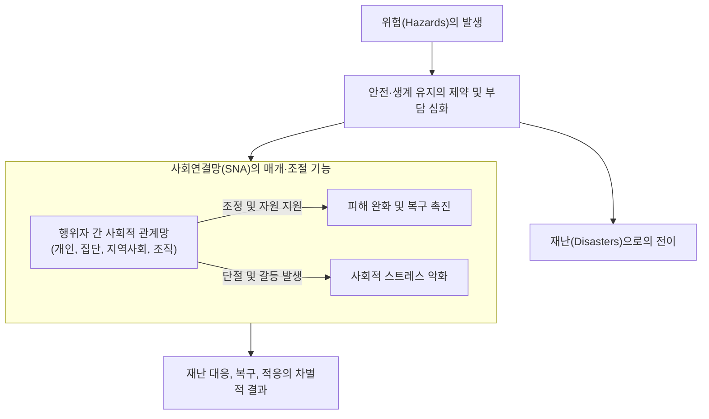
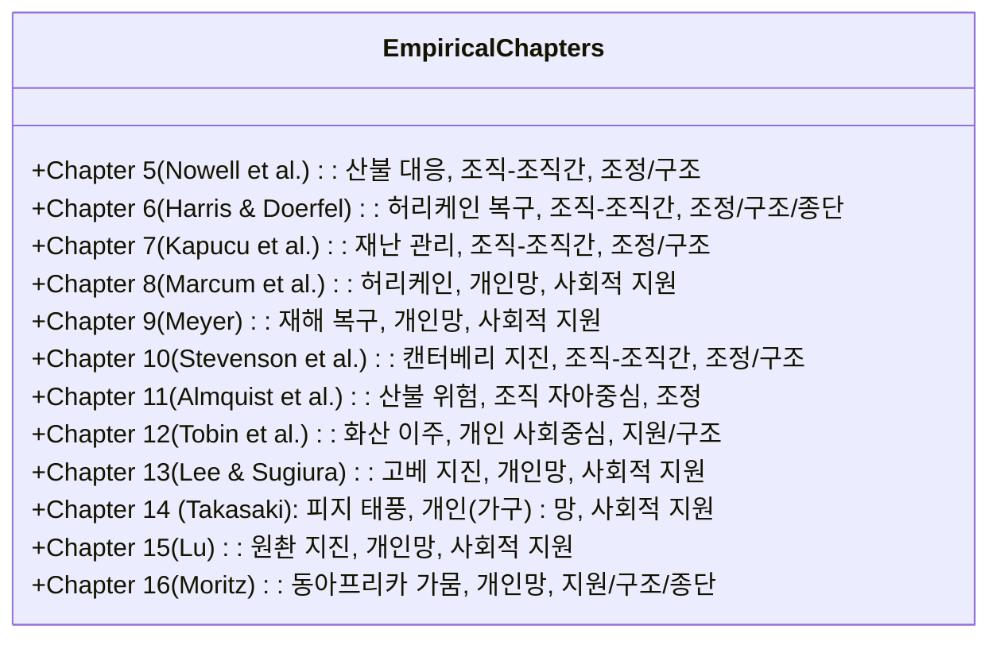
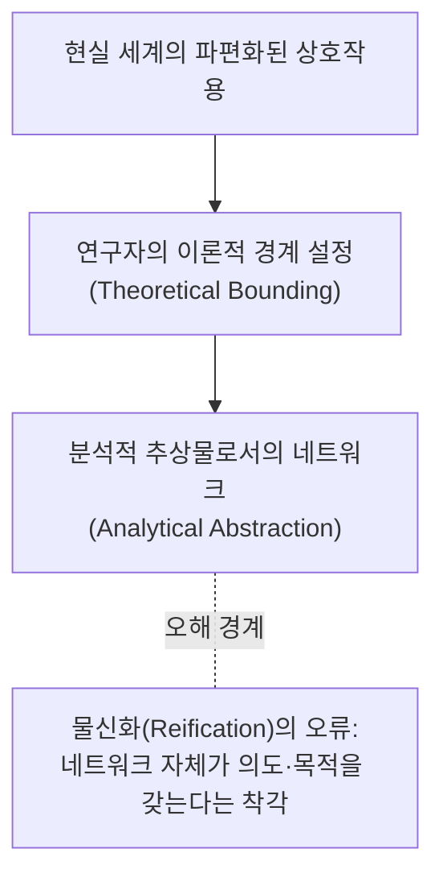
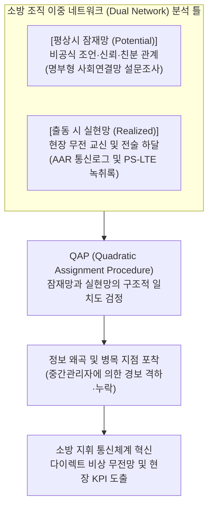
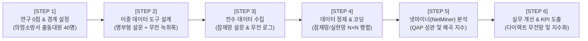

# 제1장 재난 맥락에서의 사회연결망 분석 서설 (Sub-Note)

**원제**: CHAPTER 1 AN INTRODUCTION TO SOCIAL NETWORK ANALYSIS IN DISASTER CONTEXTS  
**저자**: Eric C. Jones¹ (University of Texas Health Science Center at Houston), A.J. Faas² (San Jose State University)  
**출처**: *Social Network Analysis of Disaster Response, Recovery, and Adaptation* (Elsevier, 2017, pp. 3–9, http://dx.doi.org/10.1016/B978-0-12-805196-2.00001-7)  

---

## [개요] 챕터 목차 체계 (Chapter Outline)

1. **서론** (Introduction, p. 3)
2. **도서의 내용과 구성 체계** (The Content and Layout of the Book, p. 4)
   * 표 1.1: 실증 연구 챕터들의 분석 접근법 및 연구 초점 (Table 1.1, p. 5)
3. **핵심 하이라이트 및 주요 주목 사항** (Highlights and Things to Watch for, p. 6)
   * 역할 (Roles, p. 6)
   * 네트워크의 분석 수준 (Levels of Networks, p. 6)
   * 학제간 융합 연구 (Interdisciplinarity, p. 6)
   * 잠재적 연계 대 실현된 연계 (Potential Versus Realized Ties, p. 7)
   * 취약 인구 명명에 수반되는 연구 윤리 (The Ethics of Naming Vulnerable People, p. 7)
   * 정책 및 실무 적용 (Applications, p. 8)
4. **재난과 네트워크 존재론의 문제** (Disasters and the Question of Network Ontologies, p. 8)
5. **결론** (Conclusions, p. 8)

---

# 1. 서론 (Introduction)

### 1. 위험(Hazards)에서 재난(Disasters)으로의 전이 메커니즘
- **재난의 본질**: 위험(hazard)은 사람들이 안전하고 안정적인 삶과 생계를 유지하기 위한 기회와 제약이 심각한 한계에 부딪힐 때 비로소 ‘재난(disaster)’으로 비화됩니다.
- **사회적 상호작용의 이중성**: 사회적 상호작용은 재난으로 인한 스트레스와 부담을 완화(mitigate)할 수도 있고, 반대로 악화(exacerbate)시킬 수도 있습니다.
- **연구의 필요성**: 집단, 지역사회, 조직 내부 및 조직 간 연계(ties)가 위험과 재난에 어떻게 반응하고 영향을 받는지를 체계적으로 규명하는 지적 노력이 필수적입니다.

### 2. 사회과학에서 사회연결망(Social Networks)을 다루는 2대 접근법
사회과학 연구에서 사회연결망은 크게 두 가지 방식으로 다루어집니다:

| 구분 | 1. 은유적·발견적 접근법 (Metaphorical / Heuristic) | 2. 공식적 측정 시스템 (Formal System of Measurement) |
| :--- | :--- | :--- |
| **개념적 성격** | 특정 맥락에서 연구자가 인지한 관계나 상호작용 패턴을 요약하는 서술적·분석적 개념 | 그래프 이론(graph theory)에 기반한 엄밀한 수학적·통계적 측정 체계 |
| **주요 연구 방식** | 관계적 관찰을 위한 정성적 가이드, 개념적 틀거리(Heuristics)로 활용 | 밀도(density), 중앙성(centrality), 집중도(centralization), 교량화(bridging), 복잡성 및 네트워크 변화 측정 |
| **본 도서의 위치** | 기여 저자들이 개념과 경험적 트렌드를 풍부하게 차용함 | **본 도서가 핵심적으로 지향하는 주된 분석 틀** |

### 3. 본 도서의 학술적 차별성과 의의
- **분절된 학문 분과 간의 통합**: 기존 재난 연구와 연결망 분석은 여러 분과 학문(행정학, 사회학, 인류학 등)의 경계 속에 흩어져 있었습니다. 본서는 이를 집대성한 최초의 저작입니다.
- **대인 네트워크와 조직간 네트워크의 결합**: 상호 교류가 극히 드물었던 **‘대인 재난 네트워크(interpersonal disaster networks)’** 연구와 **‘조직간 재난 네트워크(interorganizational disaster networks)’** 연구를 한자리에 모아 이론적 간극을 탐색합니다.
  - *예시 (교량화/Bridging의 상이한 의미)*:
    - 대인 네트워크 연구: 교량(bridging) 연계는 주로 **권력(power), 취약성(vulnerability), 자산 및 부채(assets/liabilities)**를 분석하는 렌즈로 활용됨.
    - 조직간 네트워크 연구: 교량 연계는 주로 **커뮤니케이션의 효과성(effectiveness of communication)**과 **목표 일치도(goal alignment)**를 평가하는 렌즈로 활용됨.
- **이원적(Dyadic) 관계를 넘어 전체 관계망(Whole Web of Relationships)으로의 확장 요구**:
  - 연구들이 특정 개인·역할·기관 간의 쌍방 교환(dyadic data)에 머무르지 않고, 전체 네트워크 내 다른 개인, 이항 쌍, 클리크(cliques)에 대한 의존성을 종합적으로 파악할 것을 촉구합니다.

---

# 2. 도서의 내용과 구성 체계 (The Content and Layout of the Book)

본서는 이론적 기초에서 출발하여 실증적 사례 연구, 그리고 실무 적용에 이르는 5개 부(Part), 17개 장으로 구성되어 있습니다:
- **Part I: 기초 이론 및 방법론 (1~4장)**: 개인 및 조직 수준의 이론적 오리엔테이션과 포괄적 방법론 프레임워크 제공.
- **Part II: 재난 대응 (Response, 5~7장)**: 산불, 허리케인 등 긴급 대응 네트워크의 실증 분석.
- **Part III: 재난 복구 (Recovery, 8~12장)**: 장기 복구 과정에서의 사회적 자본, 정신건강, 취약성 분석.
- **Part IV: 적응 및 완화 (Adaptation and Mitigation, 13~16장)**: 가뭄, 지진, 태풍 등 만성적·주기적 위험에 대한 사회적 적응망 분석.
- **Part V: 적용 (Applications, 17장)**: 재난 정책 및 실무 현장 개선을 위한 실천적 제언.

### 표 1.1 실증 연구 챕터들의 분석 접근법 및 연구 초점 (Table 1.1)

| 장 (Chapter) | 네트워크 분석 수준 및 행위자 유형 | 사회적 지원 (Social Support) | 조정 (Coordination) | 구조적 지표 (Structure) | 종단적 설계 (Longitudinal) |
| :---: | :--- | :---: | :---: | :---: | :---: |
| **제5장** | 사회중심(Sociocentric) — 조직(Organizations) | | **X** | **X** | |
| **제6장** | 사회중심(Sociocentric) — 조직(Organizations) | | **X** | **X** | **X** |
| **제7장** | 사회중심(Sociocentric) — 조직(Organizations) | | **X** | **X** | |
| **제8장** | 자아중심(Egocentric) — 개인(Individuals) | **X** | | | |
| **제9장** | 자아중심(Egocentric) — 개인(Individuals) | **X** | | | |
| **제10장** | 사회중심(Sociocentric) — 조직(Organizations) | | **X** | **X** | |
| **제11장** | 자아중심(Egocentric) — 조직(Organizations) | | **X** | | |
| **제12장** | 사회중심(Sociocentric) — 개인(Individuals) | **X** | | **X** | |
| **제13장** | 자아중심(Egocentric) — 개인(Individuals) | **X** | | | |
| **제14장** | 자아중심(Egocentric) — 개인/가구(Households) | **X** | | | |
| **제15장** | 자아중심(Egocentric) — 개인(Individuals) | **X** | | | |
| **제16장** | 자아중심(Egocentric) — 개인(Individuals) | **X** | | **X** | **X** |

> [!NOTE] **도표 1.1이 시사하는 재난 연결망 연구의 학술적 불균형**
> 1. **행위자 유형과 분석 수준의 고착화**: 12개 실증 챕터 중 단 2개 챕터(제11장, 제12장)를 제외하고는 모두 **"개인 연구 = 자아중심 네트워크(Egocentric)"**, **"조직 연구 = 사회중심 전체 네트워크(Sociocentric)"**라는 이분법적 공식에 머물러 있습니다.
> 2. **구조 분석(Structure) 및 종단적 분석(Longitudinal)의 절대적 부족**: 네트워크 구조 지표(밀도, 응집력, 경로 거리 등)를 정밀 측정하거나 시간에 따른 변화를 종단적으로 추적한 연구는 여전히 극소수에 불과합니다.

---

# 3. 핵심 하이라이트 및 주요 주목 사항 (Highlights and Things to Watch for)

저자들은 재난 네트워크 연구가 기존 한계를 극복하고 학문적 도약을 이루기 위해 주목해야 할 6대 핵심 쟁점을 제시합니다.

### 1) 역할 (Roles)
- **조직망 속 대인 관계의 존재**: 조직 간 네트워크 연계 중 상당수는 실제로는 **개인 간 인간관계(interpersonal relationships)**에 뿌리를 두고 있습니다.
- **세 가지 관계적 층위**:
  1. *순수 인간관계*: 개인적 성향, 친분, 공통의 역사에 기반한 우정적 관계.
  2. *역할 간 관계(Interrole relations)*: 직위나 역할에 묶여 있어, 담당자가 바뀌어도 직책 승계자를 통해 지속되는 공식적 관계.
  3. *비인격적 제도 간 거래(Impersonal interinstitutional relations)*: 금융기관 간의 자금 이체와 같이, 개인이나 역할의 고유한 성격과 무관하게 기계적으로 일어나는 상호작용.

### 2) 네트워크의 분석 수준 (Levels of Networks)
- 고정된 수준 구분을 넘어, **개인 수준 네트워크와 지역사회 수준 네트워크의 다층적 결합(joining levels)**이 필요합니다.
  - 예: 개인 행동에 영향을 미치는 자아중심 네트워크들을 모아 지역사회 전체의 대푯값 네트워크로 결합함으로써 구조적 맥락을 풍부화함 (제5장 Nowell et al. 참조).
- 개인 수준 사회연결망 연구와 조직간 네트워크 연구 사이의 통합 결여를 극복해야 합니다.

### 3) 학제간 융합 연구 (Interdisciplinarity)
- 단일 저자 혹은 단일 분과 중심 연구의 한계를 벗어나 학제간 시각을 교차시켜야 합니다:
  - 행정학(Public Administration): 3, 4, 5, 10장
  - 사회학(Sociology): 7, 8, 9장
  - 커뮤니케이션학(Communication): 6장
  - 인류학(Anthropology): 2, 12, 13, 16, 17장
  - 지리학(Geography): 11장
  - 경제학(Economics): 14, 17장

### 4) 잠재적 연계 대 실현된 연계 (Potential Versus Realized Ties)
- **잠재적 연계(Network Potential)**: 정서적 친밀도나 평상시 지향성에 기초한 기존 관계망. 재난 이후의 결과 예측에서 불분명한 예측력을 보임.
- **실현된 연계(Network Activation / Realized Ties)**: 재난 발생 시 도구적(instrumental)으로 실제 작동하고 지원을 주고받은 관계망. 사후 성과 및 메커니즘을 보다 명확히 설명함.
- **연구적 과제**: 잠재적 관계가 어떤 조건 하에서 실제 활성화된 연계로 전환되는지 그 간극을 규명해야 함.

### 5) 취약 인구 명명에 수반되는 연구 윤리 (The Ethics of Naming Vulnerable People)
재난 및 사회연결망 연구는 일반 사회과학 연구보다 훨씬 엄중한 윤리적 책무를 요구합니다:
1. **취약성의 증폭**: 재난 피해자들은 심리적·물리적으로 극히 취약하여 인터뷰 동의 과정에서 유도되기 쉽고, 응답 내용이 개인의 치명적 취약점을 드러낼 수 있음.
2. **동의 없는 제3자 지명(Name Generator의 문제)**: 응답자(Ego)가 조사에 참여하지도 않은 타인(Alter)의 이름, 종교, 소득, 정치 성향, 건강 상태, 사적 상호작용 내역을 연구자에게 노출함.
   - *보호 조치*: 고유 식별자(Unique ID) 부여를 통한 철저한 비식별화(de-identification) 필수.
3. **거울 보기(Self-evaluation)와 부작용 통제**: 분석 결과를 응답자 공동체에 환류할 때, 상호 비교나 서열화, 갈등을 유발하지 않도록 상호 협력적 방식으로 관리해야 함.

### 6) 정책 및 실무 적용 (Applications)
- 국제 인도주의 기구들의 관심: IFRC(2014) *World Disasters Report*와 UNISDR(2011) 보고서는 사회연결망을 재난 대응과 복구의 핵심 동력인 **‘지역사회 역량(community competence)’**으로 규정함.
- **만족화(Satisficing)를 넘어서는 정밀성**: 단순히 "네트워크나 사회적 자본이 부족해서 실패했다"는 식의 피상적 결론(satisficing; Simon, 1957)을 지양하고, 구체적 지원, 교환, 조정, 자생적 동태성을 정책에 정밀하게 매핑해야 함.

---

# 4. 재난과 네트워크 존재론의 문제 (Disasters and the Question of Network Ontologies)

> [!IMPORTANT] **네트워크의 존재론적 성격 (저자들의 핵심 선언)**  
> **"엄밀히 말해 사회연결망은 공식 조직 외부에서는 '객관적 실체(objective things)'로 존재하지 않는다."**

### 1. 분석적 추상물(Analytical Abstractions)로서의 네트워크
- 네트워크는 스스로 움직이는 객관적 실체가 아니라, **연구자가 이론적으로 도출한 경계(boundaries)를 바탕으로 특정 관계들을 규정한 ‘분석적 추상물’**입니다.
- 네트워크는 공식 조직 구조, 행동 계획, 인지 모델, 또는 과거 상호작용의 흔적으로만 식별될 수 있습니다.

### 2. 네트워크의 행위성(Agency)과 목적성(Telos)의 부재
- 앤드루 피커링(Andrew Pickering, 1995)의 '물질적 행위성(material agency)' 개념을 빌려 "세상에서 무언가를 수행한다"는 느슨한 의미를 부여할 수는 있으나, **네트워크 자체에는 고유한 목적(telos)이나 의도성(intentionality)이 존재하지 않습니다.**
- 행위와 의도를 지닌 주체는 개별 행위자(개인 또는 조직)이며, 네트워크는 이들의 연결 패턴을 통해 행위를 촉진하거나 제약할 뿐입니다.

### 3. '흐름(Flow)' 개념에 대한 비판적 재검토
- 네트워크 연계를 통해 "정보가 흐른다(flow)"고 당연시하는 관점을 비판합니다.
- 실제 현실에서 정보는 파이프라인처럼 온전히 흐르는 것이 아니라, 네트워크 내의 중개자(brokers)와 제약 요인에 의해 **격상(upgraded), 격하(downgraded), 왜곡·수정(revised), 모호화(obfuscated)**됩니다.

---

# 5. 결론 (Conclusions)

- 본서는 재난 환경 속에서 인간, 집단, 지역사회의 상호작용 및 자원 교환 행동의 다양한 변이(variation)를 규명하는 통합적 학술 기반을 구축하고자 합니다.
- 재난은 일상성이 무너지고 경계가 모호해지는 **임계 공간(liminal space)**을 형성합니다. 비록 일상이 멀어 보일지라도 사람들은 매일매일 사회연결망을 통해 그 일상성을 다시 끌어당깁니다(reeled in daily through social networks).
- 연결망 분석은 이처럼 덧없고(ephemeral) 동태적인 재난 현장의 사회적 상호작용을 가장 심층적으로 포착해낼 수 있는 강력한 통찰을 제공합니다.

---

# [부록] 박사학위 논문 선행연구 분석 템플릿 연계

| 순서 | 분석 항목 | 제1장 핵심 요약 및 연구자 통제 관점 |
| :---: | :--- | :--- |
| **1** | **연구배경** | 재난은 사회 인프라와 관계망을 급격히 해체·교란함. 재난 피해의 완화와 악화는 사회적 관계망의 구조적 배치에 의해 결정되나, 대인망과 조직망 연구가 심각하게 분절되어 있음. |
| **2** | **이론적 개념** | 은유적 네트워크 vs 공식 측정 네트워크; 이원적(Dyadic) 관계 vs 전체망(Whole Network); 잠재적 연계(Potential) vs 실현된 연계(Activation); 네트워크 존재론(분석적 추상물). |
| **3** | **연구목적** | 분과 학문별(행정학, 사회학, 인류학 등)로 분산된 재난 연결망 연구를 집대성하고, 대인망과 조직망을 아우르는 체계적 이론·방법론적 분석 틀을 정립함. |
| **4** | **연구방법** | 문헌 고찰 및 도서 수록 12개 실증 연구 매트릭스 분석 (분석 수준, 행위자 유형, 지원, 조정, 구조, 종단 연구 여부 교차 검토). |
| **5** | **연구결과** | 대부분의 연구가 '개인-자아중심망' 또는 '조직-사회중심망'의 이분법에 갇혀 있으며, 구조적 지표 측정 및 종단적 분석이 절대적으로 부족함을 실증적으로 제시함 (표 1.1). |
| **6** | **핵심 발견** | 1) 네트워크는 객관적 실체가 아닌 연구자의 분석적 추상물임. 2) 조직간 연계의 기저에는 대인적 관계와 역할 관계가 혼재함. 3) 정보는 온전히 흐르는 것이 아니라 매개자에 의해 왜곡·변형됨. |
| **7** | **연구의 한계** | 수록된 실증 챕터 다수가 단일 분과 학문 중심이며, 잠재적 연계와 실제 활성화된 연계 간의 전이 메커니즘을 규명하는 데 데이터의 한계가 존재함. |
| **8** | **이론적 시사점** | 네트워크 물신화(Reification)를 경계하고, 행위자의 의도성과 구조적 제약의 변증법적 상호작용으로 재난 네트워크를 파악해야 함을 입증. |
| **9** | **후속 연구 시사점** | 개인망과 조직망을 연계하는 다수준(Multilevel) 네트워크 모델링의 도입, 취약 인구 연구 윤리의 제도화, 종단적 네트워크 데이터 구축 필요. |

---

# 6. 소방 조직 및 현장 대응 적용 연구 주제 및 방법론 (Application to Fire Services)

> [!TIP] **학습 지도노트 연계**: AI 활용 성과지표(KPI) 도출 7대 원칙 및 박사학위 연구모델 확장  
> 제1장의 핵심 이론인 **(1) 대인망 vs 조직망 이원론 극복**, **(2) 잠재적 연계 vs 실현된 연계**, **(3) 정보 흐름의 왜곡(격상·격하·모호화)**, **(4) 네트워크 비물신화(분석적 추상물)** 개념을 소방 현장에 실증적으로 접목합니다.

### 1. 연구질문 (Research Questions)
- **RQ 1 (잠재망과 실현망의 구조적 괴리)**: 평시 비공식 신뢰/조언 잠재망($M_{\text{potential}}$)과 출동 시 무전 교신 실현망($M_{\text{realized}}$) 간의 구조적 상관성(QAP Matrix Correlation)은 얼마나 일치하는가?
- **RQ 2 (정보 흐름의 왜곡 및 병목 노드)**: 무전 지휘선에서 현장 대원의 위험 보고가 최고지휘관에게 전달될 때, 특정 중간관리자(소방위·소방장)에 의해 정보가 격하(downgraded), 수정(revised), 또는 묵살(obfuscated)되는 병목(Bottleneck) 현상이 발생하는가?
- **RQ 3 (공식 ICS 지휘망 vs 비공식 자문망)**: 화재안전 현장에서 공식 계통망(ICS)과 비공식 전문 조언망의 불일치가 현장 진입 후 초진 시간 및 대원 안전사고에 미치는 영향은 무엇인가?
- **RQ 4 (동태적 전이와 잠재 연계 활성화)**: 평시 잠재망에서 높은 중심성을 가진 대원이 실제 출동 현장(실현망)에서 핵심적인 상황 전파자 및 중개자로 온전히 활성화(Activation)되는가?
- **RQ 5 (네트워크 성과 및 안전 책무성)**: 잠재망과 실현망 간의 정합도(Alignment)가 높은 팀일수록 아차사고 보고율이 높고 현장 안전수칙 위반율이 낮은가?

### 2. 확인한 연구결과 (Key Findings from Literature)

| 이론 및 챕터 출처 | 선행연구 핵심 실증 결과 | 본 소방 안전 네트워크 연구로의 연계 시사점 |
| :--- | :--- | :--- |
| **대인망 vs 조직망 이원론 극복 (Chapter 1; Quarantelli & Dynes, 1977)** | 대부분의 재난 연구가 개인 수준 또는 조직 수준 중 하나에 편중되어 양자 간 배태성을 놓침. | 소방서라는 공식 조직(조직 수준) 내에서 개별 대원 간의 비공식 대인망(개인 수준)이 상호작용하는 다수준(Multilevel) 분석 틀 구축. |
| **잠재적 연계 vs 실현된 연계 (Chapter 1; Table 1.1)** | 평상시 형성된 사회적 자본(잠재망)이 재난 충격 시 실제로 활성화(실현망)되지 못하면 무용지물이 됨. | 평시 비공식 조언망(잠재망)과 출동 시 무전 교신망(실현망)의 불일치도를 QAP 행렬 상관으로 정량화하여 유휴 자본 발견. |
| **정보 흐름 왜곡 메커니즘 (Chapter 1; Pickering, 1995 비판)** | 정보는 파이프라인처럼 온전히 흐르지 않고 매개자에 의해 격상, 격하, 수정, 모호화됨. | 현장 대원이 보고한 급격한 연소 위험 신호가 중간 지휘관에 의해 묵살·격하되어 지휘관에게 미도달하는 병목 노드 식별. |
| **네트워크 비물신화 (Chapter 1; Ontological Stance)** | 네트워크는 스스로 움직이는 실체가 아니며 연구자의 목적에 따라 경계가 획정되는 '분석적 추상물'임. | '재난 대응 네트워크'라는 추상적 개념을 의령소방서 출동 대원들의 구체적 무전 통화 및 Roster 설문으로 정밀 조작화. |

### 3. 연구절차 (Research Procedure: 6단계 표준 프로세스)

### 4. 네트워크 분석단위 및 분석지표 (Units & Network Metrics)

1. **노드 수준 (Node-level)**:
   - **개별 소방공무원 노드 ($N \approx 40$명)**:
     - **In-Degree Centrality (인입 연결정도)**: 평시 대원들로부터 안전 조언/도움을 요청받는 빈도 $\to$ 신뢰받는 안전 리더 지수.
     - **Out-Degree Centrality (인출 연결정도)**: 출동 시 무전 지시 및 보고를 적극적으로 발신하는 빈도.
     - **Betweenness Centrality (매개 중심성)**: 지휘부와 현장 대원 사이에서 통신을 독점하는 소통 교량(Bridge) 또는 정보 차단 병목(Bottleneck).
     - **Information Distortion Index (정보 왜곡 지수)**: 하위 발신 정보와 상위 수신 정보 간 누락·격하율.
2. **하위집단 수준 (Subgroup-level)**:
   - **계급별(지휘관리층, 중간관리층, 일선대원층) 및 부서별(구조대, 진압대, 구급대)**:
     - **E-I Index (External-Internal Index)**: 집단 내부 무전 교신 vs 집단 간 교신 비율 산출 ($-1$에 가까울수록 부서 간 소통이 단절된 폐쇄적 무전, $+1$에 가까울수록 개방적 합동 교신).
3. **전체망 수준 (Whole-level)**:
   - **의령소방서 출동부서 전체망**:
     - **Network Density (네트워크 밀도)**: 잠재망 밀도 vs 실현망 밀도의 전이율.
     - **Network Centralization (집중도)**: 무전 교신이 현장지휘관 1인에게 지나치게 집중되어 과부하가 발생하는지 측정.
     - **Reciprocity (호혜성)**: 명령과 복명복창(피드백)의 상호 교환 비율.

### 5. 네트워크 데이터 구조 및 코딩처리 방식 (Data & Coding Method)

| 구분 | 데이터 형식 | 변수 구성 및 코딩 기준 |
| :--- | :--- | :--- |
| **노드 속성 데이터 (Node Properties)** | 1-mode 엑셀 테이블 (행 = 소방관 $i$) | • **ID**: 고유 식별코드 (Fire-01 ~ Fire-40) • **Rank (계급)**: 1=지휘관리층(령·경), 2=중간관리층(위·장), 3=일선대원층(교·사) • **Team (부서)**: 1=119구조대, 2=현장대응단 진압대, 3=구급대 • **Role (직무)**: 지휘, 진압, 구조, 구급, 운전 • **Radio_CH**: 주 사용 무전 채널 (지휘망, 작전1망, 작전2망) |
| **잠재망 행렬 ($M_{\text{potential}}$)** | $N \times N$ 정방 행렬 | "평상시 고위험 현장 출동을 앞두고 가장 신뢰하고 전술 조언을 구하는 동료는 누구인가?" 1점(전혀안함) ~ 5점(매우자주). 4점 이상을 연계 존재(1)로 이진화(Binarization) 병행. |
| **실현망 행렬 ($M_{\text{realized}}$)** | $N \times N$ 정방 행렬 | 대형 화재 현장 무전 교신 녹취록(PS-LTE/소방무전) 내용분석: 소방관 $i$가 소방관 $j$를 호출하여 위험/지시를 하달한 총 발화 횟수 코딩. |

> [!NOTE] **코딩 정제 및 결측치 관리 원칙**  
> 1. **대각선 요소 처리**: 자기 자신과의 관계($i = j$)는 모두 `0`으로 처리합니다.  
> 2. **결측치(Missing Data) 통제**: Valente et al.(2008) 기준에 따라 비번/출장 대원에 대해 3회에 걸친 대면 추적 조사를 실시하여 결측률을 10% 미만으로 강제 통제합니다.  
> 3. **무전 녹취록 코딩 신뢰도**: 2인의 분석자가 독립적으로 무전 녹취록을 코딩하여 크립펜도르프 알파(Krippendorff's $\alpha$) 0.85 이상 확보 후 불일치 항목 상호 합의.

### 6. 자료수집 및 설문조사/녹취록 집행 전략 (Data Collection)
- **사전 명부 방식(Prepared Roster Method) 전면 채택**: 자유 명명생성법의 철자 오류 및 과소보고를 방지하기 위해 관내 출동대원 40명의 성명·직책이 인쇄된 표준 명부형 설문지 배포.
- **사후보고서(AAR) 및 무전 녹취록 연계**: 최근 발생한 대형 공장·산불 화재 2건의 공식 소방활동 검토보고서(AAR)에 첨부된 무전 교신 녹취록 전수 텍스트 마이닝.
- **연구 윤리 및 비문책 보증**: 설문 및 교신 분석 결과가 감찰이나 징계에 일체 활용되지 않음을 보증하는 기관장 협약서 및 연구윤리 서약서 체결.

### 7. 넷마이너(NetMiner) 4단계 정밀 분석 프로토콜
- **Step 1: 데이터 모델링 (Import)**: 노드 속성 테이블과 $M_{\text{potential}}, M_{\text{realized}}$ 행렬을 넷마이너 4에 임포트하여 이중 네트워크 레이어 구축.
- **Step 2: 토폴로지 시각화 (Visualization)**: Spring-Embedder 알고리즘을 적용하여 평시 잠재망과 출동 실현망의 구조적 배치를 나란히 2D 매핑. 링크 굵기 = 교신 빈도.
- **Step 3: 중심성 및 병목 노드 분석 (Analysis)**: In/Out-Degree, Betweenness 산출. 잠재망에서는 중심에 있으나 실현망에서 고립되는 노드(유휴 자원) 및 정보 왜곡 병목 노드 적출.
- **Step 4: 통계적 추론 검정 (Inference)**: NetMiner QAP Correlation 모듈(Permutations = 5,000회)을 실행하여 잠재망과 실현망 간의 상관계수 검정. MRQAP 회귀분석으로 계급 및 부서 일치도가 교신 빈도를 설명하는지 검증.

### 8. 최종 실무·정책 환류: 소방 안전관리 KPI 도출 및 법적 근거

#### 1) 소방 실무 개선 및 KPI 도출
- **다이렉트 비상 무전 채널(Direct Emergency Channel) 신설**: 중간 지휘관의 자의적 정보 필터링을 방지하기 위해 현장 대원이 긴급 위험 직면 시 최고지휘관에게 즉각 보고하는 비상 채널 공식화.
- **소방 고유 KPI(70%)**: **'현장 안전교신 상호운용성 및 잠재-실현망 일치도 지수'**를 신설하여 일선 소방서 안전관리 종합평가에 반영.

#### 2) 관련 법적 근거 매핑 (조문 강제 연계)
- **소방기본법 제16조의2(소방지원활동)** 및 **제16조의3(소방활동에 대한 방해의 배제)**
- **재난 및 안전관리 기본법 제52조(긴급구조통제단장의 현장지휘)**: 현장지휘관의 명확한 지휘 통일성과 정보 왜곡 방지 의무화 규정.
- **소방청 현장소방활동 안전관리 로드맵**: 현장 대원의 위험 상황 보고권(Safety Voice) 보장 및 무전 통신망 상시 모니터링 규정.
