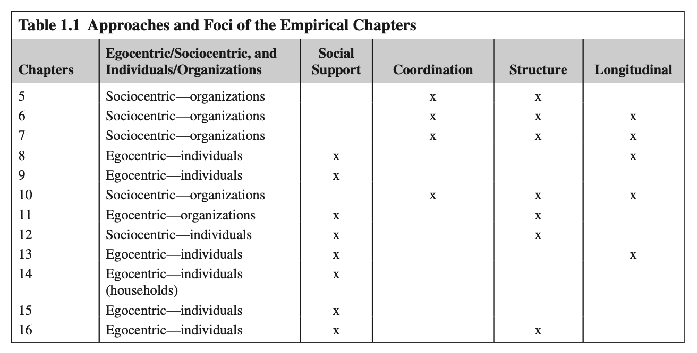

# CHAPTER 1: AN INTRODUCTION TO SOCIAL NETWORK ANALYSIS IN DISASTER CONTEXTS

**Authors:** Eric C. Jones¹, A.J. Faas²  
¹University of Texas Health Science Center at Houston, El Paso, TX, United States  
²San Jose State University, San Jose, CA, United States  

**Source:** *Social Network Analysis of Disaster Response, Recovery, and Adaptation*. http://dx.doi.org/10.1016/B978-0-12-805196-2.00001-7  
Copyright © 2017 Elsevier Inc. All rights reserved. (pp. 3–9)

---

## CHAPTER OUTLINE

* **Introduction** (p. 3)
* **The Content and Layout of the Book** (p. 4)
* **Highlights and Things to Watch for** (p. 6)
  * Roles (p. 6)
  * Levels of Networks (p. 6)
  * Interdisciplinarity (p. 6)
  * Potential Versus Realized Ties (p. 7)
  * The Ethics of Naming Vulnerable People (p. 7)
  * Applications (p. 8)
* **Disasters and the Question of Network Ontologies** (p. 8)
* **Conclusions** (p. 8)

---

## INTRODUCTION

Hazards become disasters as the opportunities and constraints for maintaining a safe and secure life and livelihood become too strained for many people. Anecdotally and through many case studies, we know that social interactions exacerbate or mitigate those strains. However, we need a concerted intellectual effort to understand the variation in how ties within and between groups, communities, and organizations both respond to and are affected by hazards and disasters. Network research allows us to be incredibly creative in the ways that we capture the subtle, intricate, and dynamic power of relationships and interactions in the areas of disaster response, recovery, and adaptation.

Before, during, and after a disaster, people, agencies, and organizations help and hinder each other, alternatively opening up new possibilities and hamstringing others. To be sure, exposures to hazards become disasters in large part as a result of relational patterns in societies, and our responses to disasters—emergency deployment, mitigation, coping, and adaptation—are likewise facilitated and obstructed by variations in coordination and support between networks of actors. The social network is therefore a seductive concept in the social science of disasters—a potentially robust tool for investigating complex patterns of social relations and human-environment entanglements.

Social networks are typically invoked in one of two general ways in social science research: (1) metaphorically or heuristically, as descriptive or analytical concepts that summarize researchers’ perceived patterns of relationships or interactions in particular contexts, or else as guides for systematic observations of relationships and interactions; and (2) as a formal system of measurement of either personal or whole (i.e., community or institutional) patterns of relationships or interaction employing one or more measures derived from graph theory (e.g., density, centralization, bridging, etc.) and, more recently, examining complexity and network change. This book is principally focused on the second broad approach to network analysis, though contributors draw heavily on concepts and empirical trends identified in studies that engage networks more metaphorically.

This book is the first of its kind; it presents a great deal of the diversity in network approaches to better understanding how people and groups experience extreme events. Since both network analysis and disaster studies are often separated out into the publishing confines of multiple disciplines—and we do not always read outside of these disciplines—this cutting-edge scholarly work would otherwise be scattered in disparate journals and books. Not only does this book bring this work from different disciplines together but it brings together the relatively minimally interacting fields of interpersonal disaster networks and interorganizational disaster networks. By doing so, we can start to explore the theoretical disconnects between the ways networks are deployed by scholars. For example, we note that the study of bridging—or being a relatively unique connection between at least a couple of parts of a network—in the field of interpersonal networks usually means we are examining power, vulnerability, or assets/liabilities, while in the field of interorganizational networks we are typically examining the effectiveness of communication and, to a lesser extent, goal alignment.

We have tried to keep the studies in this book to those that revolve around identifiable disasters and that use systematic qualitative or quantitative analysis of dyadic data—the specific kinds of relationships between specific individuals, roles, or institutions. This said, we would like even more studies to go beyond dyadic analyses and to engage the entire web of relationships involved in disasters. In other words, exchange and dyadic interaction is a minimum in our mind for the study of relationships and disasters, but it does not fully leverage the possibilities of social network analysis because the dependence of a dyad on other individuals and dyads and cliques (and the rest of the network) is left unexamined when only paying attention to dyads. While we have chosen studies for this book that we consider to use the methodologies of social network analysis, our interest is less on the importance of conducting social network analysis and more on the kinds of things it can tell us about human behavior in extreme settings.

---

## THE CONTENT AND LAYOUT OF THE BOOK

This first section provides orientations to theory on individual and organizational networks in disaster settings plus a methodological overview of the loosely organized field. Then empirical work comprises the sections on response, recovery, and adaptation/mitigation. Each empirical chapter also addresses methodological and theoretical concerns. Since we are addressing a fairly new and somewhat specialized field, we end the book with a chapter that provides insight into how this new and specialized knowledge can be applied to improve response, recovery, and adaptation.

The authors in this book cover some major events of our times like Hurricanes Katrina, Sandy, and Ike in the United States, the Wenchuan earthquake in China, the Kobe earthquake in Japan, and the Canterbury earthquakes in New Zealand, plus some lesser known events, like volcanic eruptions in Ecuador and Mexico, landslides in Mexico, a day care fire in Mexico, a typhoon in Fiji, wildfires in the United States, and drought in East Africa. These studies include those in contexts of geophysical and hydrometeorological hazards (volcanoes and mudslides—Tobin and colleagues; earthquakes—Stevenson, Lee and Sugiura, Lu; hurricanes—Marcum and colleagues, Harris and Doerfel, Meyer; typhoons—Takasaki; droughts—Moritz; wildfires—Nowell and colleagues, Almquist and colleagues), and those caused by human carelessness or recklessness (a building fire—Rangel and colleagues). We purposefully avoided including events of conflict or mass terror since—although we see them theoretically as extreme events, too—intentionality in such events often involves some very different responses and adaptations.

Table 1.1 presents the general focus and methodological approach of each empirical chapter. These chapters cover considerable variation in the kinds of networks that are studied. There is not always a clear division between egocentric networks that focus on the ties in each individual’s or organization’s own network versus sociocentric networks that focus on an identifiable group or interaction sphere. However, it is worth noting the degree to which this book’s chapters cover networks that are more methodologically relying on ties focused on a given individual/organization versus ties that exist within a group of people/institutions that are likely to interact. Among the book’s 12 case study chapters, only two chapters break the pattern of egocentric networks being about individuals and sociocentric networks being about organizations. Similarly, few chapters cover network structure (e.g., density, cohesion, bridging, path distance) or employ longitudinal design. It was not our goal to have all chapters cover structure or network dynamics/change, but it is clear that these approaches are not in the majority for disaster network research.

To the extent the data allowed, the authors have tried to address temporal aspects of networks, although we only marked them as longitudinal when comparable data was collected at two or more points in time. Since people may rely on different kinds of people for different things at different points as hazards, the contributors have attempted to account for dynamic shifts in needs, constraints, and help seeking.

### Table 1.1: Approaches and Foci of the Empirical Chapters

| Chapters | Egocentric / Sociocentric, and Individuals / Organizations | Social Support | Coordination | Structure | Longitudinal |
| :---: | :--- | :---: | :---: | :---: | :---: |
| **5** | Sociocentric—organizations | | X | X | |
| **6** | Sociocentric—organizations | | X | X | X |
| **7** | Sociocentric—organizations | | X | X | |
| **8** | Egocentric—individuals | X | | | |
| **9** | Egocentric—individuals | X | | | |
| **10** | Sociocentric—organizations | | X | X | |
| **11** | Egocentric—organizations | | X | | |
| **12** | Sociocentric—individuals | X | | X | |
| **13** | Egocentric—individuals | X | | | |
| **14** | Egocentric—individuals (households) | X | | | |
| **15** | Egocentric—individuals | X | | | |
| **16** | Egocentric—individuals | X | | X | X |

<!-- [참고: 원서 Chapter 1에는 도표(Table 1.1) 외 별도의 그림(Figure)은 수록되어 있지 않습니다. 관련 시각 자료나 다이어그램 추가 시 아래 양식을 사용하세요.] -->
<!--  -->

---

## HIGHLIGHTS AND THINGS TO WATCH FOR

We want to highlight a few things that we generally think are missing in disaster network research. This observation is less of a criticism than it is an encouragement to those of us in this field to undertake an exercise in systematically thinking beyond a study to hopefully imagine what might provide the next contribution or breakthrough in the field.

### Roles

When we’re studying organizational networks, we should remember that many of those network ties or relationships are actually interpersonal relationships. Some of those relationships are more like friendships or relationships based on personality and common history, while other interpersonal relationships between organizations really are between roles—the relationship can continue if one or more people leave their role and are replaced by someone else. Yet other relationships between institutions are very far removed from individuals and roles. Financial institutions that transfer money have individuals in roles transferring the money, or even deciding to transfer the money, but these interactions have no interpersonal and no interrole qualities.

### Levels of Networks

Levels of analysis are construed various ways, sometimes depending on the discipline or the objective of a project. Rather than propose a concrete list of levels of networks, we want to point out that levels of networks can be joined to arrive at new insights in disaster response, recovery, and adaptation. For example, personal networks that influence individual behavior can be joined together into a representative community network that provides greater context for the distribution of the various kinds of personal networks. Nowell and colleagues in Chapter 5 use their case study to tackle head on this issue of intersecting levels of analysis.

Importantly, several authors have lamented the low level of integration between research in the area of social network analysis with research on interorganizational networks (Bergenholtz & Waldstrøøm, 2011; Knobben & Oerlemans, 2006; Roijakkers & Hagedoorn, 2006). Some of this is due to real distinctions between the organizational and individual levels of analysis, but, while interorganizational networks can be conceived of as metaphors for multiagency interdependencies, it is feasible to analyze the social structure between organizations. This book therefore includes studies both of social networks and of interorganizational networks to attempt to synthesize some of the cutting-edge developments in both hitherto disparate bodies of research.

### Interdisciplinarity

The theoretical approaches used by the authors in this book are sometimes constrained by them being single-authored studies, and because most of the coauthored papers come from a single discipline. That said, the following disciplines are represented in this book: public administration (Chapters 3–5 and 10), sociology (Chapters 7–9), communication (Chapter 6), anthropology (Chapters 2, 12, 13, 16, and 17), geography (Chapter 11), and economics (Chapters 14 and 17). A few of these chapters are somewhat interdisciplinary, but that is not the norm. As you read the book, imagine how the authors, other scholars, or you yourself might arrive at more complete understandings in any of these studies by increasing the input from some other disciplines.

### Potential Versus Realized Ties

In Chapter 2, we provide a very brief discussion of how the measurement of network potential (i.e., existing ties concerning affect or orientation) produces somewhat unclear sets of predictions for a variety of postdisaster outcomes, while the measurement of network activation (i.e., instrumental ties) indicates more clear relationships and mechanisms between network behavior and the postdisaster outcomes of interest. Additionally, the relationship between network potential and network activation is often not clear. As you read through the various chapters, imagine what the network potential is or might be, how it compares to network activation, and what might be some useful ways to bridge the gap between the two. Additionally, when trying to make these observations, thinking in terms of a full network instead of just sets of dyadic ties makes the puzzle harder but probably more interesting.

### The Ethics of Naming Vulnerable People

Concerns of confidentiality are not unique to studies of disasters nor to studies of social networks. However, both kinds of studies present added issues to consider above those that many other social science studies may not encounter.

First, people in disaster settings are typically more vulnerable than in other settings. This means that people might be more suggestible when consenting to and answering interviews, and it means that the information they share might be more sensitive than it would be in another setting since the information highlights their level of vulnerability.

Second, social network research usually involves the naming of people who have not consented to being named or who have not been approached to participate in the study. A respondent might be asked to give information on faith, wealth, attitude, health issues, politics, and other characteristics of each person that they name in a network study. They also often report on the types of interactions and exchanges they have had with these other people. This means that researchers often possess information (whether accurate or not) about various people that don’t know they are now in your study. One protection on this data is the de-identification of people in the networks by giving them unique identifiers. This is not always a quick or easy process, since the same person might be named by several people and, thus, spelling issues, nicknames, variation in reported characteristics, and lack of information may make it hard to determine if they are the same person.

As with all social science research, the process of protecting research subjects from adverse consequences of participating in a study can present some procedural challenges. We feel strongly that every effort should be made to maintain a primary ethical obligation to research subjects and prevent and minimize any potential harm that may result from participation. Beyond minimizing harm, the best research endeavors—especially in disaster contexts—should attempt to apply study findings to maximize the benefits to our subjects and to others who endure the vulnerabilities of disaster and environmental crisis. In the case that network findings are used to directly engage respondents to improve agency or belonging, there is an incredible opportunity for self-evaluation—like looking in a mirror—by the respondent or group of respondents. However, whether the goal is social justice, process improvement, or some other outcome, such an application requires careful management of the interaction with respondents over the results so that people have buy in but also are guided toward solutions that avoid competitive comparisons or jockeying to improve one’s situation at the expense of others.

### Applications

The International Federation of Red Cross and Red Crescent Societies’ (2014) *World Disasters Report 2014* pays extensive attention to the roles of community networks in disaster contexts around the world. Such large and important humanitarian organizations are looking to shape policy and practice that is sensitive to and supportive of informal community networks. A 2011 United Nations International Strategy for Disaster Reduction report refers to social networks as a type of “community competence” that is a driver of effective response, recovery, and adaptation (UNISDR, 2011). One hope is that disaster risk reduction policy and practice will help build and support such competencies—not simply conclude that community problem-solving capacity is hindered by poor networks or social capital. The care to such detail of support, exchange, coordination, and emergent network dynamics provides one avenue to find a better fit between local cultural dynamics, relational patterns, and broader efforts of disaster risk reduction, prevention, mitigation, response, and recovery. Network heuristics and metaphors may be “good to think” (Descola, 1994), but if we want to see networks effectively engaged in policy and practice, we have to be sure that we do better than “satisficing” (Simon, 1957).

---

## DISASTERS AND THE QUESTION OF NETWORK ONTOLOGIES

We feel compelled to state at the outset that networks, strictly speaking, cannot properly be said to exist outside of formal organizations. They are, instead, analytical abstractions—sets of researcher-specified relationships around which analysts impose theoretically derived boundaries. Social networks, as objective things, do not exist except as formal organizational structures (in contrast to informal organizational structures), plans for action, cognitive models, or forensic traces of patterns of interaction. Networks themselves have no agency, except perhaps in terms of Andrew Pickering’s (1995) loose definition of material (i.e., nonhuman) agency as things “doing things in the world.” But networks are scarcely even “things” or any category of objective being at all. Networks, rather, are cumulative—often emergent—patterns of dyadic and triadic relationships that are specified by the researcher.

To the extent that there is any agency to networks—again, according to Pickering’s relaxed criterion for material agency—there can be no telos, no intentionality to social networks. Instead, we examine patterns of connection and interaction between actors—either individuals or organizations—whose actions and intentions are facilitated or constrained by emergent patterns of connectivity. Even with these connections, it is tricky to speak of the kinds of flows that occur across the connections. For example, does information really flow? Or does it get upgraded, downgraded, revised, and obfuscated as much (or more so) than it gets passed on as some bit of information? Actors in networks broker and constrain the transmission of information and materials. How do the authors in this book translate these phenomena into and out of social network analysis in disaster response, recovery, and adaptation?

---

## CONCLUSIONS

We hope this book starts to congregate the confirmed generalizations, the conceptual devices, the modes of translation, the definitions, the recognized facts, and the applications of studying relationships and interactions in disaster settings. We especially hope it begins to showcase the nature of variation in human, group and community interactional and exchange behaviors in the face of disaster and as its aftermath unfolds. We do not expect major patterns to be immediately apparent nor do we expect so many patterns to hold in most places or among most populations. However, applying a networks understanding to disasters means that we are able to gather the greatest insight possible into interactions that are ephemeral in and of themselves and that belong to that very liminal space of disasters—where normalcy seems distant even though that normalcy is reeled in daily through those social networks.
