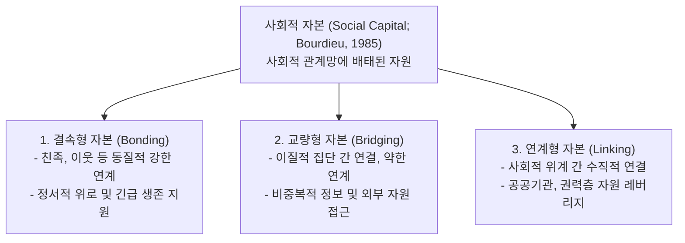
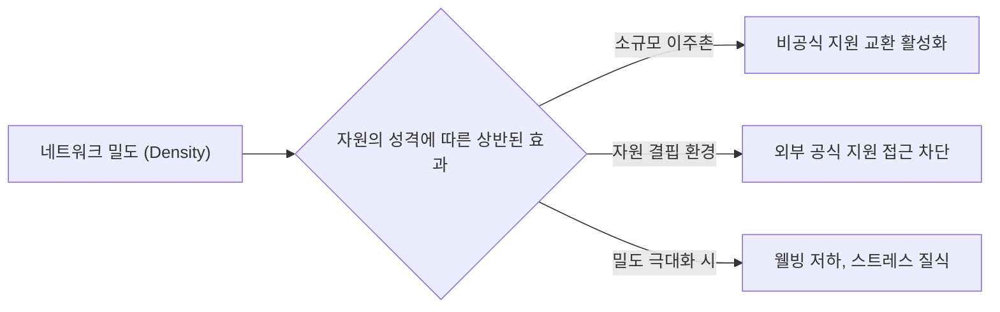
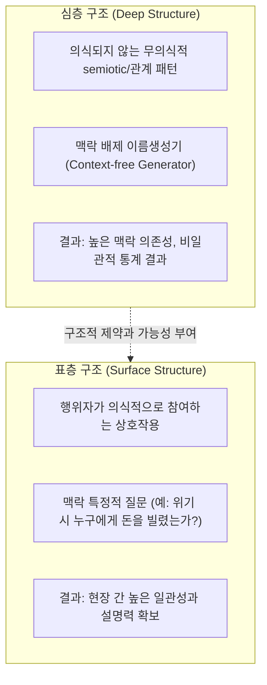
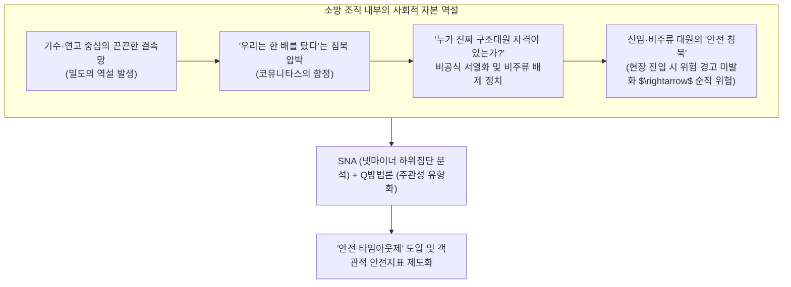
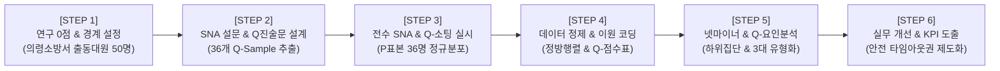

# 제2장 위험과 재난에 직면한 개인 중심 사회연결망 분석 (Sub-Note)

**원제**: CHAPTER 2 SOCIAL NETWORK ANALYSIS FOCUSED ON INDIVIDUALS FACING HAZARDS AND DISASTERS  
**저자**: A.J. Faas¹ (San Jose State University), Eric C. Jones² (University of Texas Health Science Center at Houston)  
**출처**: *Social Network Analysis of Disaster Response, Recovery, and Adaptation* (Elsevier, 2017, pp. 11–24, http://dx.doi.org/10.1016/B978-0-12-805196-2.00002-9)  

---

## [개요] 챕터 목차 체계 (Chapter Outline)

1. **서론** (Introduction, p. 11)
2. **사회적 지원, 사회적 자본 및 연계 유형** (Social Support, Social Capital, and Types of Ties, p. 12)
   * 결속형 사회적 자본: 친족 및 기타 긴밀한 연계 (Bonding Social Capital: Kin and Other Close Ties, p. 13)
3. **네트워크 구성에서의 동질선호와 다양성** (Homophily and Diversity in Network Composition, p. 14)
   * 유사성을 통한 결속 (Bonding Through Similarities, p. 14)
   * 차이를 가로지르는 교량화 (Bridging Across Differences, p. 15)
   * 사회적 위계를 통한 연계 (Linking via Social Hierarchy, p. 16)
   * "우리는 모두 같은 배를 탔다": 공동체 결속 (Community Bonding Because “We’re All in the Same Boat”, p. 16)
4. **사회연결망 구조: 사회적 자본과 코뮤니타스를 넘어서** (Social Network Structure: Moving Beyond Social Capital and Communitas, p. 17)
   * 밀도 (Density, p. 17)
   * 구조적 다양성 (Structural Diversity, p. 18)
5. **표층 구조와 심층 구조** (Surface Structure and Deep Structure, p. 19)
6. **재난 단계에 따른 네트워크 내 개인** (Individuals in Networks Across Phases of Disaster, p. 20)
7. **결론** (Conclusions, p. 22)

---

# 1. 서론 (Introduction)

### 1. 연구 목적 및 문제의식
- **연구 질문**: 재난 맥락에서 개인의 행동, 지각(perception), 웰빙(well-being)을 연구할 때 사회연결망 데이터를 수집하고 분석하는 것이 재난 이론에 어떤 기여를 하는가?
- **개인 중심 분석의 위치**: 제3장이 집단과 공식 조직망에 초점을 맞추는 반면, 제2장은 **개인(individuals)과 지역사회(communities)**를 중심으로 이원적 관계(dyadic ties)가 재난 대비, 대응, 복구, 적응, 완화에 미치는 영향을 개념적으로 조망합니다.

### 2. 챕터의 핵심 구성 논리
- 재난 연구의 출발점인 **사회적 지원(Social Support)**에서 시작하여, 행위자들의 특성인 **네트워크 구성(Composition)**, 연결 형태인 **네트워크 구조(Structure)**로 심화됩니다.
- 후반부에서는 **재난의 시간적 단계(Phases)**와 인간의 무의식적 관계 패턴을 다루는 **심층 구조 대 표층 구조(Deep vs Surface Structure)**라는 고난도 이론적 쟁점을 다룹니다.

---

# 2. 사회적 지원, 사회적 자본 및 연계 유형 (Social Support, Social Capital, and Types of Ties)

### 1. 사회적 지원의 양면성과 계층적 격차
- **제도적 원조의 보완재/대체재**: 사회적 지원은 공식 기관의 원조를 보완하거나 대체하여 개인 및 집단의 회복을 촉진합니다 (Ibañez et al., 2004; Kaniasty, 2012).
- **자원 접근의 불평등**: 빈곤층은 부유층에 비해 실제 지원 접근성과 지각된 지원 수준이 낮지만 (Norris et al., 2005; Jones et al., 2011), 허리케인 앤드루(Andrew) 연구에 따르면 일자리 탐색과 같은 비공식 정보 지원에서는 빈곤층이 비공식 망을 더 활발히 활용하는 특성을 보였습니다 (Hurlbert et al., 2001).

### 2. 결속형 사회적 자본: 친족 및 기타 긴밀한 연계 (Bonding Social Capital: Kin and Other Close Ties)
- **일반화된 호혜성(Generalized Reciprocity)**: 살린스(Marshall Sahlins, 1972)는 친족 관계가 즉각적인 반대급부를 계산하지 않고 베푸는 일반화된 호혜성과 밀접하게 결합되어 있음을 밝혔습니다.
- **친족 연계의 강점**:
  - 허리케인 앤드루 생존자 연구에서 친족 비율이 높은 개인망을 가진 이들이 비공식 지원을 훨씬 자주 획득했습니다 (Hurlbert et al., 2000).
  - 태즈메이니아 태스먼 다리 붕괴 사고(Lee, 1980) 및 케냐 투르카나 가뭄(Juma, 2009)에서도 지리적 분리 시 친족 연계가 비친족 연계보다 훨씬 강인하게 유지되었습니다.
- **친족 연계의 명확한 한계와 역설 (The Kinship Trap)**:
  - **지원 유형의 분화**: 걸프전 당시 하이파 시민 연구(Shavit et al., 1994) 및 미 중서부 홍수 연구(Casagrande et al., 2015)에서 신체적 위협 상황에서는 가족을 찾았으나, 정서적 위로 및 일상 복구 시에는 친구, 이웃, 자원봉사자, 전문가를 찾았습니다.
  - **제도적 자원 단절**: 친족 중심 네트워크는 일상적 삶의 만족도를 저하시키거나(Acock & Hurlbert, 1993), **공식 기관의 제도적 원조(institutional support)를 획득하는 데 역효과(음의 상관관계)**를 낳습니다 (Tausig, 1992; Hurlbert et al., 2001).

---

# 3. 네트워크 구성에서의 동질선호와 다양성 (Homophily and Diversity in Network Composition)

### 1. 유사성을 통한 결속 (Bonding Through Similarities)
- **동질선호(Homophily)**: 인종, 계급, 성별 등 유사한 속성을 가진 사람들과 교류하려는 사회학적 경향 (McPherson & Smith-Lovin, 1987). 동질선호는 신뢰 형성을 촉진합니다 (Burt, 1992).
- **실전 재난 현장에서의 괴리 (계획 대 실제)**:
  - 노웰과 스틸먼(Nowell & Steelman, 2015)의 산불 대응 연구: 소속 기관의 동질성은 소통 빈도를 높였으나, **직접적인 개인적 친분이 없는 동질적 연계는 오히려 소통 장애를 초래**했습니다.
  - 파스 등(Faas et al., 2016)의 산불 교량 행위자 연구: 사전 설문에서는 동일 기관 소속(동질선호)을 신뢰할 수 있는 교량자로 지명(약 50%)했으나, **실제 대형 화재 현장에서 활성화된 교량자 중 동질선호 원칙에 부합한 비율은 단 3%에 불과**했습니다 (운영상의 필요와 전문성이 동질성을 압도함).
- **위험 지각(Risk Perception)의 사회적 확산**:
  - 위험 지각은 개인 내면의 인지 과정을 넘어, 네트워크 내 타인의 지각 및 강한 연계(strong ties)를 통해 집단적으로 구성되는 '사회적 인지(social cognition)' 현상입니다 (Gordon et al., 2012; Scherer & Cho, 2003).

### 2. 차이를 가로지르는 교량화 (Bridging Across Differences)
- **자원의 비중복성과 적응력**: 약한 연계(weak ties)를 통한 네트워크 다양성은 비중복적 정보와 이질적 자원을 제공하여, 기후변화 및 재난에 대한 집단 의사결정과 적응 역량을 강화합니다 (Granovetter, 1973; Newman & Dale, 2005).
- **폐쇄적 네트워크의 위험 (Cheong, 2012)**:
  - 2007년 한국 서해안 허베이 스피리트호 기름유출 사고 연구: 높은 결속형 자본(친족 및 동질적 연계)은 지역사회 내부 결속에는 기여했으나, **외부 전문가와의 지식 교류를 가로막고 혁신적 방제 기술의 도입을 저해하는 높은 장벽(high barriers)**으로 작용했습니다.

### 3. 사회적 위계를 통한 연계 (Linking via Social Hierarchy)
- **권력층과의 수직적 연결**: 알드리치와 마이어(Aldrich & Meyer, 2015)는 지역사회 주민과 상위 스케일의 권력자를 잇는 연계를 '연계형 사회적 자본'으로 명명했습니다.
- **성별과 연계형 자본의 변동 (Faas et al., 2014, 2015)**:
  - 에콰도르 퉁구라우아 화산 이주민 정착지 분석: 이주 초기 파편화된 도시 정착지에서는 여성이 정보 지원의 주된 제공자였으나, 2년 후 공식 기관과 소통하는 창구로 누구를 선호하느냐는 질문에는 **남성이 여성을 압도(도시 정착지 7:1, 농촌 2:1)**했습니다. 외부 권력과의 실질적 연계는 여성이 수행했더라도, 명성과 사회적 대표성은 남성이 독점하는 젠더 불평등이 확인되었습니다.

### 4. "우리는 모두 같은 배를 탔다": 공동체 결속
- **알드리치(Aldrich, 2011)의 고베 지진 비교 연구**: 인구당 비영리단체 수가 많아 공동체 사회적 자본이 높았던 지역은 주민들이 자발적으로 결속하여 화재를 진압하고 상호 구호에 성공했으나, 사회적 자본이 낮았던 인근 동네는 불길이 번지는 것을 무력하게 방관했습니다.

---

# 4. 사회연결망 구조: 사회적 자본과 코뮤니타스를 넘어서

### 1. 밀도 (Density)의 역설과 원조 자격의 정치
- **밀도의 긍정적 측면**: 구성원 간 연계가 촘촘할수록 비공식 지원을 주고받는 빈도가 증가합니다 (Faas et al., 2014, 2015).
- **밀도의 어두운 면 (Dark Side of Density)**:
  - 허리케인 앤드루 연구: 촘촘한 고밀도 망에 갇힌 개인들은 외부 공식 원조를 가장 적게 받았습니다 (Hurlbert et al., 2001).
  - 멕시코 이주민 연구: **가장 밀도가 높은 네트워크를 가진 집단이 가장 열악한 웰빙 수준**을 보였습니다 (Jones et al., 2014).
- **코뮤니타스(Communitas)의 함정과 '원조 자격의 정치(Politics of Deservingness)' (★핵심 발견)**:
  - 마이클 세르니아(Michael Cernea, 1996, 1997)는 이주 시 전통적 연대망 유지를 권장했으나, 끈끈한 네트워크를 지나치게 이상화하면 **기존의 인종, 계급, 젠더 위계가 고착화**됩니다.
  - 파스(Faas, 2012, 2015a)의 에콰도르 연구: 정부와 NGO가 전통 공동노동(*mingas*) 참여를 주택·관개용수 지원의 '필수 조건'으로 내걸자, 임금 노동자 가구는 참여가 불가능해져 지원 대상에서 배제되었습니다. 지역 엘리트들은 이를 악용하여 **누가 원조를 받을 자격이 있고(deserving) 없는지(undeserving) 낙인찍는 폭력적 배제 정치**를 자행했습니다.

### 2. 구조적 다양성 (Structural Diversity)
- **응집된 하위집단(Cohesive Subgroups)의 정신건강 영향**:
  - 연구자들의 초기 가설: 하위집단이 존재하면 고립되지도 않고 과도하게 질식되지도 않아 웰빙에 긍정적일 것으로 기대함.
  - 실증 분석 결과: **하위집단을 가진 개인망에 속한 이주민 여성이 가장 열악한 정신건강 점수**를 보였고, 남성은 우울증 기능 장애 점수가 가장 높았습니다 (Jones et al., 2014).
  - 멕시코 ABC 어린이집 화재 사례(Jones & Murphy, 2015): 희생자 부모와 부상자 부모, 사법 정의 추구파와 온건파로 하위집단이 분열·갈등하며 네트워크가 파편화되었습니다.

---

# 5. 표층 구조와 심층 구조 (Surface Structure and Deep Structure)

- **이론적 기원**: 레비스트로스(Lévi-Strauss, 1969)의 심층 기호 구조, 호프만(Susanna Hoffman, 1999)의 문화적 심층 구조(보이지 않는 규칙) 대 표층 구조(일상의 관습과 실천).
- **심층 구조(Deep Structure) 접근법**:
  - 특정 맥락을 주지 않고 자유롭게 지인을 나열하게 하는 방식(맥락 배제 이름생성기; McCarty et al., 2007)으로 도출된 전체 잠재망.
  - *한계*: 460개에 달하는 멕시코-에콰도르 횡단 표본 분석 결과, 심층 구조는 결과 변수(웰빙 등)와의 관계에서 일관성이 극히 낮았으며, 문화와 역사에 과도하게 좌우되었습니다.
- **표층 구조(Surface Structure) 접근법**:
  - 재난 상황에서 의식적으로 자원을 주고받은 관계를 측정하는 방식(Hurlbert et al., 2001; Casagrande et al., 2015).
  - *성과*: 재난 현장 간에 훨씬 일관되고 예측 가능한 결과를 도출했습니다.
- **학술적 결론**: 심층적 연결망 구조는 인간 행위를 완전히 규정하는 문법(grammar)이 될 수 없으며, 역사적 맥락과 문화적 레퍼토리에 의해 매개됩니다.

---

# 6. 재난 단계에 따른 네트워크 내 개인 (Individuals in Networks Across Phases of Disaster)

### 1. 선형적 단계 모형에 대한 비판과 대안
- **앤서니 월리스(Anthony Wallace, 1956)의 '재난 증후군(Disaster Syndrome)' 4단계**:
  1. 충격 및 무기력(Stunned) $\rightarrow$ 2. 피암시성 및 이타주의 $\rightarrow$ 3. 극도의 행복감 및 구호 참여 $\rightarrow$ 4. 정상화 및 비판·무관심.
  - *비판*: 미국적 맥락에 치우쳐 있으며 선형적이지 않고 후퇴·생략·장기화가 빈번함.
- **호프만(Hoffman, 1999)의 3단계 동태 모델**:
  - 개인적 경험(Individual experience) $\rightarrow$ 집단적 상호 지원(Collective support) $\rightarrow$ 파벌 경쟁 및 가계 복귀(Factional competition & household affairs).
  - 올리버-스미스(Oliver-Smith, 1979, 1992): 계급과 민족의 분열이 일시적으로 사라지는 '이타주의의 물결'은 단명하며, 외부 원조가 유입되거나 고갈되면 즉각 구 분열과 갈등이 재발함.

### 2. 사회적 시공간(Social Time and Space)과 지지망의 진화
- **카사그란데 등(Casagrande et al., 2015)의 중서부 홍수 실증 연구**:
  - 물리적·연대기적 시간이 아닌, 행위자의 체감에 기초한 '사회적 시공간' 개념 도입.
  - **생명 위협 단계(Vital phase)**: 친족(Kin)의 지원이 다른 모든 출처를 압도함.
  - **비위협 대비 및 장기 복구 단계**: 제도적 전문 지원(공공기관, 전문가) 및 친구·이웃의 기여 비중이 증가함.
- **종단 연구의 필요성과 희소성**:
  - 종단적 네트워크 조사는 물류적·재정적 난관으로 인해 극히 드묾[^1].
  - 멕시코 ABC 어린이집 화재 망(Jones & Murphy, 2015): 1년 차에 2개 연합(사망자 부모 vs 부상자 부모)에서 2년 차에 4개 그룹(정치적 접근 vs 비정치적 접근)으로 파편화되는 동태성을 확인.

---

# 7. 결론 (Conclusions)

- 개인 수준의 재난 연결망 연구는 촘촘함(tight-knit)과 연대라는 낭만적 통념에 비판적 메스를 가해야 합니다.
- **네트워크의 이중적 얼굴**: 조밀한 결속망은 즉각적 위기 생존에는 귀중하지만, 만성적 결핍과 정보 중복, 제도적 원조 배제라는 질식 효과를 초래합니다.
- 성별에 따른 교량자 역할과 명성의 괴리, 응집된 하위집단이 초래하는 정신건강 악화 등은 맥락 중심적(context-sensitive)이고 비판적인 연결망 분석이 왜 필요한지를 웅변합니다.

---

# [부록] 박사학위 논문 선행연구 분석 템플릿 연계

| 순서 | 분석 항목 | 제2장 핵심 요약 및 연구자 통제 관점 |
| :---: | :--- | :--- |
| **1** | **연구배경** | 재난 상황에서 개인의 생존, 정신건강, 복구 역량을 규명하기 위해 개인 수준의 사회연결망 데이터 분석이 필수적이나, 낭만화된 사회적 자본 이론의 한계가 노정됨. |
| **2** | **이론적 개념** | 결속형/교량형/연계형 자본; 일반화된 호혜성; 동질선호; 코뮤니타스와 원조 자격의 정치; 표층 구조 vs 심층 구조; 사회적 시공간. |
| **3** | **연구목적** | 개인 및 지역사회 수준에서 대인 연결망의 구성(composition)과 구조(structure)가 재난 대응 및 복구 성과에 미치는 복합적 인과 메커니즘 규명. |
| **4** | **연구방법** | 다지역 횡단 비교(멕시코 2개 지역, 에콰도르 5개 정착지 총 460개 개인망 표본 분석) 및 장기 인류학적 민족지학(Ethnography) 결합. |
| **5** | **연구결과** | 1) 친족망은 생존 지원에 유용하나 제도적 원조를 저해함. 2) 화재 시 실제 교량자는 동질선호와 무관하게 전문성으로 작동(3%만 일치). 3) 가장 밀도가 높은 망에서 웰빙이 가장 낮게 나타남. |
| **6** | **핵심 발견** | 공동체 결속의 강요는 '원조 자격의 정치'를 낳아 취약 계층을 합법적으로 배제하는 부작용을 초래하며, 무의식적 심층 구조보다 의식적 표층 구조가 높은 예측력을 지님. |
| **7** | **연구의 한계** | 대규모 횡단 조사에도 불구하고 문화적·지역적 맥락에 따라 통계적 일관성이 크게 흔들리며, 개인망의 종단적 추적 조사가 제한적임. |
| **8** | **이론적 시사점** | 사회적 자본의 '어두운 면(Dark side)'을 실증적으로 증명하고, 연대성의 규범 뒤에 숨은 권력 관계와 젠더 위계를 가시화함. |
| **9** | **후속 연구 시사점** | 현장 밀착형 위험 지각 측정, '원조 자격의 정치'를 통제할 수 있는 제도적 배분 가이드라인 수립, 사회적 시공간 기반 단계별 지표 설계. |

---

# 8. 소방 조직 및 현장 대응 적용 연구 주제 및 방법론 (Application to Fire Services)

> [!TIP] **학습 지도노트 연계**: AI 활용 성과지표(KPI) 도출 7대 원칙 및 Q방법론 실증 연구 확장  
> 제2장의 핵심 이론인 **(1) 결속형 자본의 어두운 면(The Dark Side of Bonding Capital)**, **(2) 밀도의 역설과 최악의 웰빙**, **(3) 코뮤니타스의 함정과 '원조 자격의 정치(Politics of Deservingness)'**, **(4) 위험 지각의 사회적 인지**를 소방 안전문화에 정밀하게 접목합니다.

### 1. 연구질문 (Research Questions)
- **RQ 1 (밀도의 역설과 안전 침묵)**: 소방 팀 내 기수·동향 중심 결속망 밀도(Density)가 극단적으로 높을수록 신임·비주류 대원의 **'안전 침묵(Safety Silence)'**과 직무 스트레스(웰빙 악화)가 통계적으로 심화되는가?
- **RQ 2 (원조 자격의 정치와 비공식 배제)**: 결속망 내부에서 누가 "진짜 목숨 걸고 진입할 자격이 있는 구조대원인가(Deserving)"를 판별하는 비공식 서열화가 소방 장비/전술 정보 공유에서의 소외로 이어지는가?
- **RQ 3 (코뮤니타스의 함정과 위험 불감증)**: "우리는 끈끈한 한 팀이다"라는 강한 동료애 규범이 화재 현장에서 붕괴 징후 직면 시 지휘관에게 '작업 중지(Safety Time-out)'를 건의하는 정당한 이의제기를 어떻게 질식시키는가?
- **RQ 4 (주관적 안전 인식의 유형화)**: 결속망과 조직 안전 책무성에 대한 일선 소방관들의 주관적 인식은 Q방법론을 통해 어떤 하위 유형(전통 신봉형, 제도 프로토콜형, 소외 회의형)으로 분류되는가?
- **RQ 5 (네트워크 구조와 Q-유형의 교차 정합성)**: SNA 상의 고립 대원(Isolates)과 높은 중심성 대원은 각기 어떤 Q-인식 유형에 집중적으로 분포되어 있는가?

### 2. 확인한 연구결과 (Key Findings from Literature)

| 이론 및 챕터 출처 | 선행연구 핵심 실증 결과 | 본 소방 안전 네트워크 연구로의 연계 시사점 |
| :--- | :--- | :--- |
| **밀도의 역설과 최악의 웰빙 (Chapter 2; Beggs et al., 1996)** | 연계 밀도가 가장 높은 집단에서 응답자의 정신건강 및 웰빙 점수가 가장 열악하게 나타남. | 기수·연고 결속망이 가장 강한 팀일수록 상호 감시와 동조 압력으로 인해 신임 대원의 우울감과 아차사고 은폐율이 높아짐을 실증. |
| **결속형 자본의 어두운 면 (Chapter 2; Portes, 1998)** | 강한 내부 결속은 외부인에 대한 배제(Outsiders exclusion)와 개별 구성원에 대한 과도한 자유 제약을 유발. | 비공채, 타 지역 출신, 구급특채 대원을 배제하는 소방 내부 카르텔의 부정적 효과를 정량화. |
| **코뮤니타스의 함정 & 원조 자격의 정치 (Chapter 2; Cox & Perry, 2011)** | 재난 직후 강한 유대감이 형성되나, 자원 배분 시 "누가 진정한 피해자인가"를 가르는 배제의 정치 발현. | "진짜 구조대원"과 "행정/구급 대원"을 차별하는 비공식 낙인 메커니즘을 밝혀내어 현장 안전 소통 저해 요인 입증. |
| **위험 지각의 사회적 인지 (Chapter 2; Douglas & Wildavsky)** | 개인이 감지하는 위험은 객관적 확률이 아니라 자신이 속한 사회적 네트워크의 공유 규범에 의해 구성됨. | 대원이 현장에서 느끼는 붕괴 공포를 비공식 집단이 "나약한 소리"로 치부하여 위험 신호를 묵살하는 인지적 경로 규명. |

### 3. 연구절차 (Research Procedure: 6단계 표준 프로세스)

### 4. 네트워크 분석단위 및 분석지표 (Units & Network Metrics)

1. **노드 수준 (Node-level)**:
   - **개별 소방공무원 노드 ($N \approx 50$명)**:
     - **In-Degree (인입 연결정도)**: 비공식 사적 친분 및 기수망에서 지목받는 빈도.
     - **Out-Degree (인출 연결정도)**: 팀 내 사적 결속망에 손을 뻗치는 활동성.
     - **Isolate Status (고립 여부)**: 결속망에서 인입 연결이 전혀 없는 완전 고립 대원 여부.
     - **Q-Factor Loading (요인 적재치)**: 각 소방관이 3대 주관적 인식 유형에 얼마나 강하게 소속되는지를 나타내는 계수.
2. **하위집단 수준 (Subgroup-level)**:
   - **기수별, 임용경로별(공채/구조특채/구급특채), 출신지역별**:
     - **E-I Index (External-Internal Index)**: 집단 내부 친분 vs 집단 외부 친분 비율 산출 ($-1$에 가까울수록 특정 기수·특채 중심의 폐쇄적 카르텔).
     - **K-core & 파벌(Cliques)**: 핵심 비공식 이너서클(Inner Circle) 경계 획정.
3. **전체망 수준 (Whole-level)**:
   - **의령소방서 출동부서 전체 결속망**:
     - **Network Density (밀도)**: 전체 대원 대비 사적 결속 형성 비율 $\to$ 과도한 밀도 시 '밀도의 역설' 경보 발령.
     - **Network Centralization (집중도)**: 특정 베테랑 1~2인에 사적 영향력이 집중된 정도.

### 5. 네트워크 데이터 구조 및 코딩처리 방식 (Data & Coding Method)

| 구분 | 데이터 형식 | 변수 구성 및 코딩 기준 |
| :--- | :--- | :--- |
| **노드 속성 데이터 (Node Properties)** | 1-mode 엑셀 테이블 (행 = 소방관 $i$) | • **ID**: 고유 식별코드 (FF01 ~ FF50) • **Rank**: 1=지휘관리층, 2=중간관리층, 3=일선대원층 • **Path (임용경로)**: 1=공채, 2=구조특채, 3=구급특채 • **Hometown**: 1=관내(의령/경남), 2=타 시·도 • **Tenure**: 소방 실근무 연수 |
| **결속망 행렬 ($M_{\text{bonding}}$)** | $N \times N$ 정방 행렬 | "근무 외 사적 시간(식사, 술자리, 경조사)을 함께하며 속마음을 털어놓는 동료는 누구인가?" (1=전혀없음 ~ 5=매우자주). 4점 이상 이진화(1). |
| **침묵망 행렬 ($M_{\text{silence}}$)** | $N \times N$ 정방 행렬 | "위험을 직감했을 때 비난이나 눈총이 두려워 감히 의견을 제기하지 못하는 상대는 누구인가?" (0=없음, 1=있음). |
| **Q-소팅 데이터 (Q-Dataset)** | $N_{\text{sample}} \times N_P$ ($36 \times 36$ 행렬) | 36개 Q-진술문에 대해 36인의 P-표본이 강제정규분포 9점 척도(-4 가장 부정 ~ +4 가장 긍정)로 배치한 점수 행렬. |

> [!NOTE] **코딩 정제 및 결측치 관리 원칙**  
> 1. **대각선 요소 처리**: 자기 자신과의 관계($i = j$)는 모두 `0`으로 처리합니다.  
> 2. **Q-소팅 강제정규분포 검증**: 각 응답자의 카드 배치(-4, -3, -2, -1, 0, 1, 2, 3, 4 점수별 정해진 칸 수) 정합성을 100% 검증 후 코딩.  
> 3. **결측치 관리**: 비번 교대 주기를 활용하여 결측률 0% 전수 조사를 원칙으로 함.

### 6. 자료수집 및 설문조사/Q-소팅 집행 전략 (Data Collection)
- **사전 명부 방식(Prepared Roster) 전면 채택**: 관내 대원 50명의 성명·계급이 인쇄된 표준 명부형 설문지 배포.
- **플래시카드 기반 대면 심층 Q-소팅(Q-Sorting)**: 36개 Q-Sample 카드를 제작하여 대원들이 1:1 대면 방식으로 정규분포 판 위에 직접 카드를 분류(Sorting)하도록 지도.
- **철저한 익명성 보장**: 지휘관 및 동료의 입회가 차단된 독립된 상담실에서 조사를 진행하여 솔직한 주관성 진술 보장.

### 7. 넷마이너 & Q방법론 정밀 분석 프로토콜
- **Step 1: 데이터 임포트 & 모델링**: 넷마이너에 노드 속성과 $M_{\text{bonding}}, M_{\text{silence}}$ 행렬 구축.
- **Step 2: 하위집단 및 밀도의 역설 분석**: NetMiner Subgroup 모듈을 통해 파벌(Cliques) 및 E-I Index 산출. 사적 결속망 밀도와 침묵망 인입 간의 상관관계 도출.
- **Step 3: Q-요인분석 (PQMethod / QUANL)**: P-표본 36명의 Q-소팅 데이터를 주성분 분석(PCA) 및 배리맥스(Varimax) 직교 회전하여 아이겐밸류(Eigenvalue) 1.0 이상의 유의미한 3개 요인(Factor) 추출.
- **Step 4: 주관적 인식 3대 유형 도출 및 SNA 연계**:
  - **제1유형 [전통적 동료애 신봉형]**: "의리와 기수가 현장의 생명선이다. 선배를 믿고 돌진해야 한다." (높은 인입 결속망 중심성 대원 집중).
  - **제2유형 [제도적 안전 프로토콜 요구형]**: "끈끈함은 질식일 뿐이다. 감정에 기대지 말고 공식 안전 매뉴얼로 통제하라." (중간관리자 집중).
  - **제3유형 [소외·고립 회의형]**: "주류 카르텔에 못 끼면 위험 경고도 늦게 받는다. 차별과 침묵이 두렵다." (SNA 고립 대원 집중).

### 8. 최종 실무·정책 환류: 소방 안전관리 KPI 도출 및 법적 근거

#### 1) 소방 실무 개선 및 KPI 도출
- **안전 타임아웃(Safety Time-out) 발동권 제도화**: 계급이나 기수와 상관없이, 현장 위험 징후를 발견한 대원은 누구나 즉각 작업을 일시 중지시킬 수 있는 법적 권리 보장.
- **소방 고유 KPI(70%)**: **'신임·비주류 대원 멘토링 네트워크 연결성 지수'** 및 **'계급 간 E-I Index 개방도'**를 소방관서 안전문화 핵심 지표로 반영.

#### 2) 관련 법적 근거 매핑 (조문 강제 연계)
- **소방공무원 보건안전 및 복지 기본법 제8조(소방공무원의 안전관리 권리와 의무)**: 위험 상황 시 현장 활동 중지 요구권.
- **소방기본법 제16조(소방활동)** 및 **동법 시행규칙 제6조**: 소방대원의 안전장구 착용 및 현장 안전관리 기준의 객관적 표준화.
- **국가공무원법 제56조(성실 의무)** 및 **제57조(복종의 의무)**의 현대적 재해석: 맹목적 복종을 넘어선 '합리적 안전 이의제기권' 보장.
