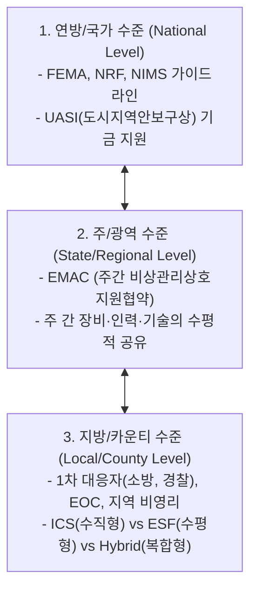
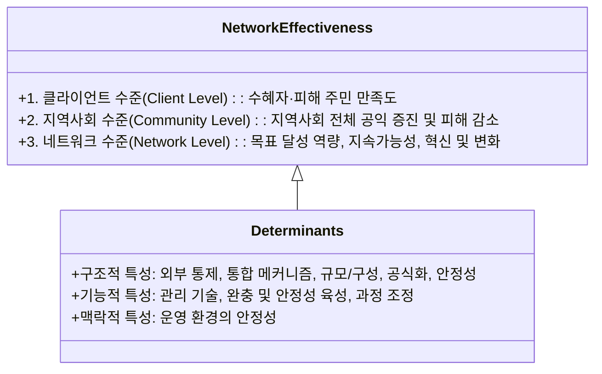
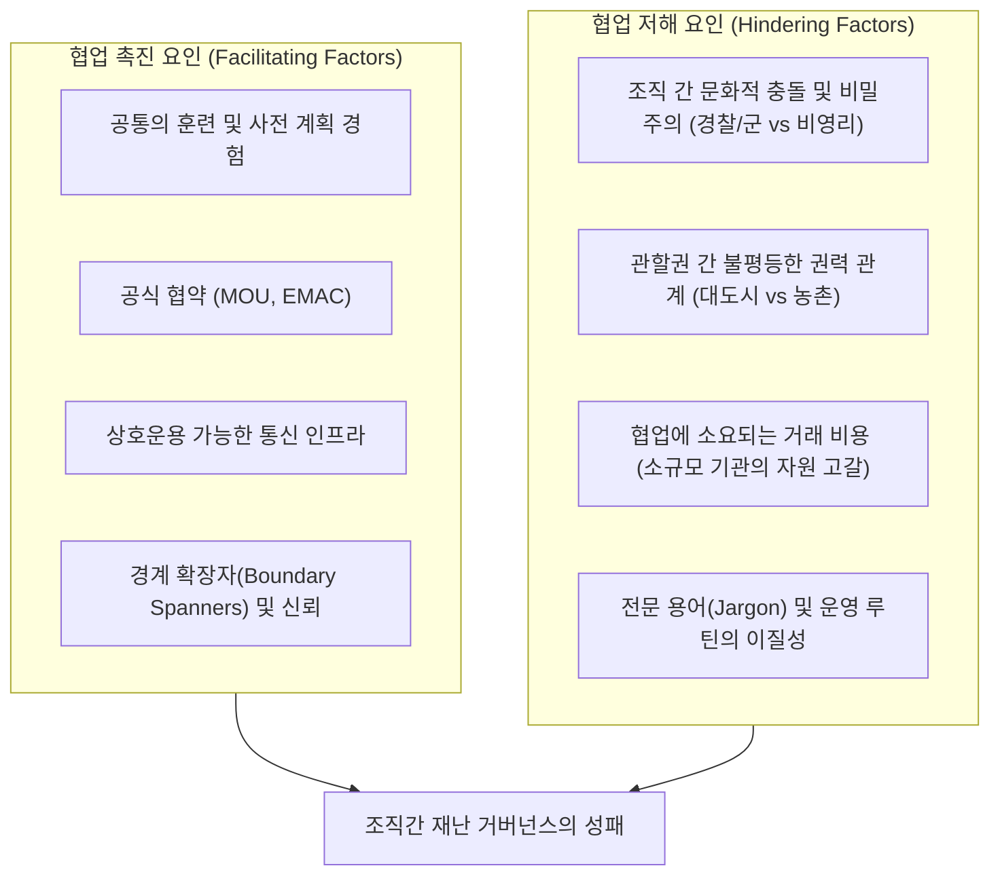
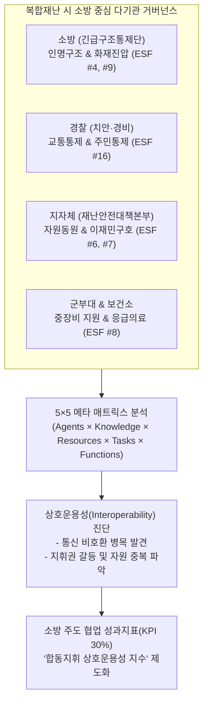
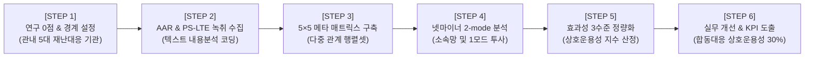

# 제3장 재난 관리에서의 조직간 네트워크 (Sub-Note)

**원제**: CHAPTER 3 INTERORGANIZATIONAL NETWORKS IN DISASTER MANAGEMENT  
**저자**: Naim Kapucu¹ (University of Central Florida), Fatih Demiroz² (Sam Houston State University)  
**출처**: *Social Network Analysis of Disaster Response, Recovery, and Adaptation* (Elsevier, 2017, pp. 25–40, http://dx.doi.org/10.1016/B978-0-12-805196-2.00003-0)  

---

## [개요] 챕터 목차 체계 (Chapter Outline)

1. **서론** (Introduction, p. 25)
2. **조직간 네트워크** (Interorganizational Networks, p. 26)
3. **재난 관리에서의 조직간 네트워크** (Interorganizational Networks in Disaster Management, p. 26)
   * 네트워크의 네트워크: 다층적 재난 네트워크 (Networks of Networks: Multilayered Disaster Networks, p. 27)
   * 그림 3.1: 오렌지 카운티 긴급지원기능(ESF) 소속 네트워크 (Figure 3.1, p. 29)
4. **효과적인 조직간 재난 네트워크** (Effective Interorganizational Disaster Networks, p. 29)
   * 커뮤니케이션 (Communication, p. 31)
   * 그림 3.2A~C: 오렌지 카운티의 친구망, 대비망, 대응망 비교 (Figures 3.2A–C, pp. 32–34)
   * 신뢰와 사회적 자본 (Trust and Social Capital, p. 34)
   * 재난 네트워크에서의 학습과 적응 (Learning and Adaptation in Disaster Networks, p. 35)
5. **조직의 재난 네트워크 형성 시 협업을 저해하는 요인** (Factors Hindering Collaboration in Forming Disaster Networks of Organizations, p. 36)
   * 그림 3.3: 재난 관리 조직간 네트워크 영향 요인 개념도 (Figure 3.3, p. 37)
6. **사회연결망 분석의 적용** (Applications of Social Network Analysis, p. 37)
   * 표 3.1: 조직간 네트워크 메타 매트릭스 (Table 3.1, pp. 38–39)
7. **결론** (Conclusions, p. 38)

---

# 1. 서론 (Introduction)

### 1. 파국적 재난(Catastrophic Disasters)과 네트워크의 필연성
- **일상적 비상사태와의 근본적 차이**: 파국적 재난은 사회 전체를 심각하게 교란하며, 정부 단독의 역량과 자원만으로는 결코 감당할 수 없습니다.
- **서비스 전달 방식의 패러다임 전환**: 과거 정부 중심의 수직적 관료제에서 공공, 민간, 비영리 부문을 아우르는 **‘교차 부문 파트너십(cross-sector partnerships)’**으로 행정 환경이 구조적으로 전환되었습니다.
- **재난 거버넌스의 표준**: 재난 관리에서 다기관 간의 수평적·협력적 조직망은 예외적 수단이 아니라 **‘기본 규범(the norm)’**으로 자리 잡았습니다.

### 2. 본 챕터의 목적
- 다수준(Multilevel), 다부문(Multisector)의 협력적 성격을 지닌 재난 관리 조직망의 이론적 지형을 종합적으로 개관합니다.
- 네트워크의 구조적 특성, 효과성 결정요인, 협업의 촉진 및 장애 요인, 그리고 연결망 분석(SNA) 도구의 실천적 적용 방안을 제시합니다.

---

# 2. 조직간 네트워크 (Interorganizational Networks)

### 1. 미국 정부 시스템에서의 네트워크의 진화
- 네트워크라는 용어 자체는 비교적 최근에 정립되었으나, 정부 간 관계(IGR)와 부처 간 상호작용은 오랜 역사를 지닙니다.
- 오늘날의 조직간 네트워크는 전통적 관료제가 축소되는 과정에서 등장한 민영화, 서비스 외주화, 비영리 부문의 팽창, 복합적 난제 해결을 위한 파트너십을 의미합니다.

### 2. 네트워크 형성의 동기: 자발적 참여 대 법적 의무화
- **자발적 네트워크(Voluntary)**: 강제나 인센티브 없이 기관들이 공동의 목표를 위해 자율적으로 결성.
- **법적 의무화 네트워크(Mandated)**: 상위 정부의 법령이나 자금 지원 요건에 따라 강제됨.
  - *예시*: 미국 연방재난관리청(FEMA)은 지방정부가 연방 기금을 수령하기 위한 전제 조건으로 국가대응체계(NRF)와 국가재난복구체계(NDRF)를 채택하고 교차 부문 파트너십을 의무적으로 구축하도록 규정함.

---

# 3. 재난 관리에서의 조직간 네트워크 (Interorganizational Networks in Disaster Management)

### 1. '전체 지역사회(Whole Community)' 접근법과 지역사회 탄력성(Resilience)
- **전체 지역사회 접근법 (Kapucu, 2009)**: 단일 기관이나 공무원 집단의 자원만으로는 대형 재난을 해결할 수 없으며, 공공, 민간, 비영리, 그리고 시민 전체가 유기적으로 결합해야 한다는 철학.
- **지역사회 재난 탄력성 (Norris et al., 2008)**: 지역사회의 자원(사회적 자본, 조직망, 인적 자본, 경제적 활력 등)을 일련의 **‘적응 역량(adaptive capacities)’**에 연결하는 동태적 과정.
- **재난 생애주기별 네트워크의 차별성 (★핵심 원칙)**:
  - **대응 네트워크(Response Networks)**: 짧은 시간 동안 즉각적·동시다발적 상호작용, 의사결정 지원 시스템, 신속한 정보 흐름에 의존함.
  - **완화 네트워크(Mitigation Networks)**: 건축 법규 개정, 홍수 보험, 고위험군 이주 등 수년에서 수십 년에 걸친 장기적 제도 집행 파트너십에 의존함.

### 2. 네트워크의 네트워크: 다층적 재난 네트워크 (Networks of Networks)

- **국가 수준 (UASI 기금과 권력 불균형; Jordan, 2010)**:
  - UASI(Urban Area Security Initiative) 기금은 대도시와 주변 농촌 지역 간의 협업을 촉진했으나, 이는 공통의 지역적 요구보다는 **"도시와 농촌 간의 권력 불균형 및 자금 쟁탈전"**에서 기인한 측면이 큼.
- **주 수준 (EMAC 상호원조협약; Kapucu et al., 2009)**:
  - 카트리나 및 리타 허리케인 대응 분석 결과, 주 간 수평적 지원 협약(EMAC)이 행정적 감독과 신속한 문제 해결 기술 자원을 제공하는 핵심 축임을 입증.
- **지방 수준의 3대 구조 모델 (Kapucu & Garayev, 2014)**:
  1. *수직적·계층적 모델 (ICS)*: 현장지휘체계에 기반한 일사불란한 상명하복.
  2. *수평적·분권적 모델 (ESF)*: 긴급지원기능별 책임 부서 중심의 협력체계.
  3. *복합 하이브리드 모델*: 수직적 통제와 수평적 기능 연계를 결합한 형태.

  
*FIGURE 3.1: Orange County, Florida, emergency support function affiliation network (오렌지 카운티의 17개 긴급지원기능을 중심으로 공공·민간 기관들이 클러스터링된 2모드 소속 네트워크).*

---

# 4. 효과적인 조직간 재난 네트워크 (Effective Interorganizational Disaster Networks)

### 1. 네트워크 효과성(Network Effectiveness)의 3단계 평가 체계 (Turrini et al., 2010)

### 2. 재난 대응 네트워크의 특수성: 자생성과 인지적 정확성
- **자생적(Emergent) 성격**: 재난 대응망은 사전 계획대로 완벽히 작동하지 않으며, 혼돈 속에서 자생적으로 형성됨 (Nowell & Steelman, 2014).
- **최상옥 & 브라워(Choi & Brower, 2006)의 인지적 정확성 4대 유형**:
  - *Type I (완전 일치망)*: 계획서상 주도기관 = 참여자 지각 주도기관 = 실제 중심성 최고 기관.
  - *Type II & III (부분 일치망)*: 계획-지각 또는 지각-실제 간에만 일치.
  - *Type IV (비일치 혼란망)*: 세 차원이 전혀 일치하지 않아 참여자들의 작전 인지도가 극히 왜곡된 상태.
- **동질성 대 이질성 가설 (Faas et al., 2016)**:
  - 산불 현장에서 평상시 지향(동질선호)과 달리, 실제 작전 시에는 **운영상의 전문성과 필요에 따른 이질적 연계(dissimilarity thesis)**가 교량 행위자를 형성함.

### 3. 커뮤니케이션과 상호운용성 (Communication & Interoperability)
- **상호운용성(Interoperability)의 중요성 (Kapucu, 2006a)**:
  - 9/11 테러 당시 뉴욕 소방국(아날로그 무전기)과 경찰국 간의 통신 시스템 불일치로 인해 치명적인 지휘 혼선과 인명 피해가 발생함.
- **대비망 vs 대응망 vs 친구망 (Hu & Kapucu, 2014; Figs. 3.2A–C)**:
  - **대비 단계의 공식 협업**은 실제 재난 대응 협업을 가장 강력하게 예측하는 변수임 (사적 친분망보다 우위).
  - 정보통신기술(ICT) 활용도는 대비망의 중심 조직에서 높게 나타났으나, 실제 긴급 대응 단계에서는 이메일, 유무선 전화, 대면 접촉 등 전통적 소통 방식이 여전히 결정적 역할을 수행함.

  
*FIGURE 3.2A–C: Orange County, Florida의 친구망(Friendship), 재난대비망(Preparedness), 재난대응망(Response) 비교.*

### 4. 신뢰와 사회적 자본 (Trust and Social Capital)
- **공식 연계와 비공식 연계의 상호보완**: MOU 등 공식 협약은 자원 공유의 틀을 제공하며, 관리자의 개인적 사회적 자본과 신뢰는 긴급 상황 시 신속한 작동을 보장함 (McGuire & Silvia, 2010; Kapucu et al., 2009).
- **동질적 뭉침과 추이성의 증명 (Siciliano & Wukich, 2015)**:
  - 카트리나 대응 분석 결과, 정부 자원 접근이 차단된 상황에서 **비영리단체는 다른 비영리단체와, 지방정부는 다른 지방정부와만 결속**하는 강한 부문별 동질선호 현상을 보임.
  - '공통의 친구'를 공유하는 닫힌 삼각관계(transitivity) 속에서 신뢰를 유지하려는 경향 확인.

### 5. 위기 학습과 적응 (Learning and Adaptation; Moynihan, 2008)
- **가금류 뉴캐슬병(Exotic Newcastle Disease, 2002–2003) 1년 장기 대응 사례**:
  - 급성 재난(지진, 토네이도)과 달리, 1년간 지속된 위기는 참여 조직 간의 상호작용과 의미구성(sensemaking), 적응적 학습을 가능케 함.
- **위기 네트워크 학습의 6대 도구**:
  1. *가상 경험(Virtual experience)*: 사전 기획, 시뮬레이션, 훈련.
  2. *타 조직으로부터의 학습(Learning from other organizations)*.
  3. *정보 시스템을 통한 학습(Information systems)*: 상황 인식 공유.
  4. *학습 포럼(Learning forums)*: 열린 토론 플랫폼.
  5. *SOP 메모리 구축(Creating memory from SOPs)*: 루틴의 제도화.
  6. *과거로부터의 학습(Learning from the past)*.

---

# 5. 조직의 재난 네트워크 형성 시 협업을 저해하는 요인 (Factors Hindering Collaboration)

1. **조직 문화의 충돌과 비밀주의**:
   - 비밀주의와 중앙집권적 통제를 중시하는 정보·경찰·군사 조직(총을 든 집단)과 자원봉사자 활용 및 개방적 분권을 지향하는 비영리 조직(총이 없는 집단) 간의 근본적 갈등 (Waugh, 2003).
   - 국토안보부(DHS) 창설 당시 22개 이질적 기관의 기계적 통합이 낳은 극심한 불협화음.
2. **협업의 비용과 자원 결핍**:
   - 소규모 농촌 기관은 협력 회의에 참석할 인력과 예산조차 없어 네트워크에서 배제됨.
3. **권력 불균형(Power Imbalances)**:
   - 자원을 독점한 중심 도시가 주변부 관할권을 일방적으로 지배하거나, 반대로 소외시키는 현상.

  
*FIGURE 3.3: Factors influencing effective interorganizational networks in disaster management (재난 관리 조직간 네트워크에 영향을 미치는 촉진 및 저해 요인 개념 모델).*

---

# 6. 사회연결망 분석의 적용 (Applications of Social Network Analysis)

### 표 3.1 조직간 네트워크 메타 매트릭스 (Interorganizational Network Meta-Matrix)

재난 후 사후검토보고서(AAR)나 정책 문서의 내용분석을 통해 다차원적 서브네트워크 데이터를 추출하는 표준 프레임워크입니다 (Kapucu, 2006a; Comfort & Kapucu, 2006).

| 구분 | 행위자 (Agents) | 지식 (Knowledge) | 자원 (Resources) | 과업 (Tasks) | 기능 (Functions) |
| :--- | :--- | :--- | :--- | :--- | :--- |
| **행위자 (Agents)** | **커뮤니케이션 네트워크** *(누가 누구를 아는가)* | **지식 네트워크** *(누가 무엇을 아는가)* | **역량 네트워크** *(누가 어떤 자원을 가졌는가)* | **과업 할당 네트워크** *(누가 어떤 과업을 수행하는가)* | **소속 네트워크** *(누가 어떤 기능에 책임이 있는가)* |
| **지식 (Knowledge)** | — | **정보 네트워크** *(무엇이 공유 정보를 알리는가)* | **기술 네트워크** *(어떤 지식이 어떤 자원 활용에 필요한가)* | **필요 지식 네트워크** *(과업 완수에 어떤 지식이 필요한가)* | **역량 기준 네트워크** *(특정 기능 수행에 어떤 지식이 필요한가)* |
| **자원 (Resources)** | — | — | **대체 네트워크** *(어떤 자원이 상호 대체·공유 가능한가)* | **자원 의존 네트워크** *(과업 완수에 어떤 자원이 필요한가)* | **공동체 자본 네트워크** *(특정 기능에 어떤 자원이 투입되는가)* |
| **과업 (Tasks)** | — | — | — | **우선순위 네트워크** *(어떤 과업이 선행되어야 하는가)* | **부문 책임 네트워크** *(과업이 어느 기능에 배정되는가)* |
| **기능 (Functions)** | — | — | — | — | **조직간 협력 네트워크** *(누가 어떤 기능을 위해 협력하는가)* |

---

# 7. 결론 (Conclusions)

- 재난 관리는 냉전 시대의 상명하복형 관료제 통제 모델에서 벗어나, 현대 사회의 복합 위험을 극복하기 위해 필수적인 **협력적 공공관리(Collaborative Public Management)**로 진화했습니다.
- 성공적인 재난 네트워크는 재난 발생 순간에 즉흥적으로 만들어질 수 없으며, **평상시 재난 대비 훈련, 사전 협약(MOU/EMAC), 상호운용 가능한 통신 장비, 경계 확장자(Boundary Spanners) 육성**을 통해 축적된 신뢰 인프라가 뒷받침되어야 합니다.
- 연구자와 실무자는 네트워크의 낭만적 환상을 버리고, 부문 간 권력 불균형, 문화적 비밀주의, 소규모 기관의 참여 비용 등 협업을 저해하는 구조적 장벽을 정밀하게 통제하고 완화하는 정책적 설계를 주도해야 합니다.

---

# [부록] 박사학위 논문 선행연구 분석 템플릿 연계

| 순서 | 분석 항목 | 제3장 핵심 요약 및 연구자 통제 관점 |
| :---: | :--- | :--- |
| **1** | **연구배경** | 대형 재난은 단일 정부 관료제의 자원 한계를 초월하므로, 공공·민간·비영리 부문을 아우르는 수평적 조직간 네트워크 거버넌스가 필수불가결함. |
| **2** | **이론적 개념** | 조직간 네트워크; 전체 지역사회(Whole Community); 다층적 재난 네트워크(NRF-EMAC-ICS/ESF); 네트워크 효과성 3수준; 상호운용성; 위기 학습. |
| **3** | **연구목적** | 다부문·다수준 재난 관리 네트워크의 구조적 특성, 효과성 결정요인, 협업 촉진 및 저해 요인을 규명하고 SNA 실무 분석 틀(메타 매트릭스)을 확립함. |
| **4** | **연구방법** | 이론적 메타분석, 오렌지 카운티 ESF 소속망 및 대응망 실증 분석, 재해 보고서 내용분석(Content Analysis) 기반 메타 매트릭스 설계. |
| **5** | **연구결과** | 1) 평상시 대비망 참여가 실제 대응 협업의 가장 강력한 예측 요인임. 2) 9/11 당시 통신 비호환이 참사를 키움. 3) 정부 지원 단절 시 비영리는 비영리끼리 뭉치는 고립적 동질선호 발현. |
| **6** | **핵심 발견** | 재난 네트워크는 계획대로 작동하지 않는 자생적 성격이 강하며, 총을 든 집단(보안)과 총이 없는 집단(복지) 간 문화적 충돌 및 대도시-농촌 간 권력 불균형이 주요 저해 요인임. |
| **7** | **연구의 한계** | 네트워크 수준의 효과성에 집중되어 있어 서비스 수혜자(이재민) 체감 관점의 효과성 연계가 부족하며, 주관적 의미구성(sensemaking) 척도 결합이 요구됨. |
| **8** | **이론적 시사점** | ICS(명령통제)와 ESF(수평협력)를 절충한 하이브리드 거버넌스의 필요성을 실증하고, 위기 학습 6대 도구를 통한 조직 적응 메커니즘을 규명함. |
| **9** | **후속 연구 시사점** | 카운티 및 소방·경찰 단위 현장 밀착형 지표 발굴, 메타 매트릭스 기반 2모드 네트워크 분석, Q방법론을 활용한 주관적 협업 인식 유형화 연계. |

---

# 8. 소방 조직 및 현장 대응 적용 연구 주제 및 방법론 (Application to Fire Services)

> [!TIP] **학습 지도노트 연계**: AI 활용 성과지표(KPI) 도출 7대 원칙 및 거버넌스 네트워크 확장  
> 제3장의 핵심 이론인 **(1) 다층적 재난 네트워크(NRF-EMAC-ICS/ESF)**, **(2) 상호운용성(Interoperability)과 9/11의 교훈**, **(3) 협업 저해 4대 장벽(총을 든 집단 vs 총이 없는 집단)**, **(4) 5×5 메타 매트릭스(Meta-Matrix)**를 소방 중심 다기관 복합대응에 정밀하게 접목합니다.

### 1. 연구질문 (Research Questions)
- **RQ 1 (5×5 메타 매트릭스 상호운용성)**: 소방(통제단), 경찰, 지자체, 군, 응급의료기관 간 **행위자(Agents) $\times$ 지식(Knowledge) $\times$ 자원(Resources) $\times$ 과업(Tasks) $\times$ 기능(Functions)** 매핑에서 가장 심각한 단절(Gaps)과 중복(Redundancy)은 어디서 발생하는가?
- **RQ 2 (문화적 충돌 및 전문용어 장벽)**: 상명하복 명령통제 조직(소방·경찰·군)과 행정지원 협력 조직(지자체·보건소) 간의 전문용어(Jargon) 및 운영 루틴 차이가 현장 협업 밀도를 얼마나 저해하는가?
- **RQ 3 (평시 대비망 vs 출동 대응망 전이)**: 평상시 긴급구조종합훈련(대비망)에 활발히 참여한 유관기관일수록 실제 대형 재난 현장(대응망)에서 유의미하게 높은 자원 공유와 공통 무전 채널 참여도를 보이는가?
- **RQ 4 (다기관 네트워크 효과성 3수준)**: 다기관 네트워크의 구조적 특성(지휘 집중도, 상호운용성 지수)은 클라이언트 수준(구조 완료율), 지역사회 수준(2차 피해 방지), 네트워크 수준(지휘 통일성) 효과성에 어떻게 차별적으로 기여하는가?
- **RQ 5 (배타적 현장지휘권 준수 여부)**: 재난안전법 제52조에 명시된 소방서장(통제단장)의 현장지휘에 대한 타 기관의 순응도 및 협조 수준을 결정하는 네트워크 요인은 무엇인가?

### 2. 확인한 연구결과 (Key Findings from Literature)

| 이론 및 챕터 출처 | 선행연구 핵심 실증 결과 | 본 소방 안전 네트워크 연구로의 연계 시사점 |
| :--- | :--- | :--- |
| **다층적 재난 네트워크 (Chapter 3; NRF-EMAC-ICS/ESF)** | 재난 대응은 단일 계통이 아니라 전국적 협약(EMAC)과 현장 지휘(ICS), 기능별 협력(ESF)이 다층적으로 맞물림. | 소방 긴급구조통제단을 중심에 두고 15대 긴급지원기능(ESF)별 타 기관 협력 관계를 다층적으로 모델링. |
| **상호운용성 결핍의 교훈 (Chapter 3; 9/11 Commission)** | 9/11 당시 소방과 경찰의 무전기 주파수 비호환으로 세계무역센터 붕괴 경보를 전달받지 못해 대규모 소방관 순직 발생. | 소방-경찰-지자체 간 재난안전통신망(PS-LTE) 공통 통화그룹(Talk Group) 교신 빈도 및 단절 지점 정밀 계측. |
| **협업 저해 4대 장벽 (Chapter 3; Waugh, 2003)** | 비밀주의·명령통제를 중시하는 보안조직(소방/경찰/군)과 개방·조정을 중시하는 비영리/행정조직 간의 문화적 충돌. | 현장지휘권을 가진 소방과 자원동원권을 가진 지자체(군청) 간의 용어 불일치 및 권력 갈등 병목 실증. |
| **네트워크 효과성 3수준 (Chapter 3; Turrini et al., 2010)** | 네트워크 효과성은 단일 차원이 아니며 클라이언트 수준, 지역사회 수준, 네트워크 수준의 3단계로 분리 평가해야 함. | 1) 구조 완료율(클라이언트), 2) 연소확대 저지율(지역사회), 3) 지휘 통일성 지수(네트워크)의 3수준 성과지표 체계 수립. |
| **5×5 메타 매트릭스 (Chapter 3; Table 3.1; Kapucu)** | 행위자, 지식, 자원, 과업, 기능의 5개 엔티티 간 상호작용 행렬을 통해 조직 간 사각지대를 포착. | AAR 사후보고서 및 무전 녹취록 텍스트 분석을 통해 5×5 메타 매트릭스를 구성하고 유휴 자원 발굴. |

### 3. 연구절차 (Research Procedure: 6단계 표준 프로세스)

### 4. 네트워크 분석단위 및 분석지표 (Units & Network Metrics)

1. **노드 수준 (Node-level - 조직 단위)**:
   - **소방서, 경찰서, 육군 부대, 군청(지자체), 보건소**:
     - **In-Degree Centrality**: 타 기관으로부터 자원 지원 및 정보 요청을 받는 빈도 (소방의 현장 지휘 허브 지수).
     - **Betweenness Centrality**: 타 기관 간의 협업을 중개하는 문지기(Gatekeeper) 및 병목(Bottleneck) 식별.
2. **하위집단 수준 (Subgroup-level - 기능 단위)**:
   - **긴급지원기능(ESF) 15개 분과별 (화재진압, 수색구조, 교통통제, 응급의료, 이재민구호 등)**:
     - **ESF 참여 밀도 (Bipartite Density)**: 각 기능별 참여 기관 수 및 독점/고립 분과 식별.
     - **이종 조직 간 E-I Index**: 명령조직(소방/경찰) vs 지원조직(지자체/보건소) 간의 기능 간 협업 개방도.
3. **전체망 수준 (Whole-level - 거버넌스 단위)**:
   - **지역 복합재난 통합 지휘 거버넌스 전체망**:
     - **지휘 집중도 (Centralization)**: 소방 긴급구조통제단 중심의 지휘 통일성(Unity of Command) 유지 정도.
     - **통신 상호운용성 비율 (Interoperability Ratio)**: PS-LTE 공통 통화그룹 전체 교신 중 이종 기관 간 교신 비중.

### 5. 네트워크 데이터 구조 및 코딩처리 방식 (Data & Coding Method)

| 구분 | 데이터 형식 | 변수 구성 및 코딩 기준 |
| :--- | :--- | :--- |
| **조직 속성 데이터 (Node Properties)** | 1-mode 엑셀 테이블 (행 = 참여 기관 $i$) | • **ID**: ORG01(소방서), ORG02(경찰서), ORG03(군청), ORG04(보건소), ORG05(군부대) • **Sector**: 1=소방, 2=경찰, 3=행정, 4=보건의료, 5=군 • **Jurisdiction**: 1=기초관할, 2=광역관할, 3=국가관할 • **Authority**: 1=명령통제(ICS 지휘), 2=행정지원(ESF 지원) |
| **기능 소속망 ($M_{\text{Agency} \times \text{ESF}}$)** | $N_{\text{org}} \times N_{\text{ESF}}$ (2-mode 행렬) | 각 기관이 15대 긴급지원기능(ESF) 중 실제로 인력과 자원을 투입하여 임무를 수행했는지 여부 (0=미참여, 1=참여). |
| **자원 의존망 ($M_{\text{Agency} \times \text{Resource}}$)** | $N_{\text{org}} \times N_{\text{res}}$ (2-mode 행렬) | 굴삭기, 헬기, 덤프트럭, 텐트, 구호물자 등 8대 핵심 재난 자원의 보유 및 상호 공유 여부. |
| **합동 교신망 ($M_{\text{comm}}$)** | $N_{\text{org}} \times N_{\text{org}}$ (1-mode 정방 행렬) | PS-LTE 공통 통화그룹 녹취록 상에서 기관 $i$와 기관 $j$ 간에 오간 공식 지시·협조 발화 빈도. |

> [!NOTE] **코딩 정제 및 결측치 관리 원칙**  
> 1. **대각선 요소 처리**: 기관 자체 교신($i = j$)은 제외하고 이종 기관 간 교신만 추출.  
> 2. **텍스트 내용분석 신뢰도**: 사후보고서(AAR) 및 통화 녹취록 코딩 시 2인의 평가자가 독립적으로 코딩하여 일치도(Krippendorff's $\alpha \ge 0.80$) 검증 후 확정.  
> 3. **2-mode 투사(Bipartite Projection)**: 소속망($M_{\text{Agency} \times \text{ESF}}$)을 넷마이너에서 1-mode 기관 간 동시출동망($M_{\text{Agency} \times \text{Agency}}$)으로 정규화 변환.

### 6. 자료수집 및 다기관 데이터 정제 집행 전략 (Data Collection)
- **공식 사후보고서(AAR) 전수 수집**: 대형 산불 및 복합 붕괴 사고의 정부 합동 사후검토보고서, 소방활동 검토회의 자료 확보.
- **재난안전통신망(PS-LTE) 통화 녹취록 내용분석**: 재난안전대책본부와 긴급구조통제단 간 가동된 공통 통화그룹(Talk Group)의 녹취 텍스트 전수 분석.
- **다기관 사전 협약(MOU) 대장 교차 검증**: 평시 체결된 상호응원협정 및 자원동원 계획서와 실제 출동 기록을 매핑.

### 7. 넷마이너 4단계 정밀 분석 프로토콜
- **Step 1: 5×5 메타 매트릭스 모델링**: 넷마이너 4에서 2-mode 모듈을 가동하여 기관-기능 및 기관-자원 행렬 입력.
- **Step 2: 2-mode 네트워크 시각화**: Bipartite Layout 알고리즘으로 기관 노드(원형)와 기능 노드(사각형)의 연결 지형도 시각화.
- **Step 3: 상호운용성 병목 및 구조적 공백 분석**: Structural Hole 모듈을 통해 특정 기관 간 연계가 단절된 '기능적 사각지대(Structural Gaps)' 도출.
- **Step 4: 네트워크 효과성 3수준 평가 (Turrini et al.)**:
  1. **클라이언트 수준**: 현장 구조 요청 건수 대비 완료율.
  2. **지역사회 수준**: 연소 확대 저지 시간 및 재산 피해 경감률.
  3. **네트워크 수준**: 지휘 통일성(Centralization) 지수 및 공통 무전 채널 상호운용성 비율.

### 8. 최종 실무·정책 환류: 소방 협업 KPI 도출 및 법적 근거

#### 1) 소방 실무 개선 및 KPI 도출
- **소방 긴급구조통제단 중심 합동지휘 체계 강제**: 재난 초기 지자체와 경찰이 소방의 지휘 통일선(ICS)에 신속히 편입되도록 PS-LTE 통화그룹 표준 가이드라인 정립.
- **소방 주도 협업 KPI(30%)**: **'다기관 합동대응 상호운용성 지수'**를 신설하여 지자체 및 유관기관 재난관리평가 시 소방 협력 실적으로 반영.

#### 2) 관련 법적 근거 매핑 (조문 강제 연계)
- **재난 및 안전관리 기본법 제50조(긴급구조기관)** 및 **제52조(긴급구조통제단장의 현장지휘)**: 재난 현장에서 소방서장의 총괄·조정 및 지휘권에 대한 타 기관의 절대적 복종 의무.
- **재난안전통신망법 제9조(재난안전통신망의 활용 등)**: 소방-경찰-지자체-군 간 공통 통화그룹(Talk Group) 의무 운용 및 상호운용성 표준화.
- **소방기본법 제16조의2(소방지원활동)**: 유관기관 간 인력 및 장비의 상호 응원과 현장 자원 공유 의무 명시.
