# 제4장 재난 대응, 복구 및 완화에서의 사회연결망 연구 전략 (Sub-Note)

**원제**: CHAPTER 4 STRATEGIES FOR RESEARCHING SOCIAL NETWORKS IN DISASTER RESPONSE, RECOVERY, AND MITIGATION  
**저자**: Danielle M. Varda (University of Colorado Denver, Denver, CO, United States)  
**출처**: *Social Network Analysis of Disaster Response, Recovery, and Adaptation* (Elsevier, 2017, pp. 41–57)  
*(Excerpts: Varda, Forgette, Banks, & Contractor, 2009, Population Research and Policy Review, 28(1), 11–29 기반 인용 포함)*

---

## [개요] 챕터 목차 체계 (Chapter Outline)

1. **서론: 왜 사회연결망 분석 방법론인가?** (Introduction: Why Social Network Analysis Methodologies?)
2. **재난 맥락을 위한 네트워크 패러다임** (A Network Paradigm for Disaster Contexts)
   * 분석 단위: 개인, 집단, 지역사회 (Units of Analysis: Individuals, Groups, and Community)
   * 분석 수준: 개인, 전체, 다수준 네트워크 (Levels of Analysis: Personal, Whole, and Multilevel Networks)
     * 자아중심 또는 개인 네트워크 (Egocentric or Personal Networks)
     * 사회중심 또는 전체 네트워크 (Sociocentric or Whole Networks)
     * 다수준 네트워크 (Multilevel Networks)
3. **연계의 개념화 및 데이터 수집** (Conceptualizing Ties and Collecting Data)
4. **재난 네트워크 분석** (Analyzing Disaster Networks)
   * 네트워크의 기술적 분석 (Descriptive Analysis of Networks)
     * 대표성/다양성 (Representation/Diversity)
     * 호혜성 (Reciprocity)
     * 집중도 (Centralization)
     * 다중성 (Multiplexity)
   * 네트워크의 통계적 비교 (Statistical Comparison of Networks)
     * 지수 랜덤 그래프 모형 (Exponential Random Graph Models; ERGM / p*)
     * 이차 배정 절차 및 자기상관 (Quadratic Assignment Procedure and Autocorrelations; QAP)
     * 다수준 모형화 (Multilevel Modeling; MLM)
5. **재난 네트워크의 동태적 특성** (The Dynamic Nature of Disaster Networks)
6. **도전 과제** (Challenges)
   * 네트워크 경계 설정 (Bounding the Network)
   * 연구 질문 정의 (Defining the Research Questions)
   * 설문조사 집행 및 관리 (Survey Administration)
7. **결론** (Conclusions)

---

# 1. 서론: 왜 사회연결망 분석 방법론인가? (Introduction: Why Social Network Analysis Methodologies?)

### 1. 재난 충격과 사회적 인프라의 해체
* **사회적 관계의 분산과 임시성**: 재난이 지역사회에 닥치면 기존의 사회적 관계망이 급격히 분산(dissipated)되거나 임시적(ad hoc) 관계로 재편됩니다. 이로 인해 사회연결망을 식별하고 규명하는 새로운 연구적 질문들이 대두됩니다.
* **전체 사회 인프라의 교란**: 재난은 사회 인프라 전체를 무질서화(disorganize)하는 파괴력을 지닙니다. 사람들이 관계를 맺는 기존의 방식, 조직의 행동 양식, 사회적 자원 및 지원 체계 전체가 근본적으로 흔들리게 되며, 이를 정확히 이해하는 것은 재난 피해 수습 및 대응 역량에 직결됩니다.

### 2. 다차원적 척도와 혁신적 연구 방법론의 요구
* **다양한 규모(Scale)의 네트워크 발생**: 재난 네트워크는 개인 단위에서부터 지역사회 전체 단위에 이르기까지 상이한 스케일에서 동시다발적으로 발현됩니다.
* **혁신적 연구 설계의 필요성**: 따라서 모든 수준에서 재난이 사회연결망에 미치는 영향을 규명하기 위해서는 독특한 사회 구조와 그에 수반되는 동태적 변화를 포착할 수 있는 혁신적인 연구 설계(innovative research designs)와 정밀한 방법론적 도구가 필수적입니다.

### 3. 본 챕터의 핵심 프레임워크 및 구성
* 본 장에서는 재난 네트워크 연구 설계를 위한 포괄적 방법론 프레임워크를 제시합니다.
* 구체적으로 **분석 단위(units of analysis)**, **분석 수준(levels of analysis)**, **네트워크 연계의 유형(types of network links)**, **분석 접근법(approaches to analysis)**, **네트워크 동태성(network dynamics)**, 그리고 재난 네트워크 연구가 직면하는 **핵심 과제(challenges)**를 체계적으로 다룹니다.

---

# 2. 재난 맥락을 위한 네트워크 패러다임 (A Network Paradigm for Disaster Contexts)

## 2.1 IOSP 프레임워크 (In/Out/Seeker/Provider Framework)
Danielle Varda, Rich Forgette, David Banks, Noshir Contractor(2009)는 다수준 조사 및 분석을 위해 네트워크의 다양한 측면을 식별·측정하는 **IOSP 프레임워크**를 제안했습니다.

* **프레임워크의 목적**: 재난 상황에서 네트워크에 미치는 영향(impacts on the networks)과 네트워크가 미치는 영향(impacts to the networks)을 다각도로 이해하기 위한 틀입니다.
* **행위자 중복 가능성**: 모든 행위자(개인, 집단, 지역사회)는 상황에 따라 둘 이상의 범주에 동시에 속할 수 있습니다.

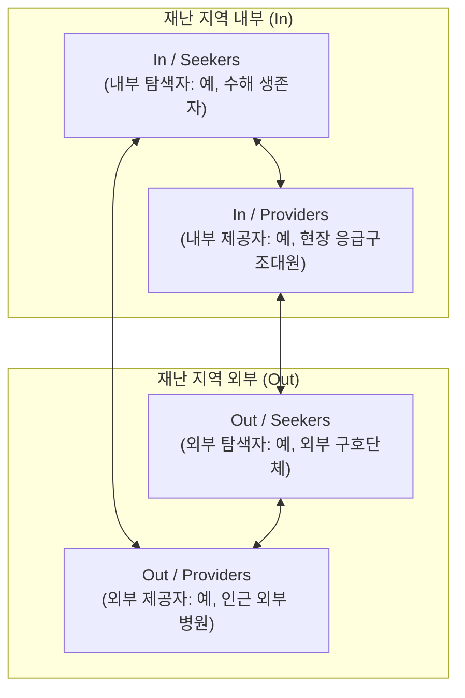

### IOSP 4대 행위자 범주 상세

| 분류 범주 | 위치 (Location) | 역할 성격 (Role) | 대표적 행위자 예시 |
| :--- | :--- | :--- | :--- |
| **In / Seekers** | 재난 지역 내부 (In) | 지원 탐색 (Seeker) | 재난 현장의 피해 주민, 침수 피해 생존자 (flood survivors) |
| **Out / Seekers** | 재난 지역 외부 (Out) | 자원 탐색 및 외부 지원 제공 (Seeker) | 재난 외부 지역에서 활동하며 자원·정보를 모색하는 외부 구호기구 (outside relief organizations) |
| **In / Providers** | 재난 지역 내부 (In) | 현장 지원 제공 (Provider) | 피해 지역 내에서 즉각 구호 활동을 펼치는 응급 구조인력 (emergency workers) |
| **Out / Providers** | 재난 지역 외부 (Out) | 원거리 전문 지원 제공 (Provider) | 재난 발생지 외곽에서 이송 환자를 수용하는 권역 외 대형병원 (hospitals) |

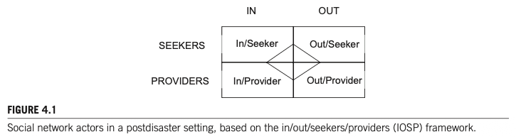  
*FIGURE 4.1: Social network actors in a postdisaster setting, based on the in/out/seekers/providers (IOSP) framework.*

* **프레임워크의 연구적 기능**:
  1. 네트워크 경계 설정 (Bounding)
  2. 분석 단위 및 분석 수준의 확립
  3. 행위자 간 연계(Ties)의 조작적 정의 옵션 도출
  4. 연구 질문(RQ)의 구체적 구조화
  5. 설문 도구(Instrument) 개발 및 데이터 수집 표준화

---

## 2.2 분석 단위: 개인, 집단, 지역사회 (Units of Analysis: Individuals, Groups, and Community)

재난 연구의 선구자들은 네트워크의 분석 단위를 다층적으로 바라보아야 함을 일찍이 강조했습니다.

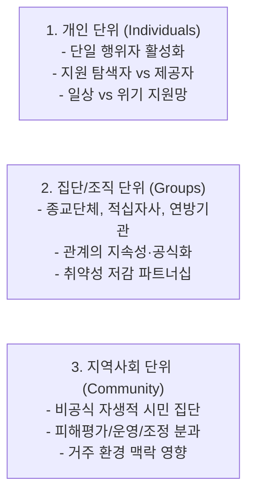

### 1. 개인 단위 (Individuals)
* **초점**: 소속 집단과 독립된 단일 행위자(single actors)로서, 개인이 사회연결망을 활성화(activate)하는 방식 및 네트워크 내에서 수행하는 역할.
* **주요 연구 질문 (Quarantelli & Dynes, 1977; Shavit, Fischer, & Koresh, 1994)**:
  * 비상 상황에서 사회적 지원을 요청하는 자는 누구인가?
  * 실제로 지원을 제공하는 자는 누구인가?
  * 재난 참여자(탐색자와 제공자 모두)의 위기 시 지원 패턴은 일상생활의 지원 패턴과 어떻게 비교되는가?
* **연구 흐름**: 개인의 일상적 지원망 구조, 사회적 연계의 동원 및 활성화 메커니즘, 다양한 사회적 지원 배치(configuration)가 미치는 영향 파악.

### 2. 집단/조직 단위 (Groups & Organizations)
* **초점**: 종교 소모임, 미국 적십자사(Red Cross), 연방 구호 기관 등 조직체를 분석 단위로 설정.
* **주요 연구 질문 (Comfort & Haase, 2006; Farmer, Tierney, & Kung-McIntyre, 2003; Kapucu, 2006a; Perrow, 1999; Robinson, Berrett, & Stone, 2006)**:
  * 위기 속에서 맺어진 관계가 재난 이후에도 지속되고 공식화(formalized)될 확률은 얼마인가?
  * 안정적인 관계는 규범적 격차(norm gaps)를 유발하는가, 아니면 소통과 상호작용을 촉진하는가?
  * 어떤 조직 간의 어떠한 관계 조합이 비상 상황에서 취약성을 감소시키는 데 기여하는가?
* **재난 환경 조직 연구의 난점과 SNA의 기여**:
  * 재난 대응 조직들은 다중 조직 유형을 넘나들며, 공식 조직의 고전적 구조를 갖추지 않는 경우가 많습니다(예: 적십자의 탈중앙화된 자원봉사자 구조, 자생적 종교 자원봉사 네트워크).
  * 사회연결망 분석(SNA) 기법은 이러한 유동적이고 비공식적인 조직 간 상호작용 연구의 한계를 극복하는 유용한 분석 도구를 제공합니다.

### 3. 지역사회 단위 (Community Context)
* **맥락적 배태성 (Embeddedness)**: Valerie Haines, Jeanne Hurlbert, John Beggs (1996, p. 261)는 개인의 지원 제공이 개인 특성, 개인 네트워크 특성(집단), 거주 지역사회 특성(지역사회)의 3가지 분석 단위 모두에 의해 영향을 받는다는 점을 실증했습니다(허리케인 대비 및 단기 복구 단계).
* **자생적 시민 집단 (Emergent Citizen Groups)**: Robert Stallings, Henry Quarantelli (1985)는 공식 조직 정체성 없이 집합적 재난 대응 목표를 위해 결성된 비공식 자생적 시민 집단을 3가지 유형으로 분류했습니다:
  1. **피해 평가 집단 (Damage assessment groups)**
  2. **운영 집단 (Operations groups)**
  3. **조정 집단 (Coordinating groups)**

---

## 2.3 분석 수준: 개인, 전체, 다수준 네트워크 (Levels of Analysis)

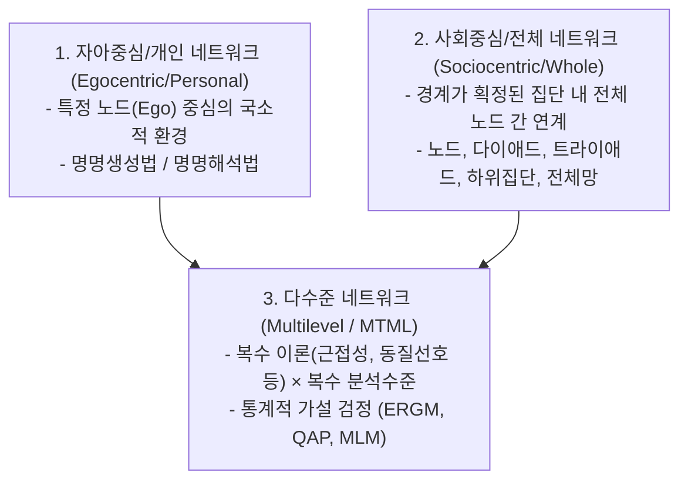

---

### 2.3.1 자아중심 또는 개인 네트워크 (Egocentric or Personal Networks)

* **개념 정의**: 자아(Ego)를 둘러싼 국소적 사회 환경(local social environment)에 대한 데이터. 특정 네트워크 구조가 초래하는 결과를 예측하는 데 주로 활용됩니다(예: 자아중심망이 조밀하게 연결되어 있으면 의사소통 효율성이 증대됨).
* **자아(Ego)의 범위**: 단일 개인에 국한되지 않으며, 특정 구조적 특성을 지닌 단일 조직, 기관 노드도 자아가 될 수 있습니다.

#### 데이터 수집 방식: 명명생성법과 명명해석법
1. **명명생성법 (Name Generator Approach)**: 응답자(Ego)에게 특정 관계 기준에 부합하는 타자(Alters)의 명단을 나열하도록 요청 (예: "지원해 주는 7명", "함께 일하는 5명", "돈을 빌려준 모든 사람").
2. **명명해석법 (Name Interpreter)**: 추출된 타자(Alters)들의 속성 및 알터 간의 관계(Alter-Alter ties)에 대해 추가 질문.
3. **응답자 부담(Respondent Burden)의 문제**:
   * 타자가 50명일 경우, 알터 간 쌍(Alter-alter pairs)의 수는 $\frac{50 \times 50 - 50}{2} = 1,225$개 문항.
   * 타자가 100명일 경우 문항 수는 $4,950$개로 기하급수적으로 폭증.

#### Christopher McCarty의 표본 추출 대안 (McCarty, 2002b; McCarty et al., 2007)
* **방법**: 응답자에게 60명의 알터를 자유 나열(free list)하게 한 후(예: "지난 2년 동안 알고 지낸 사람 60명"), 무작위 표본추출을 통해 **30명의 알터 서브셋**만 선정.
* **효과**: 평가해야 할 연계 수가 **1,770개에서 435개로 대폭 감소**하면서도 전체 개인 네트워크 구조의 분산과 구조적 대표성을 완벽히 재현함을 검증.
* **실무적 기준**: 통상 **40~60명의 알터를 수집한 후 20~30명을 무작위 추출**하여 이들 간의 연계를 측정하면 정확한 구조적 대표성을 확보할 수 있음.

#### 완전 네트워크(Complete Network)로부터의 자아중심 지표 구축
* 전체 네트워크 데이터를 이미 확보한 경우, 개별 노드의 직접 연결선과 이웃 노드 간 연결선(경로 거리 path distance = 1)만 추출하여 자아중심 지표를 계산할 수 있습니다.

#### 자아중심 연구의 주요 질문 예시
* **Q1**: 비일상적(재난) 상황에서 자원을 배분하는 일상적 네트워크의 유형은 무엇인가? (Hurlbert, Haines, & Beggs, 2000)
* **Q2**: 심각한 개인적 위기 시 동원되는 비공식 조력자 네트워크의 규모는 어느 정도인가? (Chatters, Taylor, & Neighbors, 1989)
* **Q3**: 치명적인 생명 위협 상황에서 사람들은 사회연결망을 어떻게 활용하는가? (Casagrande, McIlvaine-Newsad, & Jones, 2015; Shavit et al., 1994)
* **Q4**: 배태된 연계망 속에서 식별된 브로커(중개자)를 활용해 효과적인 조정 체계를 어떻게 동원할 수 있는가? (Saban, 2014)

---

### 2.3.2 사회중심 또는 전체 네트워크 (Sociocentric or Whole Networks)

* **개념 정의**: 명확히 경계가 설정된 행위자 집단(bounded group of actors) 내부의 모든 노드 간 연계 특성을 파악하는 분석.

#### 5단계 분석 층위
1. **노드 수준 (Nodal Level)**: 전체망 내에서 특정 단일 노드의 위치 분석. 인입/인출 연결 정도(In-/Out-degree), 교량(Bridges) 또는 문지기(Gatekeepers) 역할 여부, 하위집단 소속 여부, 네트워크 접근 용이성.
   * *Q4*: 네트워크 내 중심 행위자가 정보 전파 증대의 수단으로 기능할 수 있는가? (Kapucu, 2004)
   * *Q5*: 적시 정보 소통의 효율성을 높이기 위해 네트워크 연계의 중복성(redundancy)을 줄일 수 있는가? (Comfort & Haase, 2006)
2. **이원 수준 (Dyadic Level)**: 두 행위자 간의 쌍방 관계 분석 (예: 재난 후 상호 지원하는 두 생존자 간 관계).
3. **삼원 수준 (Triadic Level)**: 세 노드 간의 관계 구조 분석. 이행성(Transitivity; $A \to B$, $B \to C$ 일 때 $A \to C$)과 정보 흐름 검증.
4. **하위집단 수준 (Subgroup Level)**: 파벌(Cliques), 결속 집단, 분파 구조 분석.
5. **전체망 수준 (Global/Overall Level)**: 전체 네트워크의 밀도, 중심화도, 직경 등 포괄적 특성.

#### 전체망 연구의 주요 질문 예시
* **Q6**: 자생적 네트워크는 재난 후에도 지속되는가, 시간에 따라 어떻게 진화하는가? 복구 이후 공식화되어 계속 기능하는가?
* **Q7**: 비상 조정 및 의사소통 네트워크에서 호혜성(Reciprocity)은 얼마나 중요한가? 정보/자원의 일방적 전파로 충분한가, 아니면 상호 응답이 필수적인가?
* **Q8**: 의사결정 네트워크의 집중도(Centralization) 수준은 구성원들의 적시 의사결정 역량과 어떤 관련이 있는가?
* **Q9**: 구조적 동치(Structurally equivalent) 관계에 있는 네트워크 구성원들은 재난 전후 유사한 소통 패턴을 보이는가?

---

### 2.3.3 다수준 네트워크 (Multilevel Networks)

* **MTML 모델 (Multitheoretical, Multilevel Model)**: Peter Monge, Noshir Contractor (2003)가 개발한 이론적 틀로, 복수의 실질 이론(전염, 사회적 지원, 근접성, 동질선호, 자원 및 교환, 집합행동, 진화 이론 등)을 에고 및 사회중심 수준 전체에 걸쳐 복합 적용합니다.
* **통계적 도구 활용**: 관측값 간 종속성(관련성)을 보정하는 $p^*$ 모델(ERGM) 및 이차 배정 절차(QAP)를 적용하여 이론적 가설을 검정.

#### 다수준 연구 질문 예시
* **Q10**: 자원 제공자의 개인 특성, 그들의 개인 네트워크 특성, 그리고 그들이 거주하는 지역사회 맥락은 지원 제공 능력을 어떻게 촉진하거나 저해하는가? (Haines et al., 1996)
  * 매개변수 추정치를 통해 가설화된 구조적 속성(호혜적 링크, 이행적 삼원, 네트워크 집중도, 밀도)이 통계적으로 유의미하게 발현되는지 검증 가능.

#### MTML의 핵심 전제와 메타이론의 필요성
* **경쟁 이론(Competing Theories)의 동시 검증**:
  * 근접성 이론(Proximity theory): 인접 지역 피해자끼리 상호 탐색.
  * 동질선호 이론(Homophily theory): 유사한 피해 요구를 가진 자들끼리 상호 탐색.
  * ERGM 등의 통계 기법(Contractor, Wasserman, & Faust, 2006)을 통해 어떤 구조적 기제가 네트워크 형성을 지배하는지 식별.
* **상황적 메타이론(Contextual Meta-theory)의 필요성**:
  * 아이디어 탐색, 기존 자원 착취, 집합행동 동원, 경계 확장, 결속적 사회적 지원, 신속한 활성화(swarming) 등 재난 상황별로 작동하는 사회적 동인(social drivers)이 상이함.
  * 비상 대응기에는 신속한 동원(mobilizing)과 군집 활성화(swarming)가 지배적일 수 있으므로, 어떤 조건에서 특정 이론 세트가 우세해지는지 설명하는 메타이론 정립이 요구됨.

---

# 3. 연계의 개념화 및 데이터 수집 (Conceptualizing Ties and Collecting Data)

## 3.1 네트워크 연계(Ties)의 조작적 정의
* 실세계에 관계가 존재하더라도, 연구자가 연구 목적에 맞게 네트워크의 경계, 구성원, 연계 유형을 **조작적으로 정의(operationalized)**해야 합니다.
* 연계 유형: 소통, 조언, 친족, 친구, 직업(업무), 소속 기반(동호회, 헬스장, 학교), 종교, 근접성(이웃), 자원 공유 등.

## 3.2 재난 연구의 5대 핵심 관계 범주 (Kapucu, 2005; Carley, 2002)

| 관계 범주 | 핵심 질문 (Research Questions Addressed) |
| :--- | :--- |
| **1. 인적/행위자 관계 (People/agent relations)** | 누가 누구를 아는가? 누가 무엇을 아는가? 누가 어떤 자원을 가지고 있는가? 누가 무엇을 하는가? 누가 어디서 일하는가? |
| **2. 지식 관계 (Knowledge relations)** | 어떤 지식이 어떤 지식에 정보를 주는가? 특정 자원을 사용하는 데 어떤 지식이 필요한가? 해당 과업을 수행하는 데 무엇이 필요한가? 특정 지식은 어디에 존재하는가? |
| **3. 자원 관계 (Resource relations)** | 어떤 자원이 다른 자원을 대체할 수 있는가? 특정 과업 수행에 어떤 자원이 필요한가? 가용 자원은 어디에 위치해 있는가? |
| **4. 과업 관계 (Task relations)** | 어떤 과업이 다른 과업보다 먼저 선행되어야 하는가? 어떤 과업이 어디서 수행되는가? |
| **5. 조직 관계 (Organizational relations)** | 어떤 조직이 어떤 조직과 공식적·실무적으로 협력하여 일하는가? |

---

## 3.3 데이터 수집 방법론

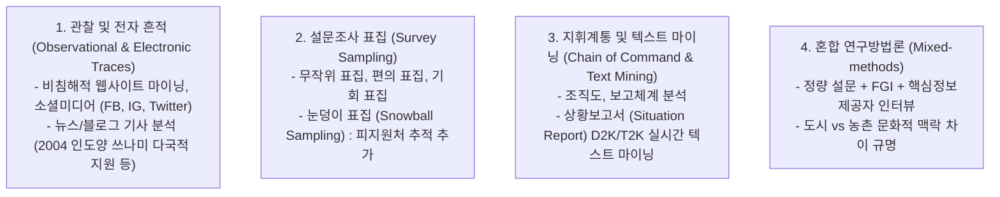

### 1. 관찰 데이터 및 전자적 흔적 (Electronic Traces)
* **웹 마이닝 및 SNS 활용**: 웹사이트 링크, 텍스트 마이닝, 소셜 미디어(Facebook, Instagram, Twitter) 데이터를 활용하여 재난 전·중·후의 네트워크 데이터를 실시간 포착.
* **비침해적 뉴스/블로그 분석**: 2004년 인도양 지진해일(쓰나미) 다국적 구호 활동 분석처럼, 신속하고 비침해적인 데이터 수집이 가능하나 전문가적 판단(expert judgment)과 도메인 지식 의존도가 높음.

### 2. 설문조사 데이터 수집
* **표집 기법**: 무작위 표집, 편의 표집, 기회 표집, 눈덩이 표집(Snowball sampling) 활용.
* **눈덩이 표집의 장단점**: 재난 후 지원을 받은 대상(Alters)을 지속적으로 샘플에 추가하여 네트워크의 전체 그림을 완성하기 용이하지만, 무작위 표집을 제외한 비확률 표집은 통계적 속성이 복잡하여 일반화(generalizability)에 제약이 따름.

### 3. 지휘계통(Chain of Command) 데이터 및 상황보고서 텍스트 마이닝
* **조직도와 보고 구조**: 공식 계통도를 바탕으로 연계를 식별하며 이메일 및 통신 텍스트 마이닝(Diesner & Carley, 2005) 병행.
* **상황보고서(Situation Report; SitRep) 마이닝**: 재난 대응 기관들이 웹에 게시하는 표준 보고서를 **D2K(Data-to-Knowledge)** 및 **T2K(Text-to-Knowledge)** 도구로 마이닝하여 준실시간(near real time)으로 네트워크를 비침해적으로 추론.

### 4. 혼합 연구방법론 (Mixed-methods)
* **결합 도구**: 설문, 포커스 그룹 인터뷰(FGI), 핵심 정보제공자(Key informant) 면담, 데이터 마이닝, 소셜 미디어 코딩(Islam & Walkerden, 2014)의 융합.
* **맥락적 차이 규명**: 농촌(Rural)과 도시(Urban) 공동체 간 서비스 탐색 패턴 차이처럼, 문화적·환경적 맥락이 상이한 경우 정량 데이터의 왜곡을 방지하고 풍부한 해석을 제공.

---

# 4. 재난 네트워크 분석 방법론 (Analyzing Disaster Networks)

네트워크 데이터는 노드 간 상호의존성(relational dependency)을 가지므로, 고전 통계학의 '관측의 독립성(independence of observations)' 가정을 충족하지 못합니다. 따라서 기술적 통계와 특화된 예측적 통계 기법이 요구됩니다.

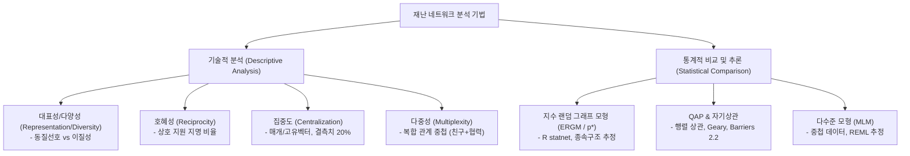

---

## 4.1 기술적 분석 (Descriptive Analysis of Networks)

### 1. 대표성 및 다양성 (Representation/Diversity)
* **동질선호 (Homophily)**: 행위자 간 유사성에 기반한 연계 형성 경향 (McPherson, Smith-Lovin, & Brashears, 2001). 반대 개념은 이질성(Heterogeneity).
* **재난 적용**: 다문화 공동체에서 재난 피해자들이 자신과 유사한 집단(내부)만을 찾는가, 아니면 외부 지역사회에도 도움을 요청하고 신뢰하는가 분석 (Messias, Barrington, & Lacy, 2012).

### 2. 호혜성 (Reciprocity)
* **정의**: 전체 이원 관계(dyads) 중 상호 지명(reciprocal nominations)이 이루어진 쌍의 비율.
* **재난 적용**: 응급실(Emergency Department) 내 의사소통 연구에서 특정 핵심 인물에게 도움 요청이 집중되면서도, 의료진 전반에서 상호 간에 지원을 주고받는 호혜적 구조가 병존함을 실증 (Creswick, Westbrook, & Braithwaite, 2009).

### 3. 집중도 및 중심성 (Centralization & Centrality)
* **집중도 (Centralization)**: 네트워크 차원의 지표. 소수의 행위자가 연결선을 독점하는 정도 (높은 점수 = 소수 독점 고도 집중, 낮은 점수 = 분산 네트워크).
* **중심성 (Centrality)**: 개별 노드 차원의 지표.
  * **매개 중심성 (Betweenness Centrality)**: 네트워크 내 문지기(gatekeeping), 교량(bridging), 병목(bottleneck) 기능 포착.
  * **고유벡터 중심성 (Eigenvector Centrality)**: 많은 연계를 가진 핵심 노드들과 잘 연결된 노드 식별.
  * **브로커리지와 정보 전파**: 재난 네트워크 내 조직들의 브로커리지 및 전파 역할 식별 (Moore, Eng, & Daniel, 2003).
* **🚨 결측 데이터(Missing Data) 경고**:
  * 중심성 지표는 무작위 결측 데이터가 **20%를 초과할 경우 급격한 성능 저하(degradation)**가 발생 (Valente et al., 2008).
  * 결측치를 최소화하도록 연구 설계를 보정하거나, 결측치에 덜 민감한 지표를 신중히 채택해야 함.

### 4. 다중성 (Multiplexity)
* **정의**: 두 노드 간에 존재하는 상이한 관계 유형의 수(복합 관계의 공존도).
* **재난 적용**: 네트워크 내 사적 친분(friendships) 수준이 재난 대응 네트워크에서 조직의 참여 수준을 유의미하게 예측 (Kapucu & Hu, 2014).

---

## 4.2 네트워크 통계적 비교 및 추론 (Statistical Comparison of Networks)

### 고전 통계 추론과의 차이점
* 고전 통계학은 관측치의 독립성을 가정하므로 표준오차를 과소추정(훨씬 작게 계산)합니다. 네트워크의 관계적 종속성을 다루기 위해 부트스트랩 및 특화된 통계 기법이 필수적입니다.
* **주요 비교 기준 3가지**:
  1. 이론적으로 결정된 기댓값과의 비교
  2. 다중 네트워크 간 비교 (예: 친구망과 도움요청망을 비교하여 구조적 특성이 구성 차이를 설명하는지 검증)
  3. 다수 시점에서의 동일 네트워크 비교 (시계열 동태성)

### 1. 지수 랜덤 그래프 모형 (Exponential Random Graph Models; ERGM / p* 모형)
* **개념**: 관측된 네트워크 구조를 형성하는 잠재적 종속성(dependence) 및 이질성(heterogeneity)의 원천을 확률론적으로 모형화 (Frank & Strauss, 1986; Robins et al., 1999; Wasserman & Pattison, 1996).
* **분석 도구**: R 통계 소프트웨어 환경의 **`statnet`** 패키지 (Handcock et al., 2008).

### 2. 이차 배정 절차 (QAP) 및 자기상관 (Autocorrelations)
* **QAP 원리**: 행위자-행위자 이원 행렬(Dyadic variable)이 다른 이원 행렬 또는 노드 속성 벡터(Monadic variable)와 상관되어 있는지 비모수적 순열 검정으로 분석.
* **재난 적용 사례**: '누가 누구를 돕는가(이원 변수)'와 '각 노드가 재난으로 피해를 입은 정도(단일 노드 속성)'의 상관을 분석하여, 피해가 극심한 대상에게 지원이 집중되는지 검증.
* **소프트웨어**:
  * **UCINET**의 **Geary autocorrelation** (p-값이 작을수록 유의미한 자기상관; Varda, 2011)
  * **Barriers 2.2** 소프트웨어의 Monmonier 알고리즘을 통한 행렬 자기상관 계산 (Manni, Guérard, & Heyer, 2004)

### 3. 다수준 모형 (Multilevel Modeling; MLM)
* **중첩 구조 보정**: 조직 내부에 중첩된 다이애드(dyads nested within organizations)처럼 데이터의 다층 위계 구조를 다룸 (Gooty & Yammarino, 2011).
* **분석 기법**: 제한된 최대우도법(Restricted Maximum Likelihood; REML) 접근법을 활용하여 조직 수준(상위) 예측 변수가 1:1 관계 결과(하위 다이애드 수준)의 변량을 어떻게 설명하는지 추정 (Raudenbush & Bryk, 2002).

---

# 5. 재난 네트워크의 동태적 특성 (The Dynamic Nature of Disaster Networks)

재난 전 기간에 걸친 네트워크의 동태성은 측정을 복잡하게 만들지만, 재난 네트워크의 본질 그 자체입니다.

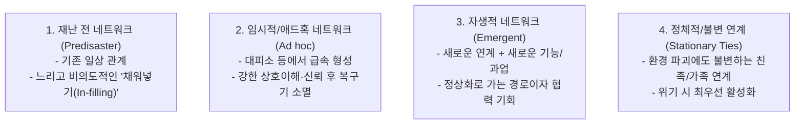

## 5.1 동태적 네트워크의 4대 범주

1. **재난 전 네트워크 (Predisaster Networks)**: 재난 발생 이전의 일상적 네트워크. 변화가 매우 느리고 특별한 목적성이 없으며, 친구의 친구가 친구가 되는 완만한 **‘채워넣기(in-filling)’** 과정 중심 (Banks & Carley, 1996).
2. **임시적/애드혹 사회 네트워크 (Ad hoc Social Networks)**: 재난 발생 중 내부/외부 탐색자와 제공자 사이에서 신속하게 결성되는 관계. 대피소(shelters) 등에서 연결되어 상호 이해와 신뢰를 바탕으로 강한 유대를 형성하나, 복구 단계를 거치며 빠르게 소멸(dissipate)함.
3. **자생적 네트워크 (Emergent Networks)**: **새로운 연계(new ties)**와 **새로운 기능/과업(new functions/tasks)**으로 정의됨 (Stallings & Quarantelli, 1985). 기존 네트워크를 상실한 개인에게는 일상 회복의 통로가 되며, 조직에게는 새로운 협력 파트너십의 기회가 됨.
4. **정체적/불변 연계 (Stationary Ties)**: 재난의 충격, 공간적 이동, 통신 두절에도 불구하고 훼손되지 않고 지속되는 연계. 주로 **친족 연계(kinship ties)**가 해당되며, 재난 피해자들은 위기 시 친족 연계를 최우선으로 가동함 (Chatters et al., 1989; Haines et al., 1996; Shavit et al., 1994).

---

## 5.2 시계열적 진화 단계와 네트워크 밀도 변화

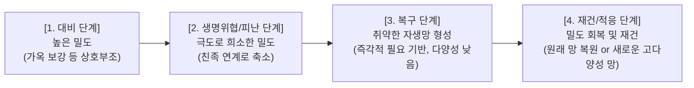

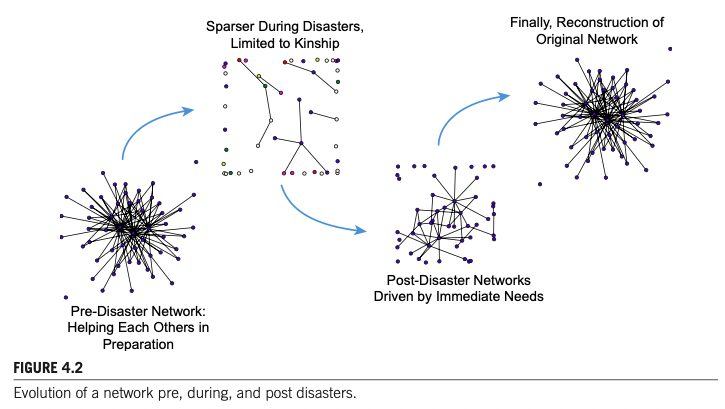  
*FIGURE 4.2: Evolution of a network pre, during, and post disasters.*

### 개인 수준과 조직 수준의 진화 동학 비교

| 진화 단계 | 개인 차원의 네트워크 변화 | 조직 차원의 네트워크 변화 |
| :--- | :--- | :--- |
| **대비 단계 (Preparation)** | 가옥 보강(boarding up), 피난 행렬 형성 등 일상 지원망을 통한 상호부조 (밀도 유지) | 가용 자원을 사전 비축하기 위해 기존 관계(preexisting ties)를 집중 활성화 |
| **생명위협/난민 단계 (Life-threat / Refugee)** | 극도로 희소(sparse)해지며, 친족 연계를 제외한 대부분의 연계가 일시 단절됨 | 피지원자들에 대한 새로운 연계의 폭발적 급증(explosion of ties), 현장 지원 집중 |
| **복구 단계 (Recovery)** | 즉각적 생존 필요에 의해 주도되는 취약한(fragile) 자생적 네트워크 형성 (다양성은 낮음) | 타 기관 간 경쟁(competitive) 또는 협력(cooperative) 관계 전개, 분파(종교, 연방, 지역) 형성 |
| **재건/적응 단계 (Reconstruction)** | 원래의 네트워크를 복원하거나, 새로운 지역에서 구조적·구성적 다양성을 갖춘 견고한 망 구축 | 공식적 다기관 협력 파트너십의 제도화 및 장기 지속 네트워크로의 정착 |

* **비재난 연구와의 결정적 차이**: 일반 네트워크 동태 연구는 정적 네트워크의 '채워넣기(in-filling)'에 집중하지만, 재난 연구는 **외생적 충격에 의해 강제된 네트워크의 희소화(thinning out)**와 이에 적응하여 자원을 확보·배분하려는 **적응적 반응(adaptive responses)**에 집중합니다.

### 동태적 네트워크 연구의 3대 발전 방향
1. **시각화 영화 도구 (Visualization "Movies")**: 혼란 속에서 소규모 네트워크가 어떻게 연계를 잃고 얻는지를 동영상 형태로 가시화 (Moody, McFarland, & Bender-DeMoll, 2005).
2. **수학적 진화 모형 (Mathematical Models)**: 재난 사건 진행에 따른 연계의 진화 궤적을 수학적으로 정식화 (Phan & Airoldi, 2014).
3. **통계적 가설 검정 도구 (Statistical Tools)**: 네트워크 변화 모델이 실제 수집 데이터에 의해 뒷받침되는지 통계적으로 적합도 검정 (Sanil, Banks, & Carley, 1995).

---

# 6. 재난 네트워크 연구의 도전 과제 (Challenges)

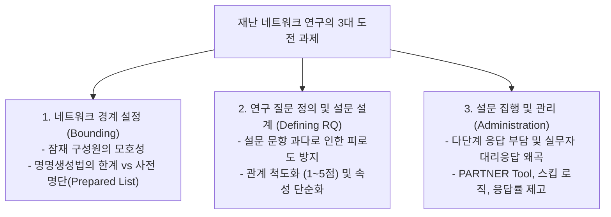

---

## 6.1 네트워크 경계 설정 (Bounding the Network)
* **경계 불명확성**: 재난 발생 지역사회 내 잠재적 네트워크 구성원은 매우 방대하고 비정형적입니다. 누구를 조사 대상에 포함하고 누구를 배제할지 명확한 경계를 긋는 것이 극히 어렵습니다.
* **고민 요인**: 활성 구성원만 포함할 것인가? 고립자(isolates)도 포함할 것인가? 한 조직 내 여러 부서를 포함할 것인가, 대표자 1인의 응답으로 갈음할 것인가?
* **엔티티 추가의 비용**: 조사 대상이 늘어날수록 프로젝트의 복잡성, 참여 협조 유도 비용, 설문 관리 부담이 기하급수적으로 증가합니다.
* **명명생성법의 한계와 대안**:
  * 비자아중심 전체망 연구에서 자유 명명생성법을 사용하면 신뢰도가 떨어지고(응답자마다 파트너 명단이 상이함), 실제 존재하는 연계를 과소보고(underestimate)하며, 철자 불일치로 데이터 정합 비용이 급증합니다.
  * **해결 대안**: 사전에 준비된 조직·구성원 명단(**Prepared list**)을 제공하고 이름을 추가/삭제할 수 있도록 설계하는 방식이 효과적입니다.

---

## 6.2 연구 질문의 정의 및 설문 설계 (Defining the Research Questions)
* **설문 개발의 딜레마**: 검증된 기존 온라인 설문(예: 재난 복원력 네트워크 설문; Eisenman et al., 2014)을 수정하여 사용할 수도 있고 처음부터 자체 개발할 수도 있으나, 가장 큰 난관은 **너무 많은 문항을 묻지 않도록 자제하는 것(refraining from asking too many questions)**입니다.
* **의미 있는 관계에 집중**: 단순한 '인지 여부(who knows whom)'를 넘어 실질적인 관계를 포착하되, 응답자 피로도를 줄여야 합니다.
  * *핵심 RQ 예시*: 어떤 전문 영역에서 활동하는가? 자금 이전의 영향은 무엇인가? 핵심 행위자 이탈 시 영향은 어떠한가? 서비스 공백(gaps)은 어디에 존재하는가? 취약성을 줄이기 위해 활용 가능한 강한 유대는 어디인가?
* **단일 질문을 통한 관계 변량 확보 (응답 부담 경감 기법)**:
  * 여러 문항을 나열하는 대신, "A와 B의 관계 강도는 1~5점 중 몇 점인가?"처럼 척도화하거나,
  * "A와 B는 친구, 업무, 종교, 지역봉사, 친족 중 어떤 관계인가?"와 같이 질적 범주를 단일 문항으로 질문.
* **방법론적 구분**: 조직 간 네트워크 구조를 밝히는 연구와 시민(수혜자)이 네트워크를 경험하는 서비스 이용 경험(customer experience) 연구는 방법론적으로 엄격히 구분되어야 함.

---

## 6.3 설문조사 집행 및 관리 (Survey Administration)
* **다단계 설문 구조의 극심한 부담**:
  1. 본인에 관한 질문 응답
  2. 사전에 주어진 명단에서 관계가 있는 대상을 선택
  3. 선택된 각 대상과의 관계 성격에 대해 개별 심층 문항 응답
* **조직 내 대리 응답의 위험성**: 조직 리더가 외부 파트너십을 잘 모르는 하위 실무자 1인에게 설문 작성을 위임할 경우 응답 왜곡 및 가치 저하가 발생.
* **응답률과 미응답 처리**:
  * 한쪽 행위자의 보고만 신뢰하는 방식은 파트너가 응답하지 않아도 연계를 추정할 수 있으나, **호혜성(Reciprocity)이나 상호 지각(perceptions)을 측정할 수 없는 치명적 한계**가 존재함.
* **실무적 해결 방안**:
  * **PARTNER Tool (Danielle Varda, 2008)**: 설문 응답 시간을 최소화하도록 설계·검증된 전문 도구(Program to Analyze, Record, and Track Networks to Enhance Relationships) 활용.
  * 정교한 설문 건너뛰기 논리(Skip logic) 적용.
  * 통계적 검정력을 유지하는 타깃 표본추출.
  * 응답률 제고를 위한 대면 인터뷰, 반복 접촉, 인센티브(추첨 등), 초기 지역사회 참여 유도(Buy-in).

---

# 7. 결론 및 향후 연구 방향 (Conclusions)

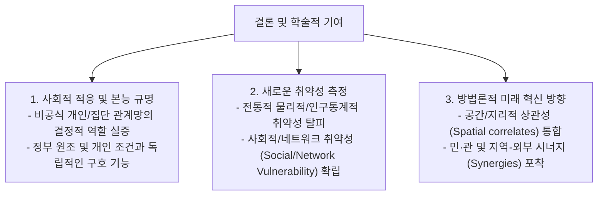

### 1. 사회과학적 가치와 비공식 연계망의 실증
* 재난은 인간의 사회적 적응과 본능이 가장 극명하게 드러나는 분석의 장을 제공합니다.
* 사회연결망 연구는 정부의 공식 지원금이나 생존자의 개인적 조건(소득, 학력, 피해 규모)과 독립적으로, **비공식적인 개인 및 집단 관계망이 재난 구호에 핵심적인 역할을 수행함**을 일관되게 보여줍니다.

### 2. '사회적/네트워크 취약성(Social/Network Vulnerability)'의 규명
* **기존 취약성 측정의 한계**: 전통적으로 취약 인구는 인구사회학적 속성(소득, 고용, 장애, 연령)이나 물리적 속성(주택 품질, 개인 교통수단 유무)으로만 정의되었습니다.
* **네트워크 취약성의 대두**: 사회연결망 연구는 **'사회적으로 고립된 생존자(socially isolated disaster survivors)'**일수록 재난 후 적응 및 복구 가능성이 현저히 낮아진다는 새로운 차원의 취약성 지표를 제공합니다.

### 3. 향후 연구의 2대 방법론적 혁신 과제
1. **공간적/지리적 상관성과의 결합 (Spatial Correlates)**:
   * 고립된 생존자들의 공간적·지리적 배치를 네트워크 분석과 통합함으로써, 공공 및 민간 응급관리 팀이 긴급 구호 활동을 보다 정밀하게 표적화(targeting relief efforts)할 수 있도록 지원.
2. **민·관 및 지역-외부 간 시너지(Synergies) 포착**:
   * 공공-민간(Public-Private) 및 지역-외부(Local-External) 간의 협력적 시너지를 포착하여, 재난 대응·복구·적응 전반의 속도(speed), 조정(coordination), 포괄 범위(breadth of coverage)를 획기적으로 향상.

---

## [부록] 본 챕터 핵심 인용 문헌 매핑 (Key References)

* **Varda, D. M., Forgette, R., Banks, D., & Contractor, N. (2009)**. *Social network methodology in the study of disasters: issues and insights prompted by post-Katrina research*. Population Research and Policy Review, 28(1), 11–29. (IOSP 프레임워크 원천)
* **Quarantelli, E. L., & Dynes, R. R. (1977)**. *Response to social crisis and disaster*. Annual Review of Sociology, 3, 23–49. (개인/조직 분석 단위)
* **Haines, V. A., Hurlbert, J. S., & Beggs, J. J. (1996)**. *Exploring the context of personal networks: An introduction*. Social Networks, 18(4), 261–266. (개인-집단-지역사회 3대 분석단위 배태성)
* **Stallings, R. A., & Quarantelli, E. L. (1985)**. *Emergent citizen groups and emergency management*. Public Administration Review, 45, 93–100. (자생적 시민 집단 3유형)
* **McCarty, C. (2002b); McCarty, Killworth, & Rennell (2007)**. (자아중심망 표본추출 기법: 60명 중 30명 추출을 통한 응답부담 경감)
* **Monge, P. R., & Contractor, N. S. (2003)**. *Theories of communication networks*. Oxford University Press. (MTML 다이론 다수준 모델)
* **Contractor, N. S., Wasserman, S., & Faust, K. (2006)**. *Testing multitheoretical multilevel networks*. Academy of Management Review, 31(3), 681–703. (ERGM 가설검정 기법)
* **Kapucu, N. (2005, 2006a); Comfort & Haase (2006)**. (조직 간 네트워크, 중심성, 5대 연계 범주)
* **Valente, T. W. et al. (2008)**. (중심성 측정 시 결측 데이터 20% 임계점 경고)
* **Varda, D. M. (2008)**. *PARTNER Tool (Program to Analyze, Record, and Track Networks to Enhance Relationships)*. (네트워크 설문 최적화 도구)

---

## [부록] 박사학위 논문 선행연구 9단계 분석 템플릿 (Chapter 4)

| 단계 | 분석 항목 | 제4장 (Varda, 2017, pp. 43–59) 핵심 내용 |
| :---: | :--- | :--- |
| **1** | **연구배경** | 허리케인 카트리나 이후 재난 대응·복구·완화 연구에서 전통적 속성(인구통계·물리적 취약성) 중심 접근의 한계가 드러남에 따라, 비공식·공식 관계망을 실증적으로 규명할 체계적 사회연결망(SNA) 방법론 전략이 요구됨. |
| **2** | **이론적 개념** | **IOSP 프레임워크**(In/Out × Seeker/Provider), **개인-집단-지역사회 3대 분석단위의 배태성(Embeddedness)**, **자아중심망(Egocentric)·전체망(Sociocentric)·다수준망(Multilevel)**, **5대 관계 범주**(인적·지식·자원·과업·조직), **다이론 다수준(MTML) 모형**, **사회적/네트워크 취약성(Social/Network Vulnerability)**. |
| **3** | **연구목적** | 재난의 특수한 맥락(시간 압축성, 경계 모호성, 종단적 재편성)에 적합한 사회연결망 연구 설계, 데이터 수집(명명생성법 vs 사전 명부), 통계적 추론(QAP, ERGM/p*), 설문 행정 전략을 종합 제시함. |
| **4** | **연구방법** | 문헌 메타 검토 및 방법론적 프레임워크 구축. 자아중심·전체·다수준 네트워크별 핵심 연구질문(Q1~Q10) 도출, PARTNER Tool 설계 원리, 결측치(20% 임계점) 및 회상 편향 통제 기법 제시. |
| **5** | **연구결과** | • **시간에 따른 네트워크 진화(Fig 4.2)**: 재난 발생 직후 비공식 연결망이 친족·핵심 연계 중심으로 급격히 **희소화(Thinning-out)**된 후 장기 복구기에 점진적으로 재건됨. • **결측치 민감성**: 무작위 결측이 **20%를 초과**하면 중심성·밀도 지표가 심각하게 왜곡됨(Valente et al., 2008). |
| **6** | **핵심 발견** | 정부의 공식 원조나 개인의 사회경제적 조건과 독립적으로 **비공식 관계망이 재난 구호와 복구에 결정적 역할**을 수행하며, **'사회적으로 고립된 생존자(Socially Isolated Survivors)'**가 가장 치명적인 네트워크 취약 집단임. |
| **7** | **연구의 한계** | 재난 직후 현장 접근성 제약, 사후 회상(Recall) 설문에 따른 기억 왜곡, 다단계 네트워크 설문의 높은 응답 피로도 및 조직 대리 응답으로 인한 호혜성 측정 한계. |
| **8** | **이론적 시사점** | 재난 연구의 패러다임을 '개별 행위자 속성'에서 **'관계적 구조와 다수준 상호의존성(MTML)'**으로 전환하고, 전통적 물리적 취약성을 넘어 **'네트워크 취약성'** 개념을 정립함. |
| **9** | **후속 연구 시사점** | (1) 네트워크 고립 노드의 **공간적·지리적 상관성(Spatial Correlates)** 결합을 통한 정밀 구호 표적화, (2) 공공-민간(Public-Private) 및 지역-외부(Local-External) 네트워크 시너지 실증. |

---

# 8. ★ [내 연구 적용] 소방공무원 안전 책무성·협력 네트워크 실증 분석 (SNA & 넷마이너 7단계 프로토콜 및 5인 가상 시뮬레이션)

본 장(Chapter 4)의 사회연결망 연구 전략(SNA)을 **[의령소방서 119구조대 및 관내 현장 출동부서의 안전 리더십, 안전 책무성(Accountability) 및 다기관 협업 네트워크 분석]**에 직접 적용하기 위해, 순수 사회연결망 분석 및 넷마이너(NetMiner) 실증 절차 7단계와 가상 소방관 5인 시뮬레이션으로 체계화한 방법론 설계입니다.

### 1. 연구질문 (Research Questions)
Chapter 4에서 제시된 자아중심망, 전체망, 다수준망 연구 질문(Q1~Q10)의 논리를 소방 현장 안전 관리 맥락에 투영하여 5대 핵심 연구 질문을 도출합니다.
- **RQ 1 (구조적 중심성 & 중개자 - Centrality)**: 의령소방서 119구조대 및 출동부서의 안전 소통망에서 **핵심 안전 정보 중개자(Broker/Bridge; 매개 중심성)**와 **고립 대원(Isolates; 인입 연결정도 최하위)**은 누구이며, 계급(지휘관리층, 중간관리층, 일선대원층)별로 중심성 분포는 어떻게 차이를 보이는가?
- **RQ 2 (하위집단 & 동질선호 - Subgroups)**: 안전 소통 및 전술 조언망 내에서 비공식적 군집(Cliques)이나 동질선호(Homophily; 동일 계급·동일 팀 편중) 현상이 존재하는가? 이것이 상하 계급 간 **'안전 침묵(Safety Silence)'**이나 정보 전달 병목(Bottleneck)을 유발하는가?
- **RQ 3 (관계의 다중성 - Multiplexity)**: 공식 업무 지시망(Command), 전문 지식/전술 조언망(Advice), 비상 장비 공유망(Resource), 아차사고(Near-Miss) 신뢰망(Trust) 간의 구조적 상관성(QAP Matrix Correlation)은 어떻게 나타나는가?
- **RQ 4 (출동 생애주기별 동태성 - Dynamics)**: 출동 생애주기(평시 대비기 $
ightarrow$ 현장 진입/대응기 $
ightarrow$ 초진/철수기 $
ightarrow$ 사후 디브리핑기)의 진행에 따라 안전 네트워크의 밀도(Density)와 집중도(Centralization)는 어떻게 축소·재편(Thinning-out & Rebuilding)되는가?
- **RQ 5 (네트워크 성과 & 취약성 - Vulnerability)**: 네트워크 내 고립도 및 중심성 격차는 현장 대원의 안전사고(아차사고 은폐, 안전수칙 위반) 및 조직의 안전 책무성(RAA 삼원조 정합성) 성과와 어떠한 통계적 인과관계를 갖는가?

### 2. 확인한 연구결과 (Key Findings from Literature)

| 이론 및 챕터 출처 | 선행연구 핵심 실증 결과 | 본 소방 안전 네트워크 연구로의 연계 시사점 |
| :--- | :--- | :--- |
| **IOSP 프레임워크 (Chapter 4; Varda et al., 2009)** | 재난 네트워크 행위자를 공간(In/Out)과 역할(Seeker/Provider)로 분리 측정. 상호의존적 자원 탐색과 제공 구조화. | 현장 진입 대원(In/Seeker; 작업중지권), 지휘관/안전점검관(In/Provider; 위험성평가·RIT), 상황실(Out/Seeker), 통제단 유관기관(Out/Provider) 매핑. |
| **5대 관계 범주 (Chapter 4; Kapucu, 2005)** | 인적(People), 지식(Knowledge), 자원(Resource), 과업(Task), 조직(Organizational) 관계의 다차원적 분리 측정. | 소방 안전 책무성(RAA 삼원조)의 책임-권한-책무성과 정합하는 4대 매트릭스(의사소통, 조언, 장비차용, 신뢰망) 분리 설계. |
| **동태적 진화 모델 (Chapter 4; Fig 4.2)** | 재난 충격 시 네트워크가 극도로 희소화(Thinning-out)되어 친족·핵심 연계로 축소된 후 복구기 점진적 재건. | 출동 시 2인 1조(Buddy) 연계로의 축소 및 Mayday 비상탈출망 가동 $
ightarrow$ 귀소 후 아차사고 자발적 등록을 통한 다원적 망 재건 모델 입증. |
| **사회적/네트워크 취약성 (Chapter 4; Valente et al., 2008)** | 물리적 취약성보다 네트워크 내 '사회적으로 고립된 노드(Isolates)'의 복구 지체 및 사고 위험이 극심함. 결측치 20% 초과 시 지표 왜곡. | 조직 내에서 안전 조언과 소통이 단절된 **'네트워크 고립 소방관(Isolated Firefighter)'**의 위험성 선제 스크리닝 및 결측치 15% 이하 통제. |
| **다원주의 & HLM 실증 (Chapter 5; Nowell et al., 2017)** | 성과 평가 변량의 **83%~97%가 사건 간이 아닌 개인 간(Within-incident)에 존재** (Table 5.4). 중앙지휘팀(IMT) 나홀로 고평가 편향. | 단일 리커트 평균점수 비교를 지양하고, 다층 위계 조직(계급별) 내부의 소통 격차 및 지휘부 편향을 통계적으로 분리 검증. |

### 3. 연구절차 (Research Procedure: 6단계 표준 프로세스)
1. **[STEP 1] 연구 0점 & 경계 설정**: 의령소방서 119구조대 및 현장출동부서 전수 정의
2. **[STEP 2] 설문 도구 설계**: 사전 명부(Prepared Roster) 기반 다중 관계 측정 도구 설계
3. **[STEP 3] 전수 데이터 수집**: 교대근무 주기를 반영한 모바일/서면 병행 전수 조사
4. **[STEP 4] 데이터 정제 & 코딩**: 1-mode 정방행렬($N 	imes N$) 및 노드 속성 테이블 구축
5. **[STEP 5] 넷마이너(NetMiner) 분석**: 시각화, 중심성, 하위집단(E-I 지수), QAP/MRQAP 검정
6. **[STEP 6] 결과 해석 & 정책 제언**: 고립 대원 멘토링 및 선행 안전 KPI 도출

### 4. 네트워크 분석단위 및 분석지표 (Units & Network Metrics)
- **노드 수준 (Node-level, 미시 분석)**: 개별 소방공무원 노드($N pprox 50$명)의 **In-Degree Centrality**(신뢰받는 안전 리더 지수), **Out-Degree Centrality**(자원 요청 활성도), **Betweenness Centrality**(소통 교량 Bridge 또는 병목 Bottleneck), **Eigenvector Centrality**(핵심 인력 연계 영향력).
- **하위집단 수준 (Subgroup-level, 중범위 분석)**: 계급별(지휘층·중간층·일선대원층) 및 팀별(1·2·3팀) 집단의 **E-I Index**(집단 내부 vs 외부 연계 비율; $-1$에 가까울수록 계급 간 소통이 단절된 폐쇄적 파벌), **Cliques 및 K-core 분석**.
- **전체망 수준 (Whole-level, 거시 분석)**: 의령소방서 출동부서 전체망의 **Network Density**(네트워크 밀도), **Network Centralization**(특정 지휘관 독점 집중도), **Reciprocity**(상호 호혜적 안전 지원 비율).

### 5. 네트워크 데이터 구조 및 코딩처리 방식 (Data & Coding Method)

| 구분 | 데이터 형식 | 변수 구성 및 코딩 기준 |
| :--- | :--- | :--- |
| **노드 속성 데이터 (Node Properties)** | 1-mode 엑셀 테이블 (행 = 소방관 $i$) | • **ID**: 고유 식별코드 (FF01 ~ FF50) • **Rank (계급)**: 1=지휘관리층(령·경), 2=중간관리층(위·장), 3=일선대원층(교·사) • **Team (근무팀)**: 1팀, 2팀, 3팀 / **Role (직무)**: 1=구조, 2=진압, 3=구급, 4=운전 • **Tenure (경력)**: 소방 근무 연수(연 단위 연속형 변수) |
| **관계 매트릭스 1 (현장 소통망 $M_{	ext{comm}}$)** | $N 	imes N$ 정방 행렬 | "현장 출동 시 안전 정보 및 작전 상황을 얼마나 자주 소통하는가?" (1점~5점, 4점 이상 이진화 병행) |
| **관계 매트릭스 2 (전술 조언망 $M_{	ext{advice}}$)** | $N 	imes N$ 정방 행렬 | "비정형 고위험(산악·수난) 현장에서 위험 판단 및 구조 전술에 대해 누구에게 조언을 구하는가?" |
| **관계 매트릭스 3 (장비 차용망 $M_{	ext{resource}}$)** | $N 	imes N$ 정방 행렬 | "긴급 상황 발생 시 특수 장비, 유압장비, 로프 등을 상호 융통하고 지원받는 관계는 누구인가?" |
| **관계 매트릭스 4 (신뢰/아차사고망 $M_{	ext{trust}}$)** | $N 	imes N$ 정방 행렬 | "현장에서 겪은 아차사고(Near-Miss)나 실수를 문책 걱정 없이 솔직하게 털어놓고 의논할 수 있는 동료는 누구인가?" |

### 6. [실전 적용 시뮬레이션] 가상 소방관 5인 데이터로 보는 네트워크 데이터 수집부터 넷마이너 분석까지의 전 과정

> [!TIP] **일반 설문조사(R방법론) vs 네트워크 분석(SNA)의 결정적 차이**  
> • **일반 설문조사 (R방법론)**: "당신은 현장 안전수칙을 잘 지킵니까? (1~5점)" $
ightarrow$ 개인 점수의 단순 평균만 산출하여 조직 내 소통 혈관의 막힘을 볼 수 없음.  
> • **네트워크 분석 (SNA)**: "당신은 현장에서 위험에 직면했을 때 **동료 중 누구에게** 무전을 치고 전술 조언을 구합니까?" $
ightarrow$ 사람과 사람 사이에 흐르는 **관계(화살표) 데이터**를 수집하여 소통 병목과 고립 대원을 정밀 진단함.

#### [Step 1] 현장에 배포되는 실제 설문지 양식 (명부형 Roster 방식 예시: 응답자 = D. 최대원)

| 대상 동료 (Alters) | 전혀 안 함 (0점) | 가끔 의논 (1점) | 보통 (2점) | 자주 의논 (3점) | 매우 자주 의논 (4점) |
| :--- | :---: | :---: | :---: | :---: | :---: |
| **A. 김서장 (지휘관리층)** | [ V ] | | | | |
| **B. 이팀장 (중간관리층)** | | | [ V ] | | |
| **C. 박주임 (구조주임/베테랑)** | | | | | **[ V ]** |
| **D. 최대원 (본인)** | - | - | - | - | - |
| **E. 정신임 (신규 임용 구조대원)** | | [ V ] | | | |

#### [Step 2] 설문 응답의 엑셀 관계 매트릭스(Adjacency Matrix, $5 	imes 5$) 변환

| 보내는 사람 $\downarrow$ \ 받는 사람 $
ightarrow$ | A. 김서장 | B. 이팀장 | C. 박주임 | D. 최대원 | E. 정신임 | 해석 요약 |
| :--- | :---: | :---: | :---: | :---: | :---: | :--- |
| **A. 김서장 (지휘관리)** | 0 | **4** | 0 | 0 | 0 | 서장은 공식 보고 라인인 이팀장(B)에게만 지시/소통 |
| **B. 이팀장 (중간관리)** | **4** | 0 | **4** | **3** | 0 | 팀장은 서장(A), 주임(C), 대원(D)과 활발히 연결 |
| **C. 박주임 (구조베테랑)** | 0 | **4** | 0 | **4** | **4** | 주임은 팀장(B), 대원(D), 신임(E) 모두에게 조언 제공 |
| **D. 최대원 (일선대원)** | 0 | **2** | **4** | 0 | **1** | 대원은 위험 시 베테랑 박주임(C)에게 전적으로 의존 |
| **E. 정신임 (신규임용)** | 0 | 0 | **4** | **1** | 0 | 신임은 박주임(C) 외에는 거의 아무와도 소통하지 못함 |

#### [Step 3] 넷마이너(NetMiner)가 계산해 낸 3대 핵심 발견 및 진단 비교
1. **실질적 현장 안전 리더 발견 (In-Degree 1위 = C. 박주임)**: 계급장과 무관하게 대원 전원이 실제 위기 시 가장 신뢰하고 조언을 구하는 핵심 안전 리더가 박주임임을 데이터로 입증.
2. **소통 병목(Bottleneck) 발견 (Betweenness 1위 = C. 박주임, 80% 이상 독점)**: 지휘부(A, B)와 일선 대원(D, E)을 연결하는 다리가 박주임 1명뿐이므로, 박주임 부재·사고 시 지휘 소통망이 단절되는 구조적 취약성 포착.
3. **순직·사고 위험 고립 대원 발견 (Isolates 경고 = E. 정신임)**: 박주임 외에는 누구와도 연결되지 못한 고립 상태로, 현장 진입 시 위험 경고를 받지 못할 위험이 가장 높음 $
ightarrow$ **(1) 박주임을 공식 현장 안전 코디네이터로 지정, (2) 신임 대원 전담 멘토링 매칭, (3) 지휘부-대원 다이렉트 비상 무전 채널 신설**이라는 즉각적 정책 환류 도출.
