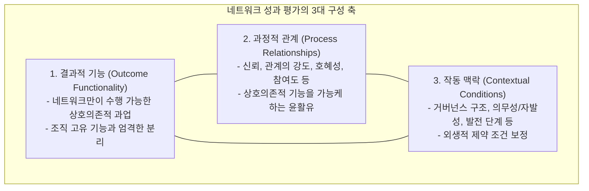
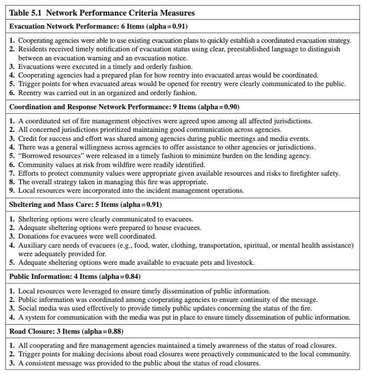
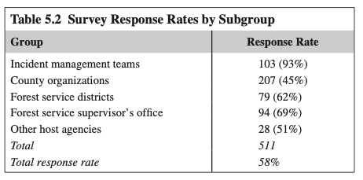
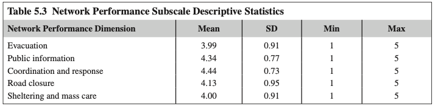
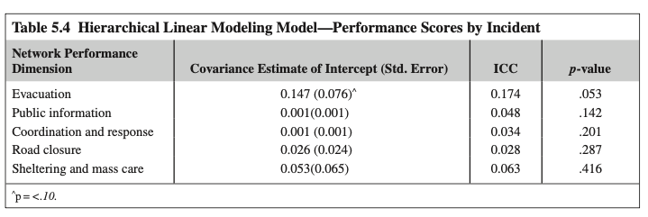
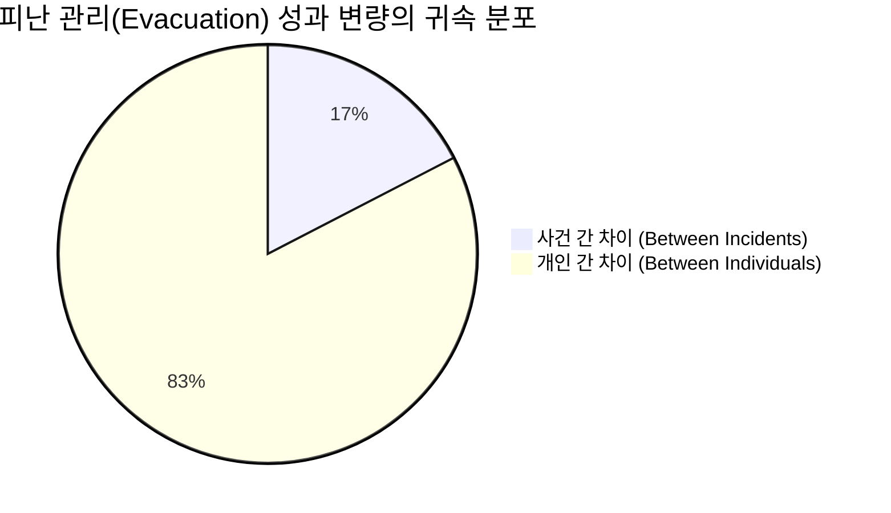
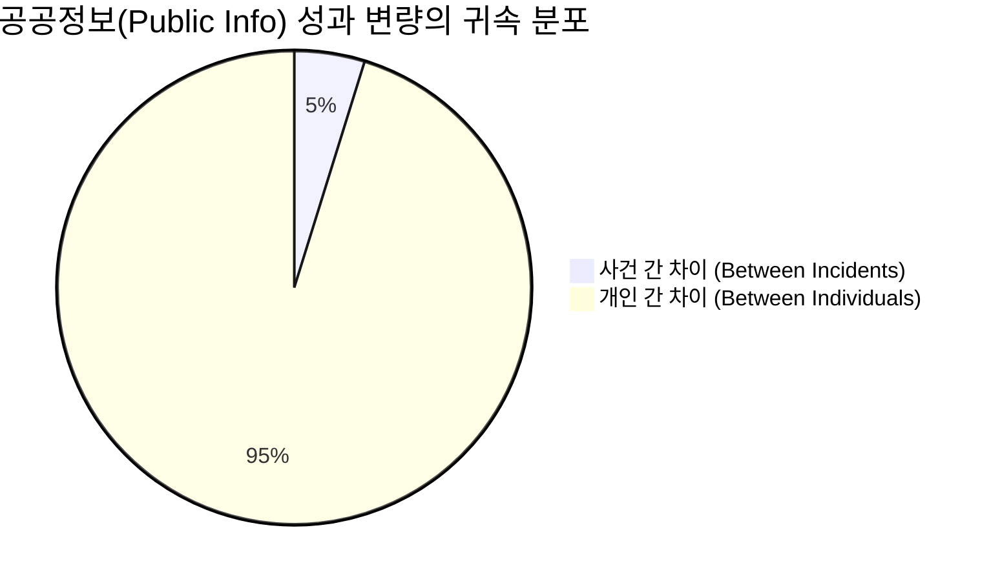
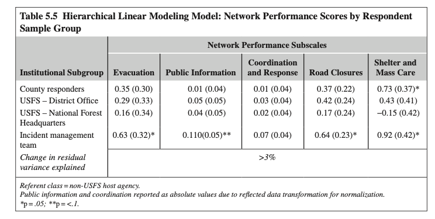
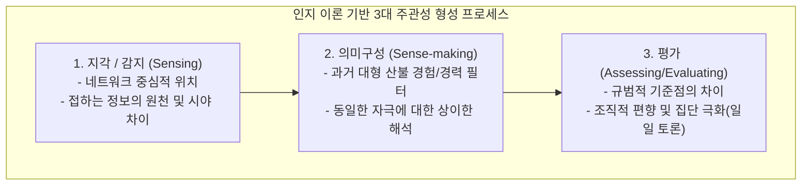
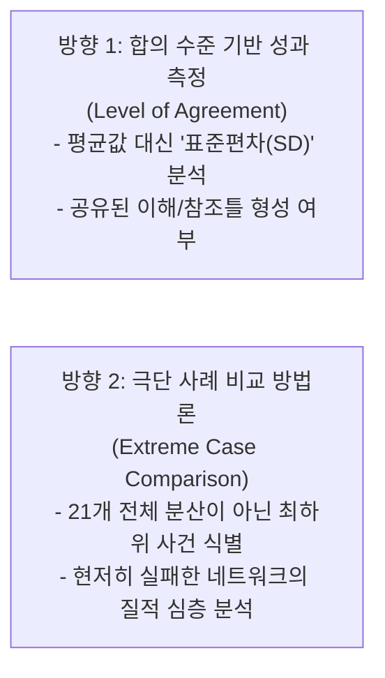

# 제5장 관점의 중요성: 산불 대응 네트워크의 성과 측정 과제 (Sub-Note)

**원제**: CHAPTER 5 PERSPECTIVE MATTERS: THE CHALLENGES OF PERFORMANCE MEASUREMENT IN WILDFIRE RESPONSE NETWORKS  
**저자**: Branda L. Nowell, Toddi A. Steelman, Anne-Lise K. Velez, Sherrie K. Godette  
*(North Carolina State University & University of Saskatchewan)*  
**출처**: *Social Network Analysis of Disaster Response, Recovery, and Adaptation* (Elsevier, 2017, pp. 59–74)  
**지원 연구 과제**: National Science Foundation (NSF # CMMI-1161755), Joint Fire Science Program (JFSP L12AC20571), USFS Northern Research Station (Fire Chasers Project)

---

## [개요] 챕터 목차 체계 (Chapter Outline)

1. **서론** (Introduction)
2. **네트워크 성과 평가: 선행문헌의 원칙들** (Assessing Performance in Networks: Principles From the Literature)
3. **산불 재난 시 네트워크 성과 측정** (Measuring Network Performance During Wildfire Disasters)
   * 원칙 1: 단일 기관이 단독으로 달성할 수 없는 기능적 결과의 반영
   * 원칙 2: 단일 지표가 아닌 전체론적(Holistic) 다차원 척도 구성 (**Table 5.1**)
   * 원칙 3: 행위자 수준 성과와 전체 네트워크 수준 성과의 동시 고려
   * 원칙 4: 네트워크가 작동하는 외생적 조건에 대한 보정
   * 원칙 5: 단일 정보제공자가 아닌 전체 네트워크 구성원의 지각 고려
4. **사건대응 네트워크 성과평가 내 다원주의 조사** (Investigating Pluralism Within Incident Response Network Performance Assessments)
   * 실재론적(Realist) 관점의 비판과 다원주의(Pluralism)의 대두
   * 2대 핵심 연구 질문 (RQ1, RQ2)
5. **연구방법** (Methods)
   * 대상 사건 및 표본 선정
   * 하위집단별 설문 응답 현황 (**Table 5.2**)
   * 위계선형모형(HLM / 다수준 모형) 분석 기법
6. **연구결과** (Results)
   * 사건 간(Between-Incidents) 네트워크 성과 변량 (**Table 5.3, Table 5.4**)
   * 사건 내(Within-Incidents) 네트워크 성과 변량 및 하위집단 영향 (**Table 5.5**)
7. **논의** (Discussion)
   * 다원주의는 측정 오차가 아닌 네트워크의 고유한 실재(Endemic Reality)
8. **성과 측정에 대한 시사점: 인지 이론 기반 3대 프로세스** (Performance Measurement Implications)
   * 지각/감지(Sensing), 의미구성(Sense-making), 평가(Assessing/Evaluating)
   * 현장관리팀(IMT) 고평가 메커니즘 규명
9. **연구의 한계 및 향후 연구 방향** (Limitations and Future Research)
   * '합의 수준(Level of Agreement; 표준편차)' 기반 성과 지표
   * 극단 사례 비교(Extreme Case Comparison) 방법론
10. **사사 및 핵심 참고문헌** (Acknowledgments & Key References)
11. **★ [내 연구 적용] 소방공무원 안전 책무성·협력 네트워크 실증 분석 (SNA & 넷마이너 7단계 프로토콜)**

---

# 1. 서론 (Introduction)

### 1. 재난 대응의 본질과 사건대응 네트워크(Incident Response Network)
* **단일 기관 역량의 한계**: 재난 사건 대응은 고도로 복잡하며, 어떤 단일 기관이나 조직도 단독으로 감당할 수 있는 자원의 범위를 넘어섭니다.
* **네트워크적 접근의 필연성**: 재난 대응 단계에서 활성화되는 수많은 기관 간의 조정되고 일관된 대응(coordinated, coherent response)을 달성하기 위해, 참여 행위자 집단을 **'사건대응 네트워크(incident response network)'**로 개념화하고 사회연결망 관점에서 구조와 기능을 분석해야 합니다 (Nowell & Steelman, 2013; Steelman et al., 2014).

### 2. 네트워크 성과의 4단계 분석 수준과 상호의존성
네트워크 내 성과는 다음의 4가지 수준에서 분석될 수 있습니다:
1. **개인 성과 (Performance of individuals)**
2. **조직/기관 성과 (Performance of organizations/agencies)**
3. **하위집단 성과 (Performance of subgroups)**
4. **전체 네트워크 성과 (Performance of the whole network)**

> [!IMPORTANT]
> **하위 수준 성과와 상위 수준 성과의 불일치 (Mandell & Keast, 2008)**  
> 특정 수준에서의 높은 성과가 반드시 상위 수준의 높은 성과로 이어지지 않습니다. 네트워크 내부의 복잡한 상호의존성으로 인해 **어느 한 수준에서의 높은 성과가 오히려 다른 수준의 성과를 저해하는 결과**를 초래할 수 있습니다.

### 3. 네트워크 성과 평가 과학의 초기성
* 성과 측정 및 평가는 일반 행정학에서는 오랜 역사를 가진 분야이지만, 사회연결망이나 조직 네트워크의 제약 속에서 성과를 평가하는 과학은 아직 **초기 단계(infancy)**에 머물러 있습니다 (Kenis & Provan, 2009; Mandell & Keast, 2008; O’Toole, 2015).
* 특히 재난 맥락에서 네트워크 성과를 다룬 실증 연구는 극히 드뭅니다 (Magsino, 2009). 본 연구는 산림-도시 접경지역(WUI; Wildland-Urban Interface)의 대형 산불 사건을 대상으로 전체 네트워크 성과를 실증적으로 규명합니다.

---

# 2. 네트워크 성과 평가: 선행문헌의 원칙들 (Assessing Performance in Networks: Principles From the Literature)

## 2.1 네트워크 성과(Network Performance)의 개념 정의
* **다차원적 구성개념 (Multidimensional Construct)**:  
  *"네트워크가 작동하는 맥락의 제약 하에서 과정 목표(process goals)와 결과 목표(outcome goals)를 달성하는 정도"* (Kenis & Provan, 2009; Mandell & Keast, 2008; Turrini et al., 2010).
* **네트워크 효과성(Network Effectiveness)의 정의 (Turrini et al., 2010, p. 529)**:  
  *"네트워크 전체에 의해 생산되어 개별 참여 조직을 넘어 귀속되는 효과, 결과, 영향 및 편익으로서, 효율성 증대, 고객 만족, 정당성 확보, 자원 획득, 비용 절감 등을 포괄하는 것."*

* **네트워크 기능성과 조직 기능성의 엄격한 분리**:
  * **조직 기능성(Organizational functionality)**: 자신의 명령-통제 체계 외부의 다른 행위자와 조정할 필요 없이 효과적으로 실행 가능한 기능.
  * **네트워크 기능성(Network functionality)**: 오직 복수 행위자 간의 상호의존적 협력을 통해서만 달성 가능한 과업.
* **다중 측정 및 다중 관점(Multimeasure, Multiperspective Approach)의 필요성 (Provan & Milward, 1995)**:
  * 네트워크의 다양한 이해관계자 집단은 저마다 중요하게 여기는 목표와 선호가 다릅니다. 따라서 단일 지표나 단일 정보원에 의존해서는 네트워크 성과를 완전하게 평가할 수 없습니다.

---

## 2.2 선행문헌이 제시하는 전체 네트워크 성과 평가 5대 원칙

1. **원칙 1**: 네트워크 수준 지표는 단일 조직이 단독으로 달성할 수 없고 복수 행위자의 상호의존적 행동을 필요로 하거나 그에 의해 영향을 받는 **기능적 결과(functional outcomes)**를 반영해야 한다 (Provan & Milward, 1995; Turrini et al., 2010).
2. **원칙 2**: 네트워크 성과는 단일 지표 평가가 아닌 **전체론적(holistic)**으로 개념화되어야 하며, 협력적 과정과 집합적 결과 모두에 초점을 맞추어야 한다 (Koliba, 2014; Mandell & Keast, 2008).
3. **원칙 3**: 네트워크 목표 달성을 향한 **행위자 수준의 기여 성과**와 네트워크 자체의 **전체 수준 목표 달성 성과**를 모두 고려해야 한다.
4. **원칙 4**: 네트워크 결과는 네트워크가 운영되고 있는 **외생적 조건(exogenous conditions)**에 적합하도록 보정(calibrated)되어야 한다 (Kenis & Provan, 2009; Raab et al., 2015).
5. **원칙 5**: 네트워크 성과 평가는 단일 정보제공자(single informants)가 아닌 **모든 네트워크 구성원의 지각(perceptions of all network members)**을 고려해야 한다 (Mandell & Keast, 2008).

---

# 3. 산불 재난 시 네트워크 성과 측정 (Measuring Network Performance During Wildfire Disasters)

## 3.1 산불 재난과 사건대응 네트워크의 특수성
* **산림-도시 접경지역(WUI; Wildland-Urban Interface)**: 인간의 거주지와 산림이 만나는 경계 지대로, 기후변화, 과거 토지 관리 관행, 주거지 팽창으로 인해 대형 산불의 위험과 취약성이 급격히 고조되는 공간.
* **현장지휘체계(ICS)와 현장관리팀(IMT)의 구조**:
  * ICS는 단일 지휘관(Incident Commander)과 IMT를 중심으로 중앙집권화된 조직 구조를 제공하며 화재 진압 작전(fire operations)에 대한 지휘권을 가짐 (Irwin, 1989).
  * **수평적 조정의 필연성**: 그러나 주민 대피(evacuation), 도로 통제(road closure), 임시 대피소 운영(sheltering), 대민 공보(public information) 등 다수의 핵심 재난 대응 기능은 관할권이 중첩된 지방자치단체, 주 정부, 경찰, 소방 등과 **수평적·측면적 조정(lateral coordination)**을 해야만 함 (Fleming et al., 2015; Moynihan, 2009).
* **사건대응 네트워크의 정의 (Nowell & Steelman, 2013, p. 235)**:
  > *"재난 기간 동안 지속적인 관여를 유지하며 재난으로 인한 피해를 최소화하고 대처하는 데 있어 지역사회에 봉사하는 것을 목표로 하는 개인, 조직, 기관들의 집합체."*

---

## 3.2 5대 원칙의 실제 연구 적용 프로세스

### 원칙 1의 적용: 정밀 현장 관찰 및 핵심 인터뷰
* 미국 서부 대형 산불 7개 현장 관찰 수행.
* 24명의 핵심 정보제공자(Key informants) 심층 반구조화 면담 (누적 646년의 경력, 총 824건의 대형 산불 대응 경험 보유자 대상 스노우볼 표집).
* 단일 조직 과업과 구별되는 '상호의존적 네트워크 성과'의 본질 추출.

### 원칙 2의 적용: 30개 문항 도출 및 탐색적 요인분석(EFA)
* 질적 분석을 통해 30개 평가 문항 도출 -> 전문가 검토 -> 2013년 여름 4개 주(오레곤, 워싱턴, 아이다호, 몬태나) 21개 대형 산불 현장 대응자 대상 배포.
* **탐색적 요인분석(EFA)** 결과 5개 하위척도(Subscales) 확립:
  1. 피난 관리 (Evacuation Management; 6문항, $\alpha = 0.91$)
  2. 공공정보 관리 (Public Information Management; 4문항, $\alpha = 0.84$)
  3. 조정 및 화재 대응 (Coordination and Fire Response; 9문항, $\alpha = 0.90$)
  4. 도로 통제 조정 (Road Closure Coordination; 3문항, $\alpha = 0.88$)
  5. 대피소 및 대규모 구호 (Sheltering and Mass Care; 5문항, $\alpha = 0.91$)

---

### [집중 분석] Table 5.1 네트워크 성과 측정 기준 척도

#### [원문 데이터] Table 5.1 척도별 상세 문항 (5점 리커트 척도)

| 척도 명칭 | 문항 수 및 신뢰도 | 세부 평가 문항 내용 |
| :--- | :---: | :--- |
| **피난 관리 성과** (Evacuation) | 6문항 ($\alpha = 0.91$) | 1. 협력 기관들은 기존 대피 계획을 활용하여 신속하게 조정된 대피 전략을 수립할 수 있었다. 2. 주민들은 명확하고 사전에 확립된 용어(대피 경고 vs 대피 공고)를 통해 대피 현황을 적시에 통보받았다. 3. 대피는 시의적절하고 질서 있는 방식으로 집행되었다. 4. 협력 기관들은 대피 지역으로의 재진입(reentry)이 어떻게 조정될지에 대한 사전 계획을 가지고 있었다. 5. 대피 지역 재진입 개시를 위한 발화점(trigger points)이 대중에게 명확히 소통되었다. 6. 재진입은 조직화되고 질서 있는 방식으로 수행되었다. |
| **공공정보 관리** (Public Information) | 4문항 ($\alpha = 0.84$) | 1. 공공정보의 적시 보급을 보장하기 위해 지역 자원이 효과적으로 활용되었다. 2. 메시지의 일관성을 보장하기 위해 협력 기관 간에 공공정보가 잘 조정되었다. 3. 화재 현황에 대한 적시 대민 업데이트를 제공하기 위해 소셜 미디어가 효과적으로 사용되었다. 4. 공공정보의 시의적절한 보급을 위해 언론과의 소통 시스템이 적절히 구축되었다. |
| **조정 및 대응 성과** (Coordination and Response) | 9문항 ($\alpha = 0.90$) | 1. 영향을 받는 모든 관할권 간에 조정된 화재 관리 목표 세트가 합의되었다. 2. 관련된 모든 관할권은 기관 간 양호한 소통 유지를 우선시하였다. 3. 공개 회의 및 언론 행사에서 성공과 노력에 대한 공로(credit)가 기관 간에 공유되었다. 4. 타 기관이나 타 관할구역에 기꺼이 지원을 제공하려는 일반적 의지가 기관 전반에 존재했다. 5. 지원 기관의 부담을 최소화하기 위해 '차용된 자원(borrowed resources)'이 적시에 반환/해제되었다. 6. 산불로 인해 위험에 처한 지역사회 가치가 신속하게 식별되었다. 7. 가용 자원과 소방관 안전 위험을 고려할 때 지역사회 가치를 보호하기 위한 노력이 적절했다. 8. 이 화재를 관리하는 데 취해진 전반적인 전략이 적절했다. 9. 현장 관리 작전에 지역 자원이 적절히 통합되었다. |
| **도로 통제 조정** (Road Closure) | 3문항 ($\alpha = 0.88$) | 1. 모든 협력 및 화재 관리 기관은 도로 통제 현황에 대해 적시 인식을 유지했다. 2. 도로 통제 결정 기준이 되는 발화점(trigger points)이 지역사회에 선제적으로 소통되었다. 3. 도로 통제 현황에 대해 대중에게 일관된 메시지가 제공되었다. |
| **대피소 및 대규모 구호** (Sheltering & Mass Care) | 5문항 ($\alpha = 0.91$) | 1. 대피자들에게 대피소 옵션이 명확히 전달되었다. 2. 대피자들을 수용하기 위한 적절한 대피소 옵션이 준비되었다. 3. 대피자들을 위한 기부물품이 잘 조정되었다. 4. 대피자들의 부수적 돌봄 필요(음식, 식수, 의복, 교통, 영적·정신건강 지원 등)가 적절히 제공되었다. 5. 반려동물 및 가축(pets and livestock)을 대피시키기 위한 적절한 대피소 옵션이 제공되었다. |

---

> [!NOTE]
> ### 🔍 [심화 내용해석 및 해설: Table 5.1의 학술적·실무적 의미]
> 1. **재난 거버넌스 생애주기의 상호의존성 포착**:  
>    * 본 척도는 단순히 '불을 껐는가'라는 전통적 물리적 지표를 완전히 배제하고, **화재 진압 외곽에서 발생하는 다기관 협업의 상호의존적 생애주기**를 다룹니다.
>    * 피난(Evacuation)의 경우 대피 명령뿐 아니라 **'재진입(Reentry)' 단계**까지 포괄하고 있으며, 대피소(Sheltering)의 경우 인간 대피뿐 아니라 농촌/산간 지역의 특성을 반영하여 **'반려동물 및 가축 대피(Item 5)'**와 구호물품 배분까지 포함하고 있습니다.
> 2. **조정 및 대응(Coordination)의 사회적 자본 측정**:
>    * 특히 조정 지표의 3번 문항(**"성공과 노력에 대한 공로 공유"**) 및 5번 문항(**"차용 자원의 적시 반환"**)은 네트워크 문헌에서 강조하는 상호 신뢰와 비공식적 규범 유지를 실증하는 핵심 KPI로 기능합니다.
> 3. **높은 내적 일관성($\alpha \ge 0.84$)**:
>    * 모든 하위척도의 신뢰도 계수가 0.84~0.91로 매우 높게 나타나, 복잡한 재난 현장에서도 다기관 협력 성과가 5개의 뚜렷한 기능적 차원으로 안정적으로 범주화됨을 입증합니다.

---

### 원칙 3, 4, 5의 연구 적용 상세
* **원칙 3 (행위자 및 조직 수준 병행)**: 전체 네트워크 성과 외에, 명부(roster) 설문을 통해 개별 대응자 간의 조정 효과성 및 IMT가 로컬 대응자에게 보인 민감성(responsiveness)을 별도 측정.
* **원칙 4 (외생적 조건 보정)**: 본 연구 대상인 21개 사건은 모두 ICS 단일 거버넌스 구조, 자발적 네트워크, 동일한 발전 단계(대응기)에 위치하여 외생적 제도 조건이 통제됨.
* **원칙 5 (전수 조사 원칙)**: 21개 사건별 IMT 연락관 인터뷰 -> 셰리프(보안관) 및 카운티 응급관리자 검증 -> 핵심 코디네이터 전수 식별 방식으로 표본 누락 방지.

---

# 4. 사건대응 네트워크 성과평가 내 다원주의 조사 (Investigating Pluralism)

## 4.1 실재론적(Realist) 객관주의의 한계와 비판
* **전통적 성과 평가의 가정**:
  * 객관적이고 정확하며 평가 대상자가 통제 가능한 지표를 우선시 (Neely et al., 1997).
  * 모든 행위자가 비교적 동등하게 이해하고 평가할 수 있는 **'단일한 객관적 실재(objective reality)'**가 존재한다는 실재론적 관점에 기반.
* **복잡계 재난 현장에서의 실패**:
  * 재난 환경은 행위자가 통제할 수 없는 수많은 외생 변수가 얽혀 있는 '혼란스러운 문제 영역(messy problem domains)'입니다 (Provan & Kenis, 2008).
  * **정량 지표의 치명적 부작용 사례 (소실 면적 지표)**:
    * 산불 정책에서 성과를 단순히 **'불탄 면적(acres burned)의 최소화'**로 측정하자, 생태학적으로 주기적 연소가 필요한 산림에 가연성 목질 연료(woody fuels)가 비정상적으로 축적되어(Mutch, 1970) 장기적으로 훨씬 파괴적인 초대형 산불을 유발하는 역효과를 초래함 (Williams, 2013).
* **규범적 판단과 다원주의(Pluralism)의 필연성**:
  * 객관적 지표가 부재한 상황에서 성과 평가는 필연적으로 **"무엇을 더 가치 있게 여길 것인가"에 대한 규범적 가치 판단(normative value judgments)**에 의존합니다 (Simon, 1976).
  * 따라서 네트워크 내부의 다양한 행위자 집단이 지닌 다양한 관점, 즉 **'다원주의(Pluralism)'**를 체계적으로 수용해야 합니다 (Mandell & Keast, 2008; Turrini et al., 2010).

## 4.2 2대 핵심 연구 질문 (Research Questions)
1. **RQ1**: 성과 평가의 변량은 **네트워크 간(Between-networks)** 대 **네트워크 내(Within-networks)**에서 각각 얼마나 발생하는가?
2. **RQ2**: 네트워크 내 변량(Within-network variation)은 **제도적 소속(Institutional affiliations; 하위집단)**과 어느 정도 연관되어 있는가?

---

# 5. 연구방법 (Methods)

## 5.1 연구 대상 및 표본 설계
* **표본 선정 기준**: 2013년 여름 아이다호, 몬태나, 오레곤, 워싱턴 4개 주에서 발생한 산림-도시 접경(WUI) 산불 중 (1) 연방/광역 IMT 파견이 요구되는 복합 재난, (2) 인구 및 인프라를 직접 위협한 대형 산불 21개 사건 선정.
* **설문 대상**: 21개 사건대응 네트워크의 369개 기관/조직, 총 885명의 핵심 대응 인력에게 설문 배포.
* **최종 표본**: 551명 응답 완료 (전체 응답률 **58%**).

---

### [집중 분석] Table 5.2 하위집단별 설문 응답률 현황

#### [원문 데이터] Table 5.2 하위집단별 응답 분포

| 집단 분류 (Subgroup) | 표본 배포 및 응답자 수 | 응답률 (Response Rate) |
| :--- | :---: | :---: |
| **현장관리팀 (Incident Management Teams; IMT)** | 103명 | **93%** |
| **카운티 대응 기관 (County organizations)** | 207명 | **45%** |
| **미 산림청 지구 사무소 (Forest Service Districts)** | 79명 | **62%** |
| **미 산림청 감독관 사무소 (Forest Service Supervisor’s Office)** | 94명 | **69%** |
| **기타 토지 관리 기관 (Other host agencies: BLM, 주 산림청 등)** | 28명 | **51%** |
| **전체 합계 (Total)** | **511명\*** | **58%** |

*\*주: 원문 본문 상 551명 응답, 표 5.2의 서브그룹 분류 확정치는 511명으로 집계됨.*

---

> [!NOTE]
> ### 🔍 [심화 내용해석 및 해설: Table 5.2의 응답률 불균형이 갖는 의미]
> 1. **IMT(93%)의 압도적 응답률의 배경**:  
>    * 현장관리팀(IMT)은 파견된 전문 소방 관제 조직으로서 연구팀의 조사 취지에 대한 제도적 이해도가 높고 설문 참여를 공식 임무의 연장선으로 인식하여 93%라는 경이적인 응답률을 기록했습니다.
> 2. **카운티 로컬 기관(45%)의 상대적 저조 이유**:
>    * 보안관(Sheriff), 카운티 응급관리국, 의용소방대 등 지역 행위자들은 재난 직후 일상 복귀와 민원 대응에 매몰되어 응답 부담이 가중되었음을 보여줍니다.
> 3. **다수준 분석(HLM) 적용의 필수성**:
>    * 이처럼 집단 간 표본 크기와 응답률이 불균등한 중첩 데이터(Nested data) 구조에서는 일반 OLS 회귀분석을 사용할 경우 표준오차가 왜곡되므로, 위계선형모형(HLM)의 적용이 방법론적으로 절대적으로 요구됩니다.

---

# 6. 연구결과 (Results)

## 6.1 사건 간(Between-Incidents) 네트워크 성과 변량

### [집중 분석] Table 5.3 성과 하위척도 기술통계

#### [원문 데이터] Table 5.3 5대 성과 차원별 기술통계치

| 성과 차원 (Dimension) | 평균 (Mean) | 표준편차 (SD) | 최소값 (Min) | 최대값 (Max) |
| :--- | :---: | :---: | :---: | :---: |
| **피난 관리 (Evacuation)** | 3.99 | 0.91 | 1.00 | 5.00 |
| **공공정보 (Public Information)** | 4.34 | 0.77 | 1.00 | 5.00 |
| **조정 및 대응 (Coordination and Response)** | **4.44** | 0.73 | 1.00 | 5.00 |
| **도로 통제 (Road Closure)** | 4.13 | 0.95 | 1.00 | 5.00 |
| **대피소 및 구호 (Sheltering and Mass Care)** | 4.00 | 0.91 | 1.00 | 5.00 |

---

> [!NOTE]
> ### 🔍 [심화 내용해석 및 해설: Table 5.3 기술통계의 분포 특성]
> 1. **부적 편포(Negative Skew)와 높은 평균 점수**:  
>    * 전반적인 성과 점수 평균이 3.99~4.44로 매우 높게 나타나, 재난 대응자 전반이 자신의 네트워크 성과를 긍정적으로 평가하는 '천장 효과(Ceiling effect)' 또는 관대화 경향이 존재함을 시사합니다.
> 2. **조정 및 대응 성과의 최고점(4.44)**:
>    * 관할권 간 의사소통과 상호 지원 의지를 묻는 '조정 및 대응' 차원이 가장 높게 평가되었습니다.
> 3. **충분한 개인 간 변량(SD $\approx$ 0.73~0.95)**:
>    * 평균은 높지만 표준편차가 1점 안팎으로 관측 범위(1~5점) 전체에 걸쳐 있어, 응답자 개인 간에는 평가에 상당한 불일치와 변량이 존재함을 알 수 있습니다.

---

### [집중 분석] Table 5.4 위계선형모형(HLM) 분석: 사건별 성과 점수 (Null Model)

#### [원문 데이터] Table 5.4 사건 간 변량과 급내상관(ICC)

| 성과 하위척도 차원 | 절편 공분산 추정치 (Covariance Estimate) | 표준오차 (Std. Error) | **급내상관 (ICC)** | p-value |
| :--- | :---: | :---: | :---: | :---: |
| **피난 관리 (Evacuation)** | 0.147 | 0.076 | **0.174 (17.4%)** | .053^ |
| **공공정보 (Public Information)** | 0.001 | 0.001 | **0.048 (4.8%)** | .142 |
| **조정 및 대응 (Coordination & Response)** | 0.001 | 0.001 | **0.034 (3.4%)** | .201 |
| **도로 통제 (Road Closure)** | 0.026 | 0.024 | **0.028 (2.8%)** | .287 |
| **대피소 및 구호 (Sheltering & Mass Care)** | 0.053 | 0.065 | **0.063 (6.3%)** | .416 |

*^p < .10 (한계적 유의)*

---

---

> [!IMPORTANT]
> ### 🔍 [심화 내용해석 및 해설: Table 5.4가 던지는 충격적 학술적 발견]
> 1. **급내상관(ICC; Intra-Class Correlation)의 핵심 의미**:  
>    * ICC는 전체 성과 평가 변량 중 **"사건 간(Between-incidents)의 실제 차이"**에 의해 설명되는 비율을 의미합니다.
> 2. **사건 간 차이의 통계적 부재 (83%~97%가 개인 내 변량)**:
>    * 전통적인 상식은 "어떤 산불은 대응 네트워크가 훌륭했고, 어떤 산불은 엉망이었다"라고 사건 간 성과를 나눌 수 있다고 믿었습니다.
>    * **그러나 HLM 분석 결과, 성과 평가 변량의 83%~97%는 동일한 산불 안에서 대응자 개인들끼리 다르게 평가한 것(Within-incident variation)이었습니다!**
>    * 오직 피난 관리($17.4\%, p=.053$)만이 한계적 유의성을 보였을 뿐, 공공정보(4.8%), 조정(3.4%), 도로통제(2.8%), 구호(6.3%)는 **사건 간 차이가 통계적으로 완전히 무의미(indistinguishable)**했습니다.
> 3. **학술적 결론**: "고성과 네트워크"와 "저성과 네트워크"를 외형적 사건 단위로 단순 구분하려는 시도는 네트워크 내부의 거대한 주관적 시각차(다원주의)에 의해 무력화됩니다.

---

## 6.2 사건 내(Within-Incidents) 네트워크 성과 변량: 제도적 소속(하위집단)의 영향

연구진은 *"그렇다면 같은 산불 안에서 개인들이 왜 이렇게 다르게 평가하는가? 혹시 소속 기관(IMT vs 로컬 카운티 vs 산림청)이 달라서 집단별로 평가가 갈린 것인가?"*를 검증하기 위해 하위집단 소속을 1수준 고정효과로 투입했습니다.

### [집중 분석] Table 5.5 응답자 표본 집단별 성과 점수 (Fixed Effects)

#### [원문 데이터] Table 5.5 HLM 분석 결과: 제도적 하위집단별 계수 및 잔차 설명력

| 성과 하위척도 | 카운티 대응자 (County) | USFS 지구사무소 (District) | USFS 본부 (Supervisor) | **현장관리팀 (IMT)** | 잔차 설명변량 변화 ($\Delta R^2$) |
| :--- | :---: | :---: | :---: | :---: | :---: |
| **피난 관리** | 0.35 (0.30) | 0.29 (0.33) | 0.16 (0.34) | **0.63 (0.32)\*** | **< 3%** |
| **공공정보\*\*\*** | 0.01 (0.04) | 0.05 (0.05) | 0.04 (0.05) | **0.11 (0.05)\*\*** | **< 3%** |
| **조정 및 대응\*\*\***| 0.01 (0.04) | 0.03 (0.04) | 0.02 (0.04) | 0.07 (0.04) | **< 3%** |
| **도로 통제** | 0.37 (0.22) | 0.42 (0.24) | 0.17 (0.24) | **0.64 (0.23)\*** | **< 3%** |
| **대피소 및 구호** | **-0.73 (0.37)\***| -0.43 (0.41) | -0.15 (0.42) | **0.92 (0.42)\*** | **> 3%** |

*\*p $\le$ .05; \*\*p < .10; 기준집단(Referent class) = 기타 비-USFS 호스트 기관.*  
*\*\*\*공공정보 및 조정 척도는 정규화를 위한 역변환(reflected transformation) 후 절대값으로 보고됨.*

---

> [!NOTE]
> ### 🔍 [심화 내용해석 및 해설: Table 5.5의 통계적 계수가 밝혀낸 사실]
> 1. **설명변량 증가의 미미함 ($\Delta R^2 < 3\%$)**:  
>    * 소속 기관(하위집단) 변수를 모델에 투입했음에도 불구하고, 개인 간 평가 불일치를 설명해 주는 비율은 **고작 3% 미만**에 불과했습니다.
>    * 즉, 개인들의 시각차는 "내가 소방청 소속인가, 카운티 경찰 소속인가"라는 공식적 소속만으로 설명되지 않는 훨씬 더 깊은 개인적 요인에 기인함을 뜻합니다.
> 2. **IMT(현장관리팀)의 일관된 '나홀로 고평가' 경향**:
>    * 통계적으로 유의미한 차이를 보인 거의 유일한 집단은 IMT였습니다. IMT는 피난($+0.63^*$), 공공정보($+0.11^{**}$), 도로통제($+0.64^*$), 대피소($+0.92^*$) 등 전 영역에서 타 집단 대비 **유의미하게 더 긍정적인 평가**를 내렸습니다.
> 3. **카운티 기관의 대피소/구호 불만족 ($-0.73^*$ 계수의 의미)**:
>    * 카운티 로컬 기관들은 유독 '대피소 및 구호' 영역에서 통계적으로 유의하게 부정적인 평가($-0.73^*$)를 보였습니다. 이는 이재민 대피소 설치, 구호물품 배분, 반려동물 수용 등 현장 복지 부담이 고스란히 로컬 지자체에 전가되어 발생하는 현실적 갈등을 정확히 반영합니다.

---

# 7. 논의 (Discussion)

### 1. 실재론적 측정관의 붕괴
* 전통적 성과 평가는 측정자 간 신뢰도(interrater reliability)를 중시하며, 동일 사건 내 응답자 간의 평가 불일치를 단순한 **'측정 오차(measurement error)'**로 치부했습니다 (Sandström & Carlsson, 2008).
* 그러나 복잡한 재난 현장에서 이러한 시각차는 오차가 아니라 **'네트워크의 고유한 실재(endemic reality)'**입니다 (Koliba, 2014; Mandell & Keast, 2008).

### 2. 다수 정보제공자(Multi-informant) 접근법의 성립 조건
사건 간의 뚜렷한 성과 차이를 규명하려면 다음 두 가지 조건이 동시에 충족되어야 합니다:
1. 네트워크 내부 구성원들이 해당 성과 차원에 대해 **유사한 평가 관점을 공유**해야 함.
2. 이 공유된 평가가 다른 네트워크의 평균 평가와 비교하여 **실질적으로 더 긍정적이거나 부정적이어야 함**.
* 본 연구에서는 공공정보와 피난 관리만이 이 조건을 근소하게 충족했을 뿐, 전반적으로 네트워크 내부의 평가 합의가 매우 낮았습니다.

---

# 8. 성과 측정에 대한 시사점: 인지 이론 기반 3대 프로세스 (Performance Measurement Implications)

연구진은 동일한 네트워크 안에서 왜 이토록 평가가 극명하게 갈리는지, 특히 **왜 IMT는 일관되게 네트워크 성과를 높게 평가했는지**를 규명하기 위해 **인지 이론(Cognitive Theory)**을 도입했습니다.

### 1. 지각/감지 (Sensing)
* **네트워크 위치와 정보 접근성**: IMT는 네트워크의 중앙 지휘 본부에 구조적으로 위치하므로 전체 상황판과 거시적 정보를 접합니다. 반면 로컬 행위자들은 특정 도로, 대피소 등 국소적 병목 현상을 주로 목격합니다.

### 2. 의미구성 (Sense-making; Weick, Sutcliffe, & Obstfeld, 2005)
* **과거 경험의 차이**:
  * 로컬 대응자에게 이번 산불은 **"생애 최악의 대참사"**일 수 있습니다.
  * 반면 매년 수십 건의 대형 산불을 지휘하는 베테랑 IMT 요원들에게 이번 산불은 **"평이하게 통제된 상위 20위에도 못 미치는 일상적 사건"**일 수 있습니다.
  * 동일한 현상을 바라보더라도 각자의 경험적 필터에 따라 의미를 다르게 구성합니다.

### 3. 평가 (Assessing/Evaluating)
* **기준점(Scale Calibration)의 격차**: 경험의 차이는 성과를 측정하는 내적 잣대(스케일) 자체를 다르게 보정하게 만듭니다.
* **이해관계 편향(Self-interest bias)**: IMT는 작전 조정을 총괄했기 때문에, 전체 네트워크의 성공을 곧 자신들의 성공으로 동일시하는 암묵적 편향을 갖기 쉽습니다.
* **집단 의미구성과 집단 극화 (Moscovici & Zavalloni, 1969)**:
  * IMT는 매일 밤 모여 일일 상황 브리핑과 전략 회의를 치열하게 진행합니다.
  * 연구에 따르면 집단 내 토론은 아이디어를 더 극단적이고 긍정적인 방향으로 강화하는 경향이 있습니다. 이러한 집단 역학이 IMT의 높은 성과 확신을 낳았을 수 있습니다.

---

# 9. 연구의 한계 및 향후 연구 방향 (Limitations and Future Research)

### 1. 연구의 한계
* 산림-도시 접경(WUI) 산불이라는 특정 재난 맥락에 국한되어 타 재난으로의 일반화에 주의 필요.
* 공식 소속 외에 미검증된 대안적 하위집단(직능별 역할: 공보관 vs 경찰 vs 소방; 현장 출신 vs 외부 출신)의 영향 가능성.

### 2. 향후 연구를 위한 2대 유망 방법론적 경로

1. **'합의 수준(Level of Agreement)'을 고성과의 척도로 활용 (Mandell & Keast, 2008)**:
   * 평균 점수(Mean) 대신 **표준편차(SD)**를 성과 지표로 채택.
   * 네트워크 구성원 간에 평가 불일치가 크다면(높은 SD), 그 네트워크는 공유된 정체성과 공동의 기준점을 구축하는 데 실패한 저성과 네트워크로 판정하는 대안적 모델.
2. **극단 사례 비교(Extreme Case Comparison) 방법론**:
   * 21개 전체 사건에서는 유의미한 차이가 없었지만, 데이터상 몇몇 문제적 사건(problematic incidents)은 전 대응자에게서 현저히 낮은 점수를 받음.
   * 이 극단적 저성과 사례와 고성과 사례 간의 정밀 질적 비교를 통해 네트워크 실패 요인을 규명.

---

# 10. 사사 및 핵심 참고문헌 (Acknowledgments & Key References)

* **지원 기관**: 미국 국립과학재단(NSF), 합동 화재과학 프로그램(JFSP), 미 산림청(USFS) 북부연구소.
* **연구팀**: Branda Nowell 박사 및 Toddi Steelman 박사가 이끄는 **Fire Chasers Project** (`firechasers.ncsu.edu`).

### 핵심 학술 문헌 매핑
* **Turrini, N., Cristofoli, D., Frosini, F., & Nasi, G. (2010)**. *Networking, context and evaluation in public management research: a review of the literature*. Public Administration, 88(2), 528–545. (네트워크 효과성 정의)
* **Mandell, M., & Keast, R. (2008)**. *Evaluating the presence, characteristics, and functioning of collaborative networks: who has the answers?* (다수준 성과 불일치 및 다원주의 원천)
* **Provan, K. G., & Milward, H. B. (1995)**. *A preliminary theory of interorganizational network effectiveness*. (다중 측정·다중 관점 원칙)
* **Nowell, B., & Steelman, T. (2013, 2015)**. (사건대응 네트워크의 개념화 및 재난 관리 연구)
* **Weick, K. E., Sutcliffe, K. M., & Obstfeld, D. (2005)**. *Organizing and the process of sensemaking*. (의미구성 이론)
* **Moscovici, S., & Zavalloni, M. (1969)**. *The group as a polarizer of attitudes*. (집단 극화 및 평가 편향)
* **Williams, J. (2013); Mutch, R. W. (1970)**. (산불 소실면적 단일 지표의 생태학적 위험성)

---

# 11. ★ [내 연구 적용] 소방공무원 안전 책무성·협력 네트워크 실증 분석 (SNA & 넷마이너 7단계 프로토콜)

본 장(Chapter 5)의 다원주의(Pluralism), HLM 다수준 분석, 인지 3대 프로세스(Sensing, Sensemaking, Evaluating) 및 Table 5.1의 5대 상호의존적 척도 프레임워크를 **[의령소방서 119구조대 및 관내 현장 출동부서의 안전 리더십, 안전 책무성(Accountability) 및 다기관 협업 네트워크 분석]**에 직접 적용합니다. 주관성 연구(Q방법론)를 완전히 배제하고, 순수 사회연결망 분석(SNA) 및 넷마이너(NetMiner) 실증 절차 7단계로 체계화하여 기술합니다.

---

### 1. 연구질문 (Research Questions)

Chapter 5의 HLM 결과(변량의 83%~97%가 개인 간 차이)와 다원주의 시각을 바탕으로 소방 안전 네트워크의 5대 연구 질문을 설정합니다:

1. **RQ 1 (구조적 중심성 & 중개자)**: 의령소방서 119구조대 및 출동부서의 현장 안전 의사소통 및 위험 자원 공유망에서 **핵심 안전 정보 중개자(Broker/Bridge; 매개 중심성)**와 **고립 노드(Isolates; 인입 연결정도 최하위)**는 누구이며, 계급(지휘관리층, 중간관리층, 일선대원층)별로 중심성 분포는 어떻게 나타나는가?
2. **RQ 2 (하위집단 편향 & 동질선호)**: 안전 소통망 내에서 특정 팀이나 동일 계급 간에만 연계가 집중되는 동질선호(Homophily)나 비공식 군집(Cliques)이 존재하는가? 이것이 Chapter 5의 결과처럼 지휘부와 일선 대원 간의 **'안전 침묵(Safety Silence)'**이나 정보 단절 병목(Bottleneck)을 유발하는가?
3. **RQ 3 (다차원성 및 다중성 Multiplexity)**: 업무 지시망(Command), 전술 조언망(Advice), 비상 장비 공유망(Resource), 아차사고(Near-Miss) 신뢰망(Trust) 간의 구조적 상관성(QAP Matrix Correlation)은 어떠한가?
4. **RQ 4 (출동 동태성 Dynamics)**: 출동 생애주기(평시 대비기 $\to$ 현장 진입/대응기 $\to$ 초진/철수기 $\to$ 사후 디브리핑기)에 따라 안전 네트워크의 밀도(Density)와 집중도(Centralization)는 어떻게 축소·재편되는가?
5. **RQ 5 (네트워크 성과 및 취약성)**: 네트워크 내 고립도(In-degree 하위 노드) 및 중심성 격차는 현장 대원의 안전사고(아차사고 은폐, 안전수칙 위반) 및 조직의 안전 책무성(RAA 삼원조 정합성) 성과와 어떤 통계적 인과관계를 갖는가?

---

### 2. 확인한 연구결과 (Literature & Empirical Findings from Ch.4 & Ch.5)

선행연구에서 입증된 핵심 이론과 통계적 사실을 본 연구의 당위성 및 판단 근거로 직접 연계합니다:

| 선행 챕터 및 연구자 | 확인된 핵심 실증 결과 | 본 소방 안전 네트워크 연구로의 연계 적용 |
| :--- | :--- | :--- |
| **다원주의 & HLM 실증 (Chapter 5; Nowell et al., 2017)** | 성과 평가 변량의 **83%~97%가 사건 간이 아닌 개인 간(Within-incident)에 존재** (Table 5.4). 중앙지휘팀(IMT)은 일관되게 고평가하고 로컬 카운티는 구호 영역에서 불만족 표출 (Table 5.5). | 소방 조직의 안전 평가 시 단일 리커트 평균점수 비교의 환상을 타파하고, 계급 간(지휘부 vs 일선) 시각차와 정보 격차를 네트워크 구조(중심성, 매개성)로 규명. |
| **인지 3대 프로세스 (Chapter 5; Weick; Moscovici)** | 지각(Sensing; 정보접근성 차이), 의미구성(Sensemaking; 경험 필터), 평가(Evaluating; 집단 극화 및 자기이해 편향). | 지휘관리층의 상황판 지각 vs 일선 대원의 농연 속 무전 난청 감지 격차를 분석하고, 중간관리자(구조주임)의 소통 매개 역할 실증. |
| **소실면적 단일지표 비판 (Chapter 5; Williams, 2013)** | 소실면적 최소화라는 단일 결과지표가 목질 연료를 과다 축적시켜 초대형 참사를 유발함. | 사상자 수/재해율 같은 후행지표(Lagging) 중심의 결과 문책 탈피 $\to$ Table 5.1과 같은 **과정적·협업적 선행 안전지표(Leading Metrics)** 수립. |
| **합의수준(SD) 대안모델 (Chapter 5; Mandell & Keast)** | 평균 점수 대신 **표준편차(SD)**를 성과 지표로 채택하여 '공유된 참조틀' 형성 여부 측정. | 지휘관과 일선 대원 간 안전인식의 표준편차(SD)를 산출하여, 편차가 적은 관서를 고성과 안전 관서로 진단하는 KPI 도입. |
| **5대 관계 범주 & IOSP (Chapter 4; Kapucu; Varda)** | 인적, 지식, 자원, 과업, 조직의 5대 관계 분리 및 In/Out/Seeker/Provider 매핑. | 4대 관계 매트릭스(소통, 조언, 장비, 신뢰) 구축 및 현장 진입 대원(In/Seeker), 지휘관/안전점검관(In/Provider) 매핑. |
| **사회적 취약성 & 결측치 (Chapter 4; Valente et al., 2008)** | 네트워크 내 고립 노드(Isolates)의 복구 지체. 무작위 결측치 20% 초과 시 중심성 왜곡. | 안전 소통이 단절된 **'네트워크 고립 대원(Isolated Firefighter)'**의 조기 스크리닝 및 조사 결측률 10% 이하 엄격 통제. |

---

### 3. 연구절차 (Research Procedure: 6단계 표준 프로세스)

1. **[STEP 1] 연구 0점 설정 및 경계 획정 (Bounding)**: 의령소방서 119구조대 및 관내 현장 출동부서 전수 대원(약 50명)으로 네트워크 경계 획정. 관련 법령(소방보건안전법 제8·10·13조, 119법 제11·24조, 재난안전법 제52조) 조문 강제 매핑.
2. **[STEP 2] 설문 도구 설계 (PARTNER Tool 원리)**: 자유 응답 방식 대신 사전 명단(Prepared Roster) 방식 채택, 1~5점 단일 그리드 척도로 응답 피로도 최소화.
3. **[STEP 3] 전수 자료수집 (Data Collection)**: 모바일 링크 및 교대점검 시 오프라인 서면 설문 병행. 회수율 85% 이상 확보.
4. **[STEP 4] 매트릭스 변환 및 데이터 코딩**: 1-mode 노드 속성표 작성 및 4개 관계 행렬($N \times N$) 코딩, 대각선 0 처리, 이진화(Binarization) 병행.
5. **[STEP 5] 넷마이너(NetMiner) 분석 실행**: 데이터 모델링 $\to$ 시각화 $\to$ 중심성(Degree, Betweenness 등) $\to$ 하위집단(Cliques, E-I Index) $\to$ QAP 상관 및 MRQAP 회귀분석.
6. **[STEP 6] 결과 환류 및 정책 제언**: 고립 대원 발굴, 안전 코디네이터(브로커) 지정, 합의수준(SD) 기반 선행 안전 KPI 제도화.

---

### 4. 네트워크 분석단위 및 분석지표 (Units & Network Metrics)

* **분석 단위**:
  * **미시 수준 (Node-level)**: 개별 소방공무원 노드 ($N \approx 50$).
  * **중범위 수준 (Subgroup-level)**: 계급별(소방령·경, 소방위·장, 소방교·사), 팀별(1팀, 2팀, 3팀) 하위집단.
  * **거시 수준 (Whole Network-level)**: 의령소방서 119구조대 및 출동부서 전체망.
* **핵심 분석 지표**:
  * **인입 연결정도 (In-Degree Centrality)**: 동료들로부터 안전 조언/도움을 요청받는 빈도 $\to$ 실질적 안전 리더 지수.
  * **인출 연결정도 (Out-Degree Centrality)**: 위험 직면 시 타인에게 적극적으로 자원/도움을 요청하는 빈도.
  * **매개 중심성 (Betweenness Centrality)**: 지휘부와 현장 대원 간 최단 경로 상에서 정보를 매개하는 소통 교량(Bridge) 또는 병목(Bottleneck) 식별.
  * **고유벡터 중심성 (Eigenvector Centrality)**: 영향력 있는 핵심 지휘관/선임 대원들과의 연결 영향력.
  * **E-I Index (External-Internal Index)**: 계급 간(외부) vs 계급 내(내부) 연결 비율 산출 ($-1$에 가까울수록 계급 간 소통이 단절된 폐쇄적 파벌, $+1$에 가까울수록 개방적 협력망).
  * **네트워크 밀도(Density) 및 집중도(Centralization)**: 전체 연결 강도 및 소수 독점도.

---

### 5. 네트워크 데이터 구조 및 코딩처리 방식 (Data & Coding Method)

#### 1) 노드 속성 데이터 (Node Properties Data: 1-mode 테이블)
* **ID**: 고유 식별코드 (FF01 ~ FF50)
* **Rank (계급)**: 1=지휘관리층(소방령·소방경), 2=중간관리층(소방위·소방장), 3=일선대원층(소방교·소방사)
* **Team (근무팀)**: 1=1팀, 2=2팀, 3=3팀
* **Role (직무)**: 1=구조, 2=진압, 3=구급, 4=운전
* **Tenure (경력)**: 소방 근무 연수(연 단위 연속형)

#### 2) 관계 매트릭스 데이터 (Relational Matrices: 4대 $N \times N$ 정방 행렬)
1. **현장 소통망 ($M_{\text{comm}}$)**: "현장 출동 시 안전 정보 및 작전 상황을 얼마나 자주 소통하는가?" (1점~5점)
2. **전술 조언망 ($M_{\text{advice}}$)**: "비정형 고위험(산악·수난) 현장에서 위험 판단 및 구조 전술에 대해 누구에게 조언을 구하는가?" (1점~5점)
3. **장비 차용망 ($M_{\text{resource}}$)**: "비상 상황 시 특수 장비, 로프, 유압장비 등을 상호 융통하고 지원받는 관계는 누구인가?" (1점~5점)
4. **신뢰/아차사고망 ($M_{\text{trust}}$)**: "현장에서 겪은 아차사고(Near-Miss)나 실수를 문책 걱정 없이 솔직하게 털어놓고 의논할 수 있는 동료는 누구인가?" (1점~5점)

#### 3) 코딩 정제 및 결측치 관리 원칙
* **대각선 요소 처리**: 자기 자신과의 관계($i = j$)는 모두 `0`으로 코딩.
* **결측치 관리**: Valente et al.(2008) 기준(20% 초과 시 왜곡)에 따라, 교대근무 3차례 추적 조사를 통해 결측률을 10% 미만으로 강제 통제.
* **이진화(Dichotomization)**: 가중치 행렬 분석과 병행하여, 3점(보통) 또는 4점(자주) 이상을 연계 존재(`1`), 미만을 `0`으로 이진화 처리.

---

### 6. 자료수집 및 설문조사 집행 전략 (Data Collection)

* **사전 명부 방식(Prepared Roster Method) 전면 채택**: Chapter 4의 권고에 따라 자유 명명생성법의 과소보고 및 철자 오류를 방지하기 위해 전체 명단이 수록된 단일 그리드 설문화.
* **설문 피로도 최소화**: 동료별 1~5점 체크박스 일괄 선택 방식으로 10분 이내 완료 유도 (PARTNER Tool 원리 적용).
* **조직적 지지(Buy-in) 및 윤리 확보**: 소방서장·과장 사전 브리핑으로 공식 협조를 구하고, 인사고과 및 감찰과 완전히 분리된 익명 연구윤리 서약서 제공 (목표 회수율: 85% 이상).

---

### 7. 넷마이너(NetMiner) 4단계 정밀 분석 프로토콜

1. **[Step 1: 데이터 모델링 (Import)]**: Excel/CSV 파일 형태의 Node Properties 테이블과 4개 관계 행렬을 넷마이너 4.x에 임포트하여 1-mode 다중 네트워크 모델 생성.
2. **[Step 2: 토폴로지 시각화 (Visualization)]**: Spring-Embedder 및 2D MDS 알고리즘 적용. 노드 크기 = 매개/연결정도 중심성, 노드 색상 = 계급, 링크 굵기 = 관계 빈도. 네트워크 지형도 맵핑.
3. **[Step 3: 중심성 & 하위집단 정량 분석 (Analysis)]**: Centrality 모듈(Degree, Betweenness, Closeness, Eigenvector) 일괄 산출. Subgroup 모듈(Cliques, K-core) 및 계급 간 E-I Index 산출로 안전 소통 폐쇄성 정량화.
4. **[Step 4: 통계적 추론 검정 (Statistical Inference)]**: 
   * **QAP Correlation**: '전술 조언망'과 '아차사고 신뢰망' 간 순열 상관 검정 (5,000회 순열).
   * **MRQAP 회귀분석**: 계급 차이, 근무 연수 차이가 안전 소통 링크 형성에 미치는 영향 검증.
   * **Node Report 출력**: 인입 연결정도 최하위 10% '고립 대원(Isolates)' 식별 및 매개 중심성 우수 대원 '안전 코디네이터' 발굴 리포트 자동 생성.

