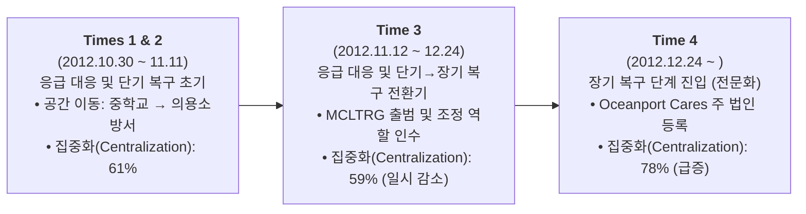
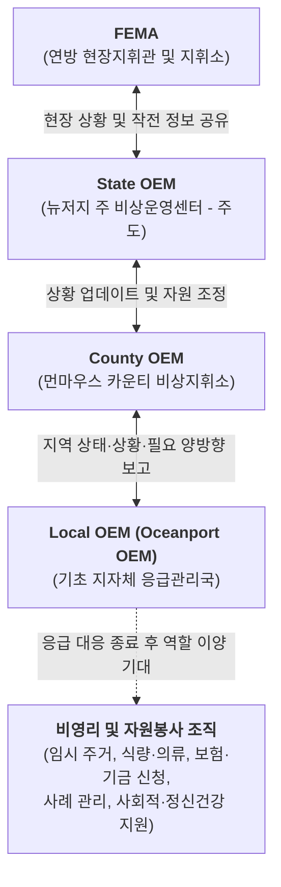
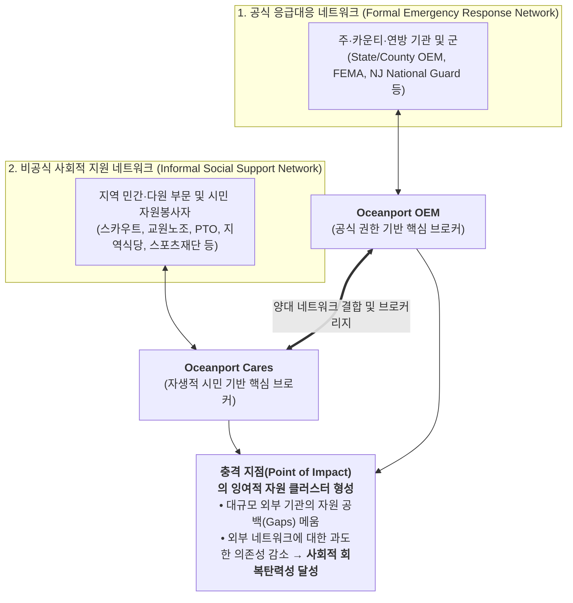
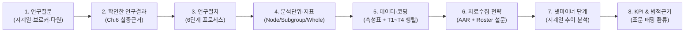
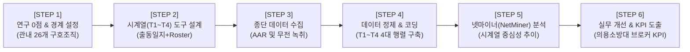

# 제6장 조직 간 회복탄력성: 슈퍼스톰 샌디 이후 지역사회 내 네트워크화된 협력 (Sub-Note)

**원제**: CHAPTER 6 INTERORGANIZATIONAL RESILIENCE: NETWORKED COLLABORATIONS IN COMMUNITIES AFTER SUPERSTORM SANDY  
**저자**: Jack L. Harris, Marya L. Doerfel *(Rutgers University, New Brunswick, NJ, United States)*  
**출처**: *Social Network Analysis of Disaster Response, Recovery, and Adaptation* (Elsevier, 2017, pp. 75–91)  
**DOI**: `http://dx.doi.org/10.1016/B978-0-12-805196-2.00006-6`

---

## CHAPTER OUTLINE (장 목차 구성 — 원문 순서 동일)

* **Introduction (서론)** ............................................................................................................................................ 75
* **Organizational Networks in the Fabric of Communities Facing Disasters (재난에 직면한 지역사회 구조 내의 조직 네트워크)** ..................................................... 76
  * Social Resilience Processes (사회적 회복탄력성 과정) .......................................................................................................... 76
  * Collaboration and Interorganizational Relationships (협력과 조직 간 관계) .................................................................. 77
  * Networked Models of Stakeholder Relationships (이해관계자 관계의 네트워크 모형) ....................................................... 77
* **Postdisaster Case Study: Oceanport, New Jersey (재난 후 사례 연구: 뉴저지주 오션포트)** ...................................................................................... 78
  * Study Variables (연구 변수) ............................................................................................................................................. 80
* **Local Stakeholder Networks in Oceanport, New Jersey (뉴저지주 오션포트의 지역 이해관계자 네트워크)** .............................................................................. 80
  * Network Transitions from Short-term to Long-term Recovery (단기 복구에서 장기 복구로의 네트워크 전환) ...................... 88
  * The National Response Framework in Action (실제 작동하는 국가대응프레임워크) ............................................................ 88
* **Building Interorganizational Resilience through Networked Collaboration (네트워크화된 협력을 통한 조직 간 회복탄력성 구축)** .................................................. 88
  * Cross-sector Communication and the Plural Sector (부문 간 커뮤니케이션과 다원 부문) ................................................... 89
  * Coordinating Resilience Through Brokers (브로커를 통한 회복탄력성 조정) ......................................................................... 89
  * Expanding Policy Frameworks to Account for Local Stakeholder Networks (지역 이해관계자 네트워크를 반영하기 위한 정책 프레임워크의 확장) ................... 90
  * Implications (시사점) ......................................................................................................................................................... 90
  * Limitations (한계점) ........................................................................................................................................................... 91
* **Conclusions (결론)** ............................................................................................................................................ 91

---

## INTRODUCTION (서론) `[원문 pp. 75–76]`

### [문단 1] 재난 대응·복구의 단계적 특성과 기존 공식 재난 계획의 간과점
재난 대응(disaster response)과 복구(recovery)는 다수의 지리적·조직적 경계를 가로지르는 **네트워크화된 협력(networked collaborations)**에 의존한다. 미국의 **국가대응프레임워크(National Response Framework; Department of Homeland Security, 2008, 2013a)**는 응급 대응과 장기 복구의 참여자로서 광범위한 공공(public), 민간(private), 비영리(nonprofit) 조직 및 기관들을 상세히 기술하고 있으며, 기존의 재난 관련 문헌들은 시간 경과에 따라 공식 및 비공식 조직, 자원봉사자, 그리고 **자생적 집단(emergent groups)**이 수행하는 역할을 강조하고 있다(Drabek & McEntire, 2003; Majchrzak, Jarvenpaa, & Hollingshead, 2007; Kendra & Wachtendorf, 2003; Simo & Bies, 2007). 재난 대응과 복구는 **단계적 과정(phased processes)**이며, 시점에 따라 서로 다른 조직 활동이 우선순위를 차지한다(Doerfel & Haseki, 2013; Doerfel, Lai, & Chewning, 2010). 효과적인 응급 대응과 재난으로부터의 장기 복구는 서로 다른 목표, 사명(missions), 정보, 자원을 가진 다수의 조직 간에 커뮤니케이션과 조정(coordination)을 가능하게 하는 연결된 공공 기관, 민간 부문 기업, 비영리 조직을 필요로 한다(Nowell & Steelman, 2013). 방관자(bystanders), 재난 관광(disaster tourism), 피해를 입지 않은 자원봉사자(unaffected volunteers), 자생적 집단의 역할은 재난 문헌에 잘 문서화되어 있는 반면(Drabek & McEntire, 2003; Helslott & Ruitenberg, 2004; Majchrzak et al., 2007), **공식적인 재난 계획 및 대응(formal disaster planning and response)은 재난 피해 지역사회 내에 존재하는 중요한 기존의 지역사회 연결망(preexisting community connections)과 풀뿌리 관계(grassroots relationships)를 간과하는 경향**이 있다.

### [문단 2] 사전 지역사회 관계와 풀뿌리 조직화의 중요성
사전 지역사회 관계(prior community relationships)는 조직 간 협력(interorganizational collaboration)을 통해 생존과 복구에 필수적인 정보 흐름(information flows)과 물질적 지원(material assistance)을 활성화한다. 재난 피해 지역사회에서의 협력은 도시, 읍(towns), 카운티, 주(states) 차원의 공식적인 제도적 대응 수준뿐만 아니라 **풀뿌리(grassroots) 또는 근린(neighborhood) 수준**에서도 발생한다. 실제로 이러한 풀뿌리 조직화(grassroots organizing)는 시민사회(civil society)의 토대로 간주되며(Taylor & Doerfel, 2011), 회복탄력적인 지역사회(resilient communities)를 뒷받침하는 **사회 구조(social structure)**로 볼 수 있다(Doerfel, 2016). 본 장은 자연재해 이후 협력하는 네트워크화된 조직들이 관여하는 사회적 현상으로서 **지역사회 회복탄력성(community resilience)**을 고찰한다.

### [문단 3] 연구 배경 사례: 2012년 슈퍼스톰 샌디(Superstorm Sandy)와 뉴저지주 오션포트(Oceanport)
본 연구는 2012년 **슈퍼스톰 샌디(Superstorm Sandy)**의 타격을 입은 뉴저지주의 작은 해안 마을인 **오션포트(Oceanport)** 사례를 제시한다.
* **주택 및 전력 피해**: 지역사회 전체 **2,100가구 중 약 1,200가구**가 피해를 입었으며, 그중 **700가구**는 가옥의 50% 이상이 심각하게 파손되거나 전파(destroyed)되었다. 정전(power outages)은 마을 전역에 걸쳐 **5일에서 13일 동안** 지속되었다.
* **핵심 공공 인프라 파괴**: 지역사회의 **타운홀(시청/읍사무소, town hall)**과 **경찰서(police station)**가 파괴되었으며, 지역사회의 **자원봉사 응급구조대(volunteer first aid squad)**는 작동 불능 상태가 되었다.
* **이중적 부담(Dual Burden)**: 오션포트에는 피해 권역에 대한 주(state) 및 국가(national) 차원의 대응 노력을 준비·전개(stage)하는 데 사용된 대규모 부지를 가진 주 및 연방 시설들이 자리 잡고 있다. 따라서 오션포트 지역사회는 **오션포트 내 피해 주민들에게 지원을 제공하는 것**에 더하여, **인근의 다른 피해 지역사회들을 지원하기 위해 마을로 유입되는 인력과 물자의 흐름까지 조정(coordinate)**해야만 했다.

> [!NOTE]
> ### 🔍 [보조교재 부연 설명: 서론의 핵심 문제의식]
> * **공식 재난관리의 맹점**: 미국의 대표적 재난대응 매뉴얼인 **국가대응프레임워크(NRF)**는 연방-주-카운티-지자체로 이어지는 공식 지휘체계와 대형 구호기관을 중시하지만, 정작 재난 현장에서 즉각 작동하는 **지역 내 기존 관계망(preexisting connections)**과 **풀뿌리 조직화(grassroots organizing)**의 역량을 과소평가합니다.
> * **오션포트 사례의 특수성**: 오션포트는 자체 공공청사(타운홀, 경찰서, 구급대)가 모두 파괴된 피해 당사자이면서, 동시에 주 방위군과 FEMA 봉사단 등이 주둔하여 인근 해안 지역(Bayshore) 전체를 지원하는 **광역 거점(Staging Area)** 역할을 수행해야 했던 독특한 공간적·조직적 맥락을 지닙니다.

---

## ORGANIZATIONAL NETWORKS IN THE FABRIC OF COMMUNITIES FACING DISASTERS (재난에 직면한 지역사회 구조 내의 조직 네트워크) `[원문 pp. 76–78]`

### SOCIAL RESILIENCE PROCESSES (사회적 회복탄력성 과정) `[원문 pp. 76–77]`

#### [문단 1] 사회적 회복탄력성의 개념과 커뮤니케이션적 본질
회복탄력성 과정(resilience processes)은 **즉흥적 대응(improvisation)** 및 **문제 인식(problem recognition)**을 **해결책 구축(solution building)**과 통합하는 담론적 활동(discursive activities)과 조직화 활동(organizing activities)의 결합이다. **사회적 회복탄력성(social resilience)**은 조직들이 위협에 대비하고 관리하기 위해 유·무형의 자원(tangible and intangible resources)에 접근할 수 있게 해주는 **지역사회 파트너십(community partnerships)**을 통해 달성된다. 재난 맥락에서 네트워크화된 파트너십은 재난에 대응하고 재난 이후 재건하는 데 있어 결정적인 자원이 된다(Doerfel, Chewning, & Lai, 2013; Doerfel et al., 2010). 회복탄력적인 시스템(resilient systems)은 다음의 특성을 지닌다(Bruneau et al., 2003; Chewning, Lai, & Doerfel, 2013; Doerfel et al., 2013; Kendra & Wachtendorf, 2003):
1. 기능의 저하(degradation)나 상실(loss of function) 없이 스트레스를 견뎌낼 수 있다.
2. 교란(disruptions) 중에 문제를 식별하고, 우선순위를 설정하며, 자원을 동원할 수 있다.
3. **잉여적/대체 가능한 요소(redundant/substitutable elements)**를 보유하고 있다.
4. 우선순위를 충족하고 시의적절한 방식으로 목표를 달성한다.

사회적 회복탄력성은 그 본질상 **커뮤니케이션적(communicative)**이다. 즉, 주변 환경을 **의미구성(make sense of their surroundings)**하고, 문제를 해결하며, 특정 결과를 달성하기 위해 사람들과 조직들 간의 상호작용(interaction)에 의존한다(Buzzanell, 2010; Doerfel & Harris, 2016; Weick, Sutcliffe, & Obstfeld, 2005).

---

### COLLABORATION AND INTERORGANIZATIONAL RELATIONSHIPS (협력과 조직 간 관계) `[원문 p. 77]`

#### [문단 1] 협력의 설계 방식과 제도적 프레임워크
협력(collaboration)은 대화(talk)와 행동(action) 모두를 수반하는 커뮤니케이션 활동을 통해 설계되며(Aakhus, 2007), 재난 피해 지역사회에서 협력은 **사전 관계(preexisting relationships)**에 크게 의존한다(Doerfel et al., 2010). 협력은 사회 구조(social structure), 과정(process), 그리고 관계(relationships)의 문제이며, 지역사회, 조직, 그리고 조직 부문(organizational sectors)을 구성하는 **조직 간 연계(interorganizational linkages)**에 반영된다(Diani, 2015). 협력은 파트너 조직 내 개인들의 **양자적(dyadic) 및 집단적(group) 행동**을 통해 생성될 수도 있고, 어떤 방식으로든 협력을 요구하는 **외부 구조(external structures)에 의해 부과**될 수도 있다. 협력 활동은 심지어 프레임워크, 거버넌스 문서, 기타 관리 및 자금 지원 기관(funder)의 문서를 통해 제안될 수도 있다. 미국의 **국가대응프레임워크(United States National Response Framework; Department of Homeland Security, 2008, 2013a)**는 위기 시 피해 지역사회에 서비스와 자원을 전달하기 위해 공공, 민간, 비영리 조직들이 어떻게 하나로 모이도록 기대되는지를 명확히 규정하고 있다.

#### [문단 2] 재난 단계 전환에 따른 커뮤니케이션 패턴 변화와 핵심 질문
재난 피해 지역사회에서 파괴된 물리적·사회적 환경의 끊임없이 변화하는 현실은, **응급(emergency) 단계에서 과도기(transitional) 단계로, 그리고 복구(recovery) 단계로 전환**되는 동안 커뮤니케이션 패턴이 변화함에 따라 조직 관계에 영향을 미친다. 재난 대응 및 복구를 이해하기 위한 **핵심 질문(key question)**은 지역사회 기반의 조직 간 협력이 다음 두 가지에서 어떠한 역할을 하는가이다:
1. 파괴된 사회적 환경에서 **네트워크화된 이해관계자 관계의 새로운 패턴을 구성(constituting new patterns of networked stakeholder relations)**하는 역할
2. **조직 간 회복탄력성(interorganizational resilience)을 구축**하는 역할

---

### NETWORKED MODELS OF STAKEHOLDER RELATIONSHIPS (이해관계자 관계의 네트워크 모형) `[원문 pp. 77–78]`

#### [문단 1] 네트워크화된 이해관계자 모형의 특징
특정 조직이 다른 조직들과 맺는 개별적 연계에만 초점을 맞추기보다, **이해관계자의 네트워크 모형(networked model of stakeholders)**은 지역사회에 사회 구조를 부여하는 **다원 부문(plural sector), 공공 부문(public sector), 민간 부문(private sector)**에 포진한 다양한 조직들 간의 동태적이고 다중적인 연계(dynamic, multiple ties)를 설명한다(Diani, 2015; Mintzberg, 2015; Rowley, 1997). 본 연구에서 탐구하는 네트워크화된 이해관계자 관계의 핵심 특징은 다음 세 가지를 포함한다:
1. **조직의 속성 (organizations’ attributes)**
2. **연계 강도 (tie strength)**
3. **보다 넓은 조직 간 네트워크에서의 중심성의 역할 (the role of centrality in broader interorganizational networks)**

조직 군(organizational populations)은 자신이 속한 더 넓은 네트워크를 형성하기 위해 상호작용하는 조직 속성과 관계적 연계(relational ties)의 조합으로 구성된다(Monge, Heiss, & Margolin, 2008). 이러한 네트워크의 구성과 기능은 조직 속성, 관계적 연계, 그리고 그 관계적 연계의 강도 또는 약함(strength or weakness)을 통해 이해된다.

#### [문단 2] 노드(Nodes)와 기존 재난 조직 연구의 한계 극복
네트워크 구조 내에서 **노드(nodes)**는 행위자(본 연구에서는 조직)를 나타내며, 각 행위자는 특정한 속성들로 구성된다. 네트워크 분석은 노드 자체의 특성이나 성격에 더하여 노드들 간의 관계 유형을 측정한다. 그러나 재난 대응 및 복구에 관한 기존 조직 간 분석의 상당수는 관계적 연계와 조직 속성의 다중성을 지닌 더 넓은 지역사회 이해관계자 네트워크보다는 **공식적인 대응 기관(formal institutions of response)**에 초점을 맞추고 있다(Carlson et al., 2016; Kapucu & Hu, 2014). 본 연구는 협력적 공공 활동에 참여하면서 지역사회를 하나로 결속시키는 역할을 하는 **더 큰 지역사회 이해관계자 네트워크(larger community stakeholder network)**를 고려함으로써 재난 후 연구를 확장한다(Diani, 2015).

#### [문단 3] 관계적 연계(Relational Ties)의 종류: 약한 연계, 강한 연계, 잠재적 연계
관계적 연계(relational ties)는 조직 간 관계의 구성 요소(building blocks)가 되는 **정보적(informational), 재정적(financial), 물질적(material), 또는 평판적(reputational) 자원**을 전달할 수 있다(Doerfel et al., 2013). 지리적 지역사회 내에서 지역 조직들은 더 넓은 지역사회의 형태를 만들어내는 개인적 관계와 조직적 관계 모두를 수반하는 관계적 연계를 통해 서로 연결된다(Diani, 2015; Mische, 2003). 관계적 연계는 관련된 이해관계자 네트워크들을 하나로 묶음으로써 지역사회 내 서로 다른 속성을 가진 조직들을 연결한다.
* **약한 연계 (Weak ties)**: 심각한 지역사회 교란 이후 조직의 회복탄력성을 가능하게 하고 **네트워크의 어느 한 부분에 대한 의존성을 줄여줌(lessen dependence on any one part of the network)**으로써 두드러지게 중요해진다(salient)(Doerfel et al., 2010; Harris & Doerfel, 2016; Taylor & Doerfel, 2011).
* **강한 연계 (Strong ties)**: 협력과 자원 공유를 촉진하는 조밀하거나 배태된 네트워크(dense or embedded networks)를 생성하는 데 도움을 줄 수 있으며, 유사한 목표나 사명을 가진 조직들 간의 링크로 구성된다.
* **잠재적 연계 (Latent ties)**: 교란 이후 활성화(activated)되며, 자원이 고갈되고 조직 시스템이 한계점(breaking point)까지 내몰릴 때 재난 피해 조직이나 지역사회 네트워크에서 **잉여성(redundancy)을 생성하거나 증가**시키는 데 도움을 줄 수 있다(Doerfel et al., 2010).

#### [문단 4] 연결 중심성(Degree Centrality)과 브로커리지(Brokerage) 역할
다른 조직들과 더 많은 연계를 가진 조직은 높은 **연결 중심성(degree centrality)**을 가지며 네트워크에서 더 두드러진 역할(prominent role)을 수행하는 경향이 있다(Doerfel & Taylor, 2004). 네트워크에서 가장 많은 노드를 아는 것이 정보에 대한 접근성과 통제력을 높이는 한 가지 방법이지만, 조직은 또한 **브로커리지 역할(brokerage role)**을 차지할 수도 있다.
* **브로커(Brokers)**는 네트워크의 멀리 떨어져 있거나 단절된 부분들(distant or disconnected parts)로부터 조직, 사람, 자원을 연결한다.
* 재난 대응 및 복구에서 브로커는 종종 **자발적 조직화 노력과 제도적 조직화 노력을 조정(coordinate)**하며, **자생적(emergent) 또는 수렴된(converged) 대응과 기존 조직들의 공식적 대응 노력 사이를 매개(mediate)**한다.
* 연구자들은 **매개 중심성(betweenness centrality; Borgatti, 2005)**과 **구조적 공백(structural holes; Burt, 1992)**을 포함한 다양한 알고리즘을 사용하여 브로커를 식별해 왔다.
* 종합하면, 중심성의 여러 측면은 네트워크의 이질적인 부분들을 하나로 모으는 **가교(bridging), 문지기(gatekeeping), 조정(coordination) 활동**을 통해 네트워크를 조직화하고 유지하는 데 있어 어떤 조직이 리더인지를 드러낸다.

#### [문단 5] 중심성(Centrality)과 집중화(Centralization)의 구별 및 핵심 네트워크 연구 질문
네트워크가 어떻게 작동하는지 이해하는 데 있어 **중심성(centrality)**과 **집중화(centralization)**를 구별하는 것이 중요하다.
* **중심성 측정치 (Centrality measures)**: 특정 조직으로 들어오고 나가는 연계(incoming and outgoing ties)의 수를 기반으로 네트워크 내에서 **어느 한 개별 조직이 얼마나 잘 연결되어 있는지**를 드러낸다.
* **집중화 측정치 (Centralization measures)**: 네트워크 내의 **전반적인 연결 또는 단절 수준(overall level of connection or disconnection)**을 드러낸다. 집중화는 네트워크가 특정 초점 조직(focal organization)이나 조직들을 중심으로 고도로 중앙집중화되어 조직되어 있는지, 아니면 특정 조직이 흐름을 통제하지 않고 정보가 네트워크 안팎으로 흐르도록 분권화(decentralized)되어 있는지에 초점을 맞춘다.
* **밀도 (Density)**—네트워크 구성원들이 다른 모든 구성원들과 연결되어 있는 정도인 전반적인 응집 수준(general level of cohesion)을 측정함—와 짝을 이룰 때, 집중화는 네트워크 조직화에 대한 조망을 제공할 수 있다(Borgatti, 2005; Borgatti & Everett, 2006).

본 연구가 고려하는 **핵심 네트워크 질문(Key network questions)**은 다음과 같다:
1. 이해관계자 네트워크가 응급 대응(emergency response)과 관련된 과업에서 장기 복구(long-term recovery)와 관련된 과업으로 이동함에 따라 **집중화(centralization)는 변화하는가?**
2. 재난 피해 지역사회의 이해관계자 네트워크에서 **지역(local) 조직과 전국(national) 조직 중 어느 쪽이 더 중심적(central)인가?**
3. 이러한 네트워크 질문들은 재난 대비, 응급 대응, 지역사회 복구를 촉진하는 대응·복구 활동 및 **공공 정책(public policies)에 어떠한 시사점(implications)**을 갖는가?

> [!TIP]
> ### 📊 [보조교재 핵심 개념 정리표: SNA 주요 지표 및 연계 유형 비교]
> 책을 읽을 때 혼동하기 쉬운 네트워크 개념들을 원문 정의에 기반하여 비교 정리한 표입니다.
> 
> | 구분 | 학술 용어 (원문) | 분석 수준 | 원문 핵심 정의 및 재난 네트워크에서의 역할 |
> | :--- | :--- | :---: | :--- |
> | **연계 유형** | **Strong ties** (강한 연계) | 관계(Tie) | 유사한 목표·사명을 가진 조직 간 링크. 조밀·배태된 네트워크를 형성하여 협력과 자원 공유 촉진. |
> | **연계 유형** | **Weak ties** (약한 연계) | 관계(Tie) | 지역사회 교란 후 두드러짐. 조직 회복탄력성을 높이고 **네트워크 특정 부분에 대한 의존성을 낮춤**. |
> | **연계 유형** | **Latent ties** (잠재적 연계) | 관계(Tie) | 평시에는 잠재되어 있다가 재난 교란 후 활성화됨. 자원 고갈 시 네트워크의 **잉여성(redundancy)** 창출·증가. |
> | **노드 지표** | **Degree Centrality** (연결 중심성) | 개별 조직(Node) | 특정 조직이 맺고 있는 연계의 수. 네트워크를 활성화·유지하는 두드러진 리더 조직 식별. |
> | **노드 지표** | **Betweenness Centrality** (매개 중심성) | 개별 조직(Node) | 단절된 조직들 사이에 위치하여 자원과 정보를 중개하는 **브로커(Broker)** 역할 측정. |
> | **전체망 지표** | **Network Centralization** (네트워크 집중화) | 전체 망(Whole) | 전체 네트워크의 정보 흐름이 소수 핵심 조직에 의존하는 정도(고집중) vs 분산된 정도(분권화). |
> | **전체망 지표** | **Density** (밀도) | 전체 망(Whole) | 네트워크 구성원들이 서로 연결되어 있는 전반적인 응집도(general level of cohesion). |

---

## POSTDISASTER CASE STUDY: OCEANPORT, NEW JERSEY (재난 후 사례 연구: 뉴저지주 오션포트) `[원문 pp. 78–80]`

### [문단 1] 현장 연구 개요 및 제1저자의 참여 관찰 배경
우리는 조직 및 지역사회 수준 모두에서 복구를 위해 사용된 조직 간 상호작용을 평가하려는 목표로, 슈퍼스톰 샌디 이후 뉴저지주 오션포트와 뉴저지 해안을 따라 현장 연구(field research)를 수행했다. **2년의 기간 동안**, 제1저자(Jack L. Harris)는 다음과 같은 활동에 자원봉사 리더로 직접 참여하며 지역사회 및 권역 수준 모두에서 파괴된 지역사회 및 조직 네트워크를 관찰했다:
1. 오션포트 마이크로쉘터(Oceanport microshelters; 소규모 임시 대피소)의 리더
2. **오션포트 케어스(Oceanport Cares)**의 결성 참여
3. **먼마우스 카운티 장기복구그룹(Monmouth County Long-term Recovery Group; MCLTRG)** 자원봉사자 위원회(volunteers committee) 일원

본 장은 **2012년 10월 29일부터 2012년 12월 24일까지의 3개월 기간**에 초점을 맞춘다. 이 기간은 샌디의 상륙(landfall)부터, 이 재난 대응 기간 동안 오션포트에서 수행된 자원봉사 활동의 결과물이자 후속 복구 활동으로의 전환을 상징하는 **오션포트 케어스(Oceanport Cares)의 공식 법인 등록(official incorporation)**까지를 포괄한다.

### [문단 2] 데이터 수집 방법, 연계(Tie)의 정의 및 표본 크기($n = 26$)
종단적 현장 연구(longitudinal field research)와 문서 분석(document analysis)을 사용하여, 우리는 네트워크 활동을 대표하는 커뮤니케이션 범주들을 활용해 네트워크 관계를 재구성했다.
* **데이터 출처**: 참여 관찰(participant observation), 활동 중인 조직에 대한 유의 표집(purposive sampling of active organizations), 제1저자의 자원봉사 역할을 통해 확보한 회의 안건(meeting agendas) 및 명부(rosters).
* **네트워크 연계(Network ties)의 조작적 정의**: 현장에서 관찰되고 공동 활동(joint activities)을 통해 나타난 데이터 세트 내 조직들 간의 상호작용(interaction)으로 정의되었다. 이 조직 간 상호작용은 다양한 대면(face-to-face) 및 매개된 커뮤니케이션 채널(mediated communication channels)을 사용하여 복구에서 활동하는 조직들 간에 이루어진 **1회 이상의 접촉(one or more contacts)**으로 정의되었다(Doerfel & Haseki, 2013; Doerfel et al., 2013; Doerfel, Lai, & Chewning, 2013).
* **분석 대상 네트워크 표본**: 이 기간 동안 오션포트에서 활동한 지역사회 및 권역 조직들(**$n = 26$**)로 구성된다.
* **장기 혼합 연구 방법(2012~2015)**: 관찰은 폭풍이 강타한 다음 날인 **2012년 10월 30일**에 비공식적으로(casually) 시작되었다. 2012년부터 2015년까지의 더 긴 연구 과정에 걸쳐 초기 관찰과 기록을 보완하기 위해 추가 관찰 및 참여 관찰, 비구조화 및 반구조화 인터뷰, 소규모 설문조사, 문서 분석을 포함한 보다 포괄적인 혼합 연구 방법(mixed methods)이 사용되었다.

### [문단 3] 초기 풀뿌리 지역사회 조직들의 임시적(Ad Hoc) 활동과 공식 조직으로의 이행
네트워크 내의 지역사회 조직들은 보이스카우트(Boy Scouts)와 걸스카우트(Girl Scouts), 오션포트 스포츠 재단(Oceanport Sports Foundation), 지역 피자가게(local pizzeria)와 같은 오션포트 집단들을 포함했다:
* **오션포트 스포츠 재단 (Oceanport Sports Foundation)**: 오션포트 케어스(Oceanport Cares)가 공식화될 때까지 금전적 기부금을 전달하는 **경유 조직(pass-through organization)** 역할을 했다.
* **엔조스 피자가게 (Enzo’s local pizzeria)**: 작전 거점이 의용소방서(volunteer fire station)로 이전했을 때 식사를 제공했으며, 마을 내 노인 아파트 건물에 음식을 제공하는 것을 도왔다.
* **오션포트 걸스카우트 (Oceanport Girl Scouts)**: 중학교(middle school)에서 아이들을 위한 돌봄(babysitting) 및 그룹 활동을 제공했으며, 사회적·심리적 지원 체계를 개발하는 정신건강 대응 인력들과 빈번히 협력했다.
* **오션포트 보이스카우트 (Oceanport Boy Scouts)**: 먼마우스 카운티 공원 시스템(Monmouth County Park System)이 배달한 구호 물품을 정리하고 배분했다.
* **지역 교원 노조 (Local teachers union, OP Education Association) 및 학부모-교사 연합회 (PTO)**: 중학교 도서관에서 의류를 수집, 정리, 배분하기 위해 협력했다.
* **학교 급식 담당 인력 (School food service personnel)**: 시민 자원봉사자들과 함께 피해 주민들을 위한 식사와 간식을 준비했다.

이들은 상황에 따라 시민 자원봉사자들에 의해 조직된 **임시적(ad hoc) 활동**이었다. 이후 작전은 종교 기반 조직(faith-based organizations), 공식화된 지역 조직(예: Oceanport Cares, Sea Bright Rising), 오큐파이 샌디(Occupy Sandy) 네트워크, 정부 기관, 그리고 MCLTRG와 같은 조정 집단 등 **보다 공식적인 조직들로 이동**했다.

### [문단 4] 광역 구호 거점(Staging Area)으로서의 오션포트 중학교와 군·연방·지자체 협력
중학교에서의 오션포트 작전은 또한 인근 지역사회들과 스태튼 아일랜드(Staten Island) 바로 남쪽 라리탄 만(Raritan Bay) 연안의 심각한 피해를 입은 베이쇼어(Bayshore) 권역을 위한 **거점 구역(staging area)** 역할을 했다.
* 샌디가 지역을 강타한 직후 며칠 동안, 먼마우스 카운티 공원 시스템(Monmouth County Park System) 창고들은 기부 물품으로 넘쳐났다(overwhelmed). 이 기부 물품들은 이를 정리하고 배분할 수 있는 지역사회들로 보내졌다.
* **뉴저지 주 방위군(New Jersey National Guard)**과 **연방재난관리청 봉사단(FEMA Corps)**이 오션포트 중학교에 거점을 두고 있었고, **오션포트 응급관리국(Oceanport’s Office of Emergency Management; OEM)**이 침수된 해변 및 만(bay) 마을들을 통과해 운행할 수 있는 **2.5톤 트럭(two-and-a-half-ton trucks)**을 보유하고 있었기 때문에, 주 및 연방 대응 작전이 마을 건너편에서 진행되는 동안에도 구호 물품과 구호 작전은 오션포트와 인근 지역사회들로 배분되기 위해 오션포트를 거쳐 라우팅(경유)되었다.
* **뉴저지 주 방위군(NJ National Guard)**: 오션포트, 먼마우스 비치(Monmouth Beach), 시 브라이트(Sea Bright)의 침수 지역에서 치안(security) 및 수색·구조(search-and-rescue) 작전을 제공했다.
* **FEMA 봉사단(FEMA Corps) 자원봉사자들**: 오션포트, 먼마우스 비치, 시 브라이트, 롱 브랜치(Long Branch) 주민들에게 연방 보험, 지원, 청구 절차에 관한 정보뿐만 아니라 신청 지원(application assistance)을 제공했다. 이때 **오션포트 응급관리국(Oceanport OEM)이 지역사회 내 FEMA 봉사단 주둔을 직접 요청(direct request)**했다.

---

### STUDY VARIABLES (연구 변수) `[원문 p. 80]`

#### [문단 1 & 2] 시간 변수 (Time): 4개 시점(Time 1 ~ Time 4)의 구분
우리는 본 연구의 시간 틀(time frames)을 4개의 기간으로 구분(bracketed)했다:
* **Time 1 및 Time 2 (2012년 10월 30일 ~ 11월 11일)**: 폭풍 직후의 응급 대응(poststorm emergency response)을 포괄한다.
* **Time 3 (2012년 11월 12일 ~ 12월 24일)**: 폭풍 후 응급 대응 및 단기 복구 활동(short-term recovery activities)을 나타낸다 *(원문에는 Time 3가 MCLTRG의 첫 조직 회의가 열린 12월 둘째 주와 연결되어 기술되며, 원문 p. 80에는 "in the second week of December 2014"로 인쇄되어 있음. 이 연도는 연구기간(2012.10.29~12.24)과 맞지 않아 2012년의 오기로 보이나, 이는 서브노트 작성자의 해석이며 원문에서 정정 여부는 확인되지 않음)*.
* **Time 4 (2012년 12월 24일 시작)**: 장기 복구 기간(long-term recovery period)의 시작을 나타낸다.

**Time 1과 Time 2의 통합 분석 이유**:
* 연결 중심성(degree centrality)과 매개 중심성(betweenness centrality) 분석을 위해 **Time 1과 Time 2는 결합(combined)**되었다.
* 질적으로(qualitatively), Time 1과 Time 2는 서로 다른 단계이다. 왜냐하면 지역 중학교(local middle school)에서 지역 의용소방서(local volunteer fire station)로의 활동 이전이 순차적으로 발생하여, 응급 대응에서 단기 지역사회 복구로의 전환을 표시했기 때문이다.
* 활동의 **공간적 위치(spatial location)**는 Time 1과 Time 2 사이에 급격하게 변한 반면, **조직 및 네트워크 활동(organizational and network activities)**은 응급 대응 상태에서 복구 상태로 서서히 전환되었다.
* 본 장에서는 공간적 활동과 조직적 활동 간의 그러한 차이를 명확히 반영하기 위해 Time 1과 Time 2를 결합하였다. 본 장의 분석은 활동의 공간적 위치보다는 **조직 활동의 시간성(temporality of organizational activities)**에 초점을 맞춘다.
* **Time 4**는 2012년 12월 24일 뉴저지주 내 자생적 재난 구호 조직인 **오션포트 케어스(Oceanport Cares)의 법인 등록(incorporation)**으로 대표되며, 지역사회 내에서 자생적(emergent) 관계로부터 보다 공식적인(formal) 조직 간 관계로의 전환을 나타낸다.
* Doerfel과 동료들(2010)을 따라, **Times 1 & 2**는 응급 대응 및 단기 복구 단계를 나타낸다(응급 대응과 단기 복구 단계는 재난 직후 첫 몇 주 동안 종종 중첩된다). **Times 3 & 4**는 지역사회에서 단기 복구로부터 장기 복구 활동으로의 전환을 나타낸다.

#### [문단 3] 조직 네트워크 변수 (Organizational Network): UCINET 지표 산출
분석된 기간 동안 이 네트워크에서 활동한 조직들 간의 커뮤니케이션은 **양방향(two-way)**이고 **다채널(multichannel)**이다. 모든 중심성 계산은 **UCINET**(Borgatti & Freeman, 2002)으로 수행되었다:
1. **연결 중심성 (Degree centrality)**: 샌디 상륙 이후 오션포트의 이해관계자 네트워크를 활성화하고 유지하는 데 도움을 준 조직들을 식별한다.
2. **프리먼의 매개 중심성 (Freeman’s betweenness measure)**: UCINET에서 프리먼의 매개 중심성 척도를 사용했다. 매개 중심성과 연결 중심성 척도는 유사한 척도이지만, **높은 매개 중심성이 반드시 높은 연결 중심성을 필요로 하지는 않는다**. 만약 전체 네트워크에서 높은 연결 중심성을 가진 조직이 소수에 불과하다면, 그 조직들은 또한 그렇지 않았다면 연결되지 않았을 조직들 사이에 위치하게 된다(fall between otherwise unconnected organizations).
3. **네트워크 집중화 (UCINET’s network centralization)**: 정보 흐름이 소수의 핵심 조직에 의존했는지 아니면 네트워크 전반에 분산되었는지를 나타낸다.
   * **높은 집중화 점수 (High-centralization scores)**: 상대적으로 더 적은 수의 조직을 통해 정보가 흐르는 보다 중앙집중화된 네트워크를 나타낸다.
   * **낮은 점수 (Low scores)**: 어느 한 조직이나 극소수의 조직이 정보의 문지기/브로커(gatekeepers/brokers) 역할을 하지 않고 구성원들 안팎으로 정보가 흐르는 상대적으로 분권화된(decentralized) 네트워크를 나타낸다(Borgatti & Freeman, 2002).

---

## LOCAL STAKEHOLDER NETWORKS IN OCEANPORT, NEW JERSEY (뉴저지주 오션포트의 지역 이해관계자 네트워크) `[원문 pp. 80–88]`

### [문단 1] 사례 연구 질문과 두 핵심 지역 조직의 일관된 주도적 역할
본 사례의 연구 질문들은 조직 간 관계가 어떻게 이해관계자 관계의 새로운 패턴을 구축하고 네트워크화된 활동을 통해 회복탄력성을 창출했는지, 그리고 네트워크가 응급 대응에서 장기 복구 활동으로 전환함에 따라 중심성(centrality)과 집중화(centralization)가 변화했는지를 고찰했다. 연구 결과, 상호작용의 패턴은 지역 오션포트 이해관계자 네트워크 내부에서의 조직 간 협력과 더 큰 권역 및 전국 조직들과의 조직 간 협력을 통해 시간 경과에 따라 변화하는 것으로 나타났다. **두 개의 지역 조직**—하나는 공식적인 제도적 대응의 일부였던 조직(**오션포트 응급관리국, Oceanport OEM**)이고, 두 번째는 시민 자원봉사자들에 의해 만들어진 새로운 조직으로 부상한 조직(**오션포트 케어스, Oceanport Cares**)—이 대응 및 복구의 4단계 전반에 걸쳐 일차적인(primary) 역할을 유지했다.

### [문단 2] Times 1 & 2의 네트워크 구조 (Figure 6.1 관련 설명)
이러한 질문들에 답하기 위해 먼저 시간에 따른 네트워크를 기술한다. **그림 6.1(Fig. 6.1)**은 **Times 1과 2**를 묘사하며, **오션포트 응급관리국(Oceanport Office of Emergency Management)**과 오션포트 응급관리국에 의해 느슨하게 조직된 비소속 자원봉사자 집단인 초기 **오션포트 케어스(nascent Oceanport Cares)**의 커뮤니케이션 활동에 의해 결합된 **두 개의 뚜렷한 클러스터(two distinct clusters)**를 보여준다. 이 시민 자원봉사자들과 자생적 조직화 과정은 폭풍 이후 이듬해에 공식 501c3 비영리 법인으로 변모했으며, 주(state) 법인 등록은 2012년 12월 24일(Time 4의 시작)에 이루어졌고 연방 501c3 비영리 지위는 2014년 1월에 획득했다. 오션포트 응급관리국과 오션포트 케어스 양자 모두 **지역사회 지원(community support) 문제를 중심으로 조직된 지역 네트워크**를 **보다 전통적인 응급 대응 및 법 집행(law enforcement) 활동을 제공하는 지역, 권역, 주, 연방 기관들의 더 큰 네트워크**와 연결했다.

### [문단 3] 두 핵심 브로커의 중심성 지속 (Figures 6.2, 6.3, 6.4 관련 설명)
**그림 6.2, 6.3, 6.4(Figures 6.2, 6.3, and 6.4)**에 나타난 바와 같이, 오션포트 응급관리국(Oceanport OEM)과 오션포트 케어스(Oceanport Cares)는 측정된 모든 기간에 걸쳐 전체 조직들($n = 26$) 중 **가장 높은 연결 중심성(degree centrality)과 매개 중심성(betweenness centrality)**을 가진 조직들에 일관되게 속했다. 이는 샌디 상륙 후 분석된 3개월 기간 내내 자원과 정보의 핵심 브로커(key brokers)로서 그들이 수행한 역할과 일치한다. 다른 조직들에 대한 높은 수준의 관계적 연계는 국가대응프레임워크(National Response Framework)와 뉴저지의 재난 대응 프로토콜의 일환으로서 응급관리국이 수행하도록 기대되는 조정 역할을 고려할 때 예상되는 바이다.

### [문단 4] 공간 이동에 따른 역할 분화와 전국 기관(FEMA, 적십자사)의 주변부 위치
이해관계자 네트워크는 Times 1과 2의 중반에 작전 위치가 중학교에서 의용소방서로 바뀌었을 때 응급 대응 단계에서 단기 복구 단계로 이동하기 시작했다. Times 1과 2의 후반부로 갈수록:
* **오션포트 응급관리국(Oceanport OEM)**은 자신들이 제공한 물자와 노동에 대해 **FEMA로부터 비용 상환(reimbursement)을 기대하는 지역 조직들을 위한 브로커**로 진화했다.
* 반면, **오션포트 케어스(Oceanport Cares)**는 피해 주민들과 기업들에게 자원과 사회적 지원을 제공하는 조직들과 계속해서 직접 연결되었다.
* **FEMA**와 **미국 적십자사(American Red Cross)** 같은 전국 기관(national institutions)들은 이 시점에 지역 커뮤니케이션 네트워크에서 **주변부 역할(peripheral roles)**에 머물렀다.$^{1}$

> **원문 각주 1 (Footnote 1)**: 연방재난관리청(FEMA)은 모든 재난 이후 그러하듯(중소기업청[Small Business Administration] 및 주택도시개발부[Department of Housing and Urban Development]와 협력하여) 샌디로부터의 재정적 복구(financial recovery)에 계속 초점을 맞추었으나, 연방 정부로부터의 재정적 지원은 기관, 비영리 단체, 주 및 지방 정부(뉴욕시와 같은 대도시의 경우), 프로그램, 행정관들로 이루어진 **복잡하고 미로 같은 구조(byzantine structure)**에 의해 집행되며, 이에 대한 논의는 본 장의 범위를 벗어난다.

### [문단 5] 샌디의 물리적 타격이 네트워크 변화에 미친 영향 (응급구조대의 단절)
Times 1과 2 동안의 이해관계자 네트워크 변화는 샌디가 오션포트에 가한 물리적 타격(material impacts)으로 인해 더욱 복잡해졌다:
* **시청사(municipal building)**가 폭풍으로 파괴되어, 정규 지자체 행정 업무를 **오션포트 훅 앤 래더 소방대(Oceanport Hook and Ladder Company; OP Fire H&L)** 건물 2층에 있는 자치구 비상운영센터(borough’s emergency operations center)로 이전하는 결과를 낳았다.
* 홍수(floodwaters)로 인해 **오션포트 응급구조대(Oceanport First Aid Squad)** 본부의 운영이 마비되었고 구급차(ambulances)들이 작동 불능 상태가 되었다. 단기 복구 작전이 중학교에서 소방서로 이전한 이후, 응급구조대는 자신들의 장비와 건물의 수리 및 복구에 집중하느라 **네트워크로부터 사실상 단절(essentially became disconnected)**되었다.

### [문단 6] Time 3: 먼마우스 카운티 장기복구그룹(MCLTRG)의 출범과 사회적·물리적 재건 (Figure 6.5 관련 설명)
**Time 3**는 **먼마우스 카운티 장기복구그룹(MCLTRG)**의 출범을 포함했으며, 재건 조직화가 **사회적 재건(social reconstruction)**과 **물리적 재건(physical reconstruction)** 모두를 포함하게 됨에 따라 MCLTRG가 지역 응급관리국(OEM)들로부터 재난 대응의 조정 역할을 넘겨받았다:
* **재건의 사회적 요소 (Social elements of reconstruction)**:
  1. 사례 관리 서비스 (case management services)
  2. 자원봉사자 조정 (volunteer coordination)
  3. 조직 간 조정 (interorganizational coordination)
  4. 이재민 주택 소유자들을 위한 임시 주거 마련 (arranging temporary housing for displaced homeowners)
  5. 주, 연방, 재단, 비영리 재원을 통한 재정 지원 (financial assistance)
  6. 영적 및 정서적 지원 서비스 (spiritual and emotional support services)
* **재건의 물리적 요소 (Physical elements of reconstruction)**:
  1. 철거 및 환경 정화/복원 (demolition and remediation)
  2. 파괴된 가옥의 대체 및 재건축 (replacement and rebuilding of destroyed homes)
  3. 살릴 수 있는 피해 가옥의 수리 및 개보수 (repairing and renovating impacted homes that could be saved)
  4. 새로운 FEMA 홍수 보험 규정(FEMA flood insurance regulations)을 준수하기 위한 가옥 지반 높이기 및 들어올리기 (elevating and lifting homes)
  5. 피해 주택 소유자들을 위한 기부 물품 창고 보관 (warehousing donations)
  6. 철거 및 재건축과 관련된 지자체 인허가 절차 (local permitting processes)

이 네트워크는 **그림 6.5(Fig. 6.5)**에 묘사되어 있다.

---

### 📊 [원문 그림 6.1 ~ 6.5 수록 및 보조교재 정밀 해설] `[원문 pp. 82–86]`

> [!IMPORTANT]
> **보조교재 안내**: 원문 책에서는 pp. 80–81의 본문 설명 직후, pp. 82–86에 걸쳐 **Figure 6.1부터 Figure 6.5까지 5개의 그림**이 연속으로 배치되어 있습니다. 책을 읽으며 각 네트워크 소시오그램과 중심성 막대그래프를 완벽히 해독할 수 있도록, 원문 이미지를 그대로 수록하고 각 그림 아래에 **정밀 부연 설명과 수치/약어 해설표**를 덧붙였습니다.

#### [참고] 네트워크 내 26개 참여 조직($n = 26$) 약어 및 속성 완벽 가이드
소시오그램(그림 6.1, 6.5, 6.6)과 중심성 차트(그림 6.2, 6.3, 6.4)에 등장하는 26개 노드의 약어와 역할은 다음과 같습니다. 원문 본문·그림에서 확인되지 않는 항목은 **"원문에서 확인되지 않음"**으로 표기했습니다. "부문 및 수준" 열은 서브노트 작성자의 분류입니다.

| 번호 | 소시오그램 표기명 | 전체 조직명 (원문·그림 기준) | 부문 및 수준 | 오션포트 사례 내 핵심 역할 |
| :---: | :--- | :--- | :---: | :--- |
| 1 | **Oceanport OEM** | Oceanport Office of Emergency Management | 공공 (지역) | **핵심 브로커 1**: 공식 재난대응 총괄, 2.5톤 트럭 운영, FEMA 상환 중개 |
| 2 | **Oceanport Cares** | Oceanport Cares | 다원/비영리 (지역) | **핵심 브로커 2**: 자생적 시민 자원봉사단 → 12월 24일 주 법인화(501c3) |
| 3 | **OP Electeds** | Oceanport Electeds (그림 표기 그대로) | 공공 (지역) | 오션포트 선출직 공직자. 구체적 역할은 원문에서 확인되지 않음 (Time 4에 OEM 정부 네트워크 측 구성원으로만 언급됨) |
| 4 | **OP Police** | Oceanport Police (그림 표기 그대로) | 공공 (지역) | 경찰서 건물이 파괴됨(원문 서론). 재난 중 구체적 활동은 원문에서 확인되지 않음 |
| 5 | **OP First Aid** | Oceanport First Aid Squad | 공공/자원 (지역) | 오션포트 자원봉사 응급구조대 (침수로 구급차·본부 마비 후 복구에 집중) |
| 6 | **OP Fire H&L** | Oceanport Fire Hook and Ladder Company | 공공/자원 (지역) | 오션포트 훅앤래더 의용소방대 (2층을 자치구 비상운영센터/임시청사로 제공) |
| 7 | **OP Fire PAP** | Oceanport Fire Port Au Peck Chemical Hose | 공공/자원 (지역) | 전체 명칭은 Fig 6.2 축 라벨 기준. 구체적 활동은 원문에서 확인되지 않음 |
| 8 | **OP School Board** | Oceanport School Board | 공공 (지역) | 구체적 역할은 원문에서 확인되지 않음 (원문은 중학교가 거점으로 쓰였다고만 서술) |
| 9 | **OP Education Association** | Oceanport Education Association | 다원/노조 (지역) | 지역 교원 노조 (PTO와 함께 중학교 도서관에서 구호 의류 수집·배분) |
| 10 | **OP PTO** | Oceanport Parent Teacher Organization | 다원 (지역) | 학부모-교사 연합회 (교원 노조와 협력하여 의류 등 구호품 배분) |
| 11 | **OP Sports Foundation** | Oceanport Sports Foundation | 다원/비영리 (지역) | 오션포트 케어스 공식 법인화 전까지 기부금 수령 **경유 조직(pass-through)** |
| 12 | **Boy Scouts** | Oceanport Boy Scouts | 다원 (지역) | 카운티 공원 시스템이 전달한 구호 물품 정리 및 배분 |
| 13 | **Girl Scouts** | Oceanport Girl Scouts | 다원 (지역) | 중학교 내 아동 돌봄(babysitting), 정신건강 대응 인력과 심리 지원 협력 |
| 14 | **Enzos** | Enzo’s local pizzeria (원문 표기) | 민간 기업 (지역) | 의용소방서로 거점 이전 시 식사 제공 및 마을 노인 아파트에 음식 지원 |
| 15 | **Ninos** | Ninos (그림 표기 그대로) | 원문에서 확인되지 않음 | 본문에 언급 없음. 업종·역할 원문에서 확인되지 않음 (그림에만 등장) |
| 16 | **Shoprite** | Shoprite (그림 표기 그대로) | 원문에서 확인되지 않음 | 본문에 언급 없음. 업종·역할 원문에서 확인되지 않음 (그림에만 등장) |
| 17 | **JBJ Soul Kitchen** | JBJ Soul Kitchen (그림 표기 그대로) | 원문에서 확인되지 않음 | 본문에 언급 없음. 소재지·업종·역할 원문에서 확인되지 않음 (그림에만 등장) |
| 18 | **County OEM** | Monmouth County Office of Emergency Management | 공공 (카운티) | 먼마우스 카운티 응급관리국 (지자체 OEM과 주 OEM 간 양방향 보고 중개) |
| 19 | **State OEM** | New Jersey State Office of Emergency Management | 공공 (주) | 뉴저지 주 응급관리국 (주 비상운영센터 및 FEMA 현장지휘관과 정보 공유) |
| 20 | **NJ National Guard** | New Jersey National Guard | 공공/군 (주) | 오션포트 중학교 거점 주둔, 침수 지역 치안 및 수색·구조(SAR) 수행 |
| 21 | **FEMA** | Federal Emergency Management Agency | 공공 (연방) | 연방재난관리청 (재정 복구 및 현장지휘 체계 참여, 로컬 망에서는 주변부) |
| 22 | **FEMA Corps** | FEMA Corps | 공공/봉사 (연방) | 오션포트 OEM의 직접 요청으로 중학교 주둔, 연방 보험·보상 신청 안내 지원 |
| 23 | **American Red Cross** | American Red Cross | 전국 기관 (원문) | 원문: Times 1·2에 지역 커뮤니케이션 네트워크에서 주변부(peripheral) 역할 |
| 24 | **MCLTRG** | Monmouth County Long-Term Recovery Group | 비영리/조정 (권역) | 먼마우스 카운티 장기복구그룹 (Time 3 출범, 장기 복구 조정 및 전국 단체 브로커) |
| 25 | **Catholic Charities** | Catholic Charities | 권역 조직 (원문) | 원문: 권역 조직(regional organization)으로서 Time 3 이후 복구의 일차적 파트너 |
| 26 | **The Brethren** | The Brethren (원문 표기) | 종교/비영리 (전국) | 원문: 전국 종교 기반 조직(national faith-based organization). Time 3 이후 복구의 일차적 파트너. 정식 명칭은 원문에서 확인되지 않음 (그림 표기는 `The Brethern`) |

---

#### 📌 FIGURE 6.1 `[원문 p. 82]`

  
**FIGURE 6.1**: Times 1 and 2. Emergency response and short-term recovery stakeholder networks through November 11, 2012, in Oceanport, New Jersey.  
*(Times 1 및 2. 2012년 11월 11일까지 뉴저지주 오션포트의 응급 대응 및 단기 복구 이해관계자 네트워크)*

> [!NOTE]
> ### 🔍 [Figure 6.1 정밀 부연 설명: 두 개의 클러스터와 2대 핵심 브로커 구조]
> 1. **중앙의 두 핵심 허브(Hub & Broker)**:
>    * 소시오그램 정중앙에 **`Oceanport Cares`**(갈색 노드)와 **`Oceanport OEM`**(보라색 노드)이 나란히 위치하며 양쪽의 이질적인 집단을 하나로 묶어주고 있습니다.
> 2. **우측 및 상단 클러스터 (지역사회 지원·풀뿌리·민간 네트워크)**:
>    * `OP Sports Foundation`, `Shoprite`, `OP PTO`, `Girl Scouts`, `Ninos`, `JBJ Soul Kitchen`, `Enzos`, `Boy Scouts`, `OP Education Association` 등 지역 민간 기업과 다원 부문(스카우트, 교원노조, 학부모회)은 오직 **`Oceanport Cares`**와 **`Oceanport OEM`**을 통해서만 전체 네트워크와 연결됩니다.
> 3. **좌측 및 하단 클러스터 (공식 재난대응·행정·치안 네트워크)**:
>    * 좌측의 지역 공공/응급 조직(`OP Fire H&L`, `OP Fire PAP`, `OP First Aid`, `OP Police`, `OP School Board`, `OP Electeds`)과 하단의 군·연방·상급 기관(`NJ National Guard`, `FEMA`, `FEMA Corps`, `American Red Cross`, `County OEM`, `State OEM`)은 서로 촘촘하게 얽혀(dense ties) 공식 대응 클러스터를 형성하고 있습니다.
> 4. **좌측 상단의 고립 노드(Isolates — 아직 진입하지 않은 3개 조직)**:
>    * 좌측 상단 모서리에 선이 연결되지 않은 채 놓여 있는 **`Catholic Charities`**, **`MCLTRG`**, **`The Brethern`** 3개 노드는 응급 대응기(Times 1 & 2)에는 아직 네트워크에 참여하지 않았으며, 이후 **Time 3(장기 복구 전환기)**부터 본격적으로 연결됩니다.

---

#### 📌 FIGURE 6.2 `[원문 p. 83]`

  
**FIGURE 6.2**: Organizational centrality in the Oceanport stakeholder network, Times 1 and 2.  
*(Times 1 및 2 오션포트 이해관계자 네트워크의 조직 중심성)*

> [!NOTE]
> ### 🔍 [Figure 6.2 정밀 부연 설명: Times 1 & 2 중심성 막대그래프 해독]
> * **⚠️ 수치 안내**: 아래 수치는 원문 본문에 제시된 값이 아니라, 서브노트 작성자가 막대그래프를 눈으로 읽은 **근사값**입니다. 인용 시에는 원문 그림을 직접 확인하십시오.
> * **그래프 읽는 법**: 파란색 막대는 **연결 중심성(Degree Centrality)**, 주황색 막대는 **매개 중심성(Betweenness Centrality)**을 나타냅니다.
> * **압도적 1·2위 브로커**:
>   1. **Oceanport OEM**: 연결 중심성 약 **0.85**, 매개 중심성 약 **1.75**로 두 지표 모두 전체 1위입니다.
>   2. **Oceanport Cares**: 연결 중심성 약 **0.73**, 매개 중심성 약 **1.38**로 전체 2위입니다.
> * **중위권 공식 대응 기관들의 특징 (높은 연결 중심성 vs 낮은 매개 중심성)**:
>   * `New Jersey National Guard`(연결 ~0.53, 매개 ~0.16), `Oceanport Electeds`(연결 ~0.49), `Oceanport School Board`(~0.49), `FEMA`(~0.49), `American Red Cross`(~0.41), `Oceanport Police`(~0.41), `Oceanport First Aid`(~0.41), `OP Fire PAP`(~0.37), `OP Fire H&L`(~0.37), `County OEM`(~0.33), `State OEM`(~0.33), `FEMA Corps`(~0.29) 등은 공식 대응 클러스터 내부에서 서로 다수의 연계를 맺어 **파란색 막대(Degree)는 0.30~0.53으로 꽤 높지만**, 클러스터 외부의 지역 풀뿌리 조직들을 중개하지 못하므로 **주황색 막대(Betweenness)는 0.02~0.16 수준으로 매우 낮게** 나타납니다.
> * **하위권 지역 풀뿌리/민간 조직 및 미진입 조직**:
>   * `Ninos`, `Enzos`, `JBJ Soul Kitchen`(연결 ~0.12)과 `Boy Scouts`, `OP Education Association`, `Girl Scouts`, `OP PTO`, `OP Sports Foundation`, `Shoprite`(연결 ~0.08, 매개 0)는 두 핵심 브로커에만 연결되어 있으며, 우측 끝의 `MCLTRG`, `Catholic Charities`, `The Brethren`은 두 지표 모두 **0.00**입니다.

---

#### 📌 FIGURE 6.3 `[원문 p. 84]`

  
**FIGURE 6.3**: Organizational centrality in the Oceanport stakeholder network, Time 3.  
*(Time 3 오션포트 이해관계자 네트워크의 조직 중심성)*

> [!NOTE]
> ### 🔍 [Figure 6.3 정밀 부연 설명: Time 3(단기 복구 및 재조직화 시기) 중심성 변화]
> * **⚠️ 수치 안내**: 아래 수치는 원문 본문에 제시된 값이 아니라, 서브노트 작성자가 막대그래프를 눈으로 읽은 **근사값**입니다. 인용 시에는 원문 그림을 직접 확인하십시오.
> * **두 핵심 브로커의 매개 중심성(주황색 막대) 정점 도달**:
>   1. **Oceanport OEM**과 **Oceanport Cares**는 연결 중심성(파란색)이 둘 다 약 **0.83**으로 동률을 이루며, 매개 중심성(주황색)은 각각 **약 1.92**와 **약 1.75**로 Times 1 & 2보다도 더 높아집니다.
>   2. 왜냐하면 Time 3에 **전체 네트워크 집중화는 59%로 일시 하락**하면서 새로운 장기복구 조직들이 진입하고 기존 조직들이 재편되는 가운데, 두 조직이 서로 다른 부문들을 이어주는 가교(Bridge) 역할을 가장 활발히 수행했기 때문입니다.
> * **신규 장기복구 파트너들의 등장**:
>   * Times 1 & 2에서 0점이었던 **`MCLTRG`**(연결 ~0.16, 매개 ~0.02), **`The Brethren`**(연결 ~0.12), **`Catholic Charities`**(연결 ~0.12)가 그래프 중하위권에 새롭게 등장하여 복구 네트워크에 편입되었음을 보여줍니다.

---

#### 📌 FIGURE 6.4 `[원문 p. 85]`

  
**FIGURE 6.4**: Organizational centrality in the Oceanport stakeholder network, Time 4.  
*(Time 4 오션포트 이해관계자 네트워크의 조직 중심성)*

> [!NOTE]
> ### 🔍 [Figure 6.4 정밀 부연 설명: Time 4(장기 복구 시작기) 중심성 역전 및 구조 변화]
> * **⚠️ 수치 안내**: 아래 수치는 원문 본문에 제시된 값이 아니라, 서브노트 작성자가 막대그래프를 눈으로 읽은 **근사값**입니다. 인용 시에는 원문 그림을 직접 확인하십시오.
> 1. **1위 조직의 역전 (`Oceanport Cares`가 1위로 부상)**:
>    * Time 4(2012년 12월 24일 법인 등록 이후)에는 시민 자원봉사 조직에서 공식 비영리 법인으로 전환한 **`Oceanport Cares`**가 연결 중심성(약 **0.92**)과 매개 중심성(약 **1.12**) 모두에서 **`Oceanport OEM`**(연결 약 **0.80**, 매개 약 **0.91**)을 앞질러 **전체 1위**를 차지합니다.
> 2. **선출직 공직자(`Oceanport Electeds`)와 `MCLTRG`의 부각**:
>    * 공식 응급 대응 기관들(주 방위군, FEMA 등)의 활동이 축소되면서, 지자체 복구 행정을 담당하는 **`Oceanport Electeds`**(매개 중심성 약 **0.43**, 전체 3위)와 장기복구 조정 기구인 **`MCLTRG`**(연결 및 매개 중심성 각각 약 **0.12**, 매개 중심성 4위)가 의미 있는 브로커 역할을 수행하기 시작합니다.
>    * *원문 본문과의 대응*: 원문은 "전체 네트워크가 축소됨에 따라 매개 중심성 점수가 감소했다"고 서술합니다(pp. 87–88). 그래프에서도 최고 매개 중심성이 Time 3 약 1.92에서 Time 4 약 1.12로 낮아집니다(눈으로 읽은 근사값).

---

#### 📌 FIGURE 6.5 `[원문 p. 86]`

  
**FIGURE 6.5**: Time 3. Organizing short-term and long-term recovery: reorganization and coordination among community organizations.  
*(Time 3. 단기 및 장기 복구의 조직화: 지역사회 조직들 간의 재조직화 및 조정)*

> [!NOTE]
> ### 🔍 [Figure 6.5 정밀 부연 설명: Time 3 소시오그램의 구조적 재편]
> 1. **고립 노드의 완전 해소 및 장기 복구 삼각 클러스터 형성**:
>    * 그림 6.1에서 좌측 상단에 고립되어 있던 **`MCLTRG`**, **`The Brethern`**, **`Catholic Charities`**가 우측 하단에 등장하여 **`Oceanport Cares`** 및 **`American Red Cross`**와 연결되면서 **장기 복구(Long-term Recovery) 클러스터**를 형성했습니다.
> 2. **좌우 분화와 가교 구조의 명확화**:
>    * **좌측 클러스터**: `Oceanport OEM`을 중심으로 `State OEM`, `County OEM`, `NJ National Guard`, `FEMA`, `FEMA Crops`(원문 그림 오타 그대로 표기; `FEMA Corps`), `OP School Board`, `OP Electeds`, `OP Fire H&L`, `OP Police`, `OP Fire PAP` 등 공공·재난관리 기관들이 결집해 있습니다.
>    * **우측 클러스터**: `Oceanport Cares`를 중심으로 지역 민간 식음료 업체(`Enzos`, `Ninos`, `Shoprite`, `JBJ Soul Kitchen`), 지역 다원 부문(`OP Sports Foundation`, `Girl Scouts`, `OP PTO`, `Boy Scouts`, `OP Education Association`), 그리고 신규 진입한 종교·장기복구 비영리 단체(`Catholic Charities`, `The Brethern`, `MCLTRG`)가 방사형으로 연결되어 있습니다.

---

### [본문 계속] Time 3 이후 권역·전국 종교기반 조직의 참여와 Time 4로의 진화 `[원문 pp. 87–88]`

#### [문단 7] 권역 및 전국 종교 기반 조직의 파트너십과 Oceanport Cares의 정보 중개 역할 (Figure 6.6 관련 설명)
이 시점(Time 3~Time 4)에서 권역 조직들(**MCLTRG** 및 **Catholic Charities**)과 전국 종교 기반 조직들(**The Brethren**[형제회], **Lutheran Social Ministries**[루터교 사회봉사회], **United Methodist Committee on Relief**[연합감리교 구호위원회])이 지역 및 다른 권역 조직들과 함께 복구의 일차적인 파트너(primary partners)가 되었다. 복구의 이 단계에서 자원 배치와 관리는 **보다 예측 가능하고 일상화(more predictable and routinized)**되었다. **그림 6.6(Fig. 6.6)**에 묘사된 바와 같이, **오션포트 케어스(Oceanport Cares)**는 비정부 조직(nongovernmental organizations)들과의 커뮤니케이션에서 중요한 역할을 수행했으며, 주 및 연방 기관들과 전국 비영리 단체들로부터 나오는 **혼란스럽고 때로는 상충하는 정보(confusing and sometimes conflicting information)**를 지역 조직들과 주민들에게 정리하여 배분했다. Time 1과 유사하게, 조정 활동은 본질적으로 두 개의 서로 다른 네트워크로 나뉘었다:
1. 하나는 **오션포트 케어스(Oceanport Cares)**에 의해 조정되는 지역 및 권역 기업들과 비영리 단체들로 구성된 네트워크이고,
2. 두 번째는 **응급관리국(Office of Emergency Management)**에 의해 조정되는 정부 기관들과 선출직 공직자들로 구성된 네트워크이다.

#### [문단 8] 외생적 사건과 조직 진·출입에 따른 네트워크 집중화(Centralization) 및 구성 변화 통계
오션포트의 이해관계자 네트워크는 **외생적 사건들(exogenous events: 물리적 위치의 이동, 시민 자원봉사 노력의 공식화)**과 **조직들이 네트워크에 진입하고 이탈함(entered and exited)**에 따라 진화했다.
* **Time 4**에 이르러, 지역 조직들이 네트워크에서 이탈하고 정보 및 자원 브로커로서 오션포트 응급관리국(Oceanport OEM)과 오션포트 케어스(Oceanport Cares)에 의존하게 됨에 따라, 오션포트의 이해관계자 네트워크는 **더 작아지고 더 중앙집중화(smaller and more centralized)**되었다.
* **전체 네트워크 집중화(Overall network centralization)의 변화**:
  * **Time 1**: **61%**
  * **Time 3**: 네트워크가 응급 대응 및 단기 복구 작전에서 장기 복구 활동으로 전환하면서 **59%로 일시 하락(dipped)**
  * **Time 4**: **78%로 증가**
* 역할과 과업이 변화함에 따라 다른 조직들도 더 중심적인 역할을 수행하기 시작했다. Time 3에 조직된 **MCLTRG**는 장기 복구 노력에 참여하기 위해 진입하는 **전국 조직들을 위한 브로커(broker for national organizations)**가 되었다.
* **지역 조직 vs 전국 조직의 비중 변화 (Time 1 → Time 4)**:
  * **지역 조직(local organizations)의 비중**: Time 1과 Time 4 사이에 **87%에서 73%로 감소**했다.
  * **전국 조직(national organizations)의 비중**: 같은 기간 동안 네트워크 내 점유율이 **13%에서 18%로 증가**했다.
* 전체 네트워크가 축소됨에 따라, 오션포트 이해관계자 네트워크에 참여한 조직들의 **매개 중심성 점수(betweenness centrality scores)는 감소**했다.

---

#### 📌 FIGURE 6.6 `[원문 p. 87]`

  
**FIGURE 6.6**: Time 4. Transitioning to long-term recovery: professionalizing the network.  
*(Time 4. 장기 복구로의 전환: 네트워크의 전문화)*

> [!NOTE]
> ### 🔍 [Figure 6.6 정밀 부연 설명: Time 4 소시오그램과 '네트워크의 전문화(Professionalizing)']
> 1. **지역 풀뿌리/민간 조직들의 이탈 (좌측 상단 4개 고립 노드)**:
>    * 초기 응급 구호와 단기 복구에서 식사와 의류, 생필품을 지원했던 **`JBJ Soul Kitchen`**, **`Ninos`**, **`OP Education Association`**(교원노조), **`Shoprite`** 4개 조직은 구호 단계가 마무리되면서 좌측 상단에 연결선이 없는 **고립 노드(Isolates, 네트워크 이탈)**로 전환되었습니다.
> 2. **응급구조대(`OP First Aid`)와 의용소방대(`OP Fire H&L`)의 주변부화**:
>    * `OP First Aid`와 `OP Fire H&L`은 오직 선출직 공직자(`OP Electeds`)와만 단일 선으로 연결되어 복구 행정 차원의 최소 연계만 유지하고 있습니다.
> 3. **양대 핵심 브로커 중심의 스타형(Star-like) 고집중화 구조 (집중화 78%)**:
>    * 주변 조직들끼리의 횡적 연결이 대거 사라지고, 대부분의 조직이 **`Oceanport OEM`** 또는 **`Oceanport Cares`** 두 허브에만 의존하는 형태로 압축되면서 네트워크 집중화가 **78%**까지 치솟았습니다.
> 4. **전문 장기복구 트라이애드(Triad)의 안착**:
>    * 우측 상단에서 **`Oceanport Cares` — `MCLTRG` — `Catholic Charities` — `The Brethern`**으로 이어지는 삼각/사각 결속 구조가 형성되어, 비공식 자원봉사 중심이었던 네트워크가 **전문적인 장기 복구 및 사례 관리(Case Management) 네트워크로 전문화(professionalized)**되었음을 시각적으로 입증합니다.

> [!TIP]
> ### 📊 [보조교재 핵심 요약표: 시기별(Time 1~4) 오션포트 네트워크 진화 비교]
> 본문 pp. 80–88에 제시된 시기별 변화와 수치를 한눈에 비교할 수 있도록 정리한 표입니다.
> 
> | 비교 항목 | Times 1 & 2 (10/30 ~ 11/11) | Time 3 (11/12 ~ 12/24) | Time 4 (12/24 ~ ) |
> | :--- | :--- | :--- | :--- |
> | **재난 관리 단계** | 응급 대응 및 단기 복구 초기 | 단기 복구 및 장기 복구 조직화 전환기 | 장기 복구 단계 진입 (네트워크 전문화) |
> | **주요 공간/제도 사건** | 중학교 거점 운영 → 의용소방서로 이전 | **MCLTRG** 출범 (12월 둘째 주), 군·FEMA Corps 철수 | **Oceanport Cares** 뉴저지주 공식 법인 등록 |
> | **네트워크 집중화 (Centralization)** | **61%** | **59%** (재조직화로 일시 하락) | **78%** (소수 브로커 의존 심화로 급증) |
> | **지역 조직 비중 (Local share)** | **87%** | 전환 과정 | **73%**로 감소 (풀뿌리/민간 일부 이탈) |
> | **전국 조직 비중 (National share)** | **13%** | 전환 과정 | **18%**로 증가 (전국 종교/구호단체 진입) |
> | **핵심 브로커 역할 변화** | **OEM**(응급대응/FEMA 상환 브로커) & **Cares**(지역 구호 브로커) 양대 축 형성 | 두 브로커의 매개 중심성(Betweenness) 최고조; **MCLTRG**가 조정 역할 인수 시작 | **Cares**(비정부/복구 정보 중개 1위) & **OEM**(정부/공공 조정) 및 **MCLTRG**(전국 조직 브로커) |

---

### NETWORK TRANSITIONS FROM SHORT-TERM TO LONG-TERM RECOVERY (단기 복구에서 장기 복구로의 네트워크 전환) `[원문 p. 88]`

#### [문단 1] 군·연방 봉사단의 철수와 시민 자원봉사 조직의 공식 비영리 법인화
Times 1과 2에서 Times 3과 4로 가면서 네트워크에서 발생한 변화들은 다음을 포함했다:
1. **Time 3 동안 FEMA 봉사단(FEMA Corps)과 뉴저지 주 방위군(New Jersey National Guard)의 철수(departure)**
2. 보다 공식적으로 조직된 비영리 조직들에 의한 **사회적 지원 서비스, 자원봉사자 조정, 식량 및 구호품 창고 보관, 사례 관리 서비스의 인수(assumption)**

보다 공식적인 비영리 조직 간 관계로의 이러한 이동은 장기 복구 노력의 일환으로 **공식적인 지역 비영리 조직(formal local nonprofit organizations)을 창설한 지역 시민 자원봉사자들의 조직화 노력**을 포함했다. 이러한 활동들은 **MCLTRG**에 참여한 **오션포트 케어스(Oceanport Cares)**와 **시 브라이트 라이징(Sea Bright Rising)**과 같은 지역 비영리 단체들을 탄생시켰다.

---

### THE NATIONAL RESPONSE FRAMEWORK IN ACTION (실제 작동하는 국가대응프레임워크) `[원문 p. 88]`

#### [문단 1] 현장지휘체계(ICS)에 기반한 수직적·양방향 공식 보고 체계와 비영리 부문에 대한 기대
오션포트 이해관계자 네트워크에서의 공식적인 응급 대응 작전은 **국가대응프레임워크(National Response Framework)**에 개괄된 것과 유사했다. 연방재난관리청(FEMA)이 개발한 국가대응프레임워크는 **현장지휘체계(incident command system; ICS)**를 통한 응급 및 지역사회 자원의 조정을 요구한다(Department of Homeland Security, 2013a).
* **뉴저지주의 중첩된 지휘 구조(nested set of command structures)**: 뉴저지에서 재난 이후의 현장지휘는 **응급관리국(Office of Emergency Management; OEM)**을 통해 이루어지는데, 이는 주도(state’s capital city, 트렌턴)에 있는 **주 비상운영센터(state emergency operations center)**에서 시작하여 **카운티 지휘소(county command centers)**를 거쳐 **기초 지자체(local municipalities)**로 이어지는 중첩된 지휘 구조 세트이다.
* **양방향(Two-way) 공식 커뮤니케이션 흐름**:
  1. **상향 보고**: 지역 응급관리국(Local OEM)은 카운티 응급관리국장이 운영하는 카운티 비상지휘소를 통해 자기 지역사회의 상태, 상황, 필요 사항을 보고하고, 카운티 지휘소는 이어서 주 비상지휘소에 최신 정보를 보고한다.
  2. **연방 공유**: 주 응급관리국(State OEM)은 지역사회의 현재 상태와 응급 작전, 그리고 현장(on-the-ground) 상황에 관한 정보를 FEMA의 현장지휘관(incident commanders) 및 지휘소들을 통해 공유한다.

* **응급 대응 종료 후의 가정(Assumption)**: 응급 대응 작전이 종료됨에 따라, 재난 계획 프레임워크와 공직자들은 **비영리 및 자원봉사 조직들(nonprofit and voluntary organizations)**이 집으로 돌아갈 수 없는 주민들을 위한 임시 주거 탐색, 식량·의류 및 기타 지원 제공, 보험 청구 및 기금 신청 지원, 전반적인 사례 관리(overall case management), 사회적 지원, 정신건강 서비스를 제공함으로써 피해 지역사회에서 핵심 역할을 채우기 시작할 것이라고 가정한다.

---

## BUILDING INTERORGANIZATIONAL RESILIENCE THROUGH NETWORKED COLLABORATION (네트워크화된 협력을 통한 조직 간 회복탄력성 구축) `[원문 pp. 88–91]`

### [문단 1 & 2] 본 사례 연구가 가시화하는 3가지 핵심 기여점
본 사례는 다음 세 가지를 가시화한다(makes visible):
1. 하나의 작은 해안 지역사회에서 대응 및 복구에 참여한 **민간(private), 공공(public), 다원 부문(plural sector) 조직들의 상호작용**
2. 재난 대응 및 복구에서 **중심에 위치한 지역 조직들(centrally located, local organizations)의 역할**
3. 재난 대응 및 복구에 관여하는 **지역 조직 활동의 폭(breadth)을 온전히 설명하는 데 있어서 기존 정책 프레임워크가 지닌 한계점(limitations)**

지역 이해관계자 네트워크를 더 큰 규모의 권역 및 전국 대응 노력과 연결함으로써, **충격 지점(point of impact)**에서 정보와 자원 교환이 발생했다. 두 개의 지역 조직—기존의 공식 정부 기관(**Oceanport OEM**)과 시민 자원봉사자들로 구성된 자생적 조직(**Oceanport Cares**)—은 대응 및 복구의 4단계 전반에 걸쳐 네트워크의 중심(central)에 있었다. 이 두 조직은 재난의 개인적 응급(personal emergency), 과도기(transitional), 복구(recovery) 단계 동안 지역, 권역, 전국 조직들 사이에서 정보를 중개(brokered)했다.

---

### CROSS-SECTOR COMMUNICATION AND THE PLURAL SECTOR (부문 간 커뮤니케이션과 다원 부문) `[원문 p. 89]`

#### [문단 1] 헨리 민츠버그(Mintzberg, 2015)의 '다원 부문(Plural Sector)' 개념과 오션포트의 실증 적용
슈퍼스톰 샌디 이후 오션포트에서의 네트워크화된 대응 활동은 **헨리 민츠버그(Henry Mintzberg, 2015)**의 **“다원 부문(plural sector)”**을 반영하는데, 이는 **완전히 공공 부문도 아니고 완전히 민간 부문도 아닌 조직들(organizations that are neither fully public nor fully private sector organizations)**로 구성된다.
* **오션포트에서 다원 부문의 형성**: 오션포트에서 이 다원 부문은 소속이 없는 시민 자원봉사자들(unaffiliated citizen volunteers)이 폭풍 직후 며칠 동안 지역사회의 복구를 돕기 위해 설계된 **업무 루틴(work routines)과 전략적 상호작용(strategic interactions)의 시스템**을 만들어내면서 구체화되었다.
* **평행(Parallel) 및 연결 구조**: 이러한 일상의 업무 루틴은 더 큰 제도적 조직 간 대응 네트워크와 연결되면서도 그와 **나란히(parallel to) 작동**하는 지역 기업, 지역 협회, 지역 회원 조직, 지역 노동조합을 포함하는 일련의 조직 간 관계를 구현(enacted)했다.
* **단일 이해관계자 네트워크로의 통합**: 이러한 활동들은 서로 다른 특성, 사명, 정체성을 가진 조직들을 응급 대응과 장기 복구에 중심을 둔 **단일한 이해관계자 네트워크(singular stakeholder network)**로 연결했다. 오션포트 응급관리국(OEM)과 결합한 시민 자원봉사 활동은 공동의 목표를 추구하는 과정에서 오션포트의 서로 다른 조직 부문들 간에 균형을 잡아주었다.
* **사회적 구성과 학술적 의의**: 이러한 **민간/공공/다원 부문 파트너십(private/public/plural sector partnerships)**은 이해관계자 네트워크 구성원들의 협력을 통해 **사회적으로 구성된 동태적 관계(dynamic relationships socially constructed)**였다. 작전이 응급 대응에서 단기 복구로, 그리고 장기 복구 활동으로 전환됨에 따라 조직 간 관계는 시간 경과에 따라 재조직화되었다. **오션포트 사례는 재난 피해 지역사회에 대한 지역사회 연구에서 다원 부문 프레임워크(plural sector framework)를 실증적으로 적용한 최초의 연구들 중 하나이다.**

---

### COORDINATING RESILIENCE THROUGH BROKERS (브로커를 통한 회복탄력성 조정) `[원문 pp. 89–90]`

#### [문단 1] 두 개의 분리된 네트워크를 중개·결합한 핵심 조직들의 역할
샌디 이후 오션포트 이해관계자 네트워크 내에서, 두 핵심 조직의 중심적 역할은 **두 개의 분리된 네트워크를 중개(brokering)**함으로써 부상했다:
1. 하나는 시민 자원봉사 집단(이후 **Oceanport Cares**가 됨)에 의해 조정된 강한 연계, 약한 연계, 잠재적 연계로 구성된 **비공식적 관계 기반의 사회적 지원 네트워크(network of social support)**이고,
2. 다른 하나는 **오션포트 응급관리국(Oceanport OEM)**, 권역 조직, 전국 조직들 간의 **공식적 관계 기반의 응급 대응 네트워크(emergency response network)**이다.

오션포트 네트워크는 강한 연계와 약한 연계 모두로 구성되었으며, 전반적인 국가대응프레임워크와 뉴저지의 기존 응급 대응 프로토콜을 반영한다. 오션포트 응급관리국(Oceanport OEM)은 또한 이 두 이해관계자 네트워크를 정보 흐름과 자원 교환을 조정하는 **더 큰 지역사회 전체의 사회적 인프라(larger community-wide social infrastructure)**로 연결했다.

#### [문단 2] 높은 중심성 조직의 영향력과 지역 자원 동원
높은 연결 중심성(high degrees of centrality)을 가진 조직들은 네트워크 내 정보 및 자원 교환 활동에서 핵심적인 역할을 수행하며, 네트워크 내 커뮤니케이션 패턴과 파트너십 활동에 영향을 미칠 수 있다. **오션포트 응급관리국(Oceanport OEM)**은 네트워크 내에서의 자신의 역할과 권한(role and authority)에 힘입어, 조직 간 대응 네트워크에 참여하고 있던 더 큰 권역 및 전국 조직들로부터는 **구할 수 없거나 접근할 수 없었던 자원(resources that were unavailable or inaccessible)을 제공하기 위해** 시민 자원봉사자, 다원 부문, 민간 부문 조직들을 응급 대응 네트워크 안으로 끌어들였다.

#### [문단 3] 충격 지점(Point of Impact) 인근의 '잉여적 자원 클러스터(Redundant Resource Cluster)' 창출
브로커리지와 조정 활동은 새로운 지역 조직이 부상할 기회를 창출했으며, **충격 지점 훨씬 가까이에 새로운 자원 클러스터(new resource cluster much closer to the point of impact)**를 만들어냈다.
* 이 새로운 자원 클러스터는 **잉여적(중복적, redundant)**인 것처럼 보일 수 있지만, 실제로는 **네트워크의 회복탄력성에서 핵심적인 역할을 수행**했으며 **네트워크의 다른 부분들에 대한 지역사회의 의존성을 줄여주었다(lessened the community’s dependence on other parts of the network)**.
* **잉여적 자원 클러스터(Redundant resource clusters)**는 더 큰 조직 간 응급 대응 네트워크 내의 **공백을 메우기 위해(to fill in the gaps)** 이해관계자 네트워크 내에서 정보와 자원을 중개하는 중심에 위치한 지역 조직들의 다중적인 커뮤니케이션 활동을 통해 생성된다.
* 오션포트 지역 이해관계자 네트워크 내에서 중심에 위치한 이 두 조직의 부상은, 지역사회 수준의 조직 간 관계가 공식적인 응급 대응 및 재난 복구 활동을 어떻게 보완하는지를 실증함으로써 재난 이후 생존, 복구, 사회적 회복탄력성에서 **네트워크 잉여성(network redundancy)**과 **다중 네트워크 연계(multiple network ties)**의 역할에 관한 기존 문헌에 기여한다(Doerfel et al., 2010; Kapucu & Garayev, 2014; Kapucu & Hu, 2014; Kendra & Wachtendorf, 2003; Nowell & Steelman, 2013).

---

### EXPANDING POLICY FRAMEWORKS TO ACCOUNT FOR LOCAL STAKEHOLDER NETWORKS (지역 이해관계자 네트워크를 반영하기 위한 정책 프레임워크의 확장) `[원문 p. 90]`

#### [문단 1] 현장 조건 속에서 국가대응프레임워크(NRF)를 실시간으로 확장한 오션포트 OEM
오션포트 응급관리국(Oceanport OEM)은 국가대응프레임워크(National Response Framework) 하에서 기대되는 바와 같이 민간, 공공, 다원 부문 조직들을 하나로 모으는 데 중요한 역할을 했다. 그러나 권역 대응을 위해 지정된 자원의 유입을 조정하는 것과 더불어 지역사회 대응을 이끌어야 하는 책임을 안고 있었기 때문에, 오션포트 응급관리국은 마이크로쉘터(소규모 임시 대피소)와 지역사회 지원 활동을 실행·운영하고 구조 및 대응 작전을 단기 및 장기 복구 활동으로 전환하기 위해 **비소속 자원봉사자들(unaffiliated volunteers)과 지역사회 내 기존 조직들에 의존**했다. 국가대응프레임워크는 지역 응급관리국이 지역사회 내의 모든 자원과 모든 유형의 조직을 조정해야 할 필요성을 강조하지만, 오션포트 응급관리국은 샌디 이후의 물질적 조건과 조직 간 대응 노력에 대한 **실시간 현장 대응(real-time, on-the-ground response)을 통해 이 프레임워크를 확장**했다.

#### [문단 2] 공식 계획 프레임워크에서 부수적(Ancillary)으로 취급되는 지역 풀뿌리 자원의 재평가 필요성
권역 구호 노력을 위한 물리적 거점(physical site)으로서 공식적인 주 및 국가 대응에서 오션포트가 수행한 역할에도 불구하고, **지역의 필요(local needs)는 국가 및 주 대응 기관들에 의해 충족되지 않았다**. 대신, 다른 지역 정부 기관들과의 관계가 활성화되었고, 오션포트 작전이 인근 지역사회들을 포함하도록 확장됨에 따라 식량, 의류, 추가 자원봉사자들을 확보하기 위해 지역 기업들과 조직들에 접근했다.
* 피해 권역 내의 **지역 조직들(local organizations)**은 응급 대응 및 단기 복구 동안 **전국 조직들(national organizations)보다 더 중요한 역할을 수행할 수 있지만**, 이러한 기여는 공식적인 계획 프레임워크 내에서나 대응 및 복구 노력의 실제 운영에서 인정받지 못할 수 있다.
* 국가대응프레임워크는 민간, 공공, 다원 부문 파트너십을 요구하지만(Department of Homeland Security, 2008, 2013a), 실제 관행에서 비소속 자원봉사자들과 새로운 조직들은 종종 **네트워크의 부수적인 부분(ancillary parts of the network)**으로 여겨지며 공식 대응 및 복구 작전에 결정적으로 중요하지 않은 것으로 간주된다(Drabek & McEntire, 2003; Helslott & Ruitenberg, 2004; Majchrzak et al., 2007).
* 그러나 오션포트 사례의 발견점들은 **지역 이해관계자 환경과 지역사회 자원의 적실성(relevance)**을 강조한다. 본 사례는 기존 공식 응급 대응 네트워크와 보조를 맞추어(in concert with) 충격 지점에서 잉여적 자원(redundant resources)을 제공하면서 비공식적인 사회적 지원 네트워크 내에서 민간, 공공, 다원 부문 자원과 자원봉사자들을 조정한 한 지역사회를 잘 보여준다. 이러한 비공식적 활동들은 더 넓은 지역사회 복구와 사회적 회복탄력성에 기여하며, **재난 계획과 공공 정책에 반드시 반영(accounted for)되어야 한다**.

---

### IMPLICATIONS (시사점) `[원문 pp. 90–91]`

#### [문단 1] 피해 당사자이면서 효율적 브로커로 기능하는 지역 조직의 위치적 이점
지역 조직들은 충격 지점(point of impact)의 이해관계자 네트워크 내부에 위치해 있으며, **그들 자신이 피해자(victims)임에도 불구하고**, 지역사회 내에서의 **물리적 위치(physical location)**와 네트워크 내에서의 **조직적 위치(organizational position)** 덕분에 자원과 정보를 더 효율적으로 중개(broker)할 수 있다(Doerfel et al., 2010, 2013; Doerfel & Haseki, 2013). 오션포트 사례는 지역사회 이해관계자 네트워크가 더 넓은 계획 및 운영 활동에서 지원받고 통합되도록 보장하기 위해 **국가대응프레임워크(National Response Framework)를 새롭게 재검토(new look)할 필요성**을 지적한다. 우리의 연구는 재난 피해 지역사회에서 이해관계자 네트워크의 활성화와 확장에 기여하는 것이 바로 **공식적 및 비공식적 관계적 연계의 결합(mix of formal and informal relational ties)**임을 보여준다.

#### [문단 2] 대형 구호 기관(적십자사, FEMA)의 한계와 양대 네트워크 동원을 통한 회복탄력성 촉진
적십자사(Red Cross)나 FEMA와 같은 대형 구호 조직들에 대한 수많은 뉴스, 블로그, 소셜 미디어의 비판에서 볼 수 있듯이(Elliot & Sullivan, 2015; Feuer, 2012; Mayton & Kazem, 2015), 재난 이후 권역 및 전국 차원의 제도적 대응 노력이 지역사회와 조직의 모든 필요를 충족시키고 지역사회를 온전하게 회복시켜야 한다는 일반적 인식(general perception)이 존재하지만, 이러한 **공식적인 제도적 대응은 종종 기대에 미치지 못한다(often fall short)**.
* 본 사례는 새로운 파트너십 기회를 창출하는 것이 바로 **통합된 지역-권역-전국 수준의 조직 간 상호작용 활동(integrated local-, regional-, and national-level interorganizational interactional activities)**임을 시사한다.
* 이러한 자생적 조직 간 관계(emergent interorganizational relationships)는 다시 사회적 회복탄력성 과정에 기여한다.
* 오션포트 사례에서 우리는 회복탄력성 과정을 촉진한 것이 바로 정보 흐름을 중개하는 **두 개의 지역 기반 중심 조직(Oceanport OEM, Oceanport Cares)을 통한 두 네트워크(정책 기반의 조직 간 대응 네트워크 + 지역 이해관계자 네트워크)의 동원(mobilization)**이었다고 주장한다.
* 본 연구의 발견점들은 정책 입안자들과 응급 대응 인력들이 재난에서의 사회연결망을 이해해야 한다는 점증하는 요구(growing call)에 힘을 보탠다(Feuer, 2012; Department of Homeland Security, 2013b).

---

### LIMITATIONS (한계점) `[원문 p. 91]`

#### [문단 1] 지역 특수적 단일 사례 연구의 한계와 '오큐파이 샌디(Occupy Sandy)'와의 대조
본 연구는 샌디의 충격 이후 3개월 기간 동안의 **작고 중산층이 거주하는 지역사회(small, middle class community)에 대한 현장 특수적 사례 연구(site-specific case study)**이다.
* **대규모 지역사회에서의 차이 가능성**: 더 큰 규모의 지역사회들은 **다수의 경쟁하는 풀뿌리 노력들(multiple, competing grassroots efforts)**을 가질 수 있으며, 이는 응급관리 노력이 그들을 조정하는 것을 더 어렵게 만들 수 있다.
* **기존 자생적 자원봉사 연구 및 Occupy Sandy와의 대조**: 재난 대응에서의 자생적 자원봉사 노력에 관한 다른 연구들(Drabek & McEntire, 2003; Helslott & Ruitenberg, 2004)과 달리, 오션포트의 응급관리국(Oceanport OEM)은 오션포트의 시민 자원봉사 노력들이 인접 지역사회들과 함께 조직화되도록 만드는 데 역할을 했으며, **이 시민 자원봉사자들에게 책임을 위임(delegated responsibilities)**했다. 이는 미국의 기존 재난 대응 프레임워크 및 프로토콜과 일치하지만, 공식적인 재난 기관 및 네트워크 **외부에서(outside of formal disaster institutions and networks)** 정보와 자원을 조직화하고 배분했던 **오큐파이 샌디(Occupy Sandy; Department of Homeland Security, 2013b; Feuer, 2012)**와 같은 평행적 대응 노력(parallel response efforts)과는 **극명한 대조(stark contrast)**를 이룬다.

---

## CONCLUSIONS (결론) `[원문 p. 91]`

### [문단 1] 지역 이해관계자 네트워크, 자원 브로커리지, 그리고 다원 부문의 핵심성
지역 이해관계자 네트워크(local stakeholder networks)의 역할은 **지역사회 회복탄력성(community resilience)의 결정적인 구성 요소**이다. 지역사회 회복탄력성은 다시 **조직 간 회복탄력성(interorganizational resilience)**에 의존하며, 이는 민간(private), 공공(public), 다원 부문(plural sector) 조직들 간의 사회적·조직적 관계라는 튼튼한 토대 위에 놓여 있다. 그러나 네트워크 구성(network composition)은 시간 경과에 따라 변화하며, 이러한 배태된 네트워크(embedded networks) 내에 표상된 조직 간 대응의 동태성(dynamics)을 반영한다. 조직들은 이해관계자의 필요(stakeholder needs)와 자신들이 이해관계자의 필요를 충족시킬 수 있는 자원을 보유하고 있는지 여부에 기반하여 재난 후 네트워크에서 활성화된다. 그러나 **자원 보유자(resource holders)가 대규모 자원 기반과 명확히 식별되는 평판을 가진 외부 조직들(outside organizations)에만 국한되는 것은 아니다.** 오션포트 사례에서와 같이 **자원 브로커리지(resource brokerage)**는 재난 피해 지역사회 내부에서 서로 다른 조직들과 조직 군들이 서로 연결됨에 따라 발생할 수 있다. 마지막으로, 매우 다른 목표, 사명, 보상 구조(reward structures)를 가진 조직들 간의 네트워크화된 관계 세트로서 **다원 부문(plural sector)의 역할은 회복탄력성에 필수적(vital)**이다.

---

> [!NOTE]
> ### 🎓 [박사학위 논문 선행연구 활용을 위한 9단계 핵심 요약 (원문 기준 정리)]
> `GEMINI.md` 연구 지침에 따라, 본 챕터(Harris & Doerfel, 2017)를 선행연구로 인용할 때 활용할 수 있도록 원문 내용만을 엄격히 추출한 구조화 요약입니다.
> 
> | 단계 | 구분 | 원문 기반 핵심 내용 요약 (Harris & Doerfel, 2017, pp. 75–91) |
> | :---: | :--- | :--- |
> | **1** | **연구배경** | 2012년 슈퍼스톰 샌디로 가옥 2,100채 중 1,200채가 파손되고 시청·경찰서·구급대가 파괴된 뉴저지주 해안 마을 오션포트(Oceanport)가 자체 구호와 인근 해안지역 광역 거점(staging area) 역할을 동시에 수행함. |
> | **2** | **이론적 개념** | 사회적 회복탄력성(Social Resilience), 강한/약한/잠재적 연계(Strong/Weak/Latent ties), 연결·매개 중심성 및 네트워크 집중화, 민츠버그(Mintzberg, 2015)의 **다원 부문(Plural Sector)**, 잉여적 자원 클러스터(Redundant resource clusters). |
> | **3** | **연구목적** | (1) 응급 대응에서 장기 복구로 이동함에 따라 네트워크 집중화(centralization)가 변하는가? (2) 지역 조직과 전국 조직 중 누가 더 중심적인가? (3) 재난 대비·대응·복구 정책(NRF 등)에 주는 시사점은 무엇인가? |
> | **4** | **연구방법** | 샌디 상륙 직후 약 3개월(2012.10.29~12.24)을 4개 시점(Times 1&2, Time 3, Time 4)으로 구분. 2년간의 참여관찰·문서분석·인터뷰·설문 등을 통해 26개 활동 조직($n=26$)의 양방향 커뮤니케이션 네트워크를 구축하고 UCINET으로 연결 중심성, 프리먼 매개 중심성, 집중화 분석 수행. |
> | **5** | **연구결과** | • **네트워크 집중화**: Time 1(61%) → Time 3(59%, 일시 감소) → Time 4(78%, 급증). • **조직 구성 변화**: 지역 조직 비중 감소(87% → 73%), 전국 조직 비중 증가(13% → 18%). • **중심성 결과**: 전 기간에 걸쳐 **Oceanport OEM**과 **Oceanport Cares**가 연결·매개 중심성 최상위 기록(Time 4에는 Cares가 1위). FEMA와 적십자사는 초기 지역 커뮤니케이션 망에서 주변부(peripheral)에 머묾. |
> | **6** | **핵심 발견** | 공식 지자체 조직(**Oceanport OEM**)과 자생적 시민 자원봉사 조직(**Oceanport Cares**, 이후 501c3 법인화) 두 지역 브로커가 공식 응급대응망과 비공식 사회적 지원망을 결합하여 충격 지점(point of impact)에 **잉여적 자원 클러스터**를 창출함으로써 외부 의존성을 낮추고 회복탄력성을 달성함. |
> | **7** | **연구의 한계** | 샌디 이후 3개월간 소규모 중산층 지역사회를 다룬 단일 현장 사례 연구임. 대규모 도시에서는 다수의 풀뿌리 집단이 경쟁하여 OEM의 조정이 어려울 수 있으며, 공식 제도와 결합한 오션포트 사례는 공식 제도 밖에서 작동한 Occupy Sandy와는 대조됨. |
> | **8** | **이론적 시사점** | 재난 피해 지역사회 연구에 민츠버그(2015)의 **다원 부문(plural sector)** 프레임워크를 최초로 실증 적용한 연구 중 하나이며, 피해 당사자인 지역 조직이 물리적·네트워크적 위치를 통해 효율적 자원 브로커리지를 수행함을 규명함. |
> | **9** | **정책·후속 시사점** | 국가대응프레임워크(NRF) 등 공식 재난 계획에서 자생적 자원봉사자와 지역 다원 부문을 부수적(ancillary) 존재로 치부하지 말고, 지역 이해관계자 네트워크를 공식 계획 및 운영 활동에 적극 통합·지원하도록 정책 프레임워크를 재검토해야 함. |

---

# 7. ★ [내 연구 적용] 태풍·수해 시 소방서-의용소방대-지역 자생단체 간 시계열적(Times 1~4) 구호 네트워크 진화 분석 (다원 부문 모형과 넷마이너 8대 표준 프로토콜)

본 장(Chapter 6)의 **다원 부문(Plural Sector)**, **시간 경과에 따른 시계열적 네트워크 진화(Times 1~4)**, **잉여적 자원 클러스터(Redundant Resource Clusters)** 및 **로컬 브로커리지 이론**을 **[소방서-의용소방대-지자체-지역 자생단체 간 풍수해 긴급구호 협력 네트워크 분석]**에 직접 적용합니다.

---

### 1. 연구질문 (Research Questions)
- **RQ 1 (시계열 네트워크 집중화)**: 대형 수해·태풍 출동 생애주기(Times 1~4: 비상소집 $\to$ 인명구조 $\to$ 임시복구 $\to$ 정상화)에 따라 소방-유관조직 네트워크의 집중도(Centralization)는 어떻게 변화(감소 후 급증)하는가?
- **RQ 2 (의용소방대 및 자생단체의 브로커리지)**: 공식 소방대(공공 부문)와 주민·이장단·상인회(민간 부문) 사이에서 **의용소방대 및 자원봉사센터(다원 부문; Plural Sector)**는 어떠한 매개 중심성(Betweenness)과 자원 중개 역할을 수행하는가?
- **RQ 3 (잉여적 자원 클러스터의 형성)**: 수해 침수 현장 충격 지점(Point of Impact) 인근에서 굴삭기, 양수기, 텐트, 급식 등 핵심 구호 자원의 **잉여적 클러스터(Redundant Resource Clusters)**가 형성되는 메커니즘은 무엇인가?
- **RQ 4 (외부 대형기관의 초기 주변부화)**: 광역 지원부대 및 중앙 구호기관이 재난 초기 현장 소통망에서 왜 주변부(Periphery)에 머물며, 이를 극복하는 지역 브로커의 연결선은 무엇인가?
- **RQ 5 (다원 부문 협업과 소방 활동 성과)**: 소방-의용소방대 간의 결합 밀도가 높은 관할 구역일수록 수해 침수지역 배수 완료 시간 및 이재민 구호 만족도가 유의미하게 높은가?

---

### 2. 확인한 연구결과 (Key Findings from Literature)

| 이론 및 챕터 출처 | 선행연구 핵심 실증 결과 | 본 소방 안전 네트워크 연구로의 연계 적용 |
| :--- | :--- | :--- |
| **다원 부문 프레임워크 (Chapter 6; Mintzberg, 2015)** | 공공(정부)과 민간(영리) 외에 자생적 시민·봉사조직인 '다원 부문(Plural Sector)'이 위기 극복의 핵심 축임. | 소방 현장 지원의 핵심 주체인 **의용소방대(전국의용소방대연합회)**와 자원봉사센터를 독자적 다원 부문으로 모델링. |
| **시계열 집중화 역전 (Chapter 6; Fig 6.1~6.6)** | 네트워크 집중화가 Time 1(61%) $\to$ Time 3(59%)로 일시 분산되었다가 장기 복구기 Time 4(78%)로 급증함. | 수해 대응 초기에는 분산적 현장 배수 작업 $\to$ 중기 자생적 구호망 활성화 $\to$ 후기 통제단 중심 수습으로 이어지는 동태성 실증. |
| **잉여적 자원 클러스터 (Chapter 6; Point of Impact)** | 외부 지원 도착 전, 피해 현장 인근의 지역 상점·의용소방대 거점이 자체 자원을 결집하여 즉각적 생존 인프라 구축. | 소방관서 침수 또는 장비 고립 시, 인근 의용소방대 청사 및 민간 중장비를 즉각 가동하는 로컬 자원 잉여화 전략 수립. |
| **로컬 브로커의 중심성 지속 (Chapter 6; OEM & Cares)** | 대형 연방기관(FEMA, 적십자)보다 지역 사정을 꿰뚫고 있는 로컬 조직들이 전 기간에 걸쳐 최고 매개 중심성 유지. | 도 단위·중앙 소방 지원부대 파견 시, 길안내와 현장 배치를 주도하는 **의용소방대장의 '로컬 브로커리지'** 제도화. |

---

### 3. 연구절차 (Research Procedure: 6단계 표준 프로세스)

---

### 4. 네트워크 분석단위 및 분석지표 (Units & Network Metrics)

1. **노드 수준 (Node-level - 조직 단위)**:
   - **소방서(119안전센터), 의용소방대, 군청(재난안전과), 이장단, 지역 자원봉사센터 등 ($N = 26$)**:
     - **Degree Centrality (연결 중심성)**: 구호 물품 및 지원 교류가 가장 활발한 허브 조직 식별.
     - **Betweenness Centrality (매개 중심성)**: 공공 행정과 이재민 간을 잇는 독점적 소통 브로커(Broker) 측정.
2. **하위집단 수준 (Subgroup-level - 부문 단위)**:
   - **공공 부문(소방·경찰·지자체), 민간 부문(자재상·건설사·상인회), 다원 부문(의용소방대·적십자·이장단)**:
     - **부문 간 E-I Index**: 공공-다원 부문 간 연계 개방도 정량화 ($-1$이면 관 주도 배제 행정, $+1$이면 민관 협력 거버넌스).
3. **전체망 수준 (Whole-level - 시계열 거버넌스 단위)**:
   - **관내 수해 대응 전체 구호 네트워크**:
     - **시점별 집중도 (Network Centralization $C_D$)**: Time 1 $\to$ Time 4에 걸친 지휘 집중화 추이.
     - **네트워크 밀도(Density) 및 컴포넌트(Components) 수**: 파편화된 지역사회가 단일 망으로 통합되는 속도.

---

### 5. 네트워크 데이터 구조 및 코딩처리 방식 (Data & Coding Method)

| 구분 | 데이터 형식 | 변수 구성 및 코딩 기준 |
| :--- | :--- | :--- |
| **조직 속성 데이터 (Node Properties)** | 1-mode 엑셀 테이블 (행 = 참여 조직 $i$) | • **ID**: ORG01(소방서), ORG02(남성의용소방대), ORG03(여성의용소방대), ORG04(군청) 등 • **Sector**: 1=공공 부문, 2=민간 부문, 3=다원 부문 (의용소방대/비영리) • **Location**: 1=충격 지점(관내 침수지), 2=원거리(광역/중앙) • **Staging**: 구호 거점(소방서 청사, 마을회관 등) 제공 여부 |
| **시계열 관계 행렬 ($M_{T1}, M_{T2}, M_{T3}, M_{T4}$)** | $26 \times 26$ 정방 행렬 (4개 시점별 독립 행렬) | 각 시점별 조직 $i$와 조직 $j$ 간의 실제 구호 협력·자원 전달·정보 교신 유무 코딩 (0=없음, 1=있음). • **Time 1**: 비상 발령 및 초기 침수 대응기 (상륙 당일~1일차) • **Time 2**: 인명구조 및 긴급 배수기 (2~3일차) • **Time 3**: 임시 대피소 운영 및 토사 제거기 (4~10일차) • **Time 4**: 항구 복구 및 주거 안정화기 (11일차 이후) |

> [!NOTE] **코딩 정제 및 결측치 관리 원칙**  
> 1. **대각선 요소 처리**: 자기 자신과의 관계($i = j$)는 모두 `0`으로 처리.  
> 2. **종단 데이터 일관성**: 26개 노드 명단을 4개 시점에 걸쳐 동일하게 고정하여 노드 진·출입에 따른 중심성 궤적(Trajectory) 추적.  
> 3. **다원 부문 연계 검증**: 의용소방대 출동 대장과 군청 재난지원 대장을 대조하여 허위 보고 연계 원천 배제.

---

### 6. 자료수집 및 시계열 데이터 정제 집행 전략 (Data Collection)
- **공식 사후검토보고서(AAR) 및 소방활동일지 분석**: 최근 발생한 대형 태풍·집중호우 수해 출동기록 전수 검토.
- **사전 명부 방식(Prepared Roster) 설문 조사**: 26개 핵심 유관기관 대표자(소방서장, 안전센터장, 의용소방대장, 이장단 대표 등)를 대상으로 4개 시점별 협력 파트너를 회고적으로 확인하는 명부형 설문 실시.
- **거점 중심 참여관찰 데이터 보정**: 소방관서 청사 및 마을 대피소에서 이루어진 물품 배분 현장 기록 연계.

---

### 7. 넷마이너(NetMiner) 4단계 정밀 분석 프로토콜
- **Step 1: 시계열 다중 네트워크 모델링 (Import)**: 넷마이너 4.x에 26개 조직 속성표와 4개 시점 행렬($M_{T1 \sim T4}$)을 종단 네트워크(Longitudinal Network)로 임포트.
- **Step 2: 시계열 토폴로지 시각화 (Time-Series Visualization)**: 4개 시점의 소시오그램을 동일 좌표계 상에서 나란히 2D 배치. 노드 색상 = 3대 부문(공공/민간/다원), 노드 크기 = 매개 중심성.
- **Step 3: 중심성 궤적 추이 분석 (Centrality Trajectory)**: NetMiner Centrality 모듈을 실행하여 시점별 연결·매개 중심성 순위 변동 추적 (의용소방대의 매개 중심성 급증 시점 포착).
- **Step 4: 통계적 추론 검정 (Statistical Inference)**: 시점 간 QAP Correlation을 실행하여 초기 대응망이 후기 복구망으로 얼마나 전이(Inertia)되는지 검정.

---

### 8. 최종 실무·정책 환류: 소방 협업 KPI 도출 및 법적 근거

#### 1) 소방 실무 개선 및 환류 정책
- **의용소방대의 '다원 부문 현장 브로커(Broker)' 공식화**: 의용소방대를 단순 진압 보조자가 아닌, 지역 주민·이장단과 공식 소방대를 잇는 **'민관 자원 연계 코디네이터'**로 법적·제도적 임무 격상.
- **소방 주도 협업 KPI(30%)**:
  1. **소방-의용소방대 시계열 협업 연속성 지수**: 재난 대응(T1)부터 복구(T4)까지 단절 없는 자원 브로커리지 유지율.
  2. **로컬 잉여 자원 클러스터 사전 구축률**: 침수 예상지 인근 민간 중장비·양수기 보유처와의 사전 MOU 체결률.

#### 2) 관련 법적 근거 매핑 (조문 강제 연계)
- **의용소방대 설치 및 운영에 관한 법률 제7조(의용소방대의 임무)**: 화재·구조·구급 및 재난 구호활동 지원, 주민 대피 유도 및 현장 구호 자원 연계 의무 명시.
- **재난 및 안전관리 기본법 제52조(긴급구조통제단장의 현장지휘)**: 민간 및 다원 부문 자원봉사 인력에 대한 소방통제단장의 체계적 지휘·조정 권한.
- **자원봉사활동 기본법 제7조(국가와 지방자치단체의 책무)**: 재난 현장 자원봉사 조직에 대한 공공 소방기관의 안전장비 지급 및 활동 지원 의무.

---

## [부록] 박사학위 논문 선행연구 9단계 분석 템플릿 (Chapter 6)

| 단계 | 분석 항목 | 제6장 (Harris & Doerfel, 2017, pp. 75–91) 핵심 내용 |
| :---: | :--- | :--- |
| **1** | **연구배경** | 2012년 슈퍼스톰 샌디로 가옥 2,100채 중 1,200채가 파손(700채는 50% 이상 반파·전파)되고 시청·경찰서·구급대가 파괴된 뉴저지주 해안 마을 오션포트(Oceanport)가 자체 구호와 인근 해안지역 광역 거점(staging area) 역할을 동시에 수행함. |
| **2** | **이론적 개념** | **사회적 회복탄력성(Social Resilience)**, **강한/약한/잠재적 연계(Strong/Weak/Latent ties)**, 연결·매개 중심성 및 네트워크 집중화, 민츠버그(Mintzberg, 2015)의 **다원 부문(Plural Sector)**, **잉여적 자원 클러스터(Redundant resource clusters)**. |
| **3** | **연구목적** | (1) 응급 대응에서 장기 복구로 이동함에 따라 네트워크 집중화(centralization)가 변하는가? (2) 지역 조직과 전국 조직 중 누가 더 중심적인가? (3) 재난 대비·대응·복구 정책(NRF 등)에 주는 시사점은 무엇인가? |
| **4** | **연구방법** | 샌디 상륙 직후 약 3개월(2012.10.29~12.24)을 4개 시점(Times 1&2, Time 3, Time 4)으로 구분. 2년간의 참여관찰·문서분석·인터뷰·설문 등을 통해 26개 활동 조직($n=26$)의 양방향 커뮤니케이션 네트워크를 구축하고 UCINET으로 연결 중심성, 프리먼 매개 중심성, 집중화 분석 수행. |
| **5** | **연구결과** | • **네트워크 집중화**: Time 1(61%) $
ightarrow$ Time 3(59%, 일시 감소) $
ightarrow$ Time 4(78%, 급증). • **조직 구성 변화**: 지역 조직 비중 감소(87% $
ightarrow$ 73%), 전국 조직 비중 증가(13% $
ightarrow$ 18%). • **중심성 결과**: 전 기간에 걸쳐 **Oceanport OEM**과 **Oceanport Cares**가 연결·매개 중심성 최상위 기록(Time 4에는 Cares가 1위). FEMA와 적십자사는 초기 지역 커뮤니케이션 망에서 주변부(peripheral)에 머묾. |
| **6** | **핵심 발견** | 공식 지자체 조직(**Oceanport OEM**)과 자생적 시민 자원봉사 조직(**Oceanport Cares**, 이후 501c3 법인화) 두 지역 브로커가 공식 응급대응망과 비공식 사회적 지원망을 결합하여 충격 지점(point of impact)에 **잉여적 자원 클러스터**를 창출함으로써 외부 의존성을 낮추고 회복탄력성을 달성함. |
| **7** | **연구의 한계** | 샌디 이후 3개월간 소규모 중산층 지역사회를 다룬 단일 현장 사례 연구임. 대규모 도시에서는 다수의 풀뿌리 집단이 경쟁하여 OEM의 조정이 어려울 수 있으며, 공식 제도와 결합한 오션포트 사례는 공식 제도 밖에서 작동한 Occupy Sandy와는 대조됨. |
| **8** | **이론적 시사점** | 재난 피해 지역사회 연구에 민츠버그(2015)의 **다원 부문(plural sector)** 프레임워크를 최초로 실증 적용한 연구 중 하나이며, 피해 당사자인 지역 조직이 물리적·네트워크적 위치를 통해 효율적 자원 브로커리지를 수행함을 규명함. |
| **9** | **정책·후속 시사점** | 국가대응프레임워크(NRF) 등 공식 재난 계획에서 자생적 자원봉사자와 지역 다원 부문을 부수적(ancillary) 존재로 치부하지 말고, 지역 이해관계자 네트워크를 공식 계획 및 운영 활동에 적극 통합·지원하도록 정책 프레임워크를 재검토해야 함. |
