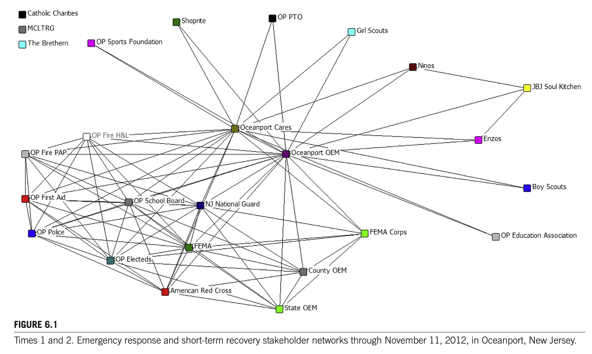
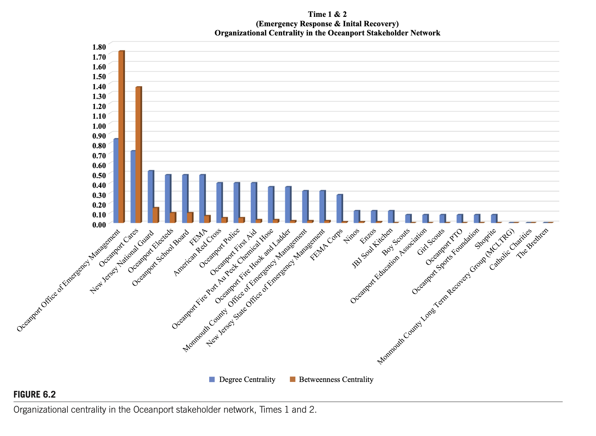
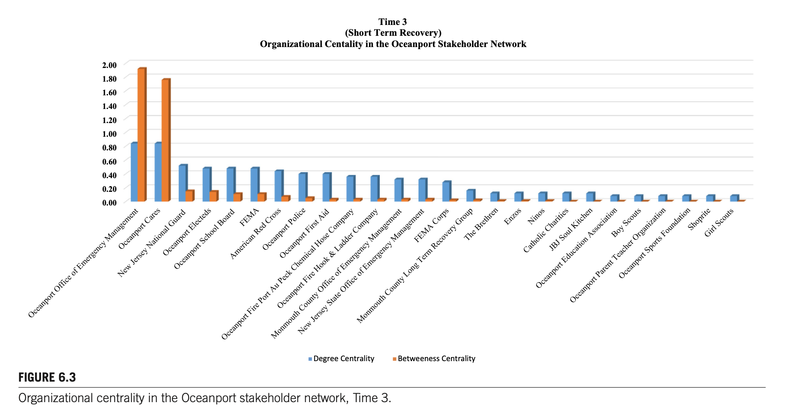
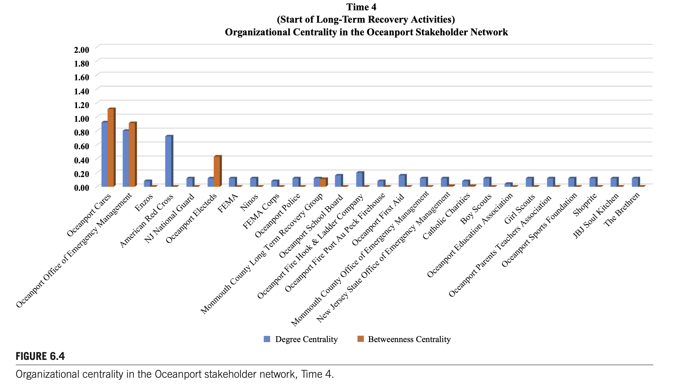
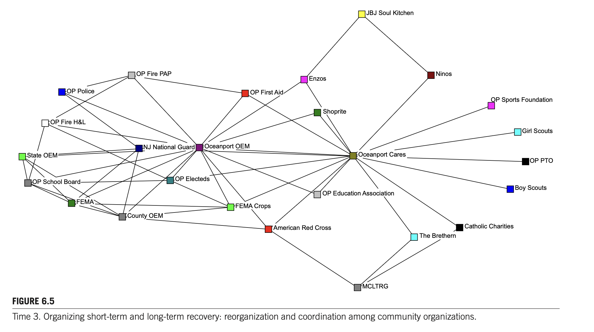
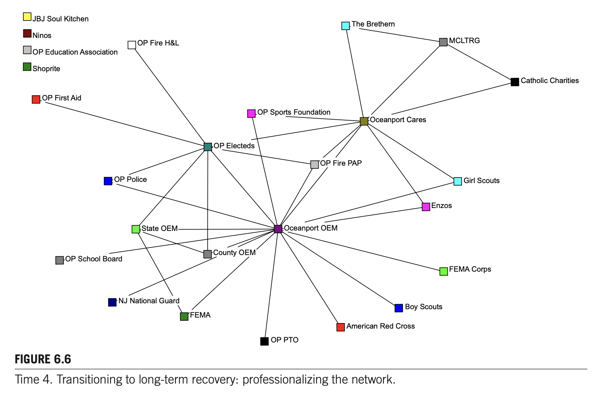

# CHAPTER 6: INTERORGANIZATIONAL RESILIENCE: NETWORKED COLLABORATIONS IN COMMUNITIES AFTER SUPERSTORM SANDY

**Authors:** Jack L. Harris, Marya L. Doerfel  
**Affiliation:** Rutgers University, New Brunswick, NJ, United States  
**Source:** *Social Network Analysis of Disaster Response, Recovery, and Adaptation*. http://dx.doi.org/10.1016/B978-0-12-805196-2.00006-6  
Copyright © 2017 Elsevier Inc. All rights reserved. (pp. 75–91)

---

## CHAPTER OUTLINE

* **Introduction** (p. 75)
* **Organizational Networks in the Fabric of Communities Facing Disasters** (p. 76)
  * Social Resilience Processes (p. 76)
  * Collaboration and Interorganizational Relationships (p. 77)
  * Networked Models of Stakeholder Relationships (p. 77)
* **Postdisaster Case Study: Oceanport, New Jersey** (p. 78)
  * Study Variables (p. 80)
* **Local Stakeholder Networks in Oceanport, New Jersey** (p. 80)
  * Network Transitions from Short-term to Long-term Recovery (p. 88)
  * The National Response Framework in Action (p. 88)
* **Building Interorganizational Resilience through Networked Collaboration** (p. 88)
  * Cross-sector Communication and the Plural Sector (p. 89)
  * Coordinating Resilience Through Brokers (p. 89)
  * Expanding Policy Frameworks to Account for Local Stakeholder Networks (p. 90)
  * Implications (p. 90)
  * Limitations (p. 91)
* **Conclusions** (p. 91)

---

## INTRODUCTION

Disaster response and recovery rely upon networked collaborations that cross multiple geographic and organizational boundaries. The National Response Framework (Department of Homeland Security, 2008, 2013a) details a wide variety of public, private, and nonprofit organizations and agencies as participants in emergency response and long-term recovery, while extant disaster-related literature highlights the roles played by formal and informal organizations, volunteers, and emergent groups over time (Drabek & McEntire, 2003; Majchrzak, Jarvenpaa, & Hollingshead, 2007; Kendra & Wachtendorf, 2003; Simo & Bies, 2007). Disaster response and recovery are phased processes, with different organizational activities taking precedence at different points in time (Doerfel & Haseki, 2013; Doerfel, Lai, & Chewning, 2010). Effective emergency response and long-term recovery from disaster require connected public agencies, private sector businesses, and nonprofit organizations that enable communication and coordination among multiple organizations with different goals, missions, information, and resources (Nowell & Steelman, 2013). While the role of bystanders, disaster tourism, unaffected volunteers, and emergent groups is well documented in the disaster literature (Drabek & McEntire, 2003; Helslott & Ruitenberg, 2004; Majchrzak et al., 2007), formal disaster planning and response tends to overlook the important preexisting community connections and grassroots relationships in disaster-struck communities.

Prior community relationships activate information flows and material assistance necessary for survival and recovery via interorganizational collaboration. Collaboration in disaster-struck communities occurs at grassroots or neighborhood levels as well as at the level of formal institutional response in cities, towns, counties, and states. Indeed, such grassroots organizing is seen as foundational to civil society (Taylor & Doerfel, 2011) and can be viewed as the social structure that undergirds resilient communities (Doerfel, 2016). This chapter examines community resilience as a social phenomenon involving networked organizations that collaborate after a natural disaster.

We present the case of Oceanport, a small coastal town in New Jersey that was struck by Superstorm Sandy in 2012. Some 1200 of the community’s 2100 residences were damaged with 700 of those having more than 50% of the given home significantly damaged or destroyed. Power outages ranged from 5 to 13 days throughout the town. The community’s town hall and police station were destroyed, and the community’s volunteer first aid squad was inoperable. Oceanport is home to state and federal installations with large amounts of property that were used to stage state and national response efforts to the impacted region. In addition to providing support for impacted residents in Oceanport, the Oceanport community had to coordinate flows of people and materials into town to service other impacted communities in the region.

---

## ORGANIZATIONAL NETWORKS IN THE FABRIC OF COMMUNITIES FACING DISASTERS

### SOCIAL RESILIENCE PROCESSES

Resilience processes are a mix of discursive and organizing activities that integrate improvisation and problem recognition with solution building. Social resilience is accomplished through community partnerships that enable organizations to access tangible and intangible resources to prepare for and manage threats. In disaster contexts, networked partnerships become a critical resource for responding to and rebuilding after disasters (Doerfel, Chewning, & Lai, 2013; Doerfel et al., 2010). Resilient systems can withstand stresses without degradation or loss of function, identify problems, establish priorities, and mobilize resources during disruptions, have redundant/substitutable elements, and meet priorities and achieve goals in a timely manner (Bruneau et al., 2003; Chewning, Lai, & Doerfel, 2013; Doerfel et al., 2013; Kendra & Wachtendorf, 2003). Social resilience is by its very nature communicative, that is, it relies on interaction between people and organizations in order to make sense of their surroundings, problem solve, and achieve specific outcomes (Buzzanell, 2010; Doerfel & Harris, 2016; Weick, Sutcliffe, & Obstfeld, 2005).

### COLLABORATION AND INTERORGANIZATIONAL RELATIONSHIPS

Collaboration is designed through communication activities that involve both talk and action (Aakhus, 2007) and, in disaster-struck communities, collaboration is heavily dependent upon preexisting relationships (Doerfel et al., 2010). Collaboration is a matter of social structure, process, and relationships, and is reflected in the interorganizational linkages that comprise communities, organizations, and organizational sectors (Diani, 2015). Collaboration can be created through the dyadic and group actions of individuals in partnering organizations or imposed by external structures that require collaboration in some way. Collaborative activities can even be suggested through the use of frameworks, governing documents, and other management and funder documents. The United States National Response Framework (Department of Homeland Security, 2008, 2013a) clearly identifies how public, private, and nonprofit organizations are expected to come together during crisis to deliver services and resources to impacted communities.

In disaster-struck communities the ever-shifting reality of disrupted physical and social environments impacts organizational relationships as communication patterns shift during transitions from emergency to transitional to recovery phases. A key question for understanding disaster response and recovery is the role that community-based interorganizational collaboration plays in: (1) constituting new patterns of networked stakeholder relations in disrupted social environments, and (2) building interorganizational resilience.

### NETWORKED MODELS OF STAKEHOLDER RELATIONSHIPS

Rather than focusing on the specific ties of specific organizations to other organizations, a networked model of stakeholders accounts for the dynamic, multiple ties among different organizations populating the plural, public, and private sectors that give a community its social structure (Diani, 2015; Mintzberg, 2015; Rowley, 1997). Key features of the networked stakeholder relationships we explore include organizations’ attributes, tie strength, and the role of centrality in broader interorganizational networks. Organizational populations consist of a combination of organizational attributes and relational ties that interact to shape the broader network of which they are a part (Monge, Heiss, & Margolin, 2008). The composition and function of these networks are understood through the organizational attributes, relational ties, and the strength or weakness of those relational ties.

Within a network structure, nodes represent the actors (in this study, organizations) with each actor composed of particular attributes. Network analysis measures the types of relationships between the nodes, in addition to the characteristics or nature of the nodes themselves. Yet, much of the interorganizational analyses of disaster response and recovery focus on the formal institutions of response rather than on the broader community network of stakeholders with their multiplicity of relational ties and organizational attributes (Carlson et al., 2016; Kapucu & Hu, 2014). We extend postdisaster research by considering the larger community stakeholder network, which serves to cement the community together as they engage in collaborative public activities (Diani, 2015).

Relational ties may carry informational, financial, material, or reputational resources that are the building blocks of interorganizational relationships (Doerfel et al., 2013). Within geographic communities, local organizations connect with one another through relational ties that involve both personal and organizational relationships that give shape to the broader community (Diani, 2015; Mische, 2003). Relational ties connect organizations with different attributes within a community by tying together their associated stakeholder networks. Weak ties become salient after significant community disruption by enabling organizational resiliency and lessen dependence on any one part of the network (Doerfel et al., 2010; Harris & Doerfel, 2016; Taylor & Doerfel, 2011). Strong ties may help to create dense or embedded networks that facilitate collaboration and resource sharing and consist of links between organizations with similar goals or missions. Latent ties become activated after disruption and may help to create or increase redundancy in a disaster-struck organizational or community network when resources are stretched thin and organizational systems are stretched to the breaking point (Doerfel et al., 2010).

Organizations with more ties to other organizations have high degree centrality and tend to play a more prominent role in the network (Doerfel & Taylor, 2004). While knowing the most nodes in a network is one way to increase access to and control over information, an organization can also occupy a brokerage role. Brokers connect organizations, people, and resources from distant or disconnected parts of a network. In disaster response and recovery, brokers often coordinate voluntary and institutional organizing efforts and mediate between emergent or converged response and the formal response efforts of established organizations. Researchers have identified brokers using different algorithms including betweenness centrality (Borgatti, 2005) and structural holes (Burt, 1992). Taken together, aspects of centrality reveal which organizations are leaders in terms of organizing and maintaining the network through bridging, gatekeeping, and coordination activities that bring disparate parts of the network together.

It is important to distinguish between centrality and centralization in understanding how networks operate. Centrality measures reveal how well connected any one organization is within a network based on the number of incoming and outgoing ties of a particular organization. Centralization measures reveal the overall level of connection or disconnection within a network. Centralization focuses on whether a network is highly centralized and organized around a particular focal organization or organizations, or whether it is decentralized, such that information flows in and around a network with no particular organization controlling the flow. Paired with density, which measures the general level of cohesion (extent to which members of the network are connected with each other member), centralization can provide a view of network organization (Borgatti, 2005; Borgatti & Everett, 2006). Key network questions we consider include: Does centralization change as the stakeholder network moves from tasks associated with emergency response to tasks associated with long-term recovery? Are local or national organizations more central in stakeholder networks in a disaster-struck community? What implications do these network questions have for response and recovery activities and public policies that foster disaster preparedness, emergency response, and community recovery?

---

## POSTDISASTER CASE STUDY: OCEANPORT, NEW JERSEY

We conducted field research in Oceanport, New Jersey, and along the New Jersey coast after Superstorm Sandy with the goal of assessing interorganizational interactions used to recover at both organization and community levels. Over the course of two years, the first author volunteered as a leader at the Oceanport microshelters, in the formation of Oceanport Cares, as part of the Monmouth County Long-term Recovery Group’s (MCLTRG) volunteers committee, and observed disrupted community and organizational networks at both community and regional levels through these activities. This chapter focuses on the three-month period from October 29, 2012, to December 24, 2012. This time period ranges from Sandy’s landfall to the official incorporation of Oceanport Cares as an outcome of the volunteer activities conducted in Oceanport during this period of disaster response and the subsequent transition into recovery activities.

Using longitudinal field research and document analysis, we reconstructed network relationships with the use of communication categories that represented network activities. The network was constructed using data obtained from participant observation, purposive sampling of active organizations, meeting agendas, and rosters obtained through the first author’s volunteer roles. Network ties were defined as interaction between organizations in the data set as observed in the field and through joint activities. This interorganizational interaction was defined as one or more contacts between organizations active in the recovery using a variety of face-to-face and mediated communication channels (Doerfel & Haseki, 2013; Doerfel et al., 2013; Doerfel, Lai, & Chewning, 2013). The network analyzed in this study is comprised of community and regional organizations ($n = 26$) active in Oceanport during this time period. Observations began casually on October 30, 2012, the day after the storm hit. More comprehensive mixed methods, including additional observation and participant observation, unstructured and semistructured interviews, small-scale surveys, and document analysis were used to supplement initial observations and notes over the longer course of the study from 2012 to 2015.

Community organizations in the network included Oceanport groups such as the Boy Scouts and Girl Scouts, the Oceanport Sports Foundation, and a local pizzeria. The Oceanport Sports Foundation acted as a pass-through organization for monetary donations until Oceanport Cares was formalized. Enzo’s local pizzeria provided meals when operations relocated to the volunteer fire station and helped provide food to the senior citizen apartment building in town. Oceanport Girl Scouts provided babysitting and group activities for children at the middle school and often worked with mental health responders developing systems of social and psychological support. Oceanport Boy Scouts organized and distributed supplies delivered by the Monmouth County Park System. The local teachers union worked with the local parent–teacher organization to collect, organize, and distribute clothing in the middle school library, while school food service personnel worked with citizen volunteers to prepare meals and snacks for impacted residents. These were ad hoc activities organized by citizen volunteers as conditions warranted. Operations then shifted to more formal organizations such as faith-based organizations, formalized local organizations (e.g., Oceanport Cares; Sea Bright Rising), the Occupy Sandy network, government agencies, and coordinating groups such as the MCLTRG.

Oceanport operations at the middle school also served as a staging area for nearby communities and the severely impacted Bayshore region, directly south of Staten Island alongside Raritan Bay. In the days after Sandy impacted the area, Monmouth County Park System warehouses were overwhelmed with donations. These donations were then sent out to those communities that could organize and distribute them. Since the New Jersey National Guard and Federal Emergency Management Administration (FEMA) Corps were staging at the Oceanport middle school, and Oceanport’s Office of Emergency Management had two-and-a-half-ton trucks that could navigate through flooded beach and bay towns, supplies and relief operations were routed through Oceanport for distribution to Oceanport and nearby communities even while state and federal response operations were underway across town. The New Jersey National Guard provided security and search-and-rescue operations in flooded areas of Oceanport, Monmouth Beach, and Sea Bright, while FEMA Corps volunteers provided information about federal insurance, assistance, and claims processes as well as application assistance for residents of Oceanport, Monmouth Beach, Sea Bright, and Long Branch. Oceanport’s Office of Emergency Management made a direct request for a Corps presence in the community.

### STUDY VARIABLES

**Time.** We bracketed the time frames of this study into four periods: Time 1 and Time 2, which cover the poststorm emergency response from October 30 to November 11, 2012; Time 3, which represents poststorm emergency response and short-term recovery activities from November 12 to December 24, 2012; and Time 4, which starts with December 24, 2012, representing the start of the long-term recovery period. Times 1 and 2 were combined for analyses of degree centrality and betweenness centrality. Qualitatively, Times 1 and 2 are different phases because a transfer of activities from a local middle school to a local volunteer fire station occurred sequentially, marking the transition from emergency response to short-term community recovery. The spatial location of activities changed sharply between Time 1 and Time 2, while organizational and network activities slowly transitioned from a state of emergency response to a state of recovery. Times 1 and 2 are combined for this chapter to clearly reflect those differences between spatial and organizational activities. The analysis in this chapter focuses on the temporality of organizational activities rather than the spatial location of those activities.

Time 3 started with the initial organizing meeting of the MCLTRG in the second week of December 2014. Time 4 is represented by the incorporation of the emergent disaster relief organization, Oceanport Cares, within the State of New Jersey on December 24, 2012, and represents a turn from emergent to more formal interorganizational relationships within the community. Following Doerfel and colleagues (2010), Times 1 and 2 represent the emergency response and short-term recovery phases. Emergency response and short-term recovery phases often overlap in the first few weeks after disaster. Times 3 and 4 represent the transition from short-term recovery to long-term recovery activities in the community.

**Organizational Network.** Communication is two-way and multichannel between the organizations active in this network during the time period analyzed. Degree centrality identifies organizations that helped activate and maintain Oceanport’s stakeholder network after Sandy made landfall. All centrality calculations were made with UCINET (Borgatti & Freeman, 2002). We used Freeman’s betweenness measure in UCINET; though betweenness and degree centrality measures are similar measures, high betweenness does not require high degree centrality. If few organizations in the overall network have high degree centrality, then they also fall between otherwise unconnected organizations. UCINET’s network centralization represents the degree to which information flows were reliant on a few key organizations or dispersed across the network. High-centralization scores represent a more centralized network in which information flows through relatively fewer organizations. Low scores represent a relatively decentralized network in which information flows in and around members where no one or very few organizations act as gatekeepers/brokers of the information (Borgatti & Freeman, 2002).

---

## LOCAL STAKEHOLDER NETWORKS IN OCEANPORT, NEW JERSEY

This case’s research questions considered how interorganizational relationships built new patterns of stakeholder relationships and created resilience through networked activities and whether centrality and centralization changed as the network transitioned from emergency response toward long-term recovery activities. The findings showed that patterns of interaction shift over time through interorganizational collaborations both within the local Oceanport stakeholder’s network and with larger regional, and national organizations. Two local organizations—one that was part of the formal institutional response and a second that emerged as a new organization created by citizen volunteers—held primary roles throughout the four phases of response and recovery.

To answer these questions, we first describe the networks over time. Fig. 6.1 depicts Times 1 and 2 and shows two distinct clusters joined by the communication activities of the Oceanport Office of Emergency Management and the nascent Oceanport Cares, a group of unaffiliated volunteers loosely organized by Oceanport’s Office of Emergency Management. These citizen volunteers and emergent organizing processes morphed into a formal 501c3 nonprofit in the year following the storm, with state incorporation occurring on December 24, 2012 (start of Time 4) and 501c3 status achieved in January 2014. Both the Oceanport Office of Emergency Management and Oceanport Cares connected a local network organized around issues of community support with a larger network of local, regional, state, and federal agencies providing more traditional emergency response and law enforcement activities.

As shown in Figures 6.2, 6.3, and 6.4, the Oceanport Office of Emergency Management and Oceanport Cares were consistently among the organizations ($n = 26$) with the highest degree and betweenness centrality across each of the time periods measured. This is consistent with their role as key brokers of resources and information throughout the three-month period analyzed after Sandy made landfall. A high degree of relational ties to other organizations would be expected given the coordinating role that emergency management offices are expected to play as part of the National Response Framework and New Jersey’s disaster response protocols.

The stakeholder network began to shift from the emergency response to the short-term recovery phase when operations changed locations from the middle school to the volunteer firehouse during the middle of Times 1 and 2. Toward the end of Times 1 and 2, the Oceanport Office of Emergency Management evolved into a broker for local organizations expecting reimbursement from FEMA for their supplies and labor, while Oceanport Cares continued to connect directly with organizations providing resources and social support to impacted residents and businesses. National institutions like FEMA and the American Red Cross were in peripheral roles in the local communication network at this time.$^{1}$

> $^{1}$ The Federal Emergency Management Agency continued to focus on financial recovery from Sandy as it does after every disaster (in conjunction with the Small Business Administration and the Department of Housing and Urban Development) but financial assistance from the federal government is administered by a byzantine structure of agencies, nonprofits, state and municipal governments (in the case of large cities like New York City), programs, and administrators, discussion of which is beyond the scope of this chapter.

Stakeholder network changes during Times 1 and 2 were complicated by the material impacts of Sandy on Oceanport. The municipal building was destroyed by the storm, resulting in moving regular municipal operations to the borough’s emergency operations center on the second floor of the Oceanport Hook and Ladder Company. Floodwaters disabled the operation of the Oceanport First Aid Squad’s headquarters and disabled their ambulances. After short-term recovery operations were moved to the firehouse from the middle school, the first aid squad essentially became disconnected from the network as they focused on repair and recovery of their equipment and buildings.

Time 3 included the launch of the MCLTRG, which took over the coordinating role in disaster response from local Offices of Emergency Management as organizing the rebuilding included both social and physical reconstruction. The social elements of reconstruction included case management services, volunteer coordination, interorganizational coordination, arranging temporary housing for displaced homeowners, financial assistance through state, federal, foundation, and nonprofit sources, and spiritual and emotional support services. Physical elements of reconstruction included demolition and remediation, replacement and rebuilding of destroyed homes, repairing and renovating impacted homes that could be saved, elevating and lifting homes to be compliant with new FEMA flood insurance regulations, warehousing donations for impacted homeowners, and the local permitting processes associated with demolition and reconstruction. This network is depicted in Fig. 6.5.

  
**FIGURE 6.1**: Times 1 and 2. Emergency response and short-term recovery stakeholder networks through November 11, 2012, in Oceanport, New Jersey.

  
**FIGURE 6.2**: Organizational centrality in the Oceanport stakeholder network, Times 1 and 2.

  
**FIGURE 6.3**: Organizational centrality in the Oceanport stakeholder network, Time 3.

  
**FIGURE 6.4**: Organizational centrality in the Oceanport stakeholder network, Time 4.

  
**FIGURE 6.5**: Time 3. Organizing short-term and long-term recovery: reorganization and coordination among community organizations.

At this point, regional organizations (MCLTRG and Catholic Charities) and national faith-based organizations (The Brethren, Lutheran Social Ministries, United Methodist Committee on Relief) became primary partners in recovery with local and other regional organizations. Resource deployment and management became more predictable and routinized at this phase of the recovery. As depicted in Fig. 6.6, the Oceanport Cares played a significant role in communication with nongovernmental organizations and distributed confusing and sometimes conflicting information from state and federal agencies and national nonprofits to local organizations and residents. Similar to Time 1, coordination activities were essentially split into two different networks, one comprising local and regional businesses and nonprofits coordinated by Oceanport Cares, and a second set of government agencies and elected officials coordinated by the Office of Emergency Management.

  
**FIGURE 6.6**: Time 4. Transitioning to long-term recovery: professionalizing the network.

Oceanport’s stakeholder network evolved in response to both exogenous events (a physical move in locations, the formalization of citizen volunteer efforts) and as organizations entered and exited the network. By Time 4, Oceanport’s stakeholder network became smaller and more centralized as local organizations exited the network, relying on the Oceanport Office of Emergency Management and Oceanport Cares as information and resource brokers. Overall network centralization increased from 61% in Time 1 to 78% in Time 4. Centralization dipped to 59% in Time 3 as the network transitioned from emergency response and short-term recovery operations into long-term recovery activities. Other organizations also began to play more central roles as roles and tasks changed. The MCLTRG, organized in Time 3, became a broker for national organizations entering to engage in long-term recovery efforts. The mix of local organizations declined from 87% to 73% between Time 1 and Time 4 as national organizations increased their share of the network from 13% to 18% during the same time period. As the overall network shrank, betweenness centrality scores decreased for organizations engaged in the Oceanport stakeholder network.

### NETWORK TRANSITIONS FROM SHORT-TERM TO LONG-TERM RECOVERY

Shifts that occurred in the network from Times 1 and 2 to Times 3 and 4 included the departure of the FEMA Corps and the New Jersey National Guard during Time 3 and the assumption of social support services, volunteer coordination, warehousing of food and supplies, and case management services by more formally organized nonprofit organizations. This move to more formal nonprofit interorganizational relationships included organizing efforts by local citizen volunteers who created formal local nonprofit organizations as part of their long-term recovery efforts. These activities created local nonprofits such as Oceanport Cares and Sea Bright Rising, which participated in the MCLTRG.

### THE NATIONAL RESPONSE FRAMEWORK IN ACTION

Formal emergency response operations in the Oceanport stakeholder network were similar to those outlined in the National Response Framework. The National Response Framework developed by the Federal Emergency Management Agency calls for coordination of emergency and community resources through an incident command system (Department of Homeland Security, 2013a). In New Jersey, incident command after a disaster runs through the Office of Emergency Management, which is a nested set of command structures running from the state emergency operations center in the state’s capital city, through county command centers, and into the local municipalities. Communication is two-way with local emergency management offices reporting their community’s status, situation, and needs through the county emergency command center run by the director of the county office of emergency management, who then updates the state emergency command center. The state office of emergency management shares information about the current status of communities and emergency operations, and the on-the-ground situation, through the FEMA’s incident commanders and command centers. As emergency response operations end, it is assumed by disaster planning frameworks and public officials that nonprofit and voluntary organizations will begin to fill key roles in impacted communities by locating temporary housing for residents who couldn’t return home, providing food, clothing, and other assistance, and providing assistance with insurance claims, funding applications, overall case management, social support, and mental health services.

---

## BUILDING INTERORGANIZATIONAL RESILIENCE THROUGH NETWORKED COLLABORATION

This case makes visible (1) the interaction of private, public, and plural sector organizations in response and recovery in one small coastal community, (2) the role of centrally located, local organizations in disaster response and recovery, and (3) the limitations of existing policy frameworks in fully accounting for the breadth of local organizational activities involved in disaster response and recovery.

By connecting local stakeholder networks with larger-scale regional and national response efforts, information and resource exchange occurred at the point of impact. Two local organizations, an existing formal government agency, and an emergent organization staffed by citizen volunteers were central to the network throughout all four phases of response and recovery. These two organizations brokered information between local, regional, and national organizations during the personal emergency, transitional, and recovery phases of the disaster.

### CROSS-SECTOR COMMUNICATION AND THE PLURAL SECTOR

The networked activities of response in Oceanport after Superstorm Sandy reflect Henry Mintzberg’s (2015) “plural sector,” which is comprised of those organizations that are neither fully public nor fully private sector organizations. In Oceanport, this plural sector took shape as unaffiliated citizen volunteers organized in the days after the storm by creating a system of work routines and strategic interactions designed to assist the community’s recovery. These daily work routines enacted a series of interorganizational relationships involving local businesses, local associations, local membership organizations, and local unions that were connected with, and ran parallel to, the larger institutional interorganizational response network. These activities connected organizations with different characteristics, missions, and identities into a singular stakeholder network centered on emergency response and long-term recovery. Citizen volunteer activities in conjunction with the Oceanport Office of Emergency Management balanced Oceanport’s different organizational sectors in pursuit of a common goal. These private/public/plural sector partnerships were dynamic relationships socially constructed through stakeholder network members’ collaborations. Interorganizational relationships reorganized over time as operations transitioned from emergency response to short-term recovery and then into long-term recovery activities. The Oceanport case is among the first empirical applications of the plural sector framework for community research in disaster-struck communities.

### COORDINATING RESILIENCE THROUGH BROKERS

Within the post-Sandy Oceanport stakeholder network, the central role of two key organizations emerged by brokering two separate networks, a network of social support based on informal relationships comprised of strong, weak, and latent ties coordinated by the citizen volunteer group—which later became Oceanport Cares—and the other, an emergency response network based on formal relationships between the Oceanport Office of Emergency Management, regional, and national organizations. The Oceanport network was comprised of both strong and weak ties and is reflective of the overall National Response Framework and existing emergency response protocols in New Jersey. The Oceanport Office of Emergency Management also connected the two stakeholder networks into a larger community-wide social infrastructure that coordinated information flows and resource exchanges.

Organizations with high degrees of centrality play a key role in information and resource exchange activities within a network and are able to influence communication patterns and partnering activities within the network. The Oceanport Office of Emergency Management, by virtue of its role and authority in the network, brought citizen volunteers, plural, and private sector organizations into the emergency response network to provide resources that were unavailable or inaccessible from larger regional and national organizations that were participating in the interorganizational response network.

Brokerage and coordination activities created an opportunity for a new local organization to emerge and created a new resource cluster much closer to the point of impact. While this new resource cluster may seem redundant, it actually played a key role in the resilience of the network and lessened the community’s dependence on other parts of the network. Redundant resource clusters are created through multiple communication activities by centrally located, local organizations that broker information and resources within the stakeholder network in order to fill in the gaps within the larger interorganizational emergency response network. The emergence of these two centrally located organizations within the local stakeholder network in Oceanport adds to existing literature on the role of network redundancy and multiple network ties in survival, recovery, and social resilience after a disaster by demonstrating how community-level interorganizational relationships supplement formal emergency response and disaster recovery activities (Doerfel et al., 2010; Kapucu & Garayev, 2014; Kapucu & Hu, 2014; Kendra & Wachtendorf, 2003; Nowell & Steelman, 2013).

### EXPANDING POLICY FRAMEWORKS TO ACCOUNT FOR LOCAL STAKEHOLDER NETWORKS

The Oceanport Office of Emergency Management played an important role in bringing together private, public, and plural sector organizations as would be expected under the National Response Framework. However, given their responsibility for leading local community response along with coordinating the influx of resources designated for the regional response, Oceanport Office of Emergency Management relied upon unaffiliated volunteers and existing organizations within the community to execute and operate a microshelter, community support activities, and to transition rescue and response operations into short- and long-term recovery activities. While the National Response Framework emphasizes the need for local emergency management offices to coordinate all resources and all types of organizations within a community, Oceanport Office of Emergency Management expanded this framework in a real-time, on-the-ground response to material conditions and interorganizational response efforts after Sandy.

Despite Oceanport’s role in the formal state and national response as a physical site for regional relief efforts, local needs were not met by national and state response agencies. Instead, relationships with other local government agencies were activated, and local businesses and organizations were accessed for food, clothes, and additional volunteers as the Oceanport operation expanded to include neighboring communities. Local organizations in an impacted region may play more significant roles during emergency response and short-term recovery than do national organizations, but these contributions may not be recognized within formal planning frameworks or in the actual operation of response and recovery efforts. While the national response framework calls for private, public, and plural sector partnerships (Department of Homeland Security, 2008, 2013a), in practice unaffiliated volunteers and new organizations are often seen as ancillary parts of the network and as not critically important to formal response and recovery operations (Drabek & McEntire, 2003; Helslott & Ruitenberg, 2004; Majchrzak et al., 2007). Findings from the Oceanport case, however, underscore the relevance of the local stakeholder environment and community resources. This case illustrates a community that coordinated private, public, and plural sector resources and volunteers in an informal social support network, providing redundant resources at the point of impact and in concert with the existing formal emergency response network. Such informal activities contribute to broader community recovery and social resilience and need to be accounted for in disaster planning and public policy.

### IMPLICATIONS

Local organizations are located within stakeholder networks at the point of impact and despite being victims, themselves, are able to broker resources and information more efficiently due to their physical location within the community and to their organizational position within the network (Doerfel et al., 2010, 2013; Doerfel & Haseki, 2013). The Oceanport case points to the need for a new look at the National Response Framework to ensure that community stakeholder networks are supported and incorporated in broader planning and operational activities. Our research indicates that it is a mix of formal and informal relational ties that contributes to the activation and expansion of a stakeholder network in a disaster-struck community.

As seen in myriad news, blogging, and social media critiques of large relief organizations like the Red Cross and FEMA (Elliot & Sullivan, 2015; Feuer, 2012; Mayton & Kazem, 2015), there is a general perception that regional and national institutional response efforts should meet all community and organizational needs after a disaster and make communities whole, but that these formal institutional responses often fall short. This case suggests that it is integrated local-, regional-, and national-level interorganizational interactional activities that create new partnering opportunities. These emergent interorganizational relationships in turn contribute to processes of social resilience. In the case of Oceanport, we contend that it was the mobilization of the two networks (policy-based interorganizational response networks and local stakeholder networks) through two locally based central organizations brokering information flows that facilitated resilience processes. The findings in this study add to a growing call for an understanding of social networks in disaster by policy planners and emergency responders (Feuer, 2012; Department of Homeland Security, 2013b).

### LIMITATIONS

This is a site-specific case study of a small, middle class community during the three-month period following Sandy’s impact. Larger communities may have multiple, competing grassroots efforts, which may make it harder for emergency management efforts to coordinate them. Unlike other examinations of emergent volunteer efforts in disaster response (Drabek & McEntire, 2003; Helslott & Ruitenberg, 2004), Oceanport’s emergency management office played a role in getting citizen volunteer efforts in Oceanport organized with adjoining communities and delegated responsibilities to these citizen volunteers. This is consistent with existing disaster response frameworks and protocols in the United States, but in stark contrast to parallel response efforts like Occupy Sandy (Department of Homeland Security, 2013b; Feuer, 2012) that organized and distributed information and resources outside of formal disaster institutions and networks.

---

## CONCLUSIONS

The role of local stakeholder networks is a crucial component of community resilience. Community resilience in turn is dependent upon interorganizational resilience, which rests upon a strong foundation of social and organizational relations between private, public, and plural sector organizations. However, network composition changes over time and reflects the dynamics of the interorganizational response represented within these embedded networks. Organizations become active in postdisaster networks based on stakeholder needs and whether or not they hold resources that could meet stakeholder needs. However, resource holders are not exclusively outside organizations with a large resource base and clearly identified reputations. Resource brokerage, like in the case of Oceanport, can take place as different organizations and organizational populations connect with one another within a disaster-struck community. Finally, the role of the plural sector as a networked set of relationships among organizations with very different goals, missions, and reward structures is vital to resilience.