# 제7장 주의의 이동: 콜로라도 산불 당시 미국 재난관리 유관 조직 간 팔로워 관계 동학 모델링 (Sub-Note)

**원제**: CHAPTER 7 SHIFTING ATTENTION: MODELING FOLLOWER RELATIONSHIP DYNAMICS AMONG US EMERGENCY MANAGEMENT-RELATED ORGANIZATIONS DURING A COLORADO WILDFIRE  
**저자**: Zack W. Almquist1,2, Emma S. Spiro2, Carter T. Butts3  
1 *University of Minnesota, Minneapolis, MN, United States*  
2 *University of Washington, Seattle, WA, United States*  
3 *University of California, Irvine, CA, United States*  
**출처**: *Social Network Analysis of Disaster Response, Recovery, and Adaptation* (Elsevier, 2017, pp. 93–113)  
**DOI**: `http://dx.doi.org/10.1016/B978-0-12-805196-2.00007-8`

---

## CHAPTER OUTLINE (장 목차 구성 — 원문 순서 동일)

* **Introduction (서론)** ............................................................................................................................................ 94
* **Literature Review (문헌 검토)** .................................................................................................................................... 95
* **Mechanisms of Attentional Interaction During a Disaster (재난 시 주의 상호작용의 메커니즘)** ........................................... 97
* **Data (데이터)** ....................................................................................................................................................... 98
  * The Dynamic Network (동적 네트워크) ............................................................................................................ 98
  * Disaster Case Study: Colorado Duckett Fire (재난 사례 연구: 콜로라도 덕켓 산불) ............................................................ 102
* **Methods (연구 방법)** ............................................................................................................................................... 103
  * Notation (수학적 표기법) ............................................................................................................................. 103
  * Dynamic Network Regression (동적 네트워크 회귀분석; DNR) ................................................................................ 105
  * Mechanisms of Attentional Dynamics (주의 동학 메커니즘의 매개변수화) ..................................................................... 105
    * Base Rate of Attending (기저 주의율) ..................................................................................................................... 106
    * Inertia (관성) ........................................................................................................................................................ 106
    * Homophily (동질혼 / 유사성) ................................................................................................................................... 106
    * Shared Partners (공유 파트너) .............................................................................................................................. 106
    * Transitivity (이행성 / 삼항 폐쇄) .............................................................................................................................. 106
    * Popularity and Activity (인기도 및 활동도) ................................................................................................................. 106
    * Reciprocity (상호성) ............................................................................................................................................. 106
    * Seasonality (계절성 / 요일 효과) .............................................................................................................................. 107
    * Hazard Event Effects (재해 사건 효과) ................................................................................................................... 107
* **Results (분석 결과)** ................................................................................................................................................. 107
  * Interpretation (결과 해석) ..................................................................................................................................... 107
* **Discussion (논의)** ............................................................................................................................................ 109
* **Summary (요약)** .............................................................................................................................................. 111
* **Acknowledgments (사사)** ................................................................................................................................. 112

---

## INTRODUCTION (서론) `[원문 pp. 94–95]`

### [문단 1] 재난관리 조직 간 상호의존성과 '주의(Attention)'의 기본적 성격
재난관리 조직(Emergency management organizations)은 진공 상태에서 행동하는 경우가 거의 없습니다. 정부 조직(governmental organizations)과 비정부 조직(nongovernmental organizations) 모두 평시(routine) 및 비평시(nonroutine) 환경 모두에서 시의적절한 주제 정보(topical information)와 실무적 지침(practical guidance)을 얻기 위해 서로를 주시합니다(Comfort et al., 2004; Drabek & McEntire, 2002).
* **주의(Attention)의 정의**: 이러한 상호작용의 가장 기본적인 발현 형태는 바로 **주의(Attention)**입니다. 즉, **한 조직이 다른 조직의 행동을 관찰하거나 다른 조직으로부터 정보를 수신하기 위해 기울이는 체계적인 노력(a systematic effort on the part of one organization to observe the actions of and/or to receive information from another)**을 의미합니다.
* **통로(Conduit)로서의 역할**: 주의 관계는 위기 상황(crisis events) 동안 정보 확산(information diffusion)을 위한 통로로서 특히 중요할 수 있으며, 평시 운영 기간 동안에는 조직의 루틴(routines), 관행(practices), 표준(standards)을 전파하는 통로가 됩니다(DiMaggio & Powell, 1983; Reeder et al., 2014).
* **신호 전달 기능(Signaling Function)**: 제3자에게 공개적으로 가시화될 때, 주의 관계는 주의를 기울이는 자(attender)와 주의를 받는 자(attendee) 사이의 제휴·소속(affiliation) 형태를 제3자에게 알리는 **신호 전달 기능(signaling function)**도 가질 수 있습니다(Kwak et al., 2010). 예를 들어, 연방 기관(federal agency)이 특정 지방 기관(local agency)을 팔로우(follow)하기 시작하면, 대중은 그 지방 기관이 연방 정부의 공식 지원을 받거나 연방 기관과 제휴 관계에 있다고 인식할 수 있습니다.

### [문단 2] 실현된 소통 관계 vs 잠재적 정보 전달 통로로서의 주의 관계
실제로 발생한 소통 관계(realized communication relationships; 예: 직접적인 메시지 발송, 전화, 멘션 등)와 달리, **주의 관계(attentional relationships)**는 **정보 전송의 잠재력(potential for information transmission)**을 반영합니다.
* 따라서 송신자의 적극적 행동과 무관하게(net of sender behavior) 조직 간 정보가 흐를 수 있는 **기회의 구조(structure of opportunities)**를 탐색하는 데 매우 유용합니다.
* 마찬가지로, 송신 조직이 수신 조직을 구체적으로 타깃팅하려는 의도적인 노력을 기울이지 않더라도(예: 주의를 기울이는 관찰자가 피관찰자의 행동이나 일반적 공지사항을 수동적으로 지켜봄으로써), 정보가 수신 조직으로 흘러 들어갈 수 있는 경로를 나타내 줍니다.

### [문단 3] 주의 관계 실증 연구의 역사적 난점과 온라인 소셜 미디어의 기회
주의 관계는 그 중요성에도 불구하고 역사적으로 연구하기가 매우 어려웠습니다.
* **조사 한계**: 조직 정보 제공자를 대상으로 한 회고적 설문조사(retrospective surveys)나 보존 기록물(archival materials)은 누가 누구에게 주의를 기울이고 있었는지에 대해 매우 제한적인 증거만을 제공하기 때문입니다.
* **온라인 시스템의 장점**: 조직 활동이 온라인 영역으로 확장되면서 이전에는 포착하기 어려웠던 이러한 네트워크를 연구할 수 있는 획기적인 기회가 열렸습니다. 특정 컴퓨터 매개 커뮤니케이션(CMC) 시스템들은 운영의 부수적 결과로서 주의 관계를 자동으로 기록하기 때문입니다. 이러한 소스에서 도출된 관계 기록은 적어도 특정 환경 내에서 조직들이 시간에 따라 주의 관계를 형성하고 해체하는 과정(formation and dissolution)을 들여다볼 수 있는 독특한 창(unique window)을 제공합니다.

### [문단 4] 트위터(Twitter) 플랫폼의 활용과 기존 연구의 한계
조직들이 주의 관계를 직접적이고 공개적으로 표명하는 대표적인 환경 중 하나가 바로 **트위터(Twitter)**입니다. 트위터는 평시 상황과 위기 상황 모두에서 재난관리 기관의 참여와 활용이 급증하고 있는 대중적 마이크로블로깅 서비스입니다.
* **기존 연구의 초점**: 비상 상황에서 소셜 미디어(특히 트위터)의 활용을 다룬 선행 연구들은 주로 신속한 정보 보급 및 전송 촉진, 집단적 의미구성(collective sense-making) 과정 및 루머 유포(rumoring) 지원 역량에 집중되어 왔습니다(Spiro et al., 2012; Sutton, 2010; Sutton et al., 2014). 다른 연구들은 디지털 자원봉사(digital volunteerism)와 상황인식(situational awareness) 향상 가능성을 살펴보기도 했습니다(Starbird & Palen, 2011; Vieweg et al., 2010).
* **기존 연구의 공백(Gap)**: 그러나 이 맥락에서 비상대응 조직 자체(emergency response organizations themselves)의 활동을 조사한 연구는 거의 없었습니다(Hughes et al., 2014; Reeder et al., 2014 등의 일부 예외 제외). 나아가 조직들이 서로에게, 그리고 일반 대중에게 정보를 얻고 제공하기 위해 추구하는 **조직 간 주의 관계의 진화하는 양상(evolving landscape of attentional relationships)**을 이해하고자 한 연구는 더욱 드뭅니다(초기 연구 사례: Sutton et al., 2012).
* **본 연구의 차별성**: 현재까지 재난관리 조직 간의 온라인 주의 관계와 그에 따른 정보 흐름을 장기간에 걸쳐 추적하고, **관계의 형성(tie formation)과 해체(tie dissolution)를 지배하는 메커니즘을 체계적으로 규명한 연구는 존재하지 않습니다.**

### [문단 5] 연구 목적: 동적 네트워크 로지스틱 회귀(DNR)를 통한 실증 규명
본 연구는 **동적 네트워크 로지스틱 회귀(Dynamic Network Logistic Regression; DNR)** 모델링 접근법을 적용하여 이 연구 공백을 해결합니다.
* **연구 대상**: 장기간에 걸쳐 트위터 상에서 활동한 미국 연방(federal) 및 주(state) 수준의 재난관리 유관 조직 213개 간의 진화하는 팔로워(follower, 즉 구독/주의) 관계.
* **DNR 방법론의 장점**: DNR은 과거 상호작용의 시간적 관계(예: 선호적 연결, preferential attachment)를 직접 모델링하여 미래의 상호작용을 이해하고 예측할 수 있게 해줍니다(Almquist & Butts, 2013, 2014b).
* **핵심 질문**: 조직들이 사회 연결망 내에서 시간 경과에 따라 진화하는 구조적 위치(structural positions) 특성을 공개적 정보 교환 패턴과 연결하고, 실제 발생한 **재난 사건(2011년 콜로라도 덕켓 산불)이 지역 트위터 피드에 미친 직접적 효과**를 실증적으로 추정합니다. 본 분석은 온라인 영역에서 재난관리 조직 간의 주의 배분(allocation of attention)을 유도하는 요인들을 최초로 규명합니다.

> [!NOTE]
> ### 🔍 [보조교재 심화 해설: '주의(Attention)'의 네트워크적 함의]
> * **소통(Communication) vs 주의(Attention)**: 기존 사회연결망 연구는 주로 실제 발생한 메시지 송수신(멘션, 리트윗, 통화 등)에 집중했습니다. 하지만 재난 현장에서는 "내가 정보를 보내지 않더라도 상대방이 내 계정을 지켜보고 있는가(구독/팔로우)"가 정보 전달의 잠재적 용량(channel capacity)을 결정합니다.
> * **선제적 주의의 구조적 중요성**: 비상 상황이 터졌을 때 즉각 정보를 받아보려면 평시 또는 위기 초기에 이미 팔로우 관계가 맺어져 있어야 합니다. 따라서 팔로워 네트워크는 재난 시 가동될 수 있는 **정보 통로의 기저 파이프라인** 역할을 합니다.

---

## LITERATURE REVIEW (문헌 검토) `[원문 pp. 95–97]`

### [문단 1] 재난 연구에서 사회연결망 이론의 부상
재난(Disasters)은 일상생활을 극단적이고 위험하게 파괴합니다. 이러한 파괴는 기존의 지원 네트워크, 통신 네트워크 및 기타 인프라의 기능을 마비시킬 수 있습니다.
* 이로 인해 재난 연구에 사회연결망 이론과 방법론(social network theory and methods)을 적용하는 방대하고 성장하는 문헌군이 형성되었습니다.
* **선행 연구 영역**:
  1. 재난 시 커뮤니케이션 네트워크 분석(Butts, 2008a; Smith & Simpson, 2009; Sutton et al., 2012, 2014)
  2. 재난 중 및 재난 후 사회적 지지(social support)의 효과와 중요성(Jones et al., 2013; Mathbor, 2007)
  3. 재난 구호 및 관리에 있어 사회연결망의 다면적 효과(Hamra et al., 2012; Marcum et al., 2012)
* **본 연구의 초점**: 본 장에서는 재난 환경에서 대응 조직들이 보이는 **주의 동학(attentional dynamics)**의 중요성에 초점을 맞추며, 현대 기술(소셜 미디어 분석 기법)이 이 분야 연구의 지평을 어떻게 확장할 수 있는지를 탐구합니다.

### [문단 2] 온라인 환경 및 소셜 미디어가 가져온 위기 커뮤니케이션의 패러다임 전환
소셜 미디어와 온라인 환경은 공직자, 조직, 개인이 경보, 경고 및 기타 정보를 전달하고 평시와 재난 시에 과업 조정을 수행하는 방식을 근본적으로 변화시켰습니다(Kavanaugh et al., 2011; Palen, Vieweg, & Sutton, 2007).
* **전통 매체 vs 온라인 매체**:
  * TV, 라디오 같은 전통 매체는 여전히 대중 참여에 필수적이지만, 주로 **일방향 브로드캐스트(broadcast)**에 국한되며 소수의 주요 민간 언론사에 의해 통제됩니다.
  * 반면 온라인 커뮤니케이션 수단은 더 유연한 전파 전략을 가능하게 합니다. 저비용 브로드캐스트뿐만 아니라 **양방향 커뮤니케이션(two-way communication)**을 허용하고, 발신 조직이 메시지의 타이밍과 콘텐츠를 직접 제어할 수 있으며, 거의 실시간(near real time)으로 업데이트될 수 있습니다(Bruns et al., 2011).
* **재전송 메커니즘(Retransmission mechanisms)**: 소셜 미디어 인프라에는 리트윗/공유와 같은 재전송 메커니즘이 내장되어 있어, 이용자들이 기저의 사회연결망을 통해 콘텐츠를 다른 사람들에게 재전송하도록 장려함으로써 정보 확산을 촉진합니다(Sutton et al., 2014, 2015a,b).

### [문단 3] 소셜 미디어 활용의 세 가지 범주와 조직의 피드백 적응
재난관리 조직들은 이러한 새로운 플랫폼의 잠재력을 인식하고 위기 시 활발히 사용하고 있습니다(예: 연방재난관리청 FEMA가 특정 위험 사건을 팔로우하거나 리트윗하면, 지방 기관들이 이를 감지하고 해당 메시지를 팔로우하거나 리트윗하기 시작함; Hughes et al., 2014).
* **기존에 식별된 소셜 미디어의 두 가지 역할**(Lindsay, 2011):
  1. 정보의 일방향 보급(disseminate information)
  2. 관리 도구 자체로서의 활용(victim requests for assistance 접수 등)
* **간과된 제3의 역할**: 위 분류는 소셜 미디어가 **정보 수집 및 상황인식 개선(information collection and improved situational awareness)**을 위한 핵심 도구로 쓰인다는 제3의 역할을 누락하고 있습니다(Mehrotra et al., 2004).
* **주의적 측면의 피드백 적응**: 소셜 미디어 사용의 주의적 측면은 조직이 사용자 피드백을 수용하여 자신의 커뮤니케이션 패턴을 바꾸는 데까지 확장됩니다. 예컨대 2012년 허리케인 샌디 대응 연구에서, 일부 응급 대응자들은 순수한 브로드캐스트 패러다임에서 벗어나 구조 요청을 인지하고 확인해 주는 방식으로 프로토콜을 적응시키는 동시에 공식 구조 채널 이용을 강화하려 노력했습니다(Hughes et al., 2014).
* **제도적 긴장**: 공무원의 소셜 미디어 활용과 일반 대중의 기대 사이에는 여전히 불일치(mismatch)가 존재합니다. 정부의 전통적 지휘통제(command-and-control) 프로토콜은 소셜 미디어와 유기적으로 통합되기 어렵고, 이로 인한 법적 장벽, 자원 부족, 소통 담당자의 훈련 부족 등이 효과적 소통을 가로막습니다.

### [문단 4] 트위터(Twitter)의 명암: 신속한 확산 vs 허위정보와 잡음
트위터는 재난 대비, 대응, 복구 과정에서 소셜 미디어가 갖는 장점과 한계를 모두 극명하게 보여줍니다.
* **장점**: 이전에 도달할 수 없었던 규모와 속도로 정보 공유를 촉진하여 비상 정보 보급, 조기 경보 시스템, 구호 활동 조정을 강화합니다(Kryvasheyeu et al., 2016). 목격자 보고를 즉각 확보하여 상황인식을 극대화합니다.
* **한계**: **오정보(misinformation)와 허위정보(disinformation)**가 만연합니다. 이는 응급 대응자들이 소셜 미디어를 정보원으로 활용하기를 꺼리는 가장 큰 원인 중 하나입니다(Hiltz et al., 2014). 또한 거대한 게시물 스트림 속에서 신뢰할 수 있거나 관련된 콘텐츠를 선별해내기가 극히 어렵습니다.

### [문단 5] 대중과 공공기관 간의 연구 격차
트위터는 위기 시 대중과 응급 대응자 모두에게 널리 활용되는 플랫폼이 되었으며, 비공식 커뮤니케이션과 분산된 과업 조정을 이해하려는 다양한 학자들의 관심을 끌었습니다.
* Sutton(2010)은 공식 정보원이 느리거나 부재할 때 대중이 소셜 미디어를 사용하여 공백을 메운다는 점을 입증했습니다.
* 다른 학자들은 불확실한 사건이 전개될 때 집단적 의미구성(collective sense-making)과 루머의 확산 과정을 분석했습니다(Spiro et al., 2012; Sutton et al., 2013; Arif et al., 2016; Starbird et al., 2016).
* **미해결 과제**: 트위터가 신속한 최신 정보 교환을 제공한다는 증거는 충분하지만, **온라인 정보 생태계 내에서 '정부 응급 대응 조직 자체'가 어떠한 역할을 수행하는지**는 여전히 명확하지 않습니다. 특히 정부 기관이 왜, 어떻게 소셜 미디어를 사용하며, 복잡한 사회적 관계 패턴이 재난 맥락 속에서 어떻게 진화하는지에 대한 실증적 증거가 매우 부족합니다.

> [!NOTE]
> ### 🔍 [보조교재 심화 해설: 위기 시 소셜 미디어의 3대 기능]
> | 구분 | 주요 활동 | 정보 흐름 방향 | 주체 간 상호작용 |
> | :--- | :--- | :---: | :--- |
> | **1. 정보 전파 (Dissemination)** | 경보 발령, 행동 요령 브로드캐스트 | 기관 $\rightarrow$ 대중 (1:N) | 일방향성, 공식 메시지 전달 |
> | **2. 운영 관리 (Management)** | 구조 요청 접수, 자원 배분 안내 | 대중 $\rightarrow$ 기관 (1:1/1:N) | 양방향성, 즉각적 민원/대응 처리 |
> | **3. 상황 파악 (Attention/Awareness)** | 현장 피해 모니터링, 타 기관 동향 파악 | 기관 $\leftarrow$ 타 기관/대중 | **주의(Attention) 집중, 상황인식 구축** |
> * 본 논문은 이 중 학술적으로 가장 규명되지 않았던 **3번(상황 파악 및 기관 간 주의 집중 동학)**을 집중 조명합니다.

---

## MECHANISMS OF ATTENTIONAL INTERACTION DURING A DISASTER (재난 시 주의 상호작용의 메커니즘) `[원문 pp. 97–98]`

### [문단 1] 관계 형성의 저비용성과 해체의 고비용성: 강력한 관성(Inertia) 가설
연구진은 특정 트위터 계정이 다른 계정을 팔로우할 가능성을 결정하는 일련의 기초적인 사회적 메커니즘을 제안합니다. 광범위한 잠재적 관성 항목(inertial terms)과 사회적 관성 효과(social inertial effects)를 고려합니다.
* **비대칭적 비용 구조**: 트위터에서 팔로우 관계를 맺는 것은 버튼 클릭 한 번으로 이루어지므로 **초기 형성 비용(initial cost)이 매우 낮습니다.**
* 반면, 피구독자가 너무 빈번하게 글을 올려 타임라인의 볼륨이 감당하기 어려워질 때 관계는 비용을 발생시킵니다.
* 그러나 팔로잉 관계를 제거(언팔로우)하려면 사용자가 해당 계정을 직접 찾아가 구독 관계를 삭제하는 추가 단계를 거쳐야 하므로 **관계 제거가 오히려 더 번거롭고 비용이 듭니다.**
* 이러한 속성은 트위터 팔로우 연결망이 **매우 강력한 관성 효과(strong inertial effects)**를 지닐 것임을 시사합니다.

### [문단 2] 기저 확률과 유사성(동질혼) 메커니즘
* 임의의 두 계정이 관계를 맺을 **기저 확률(baseline probability)**이 존재하며, 동시에 특정 $k$일 동안 연결이 지속되려는 일반적 경향이 존재할 것입니다. (무작위 연결 형성률은 매우 낮을 것으로 예상됨).
* 다음으로, 조직 간 특성의 유사성을 반영하기 위해 지리적 위치(예: 같은 주, same state)와 FEMA 지정(예: FEMA 소속 기관인지 여부)에 기반한 **동질혼(homophily)** 메커니즘을 제안합니다. 이를 통해 유사한 조직일수록 팔로우 관계로 묶일 가능성이 높은지 탐색합니다.
* 나아가 핵심 네트워크 구조적 특징과 관련된 의존성 메커니즘이 작동할 것으로 기대합니다.

### [문단 3] 9대 핵심 네트워크 가설 (Nine Core Hypotheses)
본 연구에서는 모형에 매개변수화할 주의적 성격의 **9가지 핵심 네트워크 기반 가설**을 수립합니다:

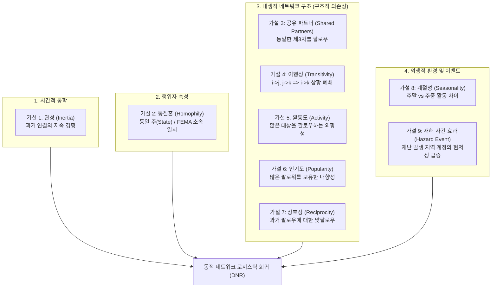

1. **관성 (Inertia)**: 조직의 주의 관계는 순간적으로 급변하지 않으며 이전 상태를 유지하려는 관성의 지배를 받는다(Almquist & Butts, 2013, 2014b).
2. **동질혼 (Homophily)**: 제도적으로 유사한 위치에 있는 조직끼리 서로 주의를 기울일 가능성이 높다(McPherson et al., 2001). 구체적으로 **동일 주(same state) 노드 일치** 및 **FEMA 하부 조직 일치** 효과에 주목한다.
3. **공유 파트너 (Shared Partners)**: 공통의 파트너를 팔로우하는 조직들은 서로를 팔로우하게 된다. 초점 쌍 $(i, j)$에 대해 특정 시간 시차(lag)에서 $(i, k)$와 $(j, k)$가 동시에 존재하는 제3의 조직 $k$의 수를 측정한다(Butts, 2008a).
4. **이행성 (Transitivity / 삼항 폐쇄)**: 주의 네트워크는 삼항 폐쇄(transitive closure)로 향한다(Wasserman & Faust, 1994). 특정 시점에 조직 $i$가 $j$를 팔로우하고 $j$가 $k$를 팔로우한다면($i \rightarrow j \rightarrow k$), 미래 시점에 $i$가 $k$를 팔로우하기 시작하거나 지속할 가능성이 높아진다.
5. **활동도 (Activity)**: 많은 다른 조직을 팔로우하는 활동적인 조직은 주의의 두드러진 표적이 된다.
6. **인기도 (Popularity)**: 많은 다른 조직들로부터 팔로우를 받는 인기 있는 조직은 주의의 두드러진 표적이 된다(Almquist & Butts, 2013).
7. **상호성 (Reciprocity)**: 팔로우는 상대방의 중요성에 대한 공개적 선언이며 자신의 팔로워는 특히 두드러진 주의 대상이 되므로, 조직의 팔로워 관계는 과거 상호성의 방향으로 편향된다(Almquist & Butts, 2013; Wasserman & Faust, 1994).
8. **계절성 (Seasonality)**: 주말과 주중 등 요일 및 업무 주기 패턴에 따라 활동성과 연결 형성률이 달라진다.
9. **재난 사건 효과 (Hazard Event Effects)**: 특정 지역의 재난 발생은 해당 지역 로컬 트위터 계정의 **현저성(Saliency)**을 대폭 증가시킨다(Sutton et al., 2008).

---

## DATA (데이터) `[원문 pp. 98–103]`

### [문단 1] HEROIC 프로젝트와 수집 기간
본 연구 데이터는 미국 정부의 재난관리 유관 조직(연방 및 주 단위) 간 트위터 팔로잉(구독) 관계로 구성된 대규모 동적 네트워크입니다.
* **수집 기관**: HEROIC(Hazards, Emergency Response, and Online Informal Communication) 프로젝트 연구진(Butts et al., 2011).[^1]
* **전체 수집 기간**: 2010년 6월 24일부터 2012년 2월 27일까지 매일 수집됨.
* **실제 분석 대상 기간**: 데이터 접근 제한으로 인한 결측이 없는 **2011년 4월 28일부터 8월 30일까지의 125일간의 완전한 일별 연속 데이터**를 활용함.

[^1]: HEROIC 프로젝트 웹사이트: `http://heroicproject.org/`.

### [문단 2] 213개 목표 계정의 식별 및 추출 방법
정부 비상 관련 공식 트위터 계정의 전수 목록을 구축하는 것은 쉽지 않습니다. 트위터는 중앙화된 조직 데이터베이스가 없기 때문입니다.
* 연구진은 알려진 모든 주 및 연방 비상관리 공식 웹페이지를 전수 검색하여 트위터 링크가 포함되어 있는지 수작업으로 검증하였습니다.
* 이를 통해 공공 안전(public-safety) 역량으로 재직하며 자신의 트위터 계정을 공식 홍보하고 있던 주 및 연방 수준 공직자/기관 계정 **213개**를 최종 식별·열거하였습니다(예: Figure 7.1).

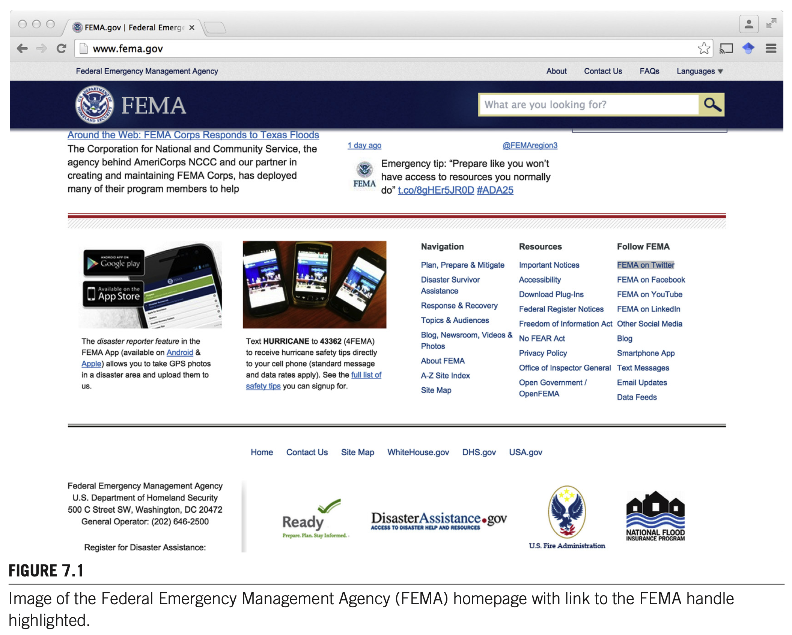  
*Figure 7.1 Image of the Federal Emergency Management Agency (FEMA) homepage with link to the FEMA handle highlighted. (연방재난관리청 FEMA 공식 홈페이지 메인 화면에서 FEMA 공식 트위터 핸들 링크가 하이라이트된 모습)*

### [문단 3] 트위터 REST API를 통한 관계 데이터 수집
식별된 트위터 핸들을 기반으로 트위터 REST API를 사용하여 플랫폼 상에서 조직들이 서로를 팔로우하고 있는지에 대한 데이터를 매일 수집하였습니다.
* 트위터의 팔로우는 메시지가 자동으로 수신함에 도달하는 구독 관계이므로, **직접 관측 가능하고 공개적으로 가시화된 주의 관계(directly measurable and publicly visible attentional relationship)**를 나타냅니다.

---

### THE DYNAMIC NETWORK (동적 네트워크) `[원문 pp. 98–102]`

#### [문단 1] 네트워크 규모 및 지역별 분포
본 조직 간 네트워크는 213개 노드로 구성되며, 각 노드는 하나의 트위터 계정을 나타냅니다.
* **지역적 포괄성**: 미국 50개 전역, 워싱턴 DC 및 푸에르토리코에 위치한 조직들을 망라합니다.
* **계층적 구성**: 다수의 계정이 주(state) 단위 기관이지만, 지역(regional) 및 연방(federal) 수준 조직도 포함됩니다.
* **연방 계정 구성**: 연방 조직 실체에 속한 계정은 22개(FEMA 13개 포함: 8개 FEMA 지역 지부, FEMA 청장 계정, 루이지애나 지부, 일반 FEMA 계정 등)입니다(Table 7.1 참조).
* **네트워크 밀도(Density)**: 관측 기간 전체 평균 밀도는 **0.0574**로 매우 희소(sparse)합니다. 즉, 213개 계정은 임의의 특정 시점에 평균적으로 약 **13개의 다른 계정만을 팔로우**하고 있었습니다.[^2]

[^2]: 비교를 위해, 트위터(2015년 12월 기준) 일반 사용자 1인당 평균 팔로워 수는 208명이었습니다.

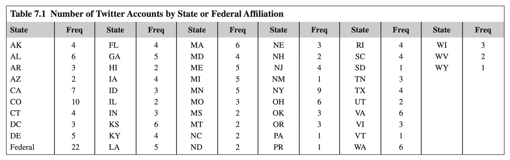

#### Table 7.1 Number of Twitter Accounts by State or Federal Affiliation (주 및 연방 소속별 트위터 계정 수)

| State | Freq | State | Freq | State | Freq | State | Freq | State | Freq | State | Freq |
| :--- | :---: | :--- | :---: | :--- | :---: | :--- | :---: | :--- | :---: | :--- | :---: |
| **AK (알래스카)** | 4 | **FL (플로리다)** | 4 | **MA (매사추세츠)** | 6 | **NE (네브래스카)** | 3 | **RI (로드아일랜드)** | 4 | **WI (위스콘신)** | 3 |
| **AL (앨라배마)** | 6 | **GA (조지아)** | 5 | **MD (메릴랜드)** | 4 | **NH (뉴햄프셔)** | 2 | **SC (사우스캐롤라이나)** | 4 | **WV (웨스트버지니아)** | 2 |
| **AR (아칸소)** | 3 | **HI (하와이)** | 2 | **ME (메인)** | 5 | **NJ (뉴저지)** | 4 | **SD (사우스다코타)** | 1 | **WY (와이오밍)** | 1 |
| **AZ (애리조나)** | 2 | **IA (아이오와)** | 4 | **MI (미시간)** | 5 | **NM (뉴멕시코)** | 1 | **TN (테네시)** | 3 | | |
| **CA (캘리포니아)** | 7 | **ID (아이다호)** | 3 | **MN (미네소타)** | 5 | **NY (뉴욕)** | 9 | **TX (텍사스)** | 4 | | |
| **CO (콜로라도)** | **10** | **IL (일리노이)** | 2 | **MO (미주리)** | 3 | **OH (오하이오)** | 6 | **UT (유타)** | 2 | | |
| **CT (코네티컷)** | 4 | **IN (인디애나)** | 3 | **MS (미시시피)** | 2 | **OK (오클라호마)** | 3 | **VA (버지니아)** | 6 | | |
| **DC (워싱턴DC)** | 3 | **KS (캔자스)** | 6 | **MT (몬태나)** | 2 | **OR (오레곤)** | 3 | **VI (버진아일랜드)** | 3 | | |
| **DE (델라웨어)** | 5 | **KY (켄터키)** | 4 | **NC (노스캐롤라이나)** | 2 | **PA (펜실베이니아)** | 1 | **VT (버몬트)** | 1 | | |
| **Federal (연방)** | **22** | **LA (루이지애나)** | 5 | **ND (노스다코타)** | 2 | **PR (푸에르토리코)** | 1 | **WA (워싱턴주)** | 6 | | |

#### [문단 2] 전체 네트워크 구조와 핵심-주변부(Core-Periphery) 블록모델 검증
팔로워 네트워크의 전역적 구조를 파악하기 위해 시간에 따른 평균 연결 지속 시간(즉, 연결이 존재하는 시점의 비율)으로 인접성을 결정한 전체 네트워크 그래프가 **Figure 7.2**에 제시되어 있습니다.
* **확인적 블록모델(Confirmatory Block Model) 검정**: 네트워크가 강한 핵심-주변부 구조를 가지는지 검증하기 위해 중앙값 강도에서 연결을 이분화(dichotomizing)한 후 4가지 정형적 방향 그래프 핵심-주변부 모델을 적합시켰습니다:
  1. 실질적으로 고립된 주변부를 가진 상호 핵심 (a mutual core with an effectively isolated periphery)
  2. 수신형 주변부를 가진 상호 핵심 (a mutual core with a receiving periphery)
  3. 송신형 주변부를 가진 상호 핵심 (a mutual core with a sending periphery)
  4. 유효 주변부가 없는 확장형 핵심 (an “expansive” core with no effective periphery)
* **검정 결과**: **핵심부와 주변부 사이에 상호작용이 거의 없는 모델(1번 모델: 고립된 주변부를 가진 상호 핵심)**이 가장 잘 부합하는 것으로 나타났습니다.

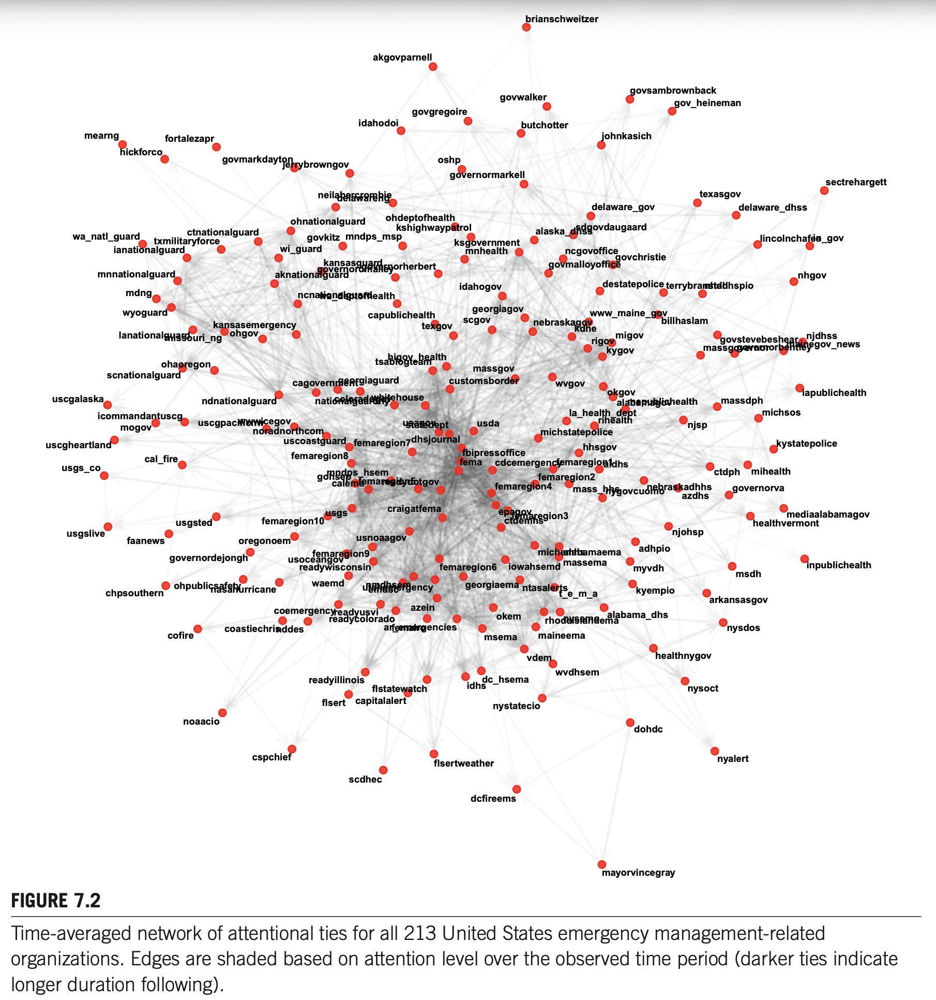  
*Figure 7.2 Time-averaged network of attentional ties for all 213 United States emergency management-related organizations. Edges are shaded based on attention level over the observed time period (darker ties indicate longer duration following). (213개 미국 재난관리 유관 조직의 시간 평균 주의 연결망. 링크의 음영은 관측 기간 동안의 주의 지속 수준을 반영하며, 진할수록 장기간 팔로우가 지속되었음을 의미함)*

📌 [참고: Figure 7.2 그래프에 포함된 213개 트위터 계정 핸들 전체 목록 보기]

`brianschweitzer`, `akgovparnell`, `govgregoire`, `idahodoi`, `govwalker`, `butchotter`, `govsambrownback`, `gov_heineman`, `mearng`, `fortalezapr`, `hickforco`, `johnkasich`, `wa_natl_guard`, `ctnationalguard`, `txmilitaryforce`, `ianationalguard`, `mnnationalguard`, `mdng`, `wyoguard`, `kansasemergency`, `lanationalguard`, `ohgov`, `missouri_ng`, `ohaoregon`, `scnationalguard`, `govmarkdayton`, `oshp`, `jerrybrowngov`, `neilabercrombie`, `delawareng`, `ohnationalguard`, `ohdeptofhealth`, `kshighwaypatrol`, `govkitz`, `mndps_msp`, `wi_guard`, `kansasguard`, `governoromalley`, `governorherbert`, `aknationalguard`, `ncnationalguard`, `wa_deptofhealth`, `capublichealth`, `governormarkell`, `sectrehargett`, `texasgov`, `ksgovernment`, `mnhealth`, `delaware_gov`, `alaska_dhss`, `sdgovdaugaard`, `ncgovoffice`, `govchristie`, `govmalloyoffice`, `destatepolice`, `terrybranstad`, `nhdhhspio`, `delaware_dhss`, `lincolnchafee`, `in_gov`, `nhgov`, `idahogov`, `georgiagov`, `scgov`, `uscgalaska`, `icommandantuscg`, `mogov`, `uscgheartland`, `cal_fire`, `usgs_co`, `usgsted`, `usgslive`, `faanews`, `texgov`, `higov_health`, `tsablogteam`, `cagovernment`, `georgiaguard`, `ndnationalguard`, `coloradogov`, `nationalguardny`, `whitehouse`, `uscgpacificnw`, `wwwicegov`, `usagov`, `statedept`, `noradnorthcom`, `uscoastguard`, `femaregion7`, `dhsjournal`, `femaregion8`, `mndps_hsem`, `gohsep`, `calema`, `femaregion5`, `readydotgov`, `craigatfema`, `usgs`, `femaregion10`, `oregonoem`, `usnoaagov`, `www_maine_gov`, `nebraskagov`, `billhaslam`, `kdhe`, `migov`, `rigov`, `kygov`, `govstevebeshear`, `njdhss`, `massgovernor`, `governorbentley`, `mainegov_news`, `massgov`, `customsborder`, `wvgov`, `okgov`, `alabamagov`, `mepublichealth`, `la_health_dept`, `rihealth`, `usda`, `njsp`, `michstatepolice`, `hhsgov`, `fbipressoffice`, `fema`, `cdcemergency`, `femaregion1`, `aldhs`, `femaregion2`, `femaregion4`, `mass_hhs`, `nebraskadhhs`, `nygovcuomo`, `azdhs`, `iapublichealth`, `massdph`, `michsos`, `ctdph`, `mihealth`, `governorva`, `kystatepolice`, `epagov`, `femaregion3`, `ctdemhs`, `mediaalabamagov`, `healthvermont`, `njohsp`, `chpsouthern`, `governordejongh`, `femaregion9`, `michemhs`, `alabamaema`, `adhpio`, `usoceangov`, `readywisconsin`, `femaregion6`, `iowahsemd`, `massema`, `myvdh`, `ohpublicsafety`, `waemd`, `nmdhsem`, `nasahurricane`, `emdsc`, `utahemergency`, `georgiaema`, `ntasalerts`, `t_e_m_a`, `kyempio`, `azein`, `coemergency`, `readyusvi`, `readycolorado`, `okem`, `alabama_dhs`, `nysemo`, `rhodeislandema`, `coastiechris`, `femalro`, `ar_emergencies`, `cofire`, `nddes`, `maineema`, `msema`, `vdem`, `healthnygov`, `wvdhsem`, `readyillinois`, `flstatewatch`, `flsert`, `capitalalert`, `dc_hsema`, `idhs`, `nystatecio`, `nysoct`, `inpublichealth`, `msdh`, `arkansasgov`, `nysdos`, `noaacio`, `dohdc`, `cspchief`, `flsertweather`, `nyalert`, `scdhec`, `dcfireems`, `mayorvincegray`

 

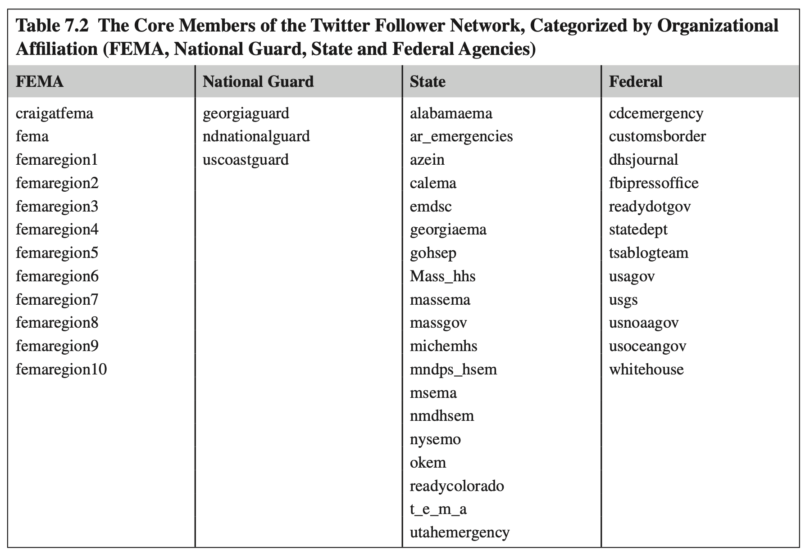

#### Table 7.2 The Core Members of the Twitter Follower Network, Categorized by Organizational Affiliation (팔로워 네트워크의 핵심부 소속 조직 분류)

| 조직 분류 (Affiliation) | 핵심 멤버 트위터 핸들 (Core Twitter Accounts) |
| :--- | :--- |
| **FEMA (연방재난관리청)** | `craigatfema` (FEMA 청장), `fema`, `femaregion1`, `femaregion2`, `femaregion3`, `femaregion4`, `femaregion5`, `femaregion6`, `femaregion7`, `femaregion8`, `femaregion9`, `femaregion10` |
| **National Guard (주 방위군)** | `georgiaguard` (조지아 방위군), `ndnationalguard` (노스다코타 방위군), `uscoastguard` (해안경비대) |
| **State (주 정부 기관)** | `alabamaema`, `ar_emergencies`, `azein`, `calema`, `emdsc`, `georgiaema`, `gohsep`, `mass_hhs`, `massema`, `massgov`, `michemhs`, `mndps_hsem`, `msema`, `nmdhsem`, `nysemo`, `okem`, `readycolorado`, `t_e_m_a`, `utahemergency` |
| **Federal (기타 연방 기관)** | `cdcemergency` (질병통제예방센터), `customsborder` (세관국경보호국), `dhsjournal` (국토안보부), `fbipressoffice` (FBI), `readydotgov` (Ready.gov), `statedept` (국무부), `tsablogteam` (교통안전청 TSA), `usagov` (USA.gov), `usgs` (지질조사국), `usnoaagov` (해양대기청 NOAA), `usoceangov`, `whitehouse` (백악관) |

* **해석**: 연방 기관(FEMA, CDC, DHS 등)이 핵심부의 중추를 차지하고 있지만, `readycolorado`와 같은 매우 활동적인 주 단위 계정도 핵심부에 다수 포진해 있습니다. 특히 `fema` 계정은 전 기간에 걸쳐 가장 높은 연결차수(highest degree)를 유지했습니다.

---

### DISASTER CASE STUDY: COLORADO DUCKETT FIRE (재난 사례 연구: 콜로라도 덕켓 산불) `[원문 pp. 102–103]`

#### [문단 1] 대형 산불의 위험성과 2011년 콜로라도 덕켓 산불 개요
산불(Wildfires)은 미국 내 많은 지역의 주요 관심사입니다. 대형 산불은 한 번에 10억 달러 이상의 피해를 입히고 10만 에이커 이상의 토지를 전소시킬 수 있습니다(Fischetti, 2011).
* **발생 배경**: 이러한 화재는 건조한 기후로 인해 여름철에 가장 빈번히 발생하며, 관리 및 복구를 위해 연방 정부의 지원을 필요로 하는 경우가 많습니다.
* **사건 전개**: 2011년 6월, 콜로라도 남부 샌 이사벨 국유림(San Isabel National Forest)에서 산불이 발생했습니다.
* **FEMA 재난 선포**: FEMA는 2011년 6월 15일부터 6월 24일까지 이 화재를 공식 "재난(disaster)"으로 선포하고 복구 노력에 연방 자금을 배정했습니다.[^3]
* **피해 및 대응 규모**: 진화 작업을 위해 약 650명이 투입되었고, 커스터(Custer) 카운티와 프레몬트(Fremont) 카운티에서 약 130가구가 대피했습니다(Figure 7.4). 총 피해액은 최소 400만 달러 이상으로 추산되었습니다(Associated Press, 2011).
* **연구 상의 의의**: 콜로라도 덕켓 산불은 매우 중요한 지역적 재난 사건(significant regional event)으로서, 재난 발생 시 네트워크의 다른 모든 계정과 비교하여 **콜로라도 기반 트위터 계정들과 관련된 효과를 대조·분석**할 수 있는 최적의 준실험적 환경을 제공합니다(Figure 7.3).

[^3]: FEMA 재난 선포 공식 기록: `https://www.fema.gov/disaster/2923`.

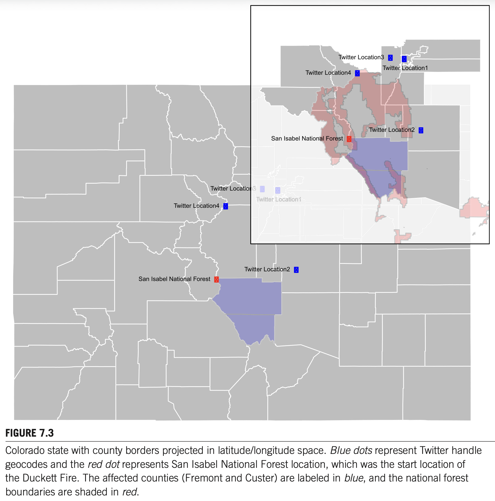  
*Figure 7.3 Colorado state with county borders projected in latitude/longitude space. Blue dots represent Twitter handle geocodes and the red dot represents San Isabel National Forest location, which was the start location of the Duckett Fire. The affected counties (Fremont and Custer) are labeled in blue, and the national forest boundaries are shaded in red. (위도/경도 공간에 투영된 콜로라도 주 및 카운티 경계 지도. 파란색 점은 트위터 계정의 지리적 위치, 빨간 점은 덕켓 산불의 시작점인 샌 이사벨 국유림을 나타냄. 피해 카운티는 파란색으로 라벨링되었고 국유림 경계는 빨간색 음영으로 표시됨)*

 

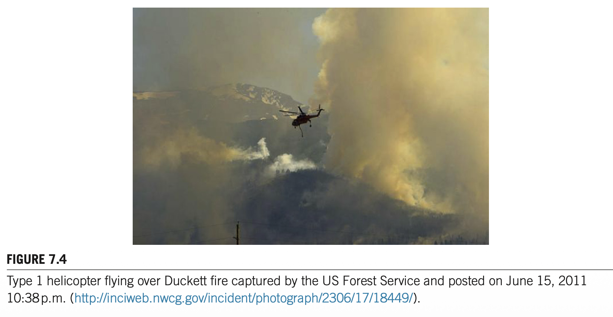  
*Figure 7.4 Type 1 helicopter flying over Duckett fire captured by the US Forest Service and posted on June 15, 2011 10:38 p.m. (미 산림청이 촬영한 덕켓 산불 상공을 비행하는 Type 1 대형 진화 헬리콥터 사진)*

---

## METHODS (연구 방법) `[원문 pp. 103–107]`

트위터 상에서 미국 재난관리 조직 간의 주의 관계가 진화하는 양상을 분석하기 위해 **동적 네트워크 회귀(Dynamic Network Regression; DNR)**를 적용합니다(Almquist & Butts, 2013, 2014b). DNR은 시간적 지수족 랜덤 그래프 모델(TERGM) 패밀리의 확장 가능하고 단순한 특수 형태로서, 동적 네트워크 모델링을 위한 매우 강력하고 강건한 출발점입니다.

---

### NOTATION (수학적 표기법) `[원문 pp. 103–105]`

사회연결망은 수학적으로 **그래프(Graph)**로 표현되며, 이는 두 개의 집합, 즉 꼭짓점 집합 $V$(노드; 조직들)와 변 집합 $E$(링크; 협력, 팔로우 등)로 정의됩니다:
$$G = (V, E)$$
* **방향 그래프 (Digraph)**: 링크의 송신과 수신이 뚜렷이 구별되는 경우, 변(edges)은 순서쌍(ordered vertex pairs) $(i, j)$에 대응됩니다.
* **트위터 팔로워 네트워크의 단순 방향 그래프 속성**:
  1. 변은 방향성을 갖습니다(directed).
  2. 어떤 노드도 자기 자신에게 변을 보낼 수 없습니다(no self-loops).
  3. 어떤 노드도 특정 시점에 동일한 타겟에게 둘 이상의 변을 보낼 수 없습니다(no multiple edges).
  * 이는 트위터 API의 작동 구조와 완벽히 일치합니다: 팔로우하는 것(following)과 팔로우받는 것(being followed)은 엄격히 구분되며, 자기 자신을 팔로우할 수 없고, 특정 순간에 부분적으로만 팔로우하거나 동시에 여러 번 팔로우할 수 없습니다.

#### 인접 행렬(Adjacency Matrix) 표현
통계적 분석에서는 행렬 기반 표현법을 사용합니다(Wasserman & Faust, 1994).
* **인접 행렬 $Y$**: $N \times N$ 크기의 행렬($N$은 네트워크 내 조직 수)이며, 각 원소 $Y_{ij}$는 $i$가 $j$로 연결을 보내면 $1$, 보내지 않으면 $0$입니다.
* **시간 인덱스 $t$의 추가**: 일별 시점을 나타내는 인덱스 $t$를 부여하여 $Y^t$로 확장합니다:
  $$Y_{ij}^t = \begin{cases} 1, & \text{if } i \text{ follows } j \text{ at time } t \\ 0, & \text{otherwise} \end{cases}$$
* 예시: 두 조직 간의 협력/팔로우 연결이 1일차에 존재하다가 2일차에 해체된 경우, $Y_{12}^1 = 1$, $Y_{12}^2 = 0$으로 부호화됩니다.

---

### DYNAMIC NETWORK REGRESSION (동적 네트워크 회귀분석; DNR) `[원문 p. 105]`

일련의 횡단면적 시계열 네트워크들 $(\dots, Y_{t-1}, Y_t, Y_{t+1}, \dots)$이 주어졌을 때($Y_t \in \{0, 1\}^{N_t \times N_t}$), DNR은 과거 상태 $Y_{t-k}^{t-1} = (Y_{t-1}, \dots, Y_{t-k})$에 조건화된 현재 네트워크 $Y_t$를 모델링합니다(Almquist & Butts, 2014b).

#### DNR의 통계적 정당성과 장점
일반적인 시간적 ERGM(TERGM)은 매우 유연하지만 축퇴(degeneracy)나 비현실적 거동을 유발하기 쉽습니다(Schweinberger, 2011). 그러나 특정 규칙성 조건 하에서 시간 구조를 통해 모형을 안정화할 수 있습니다(Cranmer & Desmarais, 2011; Hanneke et al., 2010).
* DNR은 각 시점의 연결 상태(edge states)를 종속변수로 하는 **로지스틱 회귀분석(logistic regression)으로 재작성**될 수 있기 때문에 이름이 붙여졌습니다.
* 따라서 로지스틱 회귀가 지닌 통계적 추론 및 계산상의 우수한 성질을 그대로 계승하며, 모델의 회귀계수를 **조건부 오즈비(conditional odds ratio)**로 직관적으로 해석할 수 있습니다.

#### DNR 우도함수 (Likelihood Function)
단일 시점 슬라이스에 대한 DNR 조건부 우도는 다음과 같습니다:

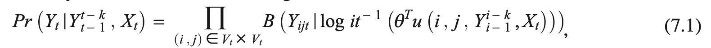

$$\Pr\left(Y^t \mid Y_{t-k}^{t-1}, X^t\right) = \prod_{i \neq j \in V^t \times V^t} \mathcal{B}\left(Y_{ij}^t; \, \operatorname{logit}^{-1}\left(\theta^T u(i, j, Y_{t-k}^{t-1}, X^t)\right)\right) \tag{7.1}$$

* 여기서 $\mathcal{B}$는 베르누이 확률질량함수(Bernoulli pmf)입니다.
* $X^t$는 공변량(covariate set)입니다.
* $u(i, j, Y_{t-k}^{t-1}, X^t)$는 링크 쌍 $(i, j)$에 대한 충분통계량 벡터(sufficient statistics)입니다.
* $\theta$는 링크 매개변수 벡터(parameter vector)입니다.
* 시계열 전체의 결합 우도(joint likelihood)는 시간적 인과 구조로 인해 이전 상태들에 조건화된 각 시점별 우도들의 단순 곱(product)이 됩니다.
* 본 연구는 Almquist & Butts(2014a)의 권고에 따라 **코시 사전분포(Cauchy parameter priors)**를 가정한 베이지안 추정법을 적용하였습니다.[^4]

[^4]: 모든 계산은 R 환경에서 Almquist & Butts(2013, 2014b), Yang & Almquist(2015)의 커스텀 코드와 `sna`, `ergm`, `arm` 패키지를 바탕으로 수행되었습니다.

---

### MECHANISMS OF ATTENTIONAL DYNAMICS (주의 동학 메커니즘의 매개변수화) `[원문 pp. 105–107]`

연구진은 제3절의 메커니즘들을 DNR 모형의 시차 그래프 통계량(lagged graph statistics)으로 변환하고, 가장 단순한 모형부터 복잡한 모형까지 순차적으로 구축하며 **베이지안 정보 기준(BIC, Bayesian Information Criterion; Kass & Wasserman, 1995)**을 기반으로 모형 선택 및 가설 검정을 수행하였습니다.

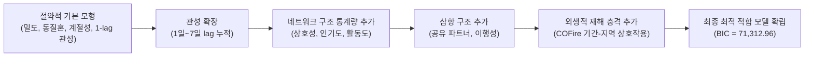

#### 1. 기저 주의율 (Base Rate of Attending)
* 계정들이 다른 계정을 팔로우하려는 가장 기본적인 성향을 포착하는 절편(intercept) 또는 엣지 효과(edge effect, $\delta$)로 매개변수화합니다(Wasserman & Faust, 1994).

#### 2. 관성 (Inertia)
* 일주일 동안의 연결 해체 위험률의 차이를 반영하기 위해 **1일부터 7일까지의 일별 시차 항($Y_{t-1} \sim Y_{t-7}$)**을 모형에 포함합니다.

#### 3. 동질혼 (Homophily)
* 두 가지 동질혼 효과를 매개변수화합니다:
  1. **동일 주 일치 (Node match on same state)**
  2. **FEMA 하부 조직 일치 (Node match for being a FEMA subunit)**

#### 4. 공유 파트너 (Shared Partners, SP)
* 특정 초점 쌍 $(i, j)$에 대해, 지정된 시차(lag)에서 $i$와 $j$가 동시에 팔로우하고 있는 제3의 조직 $k$의 수($SP$)를 계산합니다:
  $$(i, k) \in E^{t-l} \quad \text{and} \quad (j, k) \in E^{t-l}$$
* 이 매개변수가 양수이면 공통의 제3자들을 팔로우하는 조직들끼리 서로 팔로우 관계를 맺거나 유지할 확률이 높아집니다.

#### 5. 이행성 (Transitivity, Trans)
* 초점 쌍 $(i, j)$에 대해 지정된 시차에서 $(i, k)$ 및 $(k, j)$로 이어지는 2-경로(two-paths)의 수를 변수로 사용하여 삼항 폐쇄 경향을 측정합니다.

#### 6. 인기도와 활동도 (Popularity and Activity)
* **인기도 (Popularity, InDeg)**: 노드 $j$의 시차 내향연결정도(lagged indegree; $j$를 팔로우하는 계정 수)를 $(i, j)$ 연결 형성의 예측 변수로 사용.
* **활동도 (Activity, OutDeg)**: 노드 $j$의 시차 외향연결정도(lagged outdegree; $j$가 팔로우하고 있는 계정 수)를 $(i, j)$ 연결 형성의 예측 변수로 사용.

#### 7. 상호성 (Reciprocity, Mut)
* 시차 호혜성(lagged mutuality) 통계량, 즉 특정 시차에서 조직 $i$와 $j$가 서로를 동시에 팔로우하고 있던 횟수를 측정합니다. 과거에 상호 관계가 있었던 계정일수록 미래에 연결을 맺을 가능성이 높아지는지 검증합니다.

#### 8. 계절성 (Seasonality, Weekend)
* 주말(weekend) 대 평일(weekday)을 구분하는 단순 지시자(dummy indicator)를 사용하여 주중 업무시간 외에 주의 활동 패턴이 달라지는지 통제합니다.

#### 9. 재해 사건 효과 (Hazard Event Effects, COFire)
* 콜로라도 소재 트위터 계정들과 FEMA가 공식 정의한 덕켓 산불 재난 기간의 상호작용 지시자($I\{\text{COFire}\}$)를 설정하여, 재난 발생 시 로컬 계정들의 주의 집중 현저성이 급증하는지 검증합니다.

---

## RESULTS (분석 결과) `[원문 pp. 107–109]`

연구진은 가장 단순한 절약적 모형(밀도, 동질혼 2개, 계절성, 1-lag 관성)에서 출발하여 7일까지의 관성 효과를 누적시킨 후, 상호성, 인기도, 활동도, 공유 파트너, 이행성, 그리고 마지막으로 COFire 재난 사건 효과를 순차적으로 추가하였습니다.
* **모형 선택 결과**: BIC 기준에 따라 가설화된 모든 메커니즘을 포함한 전체 모델(complete model)이 가장 우수한 적합도를 보였습니다.
* **통계적 유의성 기준**: 코시 사전분포 하에서 사후 모드(posterior mode) 추정치를 계산하였으며, 모수의 95% 중앙 사후 신뢰구간(central posterior interval)이 0을 포함하지 않는 경우 통계적으로 유의미한(significant, \*) 것으로 판정하였습니다.

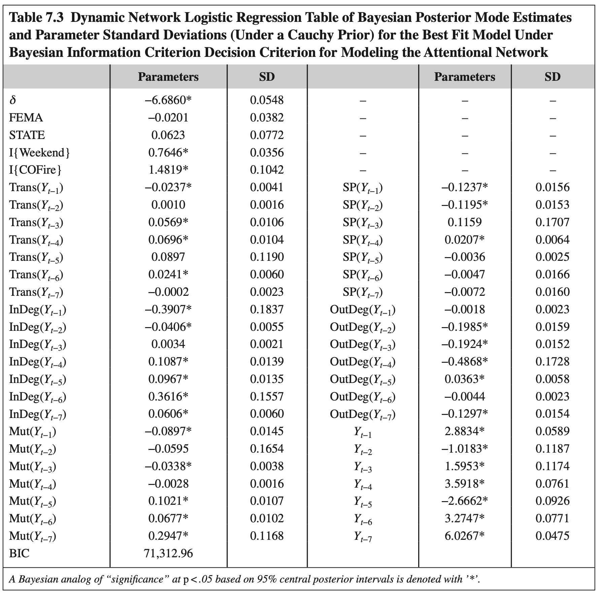

#### Table 7.3 Dynamic Network Logistic Regression Table of Bayesian Posterior Mode Estimates and Parameter Standard Deviations (Under a Cauchy Prior) for the Best Fit Model Under BIC Decision Criterion

| 매개변수 (Parameters) | 추정치 (Estimate) | 표준편차 (SD) | 매개변수 (Parameters) | 추정치 (Estimate) | 표준편차 (SD) |
| :--- | :---: | :---: | :--- | :---: | :---: |
| **절편 ($\delta$, Baseline)** | **-6.6860\*** | 0.0548 | **$SP(Y_{t-1})$ (공유파트너 1일)** | **-0.1237\*** | 0.0156 |
| **FEMA 동질혼** | -0.0201 | 0.0382 | **$SP(Y_{t-2})$ (공유파트너 2일)** | **-0.1195\*** | 0.0153 |
| **STATE 동질혼** | 0.0623 | 0.0772 | **$SP(Y_{t-3})$ (공유파트너 3일)** | 0.1159 | 0.1707 |
| **$I\{\text{Weekend}\}$ (주말 효과)** | **0.7646\*** | 0.0356 | **$SP(Y_{t-4})$ (공유파트너 4일)** | **0.0207\*** | 0.0064 |
| **$I\{\text{COFire}\}$ (산불 재난 효과)**| **1.4819\*** | 0.1042 | **$SP(Y_{t-5})$ (공유파트너 5일)** | -0.0036 | 0.0025 |
| **$\text{Trans}(Y_{t-1})$ (이행성 1일)** | **-0.0237\*** | 0.0041 | **$SP(Y_{t-6})$ (공유파트너 6일)** | -0.0047 | 0.0166 |
| **$\text{Trans}(Y_{t-2})$ (이행성 2일)** | 0.0010 | 0.0016 | **$SP(Y_{t-7})$ (공유파트너 7일)** | -0.0072 | 0.0160 |
| **$\text{Trans}(Y_{t-3})$ (이행성 3일)** | **0.0569\*** | 0.0106 | **$\text{OutDeg}(Y_{t-1})$ (활동도 1일)**| -0.0018 | 0.0023 |
| **$\text{Trans}(Y_{t-4})$ (이행성 4일)** | **0.0696\*** | 0.0104 | **$\text{OutDeg}(Y_{t-2})$ (활동도 2일)**| **-0.1985\*** | 0.0159 |
| **$\text{Trans}(Y_{t-5})$ (이행성 5일)** | 0.0897 | 0.1190 | **$\text{OutDeg}(Y_{t-3})$ (활동도 3일)**| **-0.1924\*** | 0.0152 |
| **$\text{Trans}(Y_{t-6})$ (이행성 6일)** | **0.0241\*** | 0.0060 | **$\text{OutDeg}(Y_{t-4})$ (활동도 4일)**| **-0.4868\*** | 0.1728 |
| **$\text{Trans}(Y_{t-7})$ (이행성 7일)** | -0.0002 | 0.0023 | **$\text{OutDeg}(Y_{t-5})$ (활동도 5일)**| **0.0363\*** | 0.0058 |
| **$\text{InDeg}(Y_{t-1})$ (인기도 1일)** | **-0.3907\*** | 0.1837 | **$\text{OutDeg}(Y_{t-6})$ (활동도 6일)**| -0.0044 | 0.0023 |
| **$\text{InDeg}(Y_{t-2})$ (인기도 2일)** | **-0.0406\*** | 0.0055 | **$\text{OutDeg}(Y_{t-7})$ (활동도 7일)**| **-0.1297\*** | 0.0154 |
| **$\text{InDeg}(Y_{t-3})$ (인기도 3일)** | 0.0034 | 0.0021 | **$Y_{t-1}$ (관성 1일)** | **2.8834\*** | 0.0589 |
| **$\text{InDeg}(Y_{t-4})$ (인기도 4일)** | **0.1087\*** | 0.0139 | **$Y_{t-2}$ (관성 2일)** | **-1.0183\*** | 0.1187 |
| **$\text{InDeg}(Y_{t-5})$ (인기도 5일)** | **0.0967\*** | 0.0135 | **$Y_{t-3}$ (관성 3일)** | **1.5953\*** | 0.1174 |
| **$\text{InDeg}(Y_{t-6})$ (인기도 6일)** | **0.3616\*** | 0.1557 | **$Y_{t-4}$ (관성 4일)** | **3.5918\*** | 0.0761 |
| **$\text{InDeg}(Y_{t-7})$ (인기도 7일)** | **0.0606\*** | 0.0060 | **$Y_{t-5}$ (관성 5일)** | **-2.6662\*** | 0.0926 |
| **$\text{Mut}(Y_{t-1})$ (상호성 1일)** | **-0.0897\*** | 0.0145 | **$Y_{t-6}$ (관성 6일)** | **3.2747\*** | 0.0771 |
| **$\text{Mut}(Y_{t-2})$ (상호성 2일)** | -0.0595 | 0.1654 | **$Y_{t-7}$ (관성 7일)** | **6.0267\*** | 0.0475 |
| **$\text{Mut}(Y_{t-3})$ (상호성 3일)** | **-0.0338\*** | 0.0038 | | | |
| **$\text{Mut}(Y_{t-4})$ (상호성 4일)** | -0.0028 | 0.0016 | | | |
| **$\text{Mut}(Y_{t-5})$ (상호성 5일)** | **0.1021\*** | 0.0107 | | | |
| **$\text{Mut}(Y_{t-6})$ (상호성 6일)** | **0.0677\*** | 0.0102 | | | |
| **$\text{Mut}(Y_{t-7})$ (상호성 7일)** | **0.2947\*** | 0.1168 | | | |
| **BIC 최종값** | **71,312.96** | | | | |

*\* 95% 중앙 사후 신뢰구간 기준 $p < .05$ 수준에서 유의함을 의미함.*

---

### INTERPRETATION (결과 해석) `[원문 pp. 107–109]`

#### 1. 극도로 낮은 기저 확률과 압도적인 관성(Inertia) 효과
* **기저 상호작용 확률**: 절편($\delta = -6.6860$)이 매우 크고 음수로 유의합니다. 과거 7일간 아무런 상호작용이 없었던 쌍이 새롭게 연결될 기저 확률은 거의 0에 가깝습니다.
* **관성의 위력**: 반면 시차 관성 항($Y_{t-1} = +2.8834$, $Y_{t-7} = +6.0267$)은 매우 거대하고 양수로 유의합니다.
  * 직전 1일차($t-1$)에만 관계가 존재했더라도 연결 오즈비(odds)는 약 **$e^{2.8834} \approx 17.88$배(약 20배)** 폭증합니다.
  * 7일 내내 관계가 지속되어 온 경우 오즈는 기저 상태 대비 천문학적으로 높아져, 한번 형성된 주의 관계가 극도로 강력하게 지속됨을 보여줍니다.

#### 2. 동질혼의 부재 (Lack of Homophily)
* 동일 주(STATE = 0.0623, p > .05) 및 FEMA 소속(FEMA = -0.0201, p > .05) 동질혼 효과는 **모두 통계적으로 유의하지 않았습니다.**
* 이는 재난관리 조직들이 단순히 '같은 주에 속해 있다'거나 '같은 연방 조직이다'라는 제도적 외형만으로 서로를 팔로우하지 않음을 의미합니다.

#### 3. 장기 지속 구조 vs 일시적 구조의 비대칭성 (Enduring vs Transient Asymmetry)
연구 결과에서 가장 주목할 만한 발견은 **모든 구조적 내생 변수(이행성, 상호성, 인기도, 공유파트너)에서 단기 시차(1~3일)와 장기 시차(4~7일)의 효과가 극적인 정반대 부호**를 보인다는 점입니다:

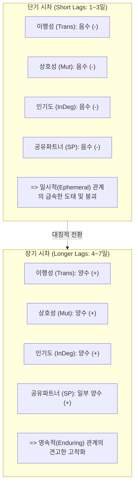

* **이행성 (Transitivity)**: 직전 1일 시차($t-1$)의 2-경로는 $-0.0237$로 음수이지만, 3~6일 시차($t-3 \sim t-6$)에서는 유의한 양수($+0.0569, +0.0696, +0.0241$)입니다. 즉, 일시적인 삼항 연결은 오히려 관계 형성을 저해하지만, 며칠간 지속된 구조적 2-경로는 삼항 폐쇄를 강력히 촉진합니다.
* **공유 파트너 (Shared Partners)**: 1~2일 시차($t-1, t-2$)에서 강한 음수($-0.1237, -0.1195$)입니다. 즉, 다른 조건이 동일하다면 동일한 제3자를 일시적으로 팔로우하고 있는 조직끼리는 서로 팔로우하는 것을 회피하는 경향이 있습니다.
* **상호성 (Mutuality)**: 1일 및 3일 시차에서는 음수($-0.0897, -0.0338$)이지만, 5~7일 장기 시차에서는 매우 강한 양수($+0.1021, +0.0677, +0.2947$)로 돌아섭니다. 즉, 순간적인 맞팔로우는 쉽게 해체되지만, 일주일가량 지속된 상호 관계는 관계 유지를 극적으로 강화합니다.
* **인기도 (InDeg)**: 1~2일 시차에서는 음수($-0.3907, -0.0406$)이지만, 4~7일 시차에서는 양수($+0.1087 \sim +0.3616$)이며 장기 양수 효과의 총합이 단기 음수 효과를 압도합니다. 즉, 일시적으로 반짝 인기를 얻은 계정은 곧 팔로워를 잃지만, 일주일 이상 꾸준히 팔로워를 유지해 온 계정은 추가적인 팔로워를 계속 끌어당깁니다.
* **활동도의 역설 (OutDeg Penalty)**: 외향연결정도(OutDeg)는 거의 모든 시차에서 **일관되게 매우 강한 음수**($-0.1985, -0.1924, -0.4868, -0.1297$)를 나타냈습니다. 즉, 자신이 너무 많은 다른 계정을 팔로우하는 적극성을 보일수록 타 기관으로부터 팔로우를 받을 확률은 오히려 급감합니다. (이 부정적 효과는 상호성의 긍정적 효과보다 훨씬 강하여, 무작정 팔로잉을 늘리는 것은 관계망 차원에서 완전히 손해입니다).

#### 4. 주말(Weekend) 활동의 역설
* 주말 효과($I\{\text{Weekend}\} = +0.7646$)는 크고 통계적으로 매우 유의했습니다.
* 정부 공공기관 계정들이 표준 평일 근무시간에 집중될 것이라는 초기 가설과 정반대로, **주말에 현저히 많은 주의 집중 및 계정 갱신 활동이 발생**했습니다. 이는 공공기관들이 SNS 계정 관리 및 모니터링을 평일 정규 업무시간 외(비표준 시간대)로 이관하여 처리하고 있음을 시사합니다.

#### 5. 재난 발생의 충격: 콜로라도 산불($I\{\text{COFire}\}$)의 극적인 효과
* $I\{\text{COFire}\}$ 계수는 **$+1.4819$로 대단히 거대하고 통계적으로 매우 유의**했습니다.
* 이는 재난이 선포되었을 때 해당 지역 계정들이 네트워크 전체에서 엄청난 주목을 받게 됨을 보여줍니다.
* **Figure 7.5의 극적인 시각적 증거**:
  * FEMA의 비상관리 지원 선포 당일인 **2011년 6월 16일**, 콜로라도 하위 그래프는 **완전한 고립 노드(Isolates)**들로만 구성되어 있었습니다(상호 연결 0개).
  * 그러나 바로 다음 날인 **6월 17일**, 콜로라도 계정들은 **거의 완전 그래프(Completely Connected Graph)**에 가깝게 하룻밤 사이에 조밀한 상호 연결망을 형성하였습니다!
* **Figure 7.6의 시계열 추이**: 덕켓 산불 재난 기간(붉은색 음영) 동안 콜로라도 계정 그룹 내부의 평균 연결차수와 전체 네트워크로부터 유입·유출되는 차수가 평시 대비 폭발적으로 치솟는 것을 명확히 확인할 수 있습니다.

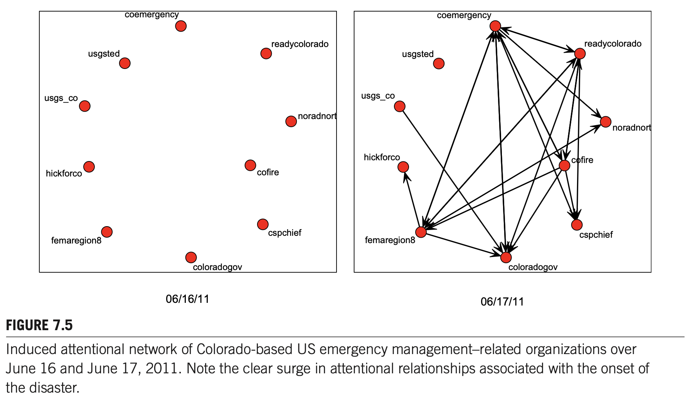  
*Figure 7.5 Induced attentional network of Colorado-based US emergency management–related organizations over June 16 and June 17, 2011. Note the clear surge in attentional relationships associated with the onset of the disaster. (2011년 6월 16일과 17일 사이 콜로라도 소재 재난관리 조직들의 유도 주의 네트워크. 재난 선포 직후 하룻밤 사이에 완전 고립 상태에서 완벽한 상호 연결망으로 주의 관계가 폭발적으로 급증함)*

 

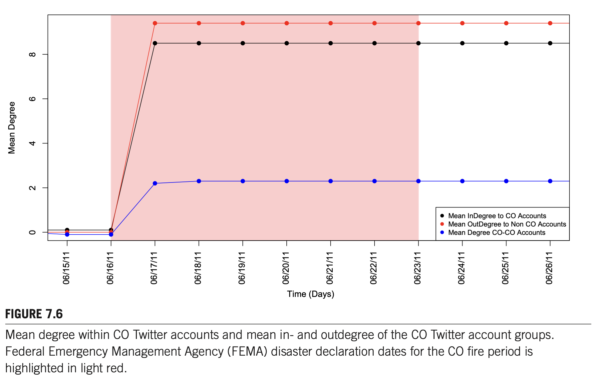  
*Figure 7.6 Mean degree within CO Twitter accounts and mean in- and outdegree of the CO Twitter account groups. Federal Emergency Management Agency (FEMA) disaster declaration dates for the CO fire period is highlighted in light red. (콜로라도 계정 내부의 평균 차수 및 콜로라도 계정 그룹의 평균 입출력 차수 추이. 붉은색 음영으로 표시된 FEMA 재난 선포 기간 동안 차수가 극적으로 치솟음)*

---

## DISCUSSION (논의) `[원문 pp. 109–111]`

### [문단 1] 비상 상황 시 주의 동학의 이동: 로컬 조직으로의 스포트라이트 집중
트위터 환경에서 미국 비상관리 유관 조직들 간의 주의 관계 이동은 개인과 조직이 정보 흐름과 상황인식을 향상하기 위해 사용하는 일련의 기본적인 사회적 메커니즘과 활동들을 명확히 보여줍니다.
* **스포트라이트의 전환**: 비상 상황이 발생하면 전체 시스템의 주의 동학이 급변하여 **직접적인 재난 피해 지역의 로컬 조직들이 내부적으로나 외부적으로 중심적이고 핵심적인 주체**로 부상합니다.
* 이러한 주의 이동은 평시의 역동(즉, 활동적인 조직이나 파트너를 공유하는 조직으로부터 연결을 철회하려는 경향)을 압도하며 전개됩니다. 즉, 위기 시에는 거대한 국가 단위 기관보다 **현장의 로컬 조직들이 집중적인 조명(spotlight)**을 받게 됩니다.

### [문단 2] 기존 사회 동학과 다른 독특한 속성: 영속성과 일시성의 비대칭
본 연구에서 관찰된 행동은 기존 집단 및 구조적 위치 특성을 그대로 보존하려는 다른 사회적 맥락의 네트워크 동학과 사뭇 다릅니다.
* **관성과 상호성의 조건부 작동**: 개별 주의 관계 내에서 전반적인 관성 경향이 존재하고, 오랜 기간 유지된 관계에서는 상호성이 강력히 작동합니다.
* **장기 구조와 일시적 구조의 비대칭성**: 영속적 구조(long-lasting structures)에서의 양자간 착근성은 새로운 연결 형성을 촉진하지만, 일시적 구조(ephemeral structures)는 오히려 연결을 억제합니다.
* **주의 집중의 생존 전술**: 재난관리 조직들은 지속적인 주의 관계는 관성적으로 유지하되, 단기적 관계는 매우 적극적으로 순환(actively cycled)시킵니다. 이는 조직들이 제한된 시간과 집중력의 제약 하에서 **상황인식(situational awareness)을 극대화하기 위해 취하는 전략적 전술**로 풀이됩니다.

### [문단 3] 팔로워와 팔로잉이 보내는 상반된 신호 (Signaling Effects)
* **많은 팔로워를 보유하는 것 (High In-degree)**: 장기간에 걸쳐 많은 팔로워를 보유하는 것은 해당 계정이 **"주의를 기울일 가치가 있는 권위 있는 정보원"**이라는 강력한 신호(strong signal)로 작용하여 주의 대상이 될 확률을 높입니다.
* **너무 많은 대상을 팔로우하는 것 (High Out-degree)**: 반대로 지나치게 많은 다른 계정을 팔로우하는 것은 오히려 해당 조직을 중요하지 않게 보이게 만들며, 심지어 **정보의 핵심에서 벗어나 있는 "루프 밖(out of the loop)"의 존재라는 부정적 신호**를 전달하여 타 조직들의 주의를 감소시킵니다.
* **재난의 구조 재편성 효과**: 그러나 이러한 일상적 신호와 관계 구조도 대규모 재난이라는 거대한 외부 충격 앞에서는 급격히 재편성(rapid reorganization)됩니다.

### [문단 4] 비공식 소셜 미디어 모델링의 중요성과 '사전 상태 고착화(Lock-in)'의 위험
온라인 비공식 커뮤니케이션 모델에 주의 동학을 통합하는 것은 소셜 경로를 통해 발생하는 사회적 과정을 이해하는 데 매우 중요합니다. 집단적 의미구성(collective sense-making)과 조직 학습(organizational learning)은 모두 이러한 온라인 플랫폼에서 발생하며 주의 동학의 직접적 영향을 받습니다.
* **관성의 양면성과 재난 적응의 위기**: 본 분석은 시스템 내의 강력한 관성을 밝혔습니다. 관성은 안정성을 주지만 극단적인 충격(재난)이 있어야만 극복될 수 있습니다.
* **고착화의 치명적 결과**: 만약 조직 간 주의 관계가 재난 이전의 사전 상태(preevent states)에 **'고착(stuck)'**되어 버린다면, 고도로 역동적인 재난 대응 환경에 적응하지 못할 수 있습니다.
* 그 결과, 비상 대응자들은 사건 관련 필수 정보를 송수신하고, 상황인식을 높이며, 일반 대중에게 중요한 정보를 명확히 알릴 수 있는 결정적인 기회를 상실하게 됩니다.
* 극단적인 경우, 계정이 처음 개설되었을 때 맺어진 관계가 고정되어 변화하는 환경에 전혀 적응하지 못할 수 있으며, 이는 재난 대응과 관리 전반에 치명적인 악영향을 미칠 수 있습니다.

> [!NOTE]
> ### 🔍 [보조교재 심화 해설: 재난관리 조직을 위한 실무적·정책적 교훈]
> 1. **무분별한 팔로잉의 함정**: 많은 기관들이 정보를 모으겠다는 목적으로 무작정 수백 개의 계정을 팔로잉하지만, 이는 타 기관들로부터 '전문성이 떨어지고 독자적 정보력이 없는 기관'으로 인식되어 오히려 네트워크 중심성을 잃게 만듭니다.
> 2. **비상 시 로컬 팔로우 프로토콜의 제도화**: 평시에는 관성으로 인해 로컬 계정을 팔로우하지 않다가 산불이 터지고 나서야 하룻밤 사이에 급조하는 형태(Fig 7.5)는 재난 초기 대응의 골든타임을 소모시킬 수 있습니다. 관할 구역 내 핵심 방재 기관 및 소방·경찰 간의 상호 팔로우 및 피드 연계를 평시 표준운영절차(SOP)에 사전 등록해 두어야 합니다.

---

## SUMMARY (요약) `[원문 pp. 111–112]`

본 연구는 트위터 맥락에서 미국 재난관리 유관 조직들의 진화하는 주의 네트워크를 최초로 조망하였습니다.
* **방법론적 성과**: 통계적 네트워크 모델(DNR)을 활용하여 사회적 상호작용을 주도하는 다수의 고유한 메커니즘들 간의 상호작용을 정밀하게 검정할 수 있었습니다.
* **핵심 실증 발견 요약**:
  1. **역사적 의존성의 복잡한 패턴**: 7일 시차 기간 동안 효과가 극적으로 변하는 복잡한 과거 의존성을 확인했습니다.
  2. **활동적 노드로부터의 이탈 및 삼항 폐쇄**: 지나치게 활동적인 노드로부터는 연결을 철회하는 특이한 경향, 그리고 조직 간 중간 수준의 삼항 폐쇄 경향 및 위계 효과를 발견했습니다.
  3. **지속적 연결 vs 일시적 연결의 비대칭**: 5~7일간 지속된 연결은 관성과 폐쇄를 강화하는 반면, 일시적 연결은 오히려 관계 형성을 억제합니다.
  4. **재난 현장 조직의 폭발적 부상**: 2011년 콜로라도 덕켓 산불 사례를 통해, 재난의 직접적 영향을 받는 조직들의 트위터 활동성과 참여도가 비약적으로 폭증함을 실증했습니다.
* **결론 및 제언**: 외부 사건의 영향을 엄밀히 통제하면서 이러한 복합적인 메커니즘을 규명할 수 있다는 점은 전개되는 사건 중 네트워크 동학을 이해하는 도구로서 DNR의 막강한 잠재력을 입증합니다. 향후 주의 네트워크뿐만 아니라 다양한 조직 간 상호작용 연구로 확장될 수 있는 상당한 가능성이 존재합니다.

---

## ACKNOWLEDGMENTS (사사) `[원문 p. 112]`

본 연구는 미 육군연구소(Army Research Office) 연구비(#W911NF-14-1-0577 [YIP], #W911NF-15-1-0270 [YIP], #W911NF-14-1-0552) 및 미국 국립과학재단(NSF) 연구비(CMMI-1031853, CMMI-1031779, CMMI-1536319)의 지원을 일부 받아 수행되었습니다.
