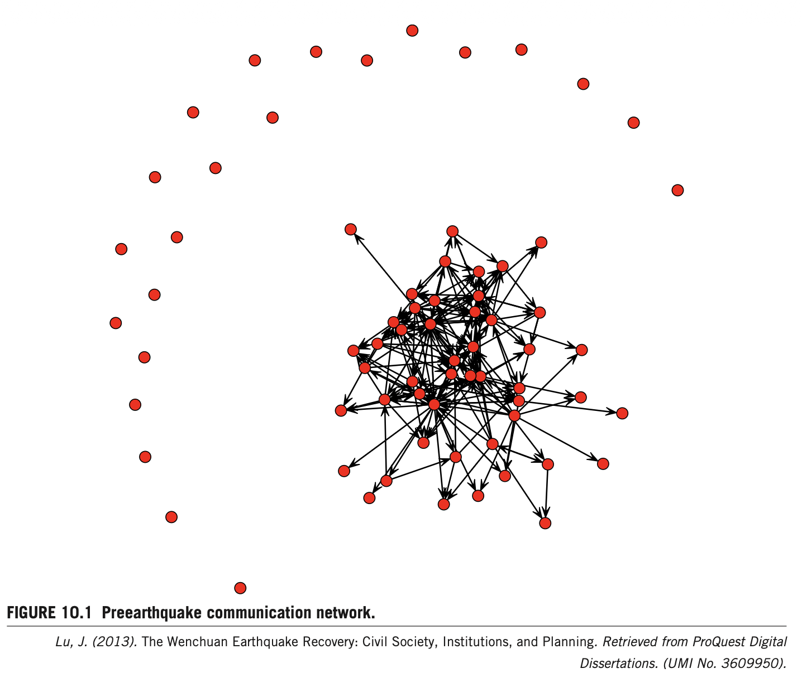
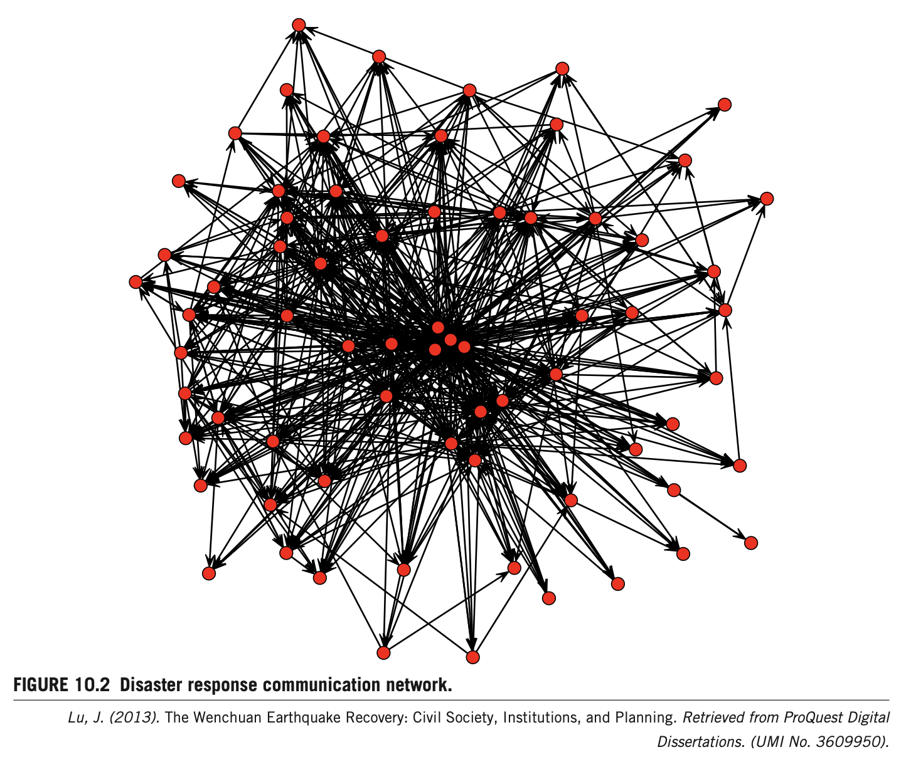
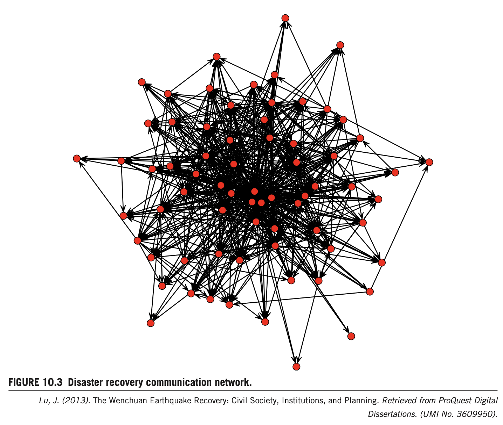
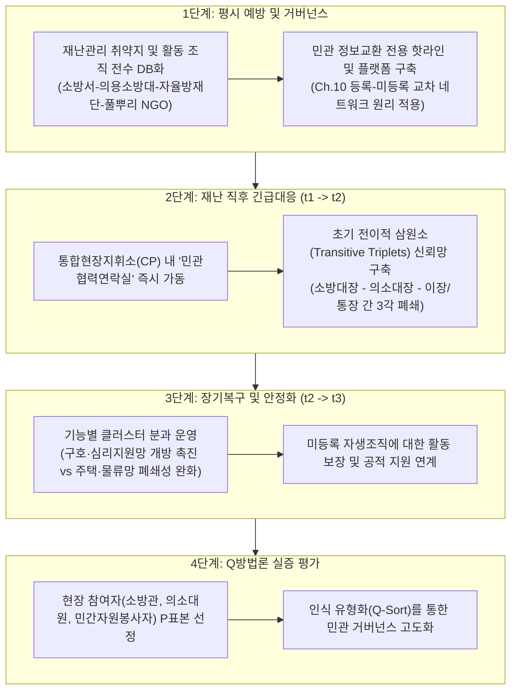

# 제10장 원촨 대지진 복구 과정에서의 조직 간 네트워크 동태성: 쓰촨성 시민사회 조직망의 종단적 진화 (Sub-Note)

**원제**: CHAPTER 10. INTERORGANIZATIONAL NETWORK DYNAMICS IN THE WENCHUAN EARTHQUAKE RECOVERY  
**저자**: Jia Lu1,2  
1 *California State University-Los Angeles, Los Angeles, CA, United States*  
2 *University of Southern California, Los Angeles, CA, United States*  
**출처**: *Social Network Analysis of Disaster Response, Recovery, and Adaptation* (Elsevier, 2017, pp. 143–161)  
**DOI**: `http://dx.doi.org/10.1016/B978-0-12-805196-2.00010-8`  
**Copyright**: © 2017 Elsevier Inc. All rights reserved.

---

## CHAPTER OUTLINE (장 목차 구성 — 원문 순서 동일)

* **Introduction (서론)** ............................................................................................................................................ 143
* **Civil Society Theory in the Chinese Context (중국적 맥락에서의 시민사회 이론)** ..................................................... 145
* **Social Networks and Disasters (사회연결망과 재난 연구)** ..................................................................................... 147
* **Research Design (연구 설계)** ................................................................................................................................ 147
  * Network Boundary Clarification (네트워크 경계 설정) ........................................................................................... 147
  * Network Content Specification (네트워크 내용 규정: 정보교환) ............................................................................. 148
  * The Survey Questionnaire Method (설문조사 기법: 로스터 명부) ............................................................................ 148
  * Data Treatment (데이터 정제 및 결측치 처리) ........................................................................................................ 148
  * Longitudinal Modeling of Network Dynamics Using RSiena (RSiena를 활용한 동태적 종단 모델링) ........................ 149
* **Results (실증 분석 결과)** ...................................................................................................................................... 151
  * Some Descriptives (기술통계 분석: Table 10.1 및 Figure 10.1) ................................................................................. 151
  * Dynamics of the Emergency Response Communication Network (긴급대응기 동태성: Figure 10.2 및 Table 10.2) ...... 151
  * Dynamics of the Disaster Recovery Communication Network (장기복구기 동태성: Figure 10.3 및 Table 10.2) .......... 156
* **Emergence of Structural Resilience (구조적 레질리언스의 발현)** ............................................................................ 157
* **Conclusions and Policy Implications (결론 및 정책적 시사점)** ................................................................................ 158

---

# 1. 서론 및 이론적 배경

## INTRODUCTION (서론) `[원문 pp. 143–145]`

### [문단 1] 재난 주기 전반에서의 공공·민간·시민사회 교차 상호작용
* **재난 주기와 행위자 상호작용**: 재난 연구자들은 대비(preparedness), 긴급 대응(emergency response), 복구(recovery), 완화(mitigation) 등 재난 생애주기의 각 단계에서 공공 부문, 민간 부문, 그리고 자생적 시민 집단(emergent citizen groups) 간의 다차원적 상호작용을 연구해 왔습니다(Stallings & Quarantelli, 1985; Neal, 1997).
* **시민사회의 선제적 역할 부각**: 최근에는 부문 간 교차 상호작용(cross-sector interactions), 특히 재난 복구 과정에서 시민사회 행위자(civil society actors)의 능동적이고 선제적인 역할이 위험 경감과 장기적 지역사회 지속가능 발전에 핵심적인 요소로 강조되고 있습니다(Arnold, 2006).
* **세계은행 및 다국적 비교 연구의 시사점**: 
  * 세계은행의 다국적 재난 프로젝트를 분석한 Margaret Arnold(2006)는 지역 공동체 수준에서의 역량 강화(empowerment)와 내생적 역량 구축(capacity building)이 경제 개발을 지원하는 위험 관리의 핵심이라고 결론지었습니다.
  * 9·11 테러, 허리케인 카트리나(2005), 아이티 지진(2010) 등 8대 재앙적 사건의 장기 복구 과정을 조사한 Jeffrey Garnett & Melinda Moore(2010)는 주민들이 주도하는 **상향식 접근(bottom-up approach)**과 국가의 장기 경제 비전을 접목한 **하향식 접근(top-down approach)**이 모두 융합되어야 한다고 역설했습니다.
  * 2004년 인도양 쓰나미 피해국 연구(Rowlands & Tan, 2008)에서도 주민 참여, 권한 부여, 부문 간 협업 원칙이 지역사회 복구의 성패를 가르는 척도임이 입증되었습니다.

### [문단 2] 국가–사회 관계의 정치사회적 조건과 시민사회의 차별적 발현
* 국가마다 시민사회가 재난에 대응하는 정치사회적 조건(sociopolitical conditions)은 상이하게 분화됩니다:
  1. **터키 골축(Golcuk) 지진 (1999)**: 국가의 취약성과 부실 대응(shattered role of the state)으로 인해 국가와 사회 간의 관계가 재협상되었으며, 약한 국가의 공백 속에서 시민 네트워크가 급속히 부상했습니다(Ganapati, 2005; Pelling & Dill, 2010).
  2. **엘살바도르 허리케인 미치 (1998)**: 교조적 신자유주의 국가 정책과 지방자치단체의 재건 역량 결핍(기획, 예산, 집행, 관리 역량 부족) 속에서 시민사회가 예방 및 완화 전략을 주도하는 배경으로 작용했습니다(Wisner, 2001).
  3. **일본 고베 대지진 (1995)**: 터키나 엘살바도르와 달리 국가는 물리적 인프라 재건에 집중한 반면, 시민사회는 사회적 인프라 구축과 이재민의 지역사회 재정착을 이끄는 상호보완적 역할을 수행했습니다(Aldrich, 2008).

### [문단 3] 절차적-행위 접근법의 필요성과 중국 2008년 원촨(汶川) 대지진
* **연구의 학술적 공백(Research Gap)**: 교란(perturbances) 이후 시민사회의 행위자들이 사회적 적응 역량(adaptive capacity)을 구축하면서 자신들의 역할을 어떻게 제도적으로 발전시키는지, 즉 긴급 대응에서 장기 복구로 전환되는 과정에 대한 **절차적-행위 접근법(procedural-action approach)** 연구는 극히 부족했습니다.
* **원촨 대지진의 충격과 시민사회의 자생적 폭발**:
  * 2008년 5월 12일 쓰촨성 청두 북서쪽 92km 지점에서 발생한 M8.0 대지진으로 69,226명이 사망하고 3천만 명이 피해를 입었습니다(EERI, 2008).
  * 지진 직후 수많은 자원봉사자와 풀뿌리 단체가 현장으로 쇄도하여 공식·비공식 조직 네트워크를 형성했습니다(Lu, 2013).
  * 본 연구는 강력한 권위주의 국가 통제 하에 있던 중국 사회에서 대형 참사를 계기로 어떻게 자생적 시민사회가 출현하고, 긴급 대응을 넘어 장기 복구 단계까지 조직 간 네트워크를 유지·진화시켰는가를 종단적으로 추적합니다.

[^1]: 1556년 중국 산시성(Shaanxi) 대지진은 80만 명 이상의 사망자를 기록하여 인류 역사상 가장 치명적인 지진으로 기록되어 있습니다.

---

## CIVIL SOCIETY THEORY IN THE CHINESE CONTEXT (중국적 맥락에서의 시민사회 이론) `[원문 pp. 145–147]`

### [문단 1] 서구적 시민사회 개념과 중국 사회주의 시장경제의 특수성
* **시민사회의 유동적 개념**: 시민사회는 하버마스(Habermas, 1989)의 공론장 개념부터 시장경제의 발흥에 이르기까지 합의된 단일 정의가 없으며, 제도적 구조의 변화에 따라 진화하는 동태적 개념입니다(Cohen & Arato, 1992).
* **서구와 중국의 근본적 차이**: 서구 자유민주주의 국가와 달리 중국은 1949년 중화인민공화국 건국 이후 1970년대 말까지 국가와 사회가 완전히 일체화(near-unity)되어 기능적 영역이 중첩되었습니다(Han, 2002; Tang, 1996; Tao, 2009).
* **개혁개방과 사회 다원화**: 1978년 개혁개방 정책은 사회적 다원화와 중국형 시민사회의 출현을 촉진한 직접적 동인입니다(Wang, 2009; Zhang, 2009). 중국의 시민사회는 서구처럼 국가에 대항하여 자생한 것이 아니라, **국가에 의해 촉진되고 사회주의 시장경제의 등장으로 육성되어 국가-시장 제도 간의 복합적 상호작용 속에서 형성**되었습니다(Wu & Gong, 2008).

### [문단 2] 관변 민간단체(GONGO)와 풀뿌리 자생 조직의 분화
* **국가의 이중 전략**:
  1. **관변단체 설립·지원**: 공산당-국가는 중화전국부녀연합회, 중화전국총공회 등 국가 통제 하의 관변 민간단체(GONGO: Government-Organized NGOs)를 운영하는 한편, 복합 사회서비스를 분담시키기 위해 사회복지단체와 업종협회를 장려했습니다(Ma, 2006; Yu, 2009).
  2. **자율적 시민조직 억제**: 1989년 민주화 운동 이후 자율적 시민단체의 정치적 위험을 경계하며 엄격한 규제 정책을 유지했습니다.
* **유커핑(Yu Keping, 2009)의 9대 시민사회 분류**:
  1. 업종조직(Trade organizations)
  2. 자선조직(Charitable organizations: 적십자, 장애인연맹 등)
  3. 학술단체(Academic groups)
  4. 정치단체(촌민위원회, 주민위원회 등)
  5. 지역사회조직(주택소유자협회 등)
  6. **사회서비스조직(Social service organizations: 환경, 문화, 교육, 보건, 복지 등)** ★ 원촨 지진 후 급증
  7. 시민 상부상조조직(Mutual assistance)
  8. 공동이익조직(Common-interest)
  9. 비영리 컨설팅조직(Nonprofit consulting)
* **원촨 지진과 소셜미디어 기반 자생적 연대**: 지진 긴급대응기 동안 중국 시민들은 온라인 메신저를 통해 가상으로 연결된 후 오프라인 현장에서 만나 집단적 구호활동을 조직했습니다(Lu, 2013; Sutton et al., 2008, 2010). 그러나 장기 복구 단계로 넘어가면서 합법적 등록 지위 부재로 인한 심각한 자금난에 봉착했습니다.

### [문단 3] 이중 관리 체제(Dual Management System)와 등록 장벽
* **업무주관단위(Professional Supervisory Agency)의 기피**: 비정부기구(NGO)가 정식 등록하려면 주무 관청의 사전 승인을 받아야 하지만, 주무 관청은 해당 단체의 정치적 리스크에 연대 책임을 지기 싫어 승인을 기피합니다(Ma, 2006).
* **미등록 비공식화 및 기업 등록 우회**: 등록 장벽을 우회하기 위해 영리 기업으로 등록하거나 등록 없이 불법·비공식 상태로 활동합니다. 중국 내 미등록 NGO 수는 정식 등록 NGO의 약 10배에 달합니다(Wang, 2007).
* **높은 설립 요건과 비경쟁 원칙**: 회원 50인 이상(법인은 30개 이상) 요건과 동일 행정구역·동일 분야 내 중복 설립 금지(Noncompetition requirement) 원칙은 풀뿌리 조직을 통제하는 강력한 기제로 작동했습니다(Ma, 2006; Yu, 2009).

---

## SOCIAL NETWORKS AND DISASTERS (사회연결망과 재난 연구) `[원문 p. 147]`

### [문단 1] 종단적 사회연결망 분석의 장점과 연구 질문
* **구조적 환경과 제약의 동태적 추적**: 사회연결망 분석(SNA)은 시민사회 행위자들이 스스로 구축하고 또 그들을 제약하는 구조적 환경을 규명할 수 있습니다.
* **핵심 미시 구조 효과**:
  * **상호성(Reciprocity)**: 정보 요청에 대한 쌍방향 응답 여부. 결핍 시 정보 교환 단절과 행위자 고립 초래.
  * **전이성(Transitivity) 및 삼원소 폐쇄(Triadic Closure)**: A가 B와 소통하고 B가 C와 소통할 때 A와 C 간의 소통 연계 형성 여부. "친구의 친구는 친구가 된다." 정보 흐름 촉진 및 클러스터링(군집화) 유도.
  * **행위자 속성 효과**: 조직의 합법적 등록 여부 및 수행 활동 분야가 연결망 진화에 미치는 영향.
* **본 연구의 2대 핵심 연구 질문(Research Questions)**:
  1. 재난 복구 맥락에서 시민사회의 조직 간 네트워크 구조의 동태성(Dynamics)은 어떠한가?
  2. 재난 발생 후 단기(긴급대응)와 장기(복구)에 걸쳐 조직 간 행위를 설명할 수 있는 변화의 법칙(Rules of change)이 존재하는가?

---

# 2. 연구 설계 및 분석 방법론

## RESEARCH DESIGN `[원문 pp. 147–151]`

### 1) Network Boundary Clarification (네트워크 경계 설정) `[원문 pp. 147–148]`
* **분석 수준**: 전체 네트워크(Whole network). 각 시민사회 조직을 네트워크 노드(Node)로 설정.
* **핵심 제보자(Key Informant) 접근**: 지진 대응 및 복구 현장에서 폭넓은 네트워크를 보유한 핵심 시민사회 조직 리더의 승인을 얻어 접촉 리스트 확보.
* **표본 선정 기준**: 긴급대응 단계(t2)에 참여하고 이를 장기 복구 단계(t3)까지 지속적으로 유지한 조직.

### 2) Network Content Specification (네트워크 내용 규정) `[원문 p. 148]`
* **정보 교환(Information Exchange) 중심의 소통망**:
  * 지진 직후 피해 지역 전역의 구호 필요성, 자원 배분 현황을 파악하기 위해 정보 탐색 및 교환이 조직 간 소통의 본질적 내용으로 작동함(Laumann & Knoke, 1987).
  * 외지 지원 단체들은 피해 현장의 위치와 지원 시급성을 파악하기 위해 현지 로컬 풀뿌리 조직을 핵심 정보원으로 삼음.

### 3) The Survey Questionnaire Method (설문조사 기법) `[원문 p. 148]`
* **설문지 구조**:
  * 제1부 (행위자 속성): 설립 연도, 공식 비영리 등록 여부(등록 vs 미등록), 수행 복구 활동 유형.
  * 제2부 (로스터 명부 평가): 전체 행위자 명부(Roster list)를 제시하고 이메일, 전화, 메신저, 대면 접촉 등 정보 교환 소통 관계 여부를 이진 판단(Binary judgment: 0/1) 방식으로 3개 시점에 대해 응답.
* **3대 시점(Time Waves)**:
  * $t_1$: 지진 발생 전 (Preearthquake)
  * $t_2$: 긴급대응기 (Emergency response: 지진 후 1년 이내)
  * $t_3$: 장기복구기 (Disaster recovery: 지진 후 최대 5년)

### 4) Data Treatment (데이터 정제 및 결측치 처리) `[원문 pp. 148–149]`
* **명부 구성**: 총 138개 행위자 (시민사회 조직 136개, 정부 공공기관 통합 노드 1개, 시장 민간기업 통합 노드 1개).
  * 비공식 미등록 사회단체 21.3%, 쓰촨 현지 풀뿌리 단체 75.7%.
* **응답률**: 136개 시민단체 중 63개 반환 (응답률 **46.32%**). 종단 네트워크 분석에서 심각한 결측치 우려.
* **2단계 정밀 결측치 보정**:
  1. **UCINET 범주형 핵심-주변부 분석(CORR 알고리즘)**: 3개 시점 전반에 걸쳐 지속적으로 핵심 위치를 유지한 **70개 핵심 조직(Core actors)** 선별.
  2. **RSiena 조직 구성 변화(Composition Change) 기능 적용**: 각 조직의 네트워크 진입 시점을 외생적 사건(exogenous events)으로 모델링하여 비응답 편향을 통제.
  * **최종 결측률**: **15.7%**로 감소시켜, RSiena 매뉴얼(Ripley et al., 2012)이 권장하는 안정 추정 안전 범위(10%~20%) 내 진입 달성.

### 5) Longitudinal Modeling of Network Dynamics Using RSiena `[원문 pp. 149–151]`
* **확률적 행위자 지향 모델 (SAOMs)**: Snijders(1996), Snijders et al.(2010)의 마르코프 연쇄 몬테카를로(MCMC) 추정 기법 활용.
* **목적 함수(Objective Function)**:
  $$f_i(eta, x) = \sum_{k=1}^L eta_k s_{ik}(x)$$
  * $i$: 초점 행위자(Ego).
  * $eta_k$: 통계적 추정 모수(선형 예측인자 가중치).
  * $s_{ik}(x)$: 네트워크 구조 및 외생 변수로 구성된 효과 함수. 행위자는 자신의 목적 함수 값을 극대화하는 방향으로 연계를 형성·유지·단절함.
* **4대 독립변수 군(Covariates)**:
  1. **기본 구조 효과**: Outdegree (밀도 음수), Reciprocity (상호성), Transitive triplets (전이적 삼원소군), Three cycles (3-순환), Transitive ties (전이적 연계), Balance (구조적 균형).
  2. **차수 기반 구조 효과**: Indegree popularity (내향차수 인기), Outdegree popularity (외향차수 인기), Outdegree activity (외향차수 활동성).
  3. **행위자 속성 효과 (Covariate Ego / Alter)**:
     * **등록 상태(Registration status)**: 등록=1, 미등록=2.
     * **활동 분야(Activity types)**: 주택 재건(housing), 노인·장애인(elderly/disabled), 여성·아동(women/children), 환경(environment), 심리상담(psychology), 생계지원(livelihood).
  4. **상호작용 효과 (Interaction Effects)**:
     * **동류성 상호작용 (Ego × Alter)**: 동일 속성 조직 간의 연계 선호.
     * **등록 유사성 × 상호성 상호작용 (Int. Registration similarity × reciprocity)**: 동일 등록 지위 간 상호성 선호 여부.

---

# 3. 실증 분석 결과

## RESULTS `[원문 pp. 151–157]`

### 1) 기술통계 분석 (Some Descriptives)

<!-- ================================================================= -->
<!-- Table 10.1                                                        -->
<!-- ================================================================= -->
### Table 10.1 Communication Network Descriptive Measures (소통 네트워크 기술통계 지표)

| 측정 지표 (Measures) | 지진 이전 ($t_1$) *Preearthquake* | 긴급대응기 ($t_2$) *Emergency Response* | 장기복구기 ($t_3$) *Disaster Recovery* |
| :--- | :---: | :---: | :---: |
| **평균 내향차수 (Average Indegree)** | **2.7** | **9.8** | **11.1** |
| **표준편차 (Standard Deviation in / out)** | 2.9 / 5.2 | 6.8 / 13.5 | 6.9 / 14.0 |
| **상호성 (Reciprocity)** | 0.11 | 0.15 | **0.17** |
| **군집화 계수 (Clustering)** | 0.17 | 0.24 | **0.28** |

*출처: Lu, J. (2017), Table 10.1 (p. 151)*

<!-- ================================================================= -->
<!-- Figure 10.1                                                       -->
<!-- ================================================================= -->
  
*FIGURE 10.1 Preearthquake communication network (지진 이전 소통 네트워크).*  
*(Source: Lu, J., 2013. The Wenchuan Earthquake Recovery: Civil Society, Institutions, and Planning. ProQuest Digital Dissertations, UMI No. 3609950)*

#### [기술통계 핵심 해석]
1. **평균 연결성(Indegree)의 폭발적 증가**: 지진 전 2.7에 불과했던 평균 차수가 긴급대응기 9.8로 **3.6배 이상 급증**하였으며, 장기 복구기에는 11.1까지 완만하게 지속 상승함.
2. **고립 노드의 통합과 군집화**: 지진 전 외곽에 산재했던 고립 행위자(isolated actors)들이 지진 직후 메인 연결망 내부로 흡수되었으며, 상호성(0.11 → 0.15 → 0.17)과 군집화(0.17 → 0.24 → 0.28)가 지속적으로 증가하여 네트워크 밀도와 응집력이 고도화됨.
3. **내·외향 차수의 변동성 심화**: 외향 차수 표준편차(5.2 → 13.5 → 14.0)가 내향 차수(2.9 → 6.8 → 6.9)보다 두 배 이상 높게 나타남. 이는 지진 후 시민사회 조직들의 자발적 정보 발신 행위(Agency motivation)가 적극적으로 작동했으나, 조직별로 역량과 참여 강도에 차별화가 심했음을 실증함.

---

### 2) 긴급대응기 소통망 동태성 ($t_1 	o t_2$)

<!-- ================================================================= -->
<!-- Figure 10.2                                                       -->
<!-- ================================================================= -->
  
*FIGURE 10.2 Disaster response communication network (지진 긴급대응기 소통 네트워크).*  
*(Source: Lu, J., 2013. The Wenchuan Earthquake Recovery: Civil Society, Institutions, and Planning. ProQuest Digital Dissertations, UMI No. 3609950)*

* **상호성 추구 (Reciprocity = 0.41†, p < .10)**: 지진 직후 시민단체들은 상호 간에 긍정적인 응답을 주고받으며 자생적 시민사회의 맹아를 형성함.
* **전이적 삼원소 폐쇄 (Transitive Triplets = 0.11\*\*, p < .01)**: "친구의 친구는 친구가 된다"는 삼각 폐쇄 경향이 뚜렷하게 발현됨. 반면 위계 질서에 반하는 3-순환 효과(Three cycles = -0.12, n.s.)는 유의하지 않아, 평등주의적 순환망보다는 **전이성에 기반한 위계적 연계 구조**가 작동함.
* **구조적 등위성의 부재 (Balance = -0.09\*\*, p < .01)**: 다른 조직과 동일한 선택 패턴을 보이는 균형 효과가 음수로 나타남. 이는 긴급대응기에 시민단체들이 제각기 고유한 방식으로 외부와 소통하며 역할 다변화(diversification)를 겪었으며, 특정 조직이 다른 조직을 쉽게 대체할 수 없는 구조적 비등위성을 보임.
* **인기 효과와 마태 효과 (Indegree Popularity = 0.93\*\*, Outdegree Popularity = -0.17\*)**:
  * 이미 많은 정보 요청을 받는 조직일수록 추가적인 소통 연계를 더 많이 유치함(부익부 빈익빈 인기 집중).
  * 반면 자신이 먼저 나서서 많은 조직에게 연락하는 조직(과도한 발신 조직)은 파트너로서의 인기가 오히려 유의하게 떨어짐.
* **★ 핵심 발견: 등록 유사성과 상호성의 역관계 (Int. Registration similarity × reciprocity = -1.39\*\*, p < .01)**:
  * 통상적인 동류성(Homophily) 가정과 정반대로, **등록 지위가 서로 다른 조직 간(공식 등록 조직 ↔ 미등록 비공식 풀뿌리 조직)에 연계가 맺어졌을 때 훨씬 더 강력한 상호성이 발현**됨.
  * 이는 같은 부류끼리의 소통보다, 이질적 제도적 배경을 가진 조직에 손을 내밀고 이에 응답할 때 높은 만족감과 상호 원조의 성취감이 유발되었음을 시사함.

---

### 3) 장기복구기 소통망 동태성 ($t_2 	o t_3$) 및 종합 비교

<!-- ================================================================= -->
<!-- Table 10.2                                                        -->
<!-- ================================================================= -->
### Table 10.2 Rules Governing Emergency Response and Recovery Periods Communication Network Evolution (긴급대응 및 복구 단계 소통망 진화 지배 법칙)

| 모형 효과 (Effect) | 긴급대응기 ($t_1 	o t_2$) 추정계수 (표준오차) | 장기복구기 ($t_2 	o t_3$) 추정계수 (표준오차) | 학술적 의미 및 해석 |
| :--- | :---: | :---: | :--- |
| **[네트워크 내적 구조 효과]** | | | |
| • Outdegree (밀도 기저) | −3.30\*\* (0.18) | −4.18\*\* (0.69) | 연계 형성의 희소성 및 기저 비용 반영 |
| • **Reciprocity (상호성)** | **0.41† (0.23)** | **0.91\*\* (0.17)** | 복구기에 상호성이 2배 이상 강화 (장기 헌신 증명) |
| • **Transitive triplets (전이적 삼원소군)** | **0.11\*\* (0.04)** | **0.08\* (0.05)** | 중개자를 통한 집단 군집화 및 신뢰 폐쇄 유지 |
| • Three cycles (3-순환) | −0.12 (0.07) | 0.01 (0.35) | 비유의 (수평적 순환구조 부재) |
| • **Transitive ties (전이적 연계)** | **−0.89\*\* (0.21)** | **1.01\*\* (0.01)** | 복구기에 강력한 정(+)의 전이 연계 형성 |
| • Balance (균형 효과) | −0.09\*\* (0.01) | −0.01 (0.06) | 복구기에 비유의화 (구조적 안정화 달성) |
| • **Indegree popularity (내향차수 인기)** | **0.93\*\* (0.07)** | **0.43\*\* (0.12)** | 인기 조직 집중화 지속 (지위 효과 잔존) |
| • Outdegree popularity (외향차수 인기) | −0.17\* (0.08) | −0.29\* (0.13) | 과도한 외향 발신 조직의 파트너 기피 지속 |
| • Outdegree activity (외향차수 활동성) | – (–) | 0.15 (0.27) | 비유의 |
| **[등록 지위(Registration) 효과]** | | | |
| • **Int. Registration similarity × reciprocity** | **−1.39\*\* (0.40)** | **−0.48† (0.13)** | **등록-미등록 간 교차 상호성 지속 (포용적 생태계)** |
| • Registration alter | – (–) | −0.06 (0.12) | 비유의 |
| • **Registration ego (미등록 풀뿌리)** | **– (–)** | **0.41\*\* (0.25)** | **복구기에 미등록 풀뿌리가 정보 발신의 핵심 주체 부상** |
| • Registration ego × alter | – (–) | 0.12 (0.11) | 비유의 (등록 지위별 분리 현상 없음) |
| **[복구 활동 분야(Activity) 효과: $t_2 	o t_3$]** | | | |
| • Housing alter | – (–) | −0.07 (0.12) | 주택 복구 단독 수신 효과 비유의 |
| • Housing ego | – (–) | 0.03 (0.13) | 주택 복구 단독 발신 효과 비유의 |
| • **Housing ego × Housing alter (동류성)** | **– (–)** | **0.84\*\* (0.11)** | **주택 재건 단체 간 폐쇄적 끼리끼리 소통 강력** |
| • Housing ego × Housing alter (상호작용) | – (–) | −0.28\* (0.31) | 타 분야와의 교차 소통 저하 |
| • **Elderly_disabled alter (수신 인기)** | **– (–)** | **0.84\*\* (0.11)** | **노인·장애인 지원 단체로 전방위 정보 요청 쇄도** |
| • Elderly_disabled ego | – (–) | 0.00 (0.11) | 비유의 |
| • Elderly_disabled ego × alter | – (–) | −0.22† (0.22) | 내부 결속보다는 외부 수신 중심 |
| • Women_children alter / ego | – (–) | 0.14 / 0.06 | 단독 효과 비유의 |
| • **Women_children ego × alter** | **– (–)** | **0.74\*\* (0.22)** | **여성·아동 지원 단체 간 강력한 협력 클러스터 형성** |
| • Environment ego × alter | – (–) | −0.50\*\* (0.23) | 환경 단체 간 소통 분절 및 고립 |
| • **Psychology ego × alter** | **– (–)** | **0.40\*\* (0.23)** | **심리지원 단체 간 유의미한 상호 연계 형성** |
| • Livelihood ego × alter | – (–) | −0.02 (0.22) | 생계지원 분야 연계 비유의 |

*†p < .10, \*p < .05, \*\*p < .01 (양측 검정). s.e.는 표준오차. RSiena 4.0 표준 추정.*

<!-- ================================================================= -->
<!-- Figure 10.3                                                       -->
<!-- ================================================================= -->
  
*FIGURE 10.3 Disaster recovery communication network (지진 장기복구기 소통 네트워크).*  
*(Source: Lu, J., 2013. The Wenchuan Earthquake Recovery: Civil Society, Institutions, and Planning. ProQuest Digital Dissertations, UMI No. 3609950)*

#### [복구기 심화 분석 및 핵심 발견]
1. **상호성의 비약적 성숙 (0.41 → 0.91\*\*)**: 지진 직후의 소통이 일시적 충동에 의한 것이 아니라, 장기 복구기로 접어들며 상호 간 헌신과 구조적 지속가능성으로 뿌리내림.
2. **미등록 풀뿌리 조직의 네트워크 주역 부상 (Registration Ego = 0.41\*\*)**:
   * 국가의 3개년 복구 기한 종료 등 제도적 압박에도 불구하고, 비공식 풀뿌리 조직들이 복구기 정보 발신과 연계 창출의 핵심 동력으로 작용함.
3. **활동 분야별 네트워크 양극화**:
   * **주택 재건(Housing, 0.84\*\*)**: 막대한 자본과 물류가 수반되는 주택 분야는 외부와 단절된 채 자기들끼리만 소통하는 강한 동류성(Homophily) 및 폐쇄성을 보임.
   * **노인·장애인(Elderly/Disabled Alter = 0.84\*\*)**: 가장 극심한 취약계층을 다루는 조직으로 전체 네트워크의 정보 유입이 집중됨.
   * **여성·아동(0.74\*\*) 및 심리상담(0.40\*\*)**: 사회복지 및 심리 지원 영역에서 강력한 상호 연계 군집이 형성되어 네트워크 확장을 견인함.

---

# 4. 구조적 레질리언스의 발현 및 정책적 시사점

## 1) EMERGENCE OF STRUCTURAL RESILIENCE (구조적 레질리언스의 3대 축) `[원문 pp. 157–158]`
1. **이원적·삼원적 미시 구조의 지속성과 지위 다양성**:
   * 상호성과 전이적 삼원소군 구조가 일회성에 그치지 않고 장기 복구기까지 유지됨.
   * 특히 **등록 지위의 다양성(공식-비공식 간 교차 상호작용)**이 뒷받침되어 풀뿌리 조직이 소외되지 않고 전체 네트워크로 통합되는 사회구조적 포용성을 달성함.
2. **초기 인기 조직 중심의 위계적 질서와 권위 형성**:
   * 긴급대응기에서 높은 인기를 누렸던 핵심 조직들이 복구기에도 신뢰받는 정보 허브 역할을 지속함으로써 네트워크의 구조적 분열을 방지하고 질서를 유지함.
3. **기능적 활동 분야별 차별화된 구조 형성**:
   * 단순 친목이 아닌, 구호 활동의 성격(주택의 폐쇄성 vs 노인·장애인의 정보 집중 vs 여성·심리의 결속)에 따라 네트워크가 고유하게 재편됨으로써 외부 충격에 유연하게 적응함.

## 2) CONCLUSIONS AND POLICY IMPLICATIONS (정책적 시사점) `[원문 pp. 158–159]`
* **신흥 사회서비스 영역에 대한 정책적 파트너십 구축**: 여성·아동 및 심리상담 분야의 활발한 연계 발신은 재난 장기 복구기에서 새로운 공공 복지 수요가 폭발함을 의미하므로, 정부는 이들 단체와의 공식 파트너십을 선제적으로 기획해야 함.
* **비공식 풀뿌리 조직에 대한 제도적 등록 완화**: 장기 복구의 실질적 동력인 비공식 풀뿌리 조직들이 재정난으로 고사하지 않도록 진입 장벽(이중 관리 체제)을 완화하고 합법적 지위를 부여해야 함.
* **주택 복구 분야의 부문 간 조정 기구 신설**: 주택 분야 조직 간의 폐쇄적 소통(동류성 편중)을 극복하기 위해 타 복구 분야 및 행정기관과의 통합 조정 플랫폼 구축이 시급함.

---

# 5. 박사학위 논문 선행연구 9단계 종합 분석 매트릭스

| 순서 | 분석 단계 | 핵심 분석 및 논문 기술 내용 |
| :---: | :--- | :--- |
| **1** | **연구배경 (Background)** | • 2008년 중국 쓰촨성 원촨 대지진(M8.0, 6.9만 명 사망)을 계기로 분출한 시민사회의 선제적 구호 활동 주목. • 강력한 권위주의 국가 통제 하에서 시민사회가 긴급대응에서 장기복구로 전환되며 조직 간 네트워크를 어떻게 구축·유지하는가에 대한 종단적 실증 연구 부재. |
| **2** | **이론적 개념 (Theoretical Concepts)** | • **사회연결망 동태성(Network Dynamics)**: 상호성, 전이성, 구조적 균형 등 미시 구조의 종단적 진화. • **이중 관리 체제(Dual Management)**: 중국 NGO의 합법적 등록 장벽과 비공식 풀뿌리 조직의 분화. • **구조적 레질리언스(Structural Resilience)**: 외생적 재난 충격 속에서 다양성과 응집력을 유지하는 네트워크 적응 역량. |
| **3** | **연구목적 (Objectives)** | • 지진 발생 전($t_1$), 긴급대응기($t_2$), 장기복구기($t_3$) 3개 시점에 걸친 조직 간 소통 네트워크의 구조적 진화 법칙 규명. • 행위자의 등록 지위(공식 vs 비공식) 및 복구 활동 분야(주택, 복지, 환경 등)가 소통망 형성에 미치는 종단적 영향 실증. |
| **4** | **연구방법 (Methodology)** | • **연구 설계**: 종단적 전체 네트워크 조사 (3-wave Whole Network Panel Design). • **표본**: 쓰촨 현장 활동 136개 시민단체 중 63개 응답(46.3%) → UCINET 핵심-주변부 분석(CORR)으로 70개 핵심 조직 도출 + RSiena 구성변화 모델링으로 최종 결측률 15.7% 통제. • **분석 기법**: 확률적 행위자 지향 모델 (SAOMs via RSiena 4.0). |
| **5** | **연구결과 (Results)** | • 평균 내향차수(2.7 → 9.8 → 11.1), 상호성(0.11 → 0.15 → 0.17), 군집도(0.17 → 0.24 → 0.28) 지속 상승. • RSiena 추정: 상호성($0.41 	o 0.91^{**}$), 전이적 삼원소($0.11^{**} 	o 0.08^{*}$)의 일관된 유의성 확인. • **등록 유사성 × 상호성 상호작용($-1.39^{**} 	o -0.48^{\dagger}$)**: 등록-미등록 조직 간 이질적 교차 상호성 입증. • 복구기 미등록 조직의 발신 주도($Ego=0.41^{**}$) 및 주택 단체 간 폐쇄적 동류성($0.84^{**}$) 도출. |
| **6** | **핵심 발견 (Key Findings)** | • **충동을 넘어선 구조적 헌신**: 상호성과 전이적 폐쇄가 장기 복구기까지 강화되어 지속가능한 시민사회망 확립. • **다양성을 품은 포용적 레질리언스**: 공식 등록 단체와 비공식 풀뿌리 단체 간의 편견 없는 교차 정보 교환. • **활동 영역별 구조적 분화**: 취약계층 지원망의 개방성과 주택 재건망의 폐쇄적 배타성 공존. |
| **7** | **연구의 한계 (Limitations)** | • 설문 응답률 46.3%로 인해 핵심 70개 노드만 추출하여 분석함으로써 주변부 소외 조직의 동태성이 누락되었을 가능성. • 지진 발생 3년 후 회상 조사로 인한 후향적 응답 편향(Retrospective Recall Bias) 존재. • 정부 통합 노드와 시장 기업 통합 노드를 단일 노드로 단순화하여 다부문 간 정밀 역학 분석 제한. |
| **8** | **이론적 시사점 (Theoretical Implications)** | • 권위주의 국가 맥락에서도 재난 위기가 시민사회의 자생적 다원주의(Pluralism)와 네트워크 레질리언스를 점화함을 이론화. • 단순한 '유유상종(Homophily)' 가설을 기각하고, 위기 극복 과정에서 '이질성 기반 상호성(Heterophilous Reciprocity)'의 이론적 가치 규명. |
| **9** | **후속연구 시사점 (Future Directions)** | • 공공-민간-시민사회 3자 간 다층 네트워크(Multilevel Multiplex Networks) 모형으로의 확장. • 네트워크 소통 구조의 진화가 실제 이재민 수혜율이나 복구 속도 등 실질적 성과에 미치는 인과관계 실증. |

---

# 6. ★ [내 연구 적용] 대형 재난 시 소방·행정 관서와 민간 자원봉사·풀뿌리 조직 간 민관 협업 네트워크 구축 및 현장 대응 프로토콜

---

## 1. 현장 맞춤형 핵심성과지표 (KPI 가중치: 소방 고유 70% / 민관 협업 30%)

> [!IMPORTANT]
> 교수님 심화 지도 원칙에 따라, 소방 관서 자체 통제 가능한 **고유 지표(70%)**와 지자체·민간단체와의 **협업 지표(30%)**를 엄격히 분배하고, Chapter 10의 실증 분석 결과(Table 10.1, Table 10.2) 및 관련 법적 조문을 강제 매핑합니다.

| 분류 | 생애주기 | 가중치 | 핵심 성과지표 (KPI) | 산출식 및 측정 방법 | 판단 근거 및 서브노트 매핑 | 관련 법적 근거 |
| :---: | :---: | :---: | :--- | :--- | :--- | :--- |
| **소방 고유 (70%)** | **예방** | 20% | **관내 민간 자율구호조직 네트워크 등록률** | $(	ext{사전 등록된 민간·풀뿌리 조직 수} / 	ext{관내 총 파악 조직 수}) 	imes 100$ | Ch.10 Table 10.1 (t1 고립 노드의 사전 파악 및 통합 관리) | **소방기본법** 제16조의2 (소방안전지원활동) |
| **소방 고유 (70%)** | **대비** | 25% | **민관 합동 현장 긴급소통 훈련 이수율** | $(	ext{합동 통신망 훈련 이수 조직 수} / 	ext{등록 민간 조직 수}) 	imes 100$ | Ch.10 Table 10.2 (초기 혼선 방지 및 Indegree 인기 집중도 관리) | **재난 및 안전관리 기본법** 제35조 (재난대비훈련) |
| **소방 고유 (70%)** | **대응** | 25% | **현장 3각 신뢰연계(전이적 삼원소) 형성률** | $(	ext{소방-의소대-민간 합동 현장팀 가동 건수} / 	ext{총 출동 분과 수}) 	imes 100$ | Ch.10 Table 10.2 Transitive triplets ($0.11^{**}$) 현장 구현 | **119구조·구급에 관한 법률** 제13조 (현장지휘) |
| **기관 협업 (30%)** | **대응** | 15% | **이질적 주체 간 교차 정보 상호성 지수** | 소방·행정 ↔ 미등록 풀뿌리 단체 간 양방향 정보 교환 건수 평가 (1~5점 척도) | Ch.10 Int. Registration similarity × reciprocity ($-1.39^{**}$ 이종 상호성) | **재난 및 안전관리 기본법** 제4조 (국가와 지방자치단체의 책무) |
| **기관 협업 (30%)** | **복구** | 15% | **취약계층 심리·사회복지 협업 연계율** | $(	ext{소방 이송 후 민간 심리·복지단체 인계 완료 건} / 	ext{요청 건}) 	imes 100$ | Ch.10 Table 10.2 Elderly/Disabled Alter ($0.84^{**}$), Psychology ($0.40^{**}$) | **재해구호법** 제4조 및 제9조 (이재민 구호 및 심리지원) |

---

## 2. 법적 근거 조문 단위 강제 매핑
1. **재난 및 안전관리 기본법 제4조(국가 등의 책무)**: 국가는 재난 발생 시 공공기관뿐만 아니라 민간 협력체계를 가동하여 이재민을 보호할 책무가 있음.
2. **재난 및 안전관리 기본법 제35조(재난대비훈련의 실시)**: 중앙행정기관 및 지자체, 소방관서는 민간단체와 합동으로 정기적인 재난대비훈련을 실시해야 함.
3. **소방기본법 제16조의2(소방안전지원활동)**: 소방관서장은 민간 자원봉사 및 자율소방단체와의 협력을 통해 화재 예방 및 구호 활동을 지원할 수 있음.
4. **의용소방대 설치 및 운영에 관한 법률 제7조(임무)**: 의용소방대는 화재 등 재난 현장에서 소방관서를 보조하고, 지역 자율방재단 및 자생 구호조직과의 가교 역할을 수행함.
5. **재해구호법 제9조(재민의 심리적 안정 지원)**: 재난으로 정신적 충격을 입은 이재민에 대해 민간 전문 심리상담 조직과 연계하여 체계적인 심리회복 지원을 제공함.

---

# 7. 주관성 연구(Q방법론) 확장: Q진술문 (Q-Sample 36개) 및 P표본 설계

### [연구 설계]
* **연구 주제**: 재난 대응 및 복구 단계에서 소방관과 민간 구호 활동가가 인지하는 "민관 협업 네트워크 성공 요인"의 주관적 인식 유형화.
* **P-표본 (P-Sample, 40명 내외)**:
  * 집단 1: 소방공무원 (현장 지휘관, 구조구급대원) 12명
  * 집단 2: 의용소방대원 및 지자체 재난과 공무원 10명
  * 집단 3: 등록 비영리 구호단체 활동가 (적십자, 구호협회 등) 10명
  * 집단 4: 미등록 지역 풀뿌리 자원봉사자 및 이장·통장 8명

### [Q-Sample: 36대 Q진술문 (생애주기 4단계 매핑)]

#### [A. 예방 및 사전 거버넌스 단계: 9개 진술문]
* **Q01**: 평상시 비공식 풀뿌리 단체까지 포함하는 민관 소통 명부가 작성되어 있어야 비상시 혼선이 없다.
* **Q02**: 공공기관에 정식 등록된 단체만을 파트너로 인정하는 현행 제도는 현장 대응력을 약화시킨다.
* **Q03**: 관할 소방서와 민간 자원봉사단체 간의 정기적인 친목 및 간담회가 위기 시 협업을 촉진한다.
* **Q04**: 재난 사전 훈련 시 민간단체의 실질적인 역할을 부여하지 않으면 실전에서 무용지물이 된다.
* **Q05**: 지자체나 소방은 평소 지역 내 자생적 구호 역량이 어디에 있는지 전혀 파악하지 못하고 있다.
* **Q06**: 민간조직 간의 지나친 지원금 유치 경쟁은 사전 협업 네트워크 형성을 저해한다.
* **Q07**: 사전 협약(MOU) 체결보다는 현장 실무자 간의 개인적 유대와 신뢰가 훨씬 더 중요하다.
* **Q08**: 평시에 재난 통신망 및 정보 공유 플랫폼 사용법이 숙달되어 있어야 한다.
* **Q09**: 지역의 자생적 종교단체나 번영회 등도 잠재적인 재난 구호 네트워크의 핵심 자원이다.

#### [B. 긴급대응 단계: 9개 진술문]
* **Q10**: 재난 초기에는 강력한 단일 지휘체계(공식 소방 지휘) 하에 일사불란하게 통제되어야 한다.
* **Q11**: 초기 긴급상황에서는 공식 절차를 따지기보다 현장의 비공식 단체들이 자발적으로 움직여야 골든타임을 지킨다.
* **Q12**: 소방-의용소방대-현지 이장 간의 긴밀한 3각 소통이 초기 인명구조의 결정적 요인이다.
* **Q13**: 지진 등 대형 참사 직후 현장 지휘소는 민간 구호단체에 정보를 신속하고 투명하게 공개해야 한다.
* **Q14**: 자원봉사자들이 너무 많이 쇄도하면 현장 지휘와 통제에 오히려 큰 부담과 혼란을 준다.
* **Q15**: 긴급대응기에는 서로 다른 출신의 조직들이라도 정보 요청에 즉각적으로 쌍방향 응답(상호성)을 해야 한다.
* **Q16**: 현장에서는 이미 지명도가 높은 유명 구호단체에만 정보와 자원이 쏠리는 현상이 심각하다.
* **Q17**: 자신이 무엇을 도울 수 있는지 먼저 나서서 연락하는 풀뿌리 단체의 적극성이 위기 극복의 원동력이다.
* **Q18**: 공식 소방관들은 미등록 자원봉사자들의 전문성을 불신하여 협력을 기피하는 경향이 있다.

#### [C. 장기복구 및 안정화 단계: 9개 진술문]
* **Q19**: 응급 대응이 끝나면 정부의 관심이 급감하므로 민간 풀뿌리 단체들의 역할이 더욱 중요해진다.
* **Q20**: 복구 단계에서는 일방적 지휘 통제보다는 수평적 네트워크 협력 거버넌스가 작동해야 한다.
* **Q21**: 주택 복구 단체들은 자기들끼리만 정보를 공유하고 다른 복구 단체들과는 소통하지 않는다.
* **Q22**: 노인, 장애인 등 사회적 약자를 돌보는 단체에 복구 자원과 정보가 최우선적으로 집중되어야 한다.
* **Q23**: 이재민의 트라우마 치료를 위한 심리지원 단체와의 네트워크 연계가 장기 복구의 핵심이다.
* **Q24**: 미등록 비공식 단체들이 재정난으로 현장을 떠나지 않도록 행정적·재정적 지원이 뒷받침되어야 한다.
* **Q25**: 장기 복구로 갈수록 민간단체들 간의 이해관계 충돌과 갈등을 조정해 줄 공공 중재자가 필요하다.
* **Q26**: 복구 사업 과정에서 공공과 민간의 성과 평가 기준이 달라 심각한 불협화음이 발생한다.
* **Q27**: 재난 후 1~2년이 지나면 민간 네트워크가 급속히 와해되므로 이를 지속시키는 플랫폼이 있어야 한다.

#### [D. 제도 개선 및 구조적 평가 단계: 9개 진술문]
* **Q28**: 비공식 단체들이 법적 등록 장벽 때문에 공적 자금 지원에서 배제되는 것은 불합리하다.
* **Q29**: 민간단체의 자발적 활동을 지나치게 법과 조례로 규제하면 시민사회의 역동성이 사장된다.
* **Q30**: 민관 협력의 성패는 상호 존중과 신뢰라는 사회자본의 축적 정도에 달려 있다.
* **Q31**: 재난 대응 협업 평가 시 민간 조직과의 연계 실적(KPI)을 공무원 근무평정에 의무 반영해야 한다.
* **Q32**: 공공과 민간의 역할은 7:3 정도로 공공이 중심을 잡고 민간이 보조하는 구조가 가장 안전하다.
* **Q33**: 현장 상황에 따라서는 민간이 주도하고 공공이 행정 지원을 뒷받침하는 5:5 대등 모델이 필요하다.
* **Q34**: 소방관과 민간 구호 활동가가 서로의 업무 문화를 이해할 수 있는 합동 교육 프로그램이 시급하다.
* **Q35**: 재난 수습 이후 백서 발간 시 민간 풀뿌리 단체들의 기여도와 실패 경험이 반드시 기록되어야 한다.
* **Q36**: 위기 속에서 형성된 민관 네트워크는 지역사회의 일상적 안전을 지키는 소중한 자산으로 계승되어야 한다.

---

### [도출 예상 인식 유형 (Typologies)]
1. **유형 1: 공공 주도 엄격 통제형 (Command & Control Advocates)**
   * 특징: 소방과 관 중심의 일원화된 지휘권 강조. 민간의 무질서한 진입을 경계하고 통제 우선.
2. **유형 2: 풀뿌리 자율 연계형 (Grassroots Autonomy Champions)**
   * 특징: 비공식 미등록 단체의 역동성과 상향식 현장 대응 가치를 최우선으로 평가.
3. **유형 3: 전문 분과 폐쇄형 (Sectoral Specialization Pragmatists)**
   * 특징: 주택, 의료, 심리 등 분야별 전문성을 중시하며, 분야 내 효율적 자원 배분에 집중.
4. **유형 4: 다원적 포용 가교형 (Pluralistic Inclusive Bridgers)**
   * 특징: 공공-민간, 등록-미등록 간의 이질적 상호작용과 수평적 파트너십을 통한 구조적 레질리언스 지향.
