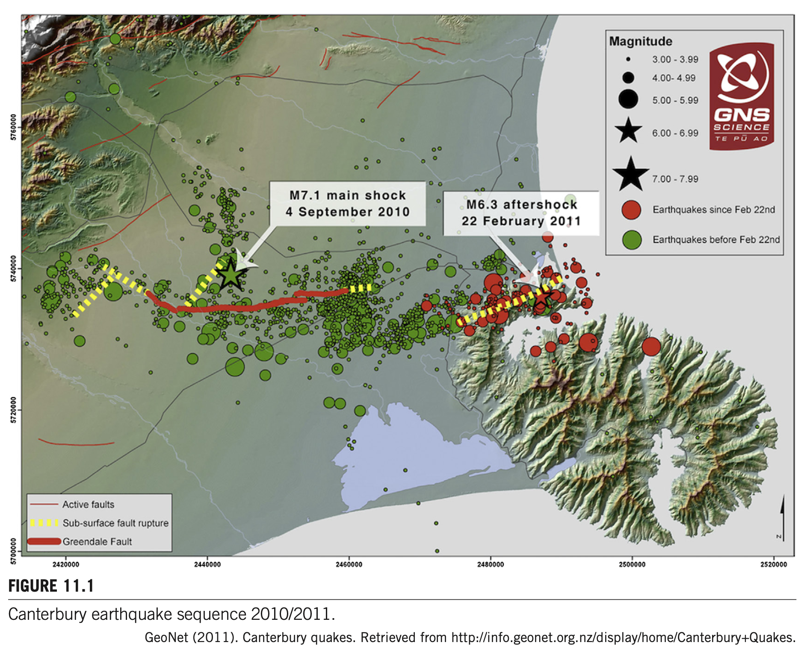
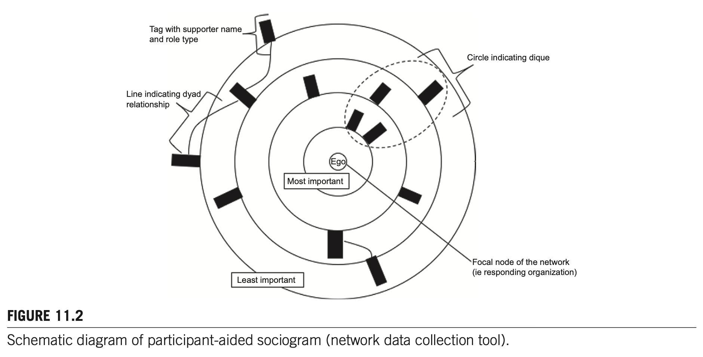
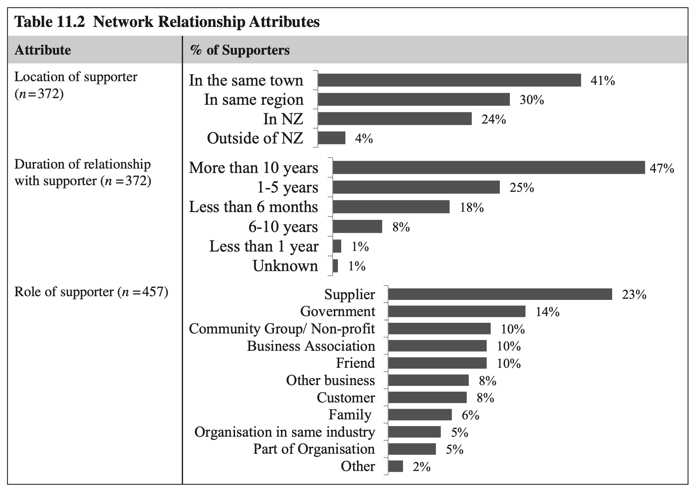
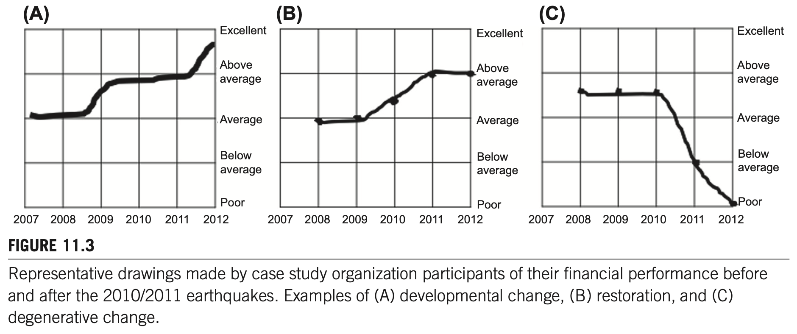
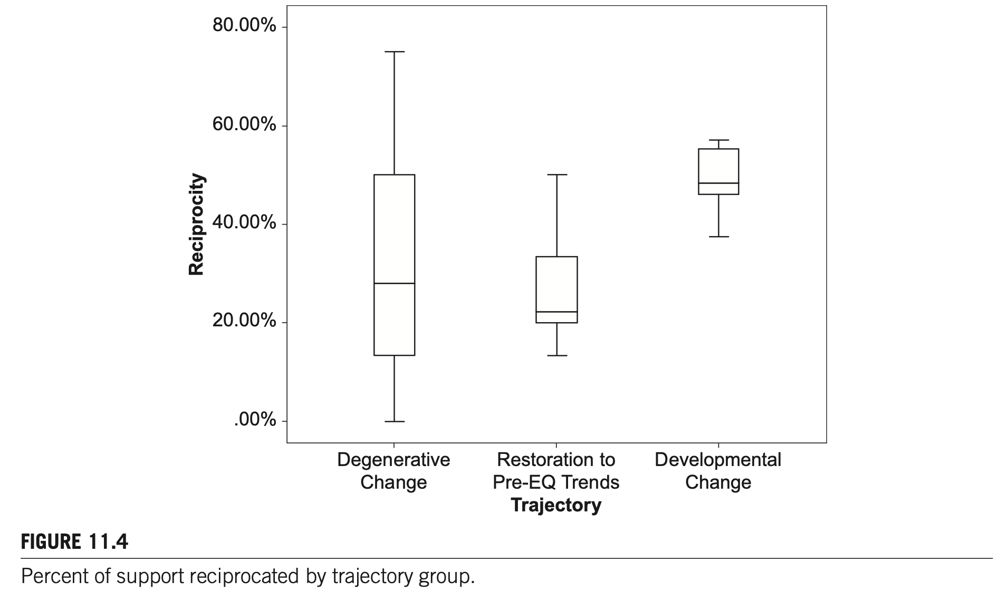
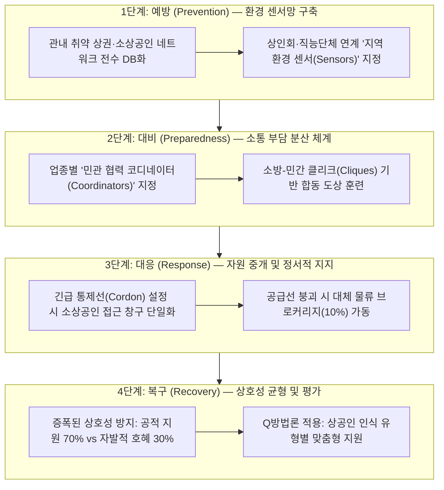

# 제11장 2010/11년 뉴질랜드 캔터베리 지진 이후 조직 지원 네트워크와 관계적 레질리언스 (Sub-Note)

**원제**: CHAPTER 11. ORGANIZATIONAL SUPPORT NETWORKS AND RELATIONAL RESILIENCE AFTER THE 2010/11 EARTHQUAKES IN CANTERBURY, NEW ZEALAND  
**저자**: Joanne R. Stevenson<sup>1,2</sup>, David Conradson<sup>2</sup>  
<sup>1</sup> *Resilient Organisations Ltd., Sheffield, New Zealand*  
<sup>2</sup> *University of Canterbury, Christchurch, New Zealand*  
**출처**: *Social Network Analysis of Disaster Response, Recovery, and Adaptation* (Elsevier, 2017, pp. 163–182)  
**DOI**: `http://dx.doi.org/10.1016/B978-0-12-805196-2.00011-X`  
**Copyright**: © 2017 Elsevier Inc. All rights reserved.

---

## CHAPTER OUTLINE (장 목차 구성 — 원문 순서 동일)

* **Introduction (서론)** ............................................................................................................................................ 163
* **Theoretical Framework (이론적 프레임워크)** .......................................................................................................... 165
* **The Canterbury Earthquake Sequence (캔터베리 지진 시퀀스 개요)** ........................................................................ 167
* **Methodology (연구방법론)** ................................................................................................................................... 168
  * Case Study Selection (사례연구 대상 선정: 32개 민간 기업/조직) ........................................................................... 168
  * Documenting the Case Studies’ Journeys (사례 조직의 종단적 복구 여정 기록: 4개 시점) ........................................... 169
  * Network Data Collection (네트워크 데이터 수집: 참여자 보조 소시오그램 기법) ........................................................ 169
* **Findings (실증 분석 결과)** ...................................................................................................................................... 171
  * Types of Support Organizations Accessed to Aid Recovery (복구 지원 유형: 6대 범주 분류, Table 11.1) ...................... 171
  * The Relationships That Make Up Support Networks (지원 네트워크를 구성하는 관계 속성: Table 11.2) ........................ 172
  * Postearthquake Networking Behaviors (지진 후 네트워킹 행동 양식) ........................................................................ 174
    * Assessing Organizational Performance (조직 성과 궤적 평가: 3대 궤적 그룹, Figure 11.3) .................................... 174
    * Sensors in the Community (지역사회 내 환경 감지 센서 기능: Box 11.1 인식 사례 비교) ....................................... 176
    * Trust and Decision Evaluation (신뢰와 의사결정 평가: Box 11.2 평가와 적응 사례 비교) ......................................... 177
    * Network Density and Understanding Connectivity (네트워크 밀도와 연결망 구조 이해) ........................................ 178
    * Managing Reciprocity (상호성 관리: 증폭된 상호성의 함정과 양극화, Figure 11.4) ................................................. 179
    * Devolved Responsibilities (책임 분산 메커니즘: 지원 코디네이터 및 클리크 구조) .................................................. 180
* **Discussion and Conclusions (논의 및 결론)** ........................................................................................................... 181
  * Relational Resilience (관계적 레질리언스의 개념화 및 정서적 지지의 의의) .............................................................. 181
  * Future Work and Implications (향후 연구 방향 및 이론적·실무적 함의) .................................................................... 181
* **Footnotes (원문 각주 정밀 해설 1~8)** .................................................................................................................... 182

---

# 1. 서론 및 이론적 배경

## INTRODUCTION (서론) `[원문 pp. 163–165]`

### [문단 1] 위기 상황에서의 조직 레질리언스와 사회연결망의 확장적 가치
* **조직 레질리언스의 정의와 본질**:
  * 위기의 부정적 충격을 흡수(absorb)하거나 완화(mitigate)하고, 그 여파 속에서 성공적으로 복구(recover), 적응(adapt), 그리고 번영(thrive)할 수 있는 조직을 '레질리언트한 조직(resilient organizations)'이라고 정의합니다.
  * 레질리언트한 조직은 위기 상황에서도 본래의 조직 목표를 달성할 가능성이 높으며, 자신이 속한 지역사회와 장소의 전반적 회복력을 촉진하는 앵커 역할을 수행합니다.
  * 레질리언스는 고정된 정적 속성이 아니라, 예측 불가능한 돌발 사건에 직면했을 때 대처 역량(coping capacity), 학습(learning), 혁신(innovation)을 지속적으로 향상시키는 다양한 역량, 실천, 행동 양식을 유지할 것을 요구합니다(Kendra & Wachtendorf, 2003; Linnenluecke & Griffiths, 2010).
* **내부 자원의 한계와 조직 간 연결망의 중요성**:
  * 조직은 조직 간(interorganizational) 및 개인 간(interpersonal) 네트워크를 통해 필요한 지원 자원, 핵심 정보, 실무 지원에 대한 접근성을 조직 경계 외부로 확장할 수 있습니다.
  * 재난 대응 및 초기 복구 단계의 조직 간 네트워크 연구는 주로 공공 구호기관이나 대응기관이 개인과 지역사회를 지원하는 방식에 집중되어 왔습니다(Hutter, 2011; Raab & Kenis, 2009).
  * 그러나 재난 대응 주체가 아닌 **일반 민간 비즈니스 및 비응급 조직(nonresponder private organizations and businesses)**이 복구 과정에서 네트워크를 어떻게 동원하고 지원을 받는지에 대한 실증적 연구는 극히 드문 실정입니다(Bowden, 2011; Doerfel, Chewning, & Lai, 2013; Doerfel, Lai, & Chewning, 2010; Graham, 2007).

### [문단 2] 3대 핵심 연구 질문 (Research Questions)
본 연구는 2010/2011년 뉴질랜드 캔터베리 대지진 피해를 입은 32개 민간 조직에 대한 심층 종단 사례연구를 통해 아래의 3대 질문을 실증적으로 규명합니다:
1. **RQ1**: 재난 이후 조직들은 복구를 돕기 위해 어떤 종류의 지원(kinds of support)을 외부로부터 동원하였는가?
2. **RQ2**: 재난 후 지원 네트워크를 구성하는 관계들(kinds of relationships)은 어떤 지리적·시간적·역할적 속성을 띠고 있는가?
3. **RQ3**: 긍정적 복구 궤적(발전적 변화)을 경험한 조직과 퇴행적 궤적(쇠퇴)을 겪은 조직 간에 네트워킹 행동 양식(networking behaviors)은 어떻게 다른가?

---

## THEORETICAL FRAMEWORK (이론적 프레임워크) `[원문 pp. 165–167]`

### [문단 1] 조직 레질리언스의 다차원적 특성과 예술성(Craftsmanship)
* **레질리언스의 핵심 선행 요인들**: 기존 이론들은 위기 극복 역량을 높이는 요인으로 투명성과 신뢰의 문화(Weick, 1993), 계획 수립과 위험 인식(Boin & Lagadec, 2000), 자원 접근 및 동원 역량(Burnard & Bhamra, 2011; Somers, 2009), 헌신적인 리더십과 내재화된 조직 학습 문화(Seville, Van Opstal, & Vargo, 2015)를 제시해 왔습니다.
* **장인정신과 감각적 조율(Craftsmanship & Artistry)**: 
  * James Kendra와 Tricia Wachtendorf(2003, p. 49)는 조직 레질리언스를 고도의 **예술성(artistry), 지각/감각(perception), 환경 변화를 감지하는 센싱 능력, 그리고 학습을 반영하여 대응을 끊임없이 조정해 나가는 일종의 '장인정신(craftsmanship)'**으로 규정하였습니다.
  * 최근의 많은 연구들은 협력적 행동(collaborative action)과 조직 간·개인 간 네트워크의 결정적 역할을 강조하고 있습니다(Johnson & Elliott, 2011; Stevenson et al., 2014).

### [문단 2] 사회자본(Social Capital)과 조직의 확장된 자원 기반(Extended Resource Base)
* **중소기업(SMEs)의 구조적 한계와 외생적 자원 확장**:
  * 특히 중소기업은 조직 내부에 여분의 중복 시스템(redundant systems)을 구축하거나, 대규모 비축 재고를 유지하거나, 모든 돌발 위기에 대비해 직원을 상시 훈련시킬 자원과 여력이 부족합니다.
  * 따라서 중소기업의 실질적인 운영 역량, 정보, 물리적 지원은 조직 외부 관계, 즉 **'확장된 자원 기반(extended resource base)'**을 통해 조달되어야 합니다(Horne & Orr, 1998; Lee, Vargo, & Seville, 2013; Mallak, 1998).
* **사회자본 이론의 접목**:
  * 관계적 네트워크 구조(교환의 패턴)가 조직의 경쟁우위를 창출한다는 고전적 사회자본 이론(Baker, 1990; Nahapiet & Ghoshal, 1998)에 따르면, 조직 간 성과 격차는 사회자본을 형성하고 활용하는 능력의 차이를 반영합니다.
  * 사회자본은 공급업체와의 거래비용 절감(Uzzi, 1997), 전략적 자원 획득(De Wever et al., 2005), 집단 혁신 패턴 촉진(Ahuja, 2000), 신규 지식 및 기술 습득(Inkpen & Tsang, 2005), 재난 시 직원의 정신적 스트레스 완충(Monge & Contractor, 2001) 등 다방면에서 기능합니다.

### [문단 3] 재난 환경에서의 네트워크 기능: 정보 유통, 지원 교환 및 중개(Brokerage)
* 극심한 시간·자원 제약 환경 속에서 네트워크는 정보 이전, 인력 교환, 물적·재정적 기부, 권한 위임 등 다양한 교환을 촉진합니다(Butts, Acton, & Marcum, 2012).
* 9·11 테러 이후 확인된 바와 같이, 급변하는 비상 환경에서 신속한 상황 정보(intelligence)를 순환시키는 핵심 도관으로 작동합니다(Tierney & Trainor, 2004).
* 또한 서로 연결되지 않은 두 행위자를 이어주는 **중개(Brokerage)** 기능은 단절된 자원과 정보의 결합을 가능케 합니다(Doerfel et al., 2013; Spiro, Acton, & Butts, 2013).

### [문단 4] 네트워크 행위주체성(Network Agency): 수동적 수혜자를 넘어선 주체적 행위자
* 재난 피해 조직은 외부 지원을 일방적으로 받아들이는 수동적 수혜자(passive recipients)가 아닙니다.
* 조직마다 새로운 문제를 감지하는 지각(Perception) 능력, 지원을 되갚는 상호성(Reciprocity) 실천, 임기응변적 즉흥성(Improvisation), 타인과의 연결 역량이 판이합니다.
* 전략적 변화와 사회적 혁신을 달성하기 위해서는 네트워크 내부에서의 **능동적 행위주체성(Network Agency)**이 요구됩니다(Moore & Westley, 2011). 관계를 주도적으로 구축하고, 자원을 중개하며, 네트워크 구성원들을 공동의 목표로 견인하는 조직만이 복합적 위기를 극복할 수 있습니다.

---

# 2. 캔터베리 지진 시퀀스 및 연구방법론

## THE CANTERBURY EARTHQUAKE SEQUENCE (캔터베리 지진 시퀀스) `[원문 pp. 167–168]`

### [문단 1] 수년간 지속된 다중 재난 사이클과 2대 주요 강진 비교
* 뉴질랜드 캔터베리 지역은 2010년 9월부터 시작된 일련의 연속 지진으로 인해 수년간 심각한 교란과 다중 복구 주기를 겪었습니다.
* 2010년 9월부터 2011년 12월 사이에만 **6차례의 대형 강진과 수천 회의 여진**이 발생했습니다:
  1. **2010년 9월 4일 다필드 지진 (M7.1)**: 심한 지반 진동과 국지적 액상화(liquefaction) 피해가 발생했으나, 발생 시각(새벽 4시 35분)과 진앙 위치 덕분에 심각한 인명피해나 사망자는 보고되지 않았습니다.
  2. **2011년 2월 22일 크라이스트처치 지진 (M6.3)**: 크라이스트처치 도심(CBD)에서 불과 10km 떨어진 얕은 심도에서 발생하여 **185명의 사망자**, 수천 명의 부상자, 광범위한 도시 인프라 및 빌딩 붕괴 참사를 야기했습니다.

### [문단 2] 장기 도심 통제(CBD Cordon) 및 주거지 레드존(Red Zone) 지정의 파급효과
* **도심 통제선(CBD Cordon)의 장기화**: 2011년 2월 지진 직후 도심 비즈니스 지구 주변에 통제선이 설치되었으며, 주요 구역은 무려 **2.5년 동안 상업 활동 및 진입이 전면 차단**되었습니다.
* **주거지 구역화(Residential Red Zone)**:
  * 캔터베리 지진복구청(CERA)은 토지 평가를 통해 대규모 주거용 토지를 구역화하였습니다.
  * 7,850채 이상의 주거용 건물이 거주 불가능 판정을 받았고, 약 10,000채가 재건 또는 대규모 보수를 필요로 하였습니다(Statistics New Zealand, 2013).
  * 심각한 피해를 입은 크라이스트처치 교외 지역은 2011~2013년 사이 **인구의 최대 63%가 유출**되는 급격한 공동화 현상을 겪었으며, 이는 비즈니스의 배후 고객망을 붕괴시키는 결정적 요인이 되었습니다.

```
<!-- Figure 11.1 시각 자료 -->
```
  
*FIGURE 11.1 2010/2011 캔터베리 지진 시퀀스 발생 위치 및 타임라인.*  
*(자료 출처: GeoNet, 2011. Canterbury quakes)*

---

## METHODOLOGY (연구방법론) `[원문 pp. 168–171]`

### 1. Case Study Selection (사례연구 대상 선정)
* **표본 도출**: 2010년 실시된 366개 조직 설문조사 코호트 중에서 3대 집중 피해 도심 중심지(크라이스트처치 CBD, 카이아포이, 리틀턴)에 위치한 **32개 민간 기업/조직**을 최종 선정하였습니다[^1],[^2].
* **선정 3대 엄격 요건**:
  1. 지진 발생 이전부터 물리적으로 설립·운영 중이던 조직 (재난 후 급조된 대응 조직 제외).
  2. 지진 전 피해 연구 지역 내에 물리적 사업장/거점을 보유했던 조직.
  3. 다년간의 종단적 연구(longitudinal study)에 성실히 참여할 의사가 있는 조직.
* **표본 업종 분포 (32개소)**:
  * 소매업(Retail): 12개소 (37.5%)
  * 접객업(Hospitality): 5개소 (15.6%)
  * 전문 및 개인 서비스업(Professional & Personal Services): 5개소 (15.6%)
  * 문화, 레크리에이션 및 사회복지(Culture, Recreation, Social Services): 4개소 (12.5%)
  * 제조 및 도매업(Manufacturing & Wholesale): 3개소 (9.4%)
  * 정보통신기술(ICT): 3개소 (9.4%)

### 2. Documenting the Case Studies’ Journeys (사례 조직의 종단적 복구 여정 추적)
* **4개 시점 종단 추적**: 2010년(9월 지진 직후), 2011년(2월 지진 직후), 2012년, 2013년 4회에 걸쳐 설문지 작성 및 현장 실사 수행.
* **심층 질적 인터뷰**: 조직 대표자(경영자/소유주)와 1.5~4시간에 걸친 반구조화 심층 인터뷰 실시.
* **조직 성과 궤적(Health Over Time) 판정 기준**: 5개년(2008~2012) 재무 데이터(매출액 추이)와 주관적 평가(지진 전 대비 '매우 개선' ~ '매우 악화' 5점 척도)를 결합하여 판정[^3].

### 3. Network Data Collection: Participant-Aided Sociograms (참여자 보조 소시오그램 기법)
* **소시오그램 도구의 구성 및 측정 원리 (Figure 11.2)**:
  * 대형 전지 위에 연구 대상 조직(Ego)을 중심에 두고 **4개의 동심원(Concentric Circles)**을 배치. 중심에 가까울수록 조직 생존에 결정적으로 중요한 핵심 지원자임을 의미.
  * 지진 후 조직을 지원한 개인 및 기관 명칭을 **이동식 태그(Moveable Tags)**에 기재하여 부착.
  * 기록 항목 7가지: (1) 지원자 명칭, (2) 지원자의 역할(공급업체, 가족, 정부 등), (3) 주관적 중요도(동심원 반경 위치), (4) 지진 전 알고 지낸 기간, (5) 지원자의 소재지, (6) 제공된 지원 유형, (7) 최초 지원 시점[^4].
* **응답 피로도 완화와 표본 분할**:
  * 32개 조직이 나열한 총 지원자 수는 **457개**에 달함.
  * 세부 질문(3~7번)의 반복에 따른 피로도를 방지하기 위해 표준화된 절차에 따라 조직당 최대 15명의 핵심 지원자를 선별, 총 **372개 지원자 네트워크 관계**에 대해 정밀 코딩 수행.
* **네트워크 구조적 연결선 작성**:
  * 지원자들끼리 서로 알고 지내는 관계에는 짝 연결선(Dyad lines)을 표기.
  * 구성원 전원이 서로를 알고 있는 하위 집단에는 **클리크 원(Clique circles)**을 표시하여 복잡성을 시각화.
  * 데이터 분석 도구: 정량 데이터는 SPSS 19 및 UCINET, 질적 전사 데이터는 QSR NVivo 9 활용.

```
<!-- Figure 11.2 시각 자료 -->
```
  
*FIGURE 11.2 참여자 보조 소시오그램(Participant-aided Sociogram) 연구 도구 개략도.*

---

# 3. 실증 분석 결과 (Findings)

## 1. Types of Support Organizations Accessed to Aid Recovery (복구 지원 유형) `[원문 pp. 171–172]`

* 모든 사례 조직은 지진 이후 외부 행위자로부터 최소 1가지 이상의 지원을 동원하였습니다.
* 피해 조직들이 보고한 지원 내용은 **6대 상호 배타적 범주(Table 11.1)**로 분류되었습니다.
* **주요 발견점**:
  1. **용역, 지원 및 노동 (37%)**: 가장 높은 비중. 매장 지원, 건물 복구/건설, 세무 대행, 이전 지원, 청소 등 당장 사업장을 물리적으로 가동하기 위한 노동력이 최다.
  2. **정서적 대처 지원 (31%)**: 약 1/3에 달하는 지원자가 '안부 확인(checking in)', 공감과 위로, 격려 전화/이메일 등 심리적 안정 지원 제공. 극심한 재난 스트레스 완충에 기여.
  3. **금전적/재정적 지원 (30%)**: 대출, 보조금, 기부금, 피해 조직 제품 구매, 보험금 지급, 직원 임금 보조금, 은행 당좌대월, 채무 면제, 신용 공여 등.
  4. **비금전적 물적 자원 (25%)**: 임시 숙소, 창고 공간, 차량, 장비, 집기류, 사무용품, 직원 거주 공간 지원.
  5. **조언 및 정보 (23%)**: 비즈니스 멘토링, 법률/재무 자문, 구호금 신청 경로 안내 등.
  6. **사회적 영향력 및 브로커리지/옹호 (10%)**: 발생 빈도는 가장 낮았으나, 급박한 대체 공급업체 연결, 정부 고위층 접근, 도심 통제구역 출입 권한 확보 등 조직 생존의 돌파구를 마련해 준 고부가가치 자원.

### Table 11.1 지진 후 조직이 접근한 지원의 유형 및 비율
| 지원 유형 (Type of Support) | 구체적 내용 설명 (Description) | 전체 지원 중 비율 (%) |
| :--- | :--- | :---: |
| **용역, 지원 및 노동**<br/>(Services, assistance, and labor) | 소매점 매장 지원, 건물 건설/수리, 세무 회계, 사업장 이전 보조, 잔해 청소 | **37%** |
| **정서적 대처 지원**<br/>(Emotional coping support) | 안부 확인("Checking in"), 공감과 위로, 지지적 내용의 이메일 및 통화 | **31%** |
| **금전적/재정적 지원**<br/>(Monetary/financial support) | 대출, 기부금, 정부 지원금, 의도적 제품 구매, 보험금, 임금 보조금, 신용 한도 연장 | **30%** |
| **비금전적 물적 자원**<br/>(Nonmonetary material resources) | 임시 숙소, 저장 창고, 업무용 차량, 필수 장비, 가구/비품, 사무용품, 직원 숙소 | **25%** |
| **조언 또는 정보**<br/>(Advice or information) | 비즈니스 멘토링, 법률·재무 전문 자문, 구호 지원금 신청 정보 제공 | **23%** |
| **사회적 영향력 및 브로커리지**<br/>(Social influence / Brokerage) | 수평적·수직적 가교(Bridging/Linking), 대체 공급선 중개, 조직을 위한 대외 옹호(Advocacy) | **10%** |

*Note: 32개 조직의 보고 내용을 6대 범주로 코딩. 각 지원자는 1~6가지 지원을 복합 제공할 수 있음.*

---

## 2. The Relationships That Make Up Support Networks (지원 네트워크 구성 관계) `[원문 pp. 172–174]`

* **지원자의 지리적 분포 (Location)**: 지원자의 **70% 이상이 캔터베리 지역 내부**에 거주/소재(Table 11.2). 즉, 지원자 자신도 동일한 지진 교란과 피해를 겪고 있는 처지에서 피해 조직을 도왔음을 의미합니다.
* **관계 지속 기간 (Relationship Duration)**:
  * **10년 이상 장기 관계: 약 47%**
  * **지진 발생 최소 1년 전 형성된 관계: 80% 이상**
  * **지진 후 새로 형성된 관계: 약 17%** (주로 캔터베리 지진복구청[CERA], 리커버 캔터베리[Recover Canterbury] 등 재건 전담 공공기구이거나, 임시 공간 공유 파트너 및 새 건물주).
* **지원자의 역할 (Supporter's Role)**:
  * **재화 및 용역 공급업체(Suppliers)가 가장 지배적인 지원 출처**로 보고됨.
  * 그 외 정부 기관, 지역 비즈니스 협회, 친구 및 가족 구성원이 주요 지원자로 기능.
* **지원 유형과 지원자 역할 간의 유의미한 교차 연관성(Chi-squared)**[^5]:
  * 정서적 대처 지원 $
ightarrow$ 가족 및 친구 ($p < 0.05$)
  * 정보 및 조언 $
ightarrow$ 비즈니스 협회 및 동종 업계 타 기업 ($p < 0.05$)
  * 물적 자원 및 용역 $
ightarrow$ 기존 공급업체 ($p < 0.05$)
  * 브로커리지 및 옹호 $
ightarrow$ 비즈니스 협회 및 정부 기관 ($p < 0.05$). 이는 공공기관과 협회가 일반 개별 기업이 직접 닿을 수 없는 광범위한 고위 네트워크에 접근할 수 있는 사회자본을 보유했기 때문임.

### Table 11.2 네트워크 관계 속성 분포
  
*Table 11.2 Network Relationship Attributes.*

| 속성 분류 (Attribute) | 세부 구분 | 지원자 내 비율 (%) |
| :--- | :--- | :---: |
| **지원자의 소재지 (Location, n = 372)** | • 캔터베리 지역 내부 (Within Canterbury)<br/>• 캔터베리 지역 외부 (Outside Canterbury) | **> 70%**<br/>< 30% |
| **관계 지속 기간 (Duration, n = 372)** | • 10년 이상 장기 관계 (More than 10 years)<br/>• 지진 발생 최소 1년 전 형성 (Formed ≥ 1 yr before)<br/>• 지진 전 교류 없던 신규 관계 (New / No prior interaction) | **~47%**<br/>**> 80%**<br/>~17% |
| **지원자의 역할 (Role, n = 457)** | • 재화 및 서비스 공급업체 (Suppliers)<br/>• 정부 기관 및 지역사회 단체 (Government & Community)<br/>• 친구 및 가족 구성원 (Friends & Family) | **압도적 최다 (Most common)**<br/>주요 지원 출처 (Common)<br/>주요 지원 출처 (Common) |

---

## 3. Postearthquake Networking Behaviors (지진 후 네트워킹 행동 양식) `[원문 pp. 174–180]`

### 1) Assessing Organizational Performance (조직 성과 궤적 평가)
32개 조직의 시간에 따른 재무 및 운영 상태(건강도)를 추적하여 3대 궤적 그룹으로 분류하였습니다(Figure 11.3):
1. **발전적 변화 (Developmental Change, n = 8, 25.0%)**:
   * 지진 후 적극적 적응을 통해 취약성을 줄이고 매출/수익의 지속적 향상을 달성한 **'레질리언트(Resilient)'** 조직군.
   * 기회 추구형(opportunity-seeking) 의사결정. 조직 네트워크를 전략적으로 활용하여 새로운 시장 개척.
2. **회복 (Restoration, n = 6, 18.8%)**:
   * 재난 전의 운영 및 재무 수준으로 복귀하였으나, 이전 추세를 넘어서는 뚜렷한 성장은 없는 안정형 조직군.
   * 핵심 운영의 복원에 집중하며 다소 수동적인 네트워킹.
3. **퇴행적 변화 (Degenerative Change, n = 18, 56.2%)**:
   * 취약성이 심화되고 지속적인 매출 감소를 겪으며 경영 위기에 빠진 조직군.
   * 환경 변화에 대한 적응력 결여, 유익한 파트너십 구축 실패, 지역 환경 적응 실패.

> [!IMPORTANT]
> **전통적 성공 예측 변수의 유의성 결여 (충격적 발견)**:
> 실증 분석 결과, **조직의 규모(Size), 업력(Age), 지진 전 재무 건전성, 보험 가입 여부, 산업 부문(Sector)**은 지진 후 긍정적 성과와 통계적으로 유의한 상관관계가 없었습니다! 심지어 직접적인 물리적 피해 정도나 영업 중단 일수(Days closed)조차 궤적을 예측하지 못했습니다.
> 3대 성과 궤적의 차이는 **"해당 조직이 재난 이후 사회·경제적 네트워크 맥락과 어떻게 상호작용하고 참여했는가(Networking Behaviors)"**에 의해서만 명확하게 설명되었습니다.

```
<!-- Figure 11.3 시각 자료 -->
```
  
*FIGURE 11.3 2010/2011 지진 전후 사례 조직 참여자들이 작성한 재무 성과 궤적 대표 도면. (A) 발전적 변화, (B) 회복, (C) 퇴행적 변화.*

---

### 2) Sensors in the Community (지역사회 환경 감지 센서 기능)
* **네트워크의 환경 센서(Sensors) 역할**:
  * 발전적 변화를 이룬 조직들은 지역 사회에 배태된 연결망(신뢰, 친분, 상호성으로 강화된 관계, 고객, 상인회, 직원들의 개인망)을 **외부 환경의 위험과 기회를 실시간 감지하는 '센서'**로 작동시켰습니다.
  * 조직이 정보를 능동적으로 검색하지 않는 순간에도 센서 네트워크가 핵심 정보를 선제적으로 배달해 주었습니다.

> ### BOX 11.1 CASE COMPARISON: 인식(PERCEPTION)의 성공과 실패 사례 분석
> 
> * **성공 사례: 암허스트 리테일 (Amherst Retail) $
ightarrow$ 발전적 변화**
>   * 지진으로 심각한 물리적 피해와 운영 중단을 겪었으나 탁월한 적응 역량 발휘.
>   * 지역 주민의 고충을 잘 아는 현지 직원 비율이 높았고, 지진 후 비즈니스 정보 회의 및 상권 홍보 캠페인에 전사적으로 참여하여 강력한 내부·외부 '센서망' 구축.
>   * 주변 경쟁 업체들이 폐업하자 시장의 공백을 포착하고, 폐업 매장이 취급하던 인기 품목을 선제적으로 매장에 도입하여 신규 고객 대거 흡수.
>   * 현재 매장 건물이 붕괴되지 않았음에도 향후 내진 안전성 기준 미달로 인한 퇴거 위험을 센서망을 통해 미리 감지하고 안전한 새 부지로 선제 이전 단행.
> 
> * **실패 사례: 카이아포이 코너스토어 (Kaiapoi Corner Store) $
ightarrow$ 퇴행적 변화**
>   * 2010년 9월 지진 직후 핵심 경쟁 매장이 파괴되자 반사이익으로 2010~2011년 매출이 급증함.
>   * 그러나 2013년에 이르러 심각한 매출 폭락과 파산 위기에 직면. 인근 주거지가 '레드존'으로 지정되어 대규모 인구 유출이 진행되었으나 점주는 이 위험을 전혀 감지하지 못함.
>   * 원인: 점주의 지역 네트워크 결핍. 지역 상인회나 비즈니스 그룹에 미가입, 개인적 친구·친족망은 모두 관외에 거주, 지역 주민 모임이나 설명회에 전혀 불참하여 '환경 센서'가 완전히 부재했음.

---

### 3) Trust and Decision Evaluation (신뢰와 의사결정 평가)
* **신뢰의 기능**: 신뢰(Trust)는 기회주의(opportunism) 가능성을 낮추고 비공식 사회적 교환을 촉진합니다.
* **평가(Evaluation) 도구로서의 신뢰망**:
  * 특히 소상공인은 강한 신뢰로 묶인 토론 네트워크를 통해 적응 전략의 타당성을 객관적으로 검증받고 피드백을 수렴합니다[^7].
  * 의사결정자는 지진 전부터 신뢰하던 사람의 조언을 훨씬 더 진지하게 수용합니다.

> ### BOX 11.2 CASE COMPARISON: 평가(EVALUATION)와 적응의 성공과 실패 사례 분석
> 
> * **배경**: 크라이스트처치 CBD 매장이 파괴된 패션 소매점 디 애틱(The Attic)과 엘레강스(Elegance)는 모두 북섬(North Island)으로의 이전을 결정함.
> * **성공 사례: 디 애틱 (The Attic) $
ightarrow$ 완전한 회복 및 성장**
>   * 영업중단보험(Business interruption insurance) 정상 유지로 이전 자금 확보.
>   * 파트너 동업자 간의 깊은 신뢰를 바탕으로 이전 타당성을 냉철히 공동 평가.
>   * 지진 전부터 친밀했던 크라이스트처치 동료 사업자 모임에 이전 계획을 공유하고, 그들의 비판적 조언과 객관적 피드백을 수용하여 웰링턴(Wellington)으로 성공적 안착.
> 
> * **실패 사례: 엘레강스 (Elegance) $
ightarrow$ 재정적 파산 및 건강 악화**
>   * 2010년 지진과 2011년 지진 사이에 영업중단보험이 실효(lapsed)되어 재정적 완충장치 부재.
>   * 1인 단독 소유주로서 객관적 평가 과정 없이 감정적으로 오클랜드(Auckland) 이전을 독단 결정.
>   * 재건 지원기구(Recover Canterbury)가 파견한 전문 비즈니스 멘토가 오클랜드 이전의 위험성을 경고했으나, "지진 전에는 알지도 못하던 사람"이라는 이유로 불신하고 멘토의 조언을 묵살. 결과적으로 막대한 부채와 파산 초래.

---

### 4) Network Density and Understanding Connectivity (네트워크 밀도와 연결망 이해)
* **네트워크 밀도(Density)의 분포**: 최저 0.0(완전 단절)에서 최고 0.60(60% 상호 연결)까지 분포.
* **초저밀도(0.0) 네트워크의 치명적 결함**:
  * 지원자들끼리 전혀 모르는 밀도 0.0인 4개 기업 중 3개가 퇴행적 변화, 1개가 단순 회복에 그침.
* **기술적 '효율성(Efficiency)'의 오류**:
  * 네트워크 이론상 중복 연결이 없는 연결망은 비중복 정보를 제공하므로 '완전한 효율성'을 갖춘 것으로 간주되지만[^8], 실제 재난 현장에서는 초점 조직이 모든 관계를 일일이 개별 관리해야 하므로 막대한 소통 비용과 에너지 소진을 초래함.
  * 또한 밀도가 0인 조직의 리더들은 "누가 누구와 연결되어 있는지"에 대한 구조적 이해가 전무했고, 낮은 상호성과 공식적 시장 관계에만 의존하여 외부 자원을 기민하게 끌어오지 못함.

---

### 5) Managing Reciprocity (상호성 관리: 양극화와 증폭된 상호성의 함정)
* **상호성의 이중적 성격**: 비공식 신용 체계로서 신뢰를 높이고 거래 속도를 단축시키지만, 의무감에 얽매인 상호성은 한정된 조직 자원을 심각하게 갉아먹을 수 있습니다.
* **성과 궤적별 상호성 비율 비교 (Figure 11.4)**:
  * **발전적 변화 조직**: 평균적으로 네트워크 지원자의 **약 50%에게 적절한 수준으로 지원을 상호 보답**하며 건강한 호혜 관계를 유지.
  * **퇴행적 변화 조직의 극단적 양극화(Bimodal Distribution)**:
    * 하위 25%: 상호성 비율이 **7%에 불과** (공식 지원만 받고 관계를 맺지 못하는 무임승차/고립).
    * 상위 25%: 상호성 비율이 **60%를 초과하는 과열 상태**.
* **'증폭된 상호성(Amplified Reciprocity)'의 치명적 함정**:
  * 퇴행적 조직 중 상호성 비율이 비정상적으로 높은 조직들은 조직 복구와 전혀 무관한 사적 지원까지 의무감에 받아들이고, 이를 다시 갚기 위해 막대한 자원과 시간을 낭비하다 자멸함(Doerfel et al., 2013; Gargiulo & Benassi, 2000).
  * 따라서 공식적 연계(공공기관, 협회 등 비상호적 지원)와 비공식적 연계(상호적 지원) 간의 **전략적 포트폴리오 균형(Mix)**이 필수적입니다.

```
<!-- Figure 11.4 시각 자료 -->
```
  
*FIGURE 11.4 성과 궤적 그룹별 상호 지원 보답 비율(%) 분포.*

---

### 6) Devolved Responsibilities: Coordinators & Cliques (책임 분산 메커니즘)
소통 부하(communication burden)를 획기적으로 줄여준 2대 네트워크 구조:
1. **지원 코디네이터 (Support Coordinators)**:
   * 중심 조직을 대신하여 외부의 복잡한 연결망과 접촉하고 정보를 조율해 주는 고연결 허브.
   * *테일러 메이드(Tailor Made)*: 동종 업계 협회가 단일 창구(Coordinator)가 되어 정부 지원책, 공급업체 현황을 일괄 취합·제공.
   * *익스큐티브 스위츠(Executive Sweets)*: 점주의 가족 구성원이 전담 코디네이터가 되어 국세청(IRD) 및 리커버 캔터베리와의 행정 접촉을 전담 대행.
2. **클리크 구조 (Network Cliques)**:
   * 구성원 전원이 상호 밀접하게 연결된 하위 집단.
   * *카이아포이 소사이어티(Kaiapoi Society)*: 소속 클리크와 단체 회의, 단체 이메일을 통해 다자간 동시 소통을 수행함으로써 개별 접촉에 따른 중복 비용을 원천 차단.

---

# 4. 논의 및 결론 (Discussion & Conclusions)

## 1. Relational Resilience (관계적 레질리언스) `[원문 pp. 181–182]`
* **개념적 도약**: 조직의 레질리언스 잠재력은 조직 내부의 물리적·재무적 자산에만 국한되지 않으며, **조직 외부의 사회적 연결망(Social Network) 속에 보관·배태**되어 있습니다. 이를 **'관계적 레질리언스(Relational Resilience)'**라 명명합니다.
* **정서적 지지(Emotional Support)의 재평가**:
  * 전체 지원자의 31%가 정서적 지지를 제공하였으며, 발전적 변화를 이룬 조직일수록 정서적 지지를 활발히 동원하였습니다.
  * 재난 후 장기화되는 직원들의 만성 스트레스(chronic stress)와 소진(burnout)을 완충하는 핵심 방어벽으로 기능합니다.

## 2. Future Work and Implications (향후 연구 및 정책적 시사점) `[원문 p. 182]`
* 조직의 사후 운명은 업력이나 규모보다 사회연결망의 형태에 의해 더 강력하게 좌우됩니다.
* 따라서 레질리언스 강화 정책과 지원 개입은 개별 조직 단위가 아닌 **'네트워크 수준(Network Level)'**에서 기획·실행되어야 합니다.
* 장소 기반의 지역사회 레질리언스(Place-based community resilience)와 조직 레질리언스를 통합 연계하는 정책적 프레임워크가 시급합니다.

---

## FOOTNOTES (원문 각주 정밀 해설 1~8)
* **[^1]**: 2010년 9월과 2011년 2월 지진 모두 크라이스트처치 CBD에 막대한 충격을 주었음. 카이아포이는 9월 지진에서 심각한 액상화 피해를, 리틀턴은 2월 지진에서 낙석과 진동 피해를 집중적으로 입었음.
* **[^2]**: 본 표본이 추출된 모체 연구에 대한 상세 내용은 Kachali et al. (2012), Stevenson et al. (2012), Whitman et al. (2014) 참조.
* **[^3]**: 2013년 설문에서 5개년(2008~2012) 재정 자원 규모(5점 척도)와 지진 전 대비 호전/악화 주관적 평가를 복합 산출함.
* **[^4]**: 소시오그램상 보고된 '지원'은 2010년 9월부터 2012년 중반 사이 조직의 대응과 복구에 실제로 도움을 준 항목으로 한정함.
* **[^5]**: 각 네트워크 구성원은 1~6개의 지원을 제공할 수 있으며, 지원 유형별로 분할표 및 카이제공($\chi^2$) 독립성 검정을 각각 실시함.
* **[^6]**: 연구 참여 조직의 익명성을 보장하기 위해 본문의 모든 기업 명칭은 가명(Pseudonyms)을 적용함.
* **[^7]**: 5인 미만 마이크로 기업 및 20인 미만 소기업이 중대형 기업에 비해 지진 후 외부 자문 및 의사결정 지원을 훨씬 더 적극적으로 요청함.
* **[^8]**: 네트워크 효율성(Efficiency)은 유효 규모(Effective size)를 실제 규모로 나눈 값임(Hanneman & Riddle, 2005).

---

# 5. 박사학위 논문 선행연구 9단계 종합 정리 매트릭스

| 순서 | 단계 | Chapter 11 실증 연구 핵심 내용 매핑 |
| :---: | :--- | :--- |
| **1** | **연구배경<br/>(Background)** | • 2010/2011 뉴질랜드 캔터베리 연속 대지진 발생 (M7.1 및 M6.3, 185명 사망, 도심 2.5년 통제, 인구 63% 유출).<br/>• 재난 대응 공공기관 중심 연구에서 벗어나, 생존 위기에 직면한 민간 비즈니스 조직의 복구 네트워크에 대한 실증적 분석 필요성 대두. |
| **2** | **이론적 개념<br/>(Theoretical Concepts)** | • **관계적 레질리언스 (Relational Resilience)**: 조직의 회복 역량이 내부 자산이 아닌 외부 사회연결망에 배태되어 있다는 개념.<br/>• **사회자본 (Social Capital)**: 확장된 자원 기반, 중개(Brokerage), 환경 감지 센서(Sensors), 신뢰 기반 의사결정 평가, 상호성 관리. |
| **3** | **연구목적<br/>(Research Objectives)** | • 재난 후 조직이 동원한 외부 지원 유형(RQ1) 및 관계 속성(RQ2) 규명.<br/>• 발전적 변화 조직과 퇴행적 변화 조직 간의 차별적 네트워킹 행동 양식(RQ3) 비교 실증. |
| **4** | **연구방법<br/>(Methodology)** | • 캔터베리 피해 3개 지역 32개 민간 조직 대상 4개년 종단 추적(2010~2013).<br/>• **참여자 보조 소시오그램(Participant-aided Sociograms)** 도구 활용: 4개 동심원 중요도, 457개 지원자 발굴(372개 심층 코딩), 짝/클리크 연결선.<br/>• SPSS 19, UCINET, NVivo 9 복합 분석. |
| **5** | **연구결과<br/>(Empirical Results)** | • **지원 유형**: 용역·노동(37%), 정서적 지지(31%), 재정(30%), 물적자원(25%), 정보·조언(23%), 브로커리지(10%).<br/>• **관계 속성**: 관내 거주 >70%, 10년 이상 장기 관계 47%, 지진 전 형성 80%, 신규 17%, 공급업체가 핵심 출처.<br/>• **궤적 분류**: 발전적 변화 8개(25%), 단순 회복 6개(18.8%), 퇴행적 변화 18개(56.2%). |
| **6** | **핵심 발견<br/>(Key Findings)** | • **전통 변수 무력화**: 규모, 업력, 사전 재무건전성, 보험, 산업, 피해 크기는 성과 궤적과 무관.<br/>• **센서망과 신뢰 평가**: 성공 조직은 지역 배태망을 '센서'로 가동하고 강한 신뢰망을 통해 이전 결정을 비판적으로 평가함.<br/>• **상호성 함정**: 성공 조직은 50% 균형 상호성을 보인 반면, 쇠퇴 조직은 7%(고립) 또는 60% 초과('증폭된 상호성' 자원 고갈)로 양극화.<br/>• **소통 분산**: 코디네이터와 클리크를 통해 통신 부하를 줄인 조직이 생존. |
| **7** | **연구의 한계<br/>(Limitations)** | • 캔터베리 지역 32개 중소사례에 한정되어 타 문화권 및 대기업으로의 일반화에 주의 필요.<br/>• 참여자의 회고적 지각(Perception)에 의존한 소시오그램 작성으로 인한 인지적 편향 가능성.<br/>• 공급망 전체의 객관적 거래 데이터와의 결합 분석 미흡. |
| **8** | **이론적 시사점<br/>(Theoretical Implications)** | • 레질리언스가 내부 자산이라는 정적 관점을 깨고, 관계적 자산(Relational Capital)이라는 동태적 패러다임 확립.<br/>• 정서적 지지(31%)가 조직 생존의 핵심 자본임을 실증하여 조직 위기관리 이론 확장.<br/>• '증폭된 상호성(Amplified Reciprocity)'이 재난 시 조직을 파멸로 이끄는 메커니즘 이론화. |
| **9** | **후속연구 시사점<br/>(Future Directions)** | • 공공-민간 협력 거버넌스에서 개별 기업 지원을 넘어 '지원 코디네이터' 육성 정책 모델 개발.<br/>• 소방·재난 관서와 민간 상공인 네트워크 간의 환경 센서망 연계 체계 구축 실증 연구. |

---

# 6. ★ [내 연구 적용] 재난 시 소방·행정 관서와 지역 소상공인·민간 네트워크 간 관계적 레질리언스 구축 및 현장 대응 프로토콜



---

## 1. 현장 맞춤형 핵심성과지표 (KPI 가중치: 소방 고유 70% / 민관 협업 30%)

> [!IMPORTANT]
> 교수님 심화 지도 지침에 따라, 소방 관서 주관의 **고유 지표(70%)**와 지자체·소상공인 단체 간의 **협업 지표(30%)**로 엄격 분배하고, Chapter 11의 정밀 분석 데이터(Table 11.1, Table 11.2, Box 11.1, Box 11.2, Figure 11.4) 및 법률 조문을 강제 매핑합니다.

| 분류 | 생애주기 | 가중치 | 핵심 성과지표 (KPI) | 산출식 및 측정 방법 | 판단 근거 및 서브노트 매핑 | 관련 법적 근거 |
| :---: | :---: | :---: | :--- | :--- | :--- | :--- |
| **소방 고유 (70%)** | **예방** | 20% | **관내 다중이용상권 조기경보 센서망 구축률** | $(	ext{센서로 지정된 상인회·핵심점포 수} / 	ext{관내 핵심 상권 수}) 	imes 100$ | Ch.11 Box 11.1 (암허스트 센서 성공 vs 카이아포이 센서 부재) | **소방기본법** 제16조<br/>(소방활동 지원 등) |
| **소방 고유 (70%)** | **대비** | 25% | **재난 현장 단일창구 지원 코디네이터 지정률** | $(	ext{지정 완료된 분과별 코디네이터 수} / 	ext{필요 현장 분과 수}) 	imes 100$ | Ch.11 4.6절 (소통 복잡성을 줄이는 지원 코디네이터 구조) | **재난 및 안전관리 기본법** 제34조<br/>(재난관리자원의 비축·관리) |
| **소방 고유 (70%)** | **대응** | 25% | **도심 통제선(Cordon) 내 핵심 비즈니스 자산 반출 지원 적기율** | $(	ext{기한 내 안전 반출 승인 및 동행 건수} / 	ext{기업 긴급 요청 건수}) 	imes 100$ | Ch.11 캔터베리 지진 2.5년 Cordon 통제 교훈 및 Table 11.1 브로커리지 | **재난 및 안전관리 기본법** 제41조<br/>(위험구역의 설정) |
| **민관 협업 (30%)** | **복구** | 15% | **재난 피해 소상공인 정서·심리지원 연계율** | $(	ext{전문 심리지원 연계 완료 사업자 수} / 	ext{고위험 스트레스 호소 사업자 수}) 	imes 100$ | Ch.11 Table 11.1 정서적 대처 지원(31%) 및 스트레스 완충 이론 | **재해구호법** 제4조의2<br/>(재난피해자의 심리회복지원) |
| **민관 협업 (30%)** | **복구** | 15% | **상호 호혜성 자원 배분 왜곡(증폭된 상호성) 방지 지수** | 공적 무상 구호자원과 민간 보답 요구 간의 건전도 평가 (1~5점 척도) | Ch.11 Figure 11.4 50% 균형 상호성 유지 및 증폭된 상호성 억제 | **소상공인 보호 및 지원에 관한 법률** 제9조<br/>(재해 소상공인 지원) |

---

## 2. 법적 근거 조문 단위 강제 매핑
1. **소방기본법 제16조 (소방활동 등)**: 소방청장·소방본부장 또는 소방서장은 화재, 재난·재해, 그 밖의 위급한 상황이 발생한 경우 신속한 구조·구급 활동과 함께 주민의 재산 피해를 최소화하기 위한 현장 지원 활동을 수행해야 함.
2. **재난 및 안전관리 기본법 제34조 (재난관리자원의 비축·관리 등)**: 재난관리책임기관의 장은 재난 수습에 필요한 물자, 자재 및 장비를 비축하고, 민간 공급업체와의 사전 협약을 통해 신속 조달망(Ch.11 Table 11.2 공급업체 네트워크)을 유지해야 함.
3. **재난 및 안전관리 기본법 제41조 (위험구역의 설정)**: 현장지휘관은 위험구역을 설정하여 출입을 제한할 수 있으나, 비즈니스 연속성 유지를 위한 핵심 자산 보호 절차를 병행 수립해야 함.
4. **재해구호법 제4조의2 (재난피해자의 심리회복지원)**: 행정안전부장관 및 지자체장은 재난으로 심리적 충격을 받은 소상공인 및 피해 주민의 트라우마 극복을 위해 정서적 지원망(Ch.11 31% 비중)을 의무적으로 제공해야 함.
5. **소상공인 보호 및 지원에 관한 법률 제9조 (재해 소상공인에 대한 지원)**: 정부는 재해로 인하여 피해를 입은 소상공인에 대하여 자금 융자, 시설 복구, 경영 자문 등을 우선적으로 지원해야 함.

---

## 3. 주관성 연구(Q방법론) 실증 확장 모델

### [연구 컨셉]
* **주제**: "재난 복구 시 소상공인 지원 네트워크와 관계적 레질리언스에 관한 이해관계자 인식 유형 연구"
* **P-표본 대상 (40명 내외)**: 소방서 현장지휘관 및 구조대원(10명), 지자체 재난안전과 공무원(10명), 피해 상인회 대표 및 소상공인(10명), 민간 비즈니스 멘토 및 상공회의소 관계자(10명).

### [Q-진술문 36개 (4단계 생애주기별 9개 진술문)]

#### [A. 예방 및 환경 감지 단계: 9개 진술문]
* **Q01**: 관내 상인회나 번영회에 가입해 두는 것이 재난 시 가장 빠른 위험 감지 센서가 된다.
* **Q02**: 소방서는 평소 화재 점검뿐만 아니라 상가 번영회와 정기적인 안전 네트워크를 유지해야 한다.
* **Q03**: 사업장 주변의 위험 요인을 감지하는 데는 본사 지침보다 현지 직원들의 입소문이 훨씬 정확하다.
* **Q04**: 평소 공급업체와의 신뢰 관계가 두터워야 재난 직후에도 물자를 우선 공급받을 수 있다.
* **Q05**: 지진 등 돌발 위기에 대비한 중복 비축 시스템은 영세 소상공인에게 현실적으로 불가능한 사치다.
* **Q06**: 지자체의 재난 위험 정보 전달 체계는 소상공인의 실무 눈높이에 맞지 않아 비효율적이다.
* **Q07**: 동종 업계 경쟁자라 할지라도 재난 예방을 위해서는 사전에 정보를 공유하는 연합체가 필요하다.
* **Q08**: 영업중단보험 등 민간 재난보험 가입 여부가 사업자의 사전 안전 불감증을 부추길 수 있다.
* **Q09**: 상가 건물의 내진 안전성에 대한 조기 정보 파악이 향후 폐업을 막는 결정적 열쇠다.

#### [B. 대비 및 소통 조직화 단계: 9개 진술문]
* **Q10**: 재난 발생 시 상공인들의 소통 창구를 일원화해 줄 '지원 코디네이터' 지정이 시급하다.
* **Q11**: 비상시에는 개별 점포가 관공서에 각자 연락하기보다 상인회 클리크를 통해 단체로 대응해야 한다.
* **Q12**: 소방서와 소상공인 연합회 간의 비상 핫라인 구축 훈련이 매년 정례화되어야 한다.
* **Q13**: 평소 모르는 외부 전문가의 자문보다는 오랫동안 알고 지낸 동료 사업자의 조언을 더 신뢰한다.
* **Q14**: 재난 후 대체 사업장을 즉시 확보할 수 있는 공간 공유(임시 셰어) 사전 협약이 필요하다.
* **Q15**: 소상공인은 재난 복구 지원 절차나 자금 신청 방법에 대해 평소 거의 알지 못한다.
* **Q16**: 가족이나 친족 중심의 닫힌 네트워크에만 의존하는 가게는 복합 재난에 취약할 수밖에 없다.
* **Q17**: 지자체는 관내 소상공인 네트워크의 연결 구조(누가 누구를 아는지)를 사전에 맵핑해 두어야 한다.
* **Q18**: 복구 계획 수립 시 현장 상공인들의 비공식적 목소리를 반영할 공식 협의체가 마련되어야 한다.

#### [C. 대응 및 자원 중개 단계: 9개 진술문]
* **Q19**: 도심 통제선(Cordon) 설정 시 소상공인의 핵심 서류와 자산 반출을 위한 일시 출입이 보장되어야 한다.
* **Q20**: 재난 직후 가장 절실한 것은 당장 잔해를 치우고 청소를 도와줄 물리적 일손 지원이다.
* **Q21**: 지진 후 충격과 상실감에 빠진 사업주와 직원들을 위한 안부 확인 등 정서적 지지가 필수적이다.
* **Q22**: 기존 공급망이 파괴되었을 때 대체 납품처를 연결해 주는 행정관서의 브로커리지 기능이 중요하다.
* **Q23**: 공공기관이 지급하는 임금 보조금과 긴급 경영안정자금은 신청 후 3일 이내에 집행되어야 한다.
* **Q24**: 소방의 긴급 통제로 인해 영업 피해를 입은 상인들에 대한 적절한 보상 체계가 미흡하다.
* **Q25**: 위기 상황에서는 계약서 중심의 공식 거래보다 상호 신뢰에 기반한 외상이나 신용 공여가 빛을 발한다.
* **Q26**: 재난 현장에 투입된 자원봉사 인력이 상권 복구 지원에 전략적으로 재배치되어야 한다.
* **Q27**: 재난 직후 신설되는 임시 지원기구는 관료주의를 탈피하고 현장 중심의 기민성을 발휘해야 한다.

#### [D. 복구 및 상호성 균형 단계: 9개 진술문]
* **Q28**: 도움을 준 사람들에게 무리하게 은혜를 갚으려다 오히려 가게 재정이 더 파탄 날 수 있다.
* **Q29**: 성공적인 복구를 위해서는 지원자의 절반 정도에게만 적절히 보답하는 '상호성 조절'이 필요하다.
* **Q30**: 공공기관의 무상 지원과 민간 간의 기브앤테이크는 7:3 비율로 공공의 책임이 우선되어야 한다.
* **Q31**: 피해 상권의 인구 유출(공동화)을 막기 위한 지자체 차원의 거주지 재생 정책이 선행되어야 한다.
* **Q32**: 사업장 이전이나 폐업 결정 시 신뢰할 수 있는 동료들과의 비판적 교차 검증이 필수적이다.
* **Q33**: 단순한 현상 복구(Restoration)에 안주하기보다 새로운 비즈니스 모델로의 과감한 피벗이 요구된다.
* **Q34**: 소상공인의 레질리언스는 가게 내부 자산보다 외부 협력 네트워크에 얼마나 연결되어 있는가에 달렸다.
* **Q35**: 재난 극복에 성공한 우수 상공인의 네트워킹 노하우를 공유하는 사례 학습 워크숍이 필요하다.
* **Q36**: 위기 속에서 입증된 민관 협력 관계망은 재난이 끝난 후에도 상시적 상권 거버넌스로 지속되어야 한다.

---

### [도출 예상 인식 유형 (Typologies)]
1. **유형 1: 공공 지원 주도 및 제도적 보호형 (Institutional Protection Seekers)**
   * 특징: 정부 및 소방의 긴급 자금, 세제 혜택, 통제선 내 출입 보장 등 공공의 제도적·재정적 보호를 최우선으로 간주.
2. **유형 2: 지역 배태적 환경 감지형 (Embedded Sensor Champions)**
   * 특징: 상인회, 현지 직원, 단골 고객 등 지역 밀착형 비공식 네트워크를 통한 위험 감지와 기회 포착 강조.
3. **유형 3: 전략적 호혜 및 코디네이터형 (Strategic Reciprocity & Coordination Pragmatists)**
   * 특징: 소통 복잡성을 줄이는 코디네이터 활용, 무분별한 보답(증폭된 상호성) 경계, 균형 잡힌 자원 포트폴리오 추구.
4. **유형 4: 관계적 레질리언스 및 피벗형 (Relational Resilience & Agile Adapters)**
   * 특징: 신뢰 기반의 비판적 의사결정 평가, 정서적 대처 지원 활용, 단순 복구를 넘어선 새로운 시장 개척 지향.
