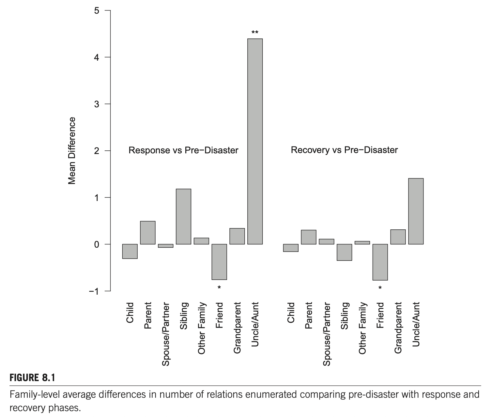
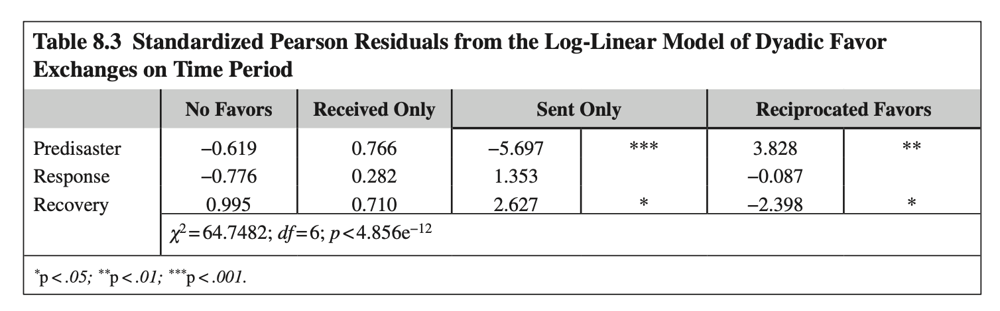
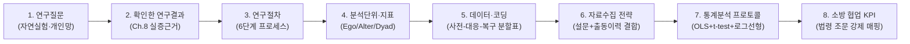
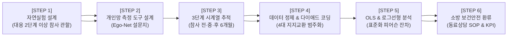

# 제8장 허리케인 아이크가 개인 네트워크 연계 활성화에 미친 영향: 대응 및 복구 단계의 전개 과정 (Sub-Note)

**원제**: CHAPTER 8 THE EFFECT OF HURRICANE IKE ON PERSONAL NETWORK TIE ACTIVATION AS RESPONSE AND RECOVERY UNFOLDED  
**저자**: Christopher Steven Marcum1, Anna V. Wilkinson2, Laura M. Koehly1  
1 *National Institutes of Health, Bethesda, MD, United States*  
2 *University of Texas Health Science Center at Houston, Houston, TX, United States*  
**출처**: *Social Network Analysis of Disaster Response, Recovery, and Adaptation* (Elsevier, 2017, pp. 113–126)  
**DOI**: `http://dx.doi.org/10.1016/B978-0-12-805196-2.00008-X`

---

## CHAPTER OUTLINE (장 목차 구성 — 원문 순서 동일)

* **Introduction (서론)** ............................................................................................................................................ 113
* **The Event in Family Context (가족 맥락에서의 재난 사건)** ........................................................................................ 114
* **Sources of Support Following Disasters (재난 후 지지의 원천)** ................................................................................... 115
  * Family Support (가족 지지) .................................................................................................................................. 115
  * Other Kinds of Relationships (기타 유형의 관계) ...................................................................................................... 116
  * Ties Across Space (공간을 초월한 연계) .................................................................................................................. 116
  * Networks and Coping (네트워크와 대처) ................................................................................................................. 117
* **Data and Methods (데이터 및 연구 방법)** ................................................................................................................ 118
* **Results (분석 결과)** ............................................................................................................................................ 119
* **Discussion: Family Networks and Disasters (논의: 가족 네트워크와 재난)** ................................................................... 123

---

# 1. 서론 및 이론적 배경

## INTRODUCTION (서론) `[원문 pp. 113–114]`

### [문단 1] 재난과 사회구조의 동태적 교란, 개인 네트워크 연구의 공백
재난(Disasters)은 시간에 따라 전개되는 규범적 과정(normative processes)을 파괴함으로써 사회구조(social structure)가 어떻게 영향을 받는지 규명할 수 있는 최적의 연구 환경(opportune settings)을 제공합니다(Drabek, 1986).
* **잠재적 연계의 활성화(Activation of Latent Ties)**: 재난 피해 주민들에게 이러한 충격은 사회연결망 경로를 따라 급속히 파급되며, 개인들은 긴급한 지원 요청에 부응하기 위해 평소 휴면 상태(dormant)로 유지되던 관계망을 호출하고 활성화(reaching out and activating ties)하게 됩니다(Smith & McCarty, 1996).
* **기존 연구 경향**: 과거 재난 대응 연구는 주로 피난 이동 패턴(Drabek & Boggs, 1968; Gray & Mueller, 2012), 피해 지역 인구통계학적 구성 변화(Donner & Rodríguez, 2008), 피난 시점(Huang et al., 2012; Ng et al., 2015), 사회적 지지를 통한 적응(Norris & Kaniasty, 1996) 등을 탐구해 왔습니다.
* **연구의 공백(Research Gap)**: 그러나 재난이 **가족 내 개인 네트워크(personal networks within families)**에 미치는 구체적 영향에 대해서는 거의 알려져 있지 않습니다. 기존 재난 네트워크 연구는 개인망이든 전체망이든 네트워크를 '원인(독립변수)'으로만 다루었을 뿐, **재난 충격에 따라 네트워크 자체가 어떻게 변화하는가(종속변수/결과변수)**에 대한 실증적 탐색은 매우 드뭅니다.

### [문단 2] 자연실험(Natural Experiment)으로서의 연구 설계 기회
본 연구는 자연에 의해 실험군과 대조군 조건이 부여된 실증적 시나리오인 **자연실험(Natural Experiment)**(Dunning, 2012)을 활용합니다.
* **연구 배경**: 2008년 여름~가을, 연구팀은 미국 텍사스주 그레이터 휴스턴(Greater Houston) 지역에 거주하는 멕시코계 가족(Mexican-origin families)을 대상으로 다중 정보제공자 종단적 가족 네트워크 조사(Project RAMA)를 진행하고 있었습니다.
* **허리케인 아이크(Hurricane Ike)의 급습**: 대상자 모집 및 데이터 수집 도중 2등급 대형 허리케인 아이크가 해당 지역을 강타했습니다.
* **연구 기회**: 재난 충격은 예측 불가능하여 개인 네트워크 수준에서 종단적 비교를 수행하기 극히 어렵지만, 기존에 진행 중이던 대규모 코호트 조사 도중 허리케인이 우연히 겹침으로써 재난 발생 전, 중, 후의 개인망 변화를 체계적으로 추적할 수 있는 독보적인 자연실험 데이터가 확보되었습니다.

### [문단 3] 3대 핵심 가설(Hypotheses) 수립
연구진은 재난 대응 과정에서 개인들이 로컬 및 원거리 구성원 모두와 접촉하면서 잠재적 연계를 활성화한다고 상정하고, **사전(Predisaster) - 대응(Response) - 복구(Recovery)**의 3시기에 걸쳐 3가지 핵심 가설을 검정합니다.
1. **가설 1 (H1: 네트워크 규모 확대)**: 재난 대응기(Response period)에 응답자들은 사전 단계나 복구 단계에 비해 **평균적으로 더 많은 수의 개인 네트워크 구성원(alters)을 열거할 것이다.**
2. **가설 2 (H2: 친족 관계 유형의 차별적 활성화)**: 재난 대응기에는 1차 친족(부모, 자녀, 배우자)이나 비친족(친구)보다 **원거리 2차 친족(삼촌, 이모, 고모 등)**이 상대적으로 더 많이 열거될 것이다.
3. **가설 3 (H3: 상호적 호의 교환의 확률적 초과)**: 재난 대응기에는 우연(기저확률)에 의한 기댓값보다 **더 많은 상호적 호의(reciprocal favors) 교환이 발생할 것**이며, 재난 사전 및 복구 단계에서는 유의한 이탈이 없을 것이다.

---

## THE EVENT IN FAMILY CONTEXT (가족 맥락에서의 재난 사건) `[원문 pp. 114–115]`

### [문단 1] 허리케인 아이크의 피해 규모와 가족 수준의 충격
* **상륙 시점 및 경로**: 2008년 9월 13일 이른 아침, 허리케인 아이크(카테고리 2)가 텍사스주 갤버스턴 섬(Galveston Island)에 상륙한 후 북동쪽 휴스턴으로 진입했습니다(Emmett, 2013).
* **물적·인적 피해**: 약 100만 명의 이재민이 발생했고, 갤버스턴 및 해리스 카운티에서만 최소 3,500가구가 즉시 파괴되어 홈리스가 되었습니다. 피해액은 약 380억 달러로, 카트리나($1,250억), 샌디($710억)에 이어 미국 역사상 세 번째로 큰 재산 피해를 기록했습니다. 미국 내 사망자는 195명(휴스턴-갤버스턴 일대 74명)이었습니다(Zane et al., 2011).

### [문단 2] 대피 결정에서의 사회연결망 역할
* **대피 명령과 잔류 선택**: 텍사스 주지사의 대피령과 국립기상청(NWS)의 극단적 경고 방송, 연방 비상사태 선포에도 불구하고 10만 명 이상의 주민들이 대피하지 않고 현장에 머물며 피난(shelter in place)을 선택했습니다(Cutter & Smith, 2009).
* **가족 네트워크의 결정적 영향**: Drabek & Boggs(1968)의 초기 연결망 연구에 따르면, **의지할 수 있는 사회적 연결망(social ties)이 적을수록 대피할 가능성이 낮아졌으며, 대응 기간 동안 활용된 사회적 관계의 대다수는 '가족 구성원'이었습니다.** 이는 재난 대응 시 확장된 가족 연계망이 활성화된다는 가설의 강력한 선행 근거가 됩니다.

### [문단 3] 대응기에서 복구기로의 전환과 가족 연계의 부각
* **공식 대응기의 전개**: 허리케인 상륙 후 즉각적 의사결정 외에도 공식적인 대응 국면은 수개월 동안 지속되었습니다. 연방재난관리청(FEMA)의 주거 복구 프로그램은 11월에야 시작되었으며, 이는 공식적으로 대응기에서 복구기로 전환되었음을 나타내는 지표입니다(Jadacki, 2011).
* **가족의 중요성(Salience of Family) 심화**: 복구 기간 동안 개인들은 비상 연락처를 확인하고 단절되었던 가족 구성원들과 재회하려 노력하면서 광범위한 가족 네트워크에 대한 인식이 크게 높아집니다. 이러한 인지적·구조적 과정은 재난 전-중-후에 네트워크 자원을 동원하는 양상을 질적으로 분화시킵니다.

---

# 2. 재난 후 사회적 지지의 원천과 대처

## SOURCES OF SUPPORT FOLLOWING DISASTERS `[원문 pp. 115–118]`

### 1) Family Support (가족 지지) `[원문 pp. 115–116]`
* **진정한 최초 대응자(True First Responders)**: Enrico Quarantelli(1960)는 동거하는 직계 가족 구성원이야말로 진정한 최초 대응자라고 역설했습니다. 가족은 위기 시 서로의 안전을 평가하고, 구호를 제공하며, 집단(collective)으로서 대응합니다.
* **지리적 근접성과 사회적 안전망**: 가족은 물리적으로 가장 가까이에 상주하므로 재난 발생 시 지원을 제공할 수 있는 가장 가용성 높은 자원입니다(Sampson, 1991). 전통적 사회학 연구에서도 가족은 위기 후 사회 보존, 피난 및 재결합, 경제적 적응의 핵심 단위로 다루어졌습니다(Drabek, 1969; Kunreuther, 1967).

### 2) Other Kinds of Relationships (기타 유형의 관계) `[원문 p. 116]`
* **제2 방어선(Second Line)**: 직계 가족을 넘어 확장 친족(extended kin), 친구, 이웃은 위기 극복의 필수적인 2차 방어선 역할을 수행합니다(Quarantelli, 1960).
* **시간적 역할 분담**: Drabek et al.(1975)과 Nigg(1995)에 따르면, **직계 가족 연계는 긴급 대응기(response period)**에 더 활발하게 가동되는 반면, **확장 친족은 장기 복구기(recovery period)**에 임시 주거, 육아, 식사, 재정적 지원 등 도구적 지원(instrumental support)을 제공하는 핵심 역할을 담당합니다.
* **심리적 지지와 친구의 역할**: 걸프전 당시 이스라엘 하이파 미사일 공격 연구(Shavit et al., 1994)에서는 친구가 직계 가족보다 심리적 지지(psychological support) 제공에서 더 큰 역할을 수행했음이 확인되었습니다.

### 3) Ties Across Space (공간을 초월한 연계) `[원문 pp. 116–117]`
* **지리적 인접성(Propinquity)과 피난처 기능**: 직계 가족은 지리적으로 가깝고, 확장 친족은 멀리 떨어져 있는 경우가 많습니다. 먼 친척은 평시에는 자주 접촉하지 않지만, **지역 전체가 초토화된 재난 상황에서는 파괴된 환경을 탈출해 피난할 수 있는 안전한 안식처(evacuation destination)**가 되기 때문에 긴급히 활성화됩니다(Lu et al., 2012; 2010년 아이티 지진 사례).
* **불평등의 축(Axes of Inequality)**: 반면 저소득층 및 이민자 가족의 경우, 원거리 친족과의 연계가 지리적·법적 장벽(국경, 추방 위험 등)으로 가로막혀 취약성이 가중됩니다(Tierney, 2006; Phillips et al., 1994). 히스패닉 가족은 공식 대피소보다 친척 집으로 피난하는 비율(63%)이 비히스패닉 가족보다 월등히 높으며, 친족 네트워크 의존도가 높을수록 공식 기관에 대한 지원 의존도는 반비례하는 경향을 보입니다(Hurlbert et al., 2001).

### 4) Networks and Coping (네트워크와 대처) `[원문 pp. 117–118]`
* **공동 대처 이론(Communal Coping Theory)**: 사회적 단위(가족 또는 공동체) 구성원들이 스트레스 사건을 개별 문제가 아닌 **공동의 문제(common problem)**로 인식하고 협력적 대처 행동을 취하는 이론입니다(Lyons et al., 1998).
* **상호적 교환(Reciprocal Exchange)**: 공동 대처는 상호 간 자원 교환 프로세스로 구체화됩니다. 특히 라틴계/히스패닉 문화권에서는 개인망 구성원 간 상호성에 대한 기대가 매우 높은 반면, 허리케인 앤드루 당시 복구 단계에서 자원 고갈을 겪은 바 있습니다(Kaniasty & Norris, 2000).

---

# 3. 데이터 및 연구 방법

## DATA AND METHODS `[원문 pp. 118–119]`

### 1) 표본 및 자료수집 (Project RAMA)
* **모집단 및 표본**: 텍사스 대학교 M.D. 앤더슨 암센터의 코호트(Mano-a-Mano Cohort)에서 모집된 휴스턴 거주 멕시코계 162개 가족, 총 **497명의 개인(가구당 3~4명)**을 대상으로 대면 방문 인터뷰 수행.
* **네트워크 측정 도구(Ego-Alter Generator)**:
  * 응답자 본인(Ego) 기준 1차 친족(부모, 자녀, 배우자, 형제자매) 및 2차 친족(조부모, 삼촌, 고모, 이모 등) 전수 조사.
  * 지난 1년 동안 "자신의 삶에서 중요한 역할을 했다"고 인식한 인물 최대 20명(친구, 이웃, 직장 동료 등) 추가 열거.
  * 분석 대상: 인터뷰 시점에 생존해 있는 알터(Alters) 및 그들과의 관계 속성.

### 2) 자연실험 시기 구분 (Time Periods)
허리케인 아이크의 상륙(2008.09.13)과 FEMA 주거 복구 프로그램 개시(2008.11월)를 기준으로 명확한 생애주기적 경계를 설정함:
1. **사전 단계 (Predisaster)**: 2008년 6월 6일 ~ 2008년 9월 10일 (주지사 대피령 직전까지)
2. **대응 단계 (Response)**: 2008년 9월 11일 ~ 2008년 11월 중순 (약 2개월간; 재난 직후 2주간의 조사 중단 기간을 제외한 실질 모집 기간 약 6주)
3. **복구 단계 (Recovery)**: 2008년 11월 중순 ~ 2009년 3월 13일

### 3) 사회적 상호작용 측정: 호의(Favors)의 다이애드 구성 (Dyadic Configurations)
응답자와 알터 간의 호의(부탁/도움) 교환을 4가지 이항 조합(Dyad)으로 범주화:
1. **No Favors (0, 0)**: 호의 교환 없음
2. **Received Only (0, 1)**: 응답자가 받기만 함 (알터 $\to$ 에고)
3. **Sent Only (1, 0)**: 응답자가 주기만 함 (에고 $\to$ 알터)
4. **Reciprocated Favors (1, 1)**: 상호 호의 교환 (전통적 상호성 네트워크 척도)

### 4) 통계 분석 모형
1. **표본 동질성 검정 (교차분석/분산분석)**: 시기별 응답자 인구통계학적 특성 차이 검정 ($\chi^2$ 검정 및 $F$-검정) $\to$ 외생적 표본 추출 편향 배제.
2. **가설 1 검정 (선형회귀분석, OLS)**: 시기(독립변수)에 따른 열거된 네트워크 규모(종속변수) 차이 검정.
3. **가설 2 검정 (독립표본 t-test)**: 시기별 가족 내 관계 유형(자녀, 부모, 배우자, 형제자매, 친척, 친구 등) 평균 차이 검정.
4. **가설 3 검정 (다이애드 로그선형모형, Log-Linear Model)**: 시기 $\times$ 호의 교환 유형 분할표에서 기대빈도 대비 관측빈도의 **표준화 피어슨 잔차(Standardized Pearson Residuals)** 산출.

---

# 4. 실증 분석 결과

## RESULTS `[원문 pp. 119–123]`

### 1) 표본의 인구통계학적 동질성 (Table 8.1 검증)
* 총 162가구, 497명 응답자 (사전 35가구 107명, 대응 45가구 137명, 복구 82가구 253명), 총 다이애드 수 8,335개.
* 여성 비율(54~55%), 평균 연령(40.5~41.4세), 외국 출생 비율(68~69%), 기혼 비율(69~71%), 자가·차량 동시 소유 비율(62~66%) 모두 시기 간 통계적으로 유의한 차이가 없음 ($p > .85$).
* **의의**: 허리케인 아이크라는 외생적 충격이 연구의 표본 추출 설계를 왜곡하지 않았음을 확인 (자연실험 조건 충족).

### 2) 가설 1 검정: 네트워크 규모의 확대 (Table 8.2)
* 선형회귀분석 결과, 사전 단계(기준집단, 평균 16.19명) 대비 **대응 단계에서 응답자들은 평균 1.84명 더 많은 네트워크 구성원을 열거함 ($\beta = 1.84, p < .01$).**
* 가구 단위(pooled family level)로 환산하면, 아이크 대응 과정에서 **가구당 평균 2.5명의 고유한 가족 구성원이 추가로 포착**되었습니다.
* 복구 단계에서는 사전 단계와 유의한 차이가 없었음 ($\beta = 0.15, p = .81$). $\to$ **가설 1 (H1) 완전 지지.**

### 3) 가설 2 검정: 친족 및 친구 관계의 선택적 활성화 (Figure 8.1)
* **삼촌/고모/이모(Uncle/Aunt)의 급증**: 대응기에는 사전 대비 2차 친족인 삼촌/이모의 수가 유의하게 증가함 ($t = 2.439, df = 752, p < .017$, 평균 4.4명 증가).
* **친구(Friend) 관계의 유의한 감소**: 반면 친구 열거 수는 대응기($t = -2.086, df = 512, p < .042$)와 복구기($t = -2.200, df = 462, p < .033$) 모두에서 유의하게 감소함.
* 직계가족(자녀, 부모, 배우자)이나 조부모는 유의한 차이가 없었음.
* **의의**: 위기 시 개인은 제한된 인지적·사회적 용량으로 인해 친구 관계를 일시적으로 탈락시키고, 위기 대응에 필요한 확장 친족(삼촌/이모 등 2차 친족)을 집중적으로 활성화함. $\to$ **가설 2 (H2) 부분적 지지.**

### 4) 가설 3 검정: 호의 교환의 상호성 및 불균형 (Table 8.3)
로그선형모형 분석 결과, 전체 모형은 극히 유의함 ($\chi^2 = 64.7482, df = 6, p < 4.856 \times 10^{-12}$).
* **사전 단계 (Predisaster)**:
  * '주기만 함(Sent Only)'은 기대치보다 극도로 적음 (잔차 **-5.697**, $p < .001$).
  * '상호적 교환(Reciprocated Favors)'은 기대치를 크게 상회함 (잔차 **+3.828**, $p < .01$). $\to$ 평시에는 엄격한 상호 호혜성이 지배함.
* **대응 단계 (Response)**:
  * 모든 호의 교환 유형(No Favors, Received Only, Sent Only, Reciprocated)이 우연적 기대치와 일치함 (통계적으로 유의한 편차 없음).
  * 즉, 대응기에는 상호 호의 교환이 기대치를 초과할 것이라는 가설과 달리, 무작위적 기댓값 수준을 유지함. $\to$ **가설 3 (H3) 기각.**
* **복구 단계 (Recovery)의 결정적 발견**:
  * '주기만 함(Sent Only)'이 기대치보다 유의하게 폭증함 (잔차 **+2.627**, $p < .05$).
  * '상호적 교환(Reciprocated Favors)'은 기대치보다 유의하게 급감함 (잔차 **-2.398**, $p < .05$).
  * **의의**: 복구 단계에서는 호의를 베풀기만 하고 되돌려받지 못하는 **'상호성 결여 및 일방적 자원 유출(Perceived Inequity)'**이 심각하게 발생함.

---

# 5. 표 및 그림 정밀 분석 (Tables & Figures)

## Table 8.1 연구참여자 및 가구 기술통계표

<!-- [표 8.1 이미지: subnote/image-table-8-1.png] -->

| 특성 (Characteristic) | 사전 단계 (Predisaster) | 대응 단계 (Response) | 복구 단계 (Recovery) | 유의확률 ($Pr(>|x|)$) |
| :--- | :---: | :---: | :---: | :---: |
| **정보제공자 수 (No. informants)** | 107명 | 137명 | 253명 | – |
| **가구 수 (No. families)** | 35가구 | 45가구 | 82가구 | – |
| **다이애드 수 (No. dyads)** | 1,732개 | 2,470개 | 4,133개 | – |
| **여성 비율 (Pct. female)** | 54% | 54% | 55% | 0.96α |
| **평균 연령 (Mean age)** | 41.4세 | 40.5세 | 40.7세 | 0.89β |
| **외국 출생 비율 (Pct. foreign born)** | 69% | 68% | 69% | 0.98α |
| **혼인 상태 (Marital status)** | | | | 0.97α |
| - 이혼 (Divorced) | 1% | 1% | 2% | – |
| - 기혼 (Married) | 71% | 69% | 70% | – |
| - 미혼 (Never married) | 25% | 28% | 25% | – |
| - 별거 (Separated) | 3% | 2% | 2% | – |
| - 사별 (Widowed) | 1% | 1% | 1% | – |
| **주택 및 차량 동시 소유 (Owns house & car)** | 62% | 65% | 66% | 0.85α |

*주: p-value는 α카이제곱 검정($\chi^2$) 및 βF-검정 기준.*

---

## Table 8.2 열거된 네트워크 규모 선형회귀분석표

| 독립변수 (Variable) | 회귀계수 $\beta$ (표준오차) | 통계적 유의성 |
| :--- | :--- | :---: |
| **상수항 (Constant)** | 16.19 (0.53) | *** ($p < .001$) |
| **시기 구분 (기준집단: 사전 단계)** | | |
| - 대응 단계 (Response phase) | **+1.84** (0.71) | ** ($p < .01$) |
| - 복구 단계 (Recovery phase) | +0.15 (0.64) | n.s. ($p = .81$) |
| **관측치 (Observations)** | 497명 | |
| **결정계수 ($R^2$ / Adj $R^2$)** | 0.020 / 0.016 | |
| **잔차 표준오차 (Residual Std. Error)** | 5.51 (자유도 $df = 494$) | |
| **$F$-통계량 (F-Statistic)** | 4.96** (자유도 $df = 2, 494$) | ** ($p < .01$) |

*주: **p < .01; ***p < .001.*

---

## Figure 8.1 시기별 관계 유형 평균차이 t-test 막대그래프

  
*FIGURE 8.1 Family-level average differences in number of relations enumerated comparing pre-disaster with response and recovery phases. (\*p < .05, \*\*p < .01)*

### 🔍 [그래프 정밀 분석]
1. **대응기 vs 사전기 (좌측 패널)**:
   - 삼촌/이모(Uncle/Aunt)의 평균 열거 수가 **+4.4명으로 폭증**하며 통계적으로 매우 유의함 ($p < .01$).
   - 반면 친구(Friend)는 **약 -0.8명 감소**하여 유의한 음(-)의 차이를 보임 ($p < .05$).
   - 자녀, 부모, 배우자, 형제자매 등 1차 친족은 0 근처에서 유의한 변화가 없음.
2. **복구기 vs 사전기 (우측 패널)**:
   - 친구(Friend)의 열거 감소 추세가 복구기에도 지속적으로 유지됨 ($-0.8$명, $p < .05$).
   - 삼촌/이모 열거 수는 약 $+1.4$명으로 다소 높지만 통계적 유의수준에는 미달하여 평시 수준으로 점차 회귀하는 양상을 나타냄.

---

## Table 8.3 호의 교환 로그선형모형 표준화 피어슨 잔차표

| 시기 (Period) | No Favors (교환 없음) | Received Only (받기만 함) | Sent Only (주기만 함) | Reciprocated Favors (상호 교환) |
| :--- | :---: | :---: | :---: | :---: |
| **사전 단계 (Predisaster)** | -0.619 | 0.766 | **-5.697\*\*\*** | **+3.828\*\*** |
| **대응 단계 (Response)** | -0.776 | 0.282 | +1.353 | -0.087 |
| **복구 단계 (Recovery)** | +0.995 | +0.710 | **+2.627\*** | **-2.398\*** |

*모형 적합도 통계량: $\chi^2 = 64.7482$; $df = 6$; $p < 4.856 \times 10^{-12}$*  
*\*p < .05; \*\*p < .01; \*\*\*p < .001.*

### 🔍 [잔차 분석 정밀 해석]
* **양의 잔차 ($> +1.96$)**: 해당 셀의 실제 빈도가 무작위 확률적 기댓값보다 통계적으로 유의하게 많음을 의미.
* **음의 잔차 ($< -1.96$)**: 해당 셀의 실제 빈도가 무작위 확률적 기댓값보다 통계적으로 유의하게 적음을 의미.
* **해석 핵심**: 사전 단계에는 상호 호혜적 교환($+3.828$)이 규범이었으나, 장기 복구 단계로 넘어가면서 지원을 일방적으로 제공하기만 하고($+2.627$) 되돌려받지 못하는($-2.398$) 자원 고갈 및 관계적 불균형(Inequity) 현상이 실증됨.

---

# 6. 논의 및 학술적 시사점

## DISCUSSION: FAMILY NETWORKS AND DISASTERS `[원문 pp. 123–124]`

### 1) 왜 2차 친족(삼촌/이모)이 급증했는가?
* **세대 간 관찰과 의사소통 활성화**: 조사에 참여한 부모 세대가 재난 대응 과정에서 자신의 형제자매(성인 자녀 기준 삼촌·고모·이모)와 긴급 연락 및 지원을 주고받는 모습을 성인 자녀들이 목격하면서, 자녀들의 개인망 인지에서 삼촌/이모의 중요도(salience)가 급상승함.
* **문화적 특수성 (*Compadrazgo*)**: 멕시코계 가족의 특수한 '콤파드레(Compadre, 대부모)' 문화가 반영되었을 가능성. 혈연관계가 아니더라도 가족처럼 깊게 의지하는 부모의 절친한 친구를 자녀들이 삼촌/이모로 호칭하여 열거했을 개연성이 존재함.

### 2) 왜 친구 관계는 단절·감소되었는가? (Social Signature 이론)
* Saramäki et al.(2014)의 '사회적 서명(Social Signature)' 이론과 일치: 인간의 인지적 통신 용량(communication capacity)에는 한계가 있기 때문에, 재난이라는 극단적 상황에서 생존과 피난에 필수적인 친족 연계를 긴급히 활성화하는 대신, 일상적 친구 관계를 일시적으로 비활성화(drop ties)하는 **자원 배분의 상충(Trade-off)**이 발생함.

### 3) 복구기 호의 교환 불균형과 심리적 영향: 공정성 이론 vs 공동 대처
* **공정성 이론(Equity Theory, Hatfield et al., 1978)**: 주는 것에 비해 받는 것이 없는 불균형은 분노, 좌절, 심리적 고통(distress)을 유발하며 관계 갈등을 촉발함.
* **적응적 공동 대처(Adaptive Communal Coping, Walsh, 2007)**: 반면 가족 체계에서는 대가를 바라지 않는 이타적 자원 제공이 가족 회복탄력성을 지탱하는 핵심 동력으로 작용할 수 있음. 그러나 이것이 장기화될 경우 지지 제공자의 심각한 피로(compassion fatigue)로 이어질 수 있음.

---

# 7. [부록] 박사학위 논문 선행연구 검토 9단계 표준 템플릿 (Chapter 8)

| 순서 | 분석 단계 | 제8장 핵심 요약 및 연구자 통제 관점 (Marcum et al., 2017) |
| :---: | :--- | :--- |
| **1** | **연구배경 (Background)** | 대형 재난이 사회구조에 미치는 영향 연구 중, 가족 내 개인 네트워크(Personal Network)가 재난 전개(대응-복구)에 따라 어떻게 변화하는지에 대한 실증 연구는 극히 부재함. |
| **2** | **이론적 개념 (Concepts)** | 잠재적 연계 활성화(Latent Tie Activation); 자연실험(Natural Experiment); 공동 대처 이론(Communal Coping); 공정성 이론(Equity Theory); 호의 교환 다이애드 구조; 사회적 서명(Social Signature). |
| **3** | **연구목적 (Objective)** | 2008년 허리케인 아이크 당시 수집된 멕시코계 162가구 497명의 데이터를 바탕으로, 재난 사전-대응-복구 시기별 개인망 규모, 친족 유형 활성화, 상호 호의 교환 구조의 동태적 변화를 실증 규명함. |
| **4** | **연구방법 (Methodology)** | RAMA 코호트 종단 데이터 활용. 사전(35가구), 대응(45가구), 복구(82가구) 자연실험 분할. OLS 선형회귀분석(규모), 독립표본 t-검정(관계유형), 4개 다이애드 범주 로그선형모형(호의교환 잔차). |
| **5** | **연구결과 (Results)** | 대응기 네트워크 규모 유의한 증가(+1.84명, 가구당 +2.5명); 2차 친족(삼촌/이모) 급증 및 친구 관계 유의한 감소; 복구기 호의 교환의 심각한 불균형(주기만 함 폭증 +2.627, 상호성 급감 -2.398). |
| **6** | **핵심 발견 (Findings)** | 위기 시 개인은 친구를 배제하고 원거리 2차 친족을 선택적으로 활성화하며, 재난 대응기에는 기댓값 수준이던 상호성이 장기 복구기에는 일방적 자원 유출로 붕괴되는 '관계적 불평등'을 실증함. |
| **7** | **연구의 한계 (Limitations)** | 텍사스 휴스턴 멕시코계 이민자 가족이라는 단일 민족·지역 표본에 국한되어 문화적 일반화에 한계가 있으며, 대피 장소와 이동 경로에 대한 지리정보시스템(GIS) 좌표 미연계. |
| **8** | **이론적 시사점 (Implications)** | 네트워크를 단순 독립변수가 아닌 '외생적 재난 충격에 반응하는 동태적 결과변수'로 정립하고, 로그선형모형 표준화 잔차를 통해 재난 복구기 상호성 붕괴 메커니즘을 최초 규명. |
| **9** | **후속 연구 시사점 (Future Scope)** | 재난 피해 주민 및 현장 긴급구조대원의 장기 복구기 사회적 지지망 고갈(Burnout) 예방 프로토콜 및 비친족 지원망 붕괴 보완 정책 수립 필요. |

---

# 8. ★ [내 연구 적용] 대형 재난 현장출동 소방대원의 개인 사회적 지지망 동학과 동료 지원(Peer Support) 상호성 붕괴 연구

본 장(Chapter 8)의 **자연실험(Natural Experiment) 설계**, **개인 네트워크 평가(Personal Ego-Net Assessment)**, **관계 유형별 선택적 활성화/탈락(t-test)** 및 **로그선형모형(Log-Linear Model) 기반 호의 교환 잔차 분석** 기법을 **[대형 참사(산불·이태원·오송 참사 등) 투입 소방공무원의 재난 전·대응·복구 단계별 지지망 동학 및 PTSD/소진(Burnout) 연구]**에 직접 적용합니다.

---

### 1. 연구질문 (Research Questions)
- **RQ 1 (재난 충격과 개인망 규모 변화)**: 관할 구역 내 대형 참사(대응 2·3단계 발령 재난)에 출동한 소방관들은 참사 투입 전, 현장 대응기, 수습 및 복구기(3~6개월 후)에 걸쳐 의지하는 **개인 사회적 지지망(가족, 동료, 지인)의 규모가 어떻게 변화하는가?**
- **RQ 2 (직무 동료 vs 외부 지인의 선택적 활성화)**: 재난 대응기 동안 참사 트라우마를 공유하는 **직무 동료(119구조대·구급대 팀원) 연계는 급격히 활성화**되는 반면, **비직무 지인(일반 친구, 사회적 모임)과의 관계망은 일시적으로 탈락·단절되는가?**
- **RQ 3 (동료 지지의 상호성 붕괴와 심리적 소진)**: 참사 수습 후 복구기 동안, 동료들에게 정서적·도구적 지지를 지속적으로 베풀기만 하고 상호 되돌려받지 못하는 **'일방적 지지 제공(Sent Only)'이 발생하는 소방관일수록 직무소진(Burnout) 및 외상후스트레스장애(PTSD) 위험이 통계적으로 유의하게 폭증하는가?**
- **RQ 4 (가족의 완충 효과와 이차 외상 스트레스)**: 직계 가족(배우자)과의 긴밀한 소통망이 참사 대응기에는 보호 요인으로 작용하지만, 복구기에 이르러 가족에게 트라우마가 전이되는 '이차 외상 스트레스(Secondary Traumatic Stress)'를 유발하는가?

---

### 2. 확인한 연구결과 및 연구 매핑 (Key Findings from Chapter 8)

| 이론 및 챕터 출처 | 선행연구 핵심 실증 결과 (Marcum et al., 2017) | 본 소방 안전 네트워크 연구로의 연계 적용 |
| :--- | :--- | :--- |
| **재난 시 개인망 규모 확대 (Chapter 8; Table 8.2)** | 허리케인 대응기 동안 응답자들은 평균 1.84명 더 많은 네트워크 구성원을 열거함 ($p < .01$). | 대형 참사 투입 직후 소방대원들이 동료, 선후배, 가족 등 생존 지지망을 긴급 확장하는 양상 검증. |
| **관계 유형의 선택적 분화 (Chapter 8; Figure 8.1)** | 2차 친족(삼촌/이모)은 폭증(+4.4명)한 반면, 친구 관계는 유의하게 감소($-0.8$명)하여 상충(trade-off) 발생. | 참사 대응기 동안 일반 친구망은 단절되고 현장 동료(Peer) 연계망으로 자원이 집중되는 쏠림 현상 규명. |
| **복구기 상호성 결여 (Chapter 8; Table 8.3)** | 복구기 동안 '주기만 함(Sent Only)' 잔차는 폭증(+2.627)하고, '상호 교환' 잔차는 급감($-2.398$)하여 불균형 발생. | 참사 수습 후 동료 상담사 역할을 도맡은 고참 대원이 일방적 지지 유출로 인해 심각한 소진을 겪는 기전 입증. |
| **공동 대처와 자원 고갈 (Chapter 8; Discussion)** | 공동 대처(Communal Coping)가 초기에는 적응적이나 장기화될 경우 관계적 불평등과 분노, 피로를 촉발함. | 초기 동료 지원(Peer Support) 프로그램이 장기 복구기에는 '동료 상담자의 지지 자원 고갈'로 이어지는 부작용 통제. |

---

### 3. 연구절차 (Research Procedure: 6단계 표준 프로세스)

---

### 4. 네트워크 분석단위 및 지표 (Units & Network Metrics)

1. **에고 수준 (Ego-level - 소방대원 본인)**:
   - **Network Size (전체 지지망 규모)**: 에고가 열거한 전체 알터(직무 동료 + 가족 + 지인)의 총수.
   - **Kin/Peer Ratio (동료 대비 친족 비율)**: 지지망 내 소방 직무 동료의 구성비율 $\to$ 직무 쏠림도.
2. **다이애드 수준 (Dyadic-level - 에고와 알터 간 쌍)**:
   - **4가지 정서적·도구적 지지 교환 유형**:
     - `No Support (0, 0)`: 상호 지지 교환 부재
     - `Received Only (0, 1)`: 에고가 동료/가족으로부터 받기만 함
     - `Sent Only (1, 0)`: 에고가 상대방에게 지지를 베풀기만 함 (자원 유출)
     - `Reciprocal (1, 1)`: 상호 호혜적 지지 교환
3. **집단/팀 수준 (Team-level - 119구조구급대 단위)**:
   - **팀 내 지지 교환 밀도(Density) 및 상호성 비율(Reciprocity Rate)**.

---

### 5. 데이터 구조 및 코딩 기준 (Data & Coding Protocol)

| 구분 | 데이터 형식 | 변수 구성 및 코딩 기준 |
| :--- | :--- | :--- |
| **소방관 속성 데이터 (Ego Demographics)** | 1-mode 엑셀 테이블 (행 = 소방관 $i$, $N = 300$) | • **ID**: FF001, FF002 ... • **Role**: 1=구조, 2=구급, 3=진압, 4=상황관리 • **Rank**: 소방사~소방령 • **Disaster_Phase**: 1=평시(사전), 2=대응기(출동중), 3=복구기(수습후) • **PTSD_Score**: IES-R 외상후 스트레스 점수 • **Burnout_Score**: MBI 직무소진 척도 |
| **개인망 알터 데이터 (Alter Matrix)** | Ego-Alter 연계 테이블 (최대 15명 열거) | • **Alter_Type**: 1=소방서 팀원, 2=타소방서 동료, 3=직계가족, 4=확장친족, 5=친구/지인 • **Proximity**: 지리적 거주 거리 (관내 vs 원거리) • **Frequency**: 주간 연락 빈도 |
| **다이애드 지지 교환 분할표 (Contingency Table)** | $3 \times 4$ 교차 행렬 (시기 $\times$ 4대 지지유형) | • 행: Predisaster vs Response vs Recovery • 열: No Support, Received Only, Sent Only, Reciprocal |

---

### 6. 통계분석 실행 프로토콜 (Statistical Analysis Protocol)

1. **Step 1: OLS 다중선형회귀분석 (네트워크 규모 변화 검정)**:
   $$Y_i (\text{Network Size}) = \beta_0 + \beta_1 (\text{Response}) + \beta_2 (\text{Recovery}) + \gamma X_i + \epsilon_i$$
2. **Step 2: 독립표본 t-검정 (동료 vs 일반 친구 관계 수 평균 비교)**:
   대응기 및 복구기 동안 소방 동료 수($N_{\text{Peer}}$)와 일반 친구 수($N_{\text{Friend}}$)의 증감 검정.
3. **Step 3: 다이애드 로그선형모형(Log-Linear Model) 추정**:
   - 시기($P$)와 지지유형($S$) 간의 독립성 검정:
     $$\ln (m_{ij}) = \mu + \lambda_i^P + \lambda_j^S + \lambda_{ij}^{PS}$$
   - 각 셀별 **표준화 피어슨 잔차(Standardized Pearson Residual)** 산출:
     $$r_{ij} = \frac{n_{ij} - \hat{m}_{ij}}{\sqrt{\hat{m}_{ij}}}$$
   - 복구기에서 `Sent Only` 셀의 $r > +1.96$ 여부 및 `Reciprocal` 셀의 $r < -1.96$ 여부 집중 검증.

---

### 7. 소방 보건안전 환류: 맞춤형 KPI 도출 및 법적 근거 매핑

#### 1) 소방 실무 개선 환류 정책
- **'동료상담사(Peer Supporter) 지지 고갈 안식제' 도입**:
  - 참사 수습 후 동료들의 심리 상담을 도맡아 일방적 지지 유출(`Sent Only`)을 경험하는 고참 대원에게 의무적 휴식 및 외부 전문 심리지원 제공 (번아웃 방지).
- **'재난 복구기 소방관 사회적 지지망 회복 프로토콜' 수립**:
  - 참사 대응기 동안 단절되었던 일반 친구·가족 관계망을 복원할 수 있도록 '회복 힐링 캠프' 및 가족 참여 프로그램 정례화.

#### 2) 소방 맞춤형 핵심성과지표 (KPI 가중치: 고유 70% / 협업 30%)
* **고유 지표 (소방 내부 관리 70%)**:
  1. **참사 복구기 동료 지지 상호성 유지율 (40%)**: 로그선형 잔차 기준 상호적 지지(`Reciprocal`) 비율 60% 이상 유지.
  2. **동료상담 대원 일방적 지지 유출(`Sent Only`) 모니터링 지수 (30%)**: 고위험 노출 대원의 조기 스크리닝 및 순환 배치율 100%.
* **협업 지표 (보건복지부·지자체 정신건강센터 협업 30%)**:
  3. **소방-지역사회 전문 심리치료망 연계율 (30%)**: 내부 지지망 고갈 시 외부 국립트라우마센터로의 신속 전원율.

#### 3) 관련 법적 근거 매핑 (조문 단위 강제 연계)
- **소방공무원 보건안전 및 복지 기본법 제10조(소방공무원의 건강관리 등)**: 소방청장은 소방활동으로 인하여 신체적·정신적 위험에 노출된 소방공무원의 건강관리를 위한 대책을 수립·시행하여야 함.
- **소방공무원 보건안전 및 복지 기본법 제11조(정신건강 관리 등)**: 소방청장 및 소방본부장은 외상후스트레스장애(PTSD), 우울증 등 정신건강 장애의 예방 및 치료를 위한 상담·치료 프로그램을 운영하여야 함.
- **재난 및 안전관리 기본법 제65조의3(재난관리 참여자 등의 심리지원)**: 재난 현장에서 구호 및 수습 활동에 참여한 긴급구조요원에 대한 심리지원 의무 명시.
