# 제9장 가족의 부담: 재난 다발 지역 플로리다 주민들이 인지하는 개인 재난 지원 사회연결망 자원 (Sub-Note)

**원제**: CHAPTER 9 THE FAMILY’S BURDEN: PERCEIVED SOCIAL NETWORK RESOURCES FOR INDIVIDUAL DISASTER ASSISTANCE IN HAZARD-PRONE FLORIDA  
**저자**: Michelle Meyer  
*Louisiana State University, Baton Rouge, LA, United States*  
**출처**: *Social Network Analysis of Disaster Response, Recovery, and Adaptation* (Elsevier, 2017, pp. 127–141)  
**DOI**: `http://dx.doi.org/10.1016/B978-0-12-805196-2.00009-1`  
**Copyright**: © 2017 Elsevier Inc. All rights reserved.

---

## CHAPTER OUTLINE (장 목차 구성 — 원문 순서 동일)

* **Introduction (서론)** ............................................................................................................................................ 127
* **Methods (연구 방법)** ............................................................................................................................................ 129
  * Social Network Measures (사회연결망 측정 도구) ................................................................................................ 130
  * Sampling and Data Collection (표본추출 및 자료수집) ........................................................................................... 131
* **Disaster Support Networks: Size and Resources (재난 지원 네트워크: 규모와 자원)** ................................................ 131
* **Disaster Support Networks: Composition (재난 지원 네트워크: 구성과 가족의 부담)** .............................................. 134
* **Perceptions of Social Networks and Socioeconomic Status (사회연결망 인식과 사회경제적 지위)** .......................... 137
* **Discussion (논의 및 결론)** ................................................................................................................................... 139

---

# 1. 서론 및 이론적 배경

## INTRODUCTION (서론) `[원문 pp. 127–129]`

### [문단 1] 재난 시 비공식 사회연결망의 결정적 역할: "진정한 최초 대응자"
* 친구, 가족, 직장 동료, 지인 등은 비밀을 털어놓고(shares confidences), 사회적 지지를 주고받으며, 중요 문제와 화제를 상의하는 개인 네트워크를 구성합니다(Paxton, 1999).
* 재난 현장 연구에 따르면 **가족, 친구, 이웃은 재난 발생 시 공공 기관보다 먼저 현장에 개입하는 "진정한 최초 대응자(real first responders)"**입니다.
* 개인의 사회연결망 구성원들은 경보 메시지 및 복구 정보 전파, 구호물품 공급, 수색 및 구조(Search and Rescue), 대피 및 재건 기간 임시 거처(피난처) 제공, 사회·정서·재정적 지원, 잔해 제거 및 주택 수리 등 광범위하고 필수적인 재난 지원을 직접 수행합니다(Elliott, Haney, & Sams-Abiodun, 2010; Hawkins & Maurer, 2010; Hurlbert, Haines, & Beggs, 2000).

### [문단 2] 네트워크의 규모(Size)와 구성(Composition)이 재난 회복에 미치는 영향
* **네트워크 규모(Size)의 효과**: 연결망의 규모가 클수록 재난 후 실질적·물적 지원(debris removal 등), 정보적 지원(공식 구호 자원 안내), 정서적 지원(격려 및 심리적 안정)을 유의하게 더 많이 수혜받습니다(Kaniasty & Norris, 1995). 선행 연구에 따르면 개인들은 재난 시 평균 1.5명에서 5명의 비공식 인물로부터 지원을 받습니다(Hurlbert et al., 2000; Jones et al., 2015).
* **네트워크 구성(Composition)의 효과**: 네트워크 내 구성원들의 인구사회학적 속성 또한 지원의 양과 질을 결정합니다. 1992년 허리케인 앤드루(Hurricane Andrew) 연구에서는 **남성, 청장년층, 가족 구성원의 비율이 높은 네트워크를 가진 개인일수록 비공식 지원(주택 재건, 육아 등)을 더 많이 받음**이 실증되었습니다(Hurlbert et al., 2000).

### [문단 3] 친족 배태성(Kin Embeddedness)과 일상적 위기의 확장
* 재난 지원 네트워크(Disaster Support Networks)에서 **가족 구성원(Family members)**은 절대적 중심을 차지합니다(Drabek & Boggs, 1968; Garrison & Sasser, 2009; Haines, Hurlbert, & Beggs, 1996).
* **친족 배태성(Kin Embeddedness)**: 평소 사회적 지지를 제공하던 지역사회 제도와 구조가 재난 충격으로 붕괴·단절되었을 때, 가족 구성원과 얼마나 단단하게 연결되어 있는가는 생존과 구호를 결정하는 가장 핵심적인 기제입니다(Bolin, 1976; Erikson, 1976).
* 이러한 재난 시 가족 의존 현상은 평상시 일상적 응급 상황(급전 차용, 긴급 육아 등)에서 가족에게 의지하는 사회적 양상과 직결됩니다(Chua et al., 2011; Longino & Lipman, 1981). 특히 **재정적 대출(financial loans)이나 장기 거처 제공과 같이 상대방에게 부담이 큰(more burdensome) 지원일수록 개인들은 오직 가족에게만 손을 벌립니다**(Furstenberg & Kaplan, 2004).

### [문단 4] 사회경제적 불평등과 연결망 자원의 비대칭성
* 사회자본 이론(Lin, 2000; Lin & Dumin, 1986)에 따르면 사회경제적 지위(SES), 인종, 성별은 개인이 연결망을 통해 접근할 수 있는 자원의 양과 종류에 근본적인 불평등을 야기합니다.
* 고소득·고지위층은 연결망을 통해 고급 정보와 실질적 기회를 획득하는 반면, 취약계층은 일상적 생존을 위해 네트워크 내부에서 제한된 호의와 자원을 나누는 데 머뭅니다(Stack, 1975).
* **재난 상황에서의 불평등 증폭**: 평소 사회연결망 자원이 부족하거나 자원을 가진 구성원과의 연계가 없는 취약계층은 재난 충격 흡수 및 반등 회복력(bounce-back capacity)이 현저히 저하됩니다(Messias, Barrington, & Lacy, 2012). 카트리나 당시 뉴욕/뉴올리언스 비교 연구(Elliott et al., 2010; Hawkins & Maurer, 2010)에서도 저소득 흑인 집단은 피해 지역 내부의 가족/친구에게만 의존하여 외부의 안전한 자원에 접근하지 못한 채 극심한 회복 격차를 겪었습니다.

### [문단 5~7] 본 연구의 독창성: 사후 회상(Post-event Recall)을 넘어 "사전 인지된 네트워크(Pre-disaster Perceptions)" 실증
기존 재난 연결망 연구는 대부분 재난이 발생한 후(post-event) 생존자들의 사후 기억 회상에 의존했습니다. 본 연구는 **상시 재난 위험에 노출된 플로리다 주민들을 대상으로, 향후 재난 발생 시 누구에게 어떤 지원을 요청할 것인지에 대한 "사전 인지(Pre-event Perceptions)" 데이터를 수집**하여 학술적 공백을 채웁니다.

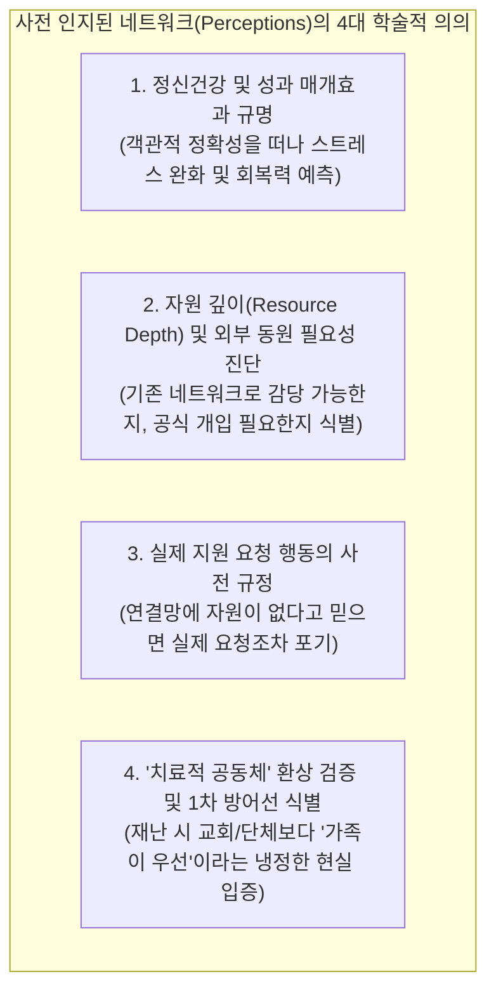

---

# 2. 연구 방법 (Data and Methods)

## METHODS `[원문 pp. 129–131]`

### 1) 연구 대상지 선정: 플로리다주 2개 카운티의 다중 생태학적 비교
* 플로리다는 매년 6월부터 10월까지 지속되는 허리케인 시즌과 함께 토네이도, 홍수, 산불 위험이 상존하는 대표적인 자연재난 취약 지역입니다.
* 자연재난 노출 위험은 동일하지만 경제, 사회, 물리적 환경이 상이한 두 카운티를 선정하여 비교 분석을 수행했습니다:
  * **레온 카운티 (Leon County)**: 주도 탤러해시(Tallahassee)가 소재한 교외 및 도시 지역. 인구밀도가 높고 중위 가계소득이 높음($44,490).
  * **딕시 카운티 (Dixie County)**: 멕시코만 연안에 위치한 농촌(Rural) 어촌/산림 지역. 인구밀도가 극히 낮고 빈곤율이 높으며 중위 가계소득이 낮음($32,312).

### 2) 네트워크 측정 도구: Name Generator (이름 생성 질문법)
* 설문 참여자들에게 재난 발생(허리케인 상륙) 시 **도움을 요청할 대상(Alters)을 최대 8명까지 열거**하도록 유도(Knoke & Yang, 2008).[^1]
* 열거된 각 인물에 대해 다음 속성을 수집:
  1. 관계(Relationship: 가족, 친구, 이웃)
  2. 연령(Age)
  3. 거주 위치(Location: 로컬 vs 비로컬/원거리)
  4. 인종(Race) 및 성별(Gender)
  5. **지원 유형(Type of Assistance)**: **재정적 지원(Financial: 대피/재건 자금 등 화폐 지원)** vs **비재정적 지원(Nonfinancial: 물리적 노동, 잔해 제거, 대피소 임시 거처, 육아, 정서적 지지)**
  6. 과거 지원 수혜 및 제공 경험(Reciprocity)

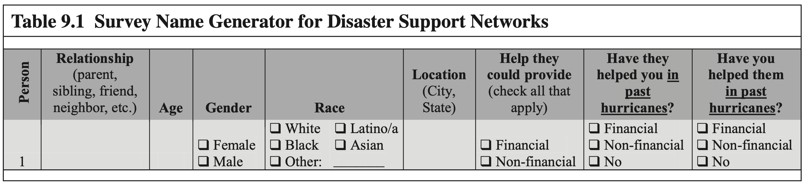  
*Table 9.1 Survey Name Generator for Disaster Support Networks*

### 3) 표본추출 및 자료수집 (혼합연구방법론: 설문조사 + 심층면담)
* **우편 설문(Mail Survey)**:
  * 딕시 카운티: 전체 카운티에서 무작위 표본추출(Random sampling) 300가구.
  * 레온 카운티: 사회적 취약성(Social Vulnerability) 지표(빈곤율, 중위소득, 소수인종 비율, 가구 규모, 여성가구주 비율, 임차가구 비율, 노인 비율, 아동 비율)를 반영한 층화 군집 표본추출(Stratified cluster sampling)[^2] 300가구.
  * 유효 가구 529가구 중 138가구 설문 완료 (응답률 27.0%: 딕시 75가구, 레온 63가구).
* **심층 인터뷰(In-person Interviews)**:
  * 설문 참여자 중 희망자($10 인센티브 제공) 25명(딕시 9명, 레온 16명)을 대상으로 20분~2시간 대면 인터뷰 실시, 녹음 후 전사(Transcribed verbatim)하여 질적 내용분석 수행.

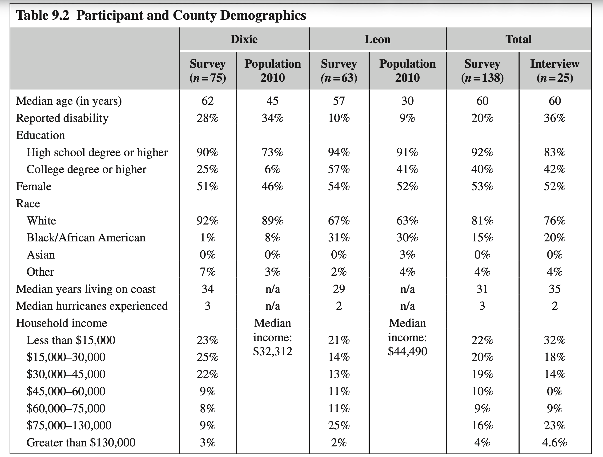  
*Table 9.2 Participant and County Demographics*

📌 Table 9.2 세부 인구통계 데이터 펼쳐보기

* **딕시 카운티 (Dixie)**:
  * 설문 응답자(n=75): 중위연령 62세, 장애가구원 28%, 고졸 이상 90%, 대졸 이상 25%, 여성 51%, 백인 73%, 흑인 6%, 기타 46%(인구센서스 대비), 중위소득 $32,312.
* **레온 카운티 (Leon)**:
  * 설문 응답자(n=63): 중위연령 57세, 장애가구원 10%, 고졸 이상 94%, 대졸 이상 57%, 여성 54%, 백인 67%, 흑인 31%, 아시아계 0%, 기타 2%, 중위소득 $44,490.
* **전체 설문 표본 (Total Survey n=138)**: 중위연령 60세, 백인 81%, 흑인 15%, 연안 거주기간 중위값 31년, 경험한 허리케인 중위값 3회.
* **심층 면담 표본 (Interview n=25)**: 중위연령 60세, 여성 52%, 백인 76%, 흑인 20%, 연안 거주기간 중위값 35년, 경험한 허리케인 중위값 2회.

---

# 3. 실증 분석 결과: 재난 지원 네트워크의 규모와 자원

## DISASTER SUPPORT NETWORKS: SIZE AND RESOURCES `[원문 pp. 131–134]`

### 1) 자원 유형별 네트워크 규모의 극심한 비대칭성: "돈(재정)을 빌릴 곳은 없다"
* 많은 응답자들은 재난 발생 시 도움을 요청할 사회적 연결망의 수가 매우 적었으며, **지원 자원의 종류(재정적 vs 비재정적)**에 따라 극명한 격차를 보였습니다.
* **전체 네트워크 규모**: 지원 유형과 무관하게 전체 열거된 평균 네트워크 규모는 **3.7명**이었습니다.
* **비재정적 지원 네트워크**: 평균 **3.1명**으로 비교적 안정적인 지지망을 보고했습니다.
* **재정적 지원 네트워크**: 평균 **1.7명**에 불과하여, 비재정적 네트워크 규모의 절반 수준에 머물렀습니다.

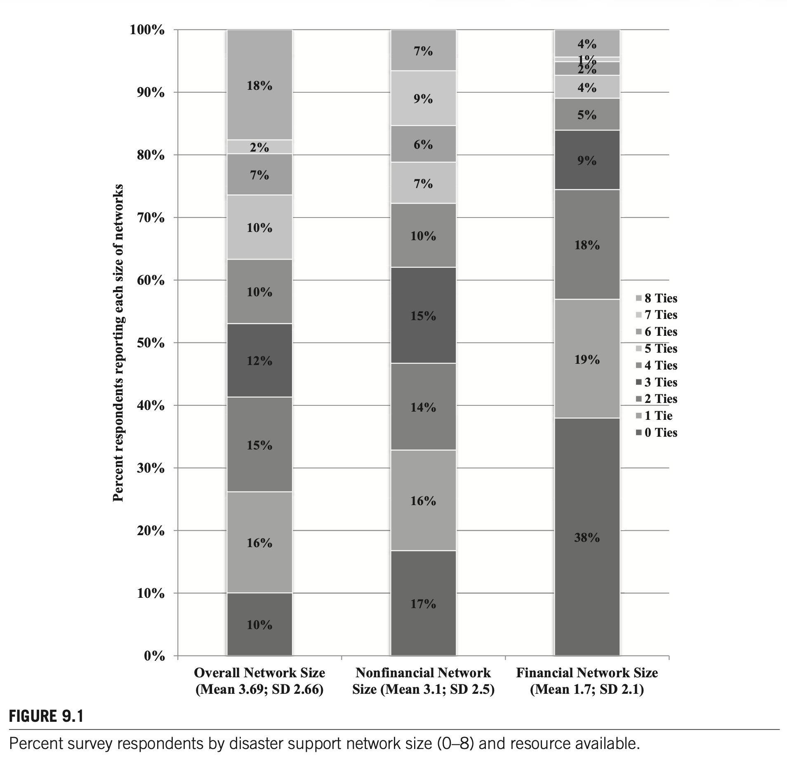  
*FIGURE 9.1 Percent survey respondents by disaster support network size (0–8) and resource available.*

```mermaid
xychart-beta
    title "재난 지원 네트워크 규모별 응답자 비율 비교 (Figure 9.1 요약)"
    x-axis ["0명(완전고립)", "1-3명(소규모)", "4-7명(중규모)", "8명(최대 연결)"]
    y-axis "응답자 비율 (%)" 0 --> 45
    bar [10, 38, 34, 18]
    bar [40, 45, 12, 3]
```
*(파란색: 비재정적/전체 네트워크 경향, 주황색: 재정적 지원 네트워크 경향)*

### 🔍 Figure 9.1 핵심 발견점
1. **재정적 고립 가구의 충격적 비율 (40%)**:
   * 전체 응답자의 **40%는 재난 발생 시 1달러의 재정적 지원도 요청할 수 있는 대상(가족, 친구, 이웃)이 단 1명도 없다(0명)**고 응답했습니다.
   * 비재정적 지원망에서 0명이라고 답한 비율이 17%인 것과 비교할 때 2배 이상 높은 수치입니다.
2. **양극화 현상**:
   * 전체 응답자의 10%는 재정·비재정을 통틀어 기댈 수 있는 사람이 전혀 없는 완전 고립 상태(0명)인 반면, 18%는 설문 상한선인 8명을 꽉 채워 보고했습니다.
3. **제도적 의존 불가피성**:
   * 응답자들은 재난 후 주택 파손 수리비, 대피 기간 모텔 투숙비 등 긴급 자금이 필요할 때, 사적 네트워크에 기대기보다 **개인 저축, 재해보험, 혹은 정부(FEMA)/구호기관의 공적 지원에 전적으로 의존하거나 아예 지원을 포기**해야 하는 구조에 놓여 있습니다.

---

# 4. 재난 지원 네트워크의 구성과 "가족의 부담(The Family's Burden)"

## DISASTER SUPPORT NETWORKS: COMPOSITION `[원문 pp. 134–137]`

### 1) 관계 구성 비율: 압도적인 가족 중심성 (Figure 9.2)
최소 1명 이상의 네트워크를 보고한 응답자들의 관계 구성을 분석한 결과, **가족(Family)이 전체 네트워크의 59%**를 차지하여 지배적인 비중을 보였습니다.

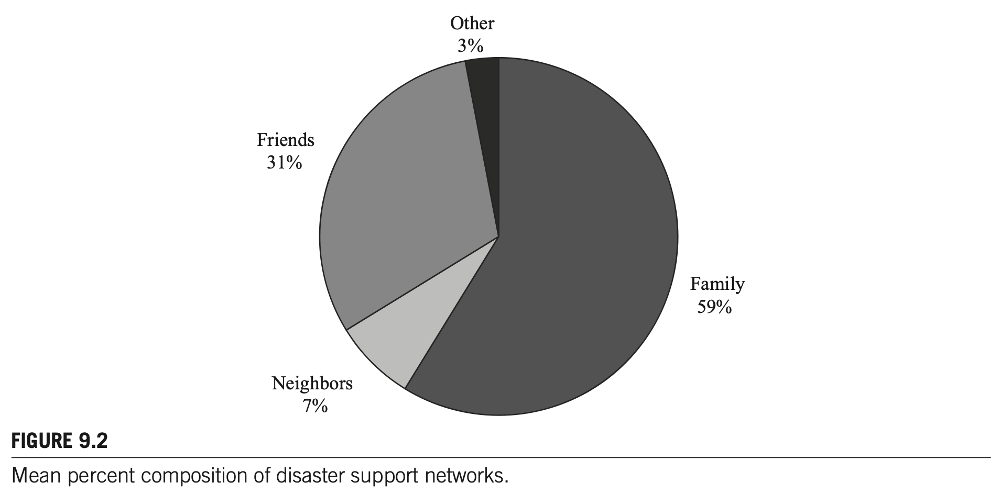  
*FIGURE 9.2 Mean percent composition of disaster support networks.*  
*(Note: Family 59%, Friends 31%, Neighbors 7%, Other 3%)*

* **가족(Family)**: 평균 **59%**. 직계 가족(부모, 자녀, 형제자매)뿐만 아니라 친인척 및 인척을 망라.
* **친구(Friends)**: 평균 **31%**. 직장 동료 포함.
* **이웃(Neighbors)**: 평균 **7%**. 지리적으로 가장 근접해 있음에도 불구하고 전체 네트워크에서 차지하는 평균 비중은 한 자릿수에 불과.
* **기타(Other)**: 평균 **3%**. 교회 교우, 사회단체 회원 등.

### 2) 관계 유형별 열거 빈도 (Figure 9.3)
응답자들이 네트워크 목록에 단 1명이라도 특정 관계를 포함시켰는지 분석한 결과:
* **가족 포함율**: 응답자의 **85% 이상**이 최소 1명 이상의 가족을 지지망에 포함.
  * **부모(Parents)**: 45%로 가장 흔하게 지목됨.
  * **형제자매(Sibling)** 및 **자녀(Child)**: 2위 및 3위 차지.
* **이웃(Neighbors)**: 전체 네트워크 내 평균 비율은 7%에 불과했으나, **응답자의 56%가 최소 1명의 이웃을 포함**시켰음 (근거리 비재정 긴급 지원용).
* **친구(Friends)**: 응답자의 24%만이 친구를 지지망에 포함.

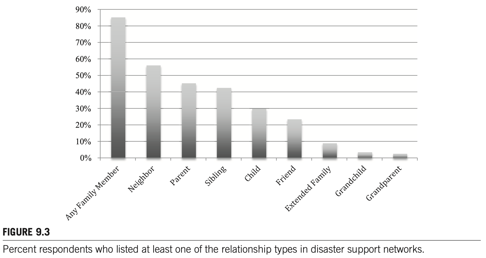  
*FIGURE 9.3 Percent respondents who listed at least one of the relationship types in disaster support networks.*

### 3) 1차 자원 선택의 분화: 자원 유형 vs 지리적 위치 (Figure 9.4)
재난 시 재정적 지원과 비재정적 지원을 가장 먼저 요청할 대상(Anticipated First Source)을 비교했을 때, 연결망 동원의 메커니즘이 확연히 갈렸습니다.

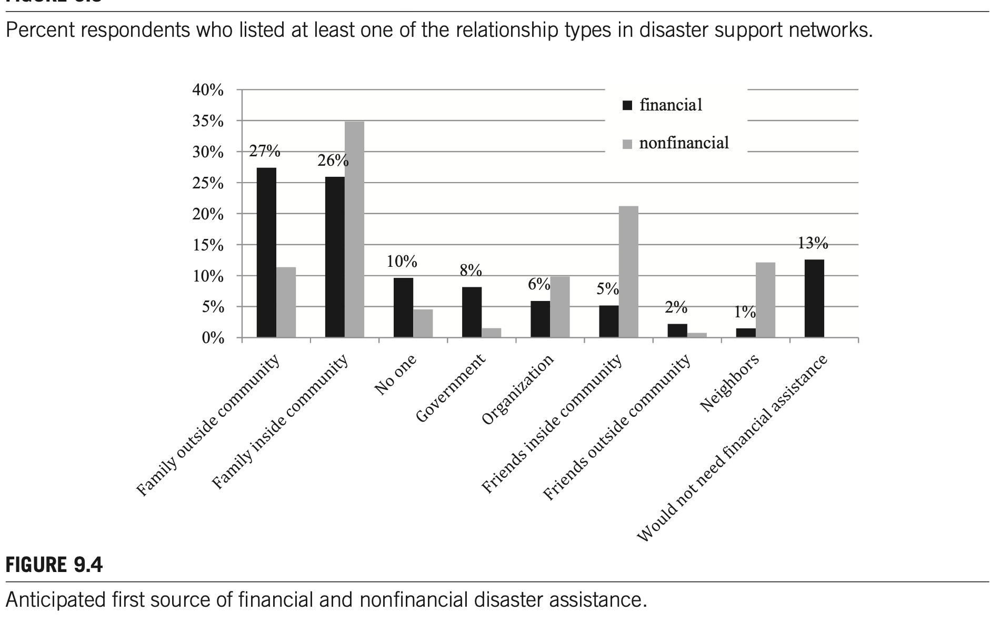  
*FIGURE 9.4 Anticipated first source of financial and nonfinancial disaster assistance.*

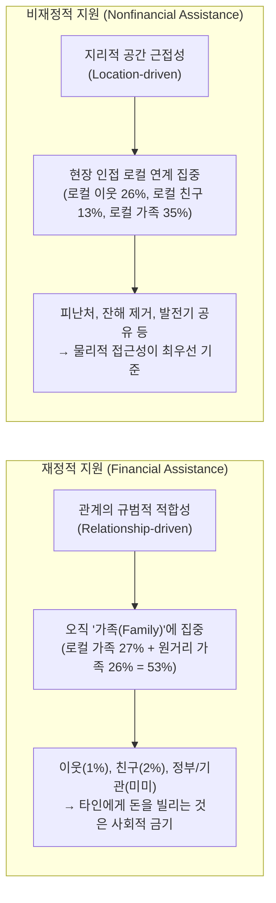

* **재정 지원: 관계 주도형(Relationship-driven)**
  * 응답자의 **53%가 가족(로컬 가족 27% + 원거리 가족 26%)을 1차 재정 지원처로 지목**.
  * 이웃(1%), 친구(2%)에게 재정 지원을 요청하겠다는 응답은 전무에 가까움.
  * 이는 돈을 요구하는 행위가 상대방에게 막대한 사회적·심리적 부담을 주기 때문에, 무조건적 호혜성이 작동하는 **가족에게만 전가되는 '가족의 짐(The Family's Burden)'**임을 증명합니다.
* **비재정 지원: 위치 주도형(Location-driven)**
  * 로컬 가족(35%), 로컬 이웃(26%), 로컬 친구(13%) 등 **지리적으로 인접한 연계(Local ties)**가 1차 지원처의 대부분을 차지.
  * 일상적 응급 상황(사다리 빌리기, 정전 시 발전기 공유, 통근 카풀)의 호의 교환 경험이 재난 시 잔해 제거, 대피소 공유로 자연스럽게 전이됨.

---

# 5. 사회경제적 지위(SES), 취약성과 재난 지지망 불평등

## PERCEPTIONS OF SOCIAL NETWORKS AND SOCIOECONOMIC STATUS `[원문 pp. 137–139]`

### 1) 로지스틱 회귀분석: 재정적 지원망 보유 여부 결정요인 (Table 9.3)
연구진은 재난 시 최소 1명 이상의 재정적 지원을 제공할 수 있는 연계를 확보하고 있는지 여부(1=있음, 0=없음)를 종속변수로 하여 로지스틱 회귀분석을 실시했습니다.

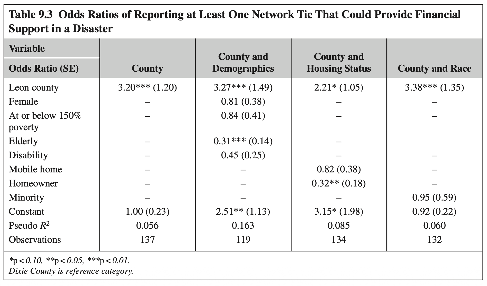  
*Table 9.3 Odds Ratios of Reporting at Least One Network Tie That Could Provide Financial Support in a Disaster*

📊 Table 9.3 회귀분석 모형별 승산비(Odds Ratio) 및 표준오차

| 독립변수 (Variables) | 모형 1: 카운티 | 모형 2: 카운티 + 인구학적 | 모형 3: 카운티 + 주거형태 | 모형 4: 카운티 + 인종 |
| :--- | :---: | :---: | :---: | :---: |
| **레온 카운티 거주 (Leon County)** | **3.20\*\*\*** (1.20) | **3.27\*\*\*** (1.49) | **2.21\*** (1.05) | **3.38\*\*\*** (1.35) |
| 여성 (Female) | — | 0.81 (0.38) | — | — |
| 빈곤선 150% 이하 (At or below 150% poverty) | — | 0.84 (0.41) | — | — |
| **노인 (Elderly, 65세 이상)** | — | **0.31\*\*\*** (0.14) | — | — |
| 장애 가구원 (Disability) | — | 0.45 (0.25) | — | — |
| 이동식 주택 거주 (Mobile home) | — | — | 0.82 (0.38) | — |
| **자가 주택 소유자 (Homeowner)** | — | — | **0.32\*\*** (0.18) | — |
| 소수인종 (Minority) | — | — | — | 0.95 (0.59) |
| 상수항 (Constant) | 1.00 (0.23) | 2.51\*\* (1.13) | 3.15\* (1.98) | 0.92 (0.22) |
| **Pseudo $R^2$** | 0.056 | **0.163** | 0.085 | 0.060 |
| 관측치 수 (Observations) | 137 | 119 | 134 | 132 |

*\*p < 0.10, \*\*p < 0.05, \*\*\*p < 0.01 (기준집단: 딕시 카운티).*

### 🔍 Table 9.3 핵심 통계 해석
1. **지역 생태학적 격차 (Leon vs. Dixie)**:
   * 도시/고소득 지역인 레온 카운티 주민은 농촌/저소득 지역인 딕시 카운티 주민에 비해 **재정적 지원 연계를 보고할 승산(Odds)이 3.20배~3.38배 유의하게 높았습니다**($p < 0.01$).
   * 이는 개인이 속한 거시적 지역사회의 부(wealth)와 인구밀도가 개인 네트워크의 자원 깊이에 직접적인 영향을 미침을 보여줍니다.
2. **노인층의 극심한 재정망 결핍 ($OR = 0.31$)**:
   * 65세 이상 노인 응답자는 비노인층에 비해 재정적 지원망을 보유할 승산이 **0.31배(약 1/3 수준)에 불과**했습니다($p < 0.01$).
   * 노인들은 부모 세대가 이미 작고했고 또래 네트워크 역시 은퇴하여 여유 자금이 없으므로, 재난 시 사적 금융 안전망에서 완전히 배제되는 취약성을 드러냅니다.
3. **주택 소유자의 역설적 저보고 ($OR = 0.32$)**:
   * 자가 주택 소유자 역시 세입자에 비해 재정 지원 연계를 보고할 확률이 0.32배로 유의하게 낮았습니다($p < 0.05$).
   * 이는 뒤이어 살펴볼 질적 인터뷰에서 밝혀지듯, 주택 소유자들은 민간 화재/풍수해보험 및 개인 저축을 보유하고 있어 사적 네트워크에 손을 벌릴 필요성(Perceived Need) 자체를 느끼지 않기 때문입니다.
4. **모형 적합도**:
   * 인구학적 요인을 결합한 모형 2가 가장 높은 설명력(Pseudo $R^2 = 0.163$)을 나타냈습니다.

### 2) 심층 질적 인터뷰 분석: 계층별 사회자본 동원의 질적 분화
인터뷰 참여자들은 (1) 연계 대상이 가진 자원 보유 여부, (2) 자신의 경제적 필요성, (3) 관계의 강도를 복합적으로 저울질하여 네트워크를 동원했습니다.

* **고소득·중산층의 인식: "돈은 보험과 저축으로, 이웃은 성가신 잔해 제거용"**
  * Debra (레온 카운티 거주자):
    > *"집이 부서지는 건 재정적인 문제이고, 우리는 보험과 저축이 완벽히 준비되어 있어요. 친구와 이웃은 창문이 깨지거나 카펫에 물이 차는 것 같은 '성가신 일(annoyance kinds of things)'을 도와달라고 부르는 즉각적인 지원 시스템일 뿐이죠."*
  * Neil (레온 카운티 거주자):
    > *"도와줄 부유한 친척들이 시내에 살고 있지만, 우리는 그들에게 재정적 도움을 요청할 필요가 전혀 없는 처지입니다. 단기적으로라도 손을 벌리지 않을 겁니다."*
* **저소득·취약계층의 인식: "주변 친구들은 동전 두 개 비빌 돈도 없다"**
  * Sheila (딕시 카운티 빈곤층 거주자):
    > *"주변에 사는 친구나 이웃들은 주머니에 동전 두 개 부딪칠 돈도 없어요(don't have two nickels to rub together). 쓰러진 나무를 치우는 건 여기 친구들이 도와주겠지만, 만약 돈이 필요하다면 시카고에 사는 친척들에게 전화해야만 해요."*
  * Marty (딕시 카운티 거주, 두 자녀를 둔 빈곤층 가장):
    > *"내가 의지할 곳은 부모님뿐입니다. 하지만 어머니께 손을 벌리지 않으려 해요. 어떻게든 내 힘으로 빠져나와야 하니까요."*

---

# 6. 논의 및 학술적 시사점

## DISCUSSION `[원문 pp. 139–141]`

### 1) 사전 인지(Pre-event Perceptions)의 타당성과 수렴성
* 본 연구에서 측정된 사전 인지 네트워크 규모(비재정 평균 3.1명)는 과거 허리케인 앤드루 당시 실측된 사후 지원 규모(대응기 1.6명, 복구기 2.5명; Hurlbert et al., 2000) 및 아이티 지진 연구(3~5명; Jones et al., 2015)와 매우 유사한 수준으로 수렴했습니다.
* 이는 재난 전 주민들이 머릿속에 그리는 사회연결망 지원에 대한 인지가 단순한 망상이 아니라, 누적된 재난 경험과 일상적 관계 속에서 형성된 **상당히 정확하고 현실적인 예측치**임을 시사합니다.

### 2) 강한 유대의 힘(The Strength of Strong Ties)과 친족 중심성
* Granovetter의 '약한 유대의 힘(strength of weak ties)'이 일상적인 취업 정보 탐색 등에서 유용할지 모르나, **생사가 오가고 막대한 비용이 수반되는 극단적 재난 상황에서는 오직 '강한 유대(가족)'만이 실질적인 구호와 재정 지원을 담보**합니다.
* 재난이 닥치면 개인들은 관계망을 가장 강력한 친족 유대로 급격히 응축(consolidate)시킵니다.

### 3) "치료적 공동체(Therapeutic Community)"의 한계와 이중 취약성
* 재난 문헌에서 흔히 칭송되는 '이재민들이 서로 돕는 치료적 공동체(Quarantelli & Dynes, 1977)'는 잔해 치우기, 음식 나누기 등 비재정적 지원에서는 작동하지만, **재정적 자원 이전에서는 완전히 침묵**합니다.
* **가족이 없거나(Isolated elderly), 가족마저 빈곤한 계층(Doubly disadvantaged)**은 사적 사회자본을 통한 회복이 원천적으로 불가능합니다. 1995년 시카고 폭염 참사(Klinenberg, 2002)에서 고립된 독거노인들이 대거 사망했던 비극이 반복될 수 있음을 경고합니다.

### 4) 실무 및 정책적 제언
* 재난관리 실무자들은 전통적인 사회적 취약성 지표(소득, 연령) 외에도 **"가족 연결망의 결핍(lack of family ties)"을 고위험 취약 가구의 핵심 지표로 통합 관리**해야 합니다.
* 가족 지지망이 취약한 가구에게는 비재정적 대피 지원뿐만 아니라 긴급 재난지원금, 임시 주거 바우처 등 **공식적 제도 지원(Institutional Assistance)이 선제적으로 타겟팅**되어야 합니다.

---

# 7. [부록] 박사학위 논문 선행연구 검토 9단계 표준 템플릿 (Chapter 9)

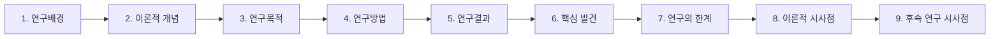

| 순서 | 분석 단계 | Chapter 9 학술 논문 매핑 세부 내용 |
| :---: | :--- | :--- |
| **1** | **연구배경 (Background)** | • 재난 시 비공식 사회연결망은 최초 대응자 역할을 하지만, 기존 연구는 대부분 재난 발생 후 사후 회상(Recall)에 의존하여 회상 편향 존재. • 상시 재난 노출 지역 주민들이 평소 재난에 대비하여 인지하고 있는 사회적 연결망 자원의 실태와 불평등에 대한 사전 실증 연구 부재. |
| **2** | **이론적 개념 (Theoretical Concepts)** | • **친족 배태성 (Kin Embeddedness)**: 제도 붕괴 시 생존을 지탱하는 혈연 안전망. • **사회자본 이론 (Social Capital Theory)**: 자원 동원 불평등 및 강한 유대의 힘. • **가족의 부담 (The Family's Burden)**: 화폐적 지원은 사회적 금기로 인해 오직 가족에게만 전가. • **인지된 사회적 지지 (Perceived Social Support)**: 스트레스 완화 및 동원 행동 결정 기제. |
| **3** | **연구목적 (Objectives)** | • 플로리다 연안 2개 카운티 주민을 대상으로 재난 시 동원 가능한 사회연결망의 규모와 구성을 밝힘. • 지원 자원의 성격(재정적 vs 비재정적)에 따른 네트워크 구조의 분화 규명. • 사회경제적 지위(SES) 및 사회적 취약성이 재정적 지지망 확보에 미치는 영향 실증. |
| **4** | **연구방법 (Methodology)** | • **연구 설계**: 혼합연구방법론 (Mixed-methods design: 우편 설문 + 심층 면담). • **표본**: 플로리다주 레온(도시/교외, n=63) 및 딕시(농촌, n=75) 카운티 총 138명 설문, 25명 인터뷰. • **측정 도구**: 재난 지원 Ego-network Name Generator (최대 8명 기표). • **분석 기법**: 기술통계, 이원교차분석, 다중 로지스틱 회귀분석, 질적 주제분석. |
| **5** | **연구결과 (Results)** | • 전체 네트워크 평균 3.7명 (비재정 3.1명 vs 재정 1.7명). 응답자의 40%는 재정 지원망 0명. • 전체 지지망의 59%가 가족, 31% 친구, 7% 이웃. 응답자의 85%가 가족을 포함. • 재정 지원의 53%는 가족에게 집중(관계 중심). 비재정 지원은 로컬 이웃/친구에 분산(공간 중심). • 로지스틱 회귀: 노인($OR=0.31$), 주택소유자($OR=0.32$)의 재정망 저보고 유의, 레온 카운티 거주자($OR=3.20$) 고보고. |
| **6** | **핵심 발견 (Key Findings)** | • **재정 지원의 가족 배타성**: 이웃과 친구는 노동/피난처를 공유할 수 있으나 돈은 오직 가족의 짐. • **이중 취약성(Double Vulnerability)**: 노인 및 농촌 빈곤층은 경제적 취약성과 연결망 자원 결핍이 중첩. • **고소득층과 저소득층의 분화**: 고소득층은 보험/저축으로 재정 해결, 저소득층은 원거리 친족 탐색. |
| **7** | **연구의 한계 (Limitations)** | • 플로리다 2개 카운티, 표본수 138명으로 통계적 일반화 한계. • Name Generator 8명 상한선 설정으로 인한 네트워크 규모 하향 추정(Underrepresentation) 가능성. • 사전 인지 데이터와 실제 재난 후 수혜 행동 간의 직접적 일치도를 검증하지 못함. |
| **8** | **이론적 시사점 (Theoretical Implications)** | • 재난 위기 시에는 Granovetter의 '약한 유대'가 아닌 '강한 친족 유대'가 회복력을 지배함을 입증. • 치료적 공동체(Therapeutic community) 이론의 적용 범위를 비재정적 지원으로 제한하는 이론적 정교화. • 사전자원 인지(Perception)가 실제 재난 행동의 심리적 임계치를 결정함을 이론화. |
| **9** | **후속연구 시사점 (Future Directions)** | • 사전 인지 지지망 조사와 사후 실제 동원 조사 간 패널 종단 연구(Pre-Post Panel Design) 필요. • 1인 가구 급증, 가족 해체 등 인구구조 변화가 재난 회복 사회자본에 미치는 영향 실증. • 공공 구호기관이 가족 결핍 취약계층의 사적 안전망을 대체할 수 있는 제도적 모델 설계. |

---

# 8. ★ [내 연구 적용] 재난 취약계층 보호를 위한 소방·지자체 현장 대응망 및 '가족 부재(Family Absence)' 고립 가구 선제적 구호 프로토콜

## 1. 문제의식 및 연구 배경
* Chapter 9의 실증 분석은 **"재난 시 실질적인 재정·생존 지원은 전적으로 가족(Family)에게 지워지며, 가족이 없는 독거노인·빈곤층은 사적 연결망에서 완전히 배제된다"**는 엄중한 사실을 증명했습니다.
* 현행 소방 및 지자체의 재난 대응은 주로 '신고 접수 후 출동(Reactive)' 방식에 머물러 있어, 사적 연결망이 단절되어 구조 요청조차 하지 못하는 고립 가구는 참사로 이어질 위험이 큽니다(1995년 시카고 폭염, 2022년 신림동 반지하 침수 참사 등).
* 따라서 소방 조직은 **Ego-Network 관점에서 관내 취약 주민들의 비공식 가족 지지망 유무를 사전 파악하고, 가족이 부재한 가구에 공적 지원을 1:1 매핑하는 '선제적 안전망(Proactive Public Safety Net)' 체계**를 구축해야 합니다.

## 2. 핵심 연구 질문 (Research Questions)
1. 관내 화재·풍수해 취약계층(독거노인, 기초생활수급자, 장애인)의 사전 인지된 사적 지지망(가족·이웃) 규모와 구조는 어떠한가?
2. 사적 가족 지지망의 부재(Family Absence)가 실제 재난 발생 시 피난 지연, 인명 피해, 복구 실패에 미치는 영향은 무엇인가?
3. 소방 의용소방대, 119생활안전정대, 지자체 복지전담팀이 결합된 '공공 대리 가족 네트워크(Public Proxy-Family Network)'는 취약 가구의 회복 탄력성을 통계적으로 유의하게 향상시키는가?

## 3. 연구 설계 및 조사 프로토콜 (6단계)
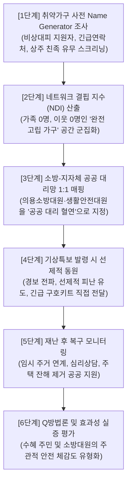

## 4. 현장 맞춤형 핵심성과지표 (KPI 가중치: 고유 70% / 협업 30%)

> [!IMPORTANT]
> 교수님 심화 지도 원칙에 따라, 소방 관서 자체 통제 가능한 **고유 지표(70%)**와 지자체·복지기관과의 **협업 지표(30%)**를 엄격히 분배하고, Chapter 9의 '가족의 부담' 이론 및 법적 근거를 강제 매핑합니다.

| 분류 | 구분 | 가중치 | 핵심 성과지표 (KPI) | 산출식 및 측정 방법 | 판단 근거 및 서브노트 매핑 | 관련 법적 근거 |
| :---: | :---: | :---: | :--- | :--- | :--- | :--- |
| **소방 고유 (70%)** | **예방** | 25% | **사적 지지망 결핍 고립가구 발굴률** | (관내 발굴된 무의탁·고립가구 수 / 추정 취약가구 수) $\times 100$ | Ch.9 Table 9.3 (노인층 재정/지원망 승산비 0.31배 급감 반영) | **소방기본법** 제16조의2 (소방안전지원) **소방청 훈령** 화재취약계층 안전대책 |
| **소방 고유 (70%)** | **대비** | 25% | **119 안심콜 및 대리연계 등록률** | (비상시 공공대리인 지정 등록 완료 가구 / 고립가구 수) $\times 100$ | Ch.9 Figure 9.1 (40%에 달하는 무자원 가구 공적 대체망 구축) | **119구조·구급에 관한 법률** 제2조의2 (119안심콜서비스 운영) |
| **소방 고유 (70%)** | **대응** | 20% | **고립가구 선제적 피난 유도율** | (경보 시 119구조대 현장 방문 대피 완료 수 / 피난대상 가구) $\times 100$ | Ch.9 Figure 9.4 (비재정적 지원의 공간적 근접성 극대화) | **재난 및 안전관리 기본법** 제40조 (대피명령 및 현장 조치) |
| **기관 협업 (30%)** | **대응** | 15% | **의용소방대-이장·통장 매칭 출동률** | (공동 현장 확인 출동 건수 / 총 취약가구 비상소집 건수) $\times 100$ | Ch.9 Figure 9.2 (이웃 7% 한계 극복을 위한 준공식 로컬 조직화) | **의용소방대 설치 및 운영에 관한 법률** 제7조 (임무) |
| **기관 협업 (30%)** | **복구** | 15% | **긴급구호 및 주거복구 연계율** | (지자체 긴급생계비/임시주거 배정 완료 건 / 의뢰 건) $\times 100$ | Ch.9 p.138 (저소득층의 공적 제도적 금융 안전망 직결) | **재해구호법** 제4조 및 제7조 (임시주거시설 및 구호물품 지원) |

## 5. 법적 근거 조문 단위 강제 매핑
1. **재난 및 안전관리 기본법 제4조(국가 등의 책무)**: 국가는 안전취약계층(어린이, 노인, 장애인 등)이 재난으로부터 안전을 확보할 수 있도록 맞춤형 시책을 수립·시행해야 함.
2. **소방기본법 제16조의2(소방안전지원활동)**: 소방청장·소방본부장 또는 소방서장은 재난 취약계층의 주거 안전 확보 및 화재 예방을 위한 물품 보급 및 안전점검을 수행할 법적 의무가 있음.
3. **119구조·구급에 관한 법률 제2조의2(구조·구급기본계획 수립)**: 국민의 생명과 신체를 보호하기 위해 119안심콜 서비스 등 취약계층 사전 등록 데이터베이스를 연계한 맞춤형 대응 프로토콜 확립.
4. **의용소방대 설치 및 운영에 관한 법률 제7조(임무)**: 의용소방대원은 화재 등 재난 발생 시 주민 대피 유도, 구호활동 지원 및 취약계층 안전 돌봄 임무를 법적으로 부여받음.

---

## FOOTNOTES

[^1]: 설문 응답자의 피로도(Burden)를 방지하기 위해 8명 상한선을 두었음(Marsden, 1990). 이전 연구에 따르면 핵심 논의망은 2~3명, 재난 네트워크는 평균 4명 수준이었음. 본 연구 설문에서 주관적으로 의지할 수 있는 인원 수를 묻는 개방형 질문 결과 재정 지원은 중위수 2명, 비재정 지원은 중위수 4명으로 나타나 8명 상한선이 전체 네트워크를 심각하게 왜곡하지 않음을 검증함.

[^2]: 취약계층의 설문 응답률이 낮을 것을 감안하여, 센서스 트랙별 사회적 취약성 8대 변수를 기반으로 취약성이 가장 높은 2개 구역, 중간 2개 구역, 가장 낮은 2개 구역을 의도적으로 층화 추출하여 과대표집(Oversampling)을 적용함.
