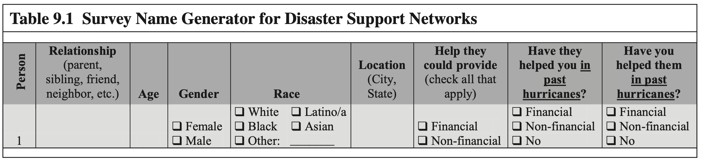
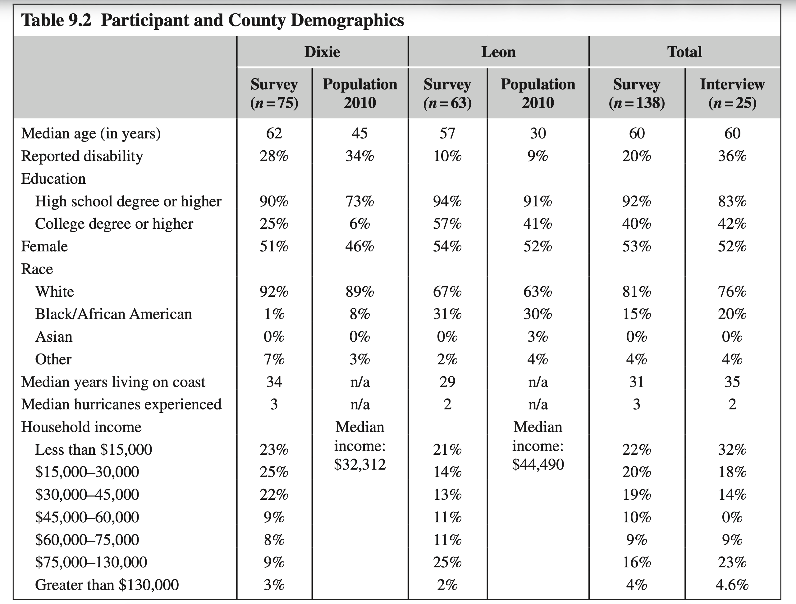
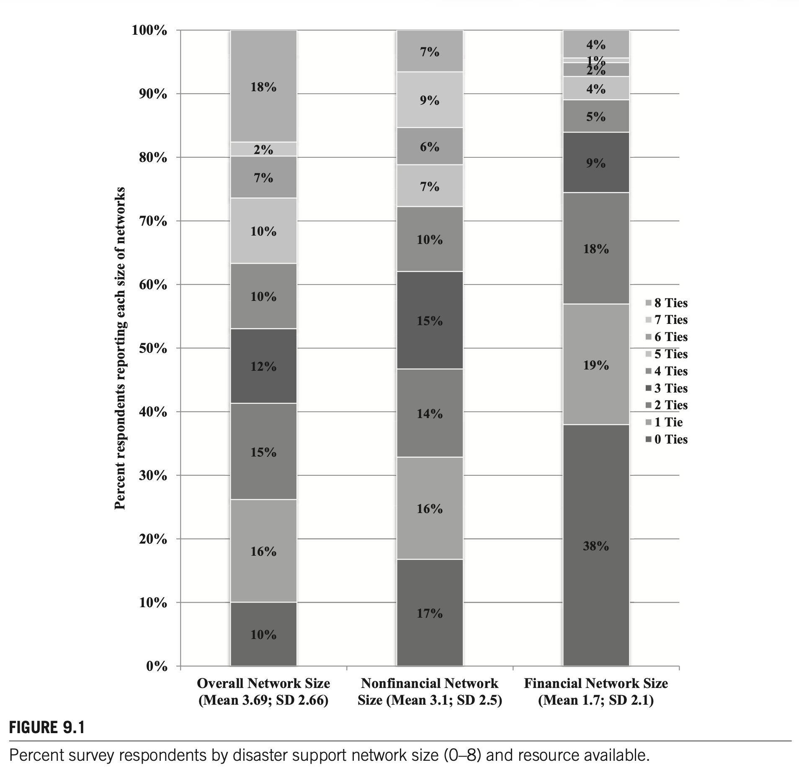
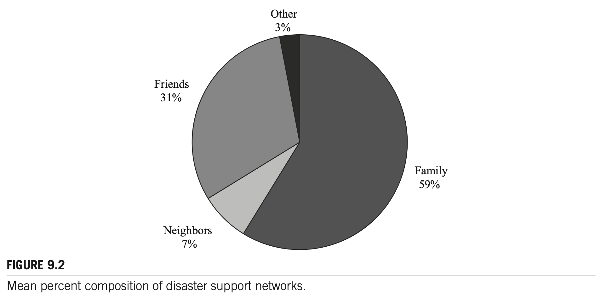
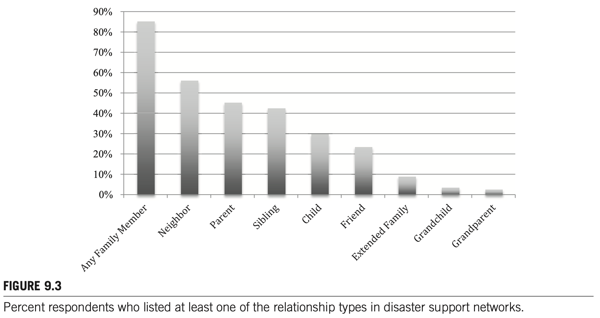
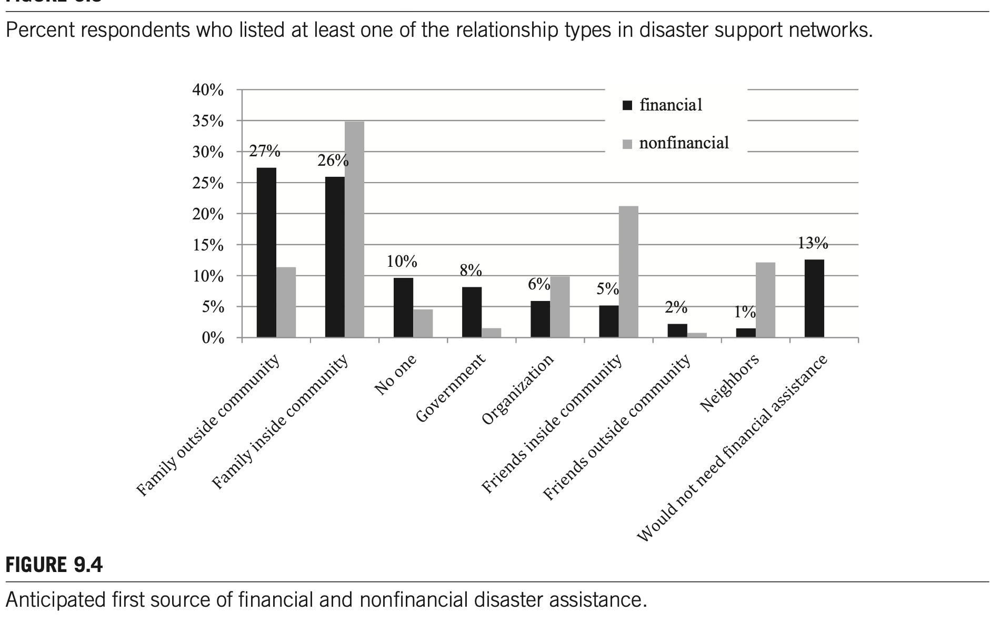
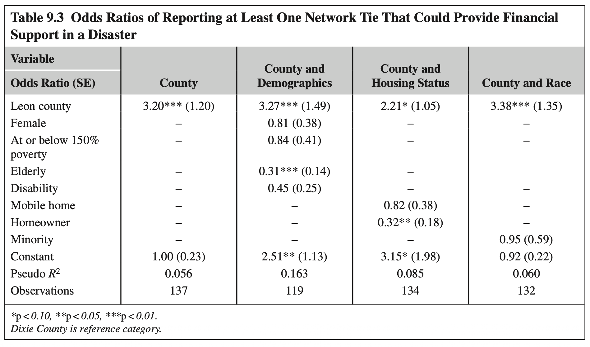

# CHAPTER 9. THE FAMILY’S BURDEN: PERCEIVED SOCIAL NETWORK RESOURCES FOR INDIVIDUAL DISASTER ASSISTANCE IN HAZARD-PRONE FLORIDA

**Michelle Meyer**  
*Louisiana State University, Baton Rouge, LA, United States*

*Social Network Analysis of Disaster Response, Recovery, and Adaptation.* http://dx.doi.org/10.1016/B978-0-12-805196-2.00009-1  
Copyright © 2017 Elsevier Inc. All rights reserved.

---

## CHAPTER OUTLINE

- **Introduction**
- **Methods**
  - Social Network Measures
  - Sampling and Data Collection
- **Disaster Support Networks: Size and Resources**
- **Disaster Support Networks: Composition**
- **Perceptions of Social Networks and Socioeconomic Status**
- **Discussion**

---

## INTRODUCTION

Friends, family, coworkers, and acquaintances comprise the networks of individuals with whom one shares confidences, provides and receives social support, and discusses problems and important topics (Paxton, 1999). Research in disasters and discussed in this book shows that family, friends, and neighbors are often the real first responders when disaster strikes. Members of one’s social networks provide vital disaster assistance including the communication of warning messages and recovery information; provision of supplies; search and rescue; shelter during evacuation and rebuilding; social, emotional, and financial support; and help with debris removal, rebuilding, and repairs (Elliott, Haney, & Sams-Abiodun, 2010; Hawkins & Maurer, 2010; Hurlbert, Haines, & Beggs, 2000). Thus, social networks contribute to the ability of a person to respond and cope with extreme events.

One way to understand the effect of social networks in disaster settings is by understanding how size and composition of these networks determine support received. Individuals with larger social networks receive more tangible (e.g., debris removal), informational (e.g., directions to formal aid resources), and emotional (e.g., encouragement) assistance following a disaster (Kaniasty & Norris, 1995). Research has found that individuals receive informal support from 1.5 to 5 individuals on average (Hurlbert et al., 2000; Jones et al., 2015). Further, the types of people—or composition—in those networks also affects the disaster assistance one receives. Research from Hurricane Andrew in 1992 found that individuals whose networks are comprised of more men, younger people, and family members are more likely to receive informal support (e.g., rebuilding assistance, child care assistance) from their social networks (Hurlbert et al., 2000).

Family members, in particular, are central to what I refer to as disaster support networks (Drabek & Boggs, 1968; Garrison & Sasser, 2009; Haines, Hurlbert, & Beggs, 1996). Kin embeddedness, or how connected one is with family members, has been shown to be an important mechanism for individuals to receive needed assistance, especially as community-wide structures and institutions that normally provide social support are fractured during a disaster (Bolin, 1976; Erikson, 1976). Disaster studies have found that family members provide evacuation and material assistance during disaster (Casagrande, McIlvaine-Newsad, & Jones, 2015; Pettigrew, 2011; Sprinkle, 2012). These findings in disaster situations coincide with research on the role of family in non-disaster “everyday” emergency situations, such as borrowing money or helping with emergency child care (Chua, Madej, & Wellman, 2011; Longino & Lipman, 1981). Family is often who individuals will turn to for assistance that is more burdensome, such as financial loans and long-term housing (Furstenberg & Kaplan, 2004).

In addition to size and composition, the types and amount of resources available through the network are key to understanding how social networks affect individuals’ life trajectories. This line of research in non-disaster situations has found that individual demographics—especially socioeconomic status, race, and gender—create variation in how individuals access and use social networks for particular resources (Lin & Dumin, 1986). For example, individuals with access to high-status persons are able to get information about high-status jobs (Lin, 2000). At the same time, disadvantaged persons often share resources and favors within their networks to meet daily survival needs (Stack, 1975). In disasters, these inequalities in existing social network resources can be exacerbated, meaning that those with fewer ties to individuals who can provide the required resources often have reduced capacity to cope and bounce back from the impact (Messias, Barrington, & Lacy, 2012).

There are few studies that clearly distinguish between the types of social ties and resource availability in disaster. James Elliott and colleagues (2010) studied two neighborhoods in New Orleans: the Lower Ninth Ward, a poor, majority African American neighborhood; and Lakeview, an affluent, majority white neighborhood. They found that Ninth Ward residents relied on close personal relationships (family and close friends) for informal support during Hurricane Katrina, and that they received less support overall—including less sheltering assistance and less contact with neighbors in the year following the event, compared to Lakeview residents. The authors concluded that affluent, white Lakeview residents had more relationships with persons outside of the area who were unaffected by the hurricane and a greater variety of resources available through these networks to support their recovery. Robert Hawkins and Katherine Maurer (2010) also found that minority and low-income individuals had limited access to aid information from their social networks following Hurricane Katrina. Earlier research following Hurricane Andrew showed that individuals living in areas of higher poverty provided less support to others than those living in higher income areas (Haines et al., 1996). Thus, networks are not created equal in their ability to increase individual resilience.

To build on our understanding of networks in disaster, in this chapter I describe data on individuals’ perceptions of their social networks as providers of disaster assistance. Using a common social network measure—the name generator—and in-person interviews, I asked participants to whom in their social networks would they turn for assistance during and following a disaster. Studies of social networks in disaster are commonly post-event and rely on recall of the survivors about their use of social networks during response and recovery. This study differs from previous research by gathering pre-disaster data and asking participants about their perceptions of how they would use their social networks in a future disaster event. How accurate these perceptions are is unknown, but these perceptions provide a novel take on networks in disasters and contribute to our understanding of disaster social networks in several ways.

First, perceptions of social support have a history of research across a variety of contexts (Furman & Buhrmester, 1992; Pierce, Sarason, & Sarason, 1991; Procidano & Heller, 1983). Perceptions of social support, whether accurate or not, independently predict mental health outcomes in stressful events (Haden, Scarpa, Jones, & Ollendick, 2007; Zimet, Dahlem, Zimet, & Farley, 1988). Further, perceived support mediates the role of actualized support on disaster outcomes (Norris & Kaniasty, 1996). To date, data on perceived support in disasters has been collected post-event. Thus, the literature includes no data that would allow scholars to understand how much these perceptions coincide with post-event disaster assistance or test any assumptions of accuracy of pre-event perceptions. 

Second, these data help us understand how individuals view their social networks’ ability to provide disaster assistance. This information indicates resource depth within a social network and whether mobilization of support from outside their usual social networks is assumed or will be necessary. Both resource depth and mobilization are important to understanding trajectories following disaster (Fothergill & Peek, 2015), and individual views on their networks provides one method of collecting information about the resource depth available in their social world. 

Third, perceptions affect the actual support received. If one does not believe that those in their network could provide evacuation shelter, for example, they may be less likely to ask for that assistance. 

Fourth, as much disaster literature shows, community members come together, whether they know each other or not, to offer support after an event (Quarantelli & Dynes, 1977).

Many of the participants in this research, as described in the following discussion, have experienced previous disasters, and often used those situations to develop their perceptions. Thus, while not based on a specific disaster, individuals are often basing their perceptions on cumulative disaster experience. This fact makes these results on perceptions interesting, in that individuals—many of whom are disaster-experienced—were unlikely to list church members, organizations, or other loose community ties as sources of assistance that are commonly highlighted as part of the therapeutic community. This result indicates how family, as one participant states, “comes first” and thus these perceptions provide information on the first line of support that individuals would seek in a disaster, and any remaining needs would be met by the, hopefully, therapeutic community.

Based on this data, I discuss the size and composition of individuals’ perceived disaster support networks. Perceptions of the resources needed and resources available from social networks highlight how the type of resource affects perceptions of disaster support networks. Specifically, individuals describe financial assistance as limited to a small number of network ties. Further, my results point to the centrality of family as a perceived source of disaster assistance and variations in perceptions based on indicators of social vulnerability. I conclude with the implications of these results for theory and practice on social networks in disaster.

---

## METHODS

Data for this chapter are drawn from a mixed-method study in two Florida counties. Florida has an annual hurricane season lasting from June through October along with a regular threat of tornadoes, floods, and wildfires. The two counties selected—Leon and Dixie—are exposed to similar natural hazards but vary in economic, social, and built environments and provide data from both suburban/urban populations as well as rural residents. I collected mail surveys and conducted in-person interviews with a subsample of the survey participants. The interviews provided in-depth information on how individuals define the role of their social relationships in disaster contexts (Schensul, LeCompte, Cromley, & Singer, 1999).

### Social Network Measures

The survey included a name generator to collect social network data (Knoke & Yang, 2008, p. 21). This data collection technique provides information on “ego networks” or the individuals’ relationships with other persons. To apply the name generator to disaster support, respondents were asked to list up to eight people to whom they would turn to for assistance after a hurricane.[^1]

Respondents also provided the following information about each person listed: relationship, age, location, race, gender, type of disaster assistance that they could provide (financial or nonfinancial), and previous assistance supplied to the interviewee and provided from the interviewee (Table 9.1). Financial assistance in this study was defined as any type of monetary assistance, such as helping with evacuation or rebuilding costs, while nonfinancial assistance was other forms of assistance such as offering labor, child care, or emotional support.

<!-- ================================================================= -->
<!-- Table 9.1                                                         -->
<!-- ================================================================= -->
  
*Table 9.1 Survey Name Generator for Disaster Support Networks*

I calculated network size as the total number of social ties each survey respondent listed in the name generator and, based on type of resource indicated, I calculated the size of financial and nonfinancial networks separately. Then, I used relationship to describe network composition. Survey respondents listed a variety of relationships, which I categorized into three groups: family, friends, and neighbors. Family included parents, children, siblings, grandparents, grandchildren, aunts/uncles, and cousins, as well as family through marriage (in-laws) and blended family members (step-parents and step-siblings). Friends included friends and coworkers. Neighbors were only those individuals listed as neighbors.

The semistructured interviews confirmed and expanded on the information provided in the survey. Gathering social network data through these open-ended questions allowed respondents to use stories and allowed me to understand how individuals determine which network ties are important in disaster contexts, such as what particular traits of individuals led to their inclusion in the support network.

### Sampling and Data Collection

Study participants were selected via mailing addresses. Because the two counties differed greatly in population density, I used different sampling strategies. In Dixie County, the low population density allowed for a random sample of 300 mailing addresses from the entire county. In Leon County, which has a higher population density, I performed stratified cluster sampling—first selecting six census tracts and then 50 households within each tract for a total of 300 households.[^2] This process helped me gather a completed set of surveys that were generally representative of Leon County (see Table 9.2).

After undeliverable addresses were removed, 529 valid households remained (275 from Dixie County and 254 from Leon County). Twenty-two households declined to participate in the survey. The response rate was 27% with 138 completed surveys. Survey respondents were mostly representative of the population of each county, except that respondents were older and more likely to have a person with a disability in the household than was the general population.

The final question on the mail survey asked respondents about their interest in an in-person interview and offered a $10 incentive for interview participation. I interviewed 25 individuals, nine from Dixie County and 16 from Leon County; 52% of interviewees were female and 76% were white. The interviews ranged from 20 minutes to 2 hours and were digitally recorded and transcribed verbatim for analysis.

<!-- ================================================================= -->
<!-- Table 9.2                                                         -->
<!-- ================================================================= -->
  
*Table 9.2 Participant and County Demographics*

<details>
<summary>📌 복사된 원문 텍스트 데이터 (참고용 펼쳐보기)</summary>

```text
Table 9.2 Participant and County Demographics
Dixie County:
- Survey (n = 75)
- Population 2010: Median age 45, Reported disability 28%, High school 90%, College 25%, Female 51%, White 73%, Black 6%, Other 46% (Note: Census stats)
Leon County:
- Survey (n = 63)
- Population 2010: Median age 30, Reported disability 9%, High school 94%, College 57%, Female 54%, White 63%, Black 30%, Asian 3%, Other 4%
Total:
- Survey (n = 138): Median age 60, Disability 20%, High school 92%, College 40%, Female 53%, White 81%, Black 15%, Asian 0%, Other 4%, Median years living on coast 31, Median hurricanes experienced 3
- Interview (n = 25): Median age 60, Disability 36%, High school 83%, College 42%, Female 52%, White 76%, Black 20%, Asian 0%, Other 4%, Median years living on coast 35, Median hurricanes experienced 2
Household income distributions: Less than $15,000 (21% / 22% / 32%), $15,000–30,000 (25% / 20% / 18%), $30,000–45,000 (22% / 19% / 14%), $45,000–60,000 (9% / 10% / 0%), $60,000–75,000 (8% / 9% / 9%), $75,000–130,000 (3% / 4% / 4%), Greater than $130,000 (2% / 4.6%)
```
</details>

---

## DISASTER SUPPORT NETWORKS: SIZE AND RESOURCES

Glen and his wife, Jane, live in an established suburban neighborhood of Tallahassee. He nervously wrung his hands as we talked about assistance from friends and family in a disaster. As he explained, he had one local friend who could provide nonfinancial assistance in a disaster, but there is no one that he would call on for financial assistance. Glen elaborated during our interview:

> "I guess [George and I] have been friends for 20 years or so. He lives pretty close to our house. We’ve assisted each other on home projects and stuff so it’s just a friend who would, you know, we’ve shared labor back and forth, off and on…. I guess we haven’t really had a lot of discussion [about disasters], maybe he wouldn’t even be here for that matter…. Uh, well I don’t really have somewhere else to turn [for financial assistance]. I suppose I’m kind of on my own so… I don’t quite know what else I would do, you know? I mean, I have what I have, and that would carry us as far as it would carry us."

Many respondents were similar to Glen—they listed few social ties available for disaster assistance, and when divided by type of assistance (financial versus nonfinancial), they listed even fewer social ties that would provide financial assistance. Fig. 9.1 shows the percentage of survey respondents who reported each size of network, from zero to eight persons. The mean and standard deviation of network size are included. The overall network column identifies the number of all individuals listed in the name generator regardless of type of assistance. Network sizes are also specified by type of resource: financial or nonfinancial.

Fig. 9.1 shows that there is variation in size of reported disaster support networks. Nearly 10% of all survey respondents listed no individuals in their disaster support network, irrespective of resource type. At the other end of the spectrum, 18% of respondents reported eight individuals in their disaster support network, which is the maximum possible from the name generator.

When the type of resource is included, the number of people that respondents believe could provide financial resources in a disaster was smaller than the number of people they felt could provide nonfinancial support. Specifically, nearly 40% of all respondents reported no friends, family, or neighbors that could or would provide financial assistance to them during a disaster, whereas only 17% reported the same for nonfinancial assistance. Average network sizes also varied by resource, with 3.7 persons listed on average regardless of resource, 3.1 persons listed on average for nonfinancial support, and only 1.7 persons reported on average for financial support.

<!-- ================================================================= -->
<!-- Figure 9.1                                                        -->
<!-- ================================================================= -->
  
*FIGURE 9.1 Percent survey respondents by disaster support network size (0–8) and resource available.*

The in-depth interviews from each county confirmed the general pattern about disaster support network size gleaned from the survey. Many interviewees discussed very few other persons that they could rely on for support in disaster, while other interviewees identified numerous others that they could and would receive assistance from as needed. As the following quote from Stan, a middle-aged man who worked for a local construction company, emphasizes, some interviewees had trouble naming each individual person that could help them and instead used phrases such as “many” or “a lot of” people. Stan remarked:

> “Oh, I think we’d be OK, depending on what kind of hit my house took, you know…. We’ve got family and friends all around to help. I wouldn’t have a problem findin’ shelter with someone close by.”

Marty and Adelle provide further examples of each end of the spectrum. Marty, a married father of two young children living in poverty in Dixie County, stated that he would rely on his parents who live a couple miles away as needed during a disaster: 

> “My parents, my kids, pretty much is what I think about all the time. If I need something, I talk to my mom and dad, see if they can help. A lot of times I don’t ask my mom, I pretty much get myself out of everything.”

At the other end of the spectrum, Adelle, a 90-year-old lifelong, middle-class resident of Dixie County, discussed how her four children and their spouses, a weekly housekeeper, two neighbors, and several fellow church members could all support her if she needed them.

These findings indicate that nonfinancial assistance is perceived as more readily available in a disaster than is financial assistance. But if individuals need money to complete a repair or to pay for a stay in a hotel during evacuation, there are fewer individuals who they think they would or could ask for assistance, with nearly half of the respondents listing no one. This result indicated that individuals will rely on savings or insurance, if they have it, governmental disaster aid or aid from other organizations when available, or go without financial assistance after an event.

---

## DISASTER SUPPORT NETWORKS: COMPOSITION

Jill is a young, white woman who recently relocated with her husband from Michigan to Tallahassee. Even though she had only lived in Florida for a few short months, she and her husband had made friends through their new church. She felt these new, local friends could provide shelter in case of a hurricane, but she was uncomfortable asking them for financial assistance, as she states here:

> "There are some people in our church, we know that they would have the money to help. We’ve been to people’s houses, to know they would have an extra room, if we were to call and need to stay somewhere. Then in that church atmosphere, we know that some of them are pretty giving. They probably wouldn’t say no, but definitely nothing that I’ve ever spoken to them about. If it was any kind of monetary help that we were seeking, we would go to our parents first as opposed to someone who was local."

Interviewees’ responses were affected by respondents’ perceptions of the availability of certain resources (financial or nonfinancial) from different ties and the social acceptability of asking those ties for each resource. In other words, respondents weighed their decisions about whom to include in these network lists between whom they knew had the resource and how appropriate it was to ask that person for that type of assistance based on their relationship. Jill’s decision to go to parents for financial assistance was a common response and brings forward the next issue of disaster support networks—composition.

Moving from size to composition, I analyzed relationship type for the ties listed in the name generator and again used the interview data to provide context. The findings confirm that family is central to disaster support networks as respondents overwhelmingly believe they will rely on kin to support them both financially and nonfinancially in a disaster. While friends, neighbors, and others were included in many survey respondents’ networks, family members dominated these networks.

Fig. 9.2 shows the average composition of disaster support networks by type of relationship between the respondent and the listed social tie. Recall that 10% of all survey respondents indicated no disaster social network ties. On average for respondents reporting at least one network tie, 59% of these respondents’ overall disaster networks were comprised of immediate or extended family. As Meryl, an interviewee from Dixie County, explained, a disaster is:

> “...when family have to take care of each other. When they have to step up to the bat. If they would still do it. I don’t have a mother or father no more…. My kids, they’re in Tennessee, so I’d have to move up there, in with them.”

On average, neighbors comprised only 7% of respondents’ networks. In contrast to neighbors, the average percent of friends in the networks was higher at nearly 30% overall. If a person reported six ties, this average network indicates three or four of those ties would be family, two would be friends, and at most one would be a neighbor.

<!-- ================================================================= -->
<!-- Figure 9.2                                                        -->
<!-- ================================================================= -->
  
*FIGURE 9.2 Mean percent composition of disaster support networks.*  
*(Note: Family 59%, Friends 31%, Neighbors 7%, Other 3%)*

To provide more detail, Fig. 9.3 shows the percent of respondents who included at least one of the common relationships reported (any family member, parent, sibling, child, extended family, grandchild, grandparent, neighbor, and friend). Of people who named at least one person in response to the name generator, over 85% included at least one family member in their disaster support networks. Parent was the most common familial relationship type, with 45% of respondents including at least one parent. Sibling and child were the second and third most common familial relationship listed. While the average percent of neighbors in networks was small, approximately 56% of respondents listed at least one neighbor in their disaster support networks. Fewer respondents reported at least one friend in their networks (24%).

<!-- ================================================================= -->
<!-- Figure 9.3                                                        -->
<!-- ================================================================= -->
  
*FIGURE 9.3 Percent respondents who listed at least one of the relationship types in disaster support networks.*

When describing the ability of neighbors or friends to help in disasters, interview respondents often recalled routine emergencies as examples that foretold the type of assistance these nonfamilial ties could provide. These stories included shared car rides, electrical outages and shared generators, and help moving, among others. Savannah, a 25-year-old white woman, lived in an apartment in Leon County with her boyfriend. She focused on nearby friends as potential assistance based on previous experiences helping each other with routine emergencies:

> "We help friends out with moving all the time and helping patch up walls and painting and stuff like that. So if something happened to their house or if they needed a place to stay with their animal or needed food or something, definitely I would lend a helping hand to those in need and I feel the same, that they would do that for me as well."

Nathan, a white man from Leon County, explained that he would call on friends for assistance if local family were unavailable:

> “We also know we have friends who are just houses away from us, and I’m sure that they would do the same thing [as family would] and let us sleep over.”

While friends and neighbors were described by interviewees as potential sources of nonfinancial disaster assistance, family was viewed as the most common source of financial assistance. Fig. 9.4 shows the differences between relationship and type of resource one expects to receive during a disaster. Overwhelmingly, respondents indicate that family is their primary source for financial assistance compared to neighbors, friends, organizations, and government. Fifty-three percent of respondents selected either local or extralocal family as their first source of financial assistance. While relationship seems to drive the selection of ties for financial assistance, location drives the selection of ties for nonfinancial assistance with local family, friends, and neighbors being the most common first sources of nonfinancial assistance.

<!-- ================================================================= -->
<!-- Figure 9.4                                                        -->
<!-- ================================================================= -->
  
*FIGURE 9.4 Anticipated first source of financial and nonfinancial disaster assistance.*

---

## PERCEPTIONS OF SOCIAL NETWORKS AND SOCIOECONOMIC STATUS

During disasters, as in everyday situations, social network resources often fill the gaps in individual resources. For example, poor individuals may need to ask for financial assistance from social ties more so than others who have financial savings or insurance coverage. Thus, it is important to understand who does and does not have these informal ties, and how that interacts with other social vulnerabilities during disaster.

To address this issue, I analyzed the effect of different indicators of financial capital and social vulnerability on the odds of reporting at least one financial tie (Table 9.3 shows the odds ratios for each independent variable). Recall that financial resources are perceived as more difficult or less appropriate to access than nonfinancial resources through network ties, and that nearly 40% of respondents across the study lacked a social tie to provide monetary assistance. Due to the small sample size, I present the regression results in variable groups of interest: demographics, housing status, and race.

<!-- ================================================================= -->
<!-- Table 9.3                                                         -->
<!-- ================================================================= -->
  
*Table 9.3 Odds Ratios of Reporting at Least One Network Tie That Could Provide Financial Support in a Disaster*

<details>
<summary>📌 복사된 원문 텍스트 데이터 (참고용 펼쳐보기)</summary>

```text
Table 9.3 Odds Ratios of Reporting at Least One Network Tie That Could Provide Financial Support in a Disaster
Dependent variable: Reporting at least one financial tie (Odds Ratio (SE))
Models:
1. County: Leon county 3.20*** (1.20), Constant 1.00 (0.23), Pseudo R2 = 0.056, Obs = 137
2. County and Demographics: Leon county 3.27*** (1.49), Female 0.81 (0.38), At or below 150% poverty 0.84 (0.41), Elderly 0.31*** (0.14), Disability 0.45 (0.25), Constant 2.51** (1.13), Pseudo R2 = 0.163, Obs = 119
3. County and Housing Status: Leon county 2.21* (1.05), Mobile home 0.82 (0.38), Homeowner 0.32** (0.18), Constant 3.15* (1.98), Pseudo R2 = 0.085, Obs = 134
4. County and Race: Leon county 3.38*** (1.35), Minority 0.95 (0.59), Constant 0.92 (0.22), Pseudo R2 = 0.060, Obs = 132

*p < 0.10, **p < 0.05, ***p < 0.01.
Dixie County is reference category.
```
</details>

The strongest relationship between demographics and odds of having at least one network source of financial assistance is the difference between residents of Leon and Dixie Counties. Recall from the previous demographic information that Leon County is more suburban/urban and has a higher median income overall. Thus, it appears from this comparison of just two counties that population density and/or median income at the county level may relate to perceptions of the availability of financial assistance through social ties. This relationship of county context to individual perceptions of network resources needs further research.

Controlling for county of residence, these results indicate that in this sample being poor, elderly, disabled, female, a homeowner, or living in a mobile home reduced the likelihood of reporting a social tie that could provide financial disaster assistance. Being elderly and being a homeowner were both statistically significant and had a large substantial effect on the odds of reporting this network resource. Elderly respondents and those owning their homes were one-third as likely to report a financial tie as were nonelderly respondents or nonhomeowners. The demographic variables together explain the most variance in the odds of reporting a financial tie ($R^2 = 0.16$). Together, these data indicate that socially vulnerable respondents are also more vulnerable in terms of network resources and will be required to mobilize new sources of resources in the aftermath of an event.

The interviews were able to add insight into these results. Specifically, interviewees evaluated:
1. the resources the tie would have to offer,
2. their individual socioeconomic status and potential needs, and
3. the strength of the tie when determining how they would activate the available social networks in a disaster.

First, social ties were often viewed as having a specific role during disasters; and that role was more quickly associated with nonfinancial resources, such as evacuation sheltering, help during debris removal, and information sharing. Interviewees commonly recalled a previous disaster event or routine everyday emergency to explain who would help them in nonfinancial ways. For example, the following quote describes sheltering assistance received by Barbara from Leon County and is a representative example of nonfinancial assistance from social networks:

> “I went with my friends over to their apartment building and of course we stayed up all night. You can hear the wind blowing and everything like that, and there was maybe about six couples in the apartment ’cause it was a sturdy building.”

Next, while interviewees of varying socioeconomic status described the importance of social ties for nonfinancial assistance, those with higher socioeconomic status discussed social capital use in disasters only as it related to nonfinancial assistance. For example, Debra, a middle-aged woman from Leon County, clearly described the type of resources she expected social ties to provide:

> “One is the financial aspect. We have insurance for the house, always have, always will. Financially, we have the savings that we would need to recover from anything that would happen, and then the immediate support system of friends and family and neighbors for any annoyance kinds of things. You know, the house wrecked is a financial thing. A broken window and water on the carpet is, you know, an annoyance kind of thing that you would call family and friends to assist.”

Other higher income individuals described family members they could ask for financial assistance, but emphasized that situation would be incredibly unlikely. Thus, they were accounting for three concerns: the type of resource, what ties had the ability to provide the resource, and whether they would even need that resource. As Neil, a white respondent from Leon County explained, he knew which family members would have the resources to share, but still expected to not have to ask for them:

> “We have family that actually would help us but we’re not in the position where we would have to ask for financial help except maybe in the short term. Even then we probably wouldn’t do it. But we do have family in town who are wealthier than we are, so they actually could afford it if we needed them to.”

On the other hand, interviewees from lower socioeconomic strata more easily described whom they could ask for financial assistance during a disaster. Instead of indicating this type of assistance was unsuitable for social ties to provide, low-income individuals evaluated who in their networks had the resources to share. This result mimics research on resource sharing among low-income populations to meet daily needs (e.g., Stack, 1975). For low-income individuals, many of the same people that could provide nonfinancial assistance were viewed as unable or unsuitable for providing financial assistance. As Sheila from Dixie County described, her local friends and neighbors could assist with debris removal but were too poor to provide financial assistance:

> “The ones close by don’t have two nickels to rub together, so if we needed money, we would probably be calling Chicago, you know, to relatives. If it’s assistance moving trees or whatever that are down, I’ve got friends down here.”

Sheila’s quote was typical of low-income interviewees, who indicated that they knew who in their social network may have financial resources to share. Further, they indicated that this resource, money, was almost exclusively a burden on family, no matter the socioeconomic status of the respondent. This result indicates that network size alone cannot fully predict how social capital resources will be used in a disaster, but perceptions of the relationship, the resources available in the whole network, and individual needs all affect reporting of social capital ties for disaster.

---

## DISCUSSION

This research, conducted outside of a disaster situation, shows how individuals perceive the role of their social networks in providing support during a future disaster. In summary, the results show that perceived disaster support networks are relatively small—less than four people per respondent—and that financial support is limited to only one or two social ties, if any. The use of a name generator and corresponding interviews to triangulate the data showed how individuals perceive the use of social ties for nonfinancial and financial resources, indicating that financial resources are less commonly associated with social networks, and is dependent upon perceptions of the relationship, capacity of the social tie to provide money, and self-perceived potential need.

Compared to previous research on networks in disasters, my results are similar to findings post-disaster. Related to network size, Jeanne Hurlbert and colleagues (2000) found that respondents reported on average 1.6 persons supported them during preparation for Hurricane Andrew and 2.5 persons supported them during the recovery, which is slightly smaller than the perceived 3.1 persons found in my study. Eric Jones and colleagues (2015) also found that individuals received and provided support to between three and five members of their social networks. The comparability of results between this pre-event data and post-event research indicates that pre-event perceptions may be close to accurate, at least in the size of support networks.

Next, my results point to the need to understand social networks in light of other forms of capital individuals may access, especially financial capital through savings or insurance. My results echo those from Deanne Hilfinger Messias et al. (2012) and James Elliot and colleagues (2010) that marginalized groups may be less able to access resources necessary for recovery through their social ties, limiting the effect of social networks among already vulnerable populations. This issue raises questions about the interconnection of personal networks and resilience with community-level social capital (Aldrich & Meyer, 2015). Future research needs to tease out the use of social networks within the context of various other assets or capacities that individuals have access to in a disaster. For example, how do social networks allocate financial resources during a disaster? Is this type of support limited to family ties, or do other individuals emerge and provide support these respondents would not predict?

In addition, this study underscores the importance of the family unit for perceived disaster assistance, thus supporting the importance of kin embeddedness for individual resilience (Bolin, 1985). These data indicate that disaster social capital is heavily dependent upon family ties, and thus is more the “strength of strong ties.” Immediate family, extended family, and family through legal changes (e.g., in-laws, divorce, marriage) are all perceived as the main members of disaster support networks. The centrality of family in my results mimic findings from David Casagrande and colleagues (2015), Olivia Pettigrew (2011), and Nicholson Sprinkle (2012) who all found that family ties provided more material support than did nonfamily ties. When disaster occurs, it appears that individuals expect to and do consolidate their social networks to the strongest ties. As one respondent, Vera, explained, family is first priority for getting and giving disaster assistance, and she expected others to do the same:

> “[During an evacuation,] I know my family would have to meet somewhere in the middle of central Florida, because my mother, sister, and brother are the Fort Myers area, and that’s not good. They’re always being hit [by hurricanes]. That’s about it, really. Friends, you know, I suppose they would do the same thing, probably. The family, we always kind of stick together a little bit.”

The centrality of family to understanding social networks in disaster implies the concern for those isolated individuals in a community with few family ties (Swanson, Forgette, Van Boening, Kinnell, & Holley, 2007). As family dynamics change in America, such as smaller family sizes, what will be the outcomes for disaster support? For those without family, or lacking family that have resources to share, the effect of individual social networks in disaster situations will be limited. Are these individuals able to find support through other persons in their social networks, or do they turn to formal institutional philanthropic or governmental support? Or, will they, like the elderly isolated persons in the Chicago Heat Wave of 1995, perish at a disproportionate rate when disaster strikes (Klinenberg, 2002)?

This research has a variety of limitations. The small sample size and focus on only two counties in Florida limits the generalizability in the statistical sense of these results. The results did show patterns that would need to be assessed with larger and more diverse samples. Also, the name generator as a data collection tool may have been burdensome to respondents and thus limited the number of ties that they listed. In this case, these results are downwardly biased considering network size. Further, the design of the pre-event survey highlighted interesting points about perceptions on social networks’ utility in disasters. Future research that incorporates pre- and post-event measures, although difficult to gather, would provide the most fruitful method of testing the accuracy of perceptions as well as the effect of perceptions on disaster outcomes.

For practitioners looking for ways to incorporate measures of social networks in disaster assessments and to predict emergency needs within their communities, these results show that measuring family ties can help highlight vulnerable populations, along with other traditional measures of social vulnerability. For populations known to have fewer family ties, nonfinancial and financial institutional assistance should be targeted and nonfamilial network mechanisms should be supported. As disasters increase in frequency and impact, policies that address both individuals and community social capital and foster network support will only grow in importance, especially for socially vulnerable groups.

---

## FOOTNOTES

[^1]: An upper limit was set for practicality and to avoid overburdening respondents (Marsden, 1990) as well as based on results from previous literature. Previous research has shown that core discussion networks include approximately two to three persons (e.g., McPherson, Smith-Lovin, & Brashears, 2006). Previous disaster research found network size averaged near four persons (e.g., Haines et al., 1996). Further, this upper limit of eight persons was tested for validity through two open-ended questions that asked respondents the total number of people that they could rely on for financial and nonfinancial assistance, respectively. Median number of people listed for financial assistance was two persons and four persons for nonfinancial assistance. Thus, the name generator may slightly underrepresent the size of these networks.

[^2]: It was expected that households with higher social vulnerability would respond at a lower rate than others. Because I could not determine which addresses contained more or less socially vulnerable individuals, I oversampled at the mailing stage from census tracts with higher populations of socially vulnerable individuals to compensate for this concern. I used eight variables common in economic and demographic analysis of social vulnerability to identify census tracts with potentially more or less vulnerable populations: percent poverty, median income, percent racial minority, household size, percent female-headed households, percent renters, percent elderly, and percent children. I purposefully selected two tracts with the highest vulnerability on these factors, two tracts with the lowest, and two tracts in the middle.
