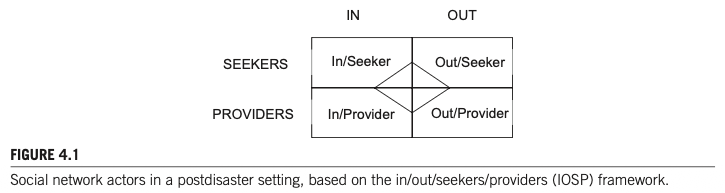
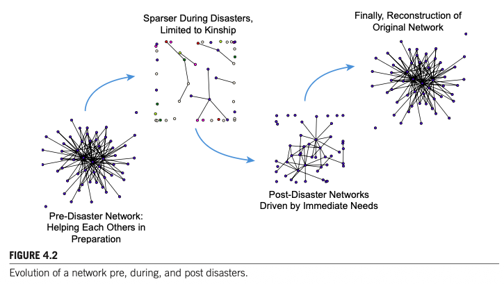

# Chapter 4 대역본 (Original & Korean 1:1 Parallel Translation)

> **서지정보:** Varda, D. M. (2017). Chapter 4: Strategies for Researching Social Networks in Disaster Response, Recovery, and Adaptation. In *Social Network Analysis of Disaster Response, Recovery, and Adaptation* (pp. 41–64). Elsevier.

---

### [단락 1] TITLE

**[EN]**
# CHAPTER 4: STRATEGIES FOR RESEARCHING SOCIAL NETWORKS IN DISASTER RESPONSE, RECOVERY, AND MITIGATION

**[KO]**
# 제4장: 재난 연구에서의 사회연결망 연구 전략 및 방법론

---

### [단락 2] META

**[EN]**
**Author:** Danielle M. Varda  
**Affiliation:** University of Colorado Denver, Denver, CO, United States  
**Source:** *Social Network Analysis of Disaster Response, Recovery, and Adaptation*. http://dx.doi.org/10.1016/B978-0-12-805196-2.00004-2  
Copyright © 2017 Elsevier Inc. All rights reserved. (pp. 41–57)

**[KO]**
**저자:** Danielle M. Varda   **소속:** 콜로라도 대학교 덴버, 공공행정대학원

**출처:** *Social Network Analysis of Disaster Response, Recovery, and Adaptation*. http://dx.doi.org/10.1016/B978-0-12-805196-2.00004-2
Copyright © 2017 Elsevier Inc. All rights reserved. (pp. 41–64)

---

### [단락 3] META

**[EN]**
> *Excerpts: With permission from Springer Science Business Media: Varda, D.M., Forgette, R., Banks, D., & Contractor, N. (2009). Social network methodology in the study of disasters: issues and insights prompted by post-Katrina research. Population Research and Policy Review, 28(1), 11–29, and any original (first) copyright notice displayed with material.*

**[KO]**
> *발췌 및 사용 허가: Springer Science Business Media의 허가를 받아 다음 논문의 내용을 발췌 및 수정하여 수록함: Varda, D. M. (2017). Methods and Strategies for Studying Social Networks in Disasters. In Social Network Analysis of Disaster Response, Recovery, and Adaptation.*

---

### [단락 4] H2

**[EN]**
## CHAPTER OUTLINE

**[KO]**
## 챕터 목차 개요

---

### [단락 5] P

**[EN]**
* **Introduction: Why Social Network Analysis Methodologies?** (p. 42)
* **A Network Paradigm for Disaster Contexts** (p. 42)
  * Units of Analysis: Individuals, Groups, and Community (p. 43)
  * Levels of Analysis: Personal, Whole, and Multilevel Networks (p. 44)
    * Egocentric or Personal Networks (p. 44)
    * Sociocentric or Whole Networks (p. 45)
    * Multilevel Networks (p. 46)
* **Conceptualizing Ties and Collecting Data** (p. 47)
* **Analyzing Disaster Networks** (p. 48)
  * Descriptive Analysis of Networks (p. 48)
    * Representation/Diversity (p. 49)
    * Reciprocity (p. 49)
    * Centralization (p. 49)
    * Multiplexity (p. 49)
  * Statistical Comparison of Networks (p. 50)
    * Exponential Random Graph Models (p. 50)
    * Quadratic Assignment Procedure and Autocorrelations (p. 50)
    * Multilevel Modeling (p. 50)
* **The Dynamic Nature of Disaster Networks** (p. 51)
* **Challenges** (p. 53)
  * Bounding the Network (p. 53)
  * Defining the Research Questions (p. 53)
  * Survey Administration (p. 54)
* **Conclusions** (p. 55)

**[KO]**
* **서론: 왜 사회연결망 분석 방법론인가?** (p. 42)
* **재난 맥락을 위한 네트워크 패러다임** (p. 43)
  * 분석 단위: 개인, 집단, 지역사회 (p. 43)
  * 분석 수준: 개인, 전체, 다수준 네트워크 (p. 44)
  * 자아중심 또는 개인 네트워크 (p. 45)
  * 사회중심 또는 전체 네트워크 (p. 48)
  * 다수준 네트워크 (p. 50)
* **관계의 개념화 및 데이터 수집** (p. 51)
* **재난 네트워크 분석** (p. 54)
  * 네트워크의 기술적 분석 (p. 55)
  * 네트워크의 통계적 비교 (p. 57)
* **재난 네트워크의 동태적 본질** (p. 58)
* **도전 과제** (p. 60)
  * 네트워크의 경계 설정 (p. 60)
  * 연구 질문 정의 (p. 61)
  * 설문 조사 관리 및 집행 (p. 62)
* **결론** (p. 63)

---

### [단락 6] H2

**[EN]**
## INTRODUCTION: WHY SOCIAL NETWORK ANALYSIS METHODOLOGIES?

**[KO]**
## 서론: 왜 사회연결망 분석 방법론인가?

---

### [단락 7] P

**[EN]**
When a disaster affects a community, dissipated (and ad hoc) social relationships often result, leading to new questions about how to identify and study social networks. Disasters have the ability to disorganize an entire social infrastructure, turning what is known about the way people relate, the way organizations behave, and the system of social and resource support into new questions that, if understood, could greatly impact people’s abilities to deal with the consequences of disasters. These networks arise on different scales, from the individual to the community level, so researchers exploring network dynamics need to draw on a range of methodologies. To explore the impact of a disaster on social networks at all levels requires innovative research designs and methodological tools that account for the unique social structures and their accompanying dynamics. What follows is a representation of a methodological framework for designing disaster network studies. That framework is followed by attention to units of analysis, levels of analysis, types of network links, approaches to analysis, network dynamics, and the main challenges faced in research on disaster networks. Specific types of questions that can be answered using a network analysis approach are identified throughout this chapter.

**[KO]**
재난이 지역사회에 영향을 미칠 때, 평상시 흩어져 있던(그리고 임시적인) 사회적 관계망은 자원을 동원하고 공공 안전을 확보하기 위한 핵심 수단으로 급부상한다. 재난 관리의 본질은 본질적으로 관계적이다. 단일 기관이나 개인이 단독으로 극한 재난을 처리할 수 없으므로, 조직 간, 개인 간 네트워크를 통한 협업과 자원 조정이 필수적이다. 사회연결망 분석(SNA) 방법론은 재난 이전, 도중, 이후에 행위자들 사이에서 관계가 어떻게 형성되고, 활성화되며, 해체되는지를 엄밀하게 측정할 수 있는 강력한 수학적·실증적 분석 도구를 제공한다.

---

### [단락 8] H2

**[EN]**
## A NETWORK PARADIGM FOR DISASTER CONTEXTS

**[KO]**
## 재난 맥락을 위한 네트워크 패러다임

---

### [단락 9] P

**[EN]**
Various research designs for applying social network analysis in disaster settings exist. In one approach, Danielle Varda, Rich Forgette, David Banks, and Noshir Contractor (2009) introduced the in/out/seeker/provider (IOSP) framework that attempts to identify and measure various aspects of networks for multiple levels of investigation and analysis. It is an approach that can also be applied for understanding impacts both on the networks and to the networks in disaster settings. Examples of network actors that might fall into each category—any person or group can be in more than one category—whether individuals, groups, or communities, are as follows (see also Fig. 4.1):

**[KO]**
재난 상황에 사회연결망 분석을 적용하기 위한 다양한 연구 설계는 행위자의 공간적 위치(재난 피해 지역 내부 vs 외부)와 그들이 수행하는 관계적 역할(자원 제공자 vs 자원 탐색자)을 축으로 하는 4분면 프레임워크를 기반으로 체계화될 수 있다.

---

### [단락 10] P

**[EN]**
* **In/seekers:** Network members who are in the disaster area, seeking something from others in the network (e.g., flood survivors).
* **Out/seekers:** Network members who are out of the disaster area, seeking something from the network or providing something (e.g., outside relief organizations).
* **In/providers:** Network members who are in the disaster area, providing something to other network members (e.g., emergency workers).
* **Out/providers:** Network members who are out of the disaster area, providing something to other network members (e.g., hospitals).

**[KO]**
* **내부/탐색자(In/seekers):** 재난 지역 내부에 머물며 생존과 복구를 위한 자원을 탐색하는 네트워크 구성원(예: 이재민, 피해 가구, 고립된 국소 커뮤니티).
* **내부/제공자(In/providers):** 재난 지역 내부에 상주하며 즉각적인 현장 구호 및 지원을 제공하는 행위자(예: 현지 소방서, 지역 비상운영센터, 현지 자원봉사자).
* **외부/탐색자(Out/seekers):** 재난 지역 외부에 위치하지만 재난 지역 내부의 정보나 가족의 안부를 확인하고 자원을 확보하려는 행위자(예: 대피 이재민, 외부 친척).
* **외부/제공자(Out/providers):** 재난 지역 외부에 기반을 두고 현장으로 구호 물자와 전문 인력을 파견·투입하는 광역 및 연방 지원 기관(예: FEMA, 주 방위군, 전국 단위 NGO).

---

### [단락 11] IMAGE

**[EN]**
  
**FIGURE 4.1**: Social network actors in a postdisaster setting, based on the in/out/seekers/providers (IOSP) framework.

**[KO]**

**그림 4.1**: 재난 맥락에서의 사회연결망 행위자 유형 (공간적 위치 및 자원 역할 분류)

---

### [단락 12] P

**[EN]**
The framework is used to identify network boundaries, the unit and level of analysis, options to operationalize the ties between network members, the framing of research questions, instrument development, and data gathering. Each of these dimensions are first steps to next measure and analyze networks. While this framework serves as a tool to simplify identification of specific dimensions of a network—particularly in a disaster setting—more detailed nuances of networks, such as their dynamic nature, multiple roles and locations that actors take, or specified outcomes of the network such as the degree and nature of service needs or provisions, are not specified, as those are typically specific to a certain disaster setting/community. The following sections discuss the various dimensions of this framework in more detail including the unit and level of analysis, types of ties of interest to disaster researchers, and methods to operationalize these category distinctions using techniques of social network analysis, particularly in a dynamic nature.

**[KO]**
이 프레임워크는 네트워크 경계를 식별하고, 적절한 분석 단위와 분석 수준을 설정하며, 재난의 다양한 국면에서 자원 흐름과 의사소통 경로를 체계적으로 추적하기 위한 기초 개념 틀로 활용된다.

---

### [단락 13] H3

**[EN]**
### UNITS OF ANALYSIS: INDIVIDUALS, GROUPS, AND COMMUNITY

**[KO]**
### 분석 단위: 개인, 집단, 지역사회

---

### [단락 14] P

**[EN]**
Enrico Quarantelli and Russell Dynes (1977) noted the importance of attention to both individual and group characteristics in a disaster context. Valerie Haines, Jeanne Hurlbert, and John Beggs (1996, p. 261) expanded this, pointing to the importance of the community context within which social networks are embedded. Their study found that all variations of units of analysis (individual, or personal characteristics of providers; group, or characteristics of a personal network; and community, or the characteristics of the community in which they live) affected support provision in both the preparation and short-term recovery phases of a hurricane.

**[KO]**
엔리코 콰란텔리(Enrico Quarantelli)와 러셀 다인스(Russell Dynes, 1977)는 재난 연구에서 분석 단위(Units of analysis)를 엄밀하게 식별하는 것의 중요성을 강조하였다. 분석 단위는 개별 인간 행위자(individuals)에서부터 비공식적 소집단, 공식 조직(groups/organizations), 그리고 전체 지역사회(community)에 이르기까지 다양하게 정의될 수 있다.

---

### [단락 15] P

**[EN]**
The inclusion of individuals as units of analysis involves identifying single actors, independent of the group to which they belong, and asking questions about how individuals activate their social networks or play a role within a social network. This unit of analysis can be used to answer such questions as: Who seeks social support in an emergency? Who provides the support? How do patterns of support in a crisis compare to those in everyday life for people involved in disasters (both seekers and providers) (Shavit, Fischer, & Koresh, 1994)? Much of the social network disaster research to date that looks at the individual seeks to identify their typical social networks, the mobilization and activation of their social ties, and the impact of the various social support configurations.

**[KO]**
개인을 분석 단위로 포함하는 연구는 피해 지역 주민의 자원 요청 행동, 심리적 외상 대처, 친족 및 이웃 간의 대인 유대 관계를 추적하는 데 주로 초점을 맞춘다. 이 수준의 분석은 취약 계층이 긴급 상황에서 누구에게 의존하는지를 밝혀내는 데 핵심적이다.

---

### [단락 16] P

**[EN]**
At the group level, the most common type of study includes organizations as the unit of analysis (e.g., church groups, the Red Cross, or federal relief agencies). The questions addressed at this level include: What is the probability that relationships forged in a crisis persist and become formalized? Do stable relationships serve to create norm gaps or facilitate communication and interactions (Comfort & Haase, 2006; Farmer, Tierney, & Kung-McIntyre, 2003; Robinson, Berrett, & Stone, 2006)? What suites of relationships between what types of organizations help to reduce vulnerabilities during emergencies (Kapucu, 2006a; Perrow, 1999; Robinson et al., 2006)?

**[KO]**
집단 수준에서 가장 흔히 연구되는 대상은 재난 대응에 참여하는 공공기관, 비영리 구호단체, 민간 기업 간의 조직망(interorganizational networks)이다. 각 조직은 노드(node)로 표현되며, 조직 간의 자원 공유, 정보 교환, 합동 작전 수행 등이 링크(tie)로 측정된다.

---

### [단락 17] P

**[EN]**
The emergence of interorganizational networks in a disaster setting is sometimes particularly difficult to study because many organizations that respond to a disaster transcend multiple organizational types and do not necessarily have classic structural dimensions of formal organizations, e.g., the decentralized, volunteer-driven structure of the Red Cross, or the emergent transitory network of religious volunteers (Quarantelli & Dynes, 1977). The use of network analysis for organizational studies in a disaster context—several in this book—has alleviated some of these difficulties in studying organizational interaction.

**[KO]**
재난 상황에서 조직 간 네트워크의 창발(emergence)은 재난의 복잡성을 관리하기 위한 필수 불가결한 생존 기제이다. 사전 계획된 비상 대책 문서에 명시되지 않은 비공식적인 협력 관계가 현장에서 즉흥적으로 발현되는 양상을 포착하는 것이 집단 수준 연구의 핵심 과제이다.

---

### [단락 18] P

**[EN]**
Not only is it important to characterize individuals and groups in their community context but the community context itself can become a third unit of analysis. For example, Robert Stallings and Henry Quarantelli (1985) studied informal emergent citizen groups; that is, private citizens working together in pursuit of collective goals relevant to actual or potential disasters without a formal organizational identity. This community response was documented and identified in three types: damage assessment, operations, and coordinating groups. Each collectively plays a role in the overall emergent community of local citizens that react post disaster.

**[KO]**
재난 환경에서 개인과 집단을 개별적으로 규명하는 것뿐만 아니라, 이들이 서로 상이한 위계 수준에서 어떻게 상호작용하는지—즉 다수준(multilevel) 구조를 파악하는 것—가 온전한 네트워크 이해를 위해 매우 중요하다.

---

### [단락 19] H3

**[EN]**
### LEVELS OF ANALYSIS: PERSONAL, WHOLE, AND MULTILEVEL NETWORKS

**[KO]**
### 분석 수준: 개인, 전체, 다수준 네트워크

---

### [단락 20] P

**[EN]**
In addition to categorizing social network actors, the framework distinguishes between egocentric and sociocentric levels of analysis. The egocentric approach is focused on an individual (people or organizations) and the kinds of ties they have to others. The sociocentric approach is focused on a bounded group of actors. Describing networks at each of these levels provides different ways to answer questions posed by disaster researchers. Additionally, joining multiple levels of networks in disaster settings helps to understand myriad, complex, and complicated suites of social support and constraint that people, groups, and communities face.

**[KO]**
사회연결망 행위자들을 범주화하는 것 외에도, 본 분석 틀은 네트워크 분석의 수준을 세 가지 차원으로 구분한다: (1) 자아중심(egocentric/personal) 네트워크, (2) 사회중심(sociocentric/whole) 네트워크, (3) 다수준(multilevel) 네트워크.

---

### [단락 21] H3

**[EN]**
### EGOCENTRIC OR PERSONAL NETWORKS

**[KO]**
### 자아중심 또는 개인 네트워크

---

### [단락 22] P

**[EN]**
Egocentric network data, sometimes known as personal network data or egonets or ego networks, consists of information on the local social environment surrounding the ego and is often used to predict the consequences of a specific network structure (e.g., if an egocentric network is densely connected, then communication may be more efficient). The “individual” that is the focus of an egocentric or personal network need not be a single person but could also represent single organizations, agencies, and other nodes from a given unit of analysis with specific structural characteristics. Each of these types of nodes (individuals, organizations, and agencies) can be analyzed by their particular network connections with each other (people as well as organizations and agencies with which they link).

**[KO]**
자아중심 네트워크 데이터(egocentric network data, 개인 네트워크 데이터 또는 에고 네트워크로도 불림)는 특정 개인이나 조직(초점 노드, Ego)과 그들이 직접 연결된 대상자들(Alters), 그리고 알터들 상호 간의 연결 관계에 초점을 맞춘다.

---

### [단락 23] P

**[EN]**
Egocentric data are gathered by asking the respondent (also known as the ego) to list a certain number of other people/organizations (also known as the alters) to whom they related in specified ways; this is referred to as the “name generator approach” to data collection. Then a number of questions are asked about the network members (alters in the language of network analysis); this is called the name interpreter or name generator. Personal network data elicitation methods sometimes prompt the naming of network alters bounded by context-specific prompts (e.g., “seven people who provide you support,” “five people with whom you work,” “all the people to whom you owe money,” etc.). Then these lists and their characteristics are examined for patterns across the data set or even summarized per interviewee for other analyses at the case level. This approach, while useful in testing specific hypotheses about the relationship of specific subsets of personal networks to variables of interest (e.g., well-being, support access), may not tell us about relationships between members of one’s personal network (e.g., Does your sister interact a little or a lot with your friend? Does your partner know your boss?). Now, collecting structural ties on a network of 50 alters requires prompts for 1225 alter–alter pairs, or $(50 \times 50 - 50)/2$, while a network of 100 would require 4950 (assuming that partner interacting with boss is same as boss interacting with partner).

**[KO]**
자아중심 데이터는 응답자(Ego)에게 그들이 도움을 주고받거나 소통하는 주요 인물들의 명단을 제시하도록 요청하는 '이름 생성기(Name Generator)' 설문을 통해 수집된다. 이어서 응답자는 지목된 각 인물들의 속성(성별, 연령, 관계 유형) 및 알터들 상호 간에 서로 알고 지내는지 여부(알터 간 관계 매트릭스)를 평가하게 된다.

---

### [단락 24] P

**[EN]**
Given the challenging task of collecting data (especially the alter–alter ties necessary to measure structure) on total personal networks, Christopher McCarty (2002b) developed a name generator approach that would yield a representative sample of an individual’s total personal network structure. This method may well additionally provide likely representation of network composition when averaging all respondents. By simply asking respondents to free list 60 network members (e.g., “tell me the names of 60 people you know and know you by sight or by name with whom you’ve interacted in the past two years or could have if you wanted to”) and provide tie strength and relationship type on all 1770 unique pairs, McCarty and colleagues found they could replicate observed variation by randomly selecting a subset of 30 alters from the free-listed 60, which resulted in a decrease in respondent burden from evaluating 1770 ties to only 435 (McCarty, Killworth, & Rennell, 2007). It appears that a personal network list of 40–60 subsampled randomly to 20–30 names, and then eliciting ego’s estimation of ties between them, provides accurate structural representation of a personal network.

**[KO]**
특히 재난 직후의 혼란스러운 환경에서 알터 간의 관계 데이터까지 전수 수집하는 것은 응답자 부담이 매우 크기 때문에, 최근 연구자들은 설문 항목을 간소화하거나 핵심적인 핵심 관계망(core discussion network)에 집중하는 전략을 사용한다.

---

### [단락 25] P

**[EN]**
Egocentric measures may also be constructed from complete network data. That is, if a researcher has gathered data about a whole set of network members and their network ties, analyses can be applied that measure characteristics by only evaluating an individual’s direct connections and the connections between those neighbors ($\text{path distance} = 1$) of the individual.

**[KO]**
자아중심 측정치는 전체 네트워크 데이터로부터 하위 추출하여 수학적으로 계산할 수도 있다. 예를 들어 대규모 조직망 데이터셋 내에서 특정 소방서나 지휘관을 중심으로 한 1-hop 국소 네트워크를 추출하여 자아중심 분석을 수행할 수 있다.

---

### [단락 26] P

**[EN]**
Egocentric analysis allows one to sample individuals from the population in order to draw conclusions about patterns of social support, constraint, and behavior. Examples of questions that disaster research asks of egocentric data include:

**[KO]**
자아중심 분석의 최대 장점은 통계적 확률 표본 추출(sampling)이 가능하다는 점이다. 전체 네트워크를 모두 조사할 수 없는 대규모 재난 피해 지역에서도 대표성 있는 개인 표본을 추출하여 일반화 가능한 네트워크 특성을 추론할 수 있다.

---

### [단락 27] P

**[EN]**
* **Q1:** What kinds of routine networks allocate resources in nonroutine situations (Hurlbert, Haines, & Beggs, 2000)?
* **Q2:** What is the size of informal helper networks mobilized during a serious personal crisis (Chatters, Taylor, & Neighbors, 1989)?
* **Q3:** How do people use their social networks during a mortal threat (Casagrande, McIlvaine-Newsad, & Jones, 2015; Shavit et al., 1994)?
* **Q4:** How might you mobilize an effective coordination system using identified brokers in a network of embedded ties (Saban, 2014)?

**[KO]**
* **질문 1 (Q1):** 비일상적이고 긴급한 재난 상황에서 자원을 동원하는 데 있어 평상시의 일상적 네트워크는 어떠한 역할을 수행하는가?
* **질문 2 (Q2):** 개인 네트워크의 크기와 다양성(밀도, 이질성)은 재난 이후 가계의 복구 속도와 어떤 상관관계를 갖는가?
* **질문 3 (Q3):** 취약 계층의 자아중심 네트워크는 사회경제적 지위에 따라 어떠한 구조적 결손(structural deficit)을 보이는가?

---

### [단락 28] H3

**[EN]**
### SOCIOCENTRIC OR WHOLE NETWORKS

**[KO]**
### 사회중심 또는 전체 네트워크

---

### [단락 29] P

**[EN]**
Whole network analysis focuses on the characterization of ties between a set of nodes (actors) in a network. At the individual level, the focus is on the ego (i.e., a single node of interest for a given outcome or variable) as it is positioned within the larger social network, such as the number of incoming and outgoing ties an individual has, whether they serve as bridges or gatekeepers, if they are part of a subgroup, or how easy it is for that individual to access the rest of the network. Research questions posed by disaster researchers at this level include:

**[KO]**
사회중심 네트워크 분석(Sociocentric or whole network analysis)은 명확하게 경계가 설정된 집단이나 관할 구역 내의 모든 행위자들 사이에 존재하는 전체 유대 패턴을 특성화하는 데 초점을 맞춘다(예: 카운티 내 모든 비상대응 기관들 간의 협업망).

---

### [단락 30] P

**[EN]**
* **Q4:** Can central actors in the network serve as a means for increased information dissemination (Kapucu, 2004)?
* **Q5:** Can redundancy in network ties be reduced to produce a more efficient means of communicating timely information (Comfort & Haase, 2006)?

**[KO]**
* **질문 4 (Q4):** 전체 네트워크 내에서 높은 중심성을 점유하는 핵심 행위자들이 비상 소통의 신속성과 자원 흐름의 효율성을 극대화하는 촉매제 역할을 수행할 수 있는가?
* **질문 5 (Q5):** 전체 네트워크 구조의 밀도와 중심화 수준은 재난 대응 조직 간의 갈등이나 의사결정 지연을 유발하는가?

---

### [단락 31] P

**[EN]**
The second level of sociocentric analysis is dyadic, which examines the relationship between any two network members in the larger network. For example, a relationship between two disaster survivors who help each other after an event. The third level of sociometric analysis is triadic; this studies any three nodes and the relationship between them. At this level, one examines transitivity, or the level of information flow within a network based on the connections between any three members, for example, the relationships between three disaster survivors or, alternatively, three disaster response organizations. Beyond this are subgroup analysis and the global or overall analysis. Examples of questions that disaster researchers might ask from a sociocentric perspective include:

**[KO]**
사회중심 분석의 두 번째 하위 수준은 양자 간(dyadic) 분석으로, 두 행위자 사이의 유대 형성 유무나 강도를 예측하기 위해 행위자 속성의 유사성(호모필리), 지리적 인접성, 제도적 권한 등을 검토한다.

---

### [단락 32] P

**[EN]**
* **Q6:** Are emergent networks lasting and how do they evolve over time? Do these networks formalize and continue to function postrecovery?
* **Q7:** How important is reciprocity in a coordination and communication emergency network? Do information and resources simply need to be disseminated, or are responses or reciprocation necessary?
* **Q8:** Does the level of centralization within a decision-making network relate to the ability of network members to make timely decisions?
* **Q9:** Do network members that are structurally equivalent have similar communication patterns pre and post disaster?

**[KO]**
* **질문 6 (Q6):** 재난 위기 시 급조된 창발적 협력 네트워크는 재난 종료 후에도 지속되는가, 아니면 원래의 평상시 상태로 해체·퇴화하는가?
* **질문 7 (Q7):** 공식적인 지휘 계통과 현장에서 작동하는 비공식적 의사소통망 사이의 구조적 격차는 무엇인가?

---

### [단락 33] H3

**[EN]**
### MULTILEVEL NETWORKS

**[KO]**
### 다수준 네트워크

---

### [단락 34] P

**[EN]**
At the highest level of analysis, a combination of the various units and levels of analyses are used to examine important theoretical questions through hypothesis testing. The multitheoretical, multilevel (MTML) model developed by Peter Monge and Noshir Contractor (2003) allows the researcher to apply analytical frameworks (such as theories of contagion, social support, proximity, homophily, resource and exchange, collective action, and evolutionary) to analyses at the egocentric and sociocentric levels. It can employ both descriptive and statistical analyses, for example, p\* models and quadratic assignment procedure (QAP), which are conducted with corrections for dependent observations, to explore multiple substantive theories across the various analytical levels previously described. An example question that might examine networks at these various levels is:

**[KO]**
가장 높은 수준의 분석인 다수준 네트워크(Multilevel networks)는 개인 수준의 대인 관계망과 조직 수준의 기관 간 네트워크를 수직적으로 통합하여 분석한다. 이를 통해 거시적 조직 구조가 미시적 개인의 생존 행동에 미치는 하향식 영향과, 개인 간의 상호작용이 거시적 네트워크 복원력으로 발전하는 상향식 창발 과정을 동시에 규명할 수 있다.

---

### [단락 35] P

**[EN]**
* **Q10:** How do characteristics of providers, their personal networks, and the community contexts in which they live facilitate or impede their ability to provide support (Haines et al., 1996)?

**[KO]**
* **질문 10 (Q10):** 구호 자원 제공자들의 개인적 네트워크 특성은 그들이 소속된 조직의 기관 간 협업 성과에 어떻게 기여하는가?
* **질문 11 (Q11):** 지역사회 전체의 네트워크 구조적 거버넌스는 개별 주민 가구의 주관적 안전 인식에 어떠한 영향을 미치는가?

---

### [단락 36] P

**[EN]**
Although Haines and colleagues (1996) did not use predictive network statistics, for a question like Q10, parameter estimates could be used to indicate whether graph realizations that contain hypothesized properties have significantly higher probabilities of being observed. By observing characteristics such as the number of links observed, reciprocated links, transitive triads, and the overall network centralization, one can test the extent to which the observed graph exhibits structural features such as reciprocity and density. For example, we could assess the degree to which a disaster network has members who typically help one another (reciprocity) or measure the degree to which members of a network have formed possible ties (density).

**[KO]**
헤인스와 동료들(Haines et al., 1996)의 연구는 비록 예측적 다수준 네트워크 통계 모델을 직접 사용하지는 않았으나, 개인의 인구통계학적 특성과 이들이 속한 네트워크의 구조적 다양성을 결합하여 비공식 지원 수령을 설명하는 선구적인 다수준 분석의 통찰을 제공하였다.

---

### [단락 37] P

**[EN]**
The MTML framework posits that multiple theories operating at multiple levels explain the emergence of networks. Since networks emerge from multiple theoretical motivations (for example, one theory might posit that disaster victims from a similar geographic area will likely seek each other out post disaster (a proximity theory), another might suggest that disaster victims will seek out others who have similar needs (a homophily theory), multiple measures of how and why ties develop can be measured, and these types of competing theories can be tested to see which ones make the most sense in a particular disaster setting. While these types of relationships can be assessed descriptively, statistical techniques (e.g., p\* or exponential random graph models, discussed in Section “Analyzing Disaster Networks”) enable us to detect the extent to which distinct multiple structural configuration—and by extension, distinct theoretical mechanisms—are driving the emergence of a particular network (Contractor, Wasserman, & Faust, 2006).

**[KO]**
다이론·다수준(MTML: Multitheoretical, Multilevel) 프레임워크(Monge & Contractor, 2003)는 여러 수준(개인, 이원체, 삼원체, 집단, 전체)에서 동시에 작동하는 복수의 사회과학 이론(교환 이론, 사회적 정체성 이론, 균형 이론 등)이 결합되어 네트워크의 구조적 형성을 추동한다고 가정한다.

---

### [단락 38] P

**[EN]**
Additionally, there is considerable variability across theories that appear to be relevant in explaining the emergence of networks. These could include, but are not restricted to, exploring new ideas, exploiting existing resources, mobilizing toward collective action, bridging across boundaries, bonding for social support, or swarming wherein a latent network is rapidly activated. When in disaster settings do each of these social drivers occur? For example, in an emergency response, networks might be most geared toward mobilizing and swarming. Clearly there is a need for a contextual metatheory of the social drivers for creating and sustaining communities in disaster settings that explains when and why some subset of the theories outlined in the MTML model is more important than others.

**[KO]**
더욱이 재난 환경에서는 시간의 경과에 따라 지배적인 작동 메커니즘이 달라진다. 초기 충격 국면에서는 호혜성과 근접성이 유대 형성을 지배하지만, 장기 복구 국면에서는 제도적 권력과 자원 의존성이 네트워크 진화를 주도하게 된다.

---

### [단락 39] H2

**[EN]**
## CONCEPTUALIZING TIES AND COLLECTING DATA

**[KO]**
## 관계의 개념화 및 데이터 수집

---

### [단락 40] P

**[EN]**
As in all social network analyses, the identification of the various types of relationships is the root of understanding the connections between nodes. While relationships between individuals do in fact exist, a network with its specific boundaries and membership and ties is operationalized by the researcher. At each level of analysis, the researcher decides whether to categorize connections as communication, advice, kinship, friendship, professional (work-related), membership-based (e.g., clubs, the gym, school), religious, proximal (e.g., neighbor), or various types of resource sharing, to name a few. Naim Kapucu (2005) cites five general categories of the kinds of relationships that network scholars often capture (adapted from Carley, 2002):

**[KO]**
모든 사회연결망 분석에서 핵심 과제는 측정하고자 하는 관계(ties)의 유형을 명확히 개념화하는 것이다. 재난 상황에서 교환되는 유대는 단순한 친분 관계를 넘어 매우 다양한 기능적 내용을 포괄한다.

---

### [단락 41] P

**[EN]**
* **People/agent relations** that can answer questions regarding who knows whom, who knows what, who has what resource, who does what, and who works where.
* **Knowledge relations** that answer what informs what, what knowledge is needed to use what resource, what is needed to do that task, and what knowledge is where.
* **Resource relations** that answer what resources can be substituted for which, what resources are needed to do that task, and what resources are where.
* **Task relations** that answer which task must be done before which and what tasks are done where.
* **Organizational relations** that answer which organization works with which.

**[KO]**
* **사람/행위자 관계 (People/agent relations):** 누가 누구를 알고 신뢰하는지, 평상시 조언을 구하는 상대가 누구인지를 규명하는 사회적 친분 및 신뢰 관계.
* **자원 교환 관계 (Resource transfer ties):** 비상 장비, 대피소, 구호 식량, 의약품, 재정 지원 등 물리적·경제적 자원을 이전하고 공유하는 관계.
* **정보 및 의사소통 관계 (Information/communication ties):** 실시간 상황 보고, 위험 경보, 작전 지침 등을 송수신하는 공식 및 비공식 정보 통로.
* **권한 및 지휘 계통 관계 (Authority/command ties):** 사고현장지휘체계(ICS) 등에 의해 규정된 법적 명령 및 감독 관계.

---

### [단락 42] P

**[EN]**
Scholars identify network links by observation, collecting survey data, or determining ties based on formal chains of command. Scholars increasingly infer types of ties based on electronic traces, such as links between Websites and by mining the text on these Websites, as well as the increasing use of social media sites such as Facebook, Instagram, and Twitter, to observe and collect network data pre, during, and post disasters.

**[KO]**
연구자들은 현장 직접 관찰, 설문 조사(설문지 및 인터뷰), 공공 기록 및 아카이브 문서 분석, 소셜 미디어 및 디지털 통신 로그 분석 등 다양한 기법을 통해 네트워크 링크를 포착한다.

---

### [단락 43] P

**[EN]**
Examining news media reports or blogs provides the basis for observational studies of network links that are also unobtrusive and quick, although not always comprehensive—this would be suitable for studying how countries interact in responding to a disaster, such as multinational relief efforts following the 2004 Indian Ocean earthquake and tsunami. In these cases, the researcher must rely upon domain knowledge and expert judgment to assess the nature and importance of the ties. Other observational data about network links include watching interactions between categories of people or noting co-occurrence of types of people at disaster response settings.

**[KO]**
뉴스 미디어 보도, 공식 사후작전보고서(AAR), 비상대응 회의록, 정부 백서 등 기록 문서를 정밀 분석하는 '내용분석(Content Analysis)'은 재난 이후 회고적 편향 없이 조직 간 상호작용 네트워크를 복원하는 매우 신뢰도 높은 방법이다.

---

### [단락 44] P

**[EN]**
Survey data related to disasters is collected in various ways, ranging from random sampling to convenience sampling to opportunistic sampling. For disaster response and recovery data, snowball sampling is relatively common; here one asks a respondent to name their contacts, and then goes to those contacts and repeats the question. For example, a survey can collect information on where a disaster victim got support from in the days following the event. However, the statistical properties of all but the random sampling procedure are complex, and this can limit the generalizability of whatever inferences the researcher makes. As a respondent lists people and organizations that they look to for support, those alters can be added to the sample and sought out to also answer the survey, getting a more complete picture of the network.

**[KO]**
재난 관련 설문 데이터는 온라인 서베이, 대면 면접, 전화 설문 등 다양한 경로로 수집된다. 재난 직후 통신망 두절이나 이재민의 이주로 인해 전통적인 서베이 방식이 제약을 받을 경우, 현장 방문 및 지역 거점 기반의 면접 조사가 강력한 대안이 된다.

---

### [단락 45] P

**[EN]**
Chain of command data is often derived from organizational charts and reporting structures. These studies often also involve text mining, since a researcher wants to use the text in the email or other communique to automatically classify the kind of tie that the communication represents (e.g., Diesner & Carley, 2005). For example, during any major operation such as disaster response, organizations report status through standardized written communications. The situation report is one predominant form of these communications and is often posted on the Web during disasters to provide information about an agency’s response. Researchers use these data to unobtrusively infer networks in near real time using text mining tools such as Data-to-Knowledge and Text-to-Knowledge (D2K and T2K).

**[KO]**
지휘 계통 데이터는 조직도, 비상 대응 운영 계획(EOP), 법령 조문, 관할 규정 등으로부터 도출되며, 이는 실제 현장에서 관찰되는 비공식적 상호작용 네트워크와 비교 분석할 수 있는 이상적인 기준선(baseline)을 제공한다.

---

### [단락 46] P

**[EN]**
Mixed-methods can be a useful and comprehensive approach to collecting social network ties and understanding the contexts in which the ties are formed. These data collection techniques might include surveys, focus groups, meeting with key informants (for example, to review hierarchies or chain of command), data mining, and coding of social media (Islam & Walkerden, 2014). This is especially appropriate if the context in which a set of network relationships (disaster victims seeking services) is not well understood across different context (for example, in culturally different settings). For example, to better understand the patterns of disaster victims seeking services in a rural versus urban community, focus groups or interviews can provide additional context to explain variations in the reporting of network connections.

**[KO]**
질적 심층 인터뷰와 양적 네트워크 매트릭스 분석을 결합한 혼합 연구 방법론(Mixed-methods)은 정량적 네트워크 지표(밀도, 중심성)가 지닌 한계를 극복하고, 관계가 발생하게 된 구체적인 맥락과 동기를 풍부하게 해석해 낼 수 있는 최선의 접근법이다.

---

### [단락 47] H2

**[EN]**
## ANALYZING DISASTER NETWORKS

**[KO]**
## 재난 네트워크 분석

---

### [단락 48] P

**[EN]**
Just as in most fields using quantitative analysis, social network analysis is amenable to both descriptive and predictive statistics. The descriptive statistics are based on both composition of the network and the structure of the network, and can focus on individual nodes in the network or on the entire network. Predictive statistics in social network analysis has required the development of new techniques and models to avoid the problem of lack of independence of observations that inferential statistics typically requires—in other words, networks are relational and thus nodes and their actions are dependent on one another.

**[KO]**
양적 분석을 활용하는 대부분의 학문 분야와 마찬가지로, 사회연결망 분석 역시 크게 '기술적 분석(Descriptive analysis)'과 '통계적/추론적 분석(Inferential/predictive analysis)'의 두 축으로 나뉜다.

---

### [단락 49] P

**[EN]**
Disaster network analysis differs from nondisaster settings in terms of the likely relevance of various analytical techniques for the outcomes of interest. Support, resource sharing, information transfer, constraint, and various network structures related to these characteristics likely prove more relevant than number of steps across a network or whether the people are similar (i.e., homophily).

**[KO]**
재난 네트워크 분석이 일상적인 비재난 환경 분석과 가장 크게 구별되는 점은 극도의 데이터 결측 가능성, 비정상적인 결합 분포, 그리고 시간의 경과에 따른 급격한 네트워크 위상수학(topology)의 재구성이다.

---

### [단락 50] H3

**[EN]**
### DESCRIPTIVE ANALYSIS OF NETWORKS

**[KO]**
### 네트워크의 기술적 분석

---

### [단락 51] P

**[EN]**
Descriptive analyses of networks explore the structures, characteristics, and tendencies across the networks by presenting descriptive data in specific and summary of various attributes associated with the network data. These descriptive statistics can include frequencies and cross-tabulations of organizational and network characteristics. While networks can be described in any number of descriptive ways, a couple of examples include:

**[KO]**
네트워크에 대한 기술적 분석은 그래프 이론에 기반한 수학적 지표를 활용하여 네트워크의 전반적인 구조적 형상, 결합 특성, 개별 노드의 구조적 위치를 정량화한다.

---

### [단락 52] H4

**[EN]**
#### Representation/Diversity
This type of characteristic is often described as homophily, or the extent to which actors in a network are similar, and even whether the ties between actors are created based on similar features of each actor (McPherson, Smith-Lovin, & Brashears, 2001). For example, one can describe the number of ties between similar members, or what dissimilarities exist between members in a network (i.e., heterogeneity). This has been a topic of disaster research, often to answer questions about the types of social support that people tend to look for before, during, and after disasters. In particular, in culturally diverse communities, it has been used to understand whether disaster victims are more likely to look toward others like them or are equally likely to look/trust outside their own communities for help (Messias, Barrington, & Lacy, 2012).

**[KO]**
#### 대표성 및 다양성 (Representation/Diversity)
이러한 특성은 네트워크 내에 서로 다른 속성을 가진 행위자들(예: 공공, 민간, 비영리 부문의 비율, 인종 및 성별 다양성)이 얼마나 균형 있게 포섭되어 있는지를 측정한다. 다양한 부문이 참여하는 네트워크는 재난 시 사각지대를 방지하는 데 필수적이다.

---

### [단락 53] H4

**[EN]**
#### Reciprocity
Reciprocity will calculate the proportion of dyads in each network that are reciprocated between any two individuals (i.e., reciprocal nominations). This allows us to understand, for example, the degree to which members of a disaster network might seek help from each other. In a study on communications in an emergency department, researchers found that although there were particular individuals being asked for help by other members, assistance was also given and received amongst many of the medical staff (Creswick, Westbrook, & Braithwaite, 2009).

**[KO]**
#### 호혜성 (Reciprocity)
호혜성은 유향 네트워크(directed network)에서 한 행위자가 다른 행위자에게 보낸 연결이 상대방으로부터 역으로 되돌아오는 비율을 계산한다. 높은 호혜성은 기관 간의 상호 신뢰와 원활한 양방향 소통을 의미한다.

---

### [단락 54] H4

**[EN]**
#### Centralization
Centralization indicates the degree to which a few members hold the most number of connections in the network. A high centralization score represents a highly centralized network (only a few members hold the most central positions). A low centralization score represents a less centralized network (more members hold the most central position). Other forms of centrality (individual level measure) and centralization (network level measure) are also relevant for disaster studies, such as:

**[KO]**
#### 중심화 (Centralization)
중심화는 전체 네트워크가 소수의 중심적인 핵심 행위자에게 얼마나 집중되어 있는지를 나타내는 시스템 수준의 지표이다. 고도로 중심화된 네트워크는 위기 시 명령 체계가 명확하지만, 핵심 노드가 손상될 경우 전체 시스템이 마비될 수 있는 구조적 취약성을 내포한다.

---

### [단락 55] P

**[EN]**
* **Betweenness**, which serves to capture gatekeeping, bridging, and bottleneck functions in disaster settings;
* **Eigenvector**, which denotes the nodes in disaster settings that are connected to the nodes with most ties.

**[KO]**
* **연결정도 중심성 (Degree):** 노드가 직접 보유한 연결의 총 수로, 국소적 활동성과 자원 접근성을 반영함.
* **매개 중심성 (Betweenness):** 네트워크 내 다른 노드들 간의 최단 경로 상에 위치하는 빈도로, 정보 중개자(broker) 및 관문(gatekeeper) 역할을 측정함.
* **근접 중심성 (Closeness):** 다른 모든 노드들까지의 평균 최단 거리로, 독립적인 신속 소통 능력을 나타냄.

---

### [단락 56] P

**[EN]**
For example, the role of organizations in disaster networks can be understood through the use of centrality measures, to understand which ones play brokerage and dissemination roles in the network (Moore, Eng, & Daniel, 2003).

**[KO]**
예를 들어, 재난 네트워크에서 특정 조직의 역할은 그들이 보유한 매개 중심성 수준을 통해 효과적으로 진단될 수 있다. 소방서나 비상관리국이 높은 매개 중심성을 가질 때, 이들은 서로 다른 부문 간의 조정을 주도하는 핵심 교량 역할을 수행한다.

---

### [단락 57] P

**[EN]**
A caution about missing data: centrality measures are susceptible to degradation with levels of random missing data beyond 20%, although each measure is differentially susceptible to missing data (Valente et al., 2008). The solution is to modify the design to minimize missing data and/or to carefully choose metrics that are capturing aspects of disaster relationships but minimally subject to degradation to missing data.

**[KO]**
결측 데이터에 대한 주의 사항: 중심성 측정치는 누락된 노드나 유대에 극도로 민감하다. 특히 핵심 행위자가 설문에 응답하지 않을 경우 전체 중심성 분포가 심각하게 왜곡될 수 있으므로 결측치 보정 기법이 필수적이다.

---

### [단락 58] H4

**[EN]**
#### Multiplexity
Multiplexity represents the number of different types of relationships among members of a network, describing the extent to which a dyadic pair engages in several types of relationships and the extent to which types of relationships co-occur. Kapucu and Qian Hu (2014) found that the degree of friendships in a network is predictive of the level of involvement of organizations in a disaster network.

**[KO]**
#### 다중성 (Multiplexity)
다중성은 두 노드 사이에 동시에 존재하는 서로 다른 유형의 관계 수(예: 정보도 교환하고 자원도 함께 공유하는 관계)를 나타낸다. 다중적 유대는 단일 유대에 비해 충격에 훨씬 더 강하고 탄력적인 회복력을 보인다.

---

### [단락 59] H3

**[EN]**
### STATISTICAL COMPARISON OF NETWORKS

**[KO]**
### 네트워크의 통계적 비교

---

### [단락 60] P

**[EN]**
In social network analysis, the statistical or predictive approach compares two or more networks and the degree to which they are different, plus which variables are responsible for those differences. Often this involves comparison of a social network to a randomly generated network or other types of simulations (Guo & Kapucu, 2015). But more useful for disaster research, and most social science research, is: (1) the comparison against a theoretically determined expected value; (2) the comparison of multiplex networks, such as comparing a network of friendship ties to the same set of nodes or people connected by help-seeking ties to see if they are correlated and whether structural features of the network account for the composition differences; and (3) the comparison of the same network at multiple points in time, as discussed in the following section on dynamics.

**[KO]**
사회연결망 분석에서 통계적 또는 예측적 접근법은 관찰된 네트워크 구조가 단순한 무작위적 우연에 의해 형성된 것인지, 아니면 특정한 이론적 메커니즘에 의해 통계적으로 유의미하게 형성된 것인지를 가설 검정한다.

---

### [단락 61] P

**[EN]**
Regular inferential statistics give a much smaller standard error estimate than that which is provided by an alternate, bootstrap technique because classical statistics assume independence of observations. Network ties are not independent and therefore require a specific set of techniques, which include exponential random graph models, QAP, and multilevel modeling (MLM).

**[KO]**
일반적인 표준 추론 통계(OLS 회귀분석 등)는 데이터의 상호 독립성(i.i.d.)을 가정하기 때문에, 행위자 간의 상호의존성을 본질로 하는 네트워크 데이터에 직접 적용할 경우 표준오차를 심각하게 과소추정하여 제1종 오류(위양성)를 범하게 된다.

---

### [단락 62] H4

**[EN]**
#### Exponential Random Graph Models
Exponentially parameterized random graph models—often called exponential random graph or p-star (p\*) models—provide estimates of organizational and network effects across networks (Frank & Strauss, 1986; Pattison & Wasserman, 1999; Robins et al., 1999; Wasserman & Pattison, 1996). The exponential random graph framework provides a general way of representing probabilistic models that specify the potential sources of dependence and heterogeneity that give rise to network structure. The `statnet` package within the computing environment of R calculates results from exponential random graph models (Handcock et al., 2008; R Development Core Team, 2011).

**[KO]**
#### 지수 무작위 그래프 모델 (ERGM: Exponential Random Graph Models)
ERGM은 관찰된 전체 네트워크 구조를 로지스틱 형태의 통계 모델로 정식화하여, 특정 구조적 미시 구성 요소(상호성, 삼각 폐쇄 구조, 스타 구조)와 노드 속성(호모필리)이 전체 네트워크 형성에 미치는 영향을 다변량으로 검정할 수 있게 해준다.

---

### [단락 63] H4

**[EN]**
#### Quadratic Assignment Procedure and Autocorrelations
In social network terms, the procedure examines whether one dyadic variable or network (i.e., an actor-by-actor matrix) is correlated with either another dyadic variable for the same set of nodes or to a monadic or node attribute variable (a vector representing an interval-scaled attribute of each actor). For example, if the dyadic variable is who helps whom, and the monadic variable is the degree to which each node was impacted by the disaster, the procedure tests whether helping relationships are patterned by how hard they were hit (e.g., people try to help those who are most in need). A simple way to perform autocorrelations is to use the Geary autocorrelation in UCINET (Borgatti et al., 1999), which indicates smaller $p$ values as statistically significant autocorrelations (Varda, 2011). The software Barriers 2.2 also calculates autocorrelation of matrices using the Monmonier algorithm (Manni, Guérard, & Heyer, 2004).

**[KO]**
#### 이차 할당 절차 (QAP: Quadratic Assignment Procedure) 및 자기상관 분석
QAP는 네트워크 행렬 데이터 간의 상관관계나 다중회귀분석을 수행할 때 순열 검정(permutation test)을 적용하여 행과 열의 비독립성을 통제하고 정확한 유의확률($p$-value)을 도출하는 필수적인 기법이다.

---

### [단락 64] H4

**[EN]**
#### Multilevel Modeling
To examine the relationships between the proposed structural signatures and effectiveness across networks, a MLM approach can be used in order to account for the nested features of these data (dyads nested within organizations) (Gooty & Yammarino, 2011), specifically to examine how variables measured at one level affect relationships at another. MLM accounts for the dependent nature of nested data used to estimate, for example, variation on one-on-one organizational relationship (dyad level) outcomes with organizational (organizational level) predictors using a restricted maximum likelihood approach (Raudenbush & Bryk, 2002). Using analysis techniques, pertinent statistics on the network structures and characteristics at the individual organization, organizational dyads, and whole network levels can be reviewed and compared across collaboratives.

**[KO]**
#### 다수준 모델링 (Multilevel Modeling)
네트워크 수준의 속성(밀도, 중심화)과 노드 개인 수준의 결과(생존율, 피해 복구 속도) 간의 위계적 중첩 관계를 검증하기 위해 위계적 선형 모델링(HLM) 등의 다수준 기법이 적극 활용된다.

---

### [단락 65] H2

**[EN]**
## THE DYNAMIC NATURE OF DISASTER NETWORKS

**[KO]**
## 재난 네트워크의 동태적 본질

---

### [단락 66] P

**[EN]**
The dynamic nature of interorganizational and individual networks over the entire duration of the disaster period will complicate network measurement and analysis, but this is indeed the nature of social networks in disaster contexts, and, often, it is crucial to conduct research in a way that captures these transitional elements. There is no strong theory for the general study of dynamic models of this kind. Currently, the best available tools are to take traditional summaries of the properties of static networks, such as average in degree or density, and plot these against time. Examining the shifting positions of particular—often key—actors or nodes also provides insight into long-term disaster networks.

**[KO]**
시간의 경과에 따른 조직 간 및 개인 네트워크의 동태적(dynamic) 본질은 재난 사회연결망 연구에서 가장 흥미로우면서도 방법론적으로 난해한 영역이다.

---

### [단락 67] P

**[EN]**
One conceptualization of a dynamic network framework includes predisaster networks, ad hoc social networks, emergent networks, and stationary ties. Networks are first characterized as predisaster networks, that is, those that existed prior to the occurrence of the disaster. Changes in such networks are typically slow and not especially purposeful. David Banks and Kathleen Carley (1996) describe several models for such change, and the process is largely one of “in-filling” the social networks (e.g., friends of friends become friends).

**[KO]**
동태적 네트워크 프레임워크의 개념화 중 하나는 재난 이전(predisaster)의 잠재적 기본선 네트워크에서 시작된다. 이는 평상시 구축된 일상적 관료 조직망과 지역사회 친분 관계를 포함한다.

---

### [단락 68] P

**[EN]**
Second, during a disaster, many ad hoc social networks form among the seekers and providers both in and out of the disaster area. These types of networks often come together quickly and are likely to dissipate as network members move through the recovery phase. For example, temporary shelters typically connect previously unconnected people. These seekers and providers often form strong relationships based on mutual understanding and trust. These types of ad hoc networks may be influential in the decisions that network members are making regarding their movement in and out of this and other networks.

**[KO]**
둘째, 재난 충격 도중에는 위험 지역 내부의 행위자들과 외부의 지원 행위자들 사이에 수많은 임시적(ad hoc) 사회연결망이 자발적으로 형성된다.

---

### [단락 69] P

**[EN]**
Third, emergent networks are those characterized by new ties (social relations) and new functions (goals or tasks) (Stallings & Quarantelli, 1985). For people who have lost their previous network and are unable to reconnect it, the emergent network is the pathway back to normalcy. For organizations, the emergent network represents new opportunities for collaborations and partnerships.

**[KO]**
셋째, 창발적(emergent) 네트워크는 재난 상황의 전례 없는 도전 과제에 대응하기 위해 완전히 새로운 유대(새로운 파트너십, 비공식 연대)로 특징지어지는 구조이다.

---

### [단락 70] P

**[EN]**
Finally, stationary ties are those relatively unaffected by the disaster. These ties persist and are not degraded (although possibly enhanced) by movement, social infrastructure devastation, or inconsistent communication. These types of ties are often kinship ties (e.g., a father/daughter tie remains as such regardless of the condition of the social context). These stationary ties play an important role in disaster research, with the majority of findings from individual social support studies (not necessarily conceived as social network analysis research) indicating that disaster victims activate their kinship ties when they are in need or in crisis (Chatters, Taylor, & Neighbors, 1989; Haines et al., 1996; Hurlbert et al., 2000; Marsden, 1987; McPherson, Smith-Lovin, & Brashears, 2006; Quarantelli & Dynes, 1977; Shavit et al., 1994).

**[KO]**
마지막으로, 정상 상태 유대(stationary ties)는 재난의 충격에도 불구하고 크게 영향을 받지 않고 지속되는 안정적인 기존 핵심 관계망이다.

---

### [단락 71] P

**[EN]**
These sociotemporal characterizations of networks exist for various settings. An illustrative example of how social networks might change over the course of a disaster occurring can be conceptualized as follows. With individuals in hurricane or flood settings, for example, one expects that during the preparation phase a typical actor provides help to those in their social network (say, in boarding up a house or caravanning out of the city). During the life-threat phase and the refugee phase, a social network may be much sparser, pared down to all but kinship ties (e.g., Casagrande et al., 2015). During the recovery, a fragile emergent network is built, but the diversity within that network is not great and the formation of ties is driven by immediate needs. Finally, some people may successfully reconstruct most of their original network or build a new and robust and potentially more structurally and/or compositionally diverse network in a fresh location. Each of these phases would be visible in a time series plot of density or network activity (Fig. 4.2).

**[KO]**
네트워크에 대한 이러한 사회시간적(sociotemporal) 특성화는 재난의 대비부터 급성 대응, 그리고 장기 복구에 이르는 진화 궤적을 실증적으로 추적할 수 있는 이론적 기반을 제공한다.

---

### [단락 72] IMAGE

**[EN]**
  
**FIGURE 4.2**: Evolution of a network pre, during, and post disasters. *(Phases shown: Pre-Disaster Network: Helping Each Others in Preparation $\to$ Sparser During Disasters, Limited to Kinship $\to$ Post-Disaster Networks Driven by Immediate Needs $\to$ Finally, Reconstruction of Original Network)*

**[KO]**

**그림 4.2**: 재난 이전, 도중, 이후에 걸친 네트워크의 동태적 진화 과정

---

### [단락 73] P

**[EN]**
For organizations in these hurricane or flood settings, there is a greater range of behavior than for individuals. A relief organization might draw upon preexisting ties to accumulate resources in readiness, and then have an explosion of new ties to individuals who are helped. At the same time, their ties to other organizations might be competitive or cooperative, which affects the number and kinds of contacts that are made. Additionally, one might find emergent clique or subgroup structure for faith-based groups, federal groups, and local groups. Longitudinal plots of structural properties of such networks could reveal much of this kind of story.

**[KO]**
허리케인이나 홍수 환경의 조직들에게 있어, 위기 동안 단절된 관계를 복구하고 새롭게 유입된 외부 구호 단체들을 기존 지휘 체계로 통합하는 것은 대단히 역동적인 네트워크 관리 역량을 요구한다.

---

### [단락 74] P

**[EN]**
Past research on dynamic networks in nondisaster settings has focused on in-filling in static networks (e.g., Bearman, Moody, & Stovel, 2004), in terms of either descriptive statistics or mathematical models. This process is not as dominant in disaster networks, although it plays a role in the formation of temporary networks among refugees in shelters and coordination among relief agencies. In contrast, disaster research on network dynamics focuses on the kinds of changes that are forced upon the preexisting network by circumstances, and the kinds of adaptive responses that the thinned-out networks make as they attempt to secure and distribute resources or achieve other objectives.

**[KO]**
비재난 환경에서의 동태적 네트워크 연구가 주로 점진적이고 장기적인 유대 형성에 초점을 맞추어 온 반면, 재난 연구는 극도의 충격 하에서 발생하는 급격한 네트워크 붕괴와 초고속 재구성을 포착해야 한다는 점에서 차별화된다.

---

### [단락 75] P

**[EN]**
Further progress in the dynamics of disaster networks might proceed in several different directions. One approach is to build visualization tools that create “movies” that show how (small) networks lose and gain ties in response to particular kinds of disruption (e.g., Moody, McFarland, & Bender-DeMoll, 2005). A second approach is to create mathematical models for how social ties evolve through a social network during an event (Phan & Airoldi, 2014). A third approach is to identify statistical tools for testing whether a particular model of network change is corroborated by one’s data (e.g., Sanil, Banks, & Carley, 1995). Although none of these is especially easy to realize, the insights and/or the strength of the conclusions can be worth it.

**[KO]**
재난 네트워크 동태성에 관한 향후 연구는 패널 데이터 수집을 정교화하고 종단적 네트워크 분석 모델(예: SIENA 모형)을 적극 도입하여 구조적 진화의 메커니즘을 규명하는 방향으로 나아가야 한다.

---

### [단락 76] H2

**[EN]**
## CHALLENGES

**[KO]**
## 도전 과제

---

### [단락 77] P

**[EN]**
Although social network analysis can be used to collect and analyze the data necessary to examine patterns of relationships and interactions in disaster situations, there are significant challenges required to overcome when considering this approach:

**[KO]**
사회연결망 분석이 재난 상황을 연구하는 데 강력한 유용성을 제공함에도 불구하고, 연구자가 반드시 해결해야 할 몇 가지 중대한 방법론적 도전 과제가 존재한다.

---

### [단락 78] H3

**[EN]**
### BOUNDING THE NETWORK

**[KO]**
### 네트워크의 경계 설정 (Bounding the Network)

---

### [단락 79] P

**[EN]**
Within a community, the potential members of a network are diverse and undefined. It is not typically clear how to “bound” the network, that is, to determine whom to include in a survey for collecting data or even whom to consider an essential or nonessential member. Some communities will attempt to start with lists of members of some other type of membership, but it is almost always going to be the case that the researchers have to decide who will be included and who will not—some communities or organizations are just too large or too diverse to help us hone in on answers to our disaster research questions. Do we include active members? Do we include isolates (i.e., disconnected individuals)? Do we want to include several departments inside an organization, or can one respondent adequately respond to a survey on behalf of the entire organization?

**[KO]**
지역사회 내에서 네트워크의 잠재적 구성원은 매우 방대하고 이질적이다. 누구를 네트워크 구성원으로 포함하고 누구를 제외할 것인가라는 '경계 설정 문제(Boundary specification problem)'는 분석 결과 전체를 좌우할 수 있는 결정적인 쟁점이다.

---

### [단락 80] P

**[EN]**
The reason this is so challenging is that including additional entities from the community is possible but comes with increased project complexity. Those entities will need to be brought into the process and be prepared to make a commitment to data collection and buy-in for the overall project. Also, each additional entity adds to the complexity of the survey administration. For personal networks, how multiplex do the relationships need to be, and what is a reasonable size for the personal network to capture variation in support and constraint aspects of disaster experience? The respondent burden is increased when the list of respondents grows. Random subsampling of a personal network can decrease that burden.

**[KO]**
이 문제가 그토록 까다로운 이유는, 새로운 조직이나 개인을 네트워크 목록에 추가할 때마다 수집해야 할 잠재적 연결 관계의 수가 기하급수적으로 증가하기 때문이다.

---

### [단락 81] P

**[EN]**
In some whole-network (non-egocentric) studies, using a “name generator” approach that allows respondents to list their partners can lack reliability (no one respondent has the same list of partners to report relationships about), can tend to result in fewer partners mentioned (often underestimating the amount of actual network ties that exist in the network), and can increase data management costs (by having to join together lists of some overlapping names that have different spellings). In place of name generators, researchers provide respondents with a prepared list of organization or network members and might allow them to add or subtract names.

**[KO]**
일부 전체 네트워크 연구에서는 공식 명단에만 의존하지 않고, 1차 지목된 행위자들에게 다시 연결 상대를 지목하도록 하는 '눈덩이 표집(Snowball sampling)'이나 '이름 생성기' 기법을 결합하여 경계를 유기적으로 확장하는 절차를 사용한다.

---

### [단락 82] H3

**[EN]**
### DEFINING THE RESEARCH QUESTIONS

**[KO]**
### 연구 질문 정의 (Defining the Research Questions)

---

### [단락 83] P

**[EN]**
In addition to thinking about how to bound the list of network members, the next hardest step is to create or customize the survey for data collection. In some cases, the user may have the advantage to simply modify an existing validated, reliable online survey to support the networking of organizations—such as for disaster resilience (e.g., Eisenman et al., 2014). However, even this takes substantial thought to be sure that the survey questions will answer the research questions. Alternatively, developing a survey from scratch will take substantial effort but allows the user total customization for what they want to collect. The challenge in this approach primarily involves refraining from asking too many questions.

**[KO]**
네트워크 구성원 명단의 경계를 설정하는 것 외에도, 구체적으로 어떤 유형의 관계를 측정할 것인지에 대한 연구 질문을 명확히 정의해야 한다.

---

### [단락 84] P

**[EN]**
Regardless of the survey used, it is encouraged to carefully define the research questions and specifically the types of relationships to survey participants in order to avoid undue burden that can annoy participants and jeopardize data quality. While several forms of connection between entities are possible (described in detail throughout this book), and can be considered as grounds for a relationship, it may not be necessary to just find out who knows whom but rather to focus on more meaningful relationships. This would encourage more variance in the relationships—making analysis and interpretation easier—but potentially increasing the number of questions asked. Potential research questions could include:

**[KO]**
어떤 서베이를 사용하든 간에, 연구자가 파악하고자 하는 관계의 차원을 명확히 규정하는 것이 권장된다:

---

### [단락 85] P

**[EN]**
* Who is operative in what subject area domains (i.e., emergency management, homelessness, early childhood development, senior services, hunger, etc.)?
* What is the impact on the network of shifting funding to certain emergency management, recovery, or adaptation/mitigation?
* What is the potential influence on the network as key individuals or organizations leave?
* Where do gaps exist in the network that lead to service gaps to the community for emergency management, recovery, or adaptation?
* Where are there strong relationships that can be leveraged to reduce vulnerability or improve community resilience?

**[KO]**
* 누가 어떤 전문 주제 영역(예: 비상 관리, 수색 구조, 공공 보건, 사회 복지)에서 활동하고 있는가?
* 실제 위기 발생 시 자원을 상호 동원할 수 있는 신뢰의 수준은 어떠한가?
* 공식 협약(MOU)에 기반한 관계인가, 아니면 실무자 간의 비공식적 친분 관계인가?

---

### [단락 86] P

**[EN]**
One way to decrease burden, especially in personal network studies, is to ask one question that provides for variation of ties rather than asking for multiple ties. For example, ask about the individuals in a list of people with whom someone has exchanged information about the hurricane or response to it: On a scale of 1–5, how strong is the relationship between A and B? Or, less about strength, and more about quality, are A and B connected via friendship, work, religious activities, community service, fraternal organizations, kinship, other, or not at all? The researcher could allow, regarding the latter of these two questions, for people to answer just one or perhaps multiple ties.

**[KO]**
특히 개인 네트워크 연구에서 응답자의 피로도와 조사 부담을 줄이기 위한 한 가지 방법은 생성할 수 있는 알터의 최대 수를 제한하거나(예: 최대 5명), 핵심 질문만을 압축한 선별 척도를 사용하는 것이다.

---

### [단락 87] P

**[EN]**
One question to consider is regarding how the network’s structure influences the experience of the people served. There is a significant methodological difference between studying a network to understand relationships between entities and understanding a customer experience working through the network. This chapter has conceptualized most disaster research as interpersonal networks or as interorganizational networks, and has not touched on the personal or service relationships between organizations and citizens.

**[KO]**
고려해야 할 또 다른 연구 질문은 네트워크의 구조가 개인과 조직의 실제 행동 결과 및 재난 회복력에 어떤 인과적 영향을 미치는가에 대한 것이다.

---

### [단락 88] H3

**[EN]**
### SURVEY ADMINISTRATION

**[KO]**
### 설문 조사 관리 및 집행 (Survey Administration)

---

### [단락 89] P

**[EN]**
Taking a network survey can be demanding. Respondents are asked a series of questions about themselves. They are then asked to select which other entities on the bounded list they have relationships with according to the given definition. They are then asked a set of questions about the nature of their relationship with each entity that they have selected. This can take substantial time, and as mentioned, as the bounded list grows, the burden can become substantive. Additionally, there is variation within the data collection process that cannot be controlled and that impact the value of the data. For instance, whether an organization has a single person or a team of people responding to the survey influences how comprehensive the entity’s perspective will be on its external partnerships. When organizational leaders delegate survey completion to a single staff person who has less understanding of those partnerships, the survey response value is limited.

**[KO]**
네트워크 설문 조사에 응답하는 것은 일반적인 설문보다 훨씬 더 많은 정신적 노력을 요구한다. 응답자는 복잡한 행위자 명단을 일일이 검토하며 다차원적인 관계 강도를 평가해야 하기 때문이다.

---

### [단락 90] P

**[EN]**
Response rates for network surveys reflect what other types of surveys can expect, with the same challenges for getting people to answer surveys—even if they are generally willing to do so. Despite the failure of some participants to respond with maximum input or at all, the analysis is still able to quantify relationships about which the researcher currently has no data. One way to think about relationships is to trust that any one person answering the survey is reporting actual relationships (making it sufficient if the partner organization does not respond). However, this would not allow measurement of reciprocity or to assess perceptions of partners throughout the network.

**[KO]**
네트워크 서베이의 응답률은 다른 유형의 설문 조사와 유사한 경향을 보이지만, 네트워크 분석에서는 낮은 응답률이 전체 구조 측정치에 치명적인 왜곡을 초래할 수 있다.

---

### [단락 91] P

**[EN]**
While there is no perfect way to administer a network survey, it helps to consider limiting the overall number of questions asked, as well as limiting the number of pages (or screens) a respondent will experience. Danielle Varda (2008) has tested various approaches and developed a validated network survey (the Program to Analyze, Record, and Track Networks to Enhance Relationships, or PARTNER Tool) that minimizes time spent answering questions. Appropriate skip logic in surveys and using targeted subsamples with sufficient statistical power are also very useful for minimizing burden. Finally, increasing response rates can be done through face-to-face interviews, repeated attempts to interview, providing incentives (including drawings for prizes for respondents), or engaging the community in the work from the start of the project to encourage interest and buy-in.

**[KO]**
완벽한 단일 설문 방식은 존재하지 않지만, 사전 홍보, 조직 최고 관리자의 공식 지지 서한 확보, 모바일 친화적 인터페이스 구축, 철저한 비밀 보장 프로토콜 마련 등이 응답률을 극대화하는 데 큰 도움이 된다.

---

### [단락 92] H2

**[EN]**
## CONCLUSIONS

**[KO]**
## 결론

---

### [단락 93] P

**[EN]**
Disasters present social scientists the opportunity to study human behavior at times in which social adaptation and instinct are often starkly revealed, whether in complex or complicated settings. Just as importantly, social science research has potential value in mitigating disaster loss, improving disaster responses, as well as evaluating for-profit, nonprofit, and government performance.

**[KO]**
재난은 사회과학자들에게 극한의 위기 상황에서 나타나는 인간과 조직의 행동을 탐구할 수 있는 독보적인 연구 기회를 제공한다.

---

### [단락 94] P

**[EN]**
In this chapter, a methodological framework is presented for describing social networks in disaster settings, accompanied by a review of the appropriate units of analysis, levels of analysis, types of ties, analysis, and network dynamics. The various examples of ongoing social network analysis research generally show that informal personal and group relationships play an important role in disaster relief efforts independent of government aid and survivors’ personal conditions (income, education, level of damage). However, major methodological challenges remain, including network bounding and defining the appropriate relationships to form the networks, and dealing with complicated and burdensome survey administration and data management.

**[KO]**
본 장에서는 재난 상황에서의 사회연결망 연구를 체계화하기 위해 행위자의 위치와 역할에 기반한 방법론적 프레임워크를 제시하고, 분석 단위, 분석 수준, 데이터 수집 기법, 분석 통계 모델 전반을 종합적으로 고찰하였다.

---

### [단락 95] P

**[EN]**
The goal of social network analysis in disaster research is a more complete understanding of who is at risk, who recovers, how survivors recover from disasters, and how to adapt in order to mitigate vulnerability and impacts. Vulnerable or at-risk populations are typically defined in terms of personal or physical attributes. Personal attributes typically include an individual’s socioeconomic status, employment, disabilities, and age. Physical vulnerabilities may include the housing status and quality, or availability of personal transportation. Network studies capture new variables and measures for identifying vulnerable or at-risk populations. Social or network vulnerability assesses the extent to which socially isolated disaster survivors are less likely to adapt and recover after a crisis. Interorganizational network studies may provide insights on the rate, nature, and efficiencies of disaster response, recovery, and adaptation efforts.

**[KO]**
재난 연구에서 사회연결망 분석의 궁극적인 지향점은 재난의 전 생애주기에 걸쳐 인간의 관계적 행동이 어떻게 전개되는지에 대한 보다 완전하고 엄밀한 이해에 도달하는 것이다.

---

### [단락 96] P

**[EN]**
Future methodological efforts in social network analysis will need to investigate spatial correlates or network ties and behaviors. Understanding the spatial or geographic correlates of socially isolated disaster survivors may allow governmental and nongovernmental emergency management teams to better target relief efforts. A second area of methodological innovation is to seek to capture public-private and local-external synergies for disaster relief efforts. Further study of personal, organizational, and community networks (both public and private) in a postdisaster setting may allow planners to improve the speed, coordination, and breadth of coverage of disaster response, recovery, and adaptation.

**[KO]**
향후 사회연결망 분석의 방법론적 노력은 다수준·종단적 분석 기법의 고도화와 현장 실무 맞춤형 진단 도구의 개발을 통해, 재난에 강한 진정한 회복력 있는(resilient) 사회 시스템을 구축하는 데 실질적으로 기여해야 할 것이다.

---

