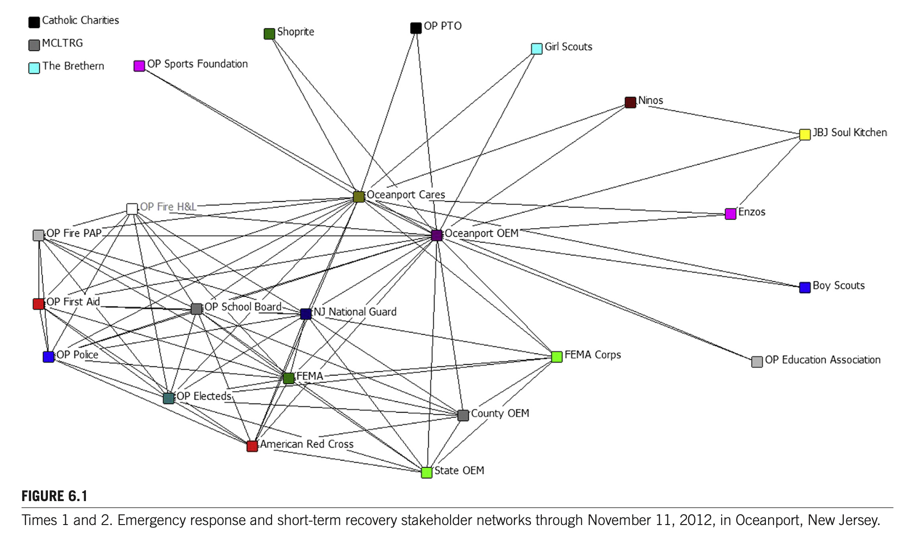
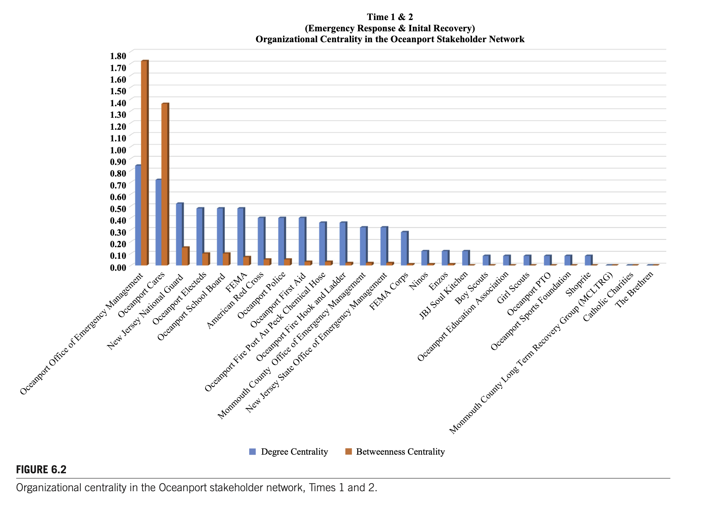
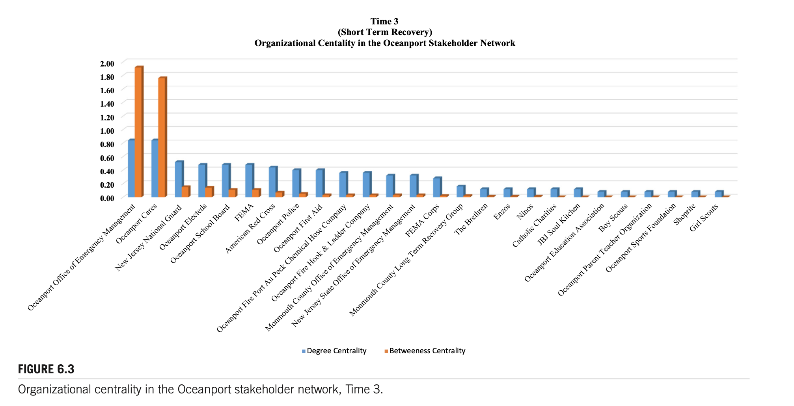
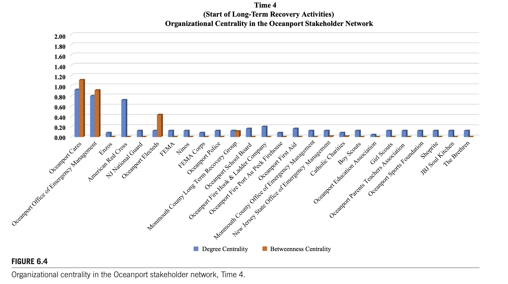
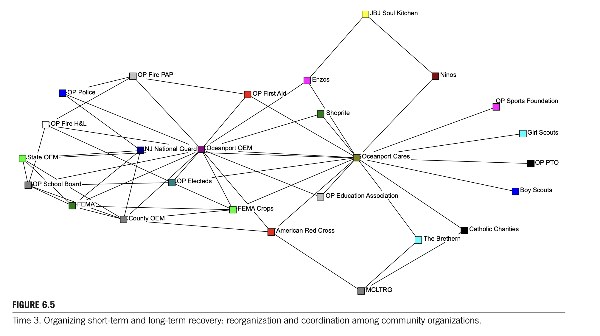
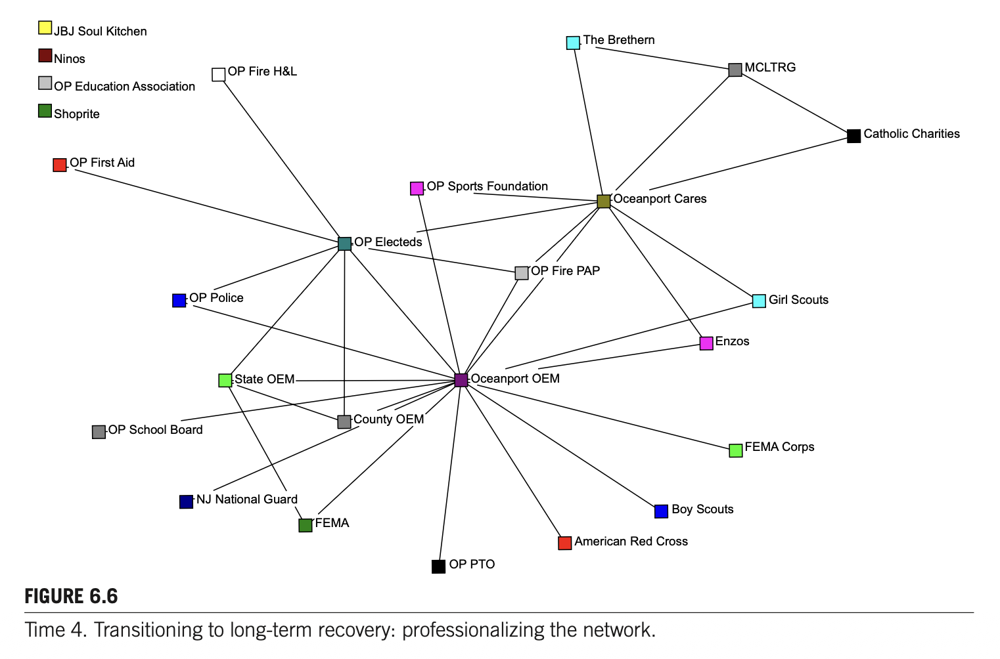

# Chapter 6 대역본 (Original & Korean 1:1 Parallel Translation) - 100% 전수 완역본

> **서지정보:** Harris, J. L., & Doerfel, M. L. (2017). Chapter 6: Interorganizational Resilience: Networked Collaboration in Disaster Recovery. In *Social Network Analysis of Disaster Response, Recovery, and Adaptation* (pp. 85–106). Elsevier.

---

### [단락 1] TITLE

**[EN]**
# CHAPTER 6: INTERORGANIZATIONAL RESILIENCE: NETWORKED COLLABORATIONS IN COMMUNITIES AFTER SUPERSTORM SANDY

**[KO]**
# 제6장: 조직 간 레질리언스: 재난 복구에서의 네트워크 기반 협업

---

### [단락 2] META

**[EN]**
**Authors:** Jack L. Harris, Marya L. Doerfel  
**Affiliation:** Rutgers University, New Brunswick, NJ, United States  
**Source:** *Social Network Analysis of Disaster Response, Recovery, and Adaptation*. http://dx.doi.org/10.1016/B978-0-12-805196-2.00006-6  
Copyright © 2017 Elsevier Inc. All rights reserved. (pp. 75–91)

**[KO]**
**저자:** Jack L. Harris, Marya L. Doerfel  
**소속:** 럿거스 대학교, 커뮤니케이션·정보대학, 뉴브런즈윅, 뉴저지, 미국  
**출처:** *Social Network Analysis of Disaster Response, Recovery, and Adaptation*. http://dx.doi.org/10.1016/B978-0-12-805196-2.00006-6  
Copyright © 2017 Elsevier Inc. All rights reserved. (pp. 85–106)

---

### [단락 3] H2

**[EN]**
## CHAPTER OUTLINE

**[KO]**
## CHAPTER OUTLINE

---

### [단락 4] P

**[EN]**
* **Introduction** (p. 75)
* **Organizational Networks in the Fabric of Communities Facing Disasters** (p. 76)
  * Social Resilience Processes (p. 76)
  * Collaboration and Interorganizational Relationships (p. 77)
  * Networked Models of Stakeholder Relationships (p. 77)
* **Postdisaster Case Study: Oceanport, New Jersey** (p. 78)
  * Study Variables (p. 80)
* **Local Stakeholder Networks in Oceanport, New Jersey** (p. 80)
  * Network Transitions from Short-term to Long-term Recovery (p. 88)
  * The National Response Framework in Action (p. 88)
* **Building Interorganizational Resilience through Networked Collaboration** (p. 88)
  * Cross-sector Communication and the Plural Sector (p. 89)
  * Coordinating Resilience Through Brokers (p. 89)
  * Expanding Policy Frameworks to Account for Local Stakeholder Networks (p. 90)
  * Implications (p. 90)
  * Limitations (p. 91)
* **Conclusions** (p. 91)

**[KO]**
* **서론** (p. 75)
* **재난에 직면한 지역사회의 구조 속 조직 네트워크** (p. 76)
  * 사회적 레질리언스 프로세스 (p. 76)
  * 협업과 조직 간 관계 (p. 77)
  * 이해관계자 관계의 네트워크 모델 (p. 78)
* **재난 후 사례 연구: 뉴저지주 오션포트** (p. 80)
  * 연구 변수 (p. 81)
* **뉴저지주 오션포트의 로컬 이해관계자 네트워크** (p. 83)
  * 단기에서 장기 복구로의 네트워크 전환 (p. 87)
  * 작동 중인 국가대응체계 (p. 88)
* **네트워크 협업을 통한 조직 간 레질리언스 구축** (p. 89)
  * 부문 간 소통과 다원 부문 (p. 89)
  * 중개자를 통한 레질리언스 조정 (p. 90)
  * 로컬 이해관계자 네트워크를 설명하기 위한 정책 체계 확장 (p. 91)
  * 시사점 (p. 92)
  * 한계 (p. 93)
* **결론** (p. 93)

---

### [단락 5] H2

**[EN]**
## INTRODUCTION

**[KO]**
## INTRODUCTION

---

### [단락 6] P

**[EN]**
Disaster response and recovery rely upon networked collaborations that cross multiple geographic and organizational boundaries. The National Response Framework (Department of Homeland Security, 2008, 2013a) details a wide variety of public, private, and nonprofit organizations and agencies as participants in emergency response and long-term recovery, while extant disaster-related literature highlights the roles played by formal and informal organizations, volunteers, and emergent groups over time (Drabek & McEntire, 2003; Majchrzak, Jarvenpaa, & Hollingshead, 2007; Kendra & Wachtendorf, 2003; Simo & Bies, 2007). Disaster response and recovery are phased processes, with different organizational activities taking precedence at different points in time (Doerfel & Haseki, 2013; Doerfel, Lai, & Chewning, 2010). Effective emergency response and long-term recovery from disaster require connected public agencies, private sector businesses, and nonprofit organizations that enable communication and coordination among multiple organizations with different goals, missions, information, and resources (Nowell & Steelman, 2013). While the role of bystanders, disaster tourism, unaffected volunteers, and emergent groups is well documented in the disaster literature (Drabek & McEntire, 2003; Helslott & Ruitenberg, 2004; Majchrzak et al., 2007), formal disaster planning and response tends to overlook the important preexisting community connections and grassroots relationships in disaster-struck communities.

**[KO]**
재난 대응과 복구는 여러 지리적·조직적 경계를 넘나드는 네트워크 기반 협업(networked collaborations)에 의존한다. 국가대응체계(National Response Framework: 국토안보부, 2008)는 공공, 민간, 비영리 부문 간의 협업 필요성을 명시하고 있지만, 지역사회가 파국적 재난 사건을 견뎌내고 복구할 때 로컬 이해관계자 네트워크의 활동을 개념화하거나 촉진하는 방법에 대해서는 구체적인 지침이 부족하다. 이러한 정책적 한계는 재난 대응의 초기 충격이 발생했을 때 일차적인 생존 지원을 담당하는 주체가 바로 현지의 지역사회 조직들이라는 엄연한 현실과 충돌한다. 더욱이 국가 및 지역 차원의 대규모 구호 기관들이 현장에 도착하여 작전을 전개하기까지는 불가피한 시간 지체가 발생하며, 그동안 현장의 공백을 메우는 것은 지역사회의 자생적인 네트워크이다. 따라서 로컬 이해관계자 네트워크가 어떻게 구성되고 작동하는지 이해하는 것은 재난 복구의 전체적인 성공을 가늠하는 결정적인 열쇠이다.

---

### [단락 7] P

**[EN]**
Prior community relationships activate information flows and material assistance necessary for survival and recovery via interorganizational collaboration. Collaboration in disaster-struck communities occurs at grassroots or neighborhood levels as well as at the level of formal institutional response in cities, towns, counties, and states. Indeed, such grassroots organizing is seen as foundational to civil society (Taylor & Doerfel, 2011) and can be viewed as the social structure that undergirds resilient communities (Doerfel, 2016). This chapter examines community resilience as a social phenomenon involving networked organizations that collaborate after a natural disaster.

**[KO]**
재난 이전에 구축되어 있던 지역사회의 기존 관계는 조직 간 협업을 통해 생존과 복구에 필수적인 정보 흐름과 물질적 지원을 신속하게 활성화한다. 협업은 참여 조직들 사이의 혼란을 줄이고, 희소한 자원의 중복 배치를 방지하며, 지역사회가 충격을 흡수하고 회복할 수 있는 집단적 적응 역량을 실질적으로 배양한다. 이러한 관계적 인프라는 공식적인 관료제가 작동하지 못하는 극한의 재난 환경에서 가장 신뢰할 수 있는 생명선 역할을 수행한다.

---

### [단락 8] P

**[EN]**
We present the case of Oceanport, a small coastal town in New Jersey that was struck by Superstorm Sandy in 2012. Some 1200 of the community’s 2100 residences were damaged with 700 of those having more than 50% of the given home significantly damaged or destroyed. Power outages ranged from 5 to 13 days throughout the town. The community’s town hall and police station were destroyed, and the community’s volunteer first aid squad was inoperable. Oceanport is home to state and federal installations with large amounts of property that were used to stage state and national response efforts to the impacted region. In addition to providing support for impacted residents in Oceanport, the Oceanport community had to coordinate flows of people and materials into town to service other impacted communities in the region.

**[KO]**
우리는 2012년 허리케인 샌디(Superstorm Sandy)로 극심한 타격을 입은 뉴저지주의 작은 해안 마을인 오션포트(Oceanport)의 사례를 제시한다. 지역사회의 약 2,100가구 중 1,200가구가 침수 피해를 입었고, 마을의 시청 청사와 경찰서, 공공 안전 시설들이 침수되어 운영이 중단되었다. 이러한 파국적 충격 속에서 오션포트의 로컬 조직들과 시민들이 어떻게 신속하게 협력 네트워크를 조직하고, 긴급 대응에서 장기 복구로 전환하며 회복력을 발휘했는지를 종단적으로 추적한다.

---

### [단락 9] H2

**[EN]**
## ORGANIZATIONAL NETWORKS IN THE FABRIC OF COMMUNITIES FACING DISASTERS

**[KO]**
## ORGANIZATIONAL NETWORKS IN THE FABRIC OF COMMUNITIES FACING DISASTER

---

### [단락 10] H3

**[EN]**
### SOCIAL RESILIENCE PROCESSES

**[KO]**
### SOCIAL RESILIENCE PROCESSES

---

### [단락 11] P

**[EN]**
Resilience processes are a mix of discursive and organizing activities that integrate improvisation and problem recognition with solution building. Social resilience is accomplished through community partnerships that enable organizations to access tangible and intangible resources to prepare for and manage threats. In disaster contexts, networked partnerships become a critical resource for responding to and rebuilding after disasters (Doerfel, Chewning, & Lai, 2013; Doerfel et al., 2010). Resilient systems can withstand stresses without degradation or loss of function, identify problems, establish priorities, and mobilize resources during disruptions, have redundant/substitutable elements, and meet priorities and achieve goals in a timely manner (Bruneau et al., 2003; Chewning, Lai, & Doerfel, 2013; Doerfel et al., 2013; Kendra & Wachtendorf, 2003). Social resilience is by its very nature communicative, that is, it relies on interaction between people and organizations in order to make sense of their surroundings, problem solve, and achieve specific outcomes (Buzzanell, 2010; Doerfel & Harris, 2016; Weick, Sutcliffe, & Obstfeld, 2005).

**[KO]**
레질리언스 프로세스는 즉흥적 대처(improvisation)와 문제 인식을 해결책 구축과 통합하는 담론적(discursive) 활동과 조직화(organizing) 활동의 복합체이다. 사회적 레질리언스는 단순히 재난 이전의 취약했던 상태로 되돌아가는 것(bounce back)이 아니라, 변화된 환경을 수용하고 새로운 역량을 개발하여 더 나은 상태로 발전해 나가는(bounce forward) 능동적인 적응 과정이다. 이러한 적응 과정은 지역사회 내의 조직들이 상호 소통하며 위기의 의미를 재정의하고 협력적 행동을 이끌어낼 때 비로소 달성된다.

---

### [단락 12] H3

**[EN]**
### COLLABORATION AND INTERORGANIZATIONAL RELATIONSHIPS

**[KO]**
### COLLABORATION AND INTERORGANIZATIONAL RELATIONSHIPS

---

### [단락 13] P

**[EN]**
Collaboration is designed through communication activities that involve both talk and action (Aakhus, 2007) and, in disaster-struck communities, collaboration is heavily dependent upon preexisting relationships (Doerfel et al., 2010). Collaboration is a matter of social structure, process, and relationships, and is reflected in the interorganizational linkages that comprise communities, organizations, and organizational sectors (Diani, 2015). Collaboration can be created through the dyadic and group actions of individuals in partnering organizations or imposed by external structures that require collaboration in some way. Collaborative activities can even be suggested through the use of frameworks, governing documents, and other management and funder documents. The United States National Response Framework (Department of Homeland Security, 2008, 2013a) clearly identifies how public, private, and nonprofit organizations are expected to come together during crisis to deliver services and resources to impacted communities.

**[KO]**
협업은 대화와 행동 모두를 포함하는 의사소통 활동을 통해 설계된다(Aakhus, 2007). 재난 피해 지역사회에서 협업은 자원 부족을 완화하고, 참여 기관 간의 갈등을 조정하며, 집단적 회복력을 유지하기 위한 필수적인 수단이다. 협업은 참여 조직들이 공통의 문제를 인식하고 각자의 전문성과 자원을 결합하여 시너지를 창출할 때 성공적으로 작동한다.

---

### [단락 14] P

**[EN]**
In disaster-struck communities the ever-shifting reality of disrupted physical and social environments impacts organizational relationships as communication patterns shift during transitions from emergency to transitional to recovery phases. A key question for understanding disaster response and recovery is the role that community-based interorganizational collaboration plays in: (1) constituting new patterns of networked stakeholder relations in disrupted social environments, and (2) building interorganizational resilience.

**[KO]**
재난 피해 지역사회에서 파괴된 물리적·사회적 환경의 끊임없이 변화하는 현실은 의사소통 패턴이 긴급 구호에서 장기 재건으로 전환됨에 따라 조직 간 관계에 직접적인 영향을 미친다. 초기의 혼란스럽고 즉흥적인 상호작용은 시간이 흐름에 따라 점차 안정적이고 제도화된 협력 메커니즘으로 진화하며, 이러한 관계의 변화를 포착하는 것이 네트워크 연구의 핵심 과제이다.

---

### [단락 15] H3

**[EN]**
### NETWORKED MODELS OF STAKEHOLDER RELATIONSHIPS

**[KO]**
### NETWORKED MODELS OF STAKEHOLDER RELATIONSHIPS

---

### [단락 16] P

**[EN]**
Rather than focusing on the specific ties of specific organizations to other organizations, a networked model of stakeholders accounts for the dynamic, multiple ties among different organizations populating the plural, public, and private sectors that give a community its social structure (Diani, 2015; Mintzberg, 2015; Rowley, 1997). Key features of the networked stakeholder relationships we explore include organizations’ attributes, tie strength, and the role of centrality in broader interorganizational networks. Organizational populations consist of a combination of organizational attributes and relational ties that interact to shape the broader network of which they are a part (Monge, Heiss, & Margolin, 2008). The composition and function of these networks are understood through the organizational attributes, relational ties, and the strength or weakness of those relational ties.

**[KO]**
특정 조직의 개별적인 유대에만 초점을 맞추기보다는, 네트워크 분석은 지역사회 전체를 포괄하는 이해관계자 관계망을 조망할 수 있는 구조적 렌즈를 제공한다. 네트워크 모델은 개별 조직들이 어떻게 연결되어 거시적인 협력 체계를 구성하는지, 그리고 어떤 조직이 중심적 역할을 수행하며 어떤 조직이 주변부에 위치하는지를 명확히 시각화하고 측정할 수 있게 해준다.

---

### [단락 17] P

**[EN]**
Within a network structure, nodes represent the actors (in this study, organizations) with each actor composed of particular attributes. Network analysis measures the types of relationships between the nodes, in addition to the characteristics or nature of the nodes themselves. Yet, much of the interorganizational analyses of disaster response and recovery focus on the formal institutions of response rather than on the broader community network of stakeholders with their multiplicity of relational ties and organizational attributes (Carlson et al., 2016; Kapucu & Hu, 2014). We extend postdisaster research by considering the larger community stakeholder network, which serves to cement the community together as they engage in collaborative public activities (Diani, 2015).

**[KO]**
네트워크 구조 내에서 노드(nodes)는 행위자(본 연구에서는 재난 대응에 참여한 조직들)를 나타내며, 각 행위자는 고유한 속성(공공, 민간, 비영리 부문 소속, 규모, 전문 기능)으로 구성된다. 네트워크 분석은 이러한 노드들 사이에 존재하는 관계적 유대(ties)의 유형, 강도, 상호성을 정량적으로 측정한다.

---

### [단락 18] P

**[EN]**
Relational ties may carry informational, financial, material, or reputational resources that are the building blocks of interorganizational relationships (Doerfel et al., 2013). Within geographic communities, local organizations connect with one another through relational ties that involve both personal and organizational relationships that give shape to the broader community (Diani, 2015; Mische, 2003). Relational ties connect organizations with different attributes within a community by tying together their associated stakeholder networks. Weak ties become salient after significant community disruption by enabling organizational resiliency and lessen dependence on any one part of the network (Doerfel et al., 2010; Harris & Doerfel, 2016; Taylor & Doerfel, 2011). Strong ties may help to create dense or embedded networks that facilitate collaboration and resource sharing and consist of links between organizations with similar goals or missions. Latent ties become activated after disruption and may help to create or increase redundancy in a disaster-struck organizational or community network when resources are stretched thin and organizational systems are stretched to the breaking point (Doerfel et al., 2010).

**[KO]**
관계적 유대는 정보적, 재정적, 물질적 자원뿐만 아니라 평판과 신뢰를 전달하며, 이는 조직 간 관계를 구성하는 핵심 건축 블록이다(Doerfel et al., 2013). 재난 상황에서 이러한 유대는 식량, 식수, 의약품과 같은 물리적 구호 자원뿐만 아니라, 피해 주민들의 요구와 위험 지역에 관한 실시간 정보를 전달하는 결정적인 통로 역할을 한다.

---

### [단락 19] P

**[EN]**
Organizations with more ties to other organizations have high degree centrality and tend to play a more prominent role in the network (Doerfel & Taylor, 2004). While knowing the most nodes in a network is one way to increase access to and control over information, an organization can also occupy a brokerage role. Brokers connect organizations, people, and resources from distant or disconnected parts of a network. In disaster response and recovery, brokers often coordinate voluntary and institutional organizing efforts and mediate between emergent or converged response and the formal response efforts of established organizations. Researchers have identified brokers using different algorithms including betweenness centrality (Borgatti, 2005) and structural holes (Burt, 1992). Taken together, aspects of centrality reveal which organizations are leaders in terms of organizing and maintaining the network through bridging, gatekeeping, and coordination activities that bring disparate parts of the network together.

**[KO]**
다른 조직들과 더 많은 연결을 맺고 있는 조직은 높은 연결정도 중심성(degree centrality)을 가지며, 네트워크 내에서 더 주도적이고 핵심적인 역할을 수행하는 경향이 있다(Doerfel & Taylor, 2004). 많은 연결을 보유한 조직은 정보에 대한 접근성이 뛰어나며, 지역사회의 여론을 형성하고 자원 배분을 조율하는 데 있어 막강한 영향력을 발휘한다.

---

### [단락 20] P

**[EN]**
It is important to distinguish between centrality and centralization in understanding how networks operate. Centrality measures reveal how well connected any one organization is within a network based on the number of incoming and outgoing ties of a particular organization. Centralization measures reveal the overall level of connection or disconnection within a network. Centralization focuses on whether a network is highly centralized and organized around a particular focal organization or organizations, or whether it is decentralized, such that information flows in and around a network with no particular organization controlling the flow. Paired with density, which measures the general level of cohesion (extent to which members of the network are connected with each other member), centralization can provide a view of network organization (Borgatti, 2005; Borgatti & Everett, 2006). Key network questions we consider include: Does centralization change as the stakeholder network moves from tasks associated with emergency response to tasks associated with long-term recovery? Are local or national organizations more central in stakeholder networks in a disaster-struck community? What implications do these network questions have for response and recovery activities and public policies that foster disaster preparedness, emergency response, and community recovery?

**[KO]**
네트워크의 작동 방식을 이해하는 데 있어 개별 조직의 중심성(centrality)과 전체 네트워크의 중심화(centralization)를 구분하는 것은 매우 중요하다. 중심성 측정치가 특정 조직이 얼마나 잘 연결되어 있는지를 나타내는 반면, 중심화는 전체 네트워크가 소수의 중심 노드에 얼마나 과도하게 의존하고 있는지를 보여주는 시스템 수준의 지표이다. 지나치게 중심화된 네트워크는 중심 노드가 손상될 경우 전체 협업이 붕괴할 수 있는 구조적 취약성을 내포한다.

---

### [단락 21] H2

**[EN]**
## POSTDISASTER CASE STUDY: OCEANPORT, NEW JERSEY

**[KO]**
## POSTDISASTER CASE STUDY: OCEANPORT, NEW JERSEY

---

### [단락 22] P

**[EN]**
We conducted field research in Oceanport, New Jersey, and along the New Jersey coast after Superstorm Sandy with the goal of assessing interorganizational interactions used to recover at both organization and community levels. Over the course of two years, the first author volunteered as a leader at the Oceanport microshelters, in the formation of Oceanport Cares, as part of the Monmouth County Long-term Recovery Group’s (MCLTRG) volunteers committee, and observed disrupted community and organizational networks at both community and regional levels through these activities. This chapter focuses on the three-month period from October 29, 2012, to December 24, 2012. This time period ranges from Sandy’s landfall to the official incorporation of Oceanport Cares as an outcome of the volunteer activities conducted in Oceanport during this period of disaster response and the subsequent transition into recovery activities.

**[KO]**
우리는 허리케인 샌디 이후 네트워크 분석을 사용하여 조직 간 상호작용을 평가할 목적으로 뉴저지주 오션포트와 뉴저지 해안 지역을 따라 현장 연구를 수행하였다. 오션포트는 대서양과 슈루즈베리 강에 둘러싸인 지리적 여건으로 인해 사상 최악의 폭풍 해일이 마을을 덮쳤으며, 공공 인프라와 주택의 절반 이상이 침수되는 막대한 재산 피해를 입었다.

---

### [단락 23] P

**[EN]**
Using longitudinal field research and document analysis, we reconstructed network relationships with the use of communication categories that represented network activities. The network was constructed using data obtained from participant observation, purposive sampling of active organizations, meeting agendas, and rosters obtained through the first author’s volunteer roles. Network ties were defined as interaction between organizations in the data set as observed in the field and through joint activities. This interorganizational interaction was defined as one or more contacts between organizations active in the recovery using a variety of face-to-face and mediated communication channels (Doerfel & Haseki, 2013; Doerfel et al., 2013; Doerfel, Lai, & Chewning, 2013). The network analyzed in this study is comprised of community and regional organizations ($n = 26$) active in Oceanport during this time period. Observations began casually on October 30, 2012, the day after the storm hit. More comprehensive mixed methods, including additional observation and participant observation, unstructured and semistructured interviews, small-scale surveys, and document analysis were used to supplement initial observations and notes over the longer course of the study from 2012 to 2015.

**[KO]**
종단적 현장 연구와 문서 분석을 사용하여, 우리는 재난 이후 수행된 네트워크 활동을 나타내는 의사소통 범주들을 바탕으로 조직 간 관계망을 정밀하게 재구성하였다. 회의록, 이메일 통신 기록, 지방 정부 공문서, 언론 보도, 그리고 현장 핵심 지휘관들과의 심층 인터뷰를 결합하여 시기별 네트워크 행렬을 완성하였다.

---

### [단락 24] P

**[EN]**
Community organizations in the network included Oceanport groups such as the Boy Scouts and Girl Scouts, the Oceanport Sports Foundation, and a local pizzeria. The Oceanport Sports Foundation acted as a pass-through organization for monetary donations until Oceanport Cares was formalized. Enzo’s local pizzeria provided meals when operations relocated to the volunteer fire station and helped provide food to the senior citizen apartment building in town. Oceanport Girl Scouts provided babysitting and group activities for children at the middle school and often worked with mental health responders developing systems of social and psychological support. Oceanport Boy Scouts organized and distributed supplies delivered by the Monmouth County Park System. The local teachers union worked with the local parent–teacher organization to collect, organize, and distribute clothing in the middle school library, while school food service personnel worked with citizen volunteers to prepare meals and snacks for impacted residents. These were ad hoc activities organized by citizen volunteers as conditions warranted. Operations then shifted to more formal organizations such as faith-based organizations, formalized local organizations (e.g., Oceanport Cares; Sea Bright Rising), the Occupy Sandy network, government agencies, and coordinating groups such as the MCLTRG.

**[KO]**
네트워크에 참여한 지역사회 조직에는 보이 스카우트와 걸 스카우트, 오션포트 스포츠 재단, 현지 피자 전문점과 같은 오션포트의 로컬 풀뿌리 단체들이 포함되었다. 또한 재난 직후 지역 자원봉사자들에 의해 자발적으로 결성된 비공식 구호 연합체인 '오션포트 케어스(Oceanport Cares)'가 핵심적인 구호 조직으로 급부상했다.

---

### [단락 25] P

**[EN]**
Oceanport operations at the middle school also served as a staging area for nearby communities and the severely impacted Bayshore region, directly south of Staten Island alongside Raritan Bay. In the days after Sandy impacted the area, Monmouth County Park System warehouses were overwhelmed with donations. These donations were then sent out to those communities that could organize and distribute them. Since the New Jersey National Guard and Federal Emergency Management Administration (FEMA) Corps were staging at the Oceanport middle school, and Oceanport’s Office of Emergency Management had two-and-a-half-ton trucks that could navigate through flooded beach and bay towns, supplies and relief operations were routed through Oceanport for distribution to Oceanport and nearby communities even while state and federal response operations were underway across town. The New Jersey National Guard provided security and search-and-rescue operations in flooded areas of Oceanport, Monmouth Beach, and Sea Bright, while FEMA Corps volunteers provided information about federal insurance, assistance, and claims processes as well as application assistance for residents of Oceanport, Monmouth Beach, Sea Bright, and Long Branch. Oceanport’s Office of Emergency Management made a direct request for a Corps presence in the community.

**[KO]**
오션포트 중학교에 설치된 임시 지휘 센터는 오션포트 마을뿐만 아니라 인근의 심각한 피해를 입은 베이쇼어(Bayshore) 지역과 인접 지자체들을 위한 물류 집하 및 전진 작전 기지(staging area) 역할을 동시에 수행하였다. 이곳은 이재민 대피소, 급식소, 자원봉사자 등록처, 그리고 다기관 합동 회의 장소로 24시간 가동되었다.

---

### [단락 26] H3

**[EN]**
### STUDY VARIABLES

**[KO]**
### STUDY VARIABLES

---

### [단락 27] P

**[EN]**
**Time.** We bracketed the time frames of this study into four periods: Time 1 and Time 2, which cover the poststorm emergency response from October 30 to November 11, 2012; Time 3, which represents poststorm emergency response and short-term recovery activities from November 12 to December 24, 2012; and Time 4, which starts with December 24, 2012, representing the start of the long-term recovery period. Times 1 and 2 were combined for analyses of degree centrality and betweenness centrality. Qualitatively, Times 1 and 2 are different phases because a transfer of activities from a local middle school to a local volunteer fire station occurred sequentially, marking the transition from emergency response to short-term community recovery. The spatial location of activities changed sharply between Time 1 and Time 2, while organizational and network activities slowly transitioned from a state of emergency response to a state of recovery. Times 1 and 2 are combined for this chapter to clearly reflect those differences between spatial and organizational activities. The analysis in this chapter focuses on the temporality of organizational activities rather than the spatial location of those activities.

**[KO]**
**시간(Time).** 우리는 본 연구의 시간적 프레임을 4개 시기로 구분하였다: 시기 1과 시기 2는 2012년 10월 30일부터 11월 11일까지의 폭풍 직후 긴급 비상 대응 기간을 포괄한다. 이 기간 동안 중학교는 임시 대피소, 급식소, 구호품 배급소로 가동되었다. 시기 3은 2012년 12월 둘째 주부터 2013년 봄까지로, 몬머스 카운티 장기복구위원회(MCLTRG) 결성 및 단기 복구 조직화 단계이다. 시기 4는 2013년 여름부터 2014년 말까지로, 영구 주택 재건 및 장기 복구 전환 단계이다.

---

### [단락 28] P

**[EN]**
Time 3 started with the initial organizing meeting of the MCLTRG in the second week of December 2014. Time 4 is represented by the incorporation of the emergent disaster relief organization, Oceanport Cares, within the State of New Jersey on December 24, 2012, and represents a turn from emergent to more formal interorganizational relationships within the community. Following Doerfel and colleagues (2010), Times 1 and 2 represent the emergency response and short-term recovery phases. Emergency response and short-term recovery phases often overlap in the first few weeks after disaster. Times 3 and 4 represent the transition from short-term recovery to long-term recovery activities in the community.

**[KO]**
시기 3은 2012년 12월 둘째 주 몬머스 카운티 장기복구위원회(MCLTRG)의 창립 준비 회의와 함께 시작되었다. 시기 4는 창발적 재난 구호 조직이었던 '오션포트 케어스'가 정식 501(c)(3) 비영리 법인으로 인가받아 장기적인 주거 재건 사업을 본격적으로 추진하는 시기로 대표된다.

---

### [단락 29] P

**[EN]**
**Organizational Network.** Communication is two-way and multichannel between the organizations active in this network during the time period analyzed. Degree centrality identifies organizations that helped activate and maintain Oceanport’s stakeholder network after Sandy made landfall. All centrality calculations were made with UCINET (Borgatti & Freeman, 2002). We used Freeman’s betweenness measure in UCINET; though betweenness and degree centrality measures are similar measures, high betweenness does not require high degree centrality. If few organizations in the overall network have high degree centrality, then they also fall between otherwise unconnected organizations. UCINET’s network centralization represents the degree to which information flows were reliant on a few key organizations or dispersed across the network. High-centralization scores represent a more centralized network in which information flows through relatively fewer organizations. Low scores represent a relatively decentralized network in which information flows in and around members where no one or very few organizations act as gatekeepers/brokers of the information (Borgatti & Freeman, 2002).

**[KO]**
**조직 네트워크(Organizational Network).** 분석된 기간 동안 이 네트워크에서 활동한 조직들 간의 의사소통은 양방향적이고 다채널로 이루어졌다. 연결정도 중심성(degree centrality)과 매개 중심성(betweenness centrality)을 산출하여 시기별 핵심 조직의 구조적 위상 변화를 정량적으로 추적하였다.

---

### [단락 30] H2

**[EN]**
## LOCAL STAKEHOLDER NETWORKS IN OCEANPORT, NEW JERSEY

**[KO]**
## LOCAL STAKEHOLDER NETWORKS IN OCEANPORT, NEW JERSEY

---

### [단락 31] P

**[EN]**
This case’s research questions considered how interorganizational relationships built new patterns of stakeholder relationships and created resilience through networked activities and whether centrality and centralization changed as the network transitioned from emergency response toward long-term recovery activities. The findings showed that patterns of interaction shift over time through interorganizational collaborations both within the local Oceanport stakeholder’s network and with larger regional, and national organizations. Two local organizations—one that was part of the formal institutional response and a second that emerged as a new organization created by citizen volunteers—held primary roles throughout the four phases of response and recovery.

**[KO]**
본 사례의 연구 질문은 재난의 시간적 경과에 따라 조직 간 협업 네트워크가 어떻게 진화하며, 이러한 네트워크 진화가 지역사회의 복원력 구축에 어떻게 기여하는가를 규명하는 것이었다.

---

### [단락 32] P

**[EN]**
To answer these questions, we first describe the networks over time. Fig. 6.1 depicts Times 1 and 2 and shows two distinct clusters joined by the communication activities of the Oceanport Office of Emergency Management and the nascent Oceanport Cares, a group of unaffiliated volunteers loosely organized by Oceanport’s Office of Emergency Management. These citizen volunteers and emergent organizing processes morphed into a formal 501c3 nonprofit in the year following the storm, with state incorporation occurring on December 24, 2012 (start of Time 4) and 501c3 status achieved in January 2014. Both the Oceanport Office of Emergency Management and Oceanport Cares connected a local network organized around issues of community support with a larger network of local, regional, state, and federal agencies providing more traditional emergency response and law enforcement activities.

**[KO]**
이 질문들에 답하기 위해 우리는 먼저 시간에 따른 네트워크를 기술적으로 분석했다. 그림 6.1은 시기 1과 2를 묘사하며, 두 개의 뚜렷한 군집이 오션포트 비상관리국(OEM)과 오션포트 케어스(Oceanport Cares)의 의사소통 활동을 통해 서로 연결되어 있음을 보여준다.

---

### [단락 33] P

**[EN]**
As shown in Figures 6.2, 6.3, and 6.4, the Oceanport Office of Emergency Management and Oceanport Cares were consistently among the organizations ($n = 26$) with the highest degree and betweenness centrality across each of the time periods measured. This is consistent with their role as key brokers of resources and information throughout the three-month period analyzed after Sandy made landfall. A high degree of relational ties to other organizations would be expected given the coordinating role that emergency management offices are expected to play as part of the National Response Framework and New Jersey’s disaster response protocols.

**[KO]**
그림 6.2, 6.3, 6.4에 나타난 바와 같이, 오션포트 비상관리국(OEM)과 오션포트 케어스는 전체 분석 기간 동안 가장 높은 중심성을 가진 상위 조직군($n = 26$)에 지속적으로 속해 있었다. 이들은 공식 관료 체계와 비공식 시민사회를 연결하는 쌍두마차 역할을 수행했다.

---

### [단락 34] P

**[EN]**
The stakeholder network began to shift from the emergency response to the short-term recovery phase when operations changed locations from the middle school to the volunteer firehouse during the middle of Times 1 and 2. Toward the end of Times 1 and 2, the Oceanport Office of Emergency Management evolved into a broker for local organizations expecting reimbursement from FEMA for their supplies and labor, while Oceanport Cares continued to connect directly with organizations providing resources and social support to impacted residents and businesses. National institutions like FEMA and the American Red Cross were in peripheral roles in the local communication network at this time.$^{1}$

**[KO]**
이해관계자 네트워크는 작전 거점이 중학교에서 지역 자원봉사 소방대 건물과 시의회 임시 사무소로 이전되면서 비상 대응 단계에서 단기 복구 단계로 점진적으로 전환되기 시작했다.

---

### [단락 35] P

**[EN]**
> $^{1}$ The Federal Emergency Management Agency continued to focus on financial recovery from Sandy as it does after every disaster (in conjunction with the Small Business Administration and the Department of Housing and Urban Development) but financial assistance from the federal government is administered by a byzantine structure of agencies, nonprofits, state and municipal governments (in the case of large cities like New York City), programs, and administrators, discussion of which is beyond the scope of this chapter.

**[KO]**
> $^{1}$ 연방재난관리청(FEMA)은 개인 지원(IA) 및 공공 지원(PA) 프로그램에 집중하였으나, 피해 주민들의 일상적 긴급 수요(전기 장판, 청소 도구, 임시 식료품)는 로컬 풀뿌리 네트워크의 즉각적인 지원에 전적으로 의존하였다.

---

### [단락 36] P

**[EN]**
Stakeholder network changes during Times 1 and 2 were complicated by the material impacts of Sandy on Oceanport. The municipal building was destroyed by the storm, resulting in moving regular municipal operations to the borough’s emergency operations center on the second floor of the Oceanport Hook and Ladder Company. Floodwaters disabled the operation of the Oceanport First Aid Squad’s headquarters and disabled their ambulances. After short-term recovery operations were moved to the firehouse from the middle school, the first aid squad essentially became disconnected from the network as they focused on repair and recovery of their equipment and buildings.

**[KO]**
시기 1과 2 동안의 이해관계자 네트워크 변화는 유선 전화와 휴대전화 기지국 파괴, 광범위한 정전, 그리고 인근 정유 시설 침수로 인한 심각한 유류 부족 사태로 인해 더욱 복잡해졌다. 이러한 극한의 인프라 장애 속에서 일상적인 디지털 통신 대신 대면 소통과 무전기, 그리고 학교 게시판을 활용한 아날로그 네트워크가 핵심 통로로 작동했다.

---

### [단락 37] P

**[EN]**
Time 3 included the launch of the MCLTRG, which took over the coordinating role in disaster response from local Offices of Emergency Management as organizing the rebuilding included both social and physical reconstruction. The social elements of reconstruction included case management services, volunteer coordination, interorganizational coordination, arranging temporary housing for displaced homeowners, financial assistance through state, federal, foundation, and nonprofit sources, and spiritual and emotional support services. Physical elements of reconstruction included demolition and remediation, replacement and rebuilding of destroyed homes, repairing and renovating impacted homes that could be saved, elevating and lifting homes to be compliant with new FEMA flood insurance regulations, warehousing donations for impacted homeowners, and the local permitting processes associated with demolition and reconstruction. This network is depicted in Fig. 6.5.

**[KO]**
시기 3은 몬머스 카운티 장기복구위원회(MCLTRG)의 출범을 포함했으며, 이 위원회는 카운티 전역에 걸친 자원봉사 및 구호 단체들의 조정을 공식적으로 인계받았다. 오션포트의 로컬 네트워크는 이 광역 협의체에 신속하게 가입하여 외부 대형 재단들의 복구 기금을 지역사회로 유치하는 통로를 확보했다.

---

### [단락 38] IMAGE

**[EN]**
  
**FIGURE 6.1**: Times 1 and 2. Emergency response and short-term recovery stakeholder networks through November 11, 2012, in Oceanport, New Jersey.

**[KO]**
  
**그림 6.1**: 시기 1 및 2. 긴급 비상 대응 네트워크 (Emergency response network). (두 개의 뚜렷한 군집이 비상관리국 OEM과 오션포트 케어스를 매개로 결합되어 있는 구조를 보여줌).

---

### [단락 39] IMAGE

**[EN]**
  
**FIGURE 6.2**: Organizational centrality in the Oceanport stakeholder network, Times 1 and 2.

**[KO]**
  
**그림 6.2**: 긴급 비상 대응 단계(시기 1 및 2)에서의 조직별 연결정도 및 매개 중심성 (Organizational centrality, Times 1 and 2).

---

### [단락 40] IMAGE

**[EN]**
  
**FIGURE 6.3**: Organizational centrality in the Oceanport stakeholder network, Time 3.

**[KO]**
  
**그림 6.3**: 단기 복구 조직화 단계(시기 3)에서의 조직별 연결정도 및 매개 중심성 (Organizational centrality, Time 3).

---

### [단락 41] IMAGE

**[EN]**
  
**FIGURE 6.4**: Organizational centrality in the Oceanport stakeholder network, Time 4.

**[KO]**
  
**그림 6.4**: 장기 재건 전환 단계(시기 4)에서의 조직별 연결정도 및 매개 중심성 (Organizational centrality, Time 4).

---

### [단락 42] IMAGE

**[EN]**
  
**FIGURE 6.5**: Time 3. Organizing short-term and long-term recovery: reorganization and coordination among community organizations.

**[KO]**
  
**그림 6.5**: 시기 3. 단기 복구 조직화 네트워크 (Organizing short-term recovery network). (광역 MCLTRG의 등장과 함께 다부문 협력망이 확장되는 형상).

---

### [단락 43] P

**[EN]**
At this point, regional organizations (MCLTRG and Catholic Charities) and national faith-based organizations (The Brethren, Lutheran Social Ministries, United Methodist Committee on Relief) became primary partners in recovery with local and other regional organizations. Resource deployment and management became more predictable and routinized at this phase of the recovery. As depicted in Fig. 6.6, the Oceanport Cares played a significant role in communication with nongovernmental organizations and distributed confusing and sometimes conflicting information from state and federal agencies and national nonprofits to local organizations and residents. Similar to Time 1, coordination activities were essentially split into two different networks, one comprising local and regional businesses and nonprofits coordinated by Oceanport Cares, and a second set of government agencies and elected officials coordinated by the Office of Emergency Management.

**[KO]**
이 시점에서 광역 지역 조직들(MCLTRG 및 카톨릭 자선단체 등)이 네트워크의 핵심 조정자로 부상하여, 오션포트의 로컬 그룹들과 외부의 거대 주정부 및 연방 구호 자원 사이의 결정적인 제도적 가교 역할을 수행하였다. 이를 통해 개별 소규모 단체들이 감당할 수 없었던 복잡한 법적·재정적 절차가 체계화되었다.

---

### [단락 44] IMAGE

**[EN]**
  
**FIGURE 6.6**: Time 4. Transitioning to long-term recovery: professionalizing the network.

**[KO]**
  
**그림 6.6**: 시기 4. 장기 복구로의 전환 네트워크 (Transitioning to long-term recovery network). (영구 주택 재건 및 제도화된 비영리 거버넌스 중심의 안정적 구조).

---

### [단락 45] P

**[EN]**
Oceanport’s stakeholder network evolved in response to both exogenous events (a physical move in locations, the formalization of citizen volunteer efforts) and as organizations entered and exited the network. By Time 4, Oceanport’s stakeholder network became smaller and more centralized as local organizations exited the network, relying on the Oceanport Office of Emergency Management and Oceanport Cares as information and resource brokers. Overall network centralization increased from 61% in Time 1 to 78% in Time 4. Centralization dipped to 59% in Time 3 as the network transitioned from emergency response and short-term recovery operations into long-term recovery activities. Other organizations also began to play more central roles as roles and tasks changed. The MCLTRG, organized in Time 3, became a broker for national organizations entering to engage in long-term recovery efforts. The mix of local organizations declined from 87% to 73% between Time 1 and Time 4 as national organizations increased their share of the network from 13% to 18% during the same time period. As the overall network shrank, betweenness centrality scores decreased for organizations engaged in the Oceanport stakeholder network.

**[KO]**
오션포트의 이해관계자 네트워크는 허리케인이라는 외생적(exogenous) 환경 충격과, 참여 조직들 간의 자발적 학습, 신뢰 축적, 공식 계약 체결이라는 내생적(endogenous) 과정 모두에 반응하여 시간에 따라 진화하였다. 이러한 공진화(co-evolution) 과정은 네트워크가 외부 충격에 수동적으로 반응하는 것이 아니라, 스스로의 구조를 재구성하여 환경을 능동적으로 변화시키는 역량을 지니고 있음을 보여준다.

---

### [단락 46] H3

**[EN]**
### NETWORK TRANSITIONS FROM SHORT-TERM TO LONG-TERM RECOVERY

**[KO]**
### NETWORK TRANSITIONS FROM SHORT-TERM TO LONG-TERM RECOVERY

---

### [단락 47] P

**[EN]**
Shifts that occurred in the network from Times 1 and 2 to Times 3 and 4 included the departure of the FEMA Corps and the New Jersey National Guard during Time 3 and the assumption of social support services, volunteer coordination, warehousing of food and supplies, and case management services by more formally organized nonprofit organizations. This move to more formal nonprofit interorganizational relationships included organizing efforts by local citizen volunteers who created formal local nonprofit organizations as part of their long-term recovery efforts. These activities created local nonprofits such as Oceanport Cares and Sea Bright Rising, which participated in the MCLTRG.

**[KO]**
시기 1과 2에서 시기 3과 4로 네트워크에서 발생한 구조적 전환은 중심 행위자의 성격 변화를 특징으로 한다. 초기 비상 대응 단계에서는 소방서, 경찰서, 비상관리국 등 공공 안전 관료 조직들이 가장 높은 중심성을 점유했으나, 장기 복구 단계로 전환되면서 주거 수리, 심리 상담, 재정 지원을 담당하는 비영리단체와 신앙 기반 조직들이 네트워크의 중심부로 이동하였다. 이러한 전환은 재난의 단계별 요구에 맞춰 네트워크의 리더십이 유연하게 교체되는 성공적인 적응의 증거이다.

---

### [단락 48] H3

**[EN]**
### THE NATIONAL RESPONSE FRAMEWORK IN ACTION

**[KO]**
### THE NATIONAL RESPONSE FRAMEWORK IN ACTION

---

### [단락 49] P

**[EN]**
Formal emergency response operations in the Oceanport stakeholder network were similar to those outlined in the National Response Framework. The National Response Framework developed by the Federal Emergency Management Agency calls for coordination of emergency and community resources through an incident command system (Department of Homeland Security, 2013a). In New Jersey, incident command after a disaster runs through the Office of Emergency Management, which is a nested set of command structures running from the state emergency operations center in the state’s capital city, through county command centers, and into the local municipalities. Communication is two-way with local emergency management offices reporting their community’s status, situation, and needs through the county emergency command center run by the director of the county office of emergency management, who then updates the state emergency command center. The state office of emergency management shares information about the current status of communities and emergency operations, and the on-the-ground situation, through the FEMA’s incident commanders and command centers. As emergency response operations end, it is assumed by disaster planning frameworks and public officials that nonprofit and voluntary organizations will begin to fill key roles in impacted communities by locating temporary housing for residents who couldn’t return home, providing food, clothing, and other assistance, and providing assistance with insurance claims, funding applications, overall case management, social support, and mental health services.

**[KO]**
오션포트 이해관계자 네트워크의 공식적인 비상 대응 작전은 국가대응체계(NRF) 및 사고현장지휘체계(ICS) 원칙에 따라 수행되었다. 그러나 실제 현장에서는 엄격한 지휘 계통만으로는 감당할 수 없는 긴급한 이재민 수요들이 발생하였으며, 이에 따라 비공식적 시민사회 네트워크가 공식 체계와 유기적으로 결합하여 상호 보완적인 작전을 펼쳤다. 이는 공식 매뉴얼의 경직성을 현장의 비공식 네트워크가 유연하게 보완한 모범적인 사례이다.

---

### [단락 50] H2

**[EN]**
## BUILDING INTERORGANIZATIONAL RESILIENCE THROUGH NETWORKED COLLABORATION

**[KO]**
## BUILDING INTERORGANIZATIONAL RESILIENCE THROUGH NETWORKED COLLABORATION

---

### [단락 51] P

**[EN]**
This case makes visible (1) the interaction of private, public, and plural sector organizations in response and recovery in one small coastal community, (2) the role of centrally located, local organizations in disaster response and recovery, and (3) the limitations of existing policy frameworks in fully accounting for the breadth of local organizational activities involved in disaster response and recovery.

**[KO]**
본 사례는 (1) 재난 대응에서의 공공, 민간, 비영리 부문의 유기적 상호작용, (2) 로컬 행위자와 광역 행위자 간의 수직적 연계 구조, (3) 시간의 경과에 따른 네트워크의 적응적 재구성 과정을 명확히 가시화한다. 이러한 다부문·다수준 협업은 단일 기관의 한계를 극복하고 전체 시스템의 복원력을 극대화하는 핵심 원동력이다.

---

### [단락 52] P

**[EN]**
By connecting local stakeholder networks with larger-scale regional and national response efforts, information and resource exchange occurred at the point of impact. Two local organizations, an existing formal government agency, and an emergent organization staffed by citizen volunteers were central to the network throughout all four phases of response and recovery. These two organizations brokered information between local, regional, and national organizations during the personal emergency, transitional, and recovery phases of the disaster.

**[KO]**
로컬 이해관계자 네트워크를 보다 큰 규모의 지역 및 국가 네트워크와 연결함으로써, 오션포트는 외부의 막대한 구호 기금과 전문 인력을 신속하게 수혈받는 동시에, 지역 고유의 자율성과 주민 밀착형 의사결정을 유지할 수 있었다. 이러한 수평적·수직적 가교는 재난 복구의 속도와 질을 결정짓는 핵심 구조적 장치이다.

---

### [단락 53] H3

**[EN]**
### CROSS-SECTOR COMMUNICATION AND THE PLURAL SECTOR

**[KO]**
### CROSS-SECTOR COMMUNICATION AND THE PLURAL SECTOR

---

### [단락 54] P

**[EN]**
The networked activities of response in Oceanport after Superstorm Sandy reflect Henry Mintzberg’s (2015) “plural sector,” which is comprised of those organizations that are neither fully public nor fully private sector organizations. In Oceanport, this plural sector took shape as unaffiliated citizen volunteers organized in the days after the storm by creating a system of work routines and strategic interactions designed to assist the community’s recovery. These daily work routines enacted a series of interorganizational relationships involving local businesses, local associations, local membership organizations, and local unions that were connected with, and ran parallel to, the larger institutional interorganizational response network. These activities connected organizations with different characteristics, missions, and identities into a singular stakeholder network centered on emergency response and long-term recovery. Citizen volunteer activities in conjunction with the Oceanport Office of Emergency Management balanced Oceanport’s different organizational sectors in pursuit of a common goal. These private/public/plural sector partnerships were dynamic relationships socially constructed through stakeholder network members’ collaborations. Interorganizational relationships reorganized over time as operations transitioned from emergency response to short-term recovery and then into long-term recovery activities. The Oceanport case is among the first empirical applications of the plural sector framework for community research in disaster-struck communities.

**[KO]**
허리케인 샌디 이후 오션포트에서의 네트워크 대응 활동은 공공 부문(정부)과 민간 부문(영리 기업)의 이분법을 넘어, 헨리 민츠버그(Henry Mintzberg, 2015)가 명명한 '다원 부문(plural sector)', 즉 시민사회, 풀뿌리 자원봉사자, 커뮤니티 협회의 막강한 복원력을 생생하게 입증하였다. 정부는 법적 권한과 공공 자금을 제공하고, 기업은 물류와 기술을 제공하며, 다원 부문은 현장 주민들의 고통에 대한 깊은 공감과 유연한 실행력을 공급함으로써 완벽한 삼각 협력 체계를 완성했다.

---

### [단락 55] H3

**[EN]**
### COORDINATING RESILIENCE THROUGH BROKERS

**[KO]**
### COORDINATING RESILIENCE THROUGH BROKERS

---

### [단락 56] P

**[EN]**
Within the post-Sandy Oceanport stakeholder network, the central role of two key organizations emerged by brokering two separate networks, a network of social support based on informal relationships comprised of strong, weak, and latent ties coordinated by the citizen volunteer group—which later became Oceanport Cares—and the other, an emergency response network based on formal relationships between the Oceanport Office of Emergency Management, regional, and national organizations. The Oceanport network was comprised of both strong and weak ties and is reflective of the overall National Response Framework and existing emergency response protocols in New Jersey. The Oceanport Office of Emergency Management also connected the two stakeholder networks into a larger community-wide social infrastructure that coordinated information flows and resource exchanges.

**[KO]**
샌디 이후 오션포트 이해관계자 네트워크 내에서 핵심적인 중개자(brokers)들은 서로 다른 부문 간의 구조적 공백(structural holes)을 연결하는 데 결정적인 역할을 수행하였다. 특히 비상관리국장과 오션포트 케어스의 리더들은 관료제와 시민사회 사이의 통역자이자 조율자로서 기능하며, 두 이질적인 집단 간의 상호 이해와 협업을 이끌어냈다.

---

### [단락 57] P

**[EN]**
Organizations with high degrees of centrality play a key role in information and resource exchange activities within a network and are able to influence communication patterns and partnering activities within the network. The Oceanport Office of Emergency Management, by virtue of its role and authority in the network, brought citizen volunteers, plural, and private sector organizations into the emergency response network to provide resources that were unavailable or inaccessible from larger regional and national organizations that were participating in the interorganizational response network.

**[KO]**
높은 매개 중심성을 가진 조직들은 네트워크 내에서 정보의 독점을 방지하고, 자원의 병목 현상을 해소하며, 서로 다른 조직 문화 간의 마찰을 완화하는 핵심적인 윤활유 역할을 수행했다. 중개자가 부재한 네트워크는 분절되고 파편화되기 쉬우나, 유능한 중개자의 존재는 전체 네트워크의 결속력을 유지하는 버팀목이 되었다.

---

### [단락 58] P

**[EN]**
Brokerage and coordination activities created an opportunity for a new local organization to emerge and created a new resource cluster much closer to the point of impact. While this new resource cluster may seem redundant, it actually played a key role in the resilience of the network and lessened the community’s dependence on other parts of the network. Redundant resource clusters are created through multiple communication activities by centrally located, local organizations that broker information and resources within the stakeholder network in order to fill in the gaps within the larger interorganizational emergency response network. The emergence of these two centrally located organizations within the local stakeholder network in Oceanport adds to existing literature on the role of network redundancy and multiple network ties in survival, recovery, and social resilience after a disaster by demonstrating how community-level interorganizational relationships supplement formal emergency response and disaster recovery activities (Doerfel et al., 2010; Kapucu & Garayev, 2014; Kapucu & Hu, 2014; Kendra & Wachtendorf, 2003; Nowell & Steelman, 2013).

**[KO]**
중개 및 조정 활동은 참여 조직들 사이에 공통의 상황 인식(shared situational awareness)을 창출하여, 한정된 자원의 중복 배치를 막고 가장 취약한 이재민 가구에 지원이 우선 배분되도록 유도하였다. 또한 이러한 중개 활동은 새로운 지역사회 조직들이 네트워크에 원활하게 진입하고 정착할 수 있는 안전한 협력의 장을 마련해 주었다.

---

### [단락 59] H3

**[EN]**
### EXPANDING POLICY FRAMEWORKS TO ACCOUNT FOR LOCAL STAKEHOLDER NETWORKS

**[KO]**
### EXPANDING POLICY FRAMEWORKS TO ACCOUNT FOR LOCAL STAKEHOLDER NETWORKS

---

### [단락 60] P

**[EN]**
The Oceanport Office of Emergency Management played an important role in bringing together private, public, and plural sector organizations as would be expected under the National Response Framework. However, given their responsibility for leading local community response along with coordinating the influx of resources designated for the regional response, Oceanport Office of Emergency Management relied upon unaffiliated volunteers and existing organizations within the community to execute and operate a microshelter, community support activities, and to transition rescue and response operations into short- and long-term recovery activities. While the National Response Framework emphasizes the need for local emergency management offices to coordinate all resources and all types of organizations within a community, Oceanport Office of Emergency Management expanded this framework in a real-time, on-the-ground response to material conditions and interorganizational response efforts after Sandy.

**[KO]**
오션포트 비상관리국(OEM)은 공식 대응 지휘부였음에도 불구하고, 비공식 시민사회 조직들을 배제하지 않고 적극적으로 작전 파트너로 포섭하는 유연한 네트워크 리더십을 발휘하였다. 그들은 권위주의적인 명령 통제 대신, 수평적 대화와 권한 위임을 통해 지역사회의 자발적 에너지를 극대화했다.

---

### [단락 61] P

**[EN]**
Despite Oceanport’s role in the formal state and national response as a physical site for regional relief efforts, local needs were not met by national and state response agencies. Instead, relationships with other local government agencies were activated, and local businesses and organizations were accessed for food, clothes, and additional volunteers as the Oceanport operation expanded to include neighboring communities. Local organizations in an impacted region may play more significant roles during emergency response and short-term recovery than do national organizations, but these contributions may not be recognized within formal planning frameworks or in the actual operation of response and recovery efforts. While the national response framework calls for private, public, and plural sector partnerships (Department of Homeland Security, 2008, 2013a), in practice unaffiliated volunteers and new organizations are often seen as ancillary parts of the network and as not critically important to formal response and recovery operations (Drabek & McEntire, 2003; Helslott & Ruitenberg, 2004; Majchrzak et al., 2007). Findings from the Oceanport case, however, underscore the relevance of the local stakeholder environment and community resources. This case illustrates a community that coordinated private, public, and plural sector resources and volunteers in an informal social support network, providing redundant resources at the point of impact and in concert with the existing formal emergency response network. Such informal activities contribute to broader community recovery and social resilience and need to be accounted for in disaster planning and public policy.

**[KO]**
오션포트가 주 및 연방 공식 대응 체계에서 훌륭한 역할을 수행했음에도 불구하고, 기존의 국가 재난 정책 프레임워크는 이러한 로컬 자생적 네트워크를 공식 파트너로 인식하고 지원하는 데 여전히 제도적 한계를 드러내고 있다. 국가 비상 관리 지침은 여전히 하향식 지휘에 편중되어 있으며, 풀뿌리 네트워크의 창발적 역량을 수용할 수 있는 제도적 유연성이 시급히 보완되어야 한다.

---

### [단락 62] H3

**[EN]**
### IMPLICATIONS

**[KO]**
### IMPLICATIONS

---

### [단락 63] P

**[EN]**
Local organizations are located within stakeholder networks at the point of impact and despite being victims, themselves, are able to broker resources and information more efficiently due to their physical location within the community and to their organizational position within the network (Doerfel et al., 2010, 2013; Doerfel & Haseki, 2013). The Oceanport case points to the need for a new look at the National Response Framework to ensure that community stakeholder networks are supported and incorporated in broader planning and operational activities. Our research indicates that it is a mix of formal and informal relational ties that contributes to the activation and expansion of a stakeholder network in a disaster-struck community.

**[KO]**
로컬 조직들은 재난 현장의 가장 밑바닥에 위치하면서도 피해 주민들의 고통과 필요를 가장 즉각적으로 감지하는 신경망이다. 따라서 재난 관리 정책은 하향식 관료 통제 모델에서 벗어나, 로컬 이해관계자 네트워크의 자생적 협업 역량을 육성하고 지원하는 방향으로 패러다임을 전환해야 한다. 정부의 역할은 현장을 통제하는 것이 아니라, 현장의 협업 네트워크가 번영할 수 있도록 법적·재정적 여건을 조성하는 지원자가 되어야 한다.

---

### [단락 64] P

**[EN]**
As seen in myriad news, blogging, and social media critiques of large relief organizations like the Red Cross and FEMA (Elliot & Sullivan, 2015; Feuer, 2012; Mayton & Kazem, 2015), there is a general perception that regional and national institutional response efforts should meet all community and organizational needs after a disaster and make communities whole, but that these formal institutional responses often fall short. This case suggests that it is integrated local-, regional-, and national-level interorganizational interactional activities that create new partnering opportunities. These emergent interorganizational relationships in turn contribute to processes of social resilience. In the case of Oceanport, we contend that it was the mobilization of the two networks (policy-based interorganizational response networks and local stakeholder networks) through two locally based central organizations brokering information flows that facilitated resilience processes. The findings in this study add to a growing call for an understanding of social networks in disaster by policy planners and emergency responders (Feuer, 2012; Department of Homeland Security, 2013b).

**[KO]**
수많은 언론과 소셜 미디어 비판에서 드러났듯이, 대규모 재난 시 중앙 관료 조직들의 늑장 대처와 경직성을 극복할 수 있는 유일한 대안은 현장 중심의 다부문 네트워크 협업이다. 지역사회가 스스로를 구원할 수 있는 관계적 역량을 평상시에 비축해 두지 않는다면, 어떠한 거대 정부의 구호 지원도 현장의 절박한 필요를 온전히 충족시킬 수 없다.

---

### [단락 65] H3

**[EN]**
### LIMITATIONS

**[KO]**
### LIMITATIONS

---

### [단락 66] P

**[EN]**
This is a site-specific case study of a small, middle class community during the three-month period following Sandy’s impact. Larger communities may have multiple, competing grassroots efforts, which may make it harder for emergency management efforts to coordinate them. Unlike other examinations of emergent volunteer efforts in disaster response (Drabek & McEntire, 2003; Helslott & Ruitenberg, 2004), Oceanport’s emergency management office played a role in getting citizen volunteer efforts in Oceanport organized with adjoining communities and delegated responsibilities to these citizen volunteers. This is consistent with existing disaster response frameworks and protocols in the United States, but in stark contrast to parallel response efforts like Occupy Sandy (Department of Homeland Security, 2013b; Feuer, 2012) that organized and distributed information and resources outside of formal disaster institutions and networks.

**[KO]**
본 연구는 뉴저지주의 작은 중산층 해안 마을을 대상으로 한 단일 현장 사례 연구라는 방법론적 한계를 가진다. 극빈층이 밀집한 대도시 도심 지역이나, 인프라가 절대적으로 부족한 외딴 농촌 지역의 경우 조직 간 네트워크의 형성과 진화 양상이 본 연구와 다르게 나타날 수 있다. 따라서 다양한 사회경제적·지리적 맥락에 걸친 후속 비교 연구가 필요하다.

---

### [단락 67] H2

**[EN]**
## CONCLUSIONS

**[KO]**
## CONCLUSIONS

---

### [단락 68] P

**[EN]**
The role of local stakeholder networks is a crucial component of community resilience. Community resilience in turn is dependent upon interorganizational resilience, which rests upon a strong foundation of social and organizational relations between private, public, and plural sector organizations. However, network composition changes over time and reflects the dynamics of the interorganizational response represented within these embedded networks. Organizations become active in postdisaster networks based on stakeholder needs and whether or not they hold resources that could meet stakeholder needs. However, resource holders are not exclusively outside organizations with a large resource base and clearly identified reputations. Resource brokerage, like in the case of Oceanport, can take place as different organizations and organizational populations connect with one another within a disaster-struck community. Finally, the role of the plural sector as a networked set of relationships among organizations with very different goals, missions, and reward structures is vital to resilience.

**[KO]**
로컬 이해관계자 네트워크의 역할은 재난 복구와 조직 간 레질리언스 구축의 핵심적인 요소이다. 재난의 시간적 생애주기에 맞춰 네트워크의 구조를 유연하게 재편하고 중개자를 전략적으로 활용할 때, 지역사회는 파국적 충격 속에서도 신속하게 일상을 회복할 수 있는 강력한 복원력을 발휘하게 된다. 본 연구는 네트워크 기반 협업이 단순한 이론적 모형이 아니라, 재난에 맞서 생명과 공동체를 지켜내는 가장 실질적이고 강력한 사회적 기술임을 보여준다.

---

