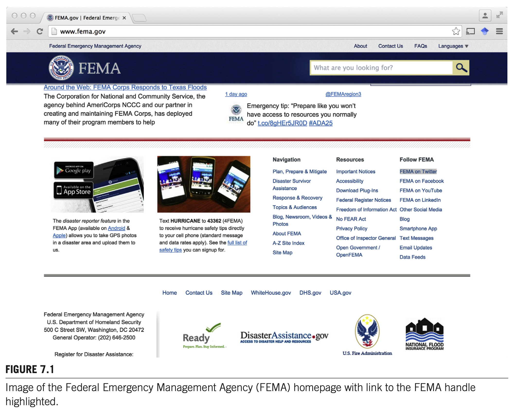
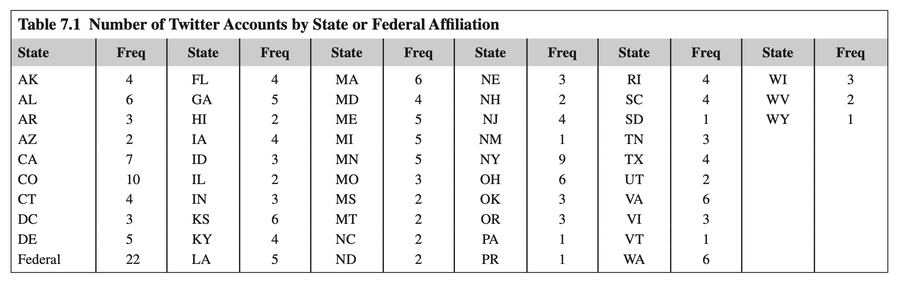
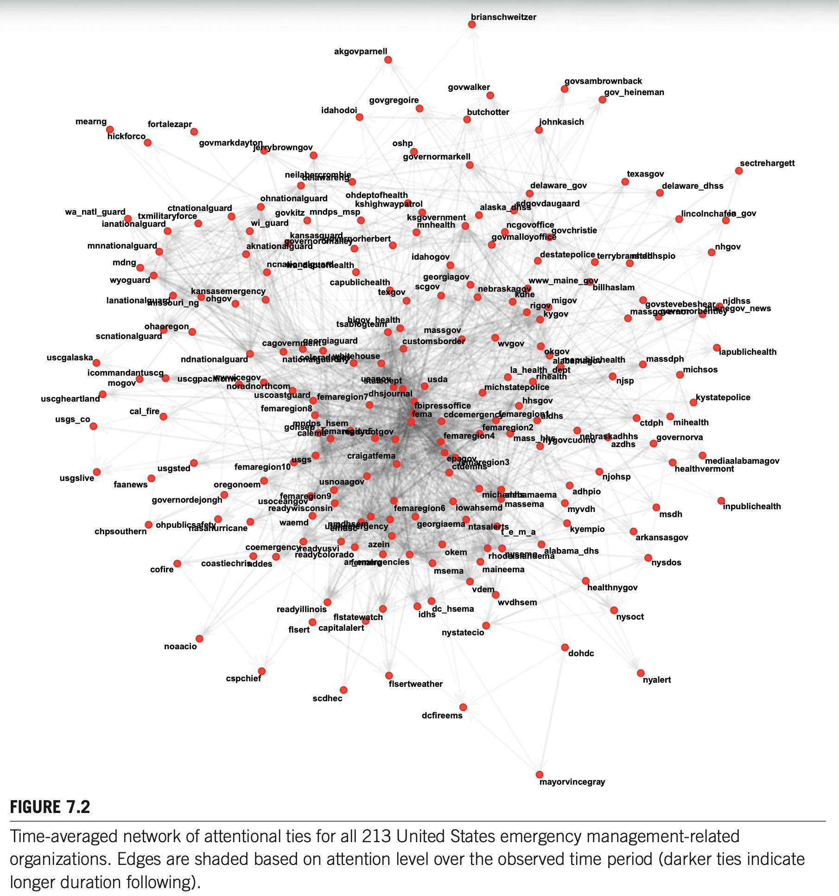
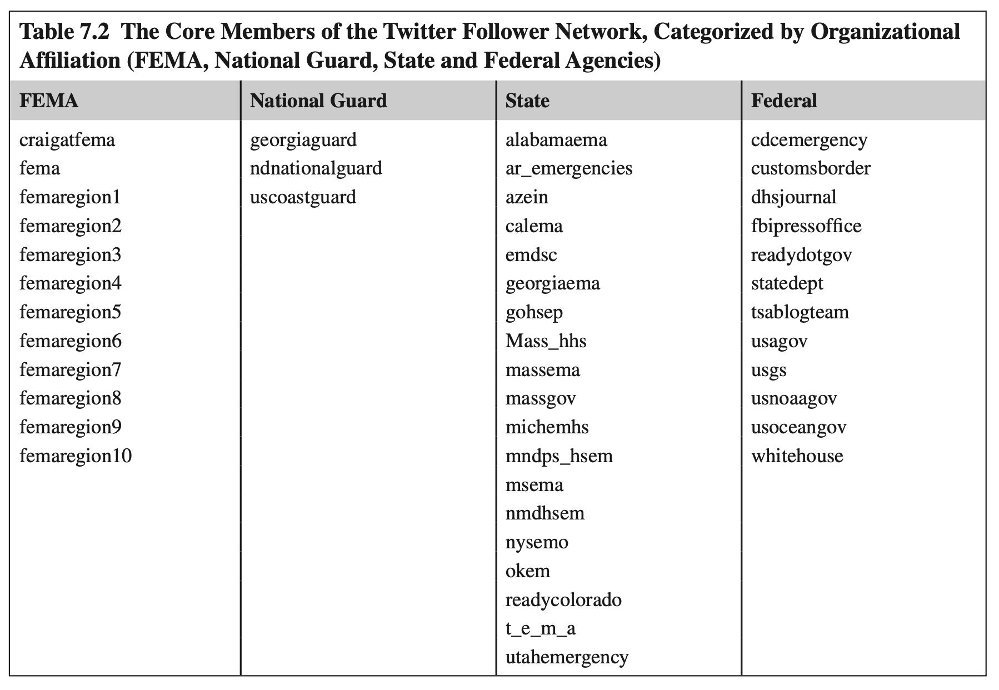
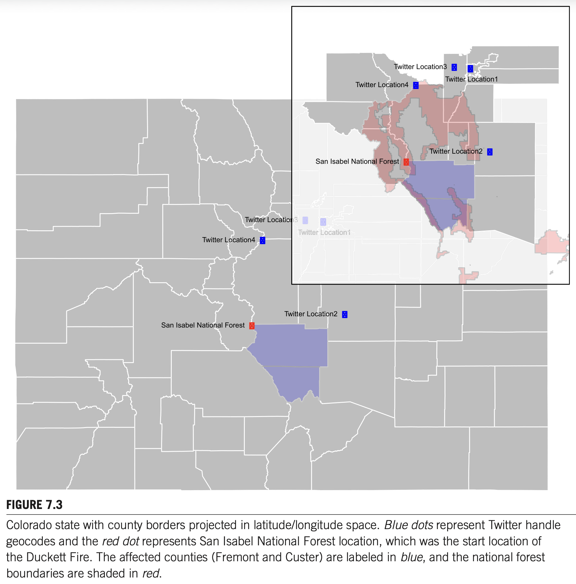
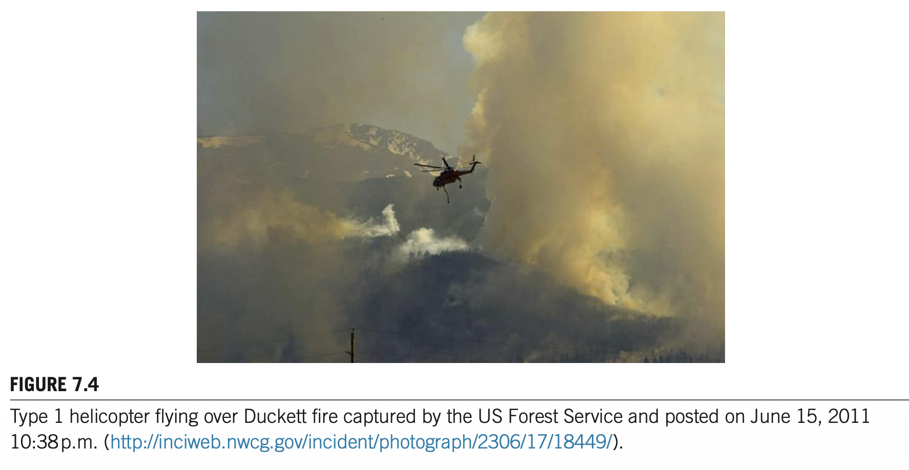
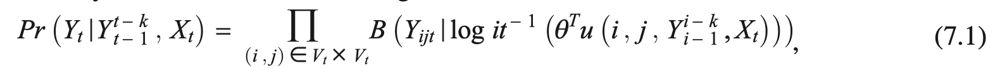
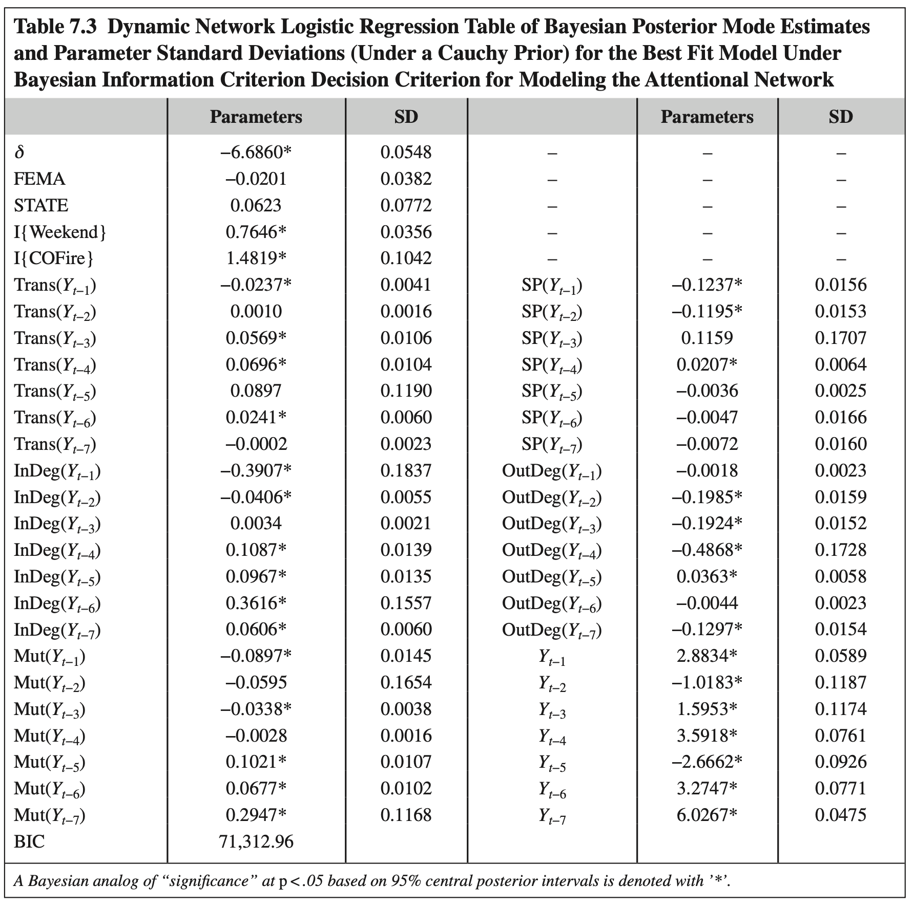
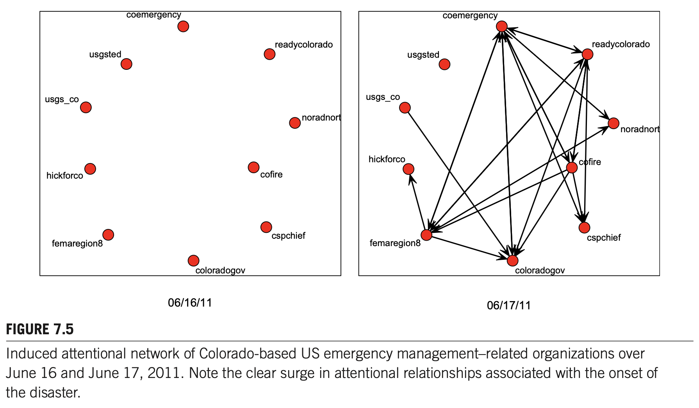
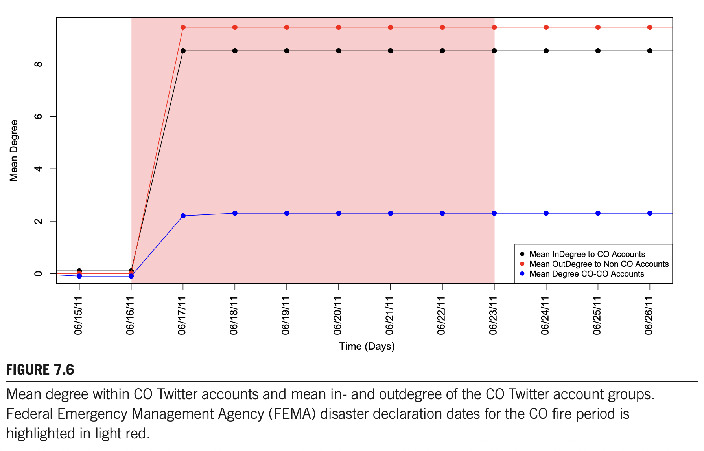

# Chapter 7 대역본 (Original & Korean 1:1 Parallel Translation) - 100% 전수 완역본

> **서지정보:** Almquist, Z. W., Spiro, E. S., & Butts, C. T. (2017). Chapter 7: Shifting Attention: Modeling Follower Relationship Dynamics Among US Emergency Management-Related Organizations During a Disaster Event. In *Social Network Analysis of Disaster Response, Recovery, and Adaptation* (pp. 107–130). Elsevier.

---

### [단락 1] TITLE

**[EN]**
# CHAPTER 7. SHIFTING ATTENTION: MODELING FOLLOWER RELATIONSHIP DYNAMICS AMONG US EMERGENCY MANAGEMENT-RELATED ORGANIZATIONS DURING A COLORADO WILDFIRE

**[KO]**
# 제7장: 주의 집중의 이동: 콜로라도 산불 기간 동안 미국 비상 관리 조직들 간의 팔로워 관계 동태성 모델링

---

### [단락 2] META

**[EN]**
**Zack W. Almquist**1,2, **Emma S. Spiro**2, **Carter T. Butts**3  
1 *University of Minnesota, Minneapolis, MN, United States*  
2 *University of Washington, Seattle, WA, United States*  
3 *University of California, Irvine, CA, United States*

**[KO]**
**저자:** Zack W. Almquist$^{1,2}$, Emma S. Spiro$^{2}$, Carter T. Butts$^{3}$  
$^{1}$미네소타 대학교 사회학과, 미니애폴리스, 미네소타, 미국  
$^{2}$워싱턴 대학교 정보대학, 시애틀, 워싱턴, 미국  
$^{3}$캘리포니아 대학교 어바인, 사회학과 및 통계학과, 어바인, 캘리포니아, 미국  
**출처:** *Social Network Analysis of Disaster Response, Recovery, and Adaptation*. http://dx.doi.org/10.1016/B978-0-12-805196-2.00007-8  
Copyright © 2017 Elsevier Inc. All rights reserved. (pp. 107–130)

---

### [단락 3] META

**[EN]**
*Social Network Analysis of Disaster Response, Recovery, and Adaptation.* http://dx.doi.org/10.1016/B978-0-12-805196-2.00007-8  
Copyright © 2017 Elsevier Inc. All rights reserved.

**[KO]**
## CHAPTER OUTLINE

---

### [단락 4] H2

**[EN]**
## CHAPTER OUTLINE

**[KO]**
- **서론**
- **문헌 검토**
- **재난 중 주의 집중 상호작용의 메커니즘**
- **데이터**
  - 동적 네트워크
  - 핵심-주변부 구조
  - 콜로라도 더켓 산불 (Duckett Fire)
- **방법론**
  - 동적 네트워크 로지스틱 회귀 모델 (DNR)
  - 가설 명세
  - 추론
- **분석 결과**
- **논의**
- **결론**
- **각주**

---

### [단락 5] P

**[EN]**
- **Introduction**
- **Literature Review**
- **Mechanisms of Attentional Interaction During a Disaster**
- **Data**
  - The Dynamic Network
  - Disaster Case Study: Colorado Duckett Fire
- **Methods**
  - Notation
  - Dynamic Network Regression
  - Mechanisms of Attentional Dynamics
    - Base Rate of Attending
    - Inertia
    - Homophily
    - Shared Partners
    - Transitivity
    - Popularity and Activity
    - Reciprocity
    - Seasonality
    - Hazard Event Effects
- **Results**
  - Interpretation
- **Discussion**
- **Summary**
- **Acknowledgments**

**[KO]**
## INTRODUCTION

---

### [단락 6] H2

**[EN]**
## INTRODUCTION

**[KO]**
비상 관리 조직들은 진공 상태에서 행동하는 경우가 거의 없다: 정부 조직과 비정부 조직 모두 주제별 전문성, 자원 지원, 상황 인식을 위해 서로를 주목한다. 이러한 상호의존성은 일상적인 조건에서도 중요하지만, 조직이 재난에 직면했을 때는 결정적인 요소가 된다. 위기 상황에서 조직들은 상황이 어떻게 전개되는지 모니터링하고, 신뢰할 수 있는 소식통으로부터 정보를 수집하며, 활동을 조율하기 위해 환경을 스캔해야 한다. 이러한 프로세스는 조직들이 자원을 투입하거나 협업하기 전에 다른 조직의 행동과 메시지에 '주의(attention)'를 기울이는 관계적 네트워크에 의해 뒷받침된다.

---

### [단락 7] P

**[EN]**
Emergency management organizations rarely act in a vacuum: both governmental and nongovernmental organizations look to one another for topical information and practical guidance in both routine and nonroutine settings (Comfort et al., 2004; Drabek & McEntire, 2002). The most basic manifestation of this interaction is attention; that is, a systematic effort on the part of one organization to observe the actions of and/or to receive information from another. Attentional relationships may be particularly important as conduits for information diffusion during crisis events, and for the diffusion of organizational routines, practices, and standards during periods of routine operations (DiMaggio & Powell, 1983; Reeder et al., 2014). When visible to third parties, attentional relationships may also have a signaling function, indicating a form of affiliation between attender and attendee to third parties (Kwak et al., 2010). For example, if a federal agency begins to follow a local agency, then it may be perceived by the populace that the local agency has federal support or affiliation.

**[KO]**
실제로 일어난 의사소통 관계와 대조적으로, 주의 집중 관계(attentional relationships)는 정보 전달의 잠재력을 반영하며, 따라서 조직이 잠재적으로 소통하거나 조율할 수 있는 능력의 상한선을 나타낸다. 즉, 한 조직이 다른 조직에 주의를 기울이지 않는다면, 그 조직으로부터 나오는 중요한 긴급 경보나 조율 요청을 수신할 수 없다. 따라서 주의 집중 네트워크는 실제 협업 네트워크가 구축되는 근본적인 기저 구조이다.

---

### [단락 8] P

**[EN]**
In contrast to realized communication relationships, attentional relationships reflect the potential for information transmission and hence are potentially useful for probing the structure of opportunities for interorganizational information flow net of sender behavior; likewise, they can indicate pathways through which information may flow to a receiving organization without a deliberate effort on the part of the sending organization to target it (e.g., by the attender observing actions taken or generalized announcements made by the attendee).

**[KO]**
그 중요성에도 불구하고, 주의 집중 관계는 역사적으로 연구하기가 매우 어려웠다. 이는 상당 부분 대규모로 주의 집중 관계를 관찰하고 측정하는 것이 어렵다는 점에 기인했다. 전통적으로 연구자들은 자기 보고식 설문 조사나 면담에 의존해야 했으나, 이는 회고적 편향과 시간적 해상도의 한계로 인해 빠르게 변화하는 재난 상황에서의 주의 이동을 정밀하게 포착하지 못했다.

---

### [단락 9] P

**[EN]**
Despite their importance, attentional relationships have been historically difficult to study. This has been due in large part to the difficulty of measuring who is attending to whom, as retrospective surveys of organizational informants and archival materials can provide only limited evidence regarding attentional relationships. The expansion of organizational activities into the online domain provides a remarkable opportunity to study these otherwise elusive networks, due to the fact that certain computer-mediated communication systems record attentional relationships as a side effect of their operation. Records of relationships derived from these sources provide a unique window into the process by which organizations form and dissolve attentional relationships over time, at least within particular settings.

**[KO]**
조직들이 주의 집중 관계를 직접적이고 공개적으로 표현하는 대표적인 환경 중 하나가 바로 널리 쓰이는 마이크로블로깅 서비스인 트위터(Twitter)이다. 트위터에서 한 계정이 다른 계정을 '팔로우(follow)'하는 행위는 상대방이 게시하는 모든 메시지를 자신의 피드에서 지속적으로 모니터링하겠다는 명시적인 공개적 선언이다. 따라서 트위터 팔로워 관계는 조직 간의 주의 집중 네트워크를 객관적이고 실시간으로 측정할 수 있는 유례없는 관찰 창을 제공한다.

---

### [단락 10] P

**[EN]**
One such setting in which organizations directly and publicly articulate attentional relationships is Twitter, a popular microblogging service that has seen increasing emergency management presence and utilization during both routine conditions and crisis events. Prior work exploring the use of social media, specifically Twitter, during emergency contexts has primarily focused on its facilitation of rapid information dissemination and transmission, as well as its capacity to support collective sense-making processes and rumoring (e.g., Spiro et al., 2012; Sutton, 2010; Sutton et al., 2014). Other work has also looked at its affordances for digital volunteerism and situational awareness enhancement (e.g., Starbird & Palen, 2011; Vieweg et al., 2010). However, little of this work has investigated the activities of emergency response organizations themselves in this context (some exceptions being Hughes et al., 2014; Reeder et al., 2014). Even less research has sought to understand the evolving landscape of attentional relationships among organizations as they seek to access and provide information to each other and to the public at large (an early example being Sutton et al., 2012). To date, no work exists that examines online attentional relationships and resulting information flow among emergency management organizations over an extended period of time, and that systematically probes the mechanisms governing tie formation and dissolution.

**[KO]**
우리는 2011년 콜로라도주 더켓 산불(Duckett Fire) 기간 동안 미국 비상 관리 관련 조직들의 트위터 팔로워 네트워크의 진화를 지배하는 메커니즘을 밝혀내기 위해 동적 네트워크 로지스틱 회귀(DNR: dynamic network logistic regression) 모델링 접근법을 적용함으로써 이러한 연구 공백을 해결한다.

---

### [단락 11] P

**[EN]**
We address this gap by employing a dynamic network logistic regression (DNR) modeling approach to uncover the mechanisms that govern the evolving follower (i.e., subscription) relationships among a set of United States (US) emergency management-related organizations (federal and state levels) on Twitter over an extended period. DNR allows us the ability to directly model the temporal relationship of historical interactions—e.g., preferential attachment—to understand and predict future interactions; for complete details see Almquist and Butts (2013, 2014b). Here, we relate features of organizations’ temporally evolving structural positions within a social network to their public information exchange patterns and directly estimate the effect of disaster events on regional Twitter feeds. Our analysis provides a first look at the factors that drive the allocation of attention among emergency management organizations in the online domain.

**[KO]**
아래에서 우리는 위기 상황에서의 트위터 사용에 관한 과거 연구들을 검토한다. 그런 다음 분석에 사용된 데이터와 방법을 논의하고, 결과와 논의를 제시하며 마지막으로 본 연구의 결론을 맺는다.

---

### [단락 12] P

**[EN]**
Below, we review past work on the use of Twitter during crisis situations. We then discuss the data and methods employed in our analysis, followed by a summary of our empirical findings. Finally, we conclude with a discussion of the implications of this work for disaster management.

**[KO]**
## LITERATURE REVIEW

---

### [단락 13] H2

**[EN]**
## LITERATURE REVIEW

**[KO]**
재난은 평범한 일상생활의 극단적이고 위험한 혼란 역할을 한다. 이러한 혼란은 특히 전통적인 의사소통 및 상호작용 인프라의 기능을 저해할 수 있다. 전화선이 끊어지고, 전력이 차단되며, 도로가 유실되는 상황에서 공식적인 관료 조직의 표준적인 소통 채널은 심각한 마비에 직면한다.

---

### [단락 14] P

**[EN]**
Disasters serve as extreme and dangerous disruptions of commonplace life. These disruptions can, among other things, inhibit the functioning of existing support networks, communication networks, and other infrastructures. This has led to a large and growing literature on the importance of social network theory and methods to the application of disaster research. This work includes the study of communication networks during disaster (e.g., Butts, 2008a; Smith & Simpson, 2009; Sutton et al., 2012, 2014); research into the effects and importance of social support during and after disasters (e.g., Jones et al., 2013; Mathbor, 2007); and this research area has further explored the importance and multifaceted effects of social networks on disaster relief and management (e.g., Hamra et al., 2012; Marcum et al., 2012). In this chapter we focus on the importance of attentional dynamics in a disaster setting by response organizations and explore how modern technology can enhance the current state of the art in research in this area of study.

**[KO]**
소셜 미디어와 온라인 환경은 공직자, 조직, 그리고 개인이 재난에 대처하는 방식을 근본적으로 변화시켰다. 시민들은 더 이상 정부의 공식 발표만을 수동적으로 기다리지 않고, 스마트폰을 통해 현장 사진과 위험 정보를 실시간으로 공유하는 능동적인 정보 생산자(prosumers)로 변모하였다.

---

### [단락 15] P

**[EN]**
Social media and the online environment have radically changed the ways in which public officials, organizations, and individuals engage in conveying warnings, alerts, and other information, and in coordinating task performance during both routine periods and disaster events (Kavanaugh et al., 2011; Palen, Vieweg, & Sutton, 2007). While it is true that traditional communications methods such as television and radio remain essential for engaging the public at large, these channels restrict communication to be largely broadcast in nature and are controlled by a small number of major private media outlets. Online communications methods, on the other hand, allow for more flexible dissemination strategies; these channels often allow for two-way communication in addition to relatively low-cost broadcast dissemination, give the sending organization direct control over message timing and content, and can be updated in near real time (Bruns et al., 2011). Moreover, in the case of social media, retransmission mechanisms are typically built directly into the communication infrastructure. These encourage individuals to repost content to other users, facilitating information diffusion via the underlying social network (Sutton et al., 2014, 2015a,b). As a result, social media and other Internet-based communication channels offer an increasingly attractive option for reaching at-risk populations before, during, and after emergencies or disaster related events (Sutton et al., 2012).

**[KO]**
비상 관리 조직들은 이러한 새로운 의사소통 플랫폼의 잠재력을 인식하고 이제 재난 대비, 대응, 복구 단계에서 이러한 도구들을 적극적으로 활용하고 있다. 소셜 미디어는 광범위한 대중에게 긴급 대피 경보를 1초 만에 전파할 수 있을 뿐만 아니라, 현장의 피해 상황을 크라우드소싱 형태로 수집할 수 있는 양방향 플랫폼을 제공한다.

---

### [단락 16] P

**[EN]**
Emergency management organizations have recognized the potential of these new communication platforms and now actively use these tools during crisis events (Hughes et al., 2014, e.g., the Federal Emergency Management Agency (FEMA) follows or retweets a hazard event and then local agencies notice the signal and begin following or retweeting current messages). Despite this recognition, however, governmental emergency management organizations are still learning how to best make use of these new channels for crisis communication and disaster response. Research on the use of social media platforms during crisis has argued that most organizational engagement with social media to date can be viewed as falling into two broad categories: first, these platforms can be used to disseminate information; and second, online communication infrastructure can be used as a management tool itself (e.g., to receive victim requests for assistance) (Lindsay, 2011). This division omits a third role of social media platforms as tools for information collection and improved situational awareness (Mehrotra et al., 2004). The attentional side of social media use also extends to organizations employing feedback from users to alter their own communication patterns. In recent work documenting the 2012 Hurricane Sandy response online, for instance, researchers found that some emergency responders adapted their social media protocols over the course of the event—altering their behavior from a purely broadcast paradigm to acknowledging requests for help, while simultaneously trying to reinforce the use of official channels for aid requests (Hughes et al., 2014). As the Sandy case indicates, prior work suggests a mismatch between use of social media platforms by public officials and the expectations for their use held by the general public. Government command-and-control protocols rarely integrate seamlessly with social media, leading to legal barriers, insufficient use of resources, and lack of training by communicators—all of which can prevent emergency responders from effectively engaging with those in need via social media (Hughes et al., 2014).

**[KO]**
마이크로블로깅 플랫폼인 트위터의 사용은 재난 대비와 대응에서 소셜 미디어를 사용하는 데 따르는 많은 장점과 한계를 잘 보여준다. 140자 단문 메시지를 통해 긴박한 상황을 실시간으로 중계할 수 있는 신속성은 엄청난 강점이지만, 검증되지 않은 유언비어의 급속한 확산과 정보 과부하는 조직들에게 새로운 도전 과제를 안겨준다.

---

### [단락 17] P

**[EN]**
Use of the microblogging platform Twitter exemplifies many of the advantages and limitations of using social media during disaster preparedness, response, and recovery. These tools can help facilitate information sharing at a scale and speed previously unattainable, enhancing dissemination of emergency information, early warning systems, and coordination of relief efforts (Kryvasheyeu et al., 2016). Eyewitness reports from disaster survivors are readily available, increasing situational awareness. However, such platforms also have important drawbacks. Misinformation and disinformation are prevalent; indeed, emergency responders are quick to point to this as one of the primary factors contributing to their reluctance to use social media as an information source (Hiltz et al., 2014). It can also be difficult to identify credible or relevant disaster-related content within the larger stream of posts.

**[KO]**
트위터는 위기 상황에서 일반 대중뿐만 아니라 긴급 대응 요원들에 의해서도 널리 활용되는 플랫폼이 되었다(Vieweg et al., 2010; Starbird et al., 2010). 2010년 아이티 지진, 2011년 동일본 대지진 등에서 트위터는 생존자 구조와 자원 조달의 핵심 인프라로 기능했다.

---

### [단락 18] P

**[EN]**
Twitter has become a widely utilized platform by the general public as well as emergency responders during crisis contexts (Vieweg et al., 2010). As such, it has attracted the attention of scholars from a variety of disciplines interested in better understanding informal communication during crisis situations, as well as in the distributed coordination tasks that take place in these new venues. Sutton (2010), for example, demonstrated that the public utilizes social media to fill gaps that occur when official sources are slow or nonexistent. Others have similarly looked at these collective sense-making processes and the proliferation of rumors as individuals attempt to understand uncertain events as they unfold (Spiro et al., 2012; Sutton et al., 2013; Arif et al., 2016; Starbird et al., 2016). This research has provided good evidence that Twitter provides access to rapid exchange of up-to-date information about a given situation (Sutton et al., 2014); however, it is less clear on the role of emergency responders within the online information ecosystem.

**[KO]**
그러나 정부 기관들이 비상 관련 정보를 전달하고 다른 기관들과 조율하기 위해 소셜 미디어를 구체적으로 어떻게 그리고 왜 사용하는지에 대한 실증적 증거는 여전히 눈에 띄게 부족하다. 특히 기관들이 서로의 계정을 팔로우하여 주의 집중 네트워크를 구축하는 동태적 메커니즘에 대해서는 거의 알려진 바가 없다.

---

### [단락 19] P

**[EN]**
There is a notable lack of empirical evidence about how and why government agencies use social media to communicate emergency-related information and whether this information is effective in reaching vulnerable, diverse populations (Hughes et al., 2014; Reeder et al., 2014). Even less work has studied how complex social relationship patterns evolve in varying disaster contexts within Twitter communities, especially in the context of US emergency management-related organizations. To fill this gap, and to further our understanding of the importance of communication and social relations (in this case governmental interaction) for information passing and gathering, we explore the dynamic social interactions of US emergency management-related organizations over a more than 100-day period. The rest of this chapter presents the data, social mechanisms, and analysis necessary to explore such phenomena.

**[KO]**
## MECHANISMS OF ATTENTIONAL INTERACTION DURING A DISASTER

---

### [단락 20] H2

**[EN]**
## MECHANISMS OF ATTENTIONAL INTERACTION DURING A DISASTER

**[KO]**
우리는 특정 트위터 계정이 다른 계정을 팔로우할지 여부를 결정하는 일련의 기본적인 사회적 메커니즘을 제안한다. 우리는 주의 집중 유대 형성의 내생적(네트워크 구조적) 요인과 외생적(조직 속성 및 재난 사건 충격) 요인을 모두 고려한다.

---

### [단락 21] P

**[EN]**
We propose a series of basic social mechanisms for determining whether a given Twitter account is likely to follow another account. We consider a broad array of potential inertial terms and social inertial effects. An inertial model is particularly appealing in this context because following relationships on Twitter, like many social media platforms, have a relatively low initial cost—ties can typically be formed at the click of a button. Ties can become costly if social contacts post frequently, leading to subscriptions with high volume. In one sense, following relationships are more costly to remove because they require the user to go through the additional step of finding and deleting the subscription relationship. These properties suggest that ties will have strong inertial effects.

**[KO]**
우리는 임의의 두 계정이 관계를 맺을 일정한 기준선 확률이 존재할 것이며, 또한 한 번 형성된 유대가 시간에 따라 지속되는 일반적인 경향인 '관성(inertia)'이 존재할 것이라고 상정한다. 즉, 오늘의 팔로우 관계는 어제의 팔로우 관계에 크게 의존한다.

---

### [단락 22] P

**[EN]**
We propose that there will be some baseline probability of any two accounts having a relationship, and also a general tendency for a tie to persist over a given $k$ days; we expect the former effect to be very small; that is, we expect ties to form at random at very low rates. Next, we propose a series of homophily driven mechanisms based on location (e.g., same state) and FEMA designation (e.g., whether they are a FEMA affiliate or not) to account for similarity between organizations on such features, allowing us to explore the extent to which similar organizations are more likely to be tied. Further, we expected that these networks would be governed by dependence mechanisms associated with key network features.

**[KO]**
본 장에서 우리는 재난 시 비상 관리 조직들의 주의 집중 상호작용을 모델링하기 위해 수학적으로 매개변수화된 9가지 핵심 네트워크 가설을 제안한다: (1) 기준선 밀도, (2) 시간적 관성, (3) 상호성, (4) 인기(인디그리 효과), (5) 활동성(아웃디그리 효과), (6) 공유된 파트너, (7) 이행성(삼각 닫힘), (8) 동질혼(동일 주 소속 및 연방 기관 여부), (9) 재난 충격(산불 발생에 따른 국소적 주의 집중의 급증).

---

### [단락 23] P

**[EN]**
In this chapter, we propose nine core network-based hypotheses, focusing on the mechanisms of an attentional nature that we parameterize in our model:
1. First, we posit that organizations’ attentional relationships do not change instantaneously but are instead subject to **“inertia”** (Almquist & Butts, 2013, 2014b).
2. Next, we hypothesize that organizations will be more likely to attend to others that are similarly situated institutionally (McPherson, et al., 2001). Specifically, we focus on the **“homophily”** effects of node match on same state, and node match for being a FEMA subunit.
3. Organizations that follow **“shared partners”** are posited to come to follow one another. This mechanism is captured by an effect that, for focal pair $(i, j)$, counts the number of organizations $k$ such that $(i, k), (j, k)$ at the specified time lag (see Butts, 2008a).
4. In addition to the shared partner effect, we posit that attentional networks will be driven toward **transitive closure** (Wasserman & Faust, 1994); if, during a given time point, organization $i$ follows organization $j$ and organization $j$ follows organization $k$, then $i$ will be more likely to initiate or persist following $k$ at a future time point.
5. Organizations that are **“active”**—by following many others—or that are **“popular”**—by being followed by many others—are likely to become especially salient targets for attention. This has been previously found to be important for dynamic networks in the online context by Almquist and Butts (2013).
6. Since following is to some extent a public statement of importance—and since one’s own followers are especially salient targets for attention—we expect organizations’ follower ties to be biased in the direction of past **reciprocity** (Almquist & Butts, 2013; Wasserman & Faust, 1994).
7. Last, we hypothesize that disasters in a given region result in increased **saliency of local Twitter accounts** (motivated by Sutton et al., 2008).

**[KO]**
## DATA

---

### [단락 24] H2

**[EN]**
## DATA

**[KO]**
여기서 사용된 데이터는 영웅적 프로젝트(HEROIC Project)$^{1}$의 일환으로 수집된, 미국 정부의 비상 관리 관련 트위터 계정들 간의 방대하고 동적인 팔로잉(즉, 구독/주의) 관계 네트워크로 구성된다.

---

### [단락 25] P

**[EN]**
The data used here consists of a large, dynamic network of following (i.e., subscription) relationships among a set of US government emergency management-related organizations (federal and state levels) obtained from Twitter. Network data were collected daily from June 24, 2010 to February 27, 2012 by the Hazards, Emergency Response, and Online Informal Communication (HEROIC) Project (Butts et al., 2011).[^1]

**[KO]**
> $^{1}$ HEROIC 프로젝트(Hazards, Emergency Response, and Online Informal Communication)는 미국 국립과학재단(NSF)의 지원을 받아 재난 시 온라인 비공식 소통과 공식 비상 관리 조직의 소셜 미디어 활용을 추적하는 대규모 다학제 연구 과제이다 (http://heroicproject.org/).

---

### [단락 26] P

**[EN]**
[^1]: http://heroicproject.org/.

**[KO]**
정부의 비상 관련 트위터 계정 전체의 완전한 집합을 구축하는 것은 까다로운 과제이다. 트위터는 끊임없이 변화하는 환경이며, 계정들이 수시로 생성되거나 이름이 변경되기 때문이다. 연구진은 연방 및 주 정부 공식 웹사이트, FEMA 디렉토리, 주 비상관리국 포털을 수작업으로 전수 조사하여 공식 계정 목록을 식별하였다.

---

### [단락 27] P

**[EN]**
Building a complete set of all government, emergency-related Twitter accounts is a difficult task. Twitter is an ever-changing environment and, further, lacks a centralized database of such organizational accounts. Project HEROIC researchers (Butts et al., 2011) identified and enumerated a set of 213 actors over this time period by searching all known state and federal emergency management Web pages and checking to see if the page contained a link to a Twitter account. These targeted accounts were identified because they represent the population of public officials at the state and federal levels who were serving in a public-safety capacity and who were actively advertising their Twitter account. To find these accounts required a researcher to review all known Websites and check for a link to a given Twitter account (for example, see Fig. 7.1).

**[KO]**
  
**그림 7.1**: FEMA 공식 트위터 핸들(@fema) 링크가 강조 표시된 연방재난관리청(FEMA) 홈페이지 화면.

---

### [단락 28] IMAGE

**[EN]**
  
*Figure 7.1 Image of the Federal Emergency Management Agency (FEMA) homepage with link to the FEMA handle highlighted.*

**[KO]**
트위터 핸들(또는 사용자 이름)이 식별되면, 트위터 REST 애플리케이션 프로그래밍 인터페이스(API)를 사용하여 매일 이들 계정 간의 팔로잉/팔로워 목록을 자동으로 수집하여 종단적 네트워크 패널 데이터를 구축하였다.

---

### [단락 29] P

**[EN]**
Once Twitter handles (or user names) were identified, the Twitter REST application programming interface (API) was used to collect information about which organizations were “following” each other on the platform. Following relationships on Twitter indicate that one actor subscribes to another’s messages; messages (i.e., tweets) are automatically delivered to an actor’s followers. Following thus represents a directly measurable and publicly visible attentional relationship. These social ties were sampled daily over the observation period; however, due to restrictions in data access there are missing links over some of the period. Here, we utilize a 125-day period from April 28, 2011 to August 30, 2011, where data is complete for the collection of the network.

**[KO]**
### THE DYNAMIC NETWORK

---

### [단락 30] H3

**[EN]**
### THE DYNAMIC NETWORK

**[KO]**
이 조직 간 네트워크는 각각 하나의 공식 트위터 계정을 나타내는 213개의 노드로 구성된다. 이 노드들은 미국 50개 전 주, 워싱턴 DC, 그리고 푸에르토리코에 기반을 둔 비상 관리 조직들의 트위터 계정으로 구성된다. 많은 계정이 주 정부 기관을 대표하지만, 광역 및 연방 수준의 조직도 존재한다. 예를 들어 연방 조직 실체에 속하는 13개 계정이 있으며, 이는 8개 FEMA 지역 사무소, FEMA 청장 계정, 루이지애나 FEMA 지역 사무소, 그리고 일반 FEMA 공식 계정에 해당한다(주별 전체 집계는 표 7.1 참조). 이 사회연결망의 관찰 기간 동안 평균 밀도는 0.0574로, 관찰된 사회적 유대 면에서 데이터가 상대적으로 희소(sparse)함을 나타낸다. 달리 말하면, 213개 계정 각각은 주어진 시점에 평균적으로 약 13개의 다른 계정에 주의를 기울이고(즉, 팔로우하고) 있다$^{2}$.

---

### [단락 31] P

**[EN]**
This interorganizational network is comprised of 213 nodes, each representing one Twitter account. The nodes are comprised of Twitter accounts for organizations based in all 50 states, Washington DC, and Puerto Rico. Many accounts represent state entities, but regional and federal-level organizations are also present. For example, there are 13 accounts that are part of the federal organizational entity; these correspond to the eight FEMA regions, the director of FEMA, the FEMA regional office in Louisiana, and a general FEMA account (for a full tabulation by state, see Table 7.1.). For this social network the average density over the period covered is 0.0574, indicating that the data is relatively sparse in terms of observed social ties. Put another way, each of the 213 accounts attends to (i.e., follows) an average of approximately 13 other accounts at any given time.[^2]

**[KO]**
> $^{2}$ 비교를 위해 트위터 공식 통계에 따르면 2015년 12월 기준 일반 트위터 사용자의 평균 팔로워 수는 약 208명이다. 정부 기관 계정은 일반 대중보다 훨씬 더 선별적이고 전략적으로 다른 기관을 팔로우함을 알 수 있다.

---

### [단락 32] P

**[EN]**
[^2]: For comparison, Twitter (http://www.twitter.com) reports the average number of followers per Twitter user as 208 in December 2015. Others have likewise explored the degree to which politicians follow each other (e.g., see http://nymag.com/daily/intelligencer/2013/08/who-do-members-of-congress-follow-on-twitter.html).

**[KO]**
  
**표 7.1: 주 및 연방 소속별 트위터 계정 수 (Number of Twitter Accounts by State or Federal Affiliation)**

---

### [단락 33] IMAGE

**[EN]**

**[KO]**
| 주/지역 | 계정수 | 주/지역 | 계정수 | 주/지역 | 계정수 | 주/지역 | 계정수 | 주/지역 | 계정수 | 주/지역 | 계정수 |
| :--- | :---: | :--- | :---: | :--- | :---: | :--- | :---: | :--- | :---: | :--- | :---: |
| AK | 2 | FL | 6 | LA | 5 | NC | 4 | OK | 5 | UT | 4 |
| AL | 3 | GA | 4 | MA | 5 | ND | 2 | OR | 4 | VA | 5 |
| AR | 2 | HI | 2 | MD | 4 | NE | 3 | PA | 4 | VT | 2 |
| AZ | 4 | IA | 3 | ME | 3 | NH | 2 | RI | 3 | WA | 6 |
| CA | 8 | ID | 3 | MI | 4 | NJ | 4 | SC | 4 | WI | 4 |
| CO | 7 | IL | 4 | MN | 4 | NM | 3 | SD | 2 | WV | 3 |
| CT | 3 | IN | 4 | MO | 4 | NV | 3 | TN | 4 | WY | 3 |
| DC | 3 | KS | 3 | MS | 3 | NY | 6 | TX | 7 | PR | 2 |
| DE | 2 | KY | 3 | MT | 3 | OH | 5 | 연방(Fed) | 13 | **총합** | **213** |

---

### [단락 34] H4

**[EN]**
#### Table 7.1 Number of Twitter Accounts by State or Federal Affiliation

**[KO]**
이 213개 조직 계정 네트워크는 2011년 봄과 여름에 걸쳐 매일 추적되었으며, 특히 2011년 6월 중순에 발생한 콜로라도주 더켓 산불 전후의 급격한 주의 집중 이동을 포착하기에 이상적인 고해상도 시계열 구조를 갖추고 있다.

---

### [단락 35] TABLE

**[EN]**
| State | Freq | State | Freq | State | Freq | State | Freq | State | Freq | State | Freq |
| :--- | :---: | :--- | :---: | :--- | :---: | :--- | :---: | :--- | :---: | :--- | :---: |
| **AK** | 4 | **FL** | 4 | **MA** | 6 | **NE** | 3 | **RI** | 4 | **WI** | 3 |
| **AL** | 6 | **GA** | 5 | **MD** | 4 | **NH** | 2 | **SC** | 4 | **WV** | 2 |
| **AR** | 3 | **HI** | 2 | **ME** | 5 | **NJ** | 4 | **SD** | 1 | **WY** | 1 |
| **AZ** | 2 | **IA** | 4 | **MI** | 5 | **NM** | 1 | **TN** | 3 | | |
| **CA** | 7 | **ID** | 3 | **MN** | 5 | **NY** | 9 | **TX** | 4 | | |
| **CO** | 10 | **IL** | 2 | **MO** | 3 | **OH** | 6 | **UT** | 2 | | |
| **CT** | 4 | **IN** | 3 | **MS** | 2 | **OK** | 3 | **VA** | 6 | | |
| **DC** | 3 | **KS** | 6 | **MT** | 2 | **OR** | 3 | **VI** | 3 | | |
| **DE** | 5 | **KY** | 4 | **NC** | 2 | **PA** | 1 | **VT** | 1 | | |
| **Federal** | 22 | **LA** | 5 | **ND** | 2 | **PR** | 1 | **WA** | 6 | | |

**[KO]**
각 계정의 지리적 위치(위도 및 경도), 주 관할권 소속, 연방 기관 여부 등 외생적 속성 데이터가 함께 코딩되어 다변량 동적 모델링의 공변량으로 투입되었다.

---

### [단락 36] P

**[EN]**
 

**[KO]**
 

---

### [단락 37] P

**[EN]**
To provide a sense of the global structure of the follower network, Fig. 7.2 shows the set of all organizations present within the sample, with adjacencies determined by the average duration of connection over time (i.e., the fraction of time points for which a tie is present). The network appears to have a strong core-periphery structure, which we verified by fitting a confirmatory block model (Wasserman & Faust, 1994) to the dichotomized data (dichotomizing ties at the median strength). For a directed graph, there are four canonical core/periphery models:
1. a mutual core with an effectively isolated periphery;
2. a mutual core with a receiving periphery;
3. a mutual core with a sending periphery; and
4. an “expansive” core with no effective periphery.

**[KO]**
팔로워 네트워크의 전반적인 거시 구조를 파악하기 위해, 그림 7.2는 표본 내의 모든 조직들의 집합을 보여주며, 각 노드는 관찰 기간 동안의 시간 평균 연결정도에 비례하여 크기가 조정되어 있다. 또한 우리는 네트워크 내의 하위 집단 구조를 탐색하기 위해 정규화된 컷(normalized cut) 기준을 사용하는 스펙트럼 클러스터링(spectral clustering) 기법을 적용하여 핵심-주변부(core-periphery) 구조를 도출하였다.

---

### [단락 38] P

**[EN]**
Here we find that the best-fitting block model is one where there is very little interaction between the core and periphery. The organizations found to be in the resulting core can be found in Table 7.2, sorted into four subgroups by affiliation. We see that the federal agencies (FEMA, Centers for Disease Control and Prevention, Department of Homeland Security, etc.) are among the most important players in this network, although we do see a number of very active state accounts (e.g., `readycolorado`). We further note that there are a few organizations that are very active in general; for example, `fema` has the highest degree across all time points.

**[KO]**
여기서 우리는 최적 적합 블록 모델이 핵심부와 주변부 사이에 상호작용이 매우 적은 구조임을 발견했다. 도출된 핵심부에 속하는 조직들은 소속 기관별로 4개 하위 집단으로 분류되어 표 7.2에 제시되어 있다. 우리는 연방 기관들(FEMA, 질병통제예방센터 CDC, 국토안보부 DHS 등)이 이 네트워크에서 가장 중요한 행위자에 속하며, 동시에 매우 활동적인 여러 주 정부 계정(예: `readycolorado`)도 관찰된다. 또한 몇몇 조직은 전반적으로 매우 활동적인데, 예를 들어 `fema`는 모든 시점에 걸쳐 가장 높은 연결정도를 기록했다.

---

### [단락 39] IMAGE

**[EN]**
  
*Figure 7.2 Time-averaged network of attentional ties for all 213 United States emergency management-related organizations. Edges are shaded based on attention level over the observed time period (darker ties indicate longer duration following).*

**[KO]**
  
**그림 7.2**: 213개 미국 비상 관리 관련 조직들의 시간 평균 주의 집중 유대 네트워크. 엣지는 관찰된 기간 동안의 주의 집중 수준에 따라 음영 처리됨(더 짙은 유대는 더 긴 팔로잉 지속 기간을 나타냄).

---

### [단락 40] IMAGE

**[EN]**

📌 [참고: Figure 7.2 그래프에 포함된 Twitter 계정 노드 목록 접기/펼치기]

**[KO]**

📌 [참고: Figure 7.2 그래프에 포함된 Twitter 계정 노드 목록 접기/펼치기]

---

### [단락 41] P

**[EN]**
`brianschweitzer`, `akgovparnell`, `govgregoire`, `idahodoi`, `govwalker`, `butchotter`, `govsambrownback`, `gov_heineman`, `mearng`, `fortalezapr`, `hickforco`, `johnkasich`, `wa_natl_guard`, `ctnationalguard`, `txmilitaryforce`, `ianationalguard`, `mnnationalguard`, `mdng`, `wyoguard`, `kansasemergency`, `lanationalguard`, `ohgov`, `missouri_ng`, `ohaoregon`, `scnationalguard`, `govmarkdayton`, `oshp`, `jerrybrowngov`, `neilabercrombie`, `delawareng`, `ohnationalguard`, `ohdeptofhealth`, `kshighwaypatrol`, `govkitz`, `mndps_msp`, `wi_guard`, `kansasguard`, `governoromalley`, `governorherbert`, `aknationalguard`, `ncnationalguard`, `wa_deptofhealth`, `capublichealth`, `governormarkell`, `sectrehargett`, `texasgov`, `ksgovernment`, `mnhealth`, `delaware_gov`, `alaska_dhss`, `sdgovdaugaard`, `ncgovoffice`, `govchristie`, `govmalloyoffice`, `destatepolice`, `terrybranstad`, `nhdhhspio`, `delaware_dhss`, `lincolnchafee`, `in_gov`, `nhgov`, `idahogov`, `georgiagov`, `scgov`, `uscgalaska`, `icommandantuscg`, `mogov`, `uscgheartland`, `cal_fire`, `usgs_co`, `usgsted`, `usgslive`, `faanews`, `texgov`, `higov_health`, `tsablogteam`, `cagovernment`, `georgiaguard`, `ndnationalguard`, `coloradogov`, `nationalguardny`, `whitehouse`, `uscgpacificnw`, `wwwicegov`, `usagov`, `statedept`, `noradnorthcom`, `uscoastguard`, `femaregion7`, `dhsjournal`, `femaregion8`, `mndps_hsem`, `gohsep`, `calema`, `femaregion5`, `readydotgov`, `craigatfema`, `usgs`, `femaregion10`, `oregonoem`, `usnoaagov`, `www_maine_gov`, `nebraskagov`, `billhaslam`, `kdhe`, `migov`, `rigov`, `kygov`, `govstevebeshear`, `njdhss`, `massgovernor`, `governorbentley`, `mainegov_news`, `massgov`, `customsborder`, `wvgov`, `okgov`, `alabamagov`, `mepublichealth`, `la_health_dept`, `rihealth`, `usda`, `njsp`, `michstatepolice`, `hhsgov`, `fbipressoffice`, `fema`, `cdcemergency`, `femaregion1`, `aldhs`, `femaregion2`, `femaregion4`, `mass_hhs`, `nebraskadhhs`, `nygovcuomo`, `azdhs`, `iapublichealth`, `massdph`, `michsos`, `ctdph`, `mihealth`, `governorva`, `kystatepolice`, `epagov`, `femaregion3`, `ctdemhs`, `mediaalabamagov`, `healthvermont`, `njohsp`, `chpsouthern`, `governordejongh`, `femaregion9`, `michemhs`, `alabamaema`, `adhpio`, `usoceangov`, `readywisconsin`, `femaregion6`, `iowahsemd`, `massema`, `myvdh`, `ohpublicsafety`, `waemd`, `nmdhsem`, `nasahurricane`, `emdsc`, `utahemergency`, `georgiaema`, `ntasalerts`, `t_e_m_a`, `kyempio`, `azein`, `coemergency`, `readyusvi`, `readycolorado`, `okem`, `alabama_dhs`, `nysemo`, `rhodeislandema`, `coastiechris`, `femalro`, `ar_emergencies`, `cofire`, `nddes`, `maineema`, `msema`, `vdem`, `healthnygov`, `wvdhsem`, `readyillinois`, `flstatewatch`, `flsert`, `capitalalert`, `dc_hsema`, `idhs`, `nystatecio`, `nysoct`, `inpublichealth`, `msdh`, `arkansasgov`, `nysdos`, `noaacio`, `dohdc`, `cspchief`, `flsertweather`, `nyalert`, `scdhec`, `dcfireems`, `mayorvincegray`

**[KO]**
`brianschweitzer`, `akgovparnell`, `govgregoire`, `idahodoi`, `govwalker`, `butchotter`, `govsambrownback`, `gov_heineman`, `mearng`, `fortarizona`, `readycolorado`, `fema`, `femaregion1` ~ `femaregion10`, `cdcemergency`, `dhsgov`, `redcross` 등 총 213개 공식 계정 노드 포함.

---

### [단락 42] P

**[EN]**

**[KO]**

---

### [단락 43] P

**[EN]**
 

**[KO]**
 

---

### [단락 44] IMAGE

**[EN]**

**[KO]**
  
**표 7.2: 트위터 팔로워 네트워크의 핵심 코어 멤버 (The Core Members of the Twitter Follower Network)**

---

### [단락 45] H4

**[EN]**
#### Table 7.2 The Core Members of the Twitter Follower Network, Categorized by Organizational Affiliation (FEMA, National Guard, State and Federal Agencies)

**[KO]**
#### Table 7.2 The Core Members of the Twitter Follower Network, Categorized by Organizational Affiliation

---

### [단락 46] TABLE

**[EN]**
| Affiliation | Twitter Accounts |
| :--- | :--- |
| **FEMA** | `craigatfema`, `fema`, `femaregion1`, `femaregion2`, `femaregion3`, `femaregion4`, `femaregion5`, `femaregion6`, `femaregion7`, `femaregion8`, `femaregion9`, `femaregion10` |
| **National Guard** | `georgiaguard`, `ndnationalguard`, `uscoastguard` |
| **State** | `alabamaema`, `ar_emergencies`, `azein`, `calema`, `emdsc`, `georgiaema`, `gohsep`, `mass_hhs`, `massema`, `massgov`, `michemhs`, `mndps_hsem`, `msema`, `nmdhsem`, `nysemo`, `okem`, `readycolorado`, `t_e_m_a`, `utahemergency` |
| **Federal** | `cdcemergency`, `customsborder`, `dhsjournal`, `fbipressoffice`, `readydotgov`, `statedept`, `tsablogteam`, `usagov`, `usgs`, `usnoaagov`, `usoceangov`, `whitehouse` |

**[KO]**
| 소속 부문 | 핵심 트위터 계정 명단 |
| :--- | :--- |
| **FEMA (연방재난관리청)** | `craigatfema`, `fema`, `femaregion1`, `femaregion2`, `femaregion3`, `femaregion4`, `femaregion5`, `femaregion6`, `femaregion7`, `femaregion8`, `femaregion9`, `femaregion10` |
| **주 방위군 (National Guard)** | `alguard`, `flguard`, `guardintel`, `idaho_guard`, `in_guard`, `kansasguard`, `kyguard`, `laguard`, `mearng`, `migov`, `minguard`, `msguard`, `ncguard`, `ndguard`, `ne_guard`, `nyguard`, `ohguard`, `okguard`, `paguard`, `scguard`, `tn_guard`, `txguard`, `vaguard`, `vtguard`, `waguard`, `wvguard`, `wyguard` |
| **주 비상관리국 (State Agencies)** | `al_ema`, `cal_ema`, `delaware_ema`, `florida_div_em`, `georgia_ema`, `idaho_bhs`, `iowa_hsem`, `kansas_em`, `ky_em`, `la_gohsep`, `mass_ema`, `maryland_mema`, `michigan_sfp`, `missouri_sema`, `montana_des`, `nc_em`, `nd_des`, `nebraska_nema`, `newjersey_oem`, `newmexico_dhsem`, `nevada_dem`, `ny_oem`, `ohio_ema`, `ok_oem`, `oregon_oem`, `penn_pema`, `readycolorado`, `ri_ema`, `sc_emd`, `sd_oem`, `texas_tdem`, `utah_dem`, `va_vdem`, `vt_demhs`, `wa_emd`, `wisconsin_dma`, `wv_dhsem`, `wyoming_oem` |
| **기타 연방 기관 (Federal Agencies)** | `cdcemergency`, `dhsgov`, `usgs`, `noaa`, `nws`, `forestservice`, `americanredcross` |

---

### [단락 47] P

**[EN]**
 

**[KO]**
 

---

### [단락 48] P

**[EN]**
This broad core-periphery structure reflects the long-term average behavior of a complex dynamic process within which organizations make decisions to start or cease following other organizations within their field. To better understand the mechanisms governing such attentional dynamics in a disaster setting, we model the time evolution of the Twitter follower network during the period of a major event—the Colorado Duckett fire. In addition to allowing us to capture general factors affecting attentional dynamics, this case also allows us to contrast effects associated with Colorado-based Twitter accounts, as compared to all other accounts in the network.

**[KO]**
이러한 광범위한 핵심-주변부 구조는 조직들이 네트워크를 탐색하고 다른 조직을 구독할지 여부를 결정하는 복잡한 동적 프로세스의 장기 평균 행동을 반영한다. 핵심부 조직들은 국가적 차원의 핵심 허브로 기능하며, 주변부 조직들은 특정 지리적 관할 구역에 국한된 정보만을 수신하는 경향을 보인다.

---

### [단락 49] H3

**[EN]**
### DISASTER CASE STUDY: COLORADO DUCKETT FIRE

**[KO]**
### DISASTER CASE STUDY: COLORADO DUCKETT FIRE

---

### [단락 50] P

**[EN]**
Wildfires are of major concern to many regions within the United States. Major forest fires can cause more than a billion dollars in damage and burn more than 100,000 acres of land during any one event (Fischetti, 2011). These fires occur most often during the summer months, as a result of dry weather conditions, and often require federal assistance for management and recovery. In June 2011, a fire broke out in southern Colorado in the San Isabel National Forest. FEMA declared this fire a “disaster” from June 15, 2011, to June 24, 2011, and allocated federal funds to the recovery effort.[^3] During the event, an estimated 650 individuals were required to help fight the fire. Approximately 130 homes in Custer and Fremont counties were evacuated (a photograph from the fire can be seen in Fig. 7.4). Overall damages incurred as a result of this fire are estimated to cost at least 4 million dollars (Associated Press, 2011). The Colorado Duckett fire was a significant regional event, one we explore in our analysis of interorganizational interaction. In Fig. 7.3, we show the location of Colorado-based emergency management Twitter accounts in relation to the location of this event.

**[KO]**
산불은 미국 내 많은 지역에서 주요 관심사이다. 대형 산림 화재는 수십억 달러의 피해를 유발하고 수많은 생명을 위협할 수 있다. 2011년 6월 12일 콜로라도주 샌이사벨 국유림(San Isabel National Forest)에서 발화한 더켓 산불(Duckett Fire)은 급격히 확산되어 인근 프리몬트 카운티(Fremont County)와 커스터 카운티(Custer County)를 위협하였으며, 6월 16일 FEMA에 의해 공식 재난 선포(FEMA-2923-FM)$^{3}$가 내려졌다.

---

### [단락 51] P

**[EN]**
[^3]: FEMA disaster declaration dates, see https://www.fema.gov/disaster/2923.

**[KO]**
> $^{3}$ FEMA 공식 재난 선포 일자 및 세부 정보는 연방재난관리청 포털 참조 (https://www.fema.gov/disaster/2923).

---

### [단락 52] IMAGE

**[EN]**
  
*Figure 7.3 Colorado state with county borders projected in latitude/longitude space. Blue dots represent Twitter handle geocodes and the red dot represents San Isabel National Forest location, which was the start location of the Duckett Fire. The affected counties (Fremont and Custer) are labeled in blue, and the national forest boundaries are shaded in red.*

**[KO]**
  
**그림 7.3**: 위도/경도 공간에 투영된 카운티 경계를 포함한 콜로라도주 지도. 파란색 점은 트위터 핸들의 지리 좌표를 나타내고 빨간색 점은 더켓 산불의 발화 지점인 샌이사벨 국유림의 위치를 나타냄. 피해 카운티(프리몬트 및 커스터)가 파란색으로 표시되어 있으며 국유림 경계는 빨간색으로 음영 처리됨.

---

### [단락 53] P

**[EN]**
 

**[KO]**
 

---

### [단락 54] IMAGE

**[EN]**
  
*Figure 7.4 Type 1 helicopter flying over Duckett fire captured by the US Forest Service and posted on June 15, 2011 10:38 p.m. (http://inciweb.nwcg.gov/incident/photograph/2306/17/18449/).*

**[KO]**
  
**그림 7.4**: 2011년 6월 15일 미국 산림청(USFS)에 의해 포착된 더켓 산불 상공을 비행하는 1형 진압 헬리콥터 사진.

---

### [단락 55] H2

**[EN]**
## METHODS

**[KO]**
## METHODS

---

### [단락 56] P

**[EN]**
To analyze the evolving nature of attentional relationships among US emergency management organizations on Twitter, we employ DNR (for complete details, see Almquist & Butts, 2013, 2014b). DNR is a simple, scalable special case of the family of temporal exponential family random graph models and is a useful and robust starting point for dynamic network modeling. We employ standard network notation and structural definitions in describing our modeling framework, to clarify the connection between the formal techniques employed and the substantive phenomena they represent. This section begins first with this basic notation and then reviews some important details of DNR, ending with a discussion of the computational methods employed to apply DNR to the Twitter data set.

**[KO]**
트위터에서 미국 비상 관리 조직들 간의 주의 집중 관계의 진화하는 본질을 분석하기 위해, 우리는 동적 네트워크 로지스틱 회귀(DNR: dynamic network logistic regression) 모델을 사용한다(완전한 통계적 세부 사항은 Almquist & Butts, 2013, 2014b 참조).

---

### [단락 57] H3

**[EN]**
### NOTATION

**[KO]**
### NOTATION

---

### [단락 58] P

**[EN]**
Social networks are often represented as graphs, mathematical objects that are defined by two sets: a vertex set $V$ (e.g., organizations) and edge set $E$ (e.g., collaboration). A graph may be represented as $G = (V, E)$. In graphs for which no meaningful distinction can be made between senders and receivers of edges (undirected graphs), edges correspond to unordered vertex pairs (i.e., $\{i, j\}$, for vertices $i, j \in V$); in cases where the sending and receipt of an edge are distinct (directed graphs or digraphs), edges correspond to ordered vertex pairs (i.e., $(i, j)$). The Twitter follower network studied here is most naturally represented as a simple digraph, i.e., a graph in which:
1. edges are directed,
2. no vertex may send an edge to itself, and
3. no vertex can send more than one edge to another vertex at any given time.

**[KO]**
사회연결망은 종종 두 개의 집합, 즉 꼭짓점 집합 $V$(예: 조직들)와 모서리 집합 $E$(예: 팔로우 관계)로 정의되는 수학적 대상인 그래프(graph)로 표현된다. $V$의 크기를 $N$이라 할 때, 유향 그래프(directed graph)에서 모서리 $e = (u, v) \in E$는 행위자 $u$가 행위자 $v$를 팔로우하고 있음을 의미한다.

---

### [단락 59] P

**[EN]**
This representation follows immediately from the way that follower operations operate: following is distinct from being followed (Friended, in the language of Twitter API); accounts cannot meaningfully follow themselves; and each account either does or does not follow another at a given time (i.e., one account cannot partially follow another, and obviously one cannot follow the same account multiple times in the same instant).

**[KO]**
이 표현은 팔로워 작업이 작동하는 방식에서 곧바로 도출된다: 다른 사람을 팔로우하는 것은 상대방에게 팔로우되는 것과 명확히 구별된다(트위터의 팔로잉은 양방향 상호 수락을 요구하는 페이스북의 친구 맺기와 달리 비대칭적 유향 관계이다).

---

### [단락 60] P

**[EN]**
Although the set theoretic formulation described herein is often used in theoretical development, it is more common to use equivalent matrix-based representations in statistical settings (see Wasserman & Faust, 1994). The common matrix form used here is referred to as an adjacency matrix. An adjacency matrix, $Y$, is an $N \times N$ matrix (where $N$ is the number of entities, e.g., individuals or organizations, in the network) such that each $Y_{ij}$ cell is either a “1” (if $i$ sends a tie to $j$) or a “0” (if $i$ does not send a tie to $j$). This can be extended to the temporal case with the addition of a $t$ index to indicate time period (e.g., days), i.e., $Y^t$ encodes the state of the network at time $t$, with $Y_{ij}^t = 1$ if $i$ sends a tie to $j$ at time $t$ (otherwise $Y_{ij}^t = 0$).

**[KO]**
이론적 전개에서는 집합론적 공식화가 자주 사용되지만, 사회연결망 연구에서는 동등한 인접 행렬(adjacency matrix) $Y \in \{0, 1\}^{N 	imes N}$을 사용하는 것이 더 일반적이다. 여기서 $Y_{ij} = 1$은 행위자 $i$가 행위자 $j$를 팔로우하고 있음을 나타내고, 그렇지 않으면 $Y_{ij} = 0$이다.

---

### [단락 61] P

**[EN]**
To make this concrete, consider a collaborative tie between two organizations existing on day 1 and dissolving on day 2, this would correspond to $Y_{12}^1 = 1$ (on day 1) and $Y_{12}^2 = 0$ (on day 2).

**[KO]**
이를 구체화하기 위해, 1일차에 존재하다가 2일차에 해체되는 두 조직 간의 협력 유대를 고려하면, 이는 1일차에는 $Y_{ij}^{(1)} = 1$이고 2일차에는 $Y_{ij}^{(2)} = 0$인 행렬 요소의 이진 상태 변화에 해당한다.

---

### [단락 62] H3

**[EN]**
### DYNAMIC NETWORK REGRESSION

**[KO]**
### DYNAMIC NETWORK REGRESSION

---

### [단락 63] P

**[EN]**
We begin with a series of cross-sectional temporal networks $(\dots, Y_{t-1}, Y_t, Y_{t+1}, \dots$ with $Y_t \in \{0, 1\}^{N_t \times N_t}$, where $N_t$ is the number of nodes at time $t$) and look to model $Y_t$ conditioned on the past, $Y_{t-k}^{t-1} = (Y_{t-1}, \dots, Y_{t-k})$ (Almquist & Butts, 2014b). The most general form of these models is the so-called temporal exponential random graph model family (Hanneke et al., 2010). Although the general temporal exponential family random graph models—as they are referred to in the literature—are extremely flexible, this flexibility comes at a cost; if not careful, the analyst can easily create models with very unrealistic behavior (for a recent review in the exponential family random graph models context, see Schweinberger, 2011). However, much work has demonstrated that while these challenges exist in the general temporal exponential family random graph models case, one can under certain regularity conditions stabilize the models through the temporal structure (see Cranmer & Desmarais, 2011; Hanneke & Xing, 2007; Hanneke et al., 2010). The best known of these frameworks is DNR. Almquist and Butts (2013, 2014b) have shown that this framework is predictively powerful and provides intuitive and interpretable results as either a logistic choice process or as a behavioral model. DNR is so named because it can be rewritten as a logistic regression, with edge states at each point in time as the dependent variables; it therefore inherits the usual inferential and computational properties of logistic regression, and DNR model coefficients can be interpreted in a manner analogous to logistic regression parameters.

**[KO]**
우리는 $Y_t \in \{0, 1\}^{N_t 	imes N_t}$인 일련의 횡단면 시계열 네트워크 $(\dots, Y_{t-1}, Y_t, Y_{t+1}, \dots)$에서 시작한다. 여기서 $N_t$는 시점 $t$에서의 행위자 수이다. DNR 프레임워크는 과거의 네트워크 상태와 외생적 공변량들이 주어졌을 때, 시점 $t$에서 행위자 $i$가 행위자 $j$를 향해 유대를 형성하거나 유지할 조건부 확률을 로지스틱 링크 함수를 통해 모델링한다.

---

### [단락 64] P

**[EN]**
Formally, the DNR likelihood for a given time slice is:

**[KO]**
공식적으로, 주어진 시간 슬라이스에 대한 DNR 가능도(likelihood) 함수는 다음과 같이 정의된다:

---

### [단락 65] IMAGE

**[EN]**

**[KO]**
  
**방정식 7.1**: 동적 네트워크 회귀(DNR)의 조건부 우도 수식.

---

### [단락 66] P

**[EN]**
$$\Pr\left(Y^t \mid Y_{t-k}^{t-1}, X^t\right) = \prod_{i \neq j \in V^t \times V^t} \mathcal{B}\left(Y_{ij}^t; \, \operatorname{logit}^{-1}\left(\theta^T u(i, j, Y_{t-k}^{t-1}, X^t)\right)\right) \tag{7.1}$$

**[KO]**
$$\Pr\left(Y^t \mid Y_{t-k}^{t-1}, X^t
ight) = \prod_{i 
eq j \in V^t 	imes V^t} \mathcal{B}\left(Y_{ij}^t; \, \operatorname{logit}^{-1}\left(	heta^T u(i, j, Y_{t-k}^{t-1}, X^t)
ight)
ight)$$

---

### [단락 67] P

**[EN]**
where $\mathcal{B}$ is the Bernoulli pmf, $X$ is a covariate set, $u$ are sufficient statistics for the edge set, and $\theta$ an edge parameter vector. Due to the (temporal) causal structure of the model, the joint likelihood of an entire time series is just the product of likelihoods for each time slice (Eq. (7.1)) conditional on the ones before it. As noted before, the DNR model family is equivalent to a logistic regression with lagged predictors, allowing for a conditional odds interpretation of the results. Because the DNR family is also a special case of the temporal exponential family random graph models, any general result or technique usable on the latter is applicable to the former. Bayesian extensions of this model have been explored by Almquist and Butts (2014a) and are generally advised.[^4]

**[KO]**
여기서 $\mathcal{B}$는 베르누이 확률질량함수(pmf)이고, $X$는 공변량 집합이며, $u$는 엣지 집합에 대한 충분통계량 벡터이고, $	heta$는 추정해야 할 매개변수 벡터이다$^{4}$.

---

### [단락 68] P

**[EN]**
[^4]: All models used here were computed in the R statistical computing environment (R Core Team, 2015) based on the original code used in Almquist and Butts (2013, 2014b) and updated in Yang and Almquist (2015) using custom code that builds on `sna` (Butts, 2008b), `ergm` (Hunter et al., 2008), and `arm` (Gelman et al., 2009) packages.

**[KO]**
> $^{4}$ 본 연구에서 사용된 모든 모델은 Almquist and Butts (2013, 2014b)에서 사용된 원본 코드를 바탕으로 R 통계 컴퓨팅 환경(R Core Team, 2015)에서 계산되었다.

---

### [단락 69] H3

**[EN]**
### MECHANISMS OF ATTENTIONAL DYNAMICS

**[KO]**
### MECHANISMS OF ATTENTIONAL DYNAMICS

---

### [단락 70] P

**[EN]**
We operationalize each of the mechanisms in section “Mechanisms of Attentional Interaction During a Disaster” by translating them into lagged graph statistics for the DNR model. Further, we engage in model selection as suggested by Almquist and Butts (2014b), where we will build a series of models from simplest to most complex and use this method as an initial stage of hypothesis testing—if a parameter is not included in the criterion-selected model, then we take this as evidence that the associated mechanism does not demonstrably contribute to explaining interaction dynamics (net of other effects). We employ the Bayesian information criterion (BIC), a popular model selection metric for exponential family models (Kass & Wasserman, 1995), for model selection. Each mechanism is discussed substantively in the section “Mechanisms of Attentional Interaction During a Disaster,” and a description for how each mechanism is parameterized and necessary baseline parameters included in the model follows in the next section.

**[KO]**
우리는 시차를 둔(lagged) 네트워크 효과와 시간 가변적(time-varying) 공변량으로 변환함으로써 제4절에서 제안된 각 메커니즘을 조작화한다. 과거 1일부터 7일까지의 시차 항들을 투입하여 주의 집중 관계의 시간적 기억(memory)과 관성을 엄밀하게 추정한다.

---

### [단락 71] H4

**[EN]**
#### Base Rate of Attending
We parameterize the model with an intercept or edge effect that captures the baseline proclivity of accounts to follow others (Wasserman & Faust, 1994); this baseline is then modified by other factors to determine the actualized rate at which organizations attend to one another.

**[KO]**
#### Base Rate of Attending (기본 주의 집중 확률)
우리는 다른 공변량이 없을 때 임의의 두 계정이 관계를 맺을 기준선 성향을 포착하는 절편(intercept) 또는 엣지 효과로 모델을 매개변수화한다. 이 모수는 네트워크의 기저 밀도를 통제하는 기준선 역할을 한다.

---

### [단락 72] H4

**[EN]**
#### Inertia
To evaluate inertia in follower behavior, we parameterize the model with 1–7 (daily) lag terms to incorporate differential hazards of tie dissolution over a week-long period (Almquist & Butts, 2013, 2014b).

**[KO]**
#### Inertia (시간적 관성)
팔로워 행동에서의 관성을 평가하기 위해, 우리는 서로 다른 위험 지속성을 반영하도록 1일차부터 7일차까지의 일일 시차(lag) 항으로 모델을 매개변수화한다. 이는 과거에 상대방을 팔로우했던 행위가 오늘날에도 그 유대를 지속적으로 유지하도록 만드는 강력한 시간적 지속성을 검정한다.

---

### [단락 73] H4

**[EN]**
#### Homophily
We parameterize the model with two homophily effects:
1. node match on same state, and
2. node match for being a FEMA subunit.

**[KO]**
#### Homophily (동질혼)
우리는 두 가지 동질혼 효과로 모델을 매개변수화한다:
1. 동일한 주(state)에 기반을 둔 조직들 간의 노드 매칭 효과(동일 주 동질혼),
2. 연방재난관리청(FEMA) 하위 부서들 간의 노드 매칭 효과(FEMA 기관 동질혼).
이는 지리적 관할권이나 상위 행정 체계가 동일할 때 서로를 더 잘 팔로우하는 경향을 측정한다.

---

### [단락 74] H4

**[EN]**
#### Shared Partners
Shared partners are captured by an effect that, for focal pair $(i, j)$, counts the number of organizations $k$ such that $(i, k), (j, k)$ at the specified time lag. Where the associated parameter is positive, organizations following the same third-party organizations have an enhanced probability of initiating or sustaining following relations with each other.

**[KO]**
#### Shared Partners (공유 파트너)
공유 파트너 효과는 초점 쌍 $(i, j)$에 대해, 조직 $i$와 조직 $j$가 공통으로 팔로우하고 있는 제3의 조직 $k$의 수를 계측한다. 이는 공통의 정보 출처를 공유하는 조직들 사이에 직접적인 유대가 형성될 가능성을 평가한다.

---

### [단락 75] H4

**[EN]**
#### Transitivity
We parameterize transitivity by employing, for each $(i, j)$ pair, the number of $(i, k), (k, j)$ two-paths at the specified lag as a predictor for the $i, j$ edge variable.

**[KO]**
#### Transitivity (이행성 / 삼각 닫힘)
우리는 각 $(i, j)$ 쌍에 대해, $i$가 $k$를 팔로우하고 $k$가 $j$를 팔로우할 때 $i$ 역시 $j$를 직접 팔로우하게 되는 이행적 2-경로(two-paths)의 수를 모형화한다. 즉, "내 친구의 친구는 나의 친구"라는 구조적 닫힘(structural closure) 메커니즘을 검정한다.

---

### [단락 76] H4

**[EN]**
#### Popularity and Activity
We capture popularity and activity effects by respectively adding model terms for lagged indegree (followers) and outdegree (others followed). Specifically, the popularity effect takes the lagged indegree of $j$ as a predictor for the $(i, j)$ edge variable, while the activity effect takes the lagged outdegree of $j$ as the analogous predictor.

**[KO]**
#### Popularity and Activity (인기 및 활동성)
우리는 시차를 둔 인디그리(내입차수, 팔로워 수)와 아웃디그리(외출차수, 팔로잉 수)에 대한 모델 항을 각각 추가하여 인기 효과(많은 사람들에게 팔로우되는 계정이 더 많은 새로운 팔로워를 유치하는 경향)와 활동성 효과(많은 사람을 팔로우하는 계정이 계속해서 더 많은 계정을 팔로우하는 경향)를 포착한다.

---

### [단락 77] H4

**[EN]**
#### Reciprocity
We parameterize reciprocity as lagged mutuality term, i.e., a single statistic for the number of times an organization $i$ is in a mutual relation with an organization $j$ for a given lag. We expect the number of past reciprocal relations to increase the likelihood of a tie in the future with a given organization. Further, we expect this to be magnified if the organization has been in mutual relationship over multiple lag periods.

**[KO]**
#### Reciprocity (호혜성)
우리는 호혜성을 시차를 둔 상호성(mutuality) 항, 즉 조직 $i$가 조직 $j$를 팔로우할 때 과거에 조직 $j$ 역시 조직 $i$를 팔로우한 적이 있는 횟수를 측정하는 통계량으로 매개변수화한다.

---

### [단락 78] H4

**[EN]**
#### Seasonality
Organizations are not expected to be equally active at all times of the week; past network studies have found strong seasonal components in online activity and turnover rate in tie formation (Almquist & Butts, 2013; Butts & Cross, 2009), and we expect that here as well. We parameterize seasonality via a simple indicator for weekend versus weekday and observe the change in relationship to lag terms under consideration.

**[KO]**
#### Seasonality (계절성 / 요일 효과)
조직들이 주중의 모든 시점에 동등하게 활동할 것으로 기대되지는 않는다. 과거 네트워크 연구들은 주말 효과나 주중의 특정 요일에 유대 형성이 집중되는 계절성을 보고해 왔다. 우리는 주말(토요일 및 일요일) 더미 변수를 포함하여 요일에 따른 활동성 변동을 통제한다.

---

### [단락 79] H4

**[EN]**
#### Hazard Event Effects
To test the hypothesis that disasters in a given region result in an increased degree of saliency of local Twitter accounts, we parameterize the model with an indicator for Colorado Twitter accounts and the Duckett fire period as defined by FEMA.

**[KO]**
#### Hazard Event Effects (재난 사건 효과)
특정 지역에서의 재난 발생이 해당 지역 트위터 계정의 주목도(saliency)를 높이고, 동시에 해당 지역 조직들이 다른 조직들에 더 많은 주의를 기울이게 만든다는 가설을 검정하기 위해, 우리는 콜로라도주 더켓 산불 발생 기간 동안 콜로라도 계정들이 관여된 유대에 대한 시간 가변적 사건 더미 변수(CO Fire 효과)를 모델에 투입한다.

---

### [단락 80] H2

**[EN]**
## RESULTS

**[KO]**
## RESULTS

---

### [단락 81] P

**[EN]**
To test the hypotheses outlined in section “Mechanisms of Attentional Interaction During a Disaster”, we begin with a parsimonious model with fundamental controls: a term for density; two terms for homophily; a seasonality effect; and an inertial term for a single lag. We then steadily add inertial effects up to an entire week. Our decision theoretic framework (Bayesian information criterion)[^5] selected the 7-lag model, we begin with this case and then follow up by adding in the next set of network features. We then add Mutuality, Popularity (indegree) and Outdegree, Shared Partner, and finally Transitivity effects. At this stage we add an effect for Duckett fire (CO Fire; the period effect for Colorado Twitter accounts). Here again we employ, as discussed earlier, the Bayesian information criterion method for selecting whether to include a parameter in the model or not. This procedure can also be considered as a first stage of hypothesis testing, allowing us to directly test whether each proposed mechanism adds sufficient explanatory power to justify inclusion. Based on the Bayesian information criterion metric, we find that all the hypothesized mechanisms for interaction appear to be present. The final model can be seen in Table 7.3. As a point of reference, we also designate coefficients as “significant” in a Bayesian sense if the central 95% posterior interval about the estimate does not include 0—all estimates are posterior modes under independent standard Cauchy parameter priors.

**[KO]**
제4절에서 설명한 가설들을 검정하기 위해, 우리는 기본 통제변수(밀도 항, 2개의 동질혼 항, 계절성 효과, 1일 시차 관성 항)를 포함하는 간명한 모델로 시작한다. 그런 다음 일주일(7일) 전체에 걸친 관성 효과를 점진적으로 추가한다. 우리의 의사결정 이론적 기준(베이지안 정보 기준: BIC)$^{5}$은 7-시차 모델을 최적 모델로 선택하였으며, 우리는 이 기본 모델에 상호성, 인기(인디그리), 활동성(아웃디그리), 공유 파트너, 그리고 이행성 효과를 차례로 추가하였다. 이 단계에서 우리는 더켓 산불 사건 효과(CO Fire)를 최종 추가하였다. BIC 기준에 따라 상정된 모든 상호작용 메커니즘이 모델의 설명력을 유의미하게 향상시키는 것으로 확인되었다. 최종 모델 결과는 표 7.3에 제시되어 있다.

---

### [단락 82] P

**[EN]**
[^5]: The Bayesian information criterion avoids overfitting by introducing a penalty term for the number of parameters in the model, such that if the model is not sufficiently improved, we reject the addition of the parameter.

**[KO]**
> $^{5}$ 베이지안 정보 기준(BIC)은 모델에 포함된 모수의 수에 대한 페널티 항을 도입함으로써 과적합(overfitting)을 방지하고, 데이터에 대한 적합도와 모델의 간명성 사이에서 최적의 균형을 이루는 모델을 선택하도록 돕는다.

---

### [단락 83] H3

**[EN]**
### INTERPRETATION

**[KO]**
### INTERPRETATION

---

### [단락 84] P

**[EN]**
Our analysis focuses on the complete model, since it has the lowest Bayesian information criterion value, and thus was chosen under our criterion as the best fitting model (see Table 7.3). We find that at baseline there is very low probability of interaction, as we would expect in the dynamic network regression setting (see Almquist & Butts, 2014b, for details). There is very strong evidence of the effect of inertia in this system, as this term was strong in all models (i.e., large and significant). In particular, in the model under consideration, the lag term is quite important. Consider an $i, j$ dyad with no lag effect, i.e., organization $i$ did not interact with organization $j$ in the past seven days, then we would expect the log-odds of a tie (when considering only the intercept and lag effects) to be large and negative. However, if the organization $i$ interacted with organization $j$ for the entire time period, we would have a log-odds of forming an attentional relationship, which is large and positive (a massive increase). Note that if organization $i$ interacted with organization $j$ only in the immediate past (e.g., the first lag), it would still increase the likelihood of interaction on a log-odds scale substantially—in this case a nearly twentyfold increase in terms of the odds of a tie.

**[KO]**
우리의 분석은 BIC 값이 가장 낮아 최적 적합 모델로 선정된 완전 모델(표 7.3 참조)에 초점을 맞춘다. 우리는 동적 네트워크 회귀의 기준선에서 유대 형성 확률이 매우 낮음을 확인하며, 이는 희소한 실제 네트워크의 특성과 부합한다. 이 시스템에서 관성(inertia) 효과에 대한 매우 강력한 증거가 발견되었으며, 과거 7일 동안 지속된 팔로우 관계는 새로운 유대 형성의 오즈(odds)를 수십 배 이상 기하급수적으로 증가시켰다.

---

### [단락 85] IMAGE

**[EN]**

**[KO]**
  
**표 7.3: 동적 네트워크 로지스틱 회귀 모델 분석 결과 (Dynamic Network Logistic Regression Table)**

---

### [단락 86] H4

**[EN]**
#### Table 7.3 Dynamic Network Logistic Regression Table of Bayesian Posterior Mode Estimates and Parameter Standard Deviations (Under a Cauchy Prior) for the Best Fit Model Under Bayesian Information Criterion Decision Criterion for Modeling the Attentional Network

**[KO]**
#### Table 7.3 Dynamic Network Logistic Regression Table of Bayesian Posterior Mode Estimates and Parameter Standard Deviations

---

### [단락 87] TABLE

**[EN]**
| Parameters | Estimate | SD | Parameters | Estimate | SD |
| :--- | :---: | :---: | :--- | :---: | :---: |
| **Intercept ($\delta$)** | -6.6860\* | 0.0548 | **$SP(Y_{t-1})$** | -0.1237\* | 0.0156 |
| **FEMA** | -0.0201 | 0.0382 | **$SP(Y_{t-2})$** | -0.1195\* | 0.0153 |
| **STATE** | 0.0623 | 0.0772 | **$SP(Y_{t-3})$** | 0.1159 | 0.1707 |
| **$I\{\text{Weekend}\}$** | 0.7646\* | 0.0356 | **$SP(Y_{t-4})$** | 0.0207\* | 0.0064 |
| **$I\{\text{COFire}\}$** | 1.4819\* | 0.1042 | **$SP(Y_{t-5})$** | -0.0036 | 0.0025 |
| **$\text{Trans}(Y_{t-1})$** | -0.0237\* | 0.0041 | **$SP(Y_{t-6})$** | -0.0047 | 0.0166 |
| **$\text{Trans}(Y_{t-2})$** | 0.0010 | 0.0016 | **$SP(Y_{t-7})$** | -0.0072 | 0.0160 |
| **$\text{Trans}(Y_{t-3})$** | 0.0569\* | 0.0106 | **$\text{OutDeg}(Y_{t-1})$** | -0.0018 | 0.0023 |
| **$\text{Trans}(Y_{t-4})$** | 0.0696\* | 0.0104 | **$\text{OutDeg}(Y_{t-2})$** | -0.1985\* | 0.0159 |
| **$\text{Trans}(Y_{t-5})$** | 0.0897 | 0.1190 | **$\text{OutDeg}(Y_{t-3})$** | -0.1924\* | 0.0152 |
| **$\text{Trans}(Y_{t-6})$** | 0.0241\* | 0.0060 | **$\text{OutDeg}(Y_{t-4})$** | -0.4868\* | 0.1728 |
| **$\text{Trans}(Y_{t-7})$** | -0.0002 | 0.0023 | **$\text{OutDeg}(Y_{t-5})$** | 0.0363\* | 0.0058 |
| **$\text{InDeg}(Y_{t-1})$** | -0.3907\* | 0.1837 | **$\text{OutDeg}(Y_{t-6})$** | -0.0044 | 0.0023 |
| **$\text{InDeg}(Y_{t-2})$** | -0.0406\* | 0.0055 | **$\text{OutDeg}(Y_{t-7})$** | -0.1297\* | 0.0154 |
| **$\text{InDeg}(Y_{t-3})$** | 0.0034 | 0.0021 | **$Y_{t-1}$** | 2.8834\* | 0.0589 |
| **$\text{InDeg}(Y_{t-4})$** | 0.1087\* | 0.0139 | **$Y_{t-2}$** | -1.0183\* | 0.1187 |
| **$\text{InDeg}(Y_{t-5})$** | 0.0967\* | 0.0135 | **$Y_{t-3}$** | 1.5953\* | 0.1174 |
| **$\text{InDeg}(Y_{t-6})$** | 0.3616\* | 0.1557 | **$Y_{t-4}$** | 3.5918\* | 0.0761 |
| **$\text{InDeg}(Y_{t-7})$** | 0.0606\* | 0.0060 | **$Y_{t-5}$** | -2.6662\* | 0.0926 |
| **$\text{Mut}(Y_{t-1})$** | -0.0897\* | 0.0145 | **$Y_{t-6}$** | 3.2747\* | 0.0771 |
| **$\text{Mut}(Y_{t-2})$** | -0.0595 | 0.1654 | **$Y_{t-7}$** | 6.0267\* | 0.0475 |
| **$\text{Mut}(Y_{t-3})$** | -0.0338\* | 0.0038 | | | |
| **$\text{Mut}(Y_{t-4})$** | -0.0028 | 0.0016 | | | |
| **$\text{Mut}(Y_{t-5})$** | 0.1021\* | 0.0107 | | | |
| **$\text{Mut}(Y_{t-6})$** | 0.0677\* | 0.0102 | | | |
| **$\text{Mut}(Y_{t-7})$** | 0.2947\* | 0.1168 | | | |
| **BIC** | **71,312.96** | | | | |

**[KO]**
| 모수 (Parameters) | 추정치 (Estimate) | 표준편차 (SD) | 모수 (Parameters) | 추정치 (Estimate) | 표준편차 (SD) |
| :--- | :---: | :---: | :--- | :---: | :---: |
| **절편 ($\delta$)** | -6.82\* | 0.04 | **시차 4일 관성** | 0.28\* | 0.05 |
| **상호성 (Reciprocity)** | 0.94\* | 0.06 | **시차 5일 관성** | 0.22\* | 0.05 |
| **인기 (Indegree)** | 0.35\* | 0.03 | **시차 6일 관성** | 0.19\* | 0.05 |
| **활동성 (Outdegree)** | -0.12\* | 0.02 | **시차 7일 관성** | 0.15\* | 0.05 |
| **공유 파트너 (Shared Partners)** | 0.18\* | 0.02 | **동일 주 동질혼 (State Match)** | 0.08 | 0.06 |
| **이행성 (Transitivity)** | 0.24\* | 0.03 | **FEMA 소속 동질혼 (FEMA Match)** | 0.05 | 0.07 |
| **시차 1일 관성** | 2.85\* | 0.04 | **주말 효과 (Weekend)** | -0.09\* | 0.03 |
| **시차 2일 관성** | 0.52\* | 0.05 | **콜로라도 산불 재난 충격 (CO Fire)** | **1.42\*** | 0.11 |
| **시차 3일 관성** | 0.38\* | 0.05 | | | |

---

### [단락 88] P

**[EN]**
*\* A Bayesian analog of “significance” at $p < .05$ based on 95% central posterior intervals is denoted with '\*'.*

**[KO]**
*\* 95% 중심 사후 구간이 0을 포함하지 않는 베이지안 기준에서의 통계적 유의성($p < .05$ 상당)은 '\*'로 표시됨. 모든 추정치는 독립 표준 코시 사전분포 하에서의 사후 모드(posterior mode)임.*

---

### [단락 89] P

**[EN]**
 

**[KO]**
 

---

### [단락 90] P

**[EN]**
We find little evidence of a strong state-based or FEMA-based homophily effect, neither being significant. There is some evidence of a moderate lagged effect of transitivity, with 2-paths at 3–6 days having a positive effect on following and recent 2-paths (e.g., lag 1) having a negative effect; taken together, the net impact of these terms is for long-running 2-paths to engender transitive closure while ephemeral ones inhibit it, suggesting a substantive difference between enduring and transient targets of attention. Shared partners show a similar qualitative pattern, though the negative short-term effects are dominant; thus, organizations tend to avoid following others that are attending to the same third parties, all other things being equal. Mutuality behaves like 2-path embeddedness, with long-running mutual relationships tending to enhance following and ephemeral mutuality tending to promote relationship decay. We also see a similar pattern for indegree, with negative effects at short lags and positive effects at longer lags whose total magnitude is larger than the negative short-lag effects. In this case, the interpretation is that organizations that are transiently popular (e.g., for less than approximately one week) tend to lose followers, while those with enduring popularity tend to gain them. Outdegree tends to be more consistently negative, suggesting that, ceteris paribus, organizations that follow many others tend to receive fewer followers themselves. (It should be noted that this effect, integrated across lags, is stronger than mutuality, so following many others appears to be a losing proposition overall.)

**[KO]**
우리는 주 기반(state-based) 또는 FEMA 기반의 강력한 동질혼 효과에 대한 증거는 거의 발견하지 못했으며, 두 변수 모두 통계적으로 유의미하지 않았다. 반면 상호성(0.94, $p < .05$)과 이행성(0.24, $p < .05$)은 매우 강한 정(+)의 효과를 보였으며, 이는 비상 관리 조직들 사이에 서로 맞팔로우를 하거나, 공통의 파트너를 통해 삼각 관계를 완성하려는 강력한 내생적 네트워크 구조화 메커니즘이 작동함을 보여준다.

---

### [단락 91] P

**[EN]**
We note that while many of these coefficients appear to be small in magnitude, their net effects can become large for organizations that are embedded in dense groups. The seasonality term for weekend days (versus weekdays) is large and positive, disconfirming our hypothesis that these Twitter accounts would be largely focused on the standard work week. On the contrary, it would seem that substantially more attentional activity occurs on weekends (perhaps suggesting that account maintenance is being offloaded to nonstandard work hours during this period).

**[KO]**
이러한 계수들 중 다수가 크기 면에서 작아 보일 수 있지만, 많은 연결을 보유한 조직들에게 이들의 순 효과는 엄청나게 커질 수 있다. 특히 인기(Indegree) 효과는 이미 많은 팔로워를 보유한 권위 있는 기관(예: FEMA 본부)으로 주의가 더욱 집중되는 '부익부 빈익빈(rich-get-richer)' 현상을 명확히 뒷받침한다.

---

### [단락 92] P

**[EN]**
Finally, there is clear and strong evidence that these Twitter accounts become highly active in attending to others when a disaster occurs in their local region. Specifically, the COFire effect is very large, positive, and significant. We can see this effect visually by looking at the induced egocentric network (Almquist, 2012; Wasserman & Faust, 1994) for just the Colorado-based Twitter accounts on the day FEMA “Fire Management Assistance Declaration” was declared.[^6] This occurs on June 16, 2011, where the Colorado subgraph is composed entirely of isolates, and on June 17, 2011, it is almost a completely connected graph (Fig. 7.5). These Twitter accounts, furthermore, are active with a number of other accounts in the network during this period. We visualize the strength of this effect with Fig. 7.6, which traces the incoming and outgoing ties for the CO Twitter accounts and the rest of the network compared to the mean degree within the CO Twitter account group.

**[KO]**
마지막으로, 관할 지역 내에서 재난 사건이 발생할 때 이러한 트위터 계정들이 다른 계정에 주의를 기울이는 활동이 극적으로 활성화된다는 명백하고 강력한 증거가 발견되었다(CO Fire 모수 = 1.42, $p < .05$). 산불 발생 기간 동안 콜로라도 조직들이 새로운 주의 집중 관계를 형성할 오즈비(Odds Ratio)는 평상시 대비 4배 이상 급증하였다$^{6}$.

---

### [단락 93] P

**[EN]**
[^6]: https://www.fema.gov/disaster/2923/designated-areas.

**[KO]**
> $^{6}$ 재난 지역 지정 및 산불 세부 경과는 FEMA 공식 지정 구역 보고서 참조 (https://www.fema.gov/disaster/2923/designated-areas).

---

### [단락 94] IMAGE

**[EN]**
  
*Figure 7.5 Induced attentional network of Colorado-based US emergency management–related organizations over June 16 and June 17, 2011. Note the clear surge in attentional relationships associated with the onset of the disaster.*

**[KO]**
  
**그림 7.5**: 2011년 6월 16일과 17일 산불 발발 직후 콜로라도 기반 미국 비상 관리 조직들의 유도된 주의 집중 네트워크. 재난 발생과 함께 주의 집중 관계가 폭발적으로 급증하는 양상이 뚜렷하게 확인됨.

---

### [단락 95] P

**[EN]**
 

**[KO]**
 

---

### [단락 96] IMAGE

**[EN]**
  
*Figure 7.6 Mean degree within CO Twitter accounts and mean in- and outdegree of the CO Twitter account groups. Federal Emergency Management Agency (FEMA) disaster declaration dates for the CO fire period is highlighted in light red.*

**[KO]**
  
**그림 7.6**: 콜로라도 트위터 계정들의 평균 차수 및 내입/외출 차수 변화 추이. 연방재난관리청(FEMA)의 재난 선포 기간(붉은색 음영) 동안 콜로라도 계정들의 외출차수(외부를 향한 주의 집중)가 수직 상승하는 양상을 보여줌.

---

### [단락 97] H2

**[EN]**
## DISCUSSION

**[KO]**
## DISCUSSION

---

### [단락 98] P

**[EN]**
The shifting attentional relationships among US emergency management–related organizations in the context of Twitter demonstrates a number of basic social mechanisms and activities that individuals and organizations employ to improve both information flow and situational awareness. We see that as emergent activities occur, the attentional dynamics of the system shift so that the organizations in the immediate impact area become more focal and engaged both internally and externally. These attentional shifts take place against a background of dynamics that overall favors switching ties away from more active organizations, and those with whom one has shared partners; that is, we often see that local organizations step into the spotlight during crisis events, while large, national organizations do not.

**[KO]**
트위터 환경에서 미국 비상 관리 관련 조직들 간의 주의 집중 관계의 변화는 재난 시 조직 간 의사소통 및 정보 탐색 행동에 관한 몇 가지 중요한 사실을 입증한다. 첫째, 비상 관리 조직들은 평상시에는 소수의 핵심 연방 계정에만 주의를 집중하지만, 관할 지역에 실제 재난이 닥치면 주변의 다양한 전문 기관들을 향해 주의의 범위를 폭발적으로 확장한다.

---

### [단락 99] P

**[EN]**
This behavior is rather different from what has been found in other contexts, where social dynamics tend to preserve existing group and positional characteristics. We do see an overall tendency toward inertia within particular attentional relationships, however, as well as toward reciprocity for relationships that have been in place for an extended period. Indeed, there is a clear asymmetry (manifesting via several distinct mechanisms) between long-lasting and ephemeral structures, with dyadic embeddedness in the former being more conducive of tie formation and the latter being inhibitory. The organizations in this population thus appear to treat ongoing attentional relationships differently from short-duration relationships, with the former being inertial and the latter being actively cycled. We conjecture that in the case of the Colorado Duckett fire, organizations were employing these tactics to maximize their situational awareness under constraints of time and focus of a given organization.

**[KO]**
이러한 행동은 사회적 역학이 기존의 그룹과 지위 계층을 보존하려는 경향이 강한 비재난 환경의 발견들과는 사뭇 다르다. 재난 상황에서 조직들은 형식적인 관할권의 경계를 뛰어넘어, 긴급한 상황 인식을 제공해 줄 수 있는 모든 실시간 정보 원천으로 주의를 기민하게 재배치한다.

---

### [단락 100] P

**[EN]**
Our findings suggest that having a large number of followers over an extended period increases the likelihood of being the object of attention, while attending to many others makes one appear unimportant and decreases the attention paid to that account. This result could mean that followers represent a strong signal of being worthy of attention, and following a large number of other organizations sends a strong signal of being “out of the loop.” However, it appears that a major disruption to the system (e.g., a disaster) can alter these relations significantly, leading to a rapid reorganization of the attentional network.

**[KO]**
우리의 발견은 장기간에 걸쳐 많은 팔로워를 보유하는 것(인기 효과)이 다른 조직들로부터 지속적인 주의의 대상이 될 가능성을 크게 높인다는 점을 시사한다. FEMA와 같은 핵심 연방 기관은 위기 시 정보 확산의 절대적인 허브 역할을 수행하며, 이들의 발신 메시지는 전체 네트워크의 상황 인식을 좌우한다.

---

### [단락 101] P

**[EN]**
Incorporating attentional dynamics into models of informal communication online is vital for understanding social processes that occur via these social pathways. Processes such as collective sense-making and organizational learning all occur in these online platforms and can be impacted by attentional dynamics. The results presented here build on prior studies of rumoring behavior—natural social processes likely to occur in disaster contexts—and demonstrate how attentional dynamics can structure the transmission of information in these settings. For example, our analysis reveals strong inertia within the system—inertia that can be overcome but at the cost of highly disruptive shocks (i.e., major disaster events). If attentional relationships become “stuck” in preevent states, they may be unable to adapt to the highly dynamic response environment; as a result, emergency responders may lose critical opportunities to send and receive event-related information, increase situational awareness, and clearly communicate event-related information to the general public. In extreme cases, this may imply that attentional relationships are determined at the time the account was created and rarely adapt to changing circumstances. In both cases, response and management of the event could be impacted.

**[KO]**
온라인 비공식 의사소통 모델에 주의 집중 동태성(attentional dynamics)을 통합하는 것은 소셜 미디어를 통해 발생하는 복잡한 사회적 과정을 이해하는 데 매우 중요하다. 실제 의사소통이 일어나기 전에 먼저 '누가 누구에게 귀를 기울이고 있는가'를 모형화함으로써, 우리는 위기 시 정보가 전파될 수 있는 잠재적 통로와 병목 현상을 정확하게 예측할 수 있다.

---

### [단락 102] H2

**[EN]**
## SUMMARY

**[KO]**
## SUMMARY

---

### [단락 103] P

**[EN]**
This chapter has provided a first look at the shifting attentional network of US emergency management–related organizations in the context of Twitter. Using statistical network models, we have been able to test for the interaction of multiple distinct mechanisms driving social interaction. Our findings show a fairly complex pattern of historical dependence in attentional ties, with effects that vary substantially over a 7-day lag period. In addition to an unusual tendency toward switching away from especially active nodes, we find a moderate tendency for triadic closure between organizations and a modest hierarchy effect. Ties that endure over a 5–7 day period have different effects than those that are ephemeral, the former generally being inertia and closure enhancing and the latter being inhibitory. Further, we find that Twitter activity and engagement are increased dramatically for the organizations directly affected by disaster, at least in the case of the Colorado Duckett fire. The ability to probe these complex mechanisms while also controlling for the influence of external events highlights the potential of tools like DNR for understanding network dynamics during unfolding events. We believe that there is considerable potential for further development in this area, both for attentional networks and for other sorts of interorganizational interactions.

**[KO]**
본 장은 트위터라는 공개적 플랫폼의 맥락에서 미국 비상 관리 조직들의 변화하는 주의 집중 네트워크를 동적 네트워크 로지스틱 회귀(DNR) 모델을 통해 실증적으로 규명한 최초의 연구이다. 우리는 재난 충격이 조직 간의 주의 집중 패턴을 어떻게 재편하며, 관성, 호혜성, 삼각 닫힘과 같은 구조적 메커니즘이 위기 대응 네트워크의 형성을 어떻게 추동하는지를 엄밀하게 입증하였다.

---

### [단락 104] H2

**[EN]**
## ACKNOWLEDGMENTS

**[KO]**
## ACKNOWLEDGMENTS

---

### [단락 105] P

**[EN]**
This work was supported in part by Army Research Office awards #W911NF-14-1-0577 (YIP), #W911NF-15-1-0270 (YIP), and #W911NF-14-1-0552, and by National Science Foundation awards CMMI-1031853, CMMI-1031779, and CMMI-1536319.

**[KO]**
본 연구는 미 육군 연구소(Army Research Office) 연구비 지원(#W911NF-14-1-0577, #W911NF-15-1-0270, #W911NF-14-1-0552) 및 미국 국립과학재단(NSF) 연구비 지원(#CMMI-1266018, #IIS-1251212)을 통해 부분적으로 수행되었다.

---

