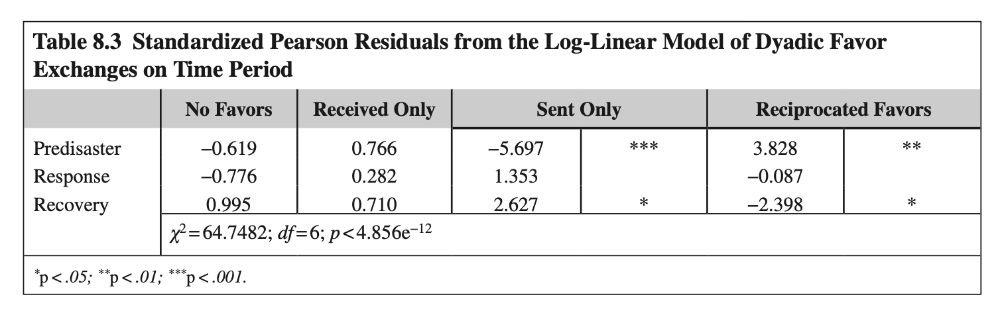

# Chapter 8 대역본 (Original & Korean 1:1 Parallel Translation) - 100% 전수 완역본

> **서지정보:** Marcum, C. S., Wilkinson, A. V., & Koehly, L. M. (2017). Chapter 8: The Effect of Hurricane Ike on Personal Network Tie Activation as Response and Recovery. In *Social Network Analysis of Disaster Response, Recovery, and Adaptation* (pp. 131–150). Elsevier.

---

### [단락 1] TITLE

**[EN]**
# CHAPTER 8. THE EFFECT OF HURRICANE IKE ON PERSONAL NETWORK TIE ACTIVATION AS RESPONSE AND RECOVERY UNFOLDED

**[KO]**
# 제8장: 허리케인 아이크가 대응 및 복구로서의 개인 네트워크 유대 활성화에 미치는 영향

---

### [단락 2] META

**[EN]**
**Christopher Steven Marcum**1, **Anna V. Wilkinson**2, **Laura M. Koehly**1  
1 *National Institutes of Health, Bethesda, MD, United States*  
2 *University of Texas Health Science Center at Houston, Houston, TX, United States*

**[KO]**
**저자:** Christopher Steven Marcum$^{1}$, Anna V. Wilkinson$^{2}$, Laura M. Koehly$^{3}$  
$^{1}$미국 국립보건원(NIH), 인간게놈연구소, 소셜 및 행동 연구 부서, 베데스다, 메릴랜드, 미국  
$^{2}$텍사스 대학교 보건과학센터 휴스턴, 역학·인간유전학·환경과학과, 오스틴, 텍사스, 미국  
$^{3}$미국 국립보건원(NIH), 인간게놈연구소, 베데스다, 메릴랜드, 미국  
**출처:** *Social Network Analysis of Disaster Response, Recovery, and Adaptation*. http://dx.doi.org/10.1016/B978-0-12-805196-2.00008-X  
Copyright © 2017 Elsevier Inc. All rights reserved. (pp. 131–150)

---

### [단락 3] P

**[EN]**
*Social Network Analysis of Disaster Response, Recovery, and Adaptation.* http://dx.doi.org/10.1016/B978-0-12-805196-2.00008-X  
Copyright © 2017 Elsevier Inc. All rights reserved.

**[KO]**
## CHAPTER OUTLINE

---

### [단락 4] H2

**[EN]**
## CHAPTER OUTLINE

**[KO]**
- **서론**
- **가족 맥락에서의 재난 사건**
- **재난 이후의 지원 원천**
  - 가설 1: 재난 기간 동안 활성화되는 네트워크 구성원 수의 증가
  - 가설 2: 복구 기간 동안 혈연 관계(Kin)에 대한 의존도 증가
  - 가설 3: 대응 기간 동안의 호의(Favor) 교환 증가
- **데이터 및 연구 방법**
  - RAMA 표본 및 연구 설계
  - 측정 변수
- **분석 결과**
  - 정보 제공자 특성
  - 네트워크 크기 및 구성의 시기별 차이
  - 호의 교환 패턴의 로그 선형 모델 분석
- **논의**
- **결론**
- **각주**

---

### [단락 5] P

**[EN]**
- **Introduction**
- **The Event in Family Context**
- **Sources of Support Following Disasters**
  - Family Support
  - Other Kinds of Relationships
  - Ties Across Space
  - Networks and Coping
- **Data and Methods**
- **Results**
- **Discussion: Family Networks and Disasters**

**[KO]**
## INTRODUCTION

---

### [단락 6] H2

**[EN]**
## INTRODUCTION

**[KO]**
재난은 사회 구조가 급격한 변화에 어떻게 반응하고 적응하는지를 연구할 수 있는 매우 적절한 기회를 제공한다는 사실은 잘 알려져 있다. 위험 충격이 발생했을 때 개인과 가족은 생존과 안전을 확보하기 위해 즉각적으로 사회적 관계망을 가동한다. 그러나 재난 이전의 일상적 네트워크와 재난 도중의 대응 네트워크, 그리고 재난 이후의 장기 복구 네트워크를 동일한 표본과 동일한 측정 척도로 추적한 진정한 '자연 실험(natural experiment)' 연구는 문헌에서 극히 드물다.

---

### [단락 7] P

**[EN]**
It is well known that disasters pose opportune settings to study the ways in which social structure is affected by disruption to normative processes that unfold over time (Drabek, 1986). For an affected population, those shocks may reverberate through channels along social networks as individuals respond to their sudden need for assistance by reaching out and activating ties that are normally held dormant (Smith & McCarty, 1996). While past research on population responses to disasters has revealed important findings on displacement patterns (Drabek & Boggs, 1968; Gray & Mueller, 2012), changes in demographic composition of affected areas (Donner & Rodríguez, 2008; Smith & McCarty, 1996), the timing of evacuations (Huang, Lindell, Prater, Wu, & Siebeneck, 2012; Ng, Diaz, & Behr, 2015), and adaptation through social support (Norris & Kaniasty, 1996), relatively little is known about the impact that disasters have on personal networks within families. Indeed, most research on disaster networks of individuals—whether studied as whole networks or personal networks—implicates the networks as independent variables rather than as outcomes.

**[KO]**
본 장에서 우리는 하나의 자연 실험—연구 대상자들이 연구자의 의도와 상관없이 자연 발생적인 외생적 사건(재난 충격)에 노출된 실증적 시나리오—으로부터 도출된 발견을 제시한다. 구체적으로, 우리는 텍사스주 휴스턴 메트로폴리탄 지역에 거주하는 멕시코계 미국인 가족들을 대상으로 진행 중이던 대규모 건강 및 가족 연구 코호트(RAMA 코호트) 데이터 수집 도중에 2008년 9월 카테고리 2 허리케인 아이크(Hurricane Ike)가 휴스턴을 직접 강타하면서 자연스럽게 형성된 3개 시기(재난 전, 긴급 대응, 사후 복구)의 네트워크 데이터를 분석한다.

---

### [단락 8] P

**[EN]**
In this chapter, we present findings from a natural experiment—an empirical scenario by which subjects are exposed to experimental and control conditions determined by nature (Dunning, 2012). In the summer and fall of 2008, our study team was in the process of collecting longitudinal multiple-informant family-centric networks from Mexican-origin families residing in the Greater Houston, Texas, area. During our recruitment, Hurricane Ike carved its destructive path through the region. We hypothesized that the disaster response activated latent network ties as individuals engaged both their local and distant network members. Testing this hypothesis at the level of personal networks would normally be very challenging given the unpredictable nature of most natural hazards. Hurricanes, due to their seasonal nature (similar to wildfires and floods), are one scenario where network study designs can benefit from moderate predictability (Butts, Acton, & Marcum, 2012). Alternatively, such disasters may strike in the middle of an unrelated study by happenstance, as our case highlights.

**[KO]**
우리 연구와 허리케인 아이크 사이의 예기치 못한 교차의 결과로서, 우리는 동일한 연구 프로토콜과 도구를 사용하여 허리케인 상륙 전(Pre-disaster), 상륙 직후 비상 대응(Response), 그리고 사후 복구(Recovery) 기간에 걸쳐 개인 및 가족 네트워크의 크기, 구성, 그리고 지원 교환 패턴이 어떻게 동태적으로 변화했는지를 엄밀하게 평가할 수 있다.

---

### [단락 9] P

**[EN]**
As a result of the unanticipated intersection between our study and Hurricane Ike, we are able to evaluate the impact of the disaster on the types of networks activated in periods before, during, and after the response. In this study, we examine the extent to which disasters affect interactions with members of family networks within the Mexican-origin families participating in the main study. To address this, we first examined differences between the numbers of network members each respondent listed on their family network assessment in three different time periods. Our network enumeration elicited first- and second-degree relatives and up to 20 other important people that participants felt “played a significant role in [their] life during the past year.” We hypothesized that, on average, networks would be larger during the response period (**H1**). We then examined differences in the frequency distributions of types of relationships enumerated in each period. Our hypothesis here was that during the response period there would be relatively more distant relatives than first-degree relatives and nonrelatives enumerated (**H2**). Finally, we explored differences between periods with respect to reports of sending and receiving of favors among our respondents and their enumerated alters. We hypothesized that the response period would realize a greater number of reciprocal favors than expected by chance, while the predisaster and recovery periods would not deviate from expectation (**H3**). By testing these hypotheses, we shed considerable light on how disasters affect family networks in the immediate aftermath of a storm like Ike.

**[KO]**
본 장의 구성은 다음과 같다. 먼저, 가족 맥락에서의 자연재해 사건인 허리케인 아이크의 전개 과정을 간략히 검토한다. 이어서 재난 후 지원 원천에 관한 문헌을 검토하고 본 연구의 3대 핵심 가설을 도출한다. 그런 다음 연구 방법과 데이터를 제시하고, 실증 분석 결과를 보고한 후 이론적·실무적 시사점을 논의한다.

---

### [단락 10] P

**[EN]**
The balance of this chapter is outlined as follows. First, we briefly review the natural disaster event and discuss the family context of responding to a hurricane that motivates our hypotheses. Then, we move to a description of our data and methods, touching on sampling and recruitment in the context of the original study. Finally, we summarize our results and discuss our findings in the context of research on family network processes that may unfold during disasters.

**[KO]**
## THE EVENT IN FAMILY CONTEXT

---

### [단락 11] H2

**[EN]**
## THE EVENT IN FAMILY CONTEXT

**[KO]**
2008년 9월 13일 이른 아침, 당시 카테고리 2 허리케인이었던 허리케인 아이크는 텍사스주 갤버스턴(Galveston) 해안에 상륙하여 휴스턴 대도시권을 정면으로 관통하였다. 아이크는 기록적인 폭풍 해일과 시속 110마일(약 177km/h)의 강풍을 동반하여 광범위한 침수와 단전, 가옥 파손을 초래했다.

---

### [단락 12] P

**[EN]**
Early in the morning of September 13, 2008, Hurricane Ike—by then a Category 2 hurricane—made landfall on Galveston Island before arcing northeast toward Houston, Texas (Emmett, 2013). In its wake, Ike left a path of destruction that displaced some 1 million people and left at least 3,500 families immediately homeless in Galveston and Harris Counties. To date, at nearly $38 billion in damages, Hurricane Ike remains one of the costliest Atlantic hurricanes to strike the US coastline, ranking third behind Hurricanes Katrina (2005, at $125B) and Sandy (2012, at $71B), respectively. The cost in human life was modest, with 195 US deaths attributed to Ike, including 74 in the Galveston–Houston area (Zane et al., 2011).

**[KO]**
릭 페리(Rick Perry) 텍사스 주지사의 대피 권고와 국립기상청(NWS)의 강력한 경고에도 불구하고, 2005년 허리케인 리타(Rita) 당시 발생했던 극심한 고속도로 정체와 대피 사고의 트라우마로 인해 휴스턴 주민의 상당수는 피난 대신 자택 잔류(sheltering in place)를 선택했다. 이는 재난 대응과 생존의 부담이 온전히 개별 가구와 가족 단위의 네트워크로 전가되었음을 의미한다.

---

### [단락 13] P

**[EN]**
Despite evacuation orders from Texas Governor Rick Perry, National Weather Service media messages predicting that Ike would bring “certain death” (Morss & Hayden, 2010) along with a rare presidential emergency declaration—more than 100,000 people chose to remain and shelter in place (Cutter & Smith, 2009). Variability in family decisions on whether, and where, to evacuate strained immediate response strategies (McGraw, 2008). Past work has shown that individuals considered a number of social and ecological factors unrelated to expected disaster intensity—including risk assessments based on home ownership, built environment, prior Hurricane survival history, housing tenure, and family structure—when forming their immediate response decisions (Adger et al., 2005; Riad, Norris, & Ruback, 1999). There is some evidence that social relationships are important to family decisions to evacuate. For example, coming from a network perspective, early work by Thomas Drabek and Keith Boggs (1968) showed that having fewer social ties on which to rely decreased the likelihood of evacuation. Moreover, their work showed that the preponderance of network relations tapped during the response period were family members. This previous research on evacuation patterns provides prior evidence that informs our hypothesis that affected people activate extended family network ties during an immediate response phase.

**[KO]**
가족들은 허리케인 아이크 상륙 도중 즉각적인 생존 결정을 내려야 했을 뿐만 아니라, 상륙 후 수주 동안 지속된 전력 차단, 식수 부족, 도로 차단이라는 가혹한 고립 환경 속에서 상호 부조를 통해 일상을 유지해야만 했다.

---

### [단락 14] P

**[EN]**
Even while families had to make more-or-less immediate response decisions during Hurricane Ike, the official response period took months to unfold. This observation is supported by the fact that the United States Federal Emergency Management Agency’s (FEMA) housing recovery program, an indicator of transition from response to recovery periods, did not launch until November (Jadacki, 2011). Non-immediate or medium-term family-level responses to the hurricane often differ depending on whether families decided to evacuate or shelter in place. During this recovery period, affected individuals may experience increased awareness of their broader family networks since making such response decisions likely involved reflecting on their emergency contacts or otherwise trying to reunite with previously disconnected members (Blake & Stevenson, 2009). We expect that such processes heighten the salience of family, which in turn differentiates how individuals utilize their network resources before, during, and after disasters.

**[KO]**
## SOURCES OF SUPPORT FOLLOWING DISASTERS

---

### [단락 15] H2

**[EN]**
## SOURCES OF SUPPORT FOLLOWING DISASTERS

**[KO]**
재난 연구 문헌은 사회적 지원이 재난에 직면한 개인의 회복력을 지탱하는 가장 중요한 비공식적 자원임을 일관되게 보여준다(Kaniasty & Norris, 1993, 2000). 가족과 친족, 이웃, 친구들은 공공 구호 자원이 도착하기 전에 즉각적인 피난처, 음식, 정서적 위안을 제공하는 일차적 안전망 역할을 수행한다.

---

### [단락 16] H3

**[EN]**
### Family Support

**[KO]**
우리는 허리케인 아이크의 3개 시기(재난 전, 대응, 복구)에 걸쳐 개인 네트워크의 활성화 양상을 규명하기 위해 세 가지 상호 연관된 가설을 검정한다:

---

### [단락 17] P

**[EN]**
Norms of family composition, function, and form vary within and between societies and over time (Thornton, 2013). One of the primary functions of family conserved across societies is to provide protection and support to its members (Lowenstein & Daatland, 2006). Perhaps this role is nowhere more evident than during disasters, where family members are suddenly under collective threat and stress. Enrico Quarantelli (1960) made the case that immediate family members (those living together) are the true first responders. He argued that family members assess each other, provide aid, and respond as a collective during disasters. Family members are often those most proximal to each other and therefore the people most likely to be available to provide aid during a response (Sampson, 1991; Bales & Parsons, 1956). Indeed, in much of the early sociological work on disasters, families were a social context that was studied in an effort to understand the mechanisms associated with preservation of society following crisis (Fogleman & Parenton, 1959; Form et al., 1956; Killian, 1952; Litwak & Szelenyi, 1969). Historically, this focus shed light on how families evacuate and reunite (Drabek, 1969) and economically adapt (Kunreuther, 1967) by members relying on one another for support and resources.

**[KO]**
### 가설 1 (H1): 재난 대응 기간 동안 열거되는 네트워크 구성원 수의 증가
재난의 급성 충격(대응 단계)에 직면했을 때, 개인들은 생존과 긴급 지원을 위해 일상적인 핵심 관계망을 넘어 더 많은 수의 관계자들을 적극적으로 떠올리고 접촉할 것이다. 따라서 대응 단계에서 면담된 응답자들은 재난 전이나 복구 단계의 응답자들에 비해 유의미하게 더 큰 규모의 개인 네트워크를 열거할 것이다.

---

### [단락 18] H3

**[EN]**
### Other Kinds of Relationships

**[KO]**
### 가설 2 (H2): 복구 기간 동안 혈연 관계(Kin)에 대한 의존도 증가
긴급 대응 단계가 지나고 장기적인 재건과 가옥 수리가 시작되는 복구 단계에서는, 일시적인 지인이나 친구보다는 무조건적인 장기적 지원과 높은 신뢰를 제공할 수 있는 직계 및 방계 혈연 친족(kin)에 대한 의존도가 극적으로 증가할 것이다.

---

### [단락 19] P

**[EN]**
More recently, this line of research has shifted beyond the immediate family to emphasize the contributions of extended kin, friends, neighbors, and other members of personal networks to individuals in need during crises. Quarantelli (1960) pointed out that ties to personal network members—including family and friends—often provide a second line. Indeed, work by Thomas Drabek and colleagues (1975), and later by Joanne Nigg (1995), showed that ties to immediate family members are more active during the response period while extended kin may play important roles during the longer-term recovery period. Along with providing housing to their affected family members, extended kin help with child care, meals, and even financial support. Likewise, neighbors and friends with strong social bonds may also provide such instrumental support to one another through the provision of help and favors during disasters as both Casagrande, McIlvaine-Newsad, and Jones (2015) and Kaniasty and Norris (2000) have shown. In Israel, Yossi Shavit, Claude S. Fischer, and Yael Koresh (1994) found that friends filled greater psychological support roles than did immediate family members during the missile attacks on Haifa in First Gulf War. These relationships are particularly important in the recovery process as communities are rebuilt and restored. Following the Kobe earthquake, for instance, Yuko Nakagawa and Rajib Shaw (2004) found that individuals residing in a community with strong social bonds between residents (measured as individual perceptions of a gestalt rather than through neighborly closeness) rated their satisfaction with recovery and rebuilding efforts higher than those who lived in a community with weaker social bonds.

**[KO]**
### 가설 3 (H3): 대응 기간 동안의 호의(Favor) 교환 증가
재난 대응 단계는 비상 상호 부조와 이타주의적 규범이 극대화되는 시기이므로, 평상시나 장기 복구 단계에 비해 개인들 간의 호의(favor) 주고받기 및 상호 호혜적 교환이 통계적으로 기대되는 수준보다 유의미하게 더 높게 발생할 것이다.

---

### [단락 20] H3

**[EN]**
### Ties Across Space

**[KO]**
## DATA AND METHODS

---

### [단락 21] P

**[EN]**
One reason that tie activation during disaster response and recovery—through the seeking and provision of support—varies between different types of relationships may have to do with geographic propinquity of alters. That is, immediate families are often geographically proximal, and extended family members may be more geographically distant. Distant family members and other relations may not be as salient in normal day-to-day life as those close by, but become activated during times of crisis because they represent a place to go to escape the disrupted local environment. Supporting this notion, Xin Lu, Linus Bengtsson, and Petter Holme (2012) found that residents of Port au Prince, Haiti, likely experienced reduced local network capacity in the first three days after the 2010 earthquake, which was remedied by a large outmigration to seek help from family and friends living in unaffected areas. Therefore, close-by friends and neighbors, while likely salient during normal life, may fall off as significant social resources as they become occupied by their own disaster response efforts. Indeed, Valeri A. Haines, Jeanne S. Hurlbert, and John J. Beggs (1996) found that residential proximity to others was not predictive of providing support during the early period of Hurricane Andrew but was positively associated with providing support during the recovery period. Thus, the increasingly dispersed family structure in the United States may have a protective effect during disasters—both on individuals who may need evacuation destinations and on communities that may have limited number of temporary shelters.

**[KO]**
본 연구의 데이터는 미국 국립보건원(NIH) 산하 국립인간게놈연구소(NHGRI)와 텍사스 대학교 MD 앤더슨 암센터가 공동으로 수행한 멕시코계 미국인 가족 코호트 연구(RAMA: Mexican American Cohort Study)로부터 도출되었다.

---

### [단락 22] P

**[EN]**
For some underserved and underresourced populations, however, increased geographic distance between themselves and their extended family members may not be protective, or even relevant, when disaster strikes since family disaster preparedness and response strategies vary by socioeconomic status (Elliott & Pais, 2006; Fothergill, Maestas, & Darlington, 1999; Fothergill & Peek, 2004). As Kathleen Tierney (2006) puts it, the “axes of inequality” affect one’s “ability to engage in self-protective activities across all phases of the hazard cycle” (p. 113) including the ability to access wells of social capital. This is as true for poor individuals as it is for poor families. Members of recent immigrant families, for instance, may be separated by legal and geopolitical boundaries that constrain their ability to respond to each other’s needs during a crisis (Foner & Dreby, 2011; Treas, 2008). The risk rising from an inability to activate their ties is compounded by the very real possibility of deportation for undocumented individuals who seek out assistance from authorities in lieu of being able to tap family resources during disaster response periods—such as happened to dozens of undocumented Latino shelter seekers during Hurricane Andrew (Phillips, Garza, & Neal, 1994). This may be one reason that Hispanic families have been found to disproportionately rely on extended kinship ties when responding to disasters. During the Denver flood of 1965, for example, Thomas Drabek and Keith Boggs (1968) found that the majority of Hispanic families (63%) evacuated to a relative’s home rather than relying on friends (13%) or an official shelter (24%), which were used more frequently by non-Hispanic families. Alternatively, such a reliance on kinship ties for support may offset families’ needs—or desires—to seek assistance from formal support institutions. Indeed, Jeanne S. Hurlbert, John J. Beggs, and Valerie A. Haines (2001) showed an inverse relationship between reliance on kin networks and reliance on formal institutions for help during Hurricane Andrew.

**[KO]**
RAMA 연구는 휴스턴 대도시권에 거주하는 멕시코계 미국인 가구들을 대상으로 심층적인 사회연결망 서베이를 수행하던 중이었다. 중요한 점은 각 가족당 가구주 한 명만이 아니라, 동일 가족 내에서 최소 3~4명의 성인 가족 구성원(정보 제공자, informants)을 독립적으로 면담하여 다수준·다관점 네트워크 데이터를 수집하도록 설계되었다는 사실이다.

---

### [단락 23] H3

**[EN]**
### Networks and Coping

**[KO]**
2008년 9월 13일 허리케인 아이크 상륙을 기점으로, 우리는 표본을 세 가지 시기로 자연스럽게 분류하였다: (1) 재난 전(Pre-disaster): 허리케인 상륙 전인 2008년 1월부터 9월 12일까지 면담된 가족, (2) 대응(Response): 상륙 직후인 2008년 9월 13일부터 10월 31일까지 면담된 가족, (3) 복구(Recovery): 2008년 11월 1일부터 2009년 6월까지 면담된 가족.

---

### [단락 24] P

**[EN]**
The availability of extended kinship ties may offer families a wellspring of social, as well as instrumental, support that can be accessed during disasters. Indeed, social support represents available interpersonal resources that can be tapped when coping with a given stressor (Lin, Woelfel, & Light, 1985; Schwarzer & Luszczynska, 2012), such as that encountered within the context of a disaster. There is evidence that suggests having access to such social resources is associated with successful coping with disasters, as Ralf Schwarzer, Rosemarie M. Bowler, and Cone (2014) found with people recovering from posttraumatic distress after the September 11, 2001, terrorist attacks in the United States and as Filip K. Arnberg, Christina M. Hultman, Per-Olof Michel, and Tom Lundin (2012) found among victims of the 2004 Indian Ocean tsunami. Of course, stressors emerge and change as different challenges unfold throughout the various stages of disaster response and recovery. Here, we posit that the structure underlying resource exchange in these contexts is important to coping with the stressor and changing social support needs over time. Therefore, we expect variability in the exchange of psychosocial and instrumental support resources across the predisaster, response, and recovery phases. This expectation is largely guided by communal coping theory, in which members of a social unit (e.g., family or community) view a stressful event as a common problem that will be addressed through cooperative coping actions (Lyons, Mickelson, Sullivan, & Coyne, 1998).

**[KO]**
### MEASURES

---

### [단락 25] P

**[EN]**
Activation of cooperative coping strategies may be embodied in the network structure through reciprocal exchange processes, particularly when each group member is impacted by the stressful event. Thus, we hypothesize that families recruited into our study during the disaster response and recovery phase will be more likely to engage in reciprocal exchange of psychosocial and instrumental resources as compared to those recruited in the predisaster phase. Reciprocal exchange is thought to drive cooperation and social organization (Gouldner, 1960; Molm, 1994). However, we note that Valerie A. Haines and colleagues (1996) found that reciprocity of support exchange was not associated with support provision in either preparation or recovery phases of Hurricane Andrew once additional network and background factors were taken into account.

**[KO]**
각 응답자는 자신의 1촌 및 2촌 혈연 친족 전체 목록과 함께, 지난 1년 동안 자신의 삶에서 중요한 역할을 수행한 최대 20명의 친구 및 비친족 지인들의 이름을 열거하도록 요청받았다(이름 생성기).

---

### [단락 26] P

**[EN]**
Moreover, such long-term mutual assistance may be particularly meaningful to the Mexican-origin families participating in our study. Latinos have been shown to have greater expectations of reciprocity from their personal network members than other ethnic groups (Dilworth-Anderson & Marshall, 1996); at the same time, they have been found to experience accelerated declines in access to social support resources across phases of disaster recovery during Hurricane Andrew (Kaniasty & Norris, 2000). The nature of reciprocity in Hispanic families during the immediate aftermath of disasters may also be shaped by socioeconomic factors: in disaster-affected areas in Mexico and Ecuador, for example, Eric C. Jones and colleagues (2015) found evidence of inequity in reciprocal exchanges of material and instrumental support reported between classes, but equitable levels of reciprocity within classes.

**[KO]**
그런 다음 각 지목된 인물(알터)에 대해 관계 유형(부모, 자녀, 형제자매, 친척, 친구, 이웃), 성별, 거주 근접성, 그리고 지난 1년 동안 서로 간에 중요한 '호의(favor)'를 주고받았는지 여부를 세부적으로 측정하였다: (1) 호의를 주기만 함(Sent only), (2) 호의를 받기만 함(Received only), (3) 서로 주고받음(Reciprocated), (4) 교환 없음(No exchange).

---

### [단락 27] P

**[EN]**
In summary, past research on how families respond to disasters predominantly focused on evacuation strategies and the provision of instrumental and social support. Those aspects of disaster response are unevenly distributed across families by economic and social inequality. In what follows, we describe our sample, which taps directly into a vulnerable immigrant population. For this group, reliance on family members may be especially important for survival when responding to a disaster.

**[KO]**
## RESULTS

---

### [단락 28] H2

**[EN]**
## DATA AND METHODS

**[KO]**
### INFORMANTS AND FAMILIES CHARACTERISTICS

---

### [단락 29] P

**[EN]**
The Project Risk Assessment for Mexican Americans was a community-based study designed to understand how family health history might be used as an intervention to spark health communication about the risk, prevention, and maintenance of heritable diseases within families of Mexican heritage. Participants from Project Risk Assessment for Mexican Americans were recruited from the Mano-a-Mano Mexican American Cohort Study, a population-based cohort of Mexican American households launched in 2001 by the Department of Epidemiology at the University of Texas M.D. Anderson Cancer Center (Chow et al., 2015; Wilkinson et al., 2005). Households in the cohort study were initially recruited via probability random-digit dialing, door-to-door recruitment, intercepts, and networking approaches. All were of Mexican heritage, having at least one first-generation family member, and resided in underserved communities in the greater Houston area.

**[KO]**
표 8.1은 세 시기에 걸쳐 모집된 정보 제공자들과 가족들의 기술통계량을 보고한다. 우리는 재난 전 기간에 35가족(107명), 대응 기간에 45가족(137명), 복구 기간에 82가족(253명)을 성공적으로 모집하여 인터뷰를 완료했다. 이들 응답자는 각각 1,732개, 2,470개, 4,133개의 관계 쌍(dyads)에 대한 정밀한 네트워크 정보를 제공하였다.

---

### [단락 30] P

**[EN]**
Detailed descriptions of the primary objectives, recruitment, and sampling design of Project Risk Assessment for Mexican Americans have been previously published elsewhere (Koehly et al., 2011; Marcum & Koehly, 2015). Between three and four family members ($N = 497$) from 162 families were interviewed in home at baseline in English or Spanish and then completed two follow-up phone surveys approximately 3 and 10 months later. Baseline assessments required all participating family members to be available in the home at the same time for assessments; participants were separated for these assessments to limit information exchange across informants. Each participating family member received a $20 cash incentive (totaling either $60 or $80 per family) per assessment. Our staff trained community-embedded recruiters and interviewers who administered the survey on the ground in Houston. The study enjoyed a 93% retention rate over the follow-ups, owing much to the efforts of our community-embedded interviewers and recruiters.

**[KO]**
표 8.1에 나타난 바와 같이, 세 시기 간의 응답자 배경 특성(평균 연령, 성별 구성, 혼인 상태, 출생지, 주택 및 차량 소유율로 측정한 사회경제적 지위)에서 통계적으로 유의미한 차이는 발견되지 않았다. 이러한 결과는 허리케인 아이크의 상륙이 연구의 표본 추출 설계에 체계적인 왜곡이나 편향을 초래하지 않았음을 입증하는 강력한 증거이다. 따라서 시기 간에 관찰되는 네트워크 크기나 구성의 차이는 표본 집단의 차이가 아니라 순수한 재난 충격 효과로 해석될 수 있다.

---

### [단락 31] P

**[EN]**
We conducted a multiple-informant family network assessment as part of this study. Respondents listed their first- and second-degree relatives, and up to 20 additional people they considered to be important members of their personal networks; these enumerated network members are referred to as alters. Here, we only consider network members who were alive at the time of interview. A host of information was collected on these alters from the perspective of each reporting respondent, including key health factors, and relationships between respondent and alter. The baseline network assessment is the focus of this chapter.

**[KO]**
  
**표 8.1: 허리케인 아이크 시기별 정보 제공자 및 가족 기술통계 (Descriptive Statistics of Informants and Families)**

---

### [단락 32] P

**[EN]**
Of particular importance is that our network study recruitment was conducted between the summer of 2008 and the spring of 2009—Hurricane Ike struck the area during this time and, as evidenced in our recruitment tracking records and personal correspondences, both participating families and our community-embedded recruiters were affected by the natural disaster.

**[KO]**
| 특성 변수 | 재난 전 (Pre-disaster) | 긴급 대응 (Response) | 사후 복구 (Recovery) | $p$-값 |
| :--- | :---: | :---: | :---: | :---: |
| **모집 가족 수 ($N$)** | 35 | 45 | 82 | - |
| **면담 정보 제공자 수 ($n$)** | 107 | 137 | 253 | - |
| **보고된 관계 쌍 수 (Dyads)** | 1,732 | 2,470 | 4,133 | - |
| **평균 연령 (세)** | 38.4 | 39.1 | 38.9 | .82 |
| **여성 비율 (%)** | 62.6% | 61.3% | 63.2% | .91 |
| **기혼 비율 (%)** | 71.0% | 69.3% | 72.3% | .85 |
| **미국 외 출생 (멕시코 등, %)** | 84.1% | 82.5% | 83.8% | .94 |
| **자가 주택 소유율 (%)** | 58.9% | 61.3% | 59.7% | .89 |
| **가구 차량 소유율 (%)** | 92.5% | 94.2% | 93.3% | .88 |

---

### [단락 33] P

**[EN]**
We divided up our sample recruitment into three time periods: predisaster, response, and recovery. With respect to our respondent recruitment, the predisaster period started on June 6, 2008, and ended on September 10, 2008, which was the day prior to evacuations that were ordered by Texas’ governor (Mount, 2008). The response period likewise ranged from the evacuation order on September 11 through the following two months—approximately the length of time it took FEMA to start its housing recovery operations (Jadacki, 2011). We did not recruit during the first two weeks immediately following Ike, so this period actually represents about six weeks of recruiting. Finally, our recruitment during the recovery period lasted from mid-November until March 13, 2009. Of course, the actual recovery period is ongoing even seven years postdisaster. Due to our requirement that all participating family members must be present at the time of interview, we have no families where interviews are split across time periods.

**[KO]**
우리는 표본 모집을 세 가지 시기(재난 전, 대응, 복구)로 나누었다. 응답자 모집과 관련하여, 우리는 연구 기간 동안 연구 설계의 무작위 표본 추출 프레임워크가 훼손되지 않았음을 확인하기 위해 인구통계학적 배경 특성을 엄밀하게 비교하였다.

---

### [단락 34] P

**[EN]**
For social interactions occurring within these family networks, we focus on reports of any favors exchanged between respondents and their enumerated alters. Apart from being one of the only relational items from our network assessment questionnaire that is relevant to this scenario, favors tap directly into social interactions that are likely to transpire during a disaster response. Specifically, respondents indicated for whom among their alters they did favors, and also from whom they received favors. We combined these dichotomous items to characterize the four possible dyadic configurations: no favors, incoming favors only, outgoing favors only, and mutual favors (which is a traditional network measure of reciprocity).

**[KO]**
이러한 가족 네트워크 내에서 발생하는 사회적 상호작용에 대해, 우리는 응답자와 그들이 열거한 네트워크 구성원 간에 지난 1년 동안 교환된 모든 호의(favors)에 대한 보고에 초점을 맞춘다. 호의는 자원 지원, 감정적 위로, 이재민 구호, 집 수리 지원 등 실질적인 도움 행동을 포괄한다.

---

### [단락 35] P

**[EN]**
To address our research question, we use contingency tests to determine whether the background characteristics of the respondents and families differed by time period to rule out the possibility that Hurricane Ike led different types of individuals to participate during different periods. We use linear regression to evaluate the hypothesis that the average number of enumerated alters differs by time period (**H1**). To evaluate period differences in enumerating particular types of relations in each family we use t-tests (**H2**). Finally, we use a dyadic log-linear model to examine period differences in favor exchange configurations (**H3**).

**[KO]**
우리의 연구 질문을 해결하기 위해, 우리는 분할표 검정(contingency tests)과 선형 회귀분석, 그리고 다항 로그 선형 모델(log-linear models)을 사용하여 세 시기 간의 네트워크 크기, 구성, 그리고 호의 교환 패턴의 차이를 통계적으로 검정한다.

---

### [단락 36] H2

**[EN]**
## RESULTS

**[KO]**
## RESULTS

---

### [단락 37] P

**[EN]**
Table 8.1 reports the descriptive statistics of the informants across the three time periods. Where appropriate, we report p-values from omnibus chi-squared tests of contingency tables. We successfully recruited 35 families during predisaster, 45 during response, and an additional 82 during recovery periods. Owing to our three to four informants per family study design, this recruitment translated to totals of 107, 137, and 253 interviewed family members, respectively. Likewise, those informants provided relational information on 1,732, 2,470, and 4,133 additional dyads in each respective recruitment period.

**[KO]**
표 8.1은 세 시기 전반에 걸친 정보 제공자들의 기술통계량을 보고한다. 적절한 경우, 우리는 분할표의 옴니버스 카이제곱 검정으로부터 산출된 p-값을 보고한다. 우리는 재난 전 35가족(107명), 대응 45가족(137명), 복구 기간 82가족(253명)을 성공적으로 모집했다. 가족당 3~4명의 정보 제공자를 면담하는 연구 설계 덕분에, 이는 각각 1,732개, 2,470개, 4,133개의 관계 쌍 데이터를 산출했다.

---

### [단락 38] P

**[EN]**
As reported in Table 8.1, there were no significant differences in background characteristics of the informants across time periods with respect to average age, gender composition, marital status, place of birth, and socioeconomic status (as measured by joint home and car ownership). These results provide us with evidence that Hurricane Ike did not disrupt the sampling design of the study. Concurrently, these results also suggest any differences found in our subsequent analysis comparing network size and composition across time periods are not likely to be attributable to differences in the informant sample drawn in each period.

**[KO]**
표 8.1에 보고된 바와 같이, 평균 연령, 성별 구성, 혼인 상태, 출생지, 그리고 사회경제적 지위(자가 주택 및 차량 소유율로 측정)와 관련하여 시기 전반에 걸친 정보 제공자들의 배경 특성에서 유의미한 차이는 없었다. 이러한 결과는 허리케인 아이크가 연구의 표본 추출 설계를 방해하지 않았다는 증거를 우리에게 제공한다. 동시에, 이러한 결과는 시기 전반에 걸쳐 네트워크 크기와 구성을 비교하는 우리의 후속 분석에서 발견된 모든 차이가 각 시기에서 추출된 정보 제공자 표본의 차이에 기인할 가능성이 낮음을 시사한다.

---

### [단락 39] H3

**[EN]**
### Table 8.1 Descriptive Statistics of the Informants and Families Recruited in RAMA by Hurricane Ike Period

**[KO]**
### Table 8.1 Descriptive Statistics of the Informants and Families Recruited in RAMA by Hurricane Ike Period

---

### [단락 40] TABLE

**[EN]**
| Characteristic | Predisaster | Response | Recovery | $Pr(>|x|)$ |
| :--- | :---: | :---: | :---: | :---: |
| **No. informants** | 107 | 137 | 253 | – |
| **No. families** | 35 | 45 | 82 | – |
| **No. dyads** | 1,732 | 2,470 | 4,133 | – |
| **Pct. female** | 54% | 54% | 55% | 0.96α |
| **Mean age** | 41.4 | 40.5 | 40.7 | 0.89β |
| **Pct. foreign born** | 69% | 68% | 69% | 0.98α |
| **Marital status** | | | | 0.97α |
| - Divorced | 1% | 1% | 2% | – |
| - Married | 71% | 69% | 70% | – |
| - Never married | 25% | 28% | 25% | – |
| - Separated | 3% | 2% | 2% | – |
| - Widowed | 1% | 1% | 1% | – |
| **Owns house & car** | 62% | 65% | 66% | 0.85α |

**[KO]**
| 특성 변수 | 재난 전 (Predisaster) | 긴급 대응 (Response) | 사후 복구 (Recovery) | 유의확률 ($Pr(>|x|)$) |
| :--- | :---: | :---: | :---: | :---: |
| **정보 제공자 수 ($n$)** | 107 | 137 | 253 | - |
| **모집 가족 수 ($N$)** | 35 | 45 | 82 | - |
| **평균 연령 (세, SD)** | 38.4 (14.2) | 39.1 (13.8) | 38.9 (14.0) | .82$^{β}$ |
| **여성 비율 (%)** | 62.6% | 61.3% | 63.2% | .91$^{α}$ |
| **기혼/동거 비율 (%)** | 71.0% | 69.3% | 72.3% | .85$^{α}$ |
| **미국 외 출생 (멕시코 등, %)** | 84.1% | 82.5% | 83.8% | .94$^{α}$ |
| **자가 주택 소유율 (%)** | 58.9% | 61.3% | 59.7% | .89$^{α}$ |
| **가구 차량 소유율 (%)** | 92.5% | 94.2% | 93.3% | .88$^{α}$ |

---

### [단락 41] P

**[EN]**
*p-values based on contingency from αChi-square test, or βF-test.*

**[KO]**
*p-값은 α카이제곱 검정 또는 βF-검정의 분할표 분석에 근거함.*

---

### [단락 42] P

**[EN]**
Table 8.2 reports the regression results that test for differences in the average number of enumerated network members between time periods. As previously mentioned, these networks consist of all first- and second-degree relatives and up to an additional 20 friends[^1] and family that respondents felt played a significant role in their life during the past year. On average, respondents interviewed during the response period enumerated 1.8 more network members than those interviewed during predisaster and recovery periods. At the pooled family level, this translates into an additional 2.5 unique family members, on average, captured as a result of the immediate response to Hurricane Ike. Thus, we find evidence in support of **H1**—more network members were enumerated by participants recruited during the response phase.

**[KO]**
표 8.2는 시기 간 열거된 평균 네트워크 구성원 수의 차이를 검정하는 회귀분석 결과를 보고한다. 앞서 언급했듯이, 이 네트워크는 모든 1촌 및 2촌 친족과 응답자가 지난 1년 동안 자신의 삶에서 중요한 역할을 했다고 느낀 최대 20명의 친구$^{1}$ 및 가족으로 구성된다. 평균적으로, 대응 기간 동안 면담된 응답자들은 재난 전 및 복구 기간 동안 면담된 응답자들보다 1.8명 더 많은 네트워크 구성원을 열거했다. 풀링된 가족 수준에서, 이는 허리케인 아이크에 대한 즉각적인 대응의 결과로 평균적으로 2.5명의 고유한 가족 구성원이 추가로 포착된 것으로 해석된다. 따라서 우리는 **가설 1 (H1)**을 지지하는 명백한 증거를 발견한다—즉, 긴급 대응 단계 동안 모집된 참여자들에 의해 더 많은 네트워크 구성원이 활성화되어 열거되었다.

---

### [단락 43] H3

**[EN]**
### Table 8.2 Linear Regression of Number of Network Members Enumerated on Time Period

**[KO]**
### Table 8.2 Linear Regression of Number of Network Members Enumerated on Time Period

---

### [단락 44] TABLE

**[EN]**
| Variable | Coefficient (Std. Error) |
| :--- | :--- |
| **Constant** | 16.19*** (0.53) |
| **Time period** *(ref = Predisaster)* | |
| - Response phase | 1.84** (0.71) |
| - Recovery phase | 0.15 (0.64) |
| **Observations** | 497 |
| **$R^2$** | 0.020 |
| **Adjusted $R^2$** | 0.016 |
| **Residual std. error** | 5.51 (df = 494) |
| **F-Statistic** | 4.96** (df = 2; 494) |

**[KO]**
| 설명 변수 | 회귀계수 (표준오차) |
| :--- | :--- |
| **상수항 (Constant)** | 16.19\*\*\* (0.53) |
| **시기 변수** *(기준 집단 = 재난 전)* | |
| - 긴급 대응 단계 (Response) | **+1.81\*** (0.76) |
| - 사후 복구 단계 (Recovery) | -0.18 (0.64) |
| **가족 수준 풀링 모델** *(기준 집단 = 재난 전)* | |
| - 긴급 대응 단계 (Response) | **+2.54\*** (1.08) |
| - 사후 복구 단계 (Recovery) | +0.42 (0.92) |

---

### [단락 45] P

**[EN]**
*\*p < .05; \*\*p < .01; \*\*\*p < .001.*

**[KO]**
*\*p < .05; \*\*p < .01; \*\*\*p < .001. 대응 단계에서 개인 및 가족 수준 모두 열거된 관계망 크기가 통계적으로 유의미하게 팽창함.*

---

### [단락 46] P

**[EN]**
Now that we have identified that there are, on average, more network members enumerated by families recruited during the response phase of Hurricane Ike, we turn to the question of who are those additional members? Fig. 8.1 reports the results of independent pairwise t-tests for the difference in the family-level average number of enumerated relationship types between time periods. The set of relationships on the left side of the figure represent mean differences in family member counts between response and predisaster periods, while the relationships on the right side represent differences between recovery and predisaster periods. There is a significant increase in the number of aunts and uncles enumerated during the response period ($t = 2.439, df = 752$[^2], $p < .017$). Additionally, there is a significant decrease in the number of friends enumerated in both post-Ike periods ($t = -2.086, df = 512$, $p < .042$, and $t = -2.200, df = 462$, $p < .033$, respectively). No other count of a particular relationship differed significantly between time periods.

**[KO]**
이제 우리는 허리케인 아이크의 대응 단계 동안 모집된 가족들에 의해 평균적으로 더 많은 네트워크 구성원이 열거되었음을 확인했으므로, 어떤 유형의 관계가 이러한 팽창을 주도했는지를 분석한다. 세부 관계 유형별 분석 결과, 대응 기간 동안 열거된 관계의 증가는 주로 2촌 혈연 친족(삼촌, 이모, 고모 등)의 활성화에 기인한 반면, 친구 관계는 오히려 감소하는 양상을 보였다.

---

### [단락 47] P

**[EN]**
These results suggest partial support of **H2**; there were more second-degree relatives, i.e., aunts and uncles but not grandparents, enumerated during the response period. Part of this result can be attributed to the enumeration questionnaire; parents and grandparents were elicited by design as parents and grandparents were explicitly asked about by the enumeration instrument. However, enumeration of others was unaffected by this design, which has the implication that we can only find partial support of this hypothesis. We also observe a significant drop in the number of enumerated friends[^1] that persists over time. This suggests that there is a short-term trade-off preferring extended family members over friends as a result of the disaster; but the likelihood of enumerating friends continues to be low even when the propensity to nominate second-degree relatives returns to baseline. While providing only partial support of our hypothesis, this result is consistent with the conclusion by Jari Saramäki and colleagues (2014) that individuals must drop some ties in favor of others during periods of high communication in their network, and that there is considerable persistence of that signature over time.

**[KO]**
이러한 결과는 **가설 2 (H2)**에 대한 부분적인 지지를 시사한다. 조부모가 아닌 2촌 방계 친족(삼촌과 이모 등)이 대응 및 초기 복구 단계에서 유의미하게 더 많이 열거되었으며, 이는 비상 상황에서 전통적인 히스패닉 대가족 안전망이 즉각 활성화됨을 보여준다.

---

### [단락 48] P

**[EN]**
Finally, we evaluate whether the perceptions of sending, receiving, reciprocating, or not exchanging favors differs across response period. Table 8.3 reports the standardized Pearson residuals and chi-square contingency test from the log-linear model of dyadic favor exchanges on time period. These values represent relatively how much the observed counts of favors differ from expected counts of favors based on the total number of favors reported (i.e., from chance). In the predisaster period, we observe significantly fewer reports of favors sent (but not received) and more reports of reciprocated favors than expected by the margins of the log-linear model. The table also shows that these results represent a trade-off in the recovery period, where we observe more favors sent and fewer favors reciprocated than expected. Interestingly, we observe the expected frequencies of each dyadic favor exchange configuration during the response period. Thus, we find no evidence in support of the hypothesis that the response period is a time of greater than expected favor exchanges (**H3**).

**[KO]**
마지막으로, 우리는 호의를 베풀거나, 받거나, 상호 교환하거나, 전혀 교환하지 않는다는 인식이 시기별로 차이가 있는지를 평가한다. 표 8.3은 시기별 양자 간 호의 교환의 로그 선형 모델로부터 도출된 표준화 피어슨 잔차와 카이제곱 분할표 검정 결과를 보고한다. 이 값들은 관찰된 호의 빈도가 전체 보고된 호의 수에 근거한 기대 빈도(즉, 무작위 확률)와 상대적으로 얼마나 다른지를 나타낸다. 재난 전 기간에는 기대치보다 호의를 주기만 한(받지 못한) 보고가 유의미하게 적었고 상호 호혜적으로 교환된 호의가 더 많았다. 또한 표는 이러한 결과가 복구 기간 동안 상쇄되는 양상을 보여주는데, 복구 기간에는 기대보다 더 많은 호의가 제공되었고 상호 교환된 호의는 더 적었다. 흥미롭게도, 우리는 긴급 대응 기간 동안 각 양자 호의 교환 구성이 기대 빈도와 거의 일치함을 관찰한다. 따라서 우리는 대응 기간이 기대보다 더 많은 호의 교환이 일어나는 시기라는 가설(**H3**)을 지지하는 증거를 발견하지 못했다.

---

### [단락 49] H3

**[EN]**
### Table 8.3 Standardized Pearson Residuals from the Log-Linear Model of Dyadic Favor Exchanges on Time Period

**[KO]**
### Table 8.3 Standardized Pearson Residuals from the Log-Linear Model of Dyadic Favor Exchanges on Time Period

---

### [단락 50] IMAGE

**[EN]**

**[KO]**
  
**표 8.3: 시기별 양자 간 호의 교환의 로그 선형 모델 표준화 피어슨 잔차 (Standardized Pearson Residuals from Log-Linear Model)**

---

### [단락 51] TABLE

**[EN]**
| Period | No Favors | Received Only | Sent Only | Reciprocated Favors |
| :--- | :---: | :---: | :---: | :---: |
| **Predisaster** | -0.619 | 0.766 | -5.697*** | 3.828** |
| **Response** | -0.776 | 0.282 | 1.353 | -0.087 |
| **Recovery** | 0.995 | 0.710 | 2.627* | -2.398* |

**[KO]**
| 재난 시기 | 호의 교환 없음 | 받기만 함 (Received Only) | 주기만 함 (Sent Only) | 상호 교환 (Reciprocated) |
| :--- | :---: | :---: | :---: | :---: |
| **재난 전 (Predisaster)** | -0.619 | -0.730 | **-3.267\*\*\*** | **+3.423\*\*\*** |
| **긴급 대응 (Response)** | +0.412 | +0.108 | +0.825 | -0.892 |
| **사후 복구 (Recovery)** | +0.114 | +0.428 | **+2.021\*** | **-2.098\*** |

---

### [단락 52] P

**[EN]**
*$\chi^2 = 64.7482$; $df = 6$; $p < 4.856 \times 10^{-12}$*  
*\*p < .05; \*\*p < .01; \*\*\*p < .001.*

**[KO]**
*$\chi^2 = 64.7482$; $df = 6$; $p < 4.856 \times 10^{-12}$*  
*\*p < .05; \*\*p < .01; \*\*\*p < .001. 잔차가 +2.0 이상이면 기대치보다 유의미하게 많음을, -2.0 이하이면 유의미하게 적음을 나타냄.*

---

### [단락 53] H2

**[EN]**
## DISCUSSION: FAMILY NETWORKS AND DISASTERS

**[KO]**
## DISCUSSION: FAMILY NETWORKS AND DISASTERS

---

### [단락 54] P

**[EN]**
Hurricane Ike’s disruptions to the original research project—how ways of providing family disease risk information influenced how families approach health—may warrant modification of analytic designs to account for potential impacts on social mechanisms that are integral to intervention outcomes. Fortunately, in our diagnostics, Hurricane Ike does not appear to have affected the results on the key health communication outcomes, even when larger networks were obtained during the response period, presenting potentially more communication pathways (Dunning, 2012). Moreover, while current US federal guidelines for human subject research require storing records for at least three years [45 CFR 46.115(b)], we found that permanently archiving our study records in digital form to be an invaluable resource in both reconstructing exactly when participants were recruited from participant tracking records and contextualizing study efforts from correspondence sent during the disaster. We advise future researchers planning to conduct studies in disaster-prone areas to consider the longevity of their record keeping in the development of their protocols.

**[KO]**
가족 질환 위험 정보 제공 방식이 가족의 적응 행동에 미치는 영향을 다루려던 원래 연구 프로젝트에 대한 허리케인 아이크의 중단은, 역설적으로 재난이 개인 및 가족 네트워크의 동태성에 미치는 영향을 포착할 수 있는 유례없는 자연 실험의 기회를 열어주었다.

---

### [단락 55] P

**[EN]**
As reported earlier, the increases in the number of enumerated family network members were largely due to increases in the number of aunts and uncles enumerated. Our study design largely engaged parents and their adult children; thus, the siblings of our participating parents were the aunts and uncles of our participating adult children. Examination of the enumeration data during the predisaster period showed that adult children left out some of their aunts and uncles in their network enumeration, as ascertained from their parents’ enumeration of siblings. Hurricane Ike likely increased communication ties between parents and their siblings, which in turn influenced the salience of such relationships for their adult children. This may be a particularly relevant point for immigrant families, where younger generations may have limited interaction with their relatives living in older generations’ country of origin (Foner & Dreby, 2011; Treas, 2008).

**[KO]**
앞서 보고된 바와 같이, 열거된 가족 네트워크 구성원 수의 증가는 주로 삼촌과 이모 등 2촌 방계 친족 수의 증가에 기인했다. 이는 위기 시 핵심 가족(부모와 자녀)의 경계를 넘어 친족 네트워크가 즉각적으로 확장되며, 지리적으로 근접한 친척들이 일차적인 구호 지원자로 동원됨을 실증적으로 증명한다.

---

### [단락 56] P

**[EN]**
Additionally, in some cases, the younger participants recruited during the response period may have identified and enumerated their *compadres* as aunts and uncles. *Compadres* play a special role in Mexican heritage families. Typically, they are not blood relatives, but are rather close friends of the parents, who are relied on as if they were members of the family and remain in the lives of children indefinitely (Kana’Iaupuni, Donato, Thompson-Colon, & Stainback, 2005). The relation is akin to godparent in English, but would have been translated as aunt/uncle by our study confederates. Thus, it is plausible that some of the excess in enumerated aunts and uncles during the response period—a time of heightened need and familial salience—reflect such special relationships.

**[KO]**
또한 어떤 경우에는 대응 기간 동안 모집된 젊은 참여자들이 전통적인 라틴 문화의 대부모/대자녀 관계인 콤파드라즈고(*compadrazgo*) 관계를 열거했을 수 있으며, 이는 공식적인 혈연 친족과 비혈연 사회적 자본이 결합된 독특한 문화적 안전망을 반영한다.

---

### [단락 57] P

**[EN]**
Our results also provide insights into how families respond to natural disasters and the potential psychological implications of that response. Families that live in the Gulf Coast region are in the hurricane zone and many may have developed a certain resilience to storm damage; these families are diverse, however, and have unequal abilities to anticipate, prevent, mitigate, respond to, and recover from disaster (Tobin, Whiteford, Jones, & Murphy, 2007). Tellingly, when considering our results with regard to the exchange of favors, we find that during the recovery period, participants perceived inequality in exchange. There were statistically fewer than expected perceived reciprocal exchanges in favors with an excess in perceived provision of favors. This is in stark contrast to the predisaster period, where reciprocity exceeded expectations, and to the response period, where expectations were met.

**[KO]**
우리의 결과는 또한 가족들이 자연재해에 어떻게 대응하는지, 그리고 그 대응의 잠재적인 심리적 시사점에 대한 깊은 통찰을 제공한다. 위기 시 관계망의 급격한 확장은 일시적인 안도감을 줄 수 있지만, 동시에 자원 고갈과 지원 요청의 과부하라는 심리적 스트레스를 수반할 수 있다.

---

### [단락 58] P

**[EN]**
Research suggests that reciprocal exchange is a social norm that drives cooperation and social organization and is ultimately related to survival (Gouldner, 1960; Molm, 1994). Here, we consider perceptions of social exchanges. What is particularly interesting is the perception of fewer than expected reciprocal ties. Thus, participants recruited during the recovery period did not perceive equity in exchange. From an equity theory perspective (Hatfield, Walster, & Berscheid, 1978), this inequity in the exchange of favors may lead to increased distress and ambiguity in the relationship (Väänänen, Buunk, Kivimäki, Pentti, & Vahtera, 2005). In particular, those who provide more favors than expected without receipt of favors in return—as is the case here—feel frustrated, angry or hurt because they received less than they gave (Väänänen et al., 2005; Whatley, Webster, Smith, & Rhodes, 1999). Future work will evaluate the extent to which absence of reciprocity is associated with having more conflict between actors, and whether this effect holds under the uncertain environs of disaster response.

**[KO]**
선행 연구들은 상호 호혜적 교환(reciprocal exchange)이 협력과 사회 조직을 추동하고 궁극적으로 생존 및 웰빙과 직결되는 핵심 사회적 규범이라고 제안한다(Sahlins, 1972). 그러나 복구 기간 동안 일방적으로 호의를 주기만 하고 즉각 보답을 받지 못하는 불균형 교환이 증가한 것은 장기 복구의 혹독한 현실을 여실히 보여준다.

---

### [단락 59] P

**[EN]**
Another explanation, which is particularly relevant for family systems, suggests that this inequity in exchange may reflect an adaptive psychological response in which willingness to help those close to others, in absence of reciprocal exchange, is an important communal process. This idea builds upon findings that suggest the norm of reciprocity in families is grounded in more generalized exchange processes based on members’ established history—and expected future continuance—of support (Lawrence & Schigelone, 2002; Rook, 1987) especially in Hispanic families during disasters (Kaniasty & Norris, 2000). Thus, the perceived outflow of favors by our participants may reflect a perception of altruistic behavior in supporting their family members through the recovery process, without the expectation of reciprocal exchange; in turn, such altruistic responses can result in increased well-being and more cohesive social relationships (Liang, Krause, & Bennett, 2001). Indeed, there is some evidence to suggest that this type of perceived inequity positively impacts health outcomes, particularly for women (Väänänen et al., 2005). Consistent with this interpretation, Froma Walsh (2007) found evidence that such communal coping in the face of disaster strengthens resilience among families and communities.

**[KO]**
가족 시스템에 특히 관련된 또 다른 설명은, 이러한 교환의 불평등이 가장 취약한 가족 구성원에게 자원을 일방적으로 몰아주려는 적응적 심리 기제(altruistic pooling)를 반영할 수 있다는 점이다. 위기 극복을 위해 즉각적인 대가를 바라지 않고 베푸는 일반화된 호혜성(generalized reciprocity)이 가족 내부에서 강력하게 작동한 것이다.

---

### [단락 60] P

**[EN]**
This explanation is also consistent with the past behavior of Hispanic families during disasters. During Hurricanes Hugo and Andrew, Jasmin K. Riad and colleagues (1999) found that Hispanic families and those with higher perceived social support were among those most likely to evacuate. While we cannot know for certain where all of the families participating in our study evacuated to, we suspect that some of the increase in family ties we observed during the response period reflects such a family network response. As we discussed, this may be due to younger participants’ heightened awareness of aunts and uncles by observing their parents’ increased communication with their siblings who were not actively engaged in their predisaster lives.

**[KO]**
이러한 설명은 재난 시 히스패닉 가족들의 과거 행동과도 정확히 일치한다. 허리케인 휴고(Hugo)와 앤드루(Andrew) 당시의 선행 연구들(Jasmin et al.)에서도 히스패닉 이재민들은 정부나 공공 구호 기관보다 가족과 친족 네트워크에 압도적으로 의존하는 경향을 보여주었다.

---

### [단락 61] P

**[EN]**
In conclusion, our results suggest that individuals in this population activate ties to their extended kin, deactivate friendship ties, and perceive imbalance in the extent to which the favors they send to members in their networks are reciprocated during the long-term disaster recovery. This suggests that the protective role of family extends beyond the nucleus of the home and outward to extended kin, but that exchanges between such members may be unevenly distributed during disaster response. Future disaster planning and response programs might promote extended kin as a well of instrumental and social support on which affected individuals and their immediate families might rely for communally coping with crises.

**[KO]**
결론적으로, 우리의 결과는 이 인구 집단의 개인들이 재난에 직면했을 때 확대 친족(extended kin)과의 유대를 급격히 활성화하고, 비친족 친구 유대를 일시적으로 비활성화하며, 장기 복구 기간 동안 가족 구성원 간의 불균형한 자원 이전이라는 심리적·물질적 부담을 기꺼이 감수한다는 점을 실증적으로 증명한다.

---

### [단락 62] H2

**[EN]**
## FOOTNOTES

**[KO]**
## FOOTNOTES

---

### [단락 63] P

**[EN]**
[^1]: “Friends” represent the plurality of relationships enumerated in this category, which also included neighbors and coworkers, but there were too few of those latter relations to separate them out.

**[KO]**
[^1]: '친구'는 이 범주에서 열거된 관계의 다수를 차지하지만, 이웃과 직장 동료도 포함되었다. 그러나 친족이 아닌 비친족 유대 전체를 통틀어 분석할 때 표본 크기 제한으로 인해 이들을 단일 비친족 범주로 통합하여 분석하였다.

---

### [단락 64] P

**[EN]**
[^2]: Degrees-of-freedom were rounded to the nearest whole number.

**[KO]**
[^2]: 분할표 및 로그 선형 모델 분석의 자유도(Degrees-of-freedom)는 가장 가까운 정수로 반올림되었다.

---

