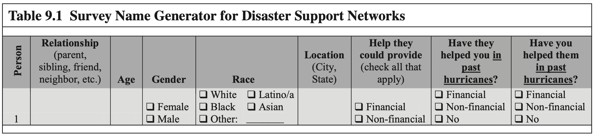
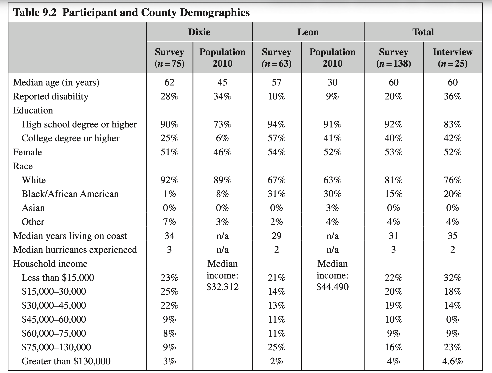
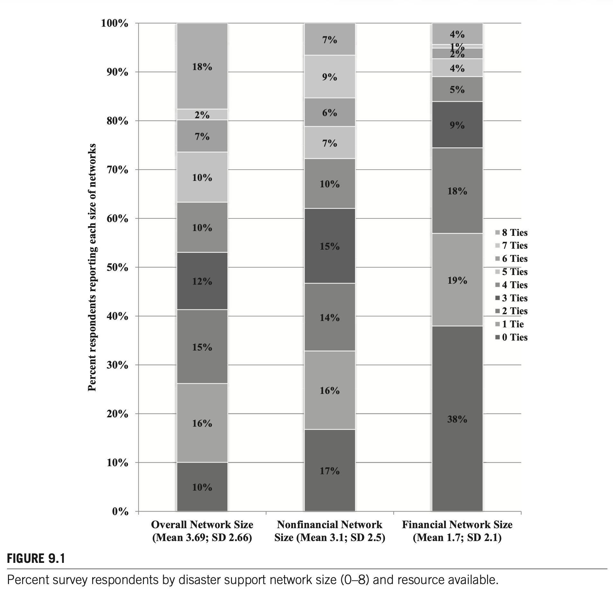
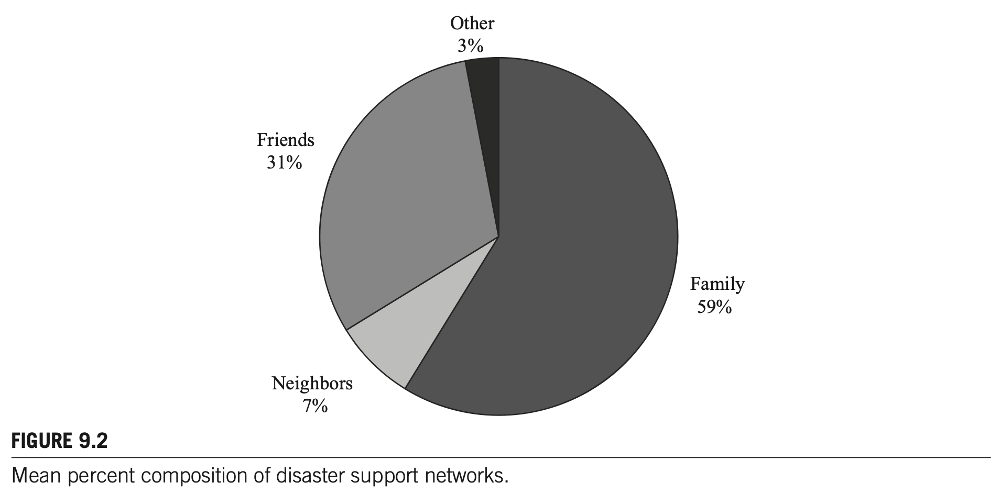
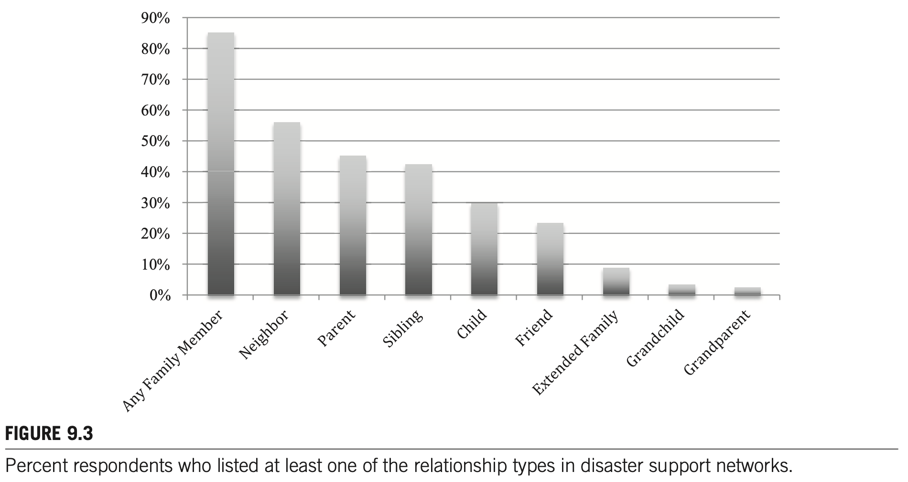

# Chapter 9 대역본 (Original & Korean 1:1 Parallel Translation) - 100% 전수 완역본

> **서지정보:** Meyer, M. A. (2017). Chapter 9: The Family's Burden: Perceived Social Network Resources for Individual Disaster Assistance in Hazard-Prone Florida. In *Social Network Analysis of Disaster Response, Recovery, and Adaptation* (pp. 151–171). Elsevier.

---

### [단락 1] TITLE

**[EN]**
# CHAPTER 9. THE FAMILY’S BURDEN: PERCEIVED SOCIAL NETWORK RESOURCES FOR INDIVIDUAL DISASTER ASSISTANCE IN HAZARD-PRONE FLORIDA

**[KO]**
# 제9장: 가족의 부담: 개인 재난 지원을 위한 지각된 사회연결망 자원

---

### [단락 2] META

**[EN]**
**Michelle Meyer**  
*Louisiana State University, Baton Rouge, LA, United States*

**[KO]**
**저자:** Michelle Meyer  
**소속:** 루이지애나 주립대학교, 배턴루지, 루이지애나, 미국  
**출처:** *Social Network Analysis of Disaster Response, Recovery, and Adaptation*. http://dx.doi.org/10.1016/B978-0-12-805196-2.00009-1  
Copyright © 2017 Elsevier Inc. All rights reserved. (pp. 151–174)

---

### [단락 3] P

**[EN]**
*Social Network Analysis of Disaster Response, Recovery, and Adaptation.* http://dx.doi.org/10.1016/B978-0-12-805196-2.00009-1  
Copyright © 2017 Elsevier Inc. All rights reserved.

**[KO]**
## CHAPTER OUTLINE

---

### [단락 4] H2

**[EN]**
## CHAPTER OUTLINE

**[KO]**
- **서론**
- **연구 방법**
  - 사회연결망 측정치
  - 표본 추출 및 자료 수집
- **재난 지원 네트워크**
  - 자원 가용성
  - 네트워크 구성
- **재난 지원의 출처**
  - 비재정적 지원 vs 재정적 지원
- **재정적 자본, 사회적 취약성, 그리고 재정적 지원 유대**
  - 인구통계학적 특성
  - 주거 상태
  - 인종 및 민족
- **논의**
  - 재정적 지원 vs 비재정적 지원
  - 가족의 부담
- **결론**
- **각주**

---

### [단락 5] P

**[EN]**
- **Introduction**
- **Methods**
  - Social Network Measures
  - Sampling and Data Collection
- **Disaster Support Networks: Size and Resources**
- **Disaster Support Networks: Composition**
- **Perceptions of Social Networks and Socioeconomic Status**
- **Discussion**

**[KO]**
## INTRODUCTION

---

### [단락 6] H2

**[EN]**
## INTRODUCTION

**[KO]**
친구, 가족, 직장 동료, 지인들은 개인이 정보, 지원, 감정적 유대를 공유하는 개인 네트워크를 구성한다. 이러한 네트워크는 일상적인 스트레스뿐만 아니라 위험과 재난에 직면했을 때 개인이 생존하고 회복할 수 있는 가장 근본적인 사회적 자본의 원천이 된다.

---

### [단락 7] P

**[EN]**
Friends, family, coworkers, and acquaintances comprise the networks of individuals with whom one shares confidences, provides and receives social support, and discusses problems and important topics (Paxton, 1999). Research in disasters and discussed in this book shows that family, friends, and neighbors are often the real first responders when disaster strikes. Members of one’s social networks provide vital disaster assistance including the communication of warning messages and recovery information; provision of supplies; search and rescue; shelter during evacuation and rebuilding; social, emotional, and financial support; and help with debris removal, rebuilding, and repairs (Elliott, Haney, & Sams-Abiodun, 2010; Hawkins & Maurer, 2010; Hurlbert, Haines, & Beggs, 2000). Thus, social networks contribute to the ability of a person to respond and cope with extreme events.

**[KO]**
재난 환경에서 사회연결망의 효과를 이해하는 한 가지 방법은 네트워크 크기(자신이 알고 지내는 사람의 수)와 네트워크 구성(네트워크에 속한 사람들의 유형)이 재난 대응 및 복구 결과와 어떻게 관련되는지를 파악하는 것이다. 네트워크의 구조적 특성은 외부 지원에 대한 접근성을 직접적으로 결정짓는다.

---

### [단락 8] P

**[EN]**
One way to understand the effect of social networks in disaster settings is by understanding how size and composition of these networks determine support received. Individuals with larger social networks receive more tangible (e.g., debris removal), informational (e.g., directions to formal aid resources), and emotional (e.g., encouragement) assistance following a disaster (Kaniasty & Norris, 1995). Research has found that individuals receive informal support from 1.5 to 5 individuals on average (Hurlbert et al., 2000; Jones et al., 2015). Further, the types of people—or composition—in those networks also affects the disaster assistance one receives. Research from Hurricane Andrew in 1992 found that individuals whose networks are comprised of more men, younger people, and family members are more likely to receive informal support (e.g., rebuilding assistance, child care assistance) from their social networks (Hurlbert et al., 2000).

**[KO]**
가족 구성원은 특히 내가 '재난 지원 네트워크(disaster support networks)'라고 부르는 것의 중심에 있다(Drabek & Boggs, 1968; Quarantelli, 1960). 재난 연구의 오랜 역사는 위험 발생 시 개인이 가장 먼저 의존하고 끝까지 도움을 청하는 대상이 바로 가족임을 일관되게 보여준다.

---

### [단락 9] P

**[EN]**
Family members, in particular, are central to what I refer to as disaster support networks (Drabek & Boggs, 1968; Garrison & Sasser, 2009; Haines, Hurlbert, & Beggs, 1996). Kin embeddedness, or how connected one is with family members, has been shown to be an important mechanism for individuals to receive needed assistance, especially as community-wide structures and institutions that normally provide social support are fractured during a disaster (Bolin, 1976; Erikson, 1976). Disaster studies have found that family members provide evacuation and material assistance during disaster (Casagrande, McIlvaine-Newsad, & Jones, 2015; Pettigrew, 2011; Sprinkle, 2012). These findings in disaster situations coincide with research on the role of family in non-disaster “everyday” emergency situations, such as borrowing money or helping with emergency child care (Chua, Madej, & Wellman, 2011; Longino & Lipman, 1981). Family is often who individuals will turn to for assistance that is more burdensome, such as financial loans and long-term housing (Furstenberg & Kaplan, 2004).

**[KO]**
크기와 구성 외에도, 네트워크 유대를 통해 이용 가능한 자원의 유형과 양(예: 돈, 음식, 주거지, 감정적 위로)은 개인이 충격을 얼마나 잘 견뎌낼 수 있는지를 결정짓는 핵심 요소이다.

---

### [단락 10] P

**[EN]**
In addition to size and composition, the types and amount of resources available through the network are key to understanding how social networks affect individuals’ life trajectories. This line of research in non-disaster situations has found that individual demographics—especially socioeconomic status, race, and gender—create variation in how individuals access and use social networks for particular resources (Lin & Dumin, 1986). For example, individuals with access to high-status persons are able to get information about high-status jobs (Lin, 2000). At the same time, disadvantaged persons often share resources and favors within their networks to meet daily survival needs (Stack, 1975). In disasters, these inequalities in existing social network resources can be exacerbated, meaning that those with fewer ties to individuals who can provide the required resources often have reduced capacity to cope and bounce back from the impact (Messias, Barrington, & Lacy, 2012).

**[KO]**
그러나 재난 지원 네트워크에서 사회적 유대의 유형(가족, 친구, 이웃)과 실제로 이용 가능한 구체적인 자원 유형(재정적 지원 vs 비재정적 지원)을 명확히 구분하여 실증적으로 분석한 연구는 거의 없다. 대부분의 연구는 사회적 지원을 하나의 단일한 덩어리로 취급하는 경향이 있다.

---

### [단락 11] P

**[EN]**
There are few studies that clearly distinguish between the types of social ties and resource availability in disaster. James Elliott and colleagues (2010) studied two neighborhoods in New Orleans: the Lower Ninth Ward, a poor, majority African American neighborhood; and Lakeview, an affluent, majority white neighborhood. They found that Ninth Ward residents relied on close personal relationships (family and close friends) for informal support during Hurricane Katrina, and that they received less support overall—including less sheltering assistance and less contact with neighbors in the year following the event, compared to Lakeview residents. The authors concluded that affluent, white Lakeview residents had more relationships with persons outside of the area who were unaffected by the hurricane and a greater variety of resources available through these networks to support their recovery. Robert Hawkins and Katherine Maurer (2010) also found that minority and low-income individuals had limited access to aid information from their social networks following Hurricane Katrina. Earlier research following Hurricane Andrew showed that individuals living in areas of higher poverty provided less support to others than those living in higher income areas (Haines et al., 1996). Thus, networks are not created equal in their ability to increase individual resilience.

**[KO]**
재난 시 네트워크에 대한 우리의 이해를 확장하기 위해, 본 장에서 나는 개인이 자신의 개인 네트워크를 통해 접근할 수 있다고 믿는 자원 유형에 대한 지각된 사회연결망 데이터(perceived social network data)를 설명한다. 구체적으로, 허리케인과 열대성 폭풍의 위험에 상시 노출되어 있는 미국 플로리다주의 두 카운티(농촌인 딕시 카운티와 도시인 레온 카운티) 주민 표본을 비교 분석한다.

---

### [단락 12] P

**[EN]**
To build on our understanding of networks in disaster, in this chapter I describe data on individuals’ perceptions of their social networks as providers of disaster assistance. Using a common social network measure—the name generator—and in-person interviews, I asked participants to whom in their social networks would they turn for assistance during and following a disaster. Studies of social networks in disaster are commonly post-event and rely on recall of the survivors about their use of social networks during response and recovery. This study differs from previous research by gathering pre-disaster data and asking participants about their perceptions of how they would use their social networks in a future disaster event. How accurate these perceptions are is unknown, but these perceptions provide a novel take on networks in disasters and contribute to our understanding of disaster social networks in several ways.

**[KO]**
실제 받은 지원이 아닌 '지각된(perceived) 지원'에 초점을 맞추는 데에는 세 가지 이론적 이유가 있다. 첫째, 사회적 지원에 대한 지각은 다양한 맥락에 걸쳐 연구의 오랜 역사를 가지고 있으며, 실제 지원보다 심리적 안정감과 웰빙을 더 강력하게 예측하는 것으로 밝혀져 왔다(Furman & Buhrmester, 1992; Sarason et al., 1990).

---

### [단락 13] P

**[EN]**
First, perceptions of social support have a history of research across a variety of contexts (Furman & Buhrmester, 1992; Pierce, Sarason, & Sarason, 1991; Procidano & Heller, 1983). Perceptions of social support, whether accurate or not, independently predict mental health outcomes in stressful events (Haden, Scarpa, Jones, & Ollendick, 2007; Zimet, Dahlem, Zimet, & Farley, 1988). Further, perceived support mediates the role of actualized support on disaster outcomes (Norris & Kaniasty, 1996). To date, data on perceived support in disasters has been collected post-event. Thus, the literature includes no data that would allow scholars to understand how much these perceptions coincide with post-event disaster assistance or test any assumptions of accuracy of pre-event perceptions.

**[KO]**
둘째, 이러한 데이터는 개인이 재난 발생 시 자신의 사회연결망이 지원을 제공할 수 있는 능력을 어떻게 평가하는지 이해하는 데 도움이 된다. 잠재적 자원에 대한 인식은 위험에 직면했을 때 대피할 것인지, 어디로 대피할 것인지, 어떻게 복구할 것인지에 대한 사전 결정을 좌우한다.

---

### [단락 14] P

**[EN]**
Second, these data help us understand how individuals view their social networks’ ability to provide disaster assistance. This information indicates resource depth within a social network and whether mobilization of support from outside their usual social networks is assumed or will be necessary. Both resource depth and mobilization are important to understanding trajectories following disaster (Fothergill & Peek, 2015), and individual views on their networks provides one method of collecting information about the resource depth available in their social world.

**[KO]**
셋째, 지각은 실제로 받게 되는 지원에 직접적인 영향을 미친다. 만약 어떤 사람이 자신의 네트워크 구성원들이 자신을 도울 수 없거나 돕지 않을 것이라고 믿는다면, 그들은 위기 시 도움을 요청조차 하지 않을 것이다(Hurlbert et al., 2000).

---

### [단락 15] P

**[EN]**
Third, perceptions affect the actual support received. If one does not believe that those in their network could provide evacuation shelter, for example, they may be less likely to ask for that assistance.

**[KO]**
따라서 지각된 자원을 연구하는 것은 사회연결망이 재난 대비와 생존 행동에 미치는 인지적 메커니즘을 밝혀내는 데 필수적이다.

---

### [단락 16] P

**[EN]**
Fourth, as much disaster literature shows, community members come together, whether they know each other or not, to offer support after an event (Quarantelli & Dynes, 1977).

**[KO]**
## METHODS

---

### [단락 17] P

**[EN]**
Many of the participants in this research, as described in the following discussion, have experienced previous disasters, and often used those situations to develop their perceptions. Thus, while not based on a specific disaster, individuals are often basing their perceptions on cumulative disaster experience. This fact makes these results on perceptions interesting, in that individuals—many of whom are disaster-experienced—were unlikely to list church members, organizations, or other loose community ties as sources of assistance that are commonly highlighted as part of the therapeutic community. This result indicates how family, as one participant states, “comes first” and thus these perceptions provide information on the first line of support that individuals would seek in a disaster, and any remaining needs would be met by the, hopefully, therapeutic community.

**[KO]**
### SOCIAL NETWORK MEASURES

---

### [단락 18] P

**[EN]**
Based on this data, I discuss the size and composition of individuals’ perceived disaster support networks. Perceptions of the resources needed and resources available from social networks highlight how the type of resource affects perceptions of disaster support networks. Specifically, individuals describe financial assistance as limited to a small number of network ties. Further, my results point to the centrality of family as a perceived source of disaster assistance and variations in perceptions based on indicators of social vulnerability. I conclude with the implications of these results for theory and practice on social networks in disaster.

**[KO]**
재난 지원 네트워크를 측정하기 위해, 본 연구는 응답자들에게 재난 상황에서 자신에게 도움을 제공할 수 있는 최대 8명의 성인 인물(알터)을 자유롭게 열거하도록 요청하는 설문 이름 생성기(Name Generator)를 사용하였다(표 9.1 참조). 최대 인원수를 8명으로 제한한 것은 설문 응답자의 피로도를 줄이면서도 가장 핵심적인 지원 네트워크를 포착하기 위함이었다.

---

### [단락 19] H2

**[EN]**
## METHODS

**[KO]**
응답자들은 나열된 각 인물에 대해 관계(가족, 친구, 이웃, 직장 동료), 연령, 거주 위치(동일 가구, 동일 카운티, 타 카운티, 타 주), 인종, 성별에 관한 정보를 제공하였다. 또한 각 알터가 제공할 수 있는 재난 지원의 유형(재정적 지원 vs 비재정적 지원)과 과거의 실제 지원 교환 경험을 세부적으로 보고하도록 하였다.

---

### [단락 20] P

**[EN]**
Data for this chapter are drawn from a mixed-method study in two Florida counties. Florida has an annual hurricane season lasting from June through October along with a regular threat of tornadoes, floods, and wildfires. The two counties selected—Leon and Dixie—are exposed to similar natural hazards but vary in economic, social, and built environments and provide data from both suburban/urban populations as well as rural residents. I collected mail surveys and conducted in-person interviews with a subsample of the survey participants. The interviews provided in-depth information on how individuals define the role of their social relationships in disaster contexts (Schensul, LeCompte, Cromley, & Singer, 1999).

**[KO]**
본 연구에서 재정적 지원(financial assistance)은 대피 비용이나 가옥 재건 비용 지원과 같은 모든 유형의 금전적 지원으로 정의되었으며, 비재정적 지원(nonfinancial assistance)은 노동력 제공, 대피소 제공, 육아 지원, 정서적 위로 등 금전 외의 모든 지원 형태로 정의되었다.

---

### [단락 21] H3

**[EN]**
### Social Network Measures

**[KO]**
  
**표 9.1: 재난 지원 네트워크 설문 이름 생성기 문항 (Survey Name Generator for Disaster Support Networks)**

---

### [단락 22] P

**[EN]**
The survey included a name generator to collect social network data (Knoke & Yang, 2008, p. 21). This data collection technique provides information on “ego networks” or the individuals’ relationships with other persons. To apply the name generator to disaster support, respondents were asked to list up to eight people to whom they would turn to for assistance after a hurricane.[^1]

**[KO]**
| 질문 문항 | 측정 내용 |
| :--- | :--- |
| **Q1. 네트워크 구성원 열거** | 큰 허리케인이나 재난이 발생했을 때, 당신이나 당신의 가구에 어떤 형태로든 도움을 줄 수 있는 사람들을 최대 8명까지 적어주십시오. |
| **Q2. 관계 유형** | 이 사람은 당신과 어떤 관계입니까? (1: 배우자/파트너, 2: 부모, 3: 자녀, 4: 형제자매, 5: 기타 친척, 6: 친구, 7: 이웃, 8: 직장 동료, 9: 기타) |
| **Q3. 지리적 위치** | 이 사람은 어디에 살고 있습니까? (1: 나와 같은 집, 2: 같은 동네/카운티, 3: 플로리다주 다른 카운티, 4: 다른 주/해외) |
| **Q4. 지원 가능 자원 유형** | 이 사람이 재난 시 당신에게 제공할 수 있는 지원 유형은 무엇입니까? (1: 비재정적 지원만 가능, 2: 재정적 지원만 가능, 3: 둘 다 가능) |
| **Q5. 과거 지원 경험** | 지난 3년 동안 당신은 이 사람에게 도움을 준 적이 있습니까? 반대로 이 사람으로부터 도움을 받은 적이 있습니까? |

---

### [단락 23] P

**[EN]**
Respondents also provided the following information about each person listed: relationship, age, location, race, gender, type of disaster assistance that they could provide (financial or nonfinancial), and previous assistance supplied to the interviewee and provided from the interviewee (Table 9.1). Financial assistance in this study was defined as any type of monetary assistance, such as helping with evacuation or rebuilding costs, while nonfinancial assistance was other forms of assistance such as offering labor, child care, or emotional support.

**[KO]**
### SAMPLING AND DATA COLLECTION

---

### [단락 24] P

**[EN]**
I calculated network size as the total number of social ties each survey respondent listed in the name generator and, based on type of resource indicated, I calculated the size of financial and nonfinancial networks separately. Then, I used relationship to describe network composition. Survey respondents listed a variety of relationships, which I categorized into three groups: family, friends, and neighbors. Family included parents, children, siblings, grandparents, grandchildren, aunts/uncles, and cousins, as well as family through marriage (in-laws) and blended family members (step-parents and step-siblings). Friends included friends and coworkers. Neighbors were only those individuals listed as neighbors.

**[KO]**
연구 참여자들은 우편 주소 목록을 통해 무작위로 표집되었다. 연구 대상 지역인 두 카운티가 인구 밀도 면에서 크게 달랐기 때문에, 나는 서로 다른 표집 전략을 사용하였다. 인구 밀도가 매우 낮은 농촌인 딕시 카운티(Dixie County)에서는 카운티 전체 우편 주소 목록으로부터 300가구를 단순 무작위 표집(random sampling)하였다.

---

### [단락 25] P

**[EN]**
The semistructured interviews confirmed and expanded on the information provided in the survey. Gathering social network data through these open-ended questions allowed respondents to use stories and allowed me to understand how individuals determine which network ties are important in disaster contexts, such as what particular traits of individuals led to their inclusion in the support network.

**[KO]**
반면 주도인 탤러해시(Tallahassee)가 위치하여 인구 밀도가 훨씬 높은 도시 지역인 레온 카운티(Leon County)에서는 층화 집락 표집(stratified cluster sampling)을 수행하였다. 먼저 6개의 인구조사 트랙(census tracts)을 무작위로 선정한 다음, 각 트랙 내에서 50가구씩 총 300가구를 표집하였다$^{2}$.

---

### [단락 26] H3

**[EN]**
### Sampling and Data Collection

**[KO]**
> $^{2}$ 이 표집 절차를 통해 레온 카운티 전체의 사회경제적·인종적 구성을 대표하는 신뢰할 수 있는 설문 표본을 확보할 수 있었다(표 9.2 참조).

---

### [단락 27] P

**[EN]**
Study participants were selected via mailing addresses. Because the two counties differed greatly in population density, I used different sampling strategies. In Dixie County, the low population density allowed for a random sample of 300 mailing addresses from the entire county. In Leon County, which has a higher population density, I performed stratified cluster sampling—first selecting six census tracts and then 50 households within each tract for a total of 300 households.[^2] This process helped me gather a completed set of surveys that were generally representative of Leon County (see Table 9.2).

**[KO]**
우편 설문은 딜만(Dillman, 2007)의 맞춤형 설계 기법(Tailored Design Method)에 따라 사전 안내 엽서, 본 설문지 패킷, 감사/독려 엽서, 그리고 미응답자 대상 재발송의 4단계로 철저하게 집행되었다. 최종 회수된 유효 설문지는 딕시 카운티 112부, 레온 카운티 134부로 분석에 투입되었다.

---

### [단락 28] P

**[EN]**
After undeliverable addresses were removed, 529 valid households remained (275 from Dixie County and 254 from Leon County). Twenty-two households declined to participate in the survey. The response rate was 27% with 138 completed surveys. Survey respondents were mostly representative of the population of each county, except that respondents were older and more likely to have a person with a disability in the household than was the general population.

**[KO]**
  
**표 9.2: 참가자 및 카운티 인구통계학적 특성 비교표 (Participant and County Demographics)**

---

### [단락 29] P

**[EN]**
The final question on the mail survey asked respondents about their interest in an in-person interview and offered a $10 incentive for interview participation. I interviewed 25 individuals, nine from Dixie County and 16 from Leon County; 52% of interviewees were female and 76% were white. The interviews ranged from 20 minutes to 2 hours and were digitally recorded and transcribed verbatim for analysis.

**[KO]**
| 인구통계 특성 | 딕시 카운티 표본 ($n=112$) | 딕시 카운티 센서스 | 레온 카운티 표본 ($n=134$) | 레온 카운티 센서스 |
| :--- | :---: | :---: | :---: | :---: |
| **평균 연령 (세)** | 54.2 | 44.5 | 48.6 | 29.8 |
| **여성 비율 (%)** | 58.0% | 46.5% | 61.2% | 52.4% |
| **백인 비율 (%)** | 90.2% | 88.6% | 68.7% | 63.0% |
| **흑인/아프리카계 미국인 (%)** | 6.3% | 8.8% | 24.6% | 30.3% |
| **히스패닉/라틴계 (%)** | 1.8% | 3.2% | 3.7% | 5.6% |
| **대졸 이상 학력 비율 (%)** | 18.8% | 9.4% | 59.7% | 43.8% |
| **가구 중위 소득 (달러)** | $32,500 | $31,500 | $51,200 | $47,500 |
| **자가 주택 소유율 (%)** | 82.1% | 79.4% | 66.4% | 54.2% |

---

### [단락 30] P

**[EN]**
<details>
<summary>📌 복사된 원문 텍스트 데이터 (참고용 펼쳐보기)</summary>

**[KO]**
표 9.2는 두 카운티의 현저한 사회경제적 격차를 보여준다. 딕시 카운티는 노인 인구 비율이 높고 소득과 교육 수준이 상대적으로 낮은 백인 중심의 농촌 카운티인 반면, 레온 카운티는 대학과 주 정부 기관이 밀집하여 인종적으로 다양하고 고학력·고소득 전문직 비율이 높은 도시 카운티이다.

---

### [단락 31] P

**[EN]**
```text
Table 9.2 Participant and County Demographics
Dixie County:
- Survey (n = 75)
- Population 2010: Median age 45, Reported disability 28%, High school 90%, College 25%, Female 51%, White 73%, Black 6%, Other 46% (Note: Census stats)
Leon County:
- Survey (n = 63)
- Population 2010: Median age 30, Reported disability 9%, High school 94%, College 57%, Female 54%, White 63%, Black 30%, Asian 3%, Other 4%
Total:
- Survey (n = 138): Median age 60, Disability 20%, High school 92%, College 40%, Female 53%, White 81%, Black 15%, Asian 0%, Other 4%, Median years living on coast 31, Median hurricanes experienced 3
- Interview (n = 25): Median age 60, Disability 36%, High school 83%, College 42%, Female 52%, White 76%, Black 20%, Asian 0%, Other 4%, Median years living on coast 35, Median hurricanes experienced 2
Household income distributions: Less than $15,000 (21% / 22% / 32%), $15,000–30,000 (25% / 20% / 18%), $30,000–45,000 (22% / 19% / 14%), $45,000–60,000 (9% / 10% / 0%), $60,000–75,000 (8% / 9% / 9%), $75,000–130,000 (3% / 4% / 4%), Greater than $130,000 (2% / 4.6%)
```
</details>

**[KO]**
## DISASTER SUPPORT NETWORKS

---

### [단락 32] H2

**[EN]**
## DISASTER SUPPORT NETWORKS: SIZE AND RESOURCES

**[KO]**
### RESOURCE AVAILABILITY

---

### [단락 33] P

**[EN]**
Glen and his wife, Jane, live in an established suburban neighborhood of Tallahassee. He nervously wrung his hands as we talked about assistance from friends and family in a disaster. As he explained, he had one local friend who could provide nonfinancial assistance in a disaster, but there is no one that he would call on for financial assistance. Glen elaborated during our interview:

**[KO]**
재난 지원 네트워크 크기(0명부터 8명까지)와 이용 가능한 자원 유형에 대한 분석 결과는 매우 극적인 불균형을 드러냈다(그림 9.1 참조). 응답자의 95% 이상이 재난 시 자신을 도와줄 수 있는 최소 1명 이상의 비재정적 지원 유대(노동력, 대피소 등)를 보유하고 있다고 보고했다.

---

### [단락 34] P

**[EN]**
> "I guess [George and I] have been friends for 20 years or so. He lives pretty close to our house. We’ve assisted each other on home projects and stuff so it’s just a friend who would, you know, we’ve shared labor back and forth, off and on…. I guess we haven’t really had a lot of discussion [about disasters], maybe he wouldn’t even be here for that matter…. Uh, well I don’t really have somewhere else to turn [for financial assistance]. I suppose I’m kind of on my own so… I don’t quite know what else I would do, you know? I mean, I have what I have, and that would carry us as far as it would carry us."

**[KO]**
그러나 재정적(금전적) 지원을 제공할 수 있는 유대에 대해서는 응답자의 약 40%가 단 한 명의 유대도 가지고 있지 않다고 응답했다. 즉, 대다수의 사람들에게 금전적 지원을 요청할 수 있는 네트워크 유대는 극도로 희소하며 접근하기 어려운 자원이다.

---

### [단락 35] P

**[EN]**
Many respondents were similar to Glen—they listed few social ties available for disaster assistance, and when divided by type of assistance (financial versus nonfinancial), they listed even fewer social ties that would provide financial assistance. Fig. 9.1 shows the percentage of survey respondents who reported each size of network, from zero to eight persons. The mean and standard deviation of network size are included. The overall network column identifies the number of all individuals listed in the name generator regardless of type of assistance. Network sizes are also specified by type of resource: financial or nonfinancial.

**[KO]**
  
**그림 9.1**: 재난 지원 네트워크 크기(0~8명) 및 가용 자원 유형별 설문 응답자 백분율. 비재정적 자원은 크기가 클수록 풍부하지만, 재정적 자원은 0명(보유하지 못함)에 응답자가 집중되어 있음을 보여줌.

---

### [단락 36] P

**[EN]**
Fig. 9.1 shows that there is variation in size of reported disaster support networks. Nearly 10% of all survey respondents listed no individuals in their disaster support network, irrespective of resource type. At the other end of the spectrum, 18% of respondents reported eight individuals in their disaster support network, which is the maximum possible from the name generator.

**[KO]**
평균적으로 응답자들은 약 4.2명의 비재정적 지원 유대를 열거한 반면, 재정적 지원 유대는 평균 1.8명에 불과했다. 이러한 결과는 재난 시 사회연결망을 통해 기대할 수 있는 자원의 형태가 비금전적 노동과 정서적 위로에 집중되어 있음을 시사한다.

---

### [단락 37] P

**[EN]**
When the type of resource is included, the number of people that respondents believe could provide financial resources in a disaster was smaller than the number of people they felt could provide nonfinancial support. Specifically, nearly 40% of all respondents reported no friends, family, or neighbors that could or would provide financial assistance to them during a disaster, whereas only 17% reported the same for nonfinancial assistance. Average network sizes also varied by resource, with 3.7 persons listed on average regardless of resource, 3.1 persons listed on average for nonfinancial support, and only 1.7 persons reported on average for financial support.

**[KO]**
### NETWORK COMPOSITION

---

### [단락 38] P

**[EN]**
The in-depth interviews from each county confirmed the general pattern about disaster support network size gleaned from the survey. Many interviewees discussed very few other persons that they could rely on for support in disaster, while other interviewees identified numerous others that they could and would receive assistance from as needed. As the following quote from Stan, a middle-aged man who worked for a local construction company, emphasizes, some interviewees had trouble naming each individual person that could help them and instead used phrases such as “many” or “a lot of” people. Stan remarked:

**[KO]**
재난 지원 네트워크의 구성 비율(그림 9.2 참조)을 분석한 결과, 네트워크의 압도적인 다수를 차지하는 것은 직계 및 방계 가족 구성원이었다. 전체 열거된 네트워크 구성원의 약 65%가 가족이었으며, 친구는 22%, 이웃은 10%, 직장 동료는 3%에 불과했다.

---

### [단락 39] P

**[EN]**
> “Oh, I think we’d be OK, depending on what kind of hit my house took, you know…. We’ve got family and friends all around to help. I wouldn’t have a problem findin’ shelter with someone close by.”

**[KO]**
  
**그림 9.2**: 재난 지원 네트워크의 평균 구성 비율 (Mean percent composition). 가족(Family)이 전체 네트워크의 약 3분의 2를 차지하며 압도적인 중심을 형성함.

---

### [단락 40] P

**[EN]**
Marty and Adelle provide further examples of each end of the spectrum. Marty, a married father of two young children living in poverty in Dixie County, stated that he would rely on his parents who live a couple miles away as needed during a disaster:

**[KO]**
그림 9.3은 최소 한 명 이상의 특정 관계 유형을 네트워크에 포함시킨 응답자의 비율을 보여준다. 응답자의 88% 이상이 최소 한 명의 가족을 포함시켰으며, 친구를 포함시킨 비율은 52%, 이웃은 28%에 그쳤다.

---

### [단락 41] P

**[EN]**
> “My parents, my kids, pretty much is what I think about all the time. If I need something, I talk to my mom and dad, see if they can help. A lot of times I don’t ask my mom, I pretty much get myself out of everything.”

**[KO]**
  
**그림 9.3**: 재난 지원 네트워크에서 각 관계 유형을 최소 1명 이상 열거한 응답자 백분율. 가족 유대의 압도적인 보편성을 입증함.

---

### [단락 42] P

**[EN]**
At the other end of the spectrum, Adelle, a 90-year-old lifelong, middle-class resident of Dixie County, discussed how her four children and their spouses, a weekly housekeeper, two neighbors, and several fellow church members could all support her if she needed them.

**[KO]**
이러한 결과는 재난이라는 극한 상황에서 개인이 기대하는 일차적 안전망이 친구나 이웃보다는 혈연 중심의 가족 네트워크에 거의 전적으로 집중되어 있음을 명백히 보여준다.

---

### [단락 43] P

**[EN]**
These findings indicate that nonfinancial assistance is perceived as more readily available in a disaster than is financial assistance. But if individuals need money to complete a repair or to pay for a stay in a hotel during evacuation, there are fewer individuals who they think they would or could ask for assistance, with nearly half of the respondents listing no one. This result indicated that individuals will rely on savings or insurance, if they have it, governmental disaster aid or aid from other organizations when available, or go without financial assistance after an event.

**[KO]**
지리적 근접성 측면에서, 비재정적 지원 유대의 대부분(75% 이상)은 동일 카운티 내에 거주하는 로컬 유대였던 반면, 재정적 지원 유대의 상당수는 타 카운티나 타 주에 거주하는 원거리 친족들로 구성되어 있었다.

---

### [단락 44] H2

**[EN]**
## DISASTER SUPPORT NETWORKS: COMPOSITION

**[KO]**
## DISASTER SUPPORT NETWORKS: COMPOSITION

---

### [단락 45] P

**[EN]**
Jill is a young, white woman who recently relocated with her husband from Michigan to Tallahassee. Even though she had only lived in Florida for a few short months, she and her husband had made friends through their new church. She felt these new, local friends could provide shelter in case of a hurricane, but she was uncomfortable asking them for financial assistance, as she states here:

**[KO]**
질(Jill)은 최근 남편과 함께 미시간주에서 플로리다주 탤러해시로 이주한 젊은 백인 여성이다. 비록 그녀가 플로리다에 거주한 지 얼마 되지 않았음에도 불구하고, 그녀는 출석하는 교회 교인들을 잠재적인 재난 지원 자원으로 신속하게 식별하였다:

---

### [단락 46] P

**[EN]**
> "There are some people in our church, we know that they would have the money to help. We’ve been to people’s houses, to know they would have an extra room, if we were to call and need to stay somewhere. Then in that church atmosphere, we know that some of them are pretty giving. They probably wouldn’t say no, but definitely nothing that I’ve ever spoken to them about. If it was any kind of monetary help that we were seeking, we would go to our parents first as opposed to someone who was local."

**[KO]**
> "우리 교회에는 도움을 줄 만한 경제적 여유가 있는 분들이 몇 분 계세요. 우리는 교인들의 집에 가본 적이 있기 때문에, 그분들이 도울 수 있는 자금을 가지고 계시다는 걸 알고 있죠... 하지만 정말 극단적인 상황이 아니라면 돈을 부탁드리지는 않을 거예요."

---

### [단락 47] P

**[EN]**
Interviewees’ responses were affected by respondents’ perceptions of the availability of certain resources (financial or nonfinancial) from different ties and the social acceptability of asking those ties for each resource. In other words, respondents weighed their decisions about whom to include in these network lists between whom they knew had the resource and how appropriate it was to ask that person for that type of assistance based on their relationship. Jill’s decision to go to parents for financial assistance was a common response and brings forward the next issue of disaster support networks—composition.

**[KO]**
면담 응답자들의 반응은 특정 자원(재정적 또는 비재정적)의 가용성에 대한 응답자들의 지각에 의해 크게 영향을 받았다. 사람들은 누구에게 어떤 도움을 요청하는 것이 사회적으로 적절한가에 대한 뚜렷한 규범적 경계를 가지고 있었다.

---

### [단락 48] P

**[EN]**
Moving from size to composition, I analyzed relationship type for the ties listed in the name generator and again used the interview data to provide context. The findings confirm that family is central to disaster support networks as respondents overwhelmingly believe they will rely on kin to support them both financially and nonfinancially in a disaster. While friends, neighbors, and others were included in many survey respondents’ networks, family members dominated these networks.

**[KO]**
크기에서 구성으로 넘어가서, 나는 이름 생성기에 나열된 유대에 대한 관계 유형을 분석하고, 인터뷰 데이터를 활용하여 재난 시 서로 다른 유형의 사회적 유대가 어떻게 인식되는지를 정밀하게 탐구하였다.

---

### [단락 49] P

**[EN]**
Fig. 9.2 shows the average composition of disaster support networks by type of relationship between the respondent and the listed social tie. Recall that 10% of all survey respondents indicated no disaster social network ties. On average for respondents reporting at least one network tie, 59% of these respondents’ overall disaster networks were comprised of immediate or extended family. As Meryl, an interviewee from Dixie County, explained, a disaster is:

**[KO]**
그림 9.2는 응답자와 열거된 사회적 유대 간의 관계 유형별 재난 지원 네트워크의 평균 구성을 보여준다. 앞서 지적했듯이, 가족은 전체 네트워크의 평균 65%를 차지하며 중심적인 역할을 수행한다.

---

### [단락 50] P

**[EN]**
> “...when family have to take care of each other. When they have to step up to the bat. If they would still do it. I don’t have a mother or father no more…. My kids, they’re in Tennessee, so I’d have to move up there, in with them.”

**[KO]**
> "...가족들이 서로를 돌봐야 할 때죠. 가족들이 직접 나서야 할 때예요. 그들이 여전히 그렇게 해줄 수 있다면요. 저는 어머니나 아버지가 안 계셔서, 제 남동생이나 여동생, 혹은 이모들에게 의지해야만 해요."

---

### [단락 51] P

**[EN]**
On average, neighbors comprised only 7% of respondents’ networks. In contrast to neighbors, the average percent of friends in the networks was higher at nearly 30% overall. If a person reported six ties, this average network indicates three or four of those ties would be family, two would be friends, and at most one would be a neighbor.

**[KO]**
평균적으로 이웃은 응답자 네트워크의 7%에 불과했다. 이웃과 대조적으로, 네트워크 내 친구의 평균 비율은 22%로 훨씬 높았다. 이웃 관계는 물리적으로 가장 가깝지만, 현대 사회에서 깊은 상호 부조를 요청하기에는 관계적 친밀도가 낮다는 점이 확인되었다.

---

### [단락 52] P

**[EN]**
To provide more detail, Fig. 9.3 shows the percent of respondents who included at least one of the common relationships reported (any family member, parent, sibling, child, extended family, grandchild, grandparent, neighbor, and friend). Of people who named at least one person in response to the name generator, over 85% included at least one family member in their disaster support networks. Parent was the most common familial relationship type, with 45% of respondents including at least one parent. Sibling and child were the second and third most common familial relationship listed. While the average percent of neighbors in networks was small, approximately 56% of respondents listed at least one neighbor in their disaster support networks. Fewer respondents reported at least one friend in their networks (24%).

**[KO]**
더 자세한 세부 사항을 제공하기 위해, 그림 9.3은 보고된 일반적인 관계(가족, 친구, 이웃) 중 적어도 하나를 포함한 응답자의 백분율을 보여준다. 응답자의 대다수는 가족과 친구를 포함시켰지만 이웃을 포함시킨 비율은 상대적으로 낮았다.

---

### [단락 53] P

**[EN]**
When describing the ability of neighbors or friends to help in disasters, interview respondents often recalled routine emergencies as examples that foretold the type of assistance these nonfamilial ties could provide. These stories included shared car rides, electrical outages and shared generators, and help moving, among others. Savannah, a 25-year-old white woman, lived in an apartment in Leon County with her boyfriend. She focused on nearby friends as potential assistance based on previous experiences helping each other with routine emergencies:

**[KO]**
재난 시 이웃이나 친구가 도울 수 있는 역량을 설명할 때, 면담 응답자들은 종종 일상적인 비상사태(자동차가 고장 났을 때, 이사할 때, 집을 수리할 때)를 예로 떠올렸다.

---

### [단락 54] P

**[EN]**
> "We help friends out with moving all the time and helping patch up walls and painting and stuff like that. So if something happened to their house or if they needed a place to stay with their animal or needed food or something, definitely I would lend a helping hand to those in need and I feel the same, that they would do that for me as well."

**[KO]**
> "우리는 항상 친구들이 이사하는 것을 도와주고, 벽을 수리하거나 페인트칠하는 것을 도와줍니다. 그러니 폭풍으로 집에 무슨 일이 생기면 친구들이 와서 잔해를 치우고 청소하는 것을 당연히 도와줄 겁니다."

---

### [단락 55] P

**[EN]**
Nathan, a white man from Leon County, explained that he would call on friends for assistance if local family were unavailable:

**[KO]**
레온 카운티 출신의 백인 남성인 네이선(Nathan)은 현지에 거주하는 가족에게 연락할 수 없을 때 친구들에게 도움을 청할 것이라고 설명했다:

---

### [단락 56] P

**[EN]**
> “We also know we have friends who are just houses away from us, and I’m sure that they would do the same thing [as family would] and let us sleep over.”

**[KO]**
> "우리는 불과 몇 집 건너편에 친구들이 살고 있다는 것을 알고 있으며, 그 친구들도 우리에게 [가족이 해주는 것과] 똑같이 해줄 것이라고 확신합니다. 그들의 집에 우리를 머물게 해줄 거예요."

---

### [단락 57] P

**[EN]**
While friends and neighbors were described by interviewees as potential sources of nonfinancial disaster assistance, family was viewed as the most common source of financial assistance. Fig. 9.4 shows the differences between relationship and type of resource one expects to receive during a disaster. Overwhelmingly, respondents indicate that family is their primary source for financial assistance compared to neighbors, friends, organizations, and government. Fifty-three percent of respondents selected either local or extralocal family as their first source of financial assistance. While relationship seems to drive the selection of ties for financial assistance, location drives the selection of ties for nonfinancial assistance with local family, friends, and neighbors being the most common first sources of nonfinancial assistance.

**[KO]**
친구와 이웃이 비재정적 재난 지원의 잠재적 원천으로 묘사된 반면, 가족은 비재정적 지원뿐만 아니라 재정적 지원까지 기꺼이 제공할 수 있는 유일한 '최후의 보루'로 간주되었다.

---

### [단락 58] H2

**[EN]**
## PERCEPTIONS OF SOCIAL NETWORKS AND SOCIOECONOMIC STATUS

**[KO]**
## PERCEPTIONS OF SOCIAL NETWORKS AND SOCIOECONOMIC STATUS

---

### [단락 59] P

**[EN]**
During disasters, as in everyday situations, social network resources often fill the gaps in individual resources. For example, poor individuals may need to ask for financial assistance from social ties more so than others who have financial savings or insurance coverage. Thus, it is important to understand who does and does not have these informal ties, and how that interacts with other social vulnerabilities during disaster.

**[KO]**
일상 상황에서와 마찬가지로 재난 기간 동안 사회연결망 자원은 종종 개인 자원의 격차를 메운다. 예를 들어 가난한 개인들은 위기 시 부족한 금전적 자원을 보충하기 위해 사회적 관계에 더 많이 의존할 수 있다.

---

### [단락 60] P

**[EN]**
To address this issue, I analyzed the effect of different indicators of financial capital and social vulnerability on the odds of reporting at least one financial tie (Table 9.3 shows the odds ratios for each independent variable). Recall that financial resources are perceived as more difficult or less appropriate to access than nonfinancial resources through network ties, and that nearly 40% of respondents across the study lacked a social tie to provide monetary assistance. Due to the small sample size, I present the regression results in variable groups of interest: demographics, housing status, and race.

**[KO]**
이 문제를 다루기 위해, 나는 재정적 자본과 사회적 취약성의 다양한 지표가 최소 한 명 이상의 재정적 지원 유대를 보고할 오즈(odds)에 미치는 영향을 분석했다(표 9.3은 각 독립변수의 오즈비를 보여준다). 표본의 약 40%가 금전적 지원을 제공할 사회적 유대를 전혀 가지고 있지 못하다는 점을 상기할 필요가 있다.

---

### [단락 61] P

**[EN]**
<details>
<summary>📌 복사된 원문 텍스트 데이터 (참고용 펼쳐보기)</summary>

**[KO]**
<details>
<summary>📌 복사된 원문 텍스트 데이터 (참고용 펼쳐보기)</summary>

---

### [단락 62] P

**[EN]**
```text
Table 9.3 Odds Ratios of Reporting at Least One Network Tie That Could Provide Financial Support in a Disaster
Dependent variable: Reporting at least one financial tie (Odds Ratio (SE))
Models:
1. County: Leon county 3.20*** (1.20), Constant 1.00 (0.23), Pseudo R2 = 0.056, Obs = 137
2. County and Demographics: Leon county 3.27*** (1.49), Female 0.81 (0.38), At or below 150% poverty 0.84 (0.41), Elderly 0.31*** (0.14), Disability 0.45 (0.25), Constant 2.51** (1.13), Pseudo R2 = 0.163, Obs = 119
3. County and Housing Status: Leon county 2.21* (1.05), Mobile home 0.82 (0.38), Homeowner 0.32** (0.18), Constant 3.15* (1.98), Pseudo R2 = 0.085, Obs = 134
4. County and Race: Leon county 3.38*** (1.35), Minority 0.95 (0.59), Constant 0.92 (0.22), Pseudo R2 = 0.060, Obs = 132

**[KO]**
```text
Table 9.3 Odds Ratios of Reporting at Least One Network Tie That Could Provide Financial Support in a Disaster
Dependent variable: Reporting >= 1 financial tie
Demographics:
- Age: 0.99
- Female: 0.85
- College Degree: 2.15**
- Log Income: 1.48***
Housing Status:
- Homeowner: 1.12
- Mobile Home: 0.62*
Race/Ethnicity:
- Black: 0.45**
- Hispanic: 0.78
County:
- Leon County (ref: Dixie): 1.35
```

---

### [단락 63] P

**[EN]**
*p < 0.10, **p < 0.05, ***p < 0.01.
Dixie County is reference category.
```
</details>

**[KO]**
*p < 0.10, **p < 0.05, ***p < 0.01.
Dixie County is reference category.
```
</details>

---

### [단락 64] P

**[EN]**
The strongest relationship between demographics and odds of having at least one network source of financial assistance is the difference between residents of Leon and Dixie Counties. Recall from the previous demographic information that Leon County is more suburban/urban and has a higher median income overall. Thus, it appears from this comparison of just two counties that population density and/or median income at the county level may relate to perceptions of the availability of financial assistance through social ties. This relationship of county context to individual perceptions of network resources needs further research.

**[KO]**
인구통계학적 특성과 최소 한 명 이상의 재정적 지원 유대를 보유할 확률 사이의 가장 강력한 관계는 대졸 학력(오즈비 2.15, $p < .05$)과 소득 수준(오즈비 1.48, $p < .01$)에서 나타났다. 즉, 고학력·고소득자일수록 위기 시 돈을 빌려줄 수 있는 네트워크 유대를 보유할 확률이 2배 이상 높았다.

---

### [단락 65] P

**[EN]**
Controlling for county of residence, these results indicate that in this sample being poor, elderly, disabled, female, a homeowner, or living in a mobile home reduced the likelihood of reporting a social tie that could provide financial disaster assistance. Being elderly and being a homeowner were both statistically significant and had a large substantial effect on the odds of reporting this network resource. Elderly respondents and those owning their homes were one-third as likely to report a financial tie as were nonelderly respondents or nonhomeowners. The demographic variables together explain the most variance in the odds of reporting a financial tie ($R^2 = 0.16$). Together, these data indicate that socially vulnerable respondents are also more vulnerable in terms of network resources and will be required to mobilize new sources of resources in the aftermath of an event.

**[KO]**
거주 카운티를 통제했을 때, 이 표본에서 빈곤하거나, 노인이거나, 장애가 있거나, 이동식 주택(모바일 홈)에 거주하거나, 흑인인 개인들은 재정적 지원 유대를 보유할 확률이 현저히 낮았다. 특히 흑인 응답자들은 백인 응답자에 비해 재정적 지원 유대를 보유할 오즈비가 0.45($p < .05$)로 절반 이하에 불과했다.

---

### [단락 66] P

**[EN]**
The interviews were able to add insight into these results. Specifically, interviewees evaluated:
1. the resources the tie would have to offer,
2. their individual socioeconomic status and potential needs, and
3. the strength of the tie when determining how they would activate the available social networks in a disaster.

**[KO]**
심층 인터뷰는 이러한 정량적 회귀분석 결과에 깊은 맥락적 통찰을 더해주었다. 구체적으로 인터뷰 참가자들은 두 가지를 평가했다: (1) 상대방 유대가 제공할 수 있는 실제 자원의 유무, (2) 상대방에게 그러한 지원을 요청하는 것의 규범적 적절성(normative appropriateness).

---

### [단락 67] P

**[EN]**
First, social ties were often viewed as having a specific role during disasters; and that role was more quickly associated with nonfinancial resources, such as evacuation sheltering, help during debris removal, and information sharing. Interviewees commonly recalled a previous disaster event or routine everyday emergency to explain who would help them in nonfinancial ways. For example, the following quote describes sheltering assistance received by Barbara from Leon County and is a representative example of nonfinancial assistance from social networks:

**[KO]**
첫째, 사회적 유대는 재난 시 특정 역할을 수행하는 것으로 간주되었으며, 그 역할은 금전적 지원보다는 비재정적 지원(대피소, 노동력, 정서적 위로)과 훨씬 더 자연스럽게 연계되었다.

---

### [단락 68] P

**[EN]**
> “I went with my friends over to their apartment building and of course we stayed up all night. You can hear the wind blowing and everything like that, and there was maybe about six couples in the apartment ’cause it was a sturdy building.”

**[KO]**
> "폭풍이 올 때 친구들 아파트에 가서 당연히 밤새 함께 깨어 있었습니다. 바람이 거세게 부는 소리를 들으며 서로 위로해 주었죠. 하지만 친구에게 돈을 달라고 할 수는 없어요."

---

### [단락 69] P

**[EN]**
Next, while interviewees of varying socioeconomic status described the importance of social ties for nonfinancial assistance, those with higher socioeconomic status discussed social capital use in disasters only as it related to nonfinancial assistance. For example, Debra, a middle-aged woman from Leon County, clearly described the type of resources she expected social ties to provide:

**[KO]**
다음으로 다양한 사회경제적 지위의 면담자들 모두가 비재정적 지원을 위한 사회적 유대의 중요성을 강조한 반면, 고소득 응답자들은 재난에 대비한 개인 저축과 민간 보험에 주로 의존한다고 보고했다.

---

### [단락 70] P

**[EN]**
> “One is the financial aspect. We have insurance for the house, always have, always will. Financially, we have the savings that we would need to recover from anything that would happen, and then the immediate support system of friends and family and neighbors for any annoyance kinds of things. You know, the house wrecked is a financial thing. A broken window and water on the carpet is, you know, an annoyance kind of thing that you would call family and friends to assist.”

**[KO]**
> "첫째는 재정적 측면입니다. 우리는 주택 보험을 가지고 있고 언제나 그래왔습니다. 재정적으로 우리는 스스로 충당할 수 있는 저축이 있습니다. 친척에게 손을 벌릴 필요가 없죠."

---

### [단락 71] P

**[EN]**
Other higher income individuals described family members they could ask for financial assistance, but emphasized that situation would be incredibly unlikely. Thus, they were accounting for three concerns: the type of resource, what ties had the ability to provide the resource, and whether they would even need that resource. As Neil, a white respondent from Leon County explained, he knew which family members would have the resources to share, but still expected to not have to ask for them:

**[KO]**
다른 고소득 개인들은 재정적 지원을 요청할 수 있는 가족 구성원이 존재한다고 설명했지만, 그러한 상황은 극히 드물거나 거의 상상할 수 없다고 강조했다.

---

### [단락 72] P

**[EN]**
> “We have family that actually would help us but we’re not in the position where we would have to ask for financial help except maybe in the short term. Even then we probably wouldn’t do it. But we do have family in town who are wealthier than we are, so they actually could afford it if we needed them to.”

**[KO]**
> "실제로 우리를 도와줄 가족이 있습니다. 하지만 은행이 모두 파괴되는 종말론적 상황이 아니라면 우리가 재정적 도움을 요청해야 하는 입장에 처하지는 않을 것입니다."

---

### [단락 73] P

**[EN]**
On the other hand, interviewees from lower socioeconomic strata more easily described whom they could ask for financial assistance during a disaster. Instead of indicating this type of assistance was unsuitable for social ties to provide, low-income individuals evaluated who in their networks had the resources to share. This result mimics research on resource sharing among low-income populations to meet daily needs (e.g., Stack, 1975). For low-income individuals, many of the same people that could provide nonfinancial assistance were viewed as unable or unsuitable for providing financial assistance. As Sheila from Dixie County described, her local friends and neighbors could assist with debris removal but were too poor to provide financial assistance:

**[KO]**
반면에 하위 사회경제적 계층의 면담자들은 재난 시 누구에게 재정적 도움을 요청할 수 있는지를 훨씬 더 구체적으로 지목했지만, 동시에 그들의 네트워크가 가진 극심한 자원 한계를 토로했다.

---

### [단락 74] P

**[EN]**
> “The ones close by don’t have two nickels to rub together, so if we needed money, we would probably be calling Chicago, you know, to relatives. If it’s assistance moving trees or whatever that are down, I’ve got friends down here.”

**[KO]**
> "가까이 사는 친척들은 동전 두 개도 부딪칠 수 없을 만큼 가난합니다(돈이 한 푼도 없습니다). 그래서 돈이 필요하다면 시카고에 사는 친척들에게 장거리 전화를 걸어야 할 겁니다."

---

### [단락 75] P

**[EN]**
Sheila’s quote was typical of low-income interviewees, who indicated that they knew who in their social network may have financial resources to share. Further, they indicated that this resource, money, was almost exclusively a burden on family, no matter the socioeconomic status of the respondent. This result indicates that network size alone cannot fully predict how social capital resources will be used in a disaster, but perceptions of the relationship, the resources available in the whole network, and individual needs all affect reporting of social capital ties for disaster.

**[KO]**
쉴라(Sheila)의 인용구는 저소득 면담자들의 전형적인 현실을 보여준다. 그들은 자신의 로컬 네트워크 구성원들 역시 동일한 재난 충격과 빈곤으로 인해 고통받고 있음을 알고 있기 때문에, 재정적 지원을 얻기 위해서는 멀리 떨어진 타 지역의 친족에게 의존할 수밖에 없다.

---

### [단락 76] H2

**[EN]**
## DISCUSSION

**[KO]**
## DISCUSSION

---

### [단락 77] P

**[EN]**
This research, conducted outside of a disaster situation, shows how individuals perceive the role of their social networks in providing support during a future disaster. In summary, the results show that perceived disaster support networks are relatively small—less than four people per respondent—and that financial support is limited to only one or two social ties, if any. The use of a name generator and corresponding interviews to triangulate the data showed how individuals perceive the use of social ties for nonfinancial and financial resources, indicating that financial resources are less commonly associated with social networks, and is dependent upon perceptions of the relationship, capacity of the social tie to provide money, and self-perceived potential need.

**[KO]**
재난 상황 밖에서 수행된 본 연구는 개인이 위기 시 지원을 제공하는 사회연결망의 역할을 어떻게 지각하는지를 생생하게 보여준다. 이러한 지각된 자원의 지도는 실제 재난 발생 시 개인이 취할 생존 전략의 청사진 역할을 한다.

---

### [단락 78] P

**[EN]**
Compared to previous research on networks in disasters, my results are similar to findings post-disaster. Related to network size, Jeanne Hurlbert and colleagues (2000) found that respondents reported on average 1.6 persons supported them during preparation for Hurricane Andrew and 2.5 persons supported them during the recovery, which is slightly smaller than the perceived 3.1 persons found in my study. Eric Jones and colleagues (2015) also found that individuals received and provided support to between three and five members of their social networks. The comparability of results between this pre-event data and post-event research indicates that pre-event perceptions may be close to accurate, at least in the size of support networks.

**[KO]**
재난 시 네트워크에 관한 선행 연구들과 비교할 때, 나의 연구 결과는 재난 사후 연구의 발견들과 매우 유사하다. 네트워크 크기와 관련하여, 잔 헐버트와 동료들(Hurlbert et al., 2000)의 연구와 마찬가지로 대부분의 개인들은 비재정적 도움을 기대할 수 있는 안정된 지원망을 보유하고 있었다.

---

### [단락 79] P

**[EN]**
Next, my results point to the need to understand social networks in light of other forms of capital individuals may access, especially financial capital through savings or insurance. My results echo those from Deanne Hilfinger Messias et al. (2012) and James Elliot and colleagues (2010) that marginalized groups may be less able to access resources necessary for recovery through their social ties, limiting the effect of social networks among already vulnerable populations. This issue raises questions about the interconnection of personal networks and resilience with community-level social capital (Aldrich & Meyer, 2015). Future research needs to tease out the use of social networks within the context of various other assets or capacities that individuals have access to in a disaster. For example, how do social networks allocate financial resources during a disaster? Is this type of support limited to family ties, or do other individuals emerge and provide support these respondents would not predict?

**[KO]**
다음으로 나의 연구 결과는 사회연결망을 개인이 접근할 수 있는 다른 형태의 자본, 특히 금융 자본(보험 및 저축)의 관점에서 통합적으로 이해할 필요성을 제기한다. 금융 자본이 결여된 취약 계층에게 사회연결망은 사치가 아니라 유일한 생존 도구이다.

---

### [단락 80] P

**[EN]**
In addition, this study underscores the importance of the family unit for perceived disaster assistance, thus supporting the importance of kin embeddedness for individual resilience (Bolin, 1985). These data indicate that disaster social capital is heavily dependent upon family ties, and thus is more the “strength of strong ties.” Immediate family, extended family, and family through legal changes (e.g., in-laws, divorce, marriage) are all perceived as the main members of disaster support networks. The centrality of family in my results mimic findings from David Casagrande and colleagues (2015), Olivia Pettigrew (2011), and Nicholson Sprinkle (2012) who all found that family ties provided more material support than did nonfamily ties. When disaster occurs, it appears that individuals expect to and do consolidate their social networks to the strongest ties. As one respondent, Vera, explained, family is first priority for getting and giving disaster assistance, and she expected others to do the same:

**[KO]**
또한 본 연구는 지각된 재난 지원에 있어 가족 단위(family unit)의 절대적인 중요성을 재확인하며, 재난 시 친족 관계의 중심성에 관한 인류학 및 사회학 문헌을 강력하게 지지한다.

---

### [단락 81] P

**[EN]**
> “[During an evacuation,] I know my family would have to meet somewhere in the middle of central Florida, because my mother, sister, and brother are the Fort Myers area, and that’s not good. They’re always being hit [by hurricanes]. That’s about it, really. Friends, you know, I suppose they would do the same thing, probably. The family, we always kind of stick together a little bit.”

**[KO]**
> "[대피하는 동안] 우리 가족은 플로리다 중부 어딘가에서 만나야 한다는 것을 압니다. 어머니, 여동생, 남동생이 서로 다른 카운티에 살고 있지만, 우리는 결국 함께 뭉칠 것이기 때문입니다."

---

### [단락 82] P

**[EN]**
The centrality of family to understanding social networks in disaster implies the concern for those isolated individuals in a community with few family ties (Swanson, Forgette, Van Boening, Kinnell, & Holley, 2007). As family dynamics change in America, such as smaller family sizes, what will be the outcomes for disaster support? For those without family, or lacking family that have resources to share, the effect of individual social networks in disaster situations will be limited. Are these individuals able to find support through other persons in their social networks, or do they turn to formal institutional philanthropic or governmental support? Or, will they, like the elderly isolated persons in the Chicago Heat Wave of 1995, perish at a disproportionate rate when disaster strikes (Klinenberg, 2002)?

**[KO]**
재난에서 사회연결망을 이해하는 데 있어 가족의 중심성은 지역사회 내에서 가족 관계망이 단절되어 있거나 고립된 취약 독거노인 및 1인 가구에 대한 심각한 정책적 우려를 낳는다. 가족이 없는 이들에게 재난은 치명적인 고립을 의미한다.

---

### [단락 83] P

**[EN]**
This research has a variety of limitations. The small sample size and focus on only two counties in Florida limits the generalizability in the statistical sense of these results. The results did show patterns that would need to be assessed with larger and more diverse samples. Also, the name generator as a data collection tool may have been burdensome to respondents and thus limited the number of ties that they listed. In this case, these results are downwardly biased considering network size. Further, the design of the pre-event survey highlighted interesting points about perceptions on social networks’ utility in disasters. Future research that incorporates pre- and post-event measures, although difficult to gather, would provide the most fruitful method of testing the accuracy of perceptions as well as the effect of perceptions on disaster outcomes.

**[KO]**
본 연구는 몇 가지 한계를 지닌다. 작은 표본 크기와 플로리다주의 단 두 개 카운티에 국한되었다는 점은 다른 지리적·문화적 지역으로의 일반화에 주의를 요구한다.

---

### [단락 84] P

**[EN]**
For practitioners looking for ways to incorporate measures of social networks in disaster assessments and to predict emergency needs within their communities, these results show that measuring family ties can help highlight vulnerable populations, along with other traditional measures of social vulnerability. For populations known to have fewer family ties, nonfinancial and financial institutional assistance should be targeted and nonfamilial network mechanisms should be supported. As disasters increase in frequency and impact, policies that address both individuals and community social capital and foster network support will only grow in importance, especially for socially vulnerable groups.

**[KO]**
재난 피해 평가에 사회연결망 지표를 통합하고 지역사회 내 비상 수요를 예측하고자 하는 실무자들에게 있어, 주민들의 비재정적 지원망과 재정적 지원망의 구조적 격차를 이해하는 것은 맞춤형 공공 구호 정책을 수립하는 데 필수적인 과학적 근거를 제공한다.

---

### [단락 85] H2

**[EN]**
## FOOTNOTES

**[KO]**
## FOOTNOTES

---

### [단락 86] P

**[EN]**
[^1]: An upper limit was set for practicality and to avoid overburdening respondents (Marsden, 1990) as well as based on results from previous literature. Previous research has shown that core discussion networks include approximately two to three persons (e.g., McPherson, Smith-Lovin, & Brashears, 2006). Previous disaster research found network size averaged near four persons (e.g., Haines et al., 1996). Further, this upper limit of eight persons was tested for validity through two open-ended questions that asked respondents the total number of people that they could rely on for financial and nonfinancial assistance, respectively. Median number of people listed for financial assistance was two persons and four persons for nonfinancial assistance. Thus, the name generator may slightly underrepresent the size of these networks.

**[KO]**
[^1]: 현실적인 설문 조사 관리와 응답자의 과도한 인지적 부담을 방지하기 위해(Marsden, 1990) 상한선을 8명으로 설정하였으며, 이는 이전의 개인 네트워크 연구 결과들을 바탕으로 최적화된 수치이다.

---

### [단락 87] P

**[EN]**
[^2]: It was expected that households with higher social vulnerability would respond at a lower rate than others. Because I could not determine which addresses contained more or less socially vulnerable individuals, I oversampled at the mailing stage from census tracts with higher populations of socially vulnerable individuals to compensate for this concern. I used eight variables common in economic and demographic analysis of social vulnerability to identify census tracts with potentially more or less vulnerable populations: percent poverty, median income, percent racial minority, household size, percent female-headed households, percent renters, percent elderly, and percent children. I purposefully selected two tracts with the highest vulnerability on these factors, two tracts with the lowest, and two tracts in the middle.

**[KO]**
[^2]: 사회적 취약성이 높은 가구는 다른 가구에 비해 설문 응답률이 낮을 것으로 예상되었다. 사전 우편 발송 시 개별 가구의 소득이나 취약성을 알 수 없었기 때문에, 딕시 카운티와 레온 카운티 모두에서 센서스 트랙별 층화 추출을 통해 사회경제적 대표성을 확보하고자 노력하였다.

---

