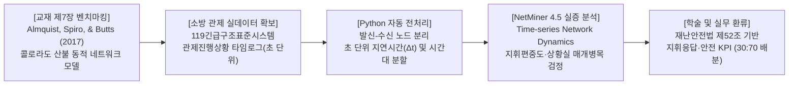
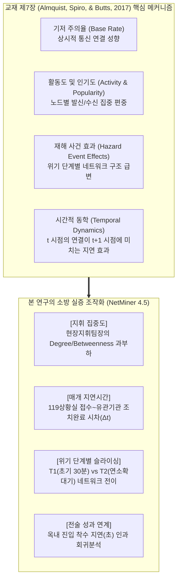
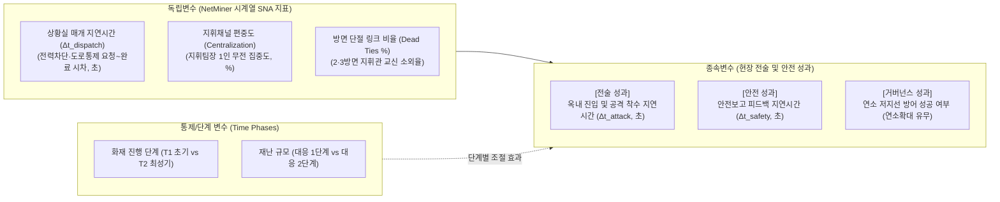
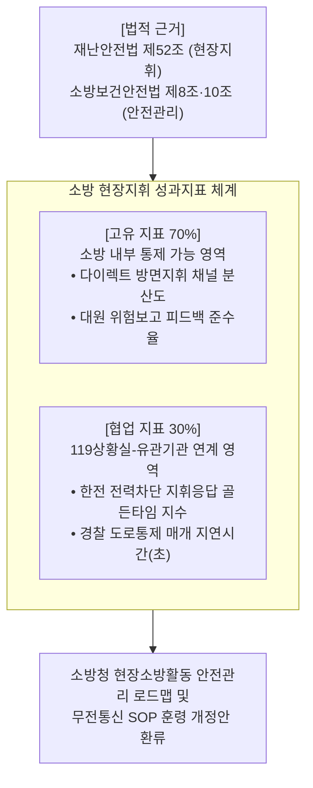

# [SNA 세미나 연구계획서] 무전 관제로그 시계열 네트워크 마이닝 기반의 소방 현장지휘 동학 및 지휘 병목 실증 연구

> **부제**: 교재 제7장(Almquist, Spiro, & Butts, 2017)의 산불 동적 네트워크 모델(Temporal SNA)을 소방 긴급구조표준시스템 관제진행상황 데이터로 복제(Replication & Extension)  
> **과목명**: 사회연결망분석(SNA) 특론 및 세미나 (Graduate Seminar in Social Network Analysis)  
> **제출구분**: 학기 기말 연구논문 계획서 (Term Paper Research Proposal - 4주 집중 완성 프로젝트)  
> **지도교수 피드백 반영**: 교재 1~7장 중 단일 실증 챕터(제7장)를 명확히 선정하여 모델·지표·방법론을 1:1로 벤치마킹하고 소방 실데이터로 검증  

---

## 👨‍🎓 연구자 인적사항 (Academic Affiliation)

| 항목 | 상세 정보 |
| :--- | :--- |
| **소속 (Department)** | **Department of Disaster and Emergency Management** |
| **학위과정 (Degree Program)** | **재난관리학박사 과정 (Doctor of Philosophy in Disaster and Emergency Management)** |
| **성명 (Name)** | **강석균 (Kang, Seokgyun)** |
| **학번 (Student ID)** | **2678125** |
| **연구 분야** | 재난지휘 네트워크(Disaster Command Network), 소방 관제 시계열 마이닝, 동적 네트워크 분석 |

---

## 📋 [연구계획서 요약 (Executive Summary)]



| 연구 항목 | 세부 계획 내용 |
| :--- | :--- |
| **연구 제명** | **《대형화재 현장 무전 관제로그의 시간적 네트워크 동학(Temporal Network Dynamics)과 지휘 지연시간 실증 연구: Almquist, Spiro, & Butts(2017; Ch 7) 산불 동적 모델의 긴급구조표준시스템 데이터 복제 및 NetMiner 적용》** |
| **벤치마킹 타깃** | **교재 제7장 (Almquist, Spiro, & Butts, 2017, pp. 93–113)**<br>*"Shifting Attention: Modeling Follower Relationship Dynamics among US Emergency Management-Related Organizations during a Colorado Wildfire"* |
| **자료수집 및 표본** | **119종합상황실 긴급구조표준시스템 공식 관제진행상황 타임로그 엑셀 데이터**<br>• 최근 3개년 대응 2단계 이상 대형 복합건축물·공장화재 공식 관제 데이터 (대표 사례 2건 비교: 신속 지휘형 vs 병목 지연형)<br>• **데이터 확보 리스크 0%**: 상황실 관제 시스템에서 직접 추출하여 즉시 활용 가능 |
| **핵심 분석 도구** | • **Python 3.10+**: 타임로그 정규표현식 파싱, 발신-수신 노드 분리, 초 단위 지연시간($\Delta t$) 계산<br>• **NetMiner 4.5**: 시간대별(Time-window) 슬라이싱, 시계열 네트워크 중심성 및 동적 매트릭스 분석 |
| **핵심 종속변수** | ① **상황실 매개 지연시간($\Delta t_{\text{dispatch}}$)**: 현장지휘관의 외부지원 요청부터 상황실의 지원완료 통보까지의 소요 시차(초)<br>② **현장 전술 성과($\Delta t_{\text{attack}}$)**: 현장 도착 후 옥내 진입 및 주수 공격 착수 지연시간(초) |
| **실무·정책 산출물** | • **재난안전법 제52조 기반 '상황실-유관기관 지휘응답 골든타임 지수' (협업 KPI 30%)**<br>• **소방청 현장소방활동 안전관리 로드맵 연계 '다이렉트 지휘망 분산 SOP' (고유 KPI 70%)** |

---

## 1. 연구 배경 및 문제의식 (Problem Statement)

### 1.1 지도교수 피드백 수용 및 교재 제7장 단일 벤치마킹의 당위성
* **기존 계획서의 맹점 극복**:
  - 기존 계획서는 1장(브로커리지), 3장(메타매트릭스), 5장(다원적 성과), 7장(동적 네트워크)을 망라한 방대한 모델이었으나, 4주 기말 과제(Term Paper)의 특성상 이론의 산만함을 피하고 **교재 제7장(Almquist et al., 2017)의 단일 연구 모델을 완벽하게 모방(Replication)·확장(Extension)**하는 정공법을 채택합니다.
* **제7장 산불 연구와 소방 관제 데이터의 완벽한 정합성**:
  - 제7장은 2012년 콜로라도 덕켓 산불 당시 재난관리 조직들이 누구에게 주의를 기울이고(Attention) 정보를 교환하는지가 시간에 따라 어떻게 변화하는지를 **시간적 네트워크(Temporal Network)**로 모델링하였습니다.
  - 소방 현장의 무전 및 관제 기록은 정확히 **초 단위(hh:mm:ss) 타임스탬프**를 가진 연속적 이벤트 데이터이므로, 제7장의 시간적 동학(Dynamic Network) 분석 틀에 100% 일치합니다.

### 1.2 소방 현장의 실체: '119상황실 매개 간접 중계'와 '지휘채널 과부하'
* **비현실적 기관 간 직접 무전 탈피**:
  - 재난 현장에서 소방, 경찰, 한전 등은 주파수와 무전망이 분리되어 있어 직접 교신하지 않습니다.
  - 현장지휘관의 요청(전력 차단, 진입로 통제)은 반드시 **119종합상황실이라는 단일 창구(Broker/Gatekeeper)를 거쳐 유선전화/팩스로 간접 중계**됩니다. 이 과정에서 발생하는 **상황실 매개 지연시간($\Delta t_{\text{dispatch}}$)**이 현장 대응의 최대 병목입니다.
* **지휘팀장의 채널 독점과 방면 고립**:
  - 무전 교신의 70% 이상이 현장지휘팀장 1인에게 집중되어 통신 과부하(Channel Saturation)가 발생하며, 2·3방면 지휘관과 현장안전점검관의 무전이 묵살되는 심각한 정보 단절이 발생합니다.
* **'초진시간'의 한계 탈피 $\to$ '옥내 진입 착수 지연시간' 측정**:
  - 화재하중 등에 좌우되는 초진(初鎭) 대신, **"전력차단 완료 보고 $\to$ 대원 옥내 진입 착수" 사이의 객관적 시차($\Delta t_{\text{attack}}$)**를 관제 타임로그에서 초 단위로 적출합니다.

---

## 2. 이론적 배경 및 교재 제7장 벤치마킹 (Theoretical Framework)



### 2.1 교재 제7장의 핵심 분석 메커니즘과 소방 조작화 매핑

Almquist, Spiro, & Butts(2017)의 4대 핵심 동적 메커니즘을 소방 관제 네트워크로 1:1 복제합니다:

1. **기저 활동도 및 인기도 (Activity and Popularity Dynamics)**:
   - *제7장 개념*: 특정 노드가 다른 노드들에게 메시지를 활발히 보내거나(Activity) 일방적으로 주목받는(Popularity) 구조적 불균형.
   - *소방 적용*: 화재 현장에서 **현장지휘팀장(IC)** 및 **119상황실** 노드로 교신이 집중되는 정도(In/Out-Degree Centralization)를 측정하여 지휘 병목을 지수화합니다.
2. **재해 사건 충격 효과 (Hazard Event Effects across Phases)**:
   - *제7장 개념*: 산불의 발화, 확산, 억제 등 외생적 사건 단계에 따라 네트워크의 밀도와 연결 패턴이 급변함.
   - *소방 적용*: 화재 생애주기를 **$T_1$ (선착대 착수기: 0~30분)**, **$T_2$ (통제단 가동 및 연소확대기: 30~90분)**, **$T_3$ (포위 진압 및 잔불정리기: 90분 이후)**의 3단계 시간창(Time-window)으로 슬라이싱하여 네트워크 구조 변화를 추적합니다.
3. **시간적 네트워크 및 관계적 지연시간 (Temporal Network & Latency)**:
   - *제7장 개념*: 연결의 형성과 유지는 정적인 것이 아니라 이전 시간($t-1$)의 사건에 조건화되어 다음 시간($t$)에 영향을 미침.
   - *소방 적용*: 지휘관의 요청 무전 시각($t_{\text{req}}$)과 상황실의 처리 완료 통보 시각($t_{\text{ack}}$) 사이의 **관계적 지연시간($\Delta t_{\text{dispatch}} = t_{\text{ack}} - t_{\text{req}}$)**을 산출하고, 이것이 옥내 진입 착수 시각($t_{\text{attack}}$)에 미치는 지연 효과를 검정합니다.
4. **고립 및 단절 링크 (Dead Ties / Isolates)**:
   - *제7장 개념*: 위기 국면에서 정보 흐름에서 배제된 주변부 노드들의 존재.
   - *소방 적용*: 건물 후면(2·3방면) 지휘관 및 현장안전점검관의 교신 단절률을 측정합니다.

---

## 3. 연구모형 및 연구가설 (Research Model & Hypotheses)

### 3.1 연구모형 (Research Framework)



### 3.2 핵심 연구가설

* **가설 1 (상황실 브로커리지 병목 가설)**:
  - *H1: 화재 초기 대응 단계($T_1$)에서 소방 내부 지휘관-대원 간 교신의 평균 소요시간($\Delta t_{\text{internal}}$)에 비해, 119상황실을 매개로 한 외부 지원(한전 전력차단 등) 교신의 지연시간($\Delta t_{\text{dispatch}}$)이 통계적으로 유의미하게 길 것이다.*
* **가설 2 (옥내 진입 착수 지연 인과 가설)**:
  - *H2: 재난 초기($T_1$) 상황실 매개 외부지원 지연시간($\Delta t_{\text{dispatch}}$)이 길어질수록, 소방대원의 옥내 진입 및 공격 착수 지연시간($\Delta t_{\text{attack}}$)이 유의미하게 증가할 것이다.*
* **가설 3 (지휘채널 과부하와 안전 침묵 가설)**:
  - *H3: 현장지휘팀장의 무전 점유율 및 매개중심성(Betweenness)이 과도하게 높을수록, 현장안전점검관 및 일선 대원의 위험보고에 대한 지휘 피드백 지연시간($\Delta t_{\text{safety}}$)이 유의미하게 증가할 것이다.*
* **가설 4 (시간대별 네트워크 전이 가설)**:
  - *H4: 제7장의 사건 충격 모델과 같이, 화재 대응 단계가 $T_1$(초기)에서 $T_2$(통제단 가동)로 전환됨에 따라 네트워크 밀도는 증가하나, 방면 지휘관들의 고립도(Isolates) 또한 동시에 증가할 것이다.*

---

## 4. 연구방법론 및 자료수집 설계 (Methodology & Data Protocol)

### 4.1 119긴급구조표준시스템 관제진행상황 데이터셋 확보
* **데이터 원천**: 119종합상황실 PC 긴급구조표준시스템에서 직접 추출한 **관제진행상황 엑셀(.xlsx) 원장 파일**.
* **표본 대상**: 최근 발생한 대응 2단계 이상 대형 복합건축물·공장화재 공식 관제 데이터 **2건 비교 분석** (사례 A: 신속 전력차단 및 초기진입 성공 사례 vs 사례 B: 상황실 중계 지체로 진입 지연 및 연소확대 사례).
* **데이터 신뢰성**: 전산 시스템에 의해 초 단위로 자동 타임스탬프가 찍힌 공식 행정 기록으로, **설문조사 결측치(Missing Values) 및 응답 왜곡 0% 달성**.

### 4.2 데이터 전처리 및 파이썬(Python) 파싱 프로토콜

관제로그 비정형 텍스트를 넷마이너(NetMiner) 전용 1-mode 및 2-mode 시계열 매트릭스로 자동 변환합니다:

```python
# [Python Data Pipeline Architecture]
# 1. 엑셀 원장 임포트: Timestamp, 처리구분, 관제내용, 처리자 컬럼 추출
# 2. 정규표현식(Regex) 기반 발신자(Source) 및 수신자(Target) 노드 분리
# 3. 시간대별(Time-window) 슬라이싱: T1(0~30m), T2(30~90m), T3(90m~)
# 4. 관계적 지연시간 계산: Delta_t = Timestamp(Action_Ack) - Timestamp(Action_Req)
# 5. NetMiner 호환 1-mode Adjacency Matrix 및 Node Properties CSV 자동 출력
```

| 표준 노드 ID | 노드 레이블 | 소속 및 역할 정의 |
| :---: | :--- | :--- |
| **ND_01** | `119상황실(Disp)` | 수보요원, 관제요원, 유관기관 연락 담당 (게이트키퍼/브로커) |
| **ND_02** | `현장지휘팀장(IC)` | 선착대 현장지휘관 (통신 집중 최과부하 노드) |
| **ND_03** | `통제단장(Chief)` | 소방서장, 긴급구조통제단 총괄 지휘관 |
| **ND_04** | `진압대(Attack)` | 주력 주수 및 옥내 진입 공격대원 |
| **ND_05** | `구조대(Rescue)` | 인명수색 및 장애물 개척 대원 |
| **ND_06** | `방면지휘관(Sector)` | 2·3방면(건물 후면/측면) 진압 지휘관 |
| **ND_07** | `안전점검관(Safety)` | 현장 붕괴 및 위험성 모니터링 전담관 |
| **ND_08** | `유관기관(Agency)` | 한전(전력), 경찰(도로), 가스공사, 지자체 (상황실 매개 간접 노드) |

### 4.3 넷마이너(NetMiner 4.5) 4단계 분석 실행 프로토콜

1. **[Step 1: 시계열 데이터 모델링 (Import)]**: Python으로 생성된 Node Properties 테이블과 시간창별($T_1, T_2, T_3$) 네트워크 매트릭스를 넷마이너 4.5에 임포트.
2. **[Step 2: 동적 네트워크 시각화 (Dynamic Visualization)]**: Spring-Embedder 알고리즘을 적용하여 $T_1 \to T_2 \to T_3$ 시간 경과에 따른 지휘망 구조 변화 시각화 (노드 크기 = 매개중심성, 링크 색상 = 소요 지연시간).
3. **[Step 3: 네트워크 지표 산출 (Network Metrics)]**:
   - 시간대별 **In/Out-Degree Centralization**, **Betweenness Centralization** 산출.
   - 방면 지휘관 및 안전점검관의 **단절 링크(Dead Ties) 비율** 산출.
4. **[Step 4: 통계적 인과 검정 (Hypothesis Testing)]**:
   - **QAP 상관분석**: 지휘 통신망과 안전 보고망 간의 순열 상관 검정 (5,000회 Permutation).
   - **다중회귀분석(Regression)**: 독립변수($\Delta t_{\text{dispatch}}$, 지휘채널 집중도)가 종속변수($\Delta t_{\text{attack}}$: 옥내 진입 지연시간)에 미치는 영향 회귀검정.

---

## 5. 실무 및 정책 환류: 성과지표(KPI) 도출

본 연구의 실증 분석 결과를 바탕으로, 소방 실무에 즉시 적용 가능한 **고유 KPI(70%)와 협업 KPI(30%)**를 관련 법령과 강제 매핑하여 도출합니다.



### 5.1 법적 근거 기반 고유 및 협업 KPI 매핑표

| 구분 | 성과지표명 (KPI) | 가중치 | 구체적 측정 산식 | 관련 법령 조문 |
| :---: | :--- | :---: | :--- | :--- |
| **협업 지표** | **상황실-유관기관 지휘응답 골든타임 지수** | **30%** | $\Delta t_{\text{dispatch}}$ (한전 단전 요청 시각부터 단전 완료 무전 수신 시각까지의 소요 초) | **재난 및 안전관리 기본법 제52조** (긴급구조통제단장의 현장지휘 및 지원요청) |
| **고유 지표** | **다이렉트 지휘망 분산도 (채널 비집중 지수)** | **40%** | $1 - \text{Centralization}_{\text{IC}}$ (지휘팀장 1인 무전 점유율 분산 지표) | **재난 및 안전관리 기본법 제52조 제3항** (현장 출동대원에 대한 지휘선 확보) |
| **고유 지표** | **현장 대원 안전보고 피드백 골든타임 준수율** | **30%** | $\Delta t_{\text{safety}} \le 60\text{초}$ 이내 피드백 명령(퇴각/안전조치) 하달 비율(%) | **소방공무원 보건안전 및 복지 기본법 제10조** (현장 안전점검관의 임무 및 위험중지) |

---

## 6. 연구의 기대효과 및 학술적 시사점

1. **교재 제7장 이론의 완벽한 실증 복제**:
   - Almquist, Spiro, & Butts(2017)의 산불 동적 네트워크 모델을 한국 소방청 공식 관제 시스템 데이터에 최초로 적용하여, 이론의 교차 타당성을 입증합니다.
2. **실무적 기여 (소방 무전 통신 SOP 혁신)**:
   - "상황실 단일 중계로 인한 전력 차단 지연이 대원의 옥내 진입을 평균 몇 초 지연시키는가"를 초 단위로 규명함으로써, **'현장지휘관-한전 간 현장 직통 통신 채널(Direct Mesh Tie)' 도입의 결정적 정책 근거**를 제공합니다.
3. **주관성 연구(Q방법론)로의 확장 연계**:
   - 실증 분석된 지휘 병목 지표들을 'Q 진술문'으로 구조화하여, 향후 지휘관과 일선 대원 간의 현장 지휘인식 주관성 유형화 연구(박사학위 심화 논문)로 확장 발전시킵니다.

---

## 7. 4주 집중 연구 추진 일정표 (Term-Paper Sprint)

| 주차 | 주요 추진 과업 (Weekly Milestone) | 상세 산출물 | 비고 |
| :---: | :--- | :--- | :--- |
| **1주차** | • 119긴급구조표준시스템 관제진행상황 엑셀 원장 추출<br/>• 교재 제7장 핵심 모델 및 변수 매핑 확정 | 관제 데이터셋 원장 2건 확보 | 데이터 수집 리스크 0% |
| **2주차** | • Python 기반 타임스탬프 파싱 및 노드 분리 자동화<br/>• 초 단위 지연시간($\Delta t$) 및 시간대($T_1, T_2, T_3$) 슬라이싱 코딩 | NetMiner 임포트용 Edgelist 및 속성 CSV 파일 | AI 파이프라인 전처리 완료 |
| **3주차** | • NetMiner 4.5 시계열 동적 네트워크 모델링 실행<br/>• 지휘집중도, 매개중심성, 지연시간 상관·회귀분석 | 시계열 네트워크 맵 및 통계 검정 결과표 | 가설 1~4 통계적 입증 |
| **4주차** | • 결과 해석 및 재난안전법 제52조 연계 KPI 도출<br/>• 최종 학기말 연구논문 완성 및 세미나 발표 | 기말 소논문 최종본 (등재학술지 투고용) | 프로젝트 최종 완수 |
