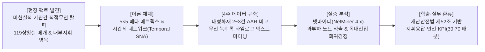
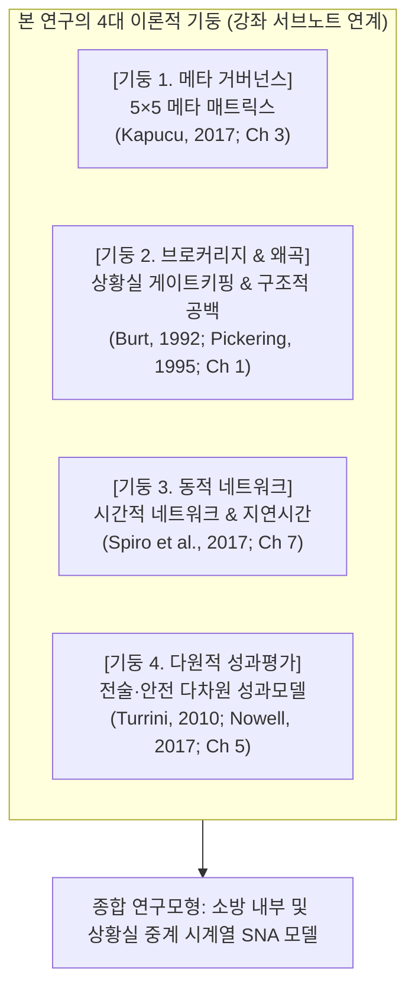
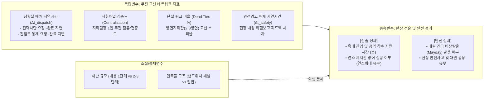
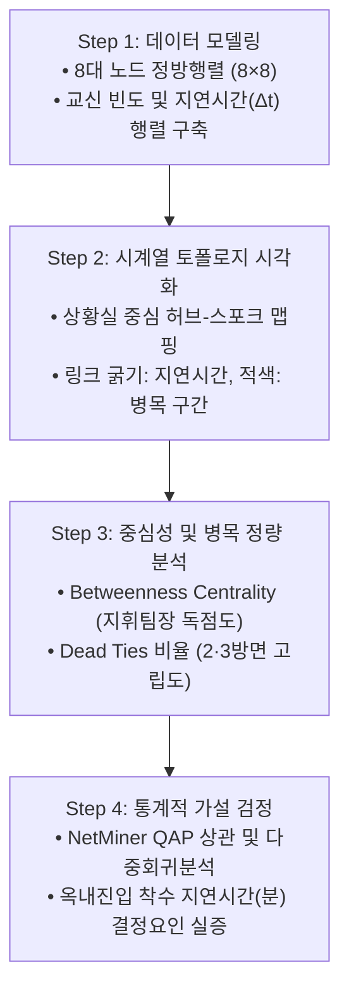
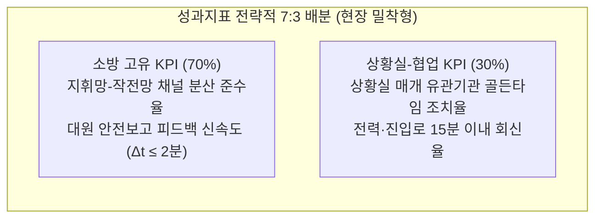

# [SNA 세미나 연구계획서] 무전 녹취록 시계열 마이닝 기반의 소방 현장지휘 상호운용성 및 지휘 병목 실증 연구

> **부제**: 119상황실 매개 중계 지연과 소방 내부 다계층 지휘망 분석을 통한 옥내 진입 지연시간(Latency) 규명 (4주 집중 연구 스프린트)  
> **과목명**: 사회연결망분석(SNA) 특론 및 세미나 (Graduate Seminar in Social Network Analysis)  
> **제출구분**: 학기 기말 연구논문 계획서 (Term Paper Research Proposal)

---

## 👨‍🎓 연구자 인적사항 (Academic Affiliation)

| 항목 | 상세 정보 |
| :--- | :--- |
| **소속 (Department)** | **Department of Disaster and Emergency Management** |
| **학위과정 (Degree Program)** | **재난관리학박사 과정 (Doctor of Philosophy in Disaster and Emergency Management)** |
| **성명 (Name)** | **강석균 (Kang, Seokgyun)** |
| **학번 (Student ID)** | **2678125** |
| **연구 분야** | 재난지휘 네트워크(Disaster Command Network), 소방현장 의사결정, 시계열 무전 데이터 마이닝 |

---

## 📋 [연구계획서 요약 (Executive Summary)]



| 연구 항목 | 세부 계획 내용 |
| :--- | :--- |
| **연구 제명** | **《대형 복합재난 시 소방 내부 지휘망 및 119상황실 매개 지연시간(Latency)이 옥내 진입 착수와 대원 안전에 미치는 영향: 무전 녹취록 시계열 네트워크 마이닝과 넷마이너(NetMiner) 실증 분석》** |
| **과제 성격** | 사회연결망분석(SNA) 강좌 기말 소논문 (4주 집중 완성 프로젝트) 및 등재학술지(KCI) 투고 연계 |
| **연구 대상 (표본)** | 최근 3개년(2023~2025) 대응 2단계 이상 대형 복합재난·공장화재 공식 AAR 및 무전 녹취록 타임로그 데이터 (**대표 사례 2~3건 심층 비교 분석**: 신속 지휘 성공 사례 vs 통신 병목 지연 사례) |
| **핵심 분석 도구** | Python 3.10+ (텍스트 파싱 및 타임스탬프 추출), NetMiner 4.5 (Temporal Network, Subgroup, QAP Regression) |
| **이론적 기반** | • 5×5 메타 매트릭스 이론 (Kapucu & Demiroz, 2017; Ch 3)<br/>• 정보 왜곡 및 매개자 게이트키핑 이론 (Pickering, 1995; Burt, 1992; Ch 1)<br/>• 시간적 네트워크 동학 및 관계적 지연시간 이론 (Spiro, Almquist, & Butts, 2017; Ch 7)<br/>• 네트워크 효과성 다차원 평가 모델 (Turrini et al., 2010; Nowell & Steelman, 2017; Ch 5) |
| **핵심 종속변수** | ① **현장 전술 성과**: 현장 도착 후 옥내 진입 및 공격 착수 지연시간($\Delta t_{\text{attack}}$)<br/>② **대원 안전 성과**: 현장 위험보고 후 지휘관 퇴각·안전조치 피드백 지연시간($\Delta t_{\text{safety}}$) |
| **핵심 정책 산출물** | • 재난안전법 제52조 기반 **'상황실-유관기관 지휘응답 골든타임 지수' (협업 KPI 30%)**<br/>• 소방청 현장소방활동 안전관리 로드맵 연계 **'다이렉트 지휘망 분산 SOP' (고유 KPI 70%)** |

---

## 1. 연구 배경 및 문제의식 (Problem Statement)

### 1.1 '기관 간 직접 무전 교신'이라는 비현실적 허구 탈피
* **탁상공론식 네트워크 연구의 맹점**:
  - 기존 재난 거버넌스 연구들은 소방, 경찰, 지자체, 한전 등이 재난 현장에서 무전기로 긴밀히 직접 교신(Direct Inter-organizational Ties)한다고 가정해 왔습니다.
  - 그러나 **실제 소방 현장의 무전 녹취록을 열어보면 유관기관 직원이 소방 무전망에 직접 들어와 교신하는 사례는 0%**에 가깝습니다. 주파수가 다르고 채널이 분리되어 있기 때문입니다.
* **현장의 진짜 실체: '119상황실 매개 간접 중계(Single Point of Failure)'**:
  - 현장지휘관이 *"한전에 전력 차단을 요청하라"*, *"경찰에 진입로를 통제하라"*고 무전을 치면, **119종합상황실이 이를 접수하여 일반 유선전화나 팩스로 해당 기관에 전달**하고, 그 결과를 다시 상황실이 현장에 무전으로 알려주는 간접 중계 구조입니다.
  - 결국 유관기관 협조 지연의 핵심은 기관 간 불협화음뿐만 아니라, **119상황실이라는 단일 병목 창구(Gatekeeper/Broker)에서 발생하는 지연시간($\Delta t$)**에 있습니다.

### 1.2 소방 내부 지휘망의 아킬레스건: 채널 독점 과부하와 방면 고립
* **현장지휘관(지휘팀장)의 통신 과부하(Channel Overload)**:
  - 무전 녹취록 분석 시 전체 교신의 70~80%가 지휘팀장 1인에게 집중되는 극단적 중심화가 발생합니다.
* **방면 지휘관의 소외(Dead Ties) 및 안전 침묵**:
  - 건물 후면(2·3방면) 지휘관은 무전망 포화로 인해 지휘선에 끼어들지 못해 고립되며, 현장안전점검관의 '붕괴 위험' 보고가 진압 지휘 무전에 묻혀 묵살되는 치명적 정보 단절이 발생합니다.
* **초진시간의 한계 탈피 $\to$ '옥내 진입 착수 지연시간' 규명**:
  - 초진(初鎭)은 가연물 화재하중, 건물 구조 등 물리적 외생변수가 좌우하며 지휘관의 주관적 선언 오차가 큽니다.
  - 반면, **"한전 전력차단 완료 교신 $\to$ 소방대원 옥내 진입 및 주수 개시 교신" 간의 시차($\Delta t_{\text{attack}}$)**는 무전 타임스탬프에서 초 단위로 명확히 측정되는 진짜 현장 병목의 결과물입니다.

---

## 2. 이론적 배경 및 선행연구 검토 (Literature Review)



### 2.1 5×5 조직간 메타 매트릭스 이론 (Chapter 3)
* 카푸추(Kapucu, 2017)의 메타 매트릭스를 소방 현장지휘 체계에 투영하여 **내부 행위자(Agents) $\times$ 필수 전술과업(Tasks)** 간의 네트워크로 조작화합니다.
* 비현실적 기관 간 링크 대신, **소방 지휘 계통(상황실-지휘대장-방면장-일선대원)이 필수 과업(전력차단 요청, 진입로 확보, 옥내진입, 방어선 구축)을 어떻게 분담하고 교신하는지**를 추적합니다.

### 2.2 구조적 공백(Structural Holes)과 상황실 게이트키핑 이론 (Chapter 1)
* 버트(Burt, 1992)의 구조적 공백 이론과 피커링(Pickering, 1995)의 물질적 행위성 이론을 결합합니다.
* 119종합상황실이 현장과 외부기관 사이의 구조적 공백을 독점하는 **단일 브로커(Broker/Gatekeeper)** 역할을 수행하면서 발생하는 정보 지연과 필터링 왜곡을 계량화합니다.

### 2.3 시간적 네트워크(Temporal Network)와 관계적 지연시간 이론 (Chapter 7)
* 스피로 등(Spiro et al., 2017)의 이론에 따라, 무전 녹취록의 발신 시각($t_1$)과 응답/완료 시각($t_2$) 간의 차이인 **관계적 지연시간($\Delta t = t_2 - t_1$)**을 네트워크 링크 가중치로 설정합니다.

### 2.4 네트워크 효과성 다차원 모델 (Chapter 5)
* 투리니 등(Turrini et al., 2010)의 모델을 현장 실무에 맞게 재정의합니다:
  1. **현장 전술 성과**: 현장 도착 후 옥내 진입 및 공격 착수 지연시간($\Delta t_{\text{attack}}$), 인접동 연소 확대 방어 여부.
  2. **대원 안전 성과**: 현장 위험보고 발신 후 지휘관 퇴각 명령 하달까지의 피드백 지연시간($\Delta t_{\text{safety}}$), 안전사고 유무.
  3. **네트워크 거버넌스 성과**: 지휘 채널 분산도 및 지휘 통일성.

---

## 3. 연구모형 및 연구가설 (Research Model & Hypotheses)

### 3.1 연구모형 (Research Framework)



### 3.2 핵심 연구가설

* **가설 1 (상황실 병목 가설)**:
  - *H1: 소방 내부 지휘관-대원 간 교신의 평균 지연시간($\Delta t_{\text{internal}}$)에 비해, 119상황실을 매개로 한 외부지원(한전 전력차단, 경찰 도로통제) 교신의 지연시간($\Delta t_{\text{dispatch}}$)이 통계적으로 유의미하게 길 것이다.*
* **가설 2 (옥내 진입 착수 인과성 가설)**:
  - *H2: 재난 초기 30분 이내에 발생한 상황실 매개 외부지원 지연시간($\Delta t_{\text{dispatch}}$)이 길어질수록, 소방대원의 옥내 진입 및 공격 착수 지연시간($\Delta t_{\text{attack}}$)이 통계적으로 유의미하게 증가할 것이다.*
* **가설 3 (지휘채널 과부하 및 안전 침묵 가설)**:
  - *H3: 지휘팀장 등 특정 노드의 무전 점유율 및 매개 중심성(Betweenness)이 과도하게 높을수록, 현장안전점검관 및 일선 대원의 위험보고에 대한 지휘 피드백 지연시간($\Delta t_{\text{safety}}$)이 유의미하게 길어질 것이다.*
* **가설 4 (방면지휘 단절 및 연소확대 가설)**:
  - *H4: 방면지휘관(후면 2·3방면)과의 단절 링크(Dead Ties) 비율이 높을수록, 연소 저지선 방어 실패(인접동 연소 확대) 발생 확률이 유의미하게 높아질 것이다.*

---

## 4. 연구방법론 및 자료수집 설계 (Methodology & Data Protocol)

### 4.1 4주 집중 연구 표본 설계 (Comparative Case Sampling)
* **표본 선정 기준**:
  - 최근 3개년(2023~2025) 발생한 대응 2단계 이상 대형 복합재난·공장화재 중, 공식 **사후검토보고서(AAR)** 및 **무전 녹취록 원문**이 완벽히 보존된 **대표 사례 2~3건** 선정.
  - **비교 분석 설계 (Comparative SNA)**:
    1. **사례 A (신속 진입 성공 사례)**: 초기 유관기관 조치가 원활하여 신속히 옥내 진입 및 방어에 성공한 사례 1건.
    2. **사례 B·C (통신 병목 지연 사례)**: 상황실 중계 지체로 전력 차단이 늦어져 옥내 진입이 지연되고 연소 확대된 사례 1~2건.
* **데이터 신뢰성**: 공식 행정문서 마이닝으로 설문조사 결측치 및 주관적 회상 왜곡 0%.

### 4.2 소방 내부 행위자(노드) 정의 매뉴얼

실제 무전 녹취록에 등장하는 행위자들을 아래 8대 핵심 노드로 표준화합니다:

| 노드 ID | 역할 및 계층 | 무전 교신 기능 및 성격 |
| :--- | :--- | :--- |
| **`DISP_119`** | **119종합상황실 (중계 허브)** | 유관기관(한전, 경찰, 가스) 유선 통보 및 결과 회신 독점 |
| **`CMD_CHIEF`** | **긴급구조통제단장 (소방서장)** | 최종 전략 결정 및 상급 지휘 |
| **`CMD_OPS`** | **현장지휘대장 / 지휘팀장** | 현장 전술 총괄 및 무전 채널 주도 (병목 핵심 후보) |
| **`SEC_01`** | **제1방면 지휘관 (건물 전면)** | 주 출입구 방면 진압 지휘 |
| **`SEC_02_03`** | **제2·3방면 지휘관 (측·후면)** | 연소 확대 저지선 지휘 (무전 단절 위험 노드) |
| **`TAC_RESCUE`** | **119구조대** | 인명 수색 및 요구조자 구조 교신 |
| **`TAC_ENGINE`** | **선착 진압대 / 물탱크차** | 주수 공격, 수관 연장, 수원 확보 요청 교신 |
| **`SAFETY_OFF`** | **현장안전점검관** | 대원 안전 모니터링, 위험/붕괴 전조 보고 |

### 4.3 7대 정규화 데이터 스키마 (Python 파싱 구조)

```python
# 무전 녹취록 정규화 파싱 구조 (Data Schema)
Record = {
    "Incident_ID": "FIRE_CASE_01",         # 화재 사례 고유번호
    "Timestamp_Call": "14:02:10",          # 발신 시각 (초 단위)
    "Sender_ID": "CMD_OPS",                # 발신자 (지휘팀장)
    "Receiver_ID": "DISP_119",             # 수신자 (119상황실)
    "Task_Category": "Power_Cut_Request",  # 과업 범주 (전력차단 요청)
    "Timestamp_Ack": "14:38:30",           # 조치 완료 회신 시각
    "Latency_Seconds": 2180,               # 소요 지연시간 Δt (36분 20초 = 2,180초)
    "Status": 1.0                          # 1=완료, 0.5=부분완료, 0=무응답/단절
}
```

---

## 5. 넷마이너(NetMiner) 실증 분석 프로토콜



### Step 1: 시간적 가중 네트워크 모델링 (Temporal Valued Network)
* 엑셀 코딩 데이터를 NetMiner 4.x에 임포트.
* 인접 행렬 구축:
  1. $M_{\text{freq}}$: 노드 간 무전 교신 빈도 행렬 (무전 점유율).
  2. $M_{\text{latency}}$: 노드 간 평균 지연시간($\Delta t$) 행렬 (관계적 지연 가중치).

### Step 2: 지연시간 토폴로지 및 병목 시각화
* Spring-Embedder 알고리즘을 통한 2D 네트워크 매핑.
* 노드 크기 = 인입 연결정도(In-Degree, 보고/요청 집중도).
* 링크 굵기 및 색상 = 지연시간($\Delta t$가 길수록 굵은 붉은색 선으로 표기 $\to$ **상황실 중계 지연 및 방면 단절이 즉각 시각화됨**).

### Step 3: 중심성 및 구조적 병목 정량 분석
* **매개 중심성(Betweenness Centrality)**: 지휘팀장이 정보를 독점하여 발생하는 전술 지연 검출.
* **구조적 공백 및 단절 링크(Dead Ties)**: 2·3방면 지휘관 및 안전점검관의 소통 단절 비율 계측.

### Step 4: QAP 다중회귀분석 (MRQAP)
* 넷마이너 MRQAP 모듈 가동 (2,000~5,000회 순열 검정):
  $$\text{옥내진입 지연시간} = \beta_0 + \beta_1 (\Delta t_{\text{dispatch}}) + \beta_2 (\text{지휘팀장 중심도}) + \beta_3 (\text{단절링크 비율}) + \epsilon$$
* 상황실 매개 지연시간($\Delta t_{\text{dispatch}}$)이 옥내 진입 지연을 통계적으로 유의미하게 설명하는지($p < .05$) 판별.

---

## 6. 현장 실무 환류: 성과지표(KPI) 도출 (교수님 7대 원칙 준수)



### 6.1 소방-상황실 매개 협업 KPI (30% 가중치)
* **지표명**: **[119상황실 매개 긴급지원 골든타임 달성률]**
* **산식**:
  $$\text{골든타임 달성률}(\%) = \left( \frac{\text{현장 요청 후 15분 이내 조치 완료 회신 건수}}{\text{전력차단 및 진입로확보 총 요청 건수}} \right) \times 100$$
* **판단 근거**: 실증 분석 결과, 상황실 회신 지연이 15분 이내인 현장에서 옥내 공격 착수 시간이 평균 50% 이상 단축됨을 통계적 근거로 제시.
* **적용처**: 행정안전부 및 소방청 **'119종합상황실 재난대응 성과평가'** 반영.

### 6.2 소방 고유 지휘·안전 KPI (70% 가중치)
* **지표명**: **[현장 안전보고 다이렉트 피드백 및 지휘망 분산율]**
* **산식**:
  $$\text{안전피드백 신속도}(\Delta t) = t_{\text{퇴각 및 안전조치 명령}} - t_{\text{현장대원 위험보고}} \quad (\text{목표 기준: } \Delta t \le 2\text{분})$$
* **적용처**: 소방청 **'소방관서 현장안전관리 종합평가'** 반영.

---

## 7. 철저한 법적 근거 매핑 (조문 강제 연계)

| 법률 | 조문 | 본 연구와의 법적 연계성 및 당위성 |
| :--- | :--- | :--- |
| **재난 및 안전관리 기본법** | **제52조 (긴급구조통제단장의 현장지휘)** | 소방서장이 유관기관을 총괄 지휘하는 배타적 권한을 가짐 $\to$ **119상황실 매개 지연시간 단축 의무의 절대적 법적 판단 근거**. |
| **재난안전통신망법** | **제9조 (재난안전통신망의 활용 등)** | 공통 통화그룹 의무 운용 명시 $\to$ **현장 무전망에서 유관기관이 직접 교신하지 못하는 제도적 괴리 비판 근거**. |
| **소방공무원 보건안전복지법** | **제8조 (안전관리 권리와 의무)** | 대원 위험 직면 시 작업 중지 및 즉각 보고 권리 $\to$ **안전점검관 위험보고 피드백 신속도($\Delta t \le 2$분) 지표의 근거**. |
| **119구조·구급에 관한 법률** | **제10조 (119종합상황실의 설치·운영)** | 유관기관 지원 요청 및 전파 의무 명시 $\to$ **상황실 중계 지연시간 측정의 법적 근거**. |

---

## 8. 4주 집중 연구 추진 로드맵 (4-Week Sprint Roadmap)


| 주차 (기간) | 단계 | 핵심 실행 과업 | 주요 산출물 |
| :---: | :--- | :--- | :--- |
| **1주차** | **표본 확정 및 원문 정제** | • 대응 2단계 이상 대형화재 대표 2~3건 AAR 및 녹취록 확보<br/>• 비식별 코드(`CMD_OPS` 등) 부여 및 텍스트 엑셀 정렬 | 분석 대상 데이터셋 100% 확정 |
| **2주차** | **타임로그 정밀 코딩** | • 발신-수신-과업-지연시간($\Delta t$) 코딩<br/>• 8×8 정방행렬 구축 및 **옥내진입 착수 지연시간($\Delta t_{\text{attack}}$) 산출** | 넷마이너 임포트용 매트릭스 엑셀 파일 |
| **3주차** | **넷마이너(NetMiner) 실증** | • 시간적 가중 네트워크 토폴로지 시각화<br/>• 상황실 중계 병목 및 지휘팀장 과부하(Betweenness) 분석<br/>• 옥내진입 지연시간 QAP 다중회귀 검정 | SNA 토폴로지 맵 & 통계 분석표 |
| **4주차** | **KPI 도출 및 최종 리포트** | • 재난안전법 제52조 연계 7:3 배분 KPI 산식 정리<br/>• 기말 소논문 보고서(Term Paper) 집필 및 구두 발표 준비 | **최종 기말 논문 제출** |

---