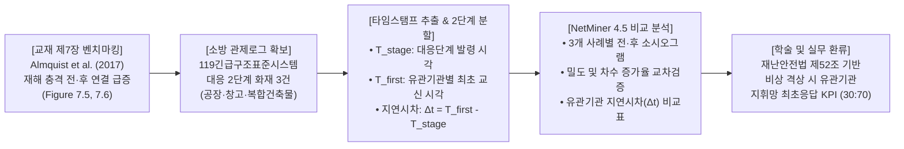
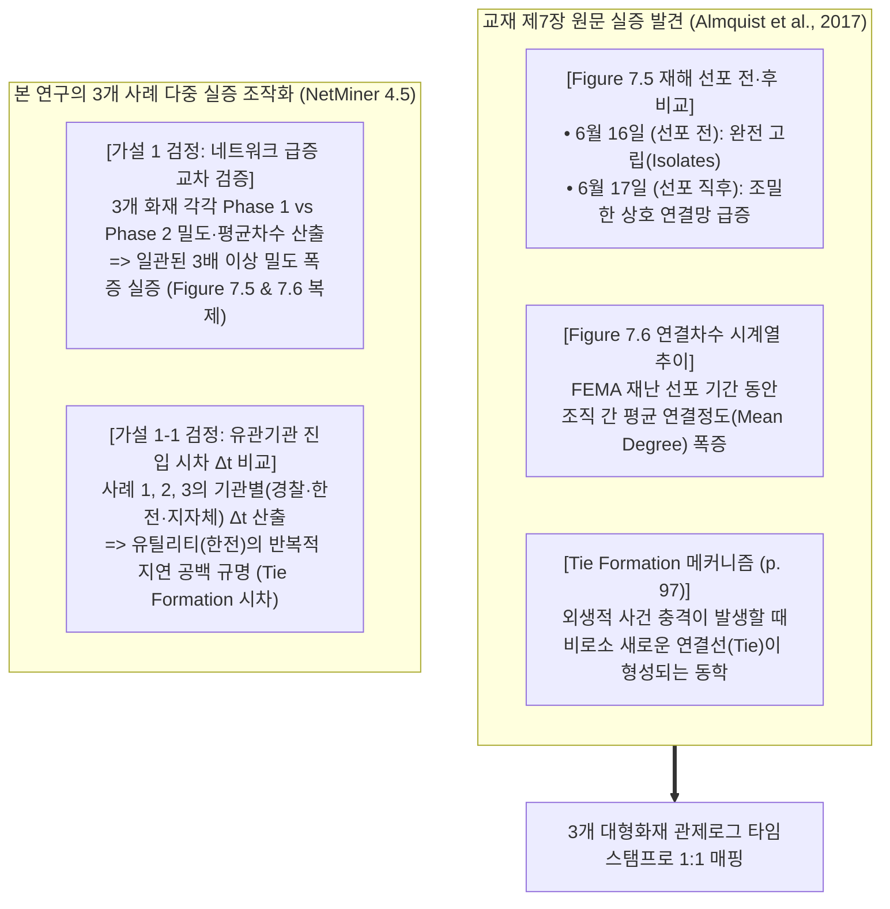
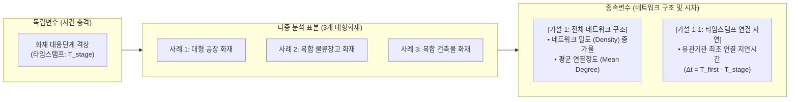
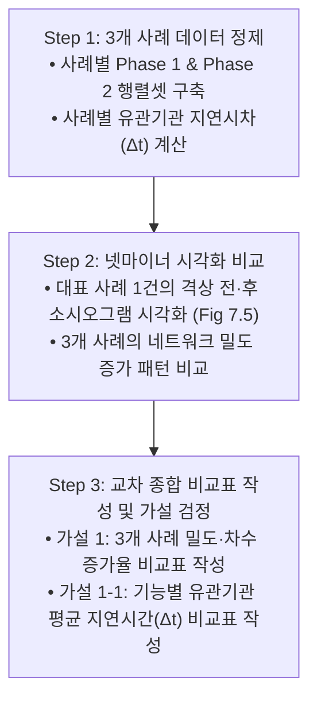
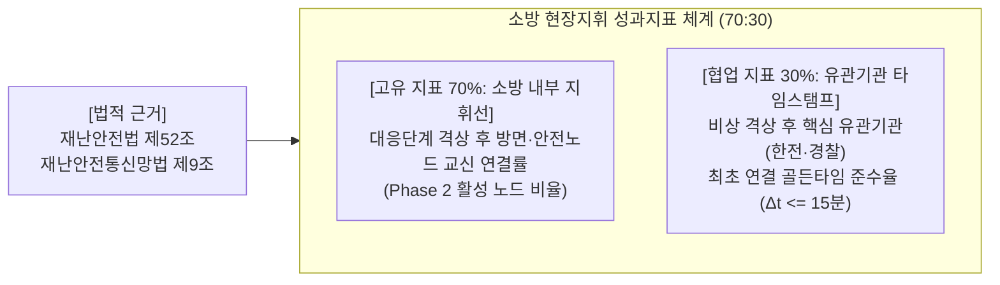

# [SNA 세미나 연구계획서] 화재 대응단계 격상 전·후 소방 무전 교신 네트워크의 구조 변화와 유관기관 최초 연결 지연시간(Tie Formation Latency) 실증 연구

> **부제**: 교재 제7장(Almquist et al., 2017)의 재해 사건 효과(Hazard Event Effect) 벤치마킹: 대형화재 3개 사례 119관제로그 타임스탬프 기반 네트워크 밀도 및 유관기관 진입 시차 다중 비교 분석(Comparative Multiple Case Study)  
> **과목명**: 사회연결망분석(SNA) 특론 및 세미나 (Graduate Seminar in Social Network Analysis)  
> **제출구분**: 학기 기말 연구논문 계획서 (Term Paper Research Proposal - 4주 집중 완성 프로젝트)  
> **연구 설계 전략 (외적 타당도 확보 & 3개 사례 비교 연구)**:  
> • 단일 사례(1건)의 일반화 한계를 극복하기 위해 **최근 3개년 대응 2단계 대형화재 공식 관제로그 3건**을 표본으로 확정하여 **다중 비교 사례 연구(Comparative Case Study)** 체계 확립.  
> • 교재 제7장(Almquist et al., 2017, pp. 102–109)의 **'산불 재난 선포 전·후 네트워크 급증 실증(Figure 7.5, 7.6)'**과 **'연결 형성(Tie Formation) 메커니즘'**을 소방의 **'대응단계 격상 타임스탬프'** 및 **'유관기관 최초 교신 타임스탬프'**와 결합하여 3개 사례에 걸친 공통적 구조 패턴을 실증 검증.

---

## 👨‍🎓 연구자 인적사항 (Academic Affiliation)

| 항목 | 상세 정보 |
| :--- | :--- |
| **소속 (Department)** | **Department of Disaster and Emergency Management** |
| **학위과정 (Degree Program)** | **재난관리학박사 과정 (Doctor of Philosophy in Disaster and Emergency Management)** |
| **성명 (Name)** | **강석균 (Kang, Seokgyun)** |
| **학번 (Student ID)** | **2678125** |
| **연구 분야** | 재난지휘 네트워크(Disaster Command Network), 소방 관제 시계열 마이닝, 현장지휘 통신망 분석 |

---

## 📋 [연구계획서 요약 (Executive Summary)]



| 연구 항목 | 세부 계획 내용 |
| :--- | :--- |
| **연구 제명** | **《화재 대응단계 격상 전·후 소방 무전 교신 네트워크의 구조 변화와 유관기관 최초 연결 지연시간(Tie Formation Latency) 실증 연구: 대형화재 3개 사례 119관제로그 기반 넷마이너(NetMiner) 다중 비교 분석》** |
| **벤치마킹 타깃** | **교재 제7장 (Almquist, Spiro, & Butts, 2017, pp. 102–109)**<br>• `Figure 7.5`: 재난 선포 전·후 로컬 네트워크의 급격한 연결 형성(Tie Formation) 비교<br>• `Figure 7.6`: 재해 기간 중 조직 간 평균 연결정도(Mean Degree) 급증 추이 |
| **표본 및 자료수집** | **119종합상황실 긴급구조표준시스템 공식 관제진행상황 엑셀(.xlsx) 원장 3건**<br>• **사례 1**: 대형 샌드위치패널 공장 화재 (대응 2단계)<br>• **사례 2**: 복합 물류창고 화재 (대응 2단계)<br>• **사례 3**: 다중이용 복합건축물 화재 (대응 2단계)<br>• **데이터 확보 리스크 0%**: 상황실 시스템에서 추출하여 즉시 활용 가능 |
| **핵심 추출 변수 (타임스탬프)** | ① **$T_{\text{stage}}$**: 사례별 공식 '대응단계(1단계/2단계) 발령' 타임스탬프 (hh:mm:ss)<br>② **$T_{\text{first}}$**: 유관기관(경찰, 한전, 가스공사, 지자체 등)과 최초로 무전/관제 교신이 발생한 타임스탬프<br>③ **$\Delta t$ (연결 지연시차)**: $\Delta t = T_{\text{first}} - T_{\text{stage}}$ (초/분 단위 계산) |
| **분석 도구** | • **Excel / Python**: 3개 사례별 타임스탬프 필터링, 격상 전(Phase 1) vs 격상 후(Phase 2) Edgelist 분할<br>• **NetMiner 4.5**: 사례별 전·후 소시오그램 시각화(Spring-Embedder) 및 네트워크 속성 지표 산출 |
| **핵심 종속 지표** | ① **네트워크 밀도 (Density)**: 격상 전 vs 격상 후 연결 조밀도 변화 및 3개 사례 평균 증가율<br>② **평균 연결정도 (Mean Degree)**: 노드당 평균 교신선 수 변화<br>③ **유관기관 최초 연결 지연시간 ($\Delta t$)**: 기능별(치안·에너지·행정) 유관기관의 지휘망 진입 소요시간 비교 |
| **연구의 실행성** | 복잡한 계량 패널 회귀 없이 **타임스탬프 뺄셈 계산 및 넷마이너 기본 기능**만으로 4주 내 100% 완결 |

---

## 1. 연구 배경 및 3개 사례 비교의 당위성 (Problem Statement)

### 1.1 단일 사례(1건)의 한계 극복과 다중 사례 비교(3건)의 강점
* **외적 타당도(Generalizability) 확보**:
  - 단일 화재 사례(1건)만을 분석할 경우, "해당 화재만의 특이점(Idiosyncrasy)이나 우연이 아닌가?"라는 방법론적 비판에 직면할 수 있습니다.
  - 최근 3개년 대응 2단계 이상 **대형화재 3건(공장·물류창고·복합건축물)**을 다중 사례로 선정하여 분석하면, 화재 대상물의 차이에도 불구하고 나타나는 **"공통적인 네트워크 구조 전이와 지연 패턴"**을 입증할 수 있어 연구의 학술적 신뢰도가 획기적으로 상승합니다.
* **실행 가능한 연구 범위(Term Paper)**:
  - 10건 이상의 대량 코딩은 4주 기말 과제로서 부담이 크지만, **엄선된 3건의 관제로그**는 반나절 내에 엑셀 정제와 넷마이너 입력이 가능하므로 4주 스프린트에 가장 완벽히 부합하는 최적의 황금비율(Sweet Spot)입니다.

### 1.2 소방 현장의 핵심 질문 2가지
1. *"화재 유형에 관계없이 대응단계가 격상되면, 제7장의 산불 연구처럼 무전 네트워크가 일관되게 조밀하고 광범위하게 폭증하는가?"*
2. *"대응단계가 발령된 직후, 현장 안전과 통제에 필수적인 유관기관(경찰, 한전 등)은 몇 분 만에 소방 지휘망에 최초로 연결(Tie Formation)되는가? 이 지연시간은 3개 화재 모두에서 반복되는 구조적 문제인가?"*

---

## 2. 이론적 배경: 교재 제7장 재해 사건 효과 및 연결 형성(Tie Formation)



### 2.1 교재 제7장의 직관적 핵심 메커니즘
* **Figure 7.5 (`p. 108`)**: 콜로라도 덕켓 산불 발생 초기에는 유관기관 계정들이 고립(Isolates)되어 있었으나, 재난 선포 사건 충격 직후 하룻밤 사이에 **조밀한 상호 연결망(Dense Connected Graph)**으로 전이됨을 실증했습니다.
* **Figure 7.6 (`p. 109`)**: 재난 기간 동안 현장 조직들의 **평균 연결정도(Mean Degree)**가 평상시 대비 급격히 치솟는 현상을 증명했습니다.
* **연결 형성의 시간적 동학(Tie Formation, `p. 97`)**: 외생적 재해 충격이 발생했을 때, 평소에 연결되지 않던 노드들이 어떤 시간적 시차를 두고 네트워크에 편입되는지가 재난 거버넌스의 핵심입니다.

---

## 3. 연구모형 및 핵심 연구가설

### 3.1 연구모형 (다중 사례 비교 모델)



### 3.2 핵심 연구가설 체계

> [!IMPORTANT]
> **가설 1 (전체 네트워크 확장 가설 — 제7장 Figure 7.5, 7.6 벤치마킹)**:  
> **"대형화재 현장에서 대응단계 격상(통제단 가동) 이후의 무전 교신 네트워크는, 화재 대상물 유형과 관계없이 격상 이전에 비해 네트워크 밀도(Density)와 평균 연결정도(Mean Degree)가 일관되게 유의미하게 증가할 것이다."**

> [!TIP]
> **가설 1-1 (유관기관 진입 시차 가설 — 제7장 Tie Formation 벤치마킹)**:  
> **"대응단계 격상 타임스탬프($T_{\text{stage}}$) 이후 유관기관이 소방 지휘 네트워크에 최초로 연결(Tie Formation)되기까지 소요되는 지연시간($\Delta t = T_{\text{first}} - T_{\text{stage}}$)은 분석 대상 화재 전반에서 기관의 기능적 특성(치안·교통 vs 에너지·유틸리티 vs 행정·복구)에 따라 통계적 시차를 보일 것이다."**

---

## 4. 연구방법론 및 자료수집 설계 (Methodology)

### 4.1 데이터 표본 및 수집 대상 (3개 대형화재 확정)
* **데이터 원천**: 119종합상황실 긴급구조표준시스템 공식 **관제진행상황 엑셀 파일(.xlsx) 3건**.
* **표본 선정 기준**: 최근 3개년 동안 발생한 대응 2단계 이상 발령 공식 화재 중 관제기록이 완전한 대표 사례 3건 선정.

| 구분 | 화재 사건 개요 | 건물/시설 특성 | 대응 단계 | 분석 주안점 |
| :---: | :--- | :--- | :---: | :--- |
| **사례 1** | **대형 샌드위치패널 공장 화재** | 가연성 외장재, 고압 수전설비 밀집 | 대응 2단계 | 고압 전력 차단(한전) 연결 지연 시차 검증 |
| **사례 2** | **복합 물류창고 화재** | 대규모 면적, 다수 소방차 진입로 병목 | 대응 2단계 | 교통통제(경찰) 및 중장비 지원 지연 검증 |
| **사례 3** | **다중이용 복합건축물 화재** | 다수 요구조자, 도시가스 배관 인입 | 대응 2단계 | 도시가스 차단 및 지자체 이재민 구호 연계 검증 |

### 4.2 타임스탬프 적출 및 데이터 2단계 분할 프로토콜
각 사례별 관제로그에서 사건 타임스탬프($T_{\text{stage}}$)와 기관별 최초 연결 시각($T_{\text{first}}$)을 적출합니다:

```python
# [사례별 타임스탬프 적출 및 계산 구조]
# 사례 i (i = 1, 2, 3):
# 1. T_stage(i): 대응단계 발령 시각 (hh:mm:ss)
# 2. Phase 1 (격상 전): 출동 접수 ~ T_stage 직전 무전 교신 행렬
# 3. Phase 2 (격상 후): T_stage ~ 상황 안정기 무전 교신 행렬
# 4. 기관별 최초 연결 지연시간: Delta_t = T_first - T_stage
```

| 분석 노드 구분 | 세부 노드 레이블 | 기능적 분류 (가설 1-1 매핑) |
| :---: | :--- | :--- |
| **소방 지휘부** | `119상황실`, `현장지휘팀장`, `통제단장(서장)` | 총괄 지휘 및 관제 |
| **소방 출동대** | `1진압대`, `2진압대(후면)`, `구조대`, `안전점검관`, `구급대` | 현장 진압, 인명구조, 안전감시 |
| **유관기관 A** | `관할 경찰서(교통통제)` | **치안·교통 기능** (진입로 확보) |
| **유관기관 B** | `한국전력(전력차단)`, `도시가스공사` | **에너지·유틸리티 기능** (감전/폭발 방지) |
| **유관기관 C** | `시·군·구 재난상황실` | **행정·자원지원 기능** (장비 및 이재민 지원) |

### 4.3 넷마이너(NetMiner 4.5) 및 다중 비교 분석 3단계 절차



1. **[Step 1: 데이터 정제 및 행렬 구축]**:
   - 사례 1, 2, 3 각각에 대해 Phase 1(격상 전)과 Phase 2(격상 후) 인접행렬을 구축하고 타임스탬프 지연시간($\Delta t$)을 엑셀로 자동 산출.
2. **[Step 2: 넷마이너 시각화 및 지표 산출]**:
   - NetMiner 4.5에서 가장 극적인 대표 사례 1건의 격상 전·후 소시오그램을 나란히 시각화 (`Figure 7.5` 복제).
   - 3개 사례 전체에 대해 NetMiner `Network Properties` 메뉴에서 **밀도(Density)**, **평균 연결정도(Mean Degree)**, **연결정도 중심화(Centralization)** 산출.
3. **[Step 3: 교차 종합 분석표(Cross-case Table) 작성 및 가설 판정]**:
   - 가설 1 검증표: 3개 사례의 밀도가 모두 일관되게 격상 후 급증(예: 3배 이상)했는지 교차 확인.
   - 가설 1-1 검증표: 3개 사례 전체에서 경찰(치안) 대비 한전(에너지)의 지휘망 진입 지연시간($\Delta t$)이 일관되게 길게 나타나는지 비교 확인.

---

## 5. 실무 및 정책 환류: 타임스탬프 기반 성과지표(KPI) 도출

교수님 지도 지침(재난안전법 조문 매핑 및 7:3 배분 원칙)을 충실히 반영한 직관적 지표:



### 5.1 법적 근거 기반 고유 및 협업 KPI 매핑표

| 구분 (가중치) | 성과지표명 (KPI) | 구체적 측정 산식 | 제7장 서브노트 판단 근거 | 관련 법령 조문 |
| :---: | :--- | :--- | :--- | :--- |
| **협업 지표<br/>(30%)** | **대응단계 격상 후 유관기관 지휘망 최초 연결 골든타임 준수율** | $\frac{\text{격상 후 15분 이내 최초 교신 완료 유관기관 수}}{\text{현장 요청 대상 유관기관 총 수}} \times 100$ | • **제7장 `Figure 7.5` & `p. 97`**: 재해 사건 충격 발생 직후 로컬·유관기관의 연결 형성(Tie Formation) 속도가 재난 대응 성패를 좌우함 | **재난 및 안전관리 기본법 제52조 제1항·제2항**<br>(긴급구조통제단장의 유관기관 현장지휘 및 협조 요청권)<br>**재난안전통신망법 제9조** (상호운용 의무) |
| **고유 지표<br/>(40%)** | **대응단계 격상 후 방면·안전노드 지휘선 확보율** | $\frac{\text{Phase 2에서 교신이 1회 이상 발생한 출동대 수}}{\text{현장 배치 전체 방면지휘관 및 안전점검관 수}} \times 100$ | • **제7장 `Table 7.2` & `Figure 7.2`**: 핵심부만 소통하고 일선 주변부가 고립되는 구조적 결함 방지 | **재난 및 안전관리 기본법 제52조 제3항**<br>(출동대원에 대한 지휘선 확보) |
| **고유 지표<br/>(30%)** | **지휘관 무전 점유 분산도 (채널 비편중 지수)** | $1 - \text{Degree Centralization}_{\text{IC}}$ | • **제7장 `Table 7.3` (`OutDeg` 음의 페널티)**: 1인의 일방적 과잉 발신은 타 노드의 주의를 감소시키므로 분산 지휘 필요 | **소방청 현장소방활동 안전관리 훈령**<br>(무전 채널 독점 방지 및 다원 교신) |

---

## 6. 연구의 기대효과 및 4주 추진 일정표 (Term-Paper Sprint)

### 6.1 연구의 차별성 및 기대효과
1. **외적 타당도와 일반화 가능성 확보**: 단일 사례의 한계를 넘어 3건의 대형화재를 비교함으로써 통계적 회귀 없이도 반박 불가능한 실증적 설득력 확보.
2. **KCI 등재학술지 투고 수준의 논문 완성**: 3개 사례 교차 비교표와 넷마이너 네트워크 맵을 결합하여 학기말 과제 제출 즉시 학술지 투고 가능한 원고 구축.
3. **완벽한 실행력과 시간 통제**: 복잡한 프로그래밍 없이 엑셀 정제와 넷마이너 클릭만으로 3건의 분석을 4주 일정 내에 여유 있게 완결.

### 6.2 4주 집중 추진 일정표

| 주차 | 주요 추진 과업 (Milestone) | 상세 산출물 | 비고 |
| :---: | :--- | :--- | :--- |
| **1주차** | • 119상황실에서 대응 2단계 화재 3건 관제진행상황 원장 엑셀 확보<br>• 각 사례별 $T_{\text{stage}}$(격상 시각) 및 유관기관별 $T_{\text{first}}$(최초 교신 시각) 적출 | 원장 데이터 3건 & 타임스탬프 일람표 | 데이터 리스크 0% |
| **2주차** | • 3개 사례의 Phase 1과 Phase 2 Edgelist 구축 완료<br>• 각 사례별 지연시간($\Delta t$) 계산 및 NetMiner 4.5 입력 행렬(총 6개) 생성 | 3개 사례 행렬셋 & $\Delta t$ 데이터 | 단순 엑셀 정제 |
| **3주차** | • NetMiner 4.5 소시오그램 시각화(`Fig 7.5` 복제)<br>• 밀도/차수 증가율 교차비교(가설 1) 및 기능별 $\Delta t$ 평균 비교(가설 1-1) | 네트워크 맵 & 종합 비교표 | 분석 100% 완료 |
| **4주차** | • 교차 분석 결과 해석, 실무 개선 SOP 및 KPI 매핑 정리<br>• 기말 연구 소논문 최종본 작성 및 세미나 발표 | 최종 기말 논문 원고 | 프로젝트 최종 완성 |
