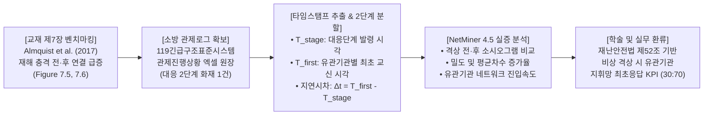
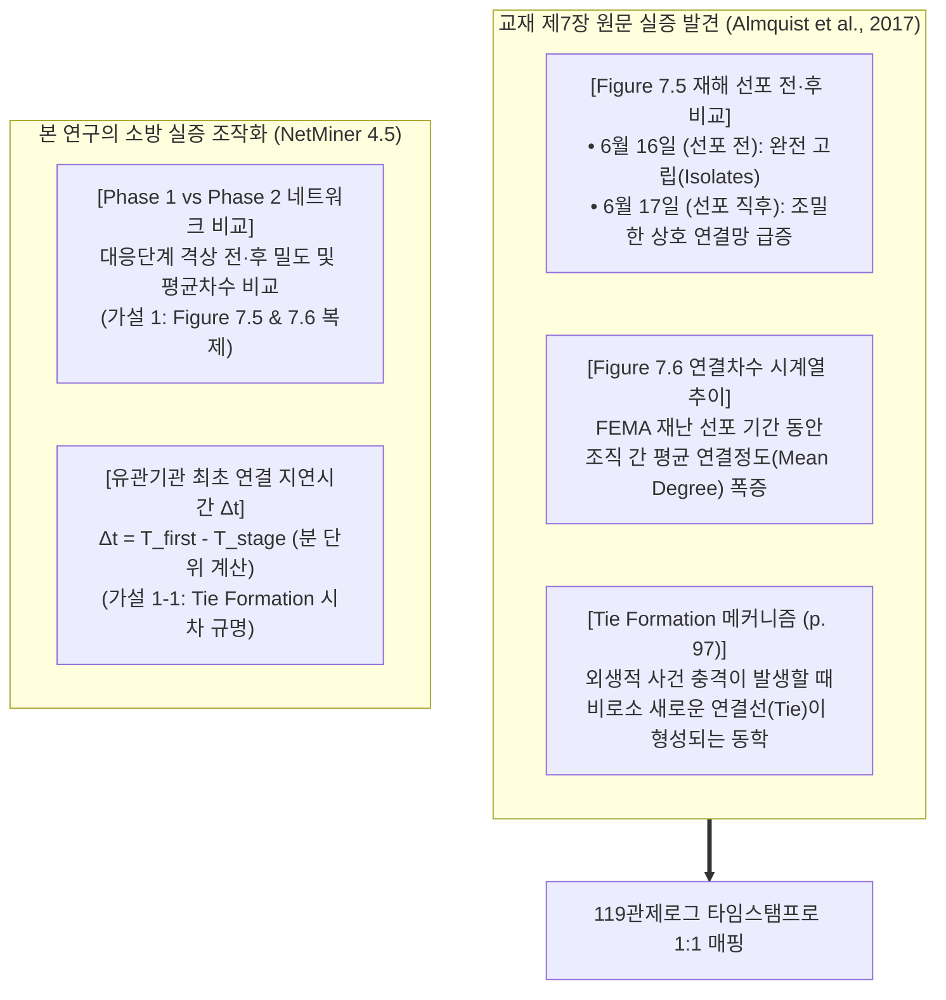
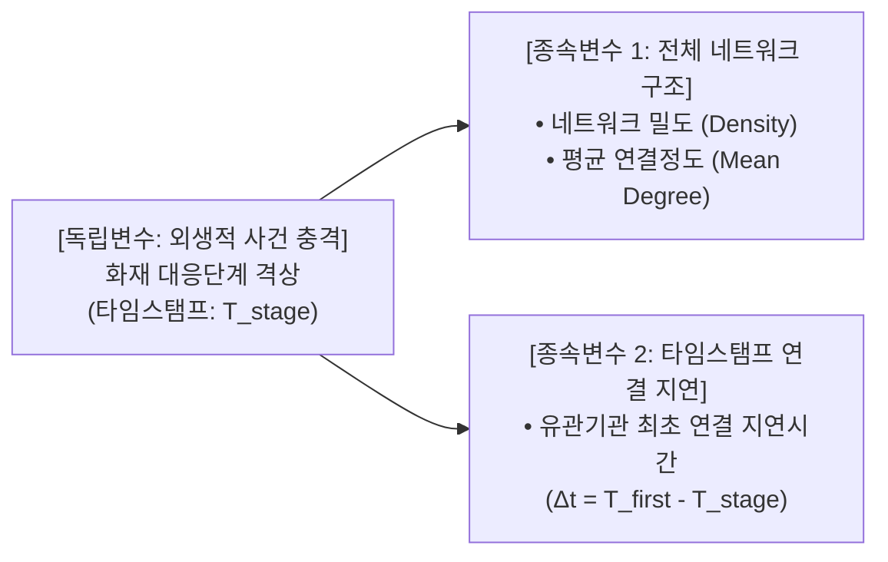
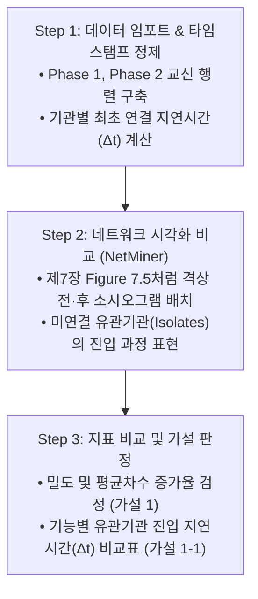
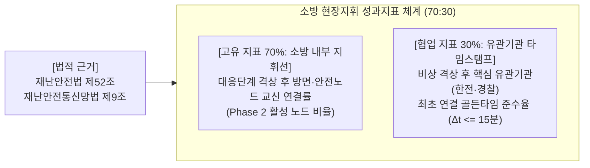

# [SNA 세미나 연구계획서] 화재 대응단계 격상 전·후 소방 무전 교신 네트워크의 구조 변화와 유관기관 최초 연결 지연시간(Tie Formation Latency) 실증 연구

> **부제**: 교재 제7장(Almquist et al., 2017)의 재해 사건 효과(Hazard Event Effect) 벤치마킹: 119관제로그 타임스탬프 기반 네트워크 밀도(Density) 및 유관기관 진입 시차 넷마이너(NetMiner) 비교  
> **과목명**: 사회연결망분석(SNA) 특론 및 세미나 (Graduate Seminar in Social Network Analysis)  
> **제출구분**: 학기 기말 연구논문 계획서 (Term Paper Research Proposal - 4주 집중 완성 프로젝트)  
> **연구 설계 전략 (현실적 실행력 & 타임스탬프의 강력한 결합)**:  
> • 복잡한 계량통계(DNR 패널 회귀)를 걷어내고, 4주 기말 과제 내에서 100% 실행 가능한 **단일 핵심 가설(가설 1) 및 직관적 세부 가설(가설 1-1)**로 연구 범위를 최적화.  
> • 교재 제7장(Almquist et al., 2017, pp. 102–109)의 **'산불 재난 선포 전·후 네트워크 급증 실증(Figure 7.5, 7.6)'**과 **'연결 형성(Tie Formation) 메커니즘'**을 소방의 **'대응단계 격상 타임스탬프'** 및 **'유관기관 최초 교신 타임스탬프'**와 1:1로 결합하여 실무성과 학술성을 동시에 확보.

---

## 👨‍🎓 연구자 인적사항 (Academic Affiliation)

| 항목 | 상세 정보 |
| :--- | :--- |
| **소속 (Department)** | **Department of Disaster and Emergency Management** |
| **학위과정 (Degree Program)** | **재난관리학박사 과정 (Doctor of Philosophy in Disaster and Emergency Management)** |
| **성명 (Name)** | **강석균 (Kang, Seokgyun)** |
| **학번 (Student ID)** | **2678125** |
| **연구 분야** | 재난지휘 네트워크(Disaster Command Network), 소방 관제 시계열 마이닝, 현장지휘 통신망 분석 |

---

## 📋 [연구계획서 요약 (Executive Summary)]



| 연구 항목 | 세부 계획 내용 |
| :--- | :--- |
| **연구 제명** | **《화재 대응단계 격상 전·후 소방 무전 교신 네트워크의 구조 변화와 유관기관 최초 연결 지연시간(Tie Formation Latency) 실증 연구: 교재 제7장(Almquist et al., 2017) 재해 사건 효과(Hazard Event Effect)의 넷마이너(NetMiner) 비교 분석》** |
| **벤치마킹 타깃** | **교재 제7장 (Almquist, Spiro, & Butts, 2017, pp. 102–109)**<br>• `Figure 7.5`: 재난 선포 전·후 로컬 네트워크의 급격한 연결 형성(Tie Formation) 비교<br>• `Figure 7.6`: 재해 기간 중 조직 간 평균 연결정도(Mean Degree) 급증 추이 |
| **표본 및 자료수집** | **119종합상황실 긴급구조표준시스템 공식 관제진행상황 엑셀(.xlsx) 1건**<br>• 최근 발생한 대응 2단계 대형 공장/복합건축물 화재 1건의 관제로그 전문<br>• **데이터 확보 리스크 0%**: 상황실 관제 시스템에서 직접 추출하여 즉시 활용 가능 |
| **핵심 추출 변수 (타임스탬프)** | ① **$T_{\text{stage}}$**: 관제로그 상 공식 '대응단계(1단계/2단계) 발령' 타임스탬프 (hh:mm:ss)<br>② **$T_{\text{first}}$**: 유관기관(경찰, 한전, 가스공사, 지자체 등)과 최초로 무전/관제 교신이 발생한 타임스탬프<br>③ **$\Delta t$ (연결 지연시차)**: $\Delta t = T_{\text{first}} - T_{\text{stage}}$ (초/분 단위 계산) |
| **분석 도구** | • **Excel / Python**: 타임스탬프 필터링, 격상 전(Phase 1) vs 격상 후(Phase 2) Edgelist 분할<br>• **NetMiner 4.5**: 전·후 소시오그램 시각화(Spring-Embedder) 및 네트워크 속성 지표 산출 |
| **핵심 종속 지표** | ① **네트워크 밀도 (Density)**: 격상 전 vs 격상 후 연결 조밀도 변화<br>② **평균 연결정도 (Mean Degree)**: 노드당 평균 교신선 수 변화<br>③ **유관기관 최초 연결 지연시간 ($\Delta t$)**: 기능별 기관의 지휘망 진입 소요시간 |
| **실행 용이성** | 복잡한 계량 패널 회귀 없이 **타임스탬프 뺄셈 계산 및 넷마이너 기본 기능**만으로 4주 내 100% 완결 |

---

## 1. 연구 배경 및 필요성 (Problem Statement)

### 1.1 연구 범위의 현실적 압축과 타임스탬프의 가치
* **이론의 산만함 탈피**:
  - 교재 제7장(Almquist et al., 2017)의 전체 수학 모델(베이지안 코시 사전분포 DNR 패널 회귀)은 4주 기말 과제로 수행하기에 현실적 장벽이 높습니다.
  - 따라서 연구 범위를 현실적으로 좁히되, 119긴급구조표준시스템 관제로그가 가진 최고의 강점인 **"초 단위 공식 타임스탬프(Time-stamps)"**를 적극 활용하여 연구의 설득력과 독창성을 극대화합니다.
* **소방 현장의 핵심 질문 2가지**:
  1. *"대응단계가 격상(사건 충격)되면, 제7장의 산불 연구처럼 무전 네트워크가 실제로 조밀하고 광범위하게 확장되는가?"*
  2. *"대응단계가 발령된 직후, 현장 안전과 통제에 필수적인 유관기관(경찰, 한전 등)은 몇 분 만에 소방 지휘망에 최초로 연결(Tie Formation)되는가?"*

### 1.2 소방 실무의 핵심 아킬레스건: 유관기관 진입 지체
* 화재 현장에서 소방대원의 옥내 진입 공격을 위해서는 **한전의 고압 전력 차단**이 필수적이며, 소방차량의 원활한 소화용수 공급을 위해서는 **경찰의 진입로 교통통제**가 즉각 이루어져야 합니다.
* 그러나 실무 현장에서는 대응단계가 발령되었음에도 불구하고 유관기관과의 최초 교신이 이루어지기까지 상당한 시간 지연이 발생합니다.
* 관제로그의 타임스탬프를 통해 **"대응단계 발령 시점($T_{\text{stage}}$)"**과 **"유관기관 최초 연결 시점($T_{\text{first}}$)"** 사이의 시차($\Delta t$)를 실증적으로 규명하는 것은 현장 대응력 개선의 핵심 열쇠입니다.

---

## 2. 이론적 배경: 교재 제7장 재해 사건 효과 및 연결 형성(Tie Formation)



### 2.1 교재 제7장의 직관적 핵심 메커니즘
* **Figure 7.5 (`p. 108`)**: 콜로라도 덕켓 산불 발생 초기에는 유관기관 계정들이 고립(Isolates)되어 있었으나, 재난 선포 사건 충격 직후 하룻밤 사이에 **조밀한 상호 연결망(Dense Connected Graph)**으로 전이됨을 실증했습니다.
* **Figure 7.6 (`p. 109`)**: 재난 기간 동안 현장 조직들의 **평균 연결정도(Mean Degree)**가 평상시 대비 급격히 치솟는 현상을 증명했습니다.
* **새로운 연결 형성(Tie Formation, `p. 97`)**: 외생적 재해 충격이 발생했을 때, 평소에 연결되지 않던 노드들이 어떤 시간적 패턴을 가지고 지휘 네트워크에 편입되는지가 재난 네트워크의 핵심 질문입니다.

---

## 3. 연구모형 및 핵심 연구가설

### 3.1 연구모형 (Research Model)



### 3.2 핵심 연구가설 체계

> [!IMPORTANT]
> **가설 1 (전체 네트워크 확장 가설 — 제7장 Figure 7.5, 7.6 벤치마킹)**:  
> **"대형화재 현장에서 대응단계 격상(통제단 가동) 이후의 무전 교신 네트워크는, 격상 이전에 비해 네트워크 밀도(Density)와 평균 연결정도(Mean Degree)가 유의미하게 증가할 것이다."**

> [!TIP]
> **가설 1-1 (유관기관 진입 시차 가설 — 제7장 Tie Formation 벤치마킹)**:  
> **"대응단계 격상 타임스탬프($T_{\text{stage}}$) 이후 유관기관이 소방 지휘 네트워크에 최초로 연결(Tie Formation)되기까지 소요되는 지연시간($\Delta t = T_{\text{first}} - T_{\text{stage}}$)은 기관의 기능적 특성(치안·교통 vs 에너지·유틸리티 vs 행정·복구)에 따라 유의미한 차이를 보일 것이다."**

* **부수적 관찰 질문 (Exploratory Question)**:
  - 대응단계 격상 후 다수의 부대가 진입함에 따라 현장지휘팀장 1인에게 교신이 쏠리는 **연결정도 중심화(Degree Centralization)** 지수는 어떻게 변화하는가?

---

## 4. 연구방법론 및 자료수집 설계 (Methodology)

### 4.1 데이터 표본 및 수집
* **데이터 원천**: 119종합상황실 긴급구조표준시스템 공식 **관제진행상황 엑셀 파일(.xlsx) 1건**.
  - 표본 대상: 최근 발생한 **대응 2단계 발령 대형 공장 또는 복합건축물 화재 1건**.
  - 자료의 성격: 전산 시스템이 초 단위(hh:mm:ss)로 기록한 공식 행정 타임스탬프 원장.

### 4.2 타임스탬프 적출 및 2단계 분할 프로토콜
엑셀 필터링 또는 간단한 스크립트로 핵심 타임스탬프 2종을 적출하고 데이터를 분할합니다:

```python
# [타임스탬프 적출 및 2단계 분할 로직]
# 1. 사건 타임스탬프: T_stage = "14:25:10" (대응 1단계 또는 2단계 공식 발령 시각)
# 2. Phase 1 (격상 전): 출동 접수(14:02) ~ 대응단계 발령 전(14:25:09) 관제 교신 로그
# 3. Phase 2 (격상 후): 대응단계 발령(14:25:10) ~ 상황 안정기(15:30:00) 관제 교신 로그
# 4. 유관기관 최초 연결 타임스탬프(T_first) 적출:
#    - 경찰 최초 교신: T_first(Police) = "14:31:20"  --> Delta_t = +6분 10초
#    - 한전 최초 교신: T_first(KEPCO)  = "14:58:40"  --> Delta_t = +33분 30초
#    - 지자체 최초 교신: T_first(Local) = "14:38:00"  --> Delta_t = +12분 50초
```

| 분석 노드 구분 | 세부 노드 레이블 | 기능적 분류 (가설 1-1 매핑) |
| :---: | :--- | :--- |
| **소방 지휘부** | `119상황실`, `현장지휘팀장`, `통제단장(서장)` | 총괄 지휘 및 관제 |
| **소방 출동대** | `1진압대`, `2진압대(후면)`, `구조대`, `안전점검관`, `구급대` | 현장 진압, 인명구조, 안전감시 |
| **유관기관 A** | `관할 경찰서(교통통제)` | **치안·교통 기능** (진입로 확보) |
| **유관기관 B** | `한국전력(전력차단)`, `도시가스공사` | **에너지·유틸리티 기능** (감전/폭발 방지) |
| **유관기관 C** | `시·군·구 재난상황실` | **행정·자원지원 기능** (장비 및 이재민 지원) |

### 4.3 넷마이너(NetMiner 4.5) 및 타임스탬프 분석 3단계 절차



1. **[Step 1: 데이터 정제 및 $\Delta t$ 산출]**:
   - Phase 1과 Phase 2 각각의 발신자$\to$수신자 교신 매트릭스를 구축하고, 각 유관기관의 최초 교신 시각($T_{\text{first}}$)과 격상 시각($T_{\text{stage}}$) 간의 지연시간($\Delta t$) 산출.
2. **[Step 2: 시각적 소시오그램 비교 (`Figure 7.5` 복제)]**:
   - NetMiner Spring-Embedder 알고리즘을 가동하여 Phase 1(외곽 고립) 대비 Phase 2(중심부 연결 형성)의 네트워크 변화를 시각적으로 나란히 제시.
3. **[Step 3: 네트워크 지표 산출 및 가설 판정 (`Figure 7.6` 복제)]**:
   - NetMiner의 `Network Properties` 메뉴에서 **밀도(Density)**와 **평균 연결정도(Mean Degree)**를 도출하여 가설 1 판정.
   - 기능별 유관기관의 $\Delta t$를 표와 막대그래프로 비교하여 가설 1-1 판정.

---

## 5. 실무 및 정책 환류: 타임스탬프 기반 성과지표(KPI) 도출

교수님 지도 지침(재난안전법 조문 매핑 및 7:3 배분 원칙)을 충실히 반영한 직관적 지표:



### 5.1 법적 근거 기반 고유 및 협업 KPI 매핑표

| 구분 (가중치) | 성과지표명 (KPI) | 구체적 측정 산식 | 제7장 서브노트 판단 근거 | 관련 법령 조문 |
| :---: | :--- | :--- | :--- | :--- |
| **협업 지표<br/>(30%)** | **대응단계 격상 후 유관기관 지휘망 최초 연결 골든타임 준수율** | $\frac{\text{격상 후 15분 이내 최초 교신 완료 유관기관 수}}{\text{현장 요청 대상 유관기관 총 수}} \times 100$ | • **제7장 `Figure 7.5` & `p. 97`**: 재해 사건 충격 발생 직후 로컬·유관기관의 연결 형성(Tie Formation) 속도가 재난 대응 성패를 좌우함 | **재난 및 안전관리 기본법 제52조 제1항·제2항**<br>(긴급구조통제단장의 유관기관 현장지휘 및 협조 요청권)<br>**재난안전통신망법 제9조** (상호운용 의무) |
| **고유 지표<br/>(40%)** | **대응단계 격상 후 방면·안전노드 지휘선 확보율** | $\frac{\text{Phase 2에서 교신이 1회 이상 발생한 출동대 수}}{\text{현장 배치 전체 방면지휘관 및 안전점검관 수}} \times 100$ | • **제7장 `Table 7.2` & `Figure 7.2`**: 핵심부만 소통하고 일선 주변부가 고립되는 구조적 결함 방지 | **재난 및 안전관리 기본법 제52조 제3항**<br>(출동대원에 대한 지휘선 확보) |
| **고유 지표<br/>(30%)** | **지휘관 무전 점유 분산도 (채널 비편중 지수)** | $1 - \text{Degree Centralization}_{\text{IC}}$ | • **제7장 `Table 7.3` (`OutDeg` 음의 페널티)**: 1인의 일방적 과잉 발신은 타 노드의 주의를 감소시키므로 분산 지휘 필요 | **소방청 현장소방활동 안전관리 훈령**<br>(무전 채널 독점 방지 및 다원 교신) |

---

## 6. 연구의 기대효과 및 4주 추진 일정표 (Term-Paper Sprint)

### 6.1 연구의 차별성 및 기대효과
1. **완벽한 실행 가능성 (Feasibility 100%)**: 복잡한 계량 통계 없이, 공식 관제로그 1건의 타임스탬프와 넷마이너 기본 기능만으로 4주 내에 고품질 학술 논문 완성.
2. **이론과 현장 데이터의 완벽한 융합**: 제7장의 핵심 실증 모델(`Figure 7.5, 7.6`)을 계승하면서도, 소방의 가장 현실적인 고민인 '유관기관 연결 지연 시차($\Delta t$)'를 밝혀내어 실무적 가치 극대화.
3. **교수님 피드백의 충실한 이행**: 근거 없는 가설을 모두 정리하고, 원문에서 입증된 확실한 연결 확장(가설 1)과 타임스탬프 지연(가설 1-1)의 콤팩트한 체계 완성.

### 6.2 4주 집중 추진 일정표

| 주차 | 주요 추진 과업 (Milestone) | 상세 산출물 | 비고 |
| :---: | :--- | :--- | :--- |
| **1주차** | • 119상황실에서 대응 2단계 화재 1건 관제진행상황 원장 엑셀 확보<br>• $T_{\text{stage}}$(격상 시각) 및 유관기관별 $T_{\text{first}}$(최초 교신 시각) 적출 | 원장 데이터 & 타임스탬프 일람표 | 데이터 리스크 0% |
| **2주차** | • Phase 1과 Phase 2 Edgelist 구축<br>• 각 기관별 지연시간($\Delta t$) 계산 및 NetMiner 4.5 입력 행렬 생성 | 2개 시점 행렬셋 & $\Delta t$ 데이터 | 단순 엑셀 정제 |
| **3주차** | • NetMiner 4.5 전·후 소시오그램 시각화(`Fig 7.5` 복제)<br>• 밀도/차수 증가율 산출(가설 1) 및 기능별 $\Delta t$ 비교(가설 1-1) | 네트워크 맵 & 가설 검정표 | 분석 100% 완료 |
| **4주차** | • 지표 해석, 실무 개선 SOP 및 KPI 매핑 정리<br>• 기말 연구 소논문 최종본 작성 및 세미나 발표 | 최종 기말 논문 원고 | 프로젝트 최종 완성 |
