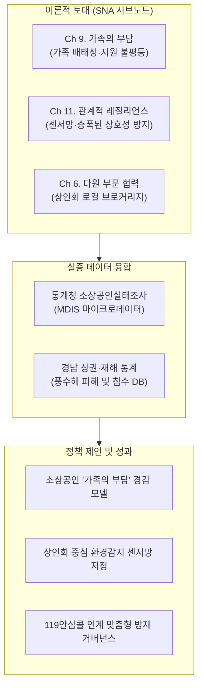

# 2026년 소상공인 연구논문 공모전 준비자료 허브

본 폴더는 **2026년 소상공인 연구논문 공모전**(주최: 중소벤처기업부·소상공인시장진흥공단·한국정책학회) 참가를 위한 연구계획서, 실증 데이터 수집 전략, 공식 제출 양식 서식 등을 종합 관리하는 전용 폴더입니다.

---

## 1. 폴더 내 파일 구성 및 역할

| 파일명 | 유형 | 내용 및 용도 |
| :--- | :---: | :--- |
| **`붙임1.2026년소상공인연구논문공모전논문제출양식.hwp`** | 서식 (HWP) | • 공모전 공식 논문 작성 템플릿 • 신명조 10pt, 줄간격 160%, 요약문, 본문 및 참고문헌 규격 |
| **`붙임2.개인정보의수집·이용동의서.hwp`** | 서식 (HWP) | • 논문 최종 접수 시 필수 첨부 서류 (서명/날인 필요) |
| **`소상공인_논문공모전_연구계획서.html`** | 웹 리포트 | • **공모전 전체 참가 계획서 & 논문 설계서** • Chapter 9 '가족의 부담' 이론 기반 연구모형 및 가설 체계 |
| **`경남_재난소상공인_데이터수집_연구계획서.html`** | 웹 리포트 | • **경남 실증 데이터 수집 & 융합 분석 계획서** • MDIS 통계청 마이크로데이터, 공공데이터포털, 소상공인 실태조사 매핑 |

---

## 2. 공모전 핵심 개요 및 추진 일정

* **공모전명**: 2026년 소상공인 연구논문 공모전
* **주최 / 주관**: 중소벤처기업부, 소상공인시장진흥공단 / 사단법인 한국정책학회
* **공식 웹사이트**: [한국정책학회 공모전 안내 (kaps.or.kr)](https://kaps.or.kr/?p=15)
* **논문 최종 마감**: **2026년 11월 15일(일) 23:59** (한국정책학회 웹 접수)
* **포상 규모**:
  * 대상(중소벤처기업부 장관상): 상금 500만 원 (1편)
  * 최우수상(소상공인시장진흥공단 이사장상): 상금 300만 원 (2편)
  * 우수상(한국정책학회 회장상): 상금 100만 원 (3편)

---

## 3. 연구 프레임워크 및 SNA 이론 연계

본 연구는 사회연결망 분석(SNA) 연구총서의 최신 이론들을 소상공인 재난 안전 및 경영 안정 정책에 융합합니다:

1. **Chapter 9 (Meyer, 2017) '가족의 부담(Family's Burden)' 이론**:
   - 위기 시 소상공인이 공적 지원망보다 혈연·가족망에 과도하게 의존함으로써 가족 전체가 동반 취약화되는 메커니즘 실증 분석.
2. **Chapter 11 (Stevenson & Conradson, 2017) '관계적 레질리언스(Relational Resilience)'**:
   - 상인회와 현지 직원을 **환경 감지 센서(Sensors)**로 가동하고, 비공식적 의무감에 따른 자원 낭비(**증폭된 상호성, Amplified Reciprocity**)를 방지하며, 소통 부하를 줄이는 **지원 코디네이터(Coordinator)** 도입.
3. **Chapter 6 (Harris & Doerfel, 2017) '다원 부문(Plural Sector)'**:
   - 관주도 하향식 지원의 한계를 극복하고 상인회·번영회를 준공식 자율방재 거버넌스로 육성.

---

## 4. 제출 전 최종 체크리스트

- [ ] **논문 원고 (`붙임1` 양식)**
  - [ ] A4용지 20매 내외 (요약문 1~2매 포함)
  - [ ] 신명조 10pt, 줄간격 160% 등 편집 규격 준수
  - [ ] 연구자 신원 식별 정보(소속, 성명 등) 블라인드 처리 여부 확인
- [ ] **개인정보 수집·이용 동의서 (`붙임2` 양식)**
  - [ ] 서명/날인 완료 스캔본 준비
- [ ] **재학/재직 증명서** (참가 자격 증빙용 서류)
- [ ] **한국정책학회 공식 홈페이지 온라인 접수 완료**

---

> **바로가기 링크**:
> - [🌲 경남 재난-소상공인 데이터 수집 계획서 보기](경남_재난소상공인_데이터수집_연구계획서.html)
> - [🏆 2026 소상공인 논문공모전 연구계획서 보기](소상공인_논문공모전_연구계획서.html)
> - [📖 SNA 포털 메인으로 이동](../index.html)
