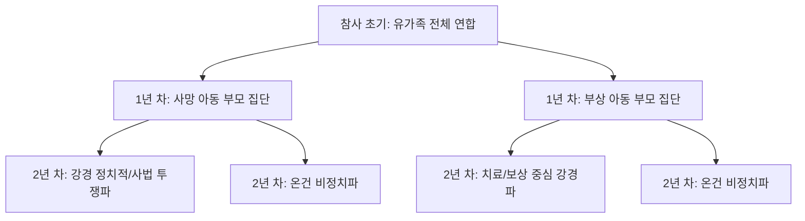

# 📘 [서브노트] 재난관리연구방법론 Chapter 2: 사회적 네트워크 구조
> **원제**: *Social Network Structure: Moving Beyond Social Capital and Communitas* (pp. 17–21)  
> **핵심 주제**: 재난 및 위험 상황에서 사회적 네트워크의 위상학적 구조(밀도, 구조적 다양성, 표면/심층 구조, 시계열 동학)가 개인의 지원 동원과 웰빙(정신건강)에 미치는 영향 및 비판적 고찰

---

## 📌 목차
1. [제1절. 네트워크 밀도(Density)와 코뮤니타스의 한계](#제1절-네트워크-밀도density와-코뮤니타스의-한계)
2. [제2절. 구조적 다양성과 하위 집단 (Structural Diversity & Subgroups)](#제2절-구조적-다양성과-하위-집단-structural-diversity--subgroups)
3. [제3절. 표면 구조와 심층 구조 (Surface Structure vs Deep Structure)](#제3절-표면-구조와-심층-구조-surface-structure-vs-deep-structure)
4. [제4절. 재난의 각 단계에 걸친 네트워크 내의 개인 (Individuals in Networks Across Disaster Phases)](#제4절-재난의-각-단계에-걸친-네트워크-내의-개인-individuals-in-networks-across-phases-of-disaster)
5. [제5절. 종합 비판: 사회적 자본과 코뮤니타스를 넘어 (Moving Beyond Social Capital & Communitas)](#제5절-종합-비판-사회적-자본과-코뮤니타스를-넘어-moving-beyond-social-capital--communitas)
6. [제6절. 주요 학자 및 핵심 용어 요약 정리](#제6절-주요-학자-및-핵심-용어-요약-정리)

---

## 제1절. 네트워크 밀도(Density)와 코뮤니타스의 한계

### 1. 밀도(Density)의 정의 및 산출 수식
- **개념**: 한 네트워크 내에서 행위자들(Alters) 사이에 실제로 존재하는 연결(유대)의 수를 이론적으로 가능한 최대 연결 수로 나눈 비율.
- **수식 (무방향 자아중심 네트워크 기준)**:
  $$\text{Density} = \frac{2L}{N(N - 1)}$$
  *(단, $N$: 지명된 알터의 수, $L$: 알터 간에 실제 존재하는 연결선 수)*
- **의미**: 밀도가 100%(1.0)에 가까울수록 구성원 전원이 서로를 잘 알고 연결된 조밀한(Close-knit) 네트워크를 뜻함.

### 2. 위험 완화를 위한 밀도의 의도적 구축
- 네트워크 밀도는 단순히 자연발생적인 결과가 아니며, 개인들은 **위험 완화(Risk Mitigation)**를 위해 네트워크의 규모와 밀도를 의식적으로 계산하고 확대함.
- **사례 (케냐 서부 포코트족)**: 목축민 포코트(Pokot)족은 가뭄이나 기근 발생 시 식량 원조 및 상호 지원을 보장받기 위해 평소 가축을 선물하여 네트워크의 규모와 밀도를 의도적으로 높여놓음.

### 3. 체르네아(Michael Cernea)의 '사회적 단절(Social Disarticulation)' 방지 노력
- **개념**: 마이클 체르네아(Cernea)는 재난이나 개발로 인한 강제 이주 및 재정착 과정에서 기존의 사회적 유대, 공동체 조직, 상호부조 네트워크가 해체되는 **'사회적 단절(Social Disarticulation)'** 위험을 지적함.
- **네트워크적 함의**: 이주민들은 이러한 사회적 단절로 인한 자원 상실 및 정체성 위기를 피하기 위해 고밀도 비공식 연대를 유지하려고 노력함. 그러나 이러한 시도는 아래에서 설명하는 '밀도의 역설'과 직면하게 됨.

### 4. 밀도에 따른 지원 성격의 분리 (Hurlbert et al., 2001)
허리케인 앤드류 연구는 네트워크 밀도가 개인이 받는 지원의 종류를 질적으로 가른다는 점을 규명함:
- **고밀도·소규모 네트워크**: 비공식 사회적 지원(감정적 위로, 일상적 돌봄, 친밀한 나눔)을 더 많이 받음.
- **저밀도·대규모 네트워크**: 외부 공공기관, 구호단체 등 **공식 제도적 지원(Formal/Institutional Support)**을 더 많이 활용함.
- **외부 단절 문제**: 고밀도 비공식 지원망에 깊이 매몰(Embedded)된 개인일수록 정작 집단 외부의 공공기관이나 공식 지원에 대한 접근성은 가장 낮게 나타남.

### 5. 밀도의 역설 (Paradox of Density)과 정신건강 악화
"네트워크가 조밀하고 끈끈할수록 재난 복구와 웰빙에 유리할 것"이라는 기존 통념을 뒤엎는 실증 연구 결과:

| 연구 대상지 | 네트워크 구조 및 지원 양상 | 웰빙(Well-being) 및 정신건강 결과 |
| :--- | :--- | :--- |
| **에콰도르 퉁구라와 화산 피해지** (도시형 vs 농촌형 재정착지) | 도시형은 이전 마을 고밀도 망 의존으로 지원 교환 양(+)의 상관관계 보임. 농촌형은 저밀도 확장형 형성. | **두 정착지 모두에서 네트워크 밀도는 개인의 웰빙 증진과 아무런 통계적 상관관계를 보이지 않음.** |
| **멕시코 이주지** (포포카테페틀 화산 및 산사태) | 극심한 자원 부족 속 고밀도 유대 유지. | **네트워크 밀도가 가장 높은 집단이 오히려 가장 최악의 웰빙(정신건강 악화)을 기록함.** |

#### 💡 밀도의 역설이 발생하는 3가지 원인:
1. **만성적 자원 결핍**: 피해자 전원이 자원이 부족한 상황에서는 밀도가 높아도 주고받을 자원이 없음.
2. **과도한 부양 의무**: 고밀도 결속망 내부에서 서로에 대한 지원 및 부양 요구가 가중되어 심리적 중압감 형성.
3. **관계적 피로감 (Burnout)**: 서로의 고통을 매일 목격하고 감정 노동이 누적되어 번아웃 발생.

---

## 제2절. 구조적 다양성과 하위 집단 (Structural Diversity & Subgroups)

### 1. 도입 배경: 밀도 중심 연구의 한계 극복
단순히 유대의 수(규모)나 밀도(Density)에만 매몰되지 않고, **가교(Bridging), 중심성(Centrality), 중앙화(Centralization), 하위집단(Subgroups)** 등 연결망의 위상학적 다양성을 종합 분석.

### 2. 가교(Bridging)와 중개자(Brokers)의 역할
- 서로 직접 연결되지 않은 집단이나 조직을 이어주는 **가교 행위자(Bridging actors)**는 비중복적 자원과 정보를 유입시키는 핵심 통로가 됨.
- 재난 상황에서는 서로 다른 집단을 잘 이해하는 인물이 중개(Brokerage) 역할을 수행할 때 구조적 다양성의 이점이 극대화됨.

### 3. 유형론적 접근과 맥락 의존성
- 네트워크 4가지 유형: **밀집형(dense)**, **확장형(extending)**, **하위집단형(subgroups)**, **희소형(sparse)**.
- **맥락 의존성**: 중심성이나 중앙화 등 동일한 위상 구조라도 **국가(멕시코 vs 에콰도르), 재정착 여부, 피해 심각도**에 따라 위험 인식 및 젠더별 정신건강(우울, 외상후 스트레스)에 미치는 영향이 완전히 다르게 나타남.

### 4. 응집력 있는 하위 집단(Subgroups/Cliques)의 역설
- **이론적 기대**: 하위 집단이 존재하면 숨 막히게 조밀하지도 않고 완전히 고립되지도 않아 복지와 지원 교환에 긍정적일 것으로 예상함.
- **실증 분석 결과**:
  1. **자원 교환 무관**: 하위 집단의 응집력과 실제 사회적 지원 교환 사이에 **상관관계가 없음**.
  2. **정신건강 악화**: 하위 집단을 가진 **재정착 여성은 전반적 정신건강 점수가 가장 낮았고**, **남성은 우울 증상 점수가 가장 높게** 나타남.

### 5. 하위 집단 및 파벌 분열의 대표 실증 사례: ABC 어린이집 화재 참사 (Jones & Murphy, 2015)
구조적 다양성과 하위 집단 파편화 과정을 입증하는 대표 종단 연구:

- **1년 차**: '사망 아동 부모' vs '부상 아동 부모'라는 피해 유형에 따라 2개 집단으로 분열.
- **2년 차**: 두 집단이 각각 '정치적·사법적 진상 규명 접근' vs '온건·비정치적 접근'으로 다시 분화되어 **총 4개의 하위 파벌로 파편화됨**.
- **학술적 시사점**: 하위 집단의 형성은 네트워크의 연대를 높이기보다 자원 분배, 법적 책임, 정치적 기회의 거시적 맥락과 상호작용하여 지속적인 갈등과 파벌 분열을 유발함.

---

## 제3절. 표면 구조와 심층 구조 (Surface Structure vs Deep Structure)

### 1. 개념적 기원: 구조주의 사상
소쉬르, 촘스키, 레비-스트로스의 구조주의 이론에 기원을 두며, Hoffman은 재난 문화를 두 층위로 구분함:
- **심층 구조 (Deep Structure)**: 보이지 않는 규칙, 현실이 조직화되는 방식, 사람·시간·공간이 분류되는 무의식적 기틀 (Grammar).
- **표면 구조 (Surface Structure)**: 표면에 드러나는 문화적 세부사항, 관습, 의식, 습관 및 실제 의식적 동원 행동.

### 2. 조작화 및 데이터 추출 방식

| 구분 | 심층 구조 (Deep Structure) | 표면 구조 (Surface Structure) |
| :--- | :--- | :--- |
| **개념** | 일상적 의사결정에 내재된 무의식적 관계 패턴 | 재난 시 구호·피난 등 개인이 의식적으로 동원하는 관계 패턴 |
| **측정 도구** | **무맥락 이름 생성기** (Context-free Name Generator) | **맥락 특화 질문** (Context-specific Questions) |
| **실증 특징** | 연구 및 현장 맥락에 따라 비일관적 변동 심함 | 연구 전반에 걸쳐 높은 일관성과 재현성을 보임 |

### 3. 실증 분석 결과
- **표면 구조의 높은 일관성**: 허리케인 앤드류, 카트리나, 미시시피강 홍수 연구 전반에서 사람들이 의식적으로 구호 네트워크에 나서는 표면적 행위 패턴은 매우 일관되게 확인됨.
- **심층 구조의 비일관성**: 저자들이 멕시코와 에콰도르 7개 재해 현장 460개 표본을 분석한 결과, 심층 구조 지표와 재난 복구 결과(웰빙, 위험 인식) 간의 관계는 일관성이 떨어지고 맥락별로 변동함.

### 4. 핵심 결론: 문법적 결정론의 한계
- 사회 네트워크의 심층 구조는 언어의 문법처럼 인간 주체의 행동을 기계적으로 결정하는 틀(Grammatical structure)로 볼 수 없음.
- 네트워크의 내용과 형태는 **역사적 상호작용 과정과 제도의 매개**, 그리고 피해자들이 이용 가능한 **문화적 레퍼토리(Cultural Repertoire)** 속에서 발현됨.

---

## 제4절. 재난의 각 단계에 걸친 네트워크 내의 개인 (Individuals in Networks Across Disaster Phases)

### 1. 앤서니 월리스(Anthony Wallace, 1956)의 시공간 및 심리 모형
앤서니 월리스는 재난 연구 초기에 시간적 단계, 공간적 영역, 심리적 반응을 통합한 정교한 체계를 제시함:

#### ① 8단계 시간 체계 (8-Stage Temporal Sequence)
1. **재난 전 단계 (Steady State)**: 평상시 사회적 균형 상태.
2. **경보 단계 (Warning)**: 위협 신호 감지 및 경고 발령.
3. **위협 단계 (Threat)**: 재난의 임박한 도래.
4. **영향 단계 (Impact)**: 재난의 직접적 타격 및 파괴.
5. **피해 조사/격리 단계 (Isolation)**: 정보 차단 및 초기 자구 노력.
6. **구조 단계 (Rescue)**: 이웃 및 현장 상호부조 구출.
7. **구제 단계 (Remedy)**: 외부의 조직적 구호 물입.
8. **복구 단계 (Recovery)**: 장기적인 재건 및 사회적 재조정.

#### ② 3대 휴리스틱 공간 체계 (Heuristic Spatial Dimensions)
- **충격 지역 (Impact Area)**: 재난이 직접 물리적 피해를 가한 핵심 파괴 지역.
- **인접 / 필터 지역 (Filter Area)**: 피해 지역을 둘러싸고 구호 물자 및 정보를 선별·전달하는 매개 지역.
- **조직화된 지원 지역 (Organized Help Area)**: 외부의 공공 구호기관 및 전문 구호 자원이 대기·출동하는 넓은 배후 지역.

#### ③ 재난 증후군 (Disaster Syndrome)
충격 지역 직후의 피해자들이 겪는 멍함, 방향 감각 상실, 수동성, 정서적 마비 등 심리적 반응 체계로, 초기 자발적 구호 네트워크 형성에 결정적 영향을 미침.

---

### 2. 수잔나 호프만(Hoffman, 1999)의 3단계 주기 모델
1. **1단계 (개인 ➔ 집단적 지원)**: 재난 직후 충격 속에 이타주의의 파도가 일며 집단적 상호부조 형성.
2. **2단계 (집단적 지원 ➔ 파벌 경쟁)**: 초기 연대가 약화되고 외부 구호물자 분배 등을 둘러싼 파벌 간 경쟁과 갈등 발생.
3. **3단계 (종결, Closure)**: 파벌 갈등이 가라앉고 각 가정(가계)의 일상 복귀로 관심 이동.

> **올리버-스미스(Oliver-Smith)의 관찰**:  
> 재난 직후 기존 계급/민족 불평등이 일시적 이타주의 속에서 사라진 것처럼 보이지만, 외부 원조 분배나 복구가 장기화되면 기존 사회적 균열이 다시 수면 위로 떠올라 갈등이 재점화됨.

---

### 3. 지원 고갈과 사회적 매몰성의 역설 (Weil et al., 2012)
허리케인 카트리나 피해자를 추적한 실증 분석 결과:
- **단기적 (재난 직후)**: 네트워크 유대가 많은(깊이 매몰된) 개인일수록 타인을 지원할 책무가 쏠려 **더 심한 초기 스트레스**를 겪음.
- **장기적 (복구 단계)**: 시간 경과 후 풍부한 관계적 자원 덕분에 덜 매몰된 사람들보다 **스트레스로부터 훨씬 더 빠르게 회복**됨.

---

### 4. 사회적 시간(Social Time)과 Vital Phase (Casagrande et al., 2015)
물리적 시계 시간이 아닌 개인이 처한 상황 중심의 '사회적 시간과 공간'에 주목 (미시시피강 홍수 연구):

| 재난 경험 단계 | 가장 지배적인 지원 원천 | 연구 시사점 |
| :--- | :--- | :--- |
| **생사 결정 단계 (Vital Phase)** | 친족 (Kin 유대) 압도적 독점 | 신체적 생존이 걸린 위기에서는 이웃, 친구, 공무원, 자원봉사자보다 **가족 유대가 가장 결정적**임. |
| **비치명적 & 장기 복구 단계** | 공식/제도적 (Institutional) 지원 | 전문적·제도적 구호 및 주택 보상 채널이 지배적 비중을 차지함. |

---

## 제5절. 종합 비판: 사회적 자본과 코뮤니타스를 넘어 (Moving Beyond Social Capital & Communitas)

### 1. 체르네아의 사회적 단절 예방 노력과 비공식 네트워크의 한계
강제 이주 상황에서 체르네아(Cernea)가 지적한 '사회적 단절(Social Disarticulation)'을 예방하기 위해 고밀도 비공식 연대를 유지하려는 주민들의 노력은 정당하지만, 자원이 결핍된 상태에서의 고밀도 결속망은 정작 '밀도의 역설'로 인해 정신건강 악화라는 부작용을 낳음.

### 2. 기존 문화적·사회적 위계 구조의 재의인화 (Reifying Inequalities)
강한 공동체 의식(Communitas)이나 긴밀한 결속망만을 강조할 경우, 네트워크 내부에 이미 뿌리내린 **인종, 계급, 성별, 민족 등의 불평등한 문화적 위계 구조를 비판 없이 답습하고 고착화**할 위험이 있음.

### 3. '수혜 자격의 정치 (Politics of Deservingness)'와 취약계층 배제
- 외부 구호기관이나 정부가 이타주의적 협동이나 고밀도 네트워크 표출을 지원 수혜의 조건으로 내세울 때 부작용 발생.
- **사례 (에콰도르 '밍가' 사례 / Faas, 2015a)**: 정부/NGO가 주택 지원 조건으로 전통 품앗이 '밍가(Minga)' 참여를 강제하자, 생계를 위해 임금 노동을 해야 했던 취약 가구가 구호 주택 지원에서 배제됨.

### 4. 낭만적 가정의 오류와 구조적 권력 독점
- 끈끈한 결속망을 보여주지 못하는 집단을 '비기능적'이거나 '지원받을 자격이 없는 집단'으로 단정하는 오류.
- 가교(Bridging) 역할을 여성이 수행하더라도, 그에 따른 권력과 위상은 남성이 독점하는 등 복잡한 젠더 불평등이 존재함을 포착해야 함.

---

## 제6절. 주요 학자 및 핵심 용어 요약 정리

### 1. 주요 학자별 핵심 기여 요약표

| 학자 / 연구진 | 연구 대상 | 핵심 기여 내용 |
| :--- | :--- | :--- |
| **Anthony Wallace (1956)** | 재난 사회학 초기 연구 | 8단계 시간 체계, 3대 휴리스틱 공간 영역(충격/필터/도움), 재난 증후군 제시 |
| **Michael Cernea (1997)** | 강제 이주 및 재정착 | 재정착 시 발생하는 '사회적 단절(Social Disarticulation)' 위험 규명 |
| **Hurlbert et al. (2001)** | 허리케인 앤드류 | 고밀도 소규모망(비공식 지원) vs 저밀도 대규모망(공식 제도 지원) 지원 분리 규명 |
| **Hoffman (1999)** | 재난 문화 & 3단계 모델 | 개인 지원 ➔ 파벌 경쟁 ➔ 종결 3단계 모델 제시. 표면 vs 심층 구조 개념 도입 |
| **Weil et al. (2012)** | 허리케인 카트리나 | 사회적 매몰성의 역설 (초기 스트레스 가중 vs 장기 복구 회복 촉진) |
| **Casagrande et al. (2015)** | 미시시피강 홍수 | 사회적 시간 정립. 생사 결정 단계(Vital Phase) 친족(Kin) 지원 독점 입증 |
| **Jones & Murphy (2015)** | 멕시코 ABC 어린이집 참사 | 하위 집단(Subgroups) 파편화 및 유가족 4개 파벌 분열 과정 종단 연구 |
| **Faas (2015a)** | 에콰도르 재정착지 | '수혜 자격의 정치(Politics of Deservingness)'와 전통 품앗이 강제로 인한 취약층 배제 고찰 |

---

### 2. 핵심 용어 사전 (Glossary)

* **사회적 단절 (Social Disarticulation)**: 재난 및 이주 과정에서 기존의 사회적 자본, 상호부조 네트워크, 공동체 조직이 깨지고 파편화되는 현상(Cernea).
* **8단계 시간 체계 (8-Stage Sequence)**: 재난 전-경보-위협-영향-격리-구조-구제-복구로 이어지는 월리스(Wallace)의 재난 시계열 구조.
* **재난 증후군 (Disaster Syndrome)**: 충격 직후 피해자들이 경험하는 멍함, 방향 감각 상실, 수동성 등 초기 심리적 상태.
* **밀도의 역설 (Paradox of Density)**: 네트워크가 조밀할수록 만성 자원 결핍과 과도한 부양 부담, 관계적 번아웃으로 피해자의 정신건강(웰빙)이 오히려 최악으로 악화되는 현상.
* **생사 결정 단계 (Vital Phase)**: 신체적 생존 확보가 직결된 시점. 이 단계에서는 이웃, 친구, 공공 구호보다 친족(Kin) 유대의 지원이 가장 결정적임.
* **수혜 자격의 정치 (Politics of Deservingness)**: 구호 주체가 끈끈한 협동 표출 여부로 지원 자격을 판단함에 따라, 생계형 임금 노동자 등 취약계층이 구호 대상에서 낙인찍히고 배제되는 부작용.
* **표면 구조 vs 심층 구조**: 표면 구조는 재난 시 의식적으로 동원하는 행동 패턴(맥락 특화 질문 측정)이며, 심층 구조는 무의식적 기초 관계망(무맥락 이름 생성기 측정)임.
