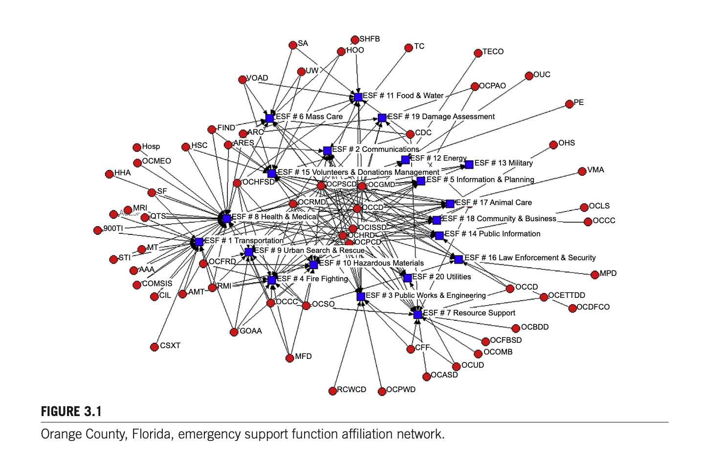
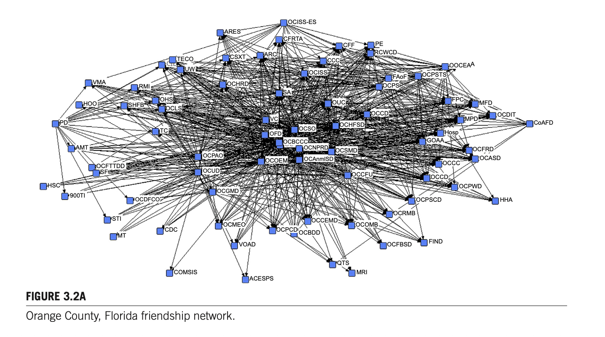
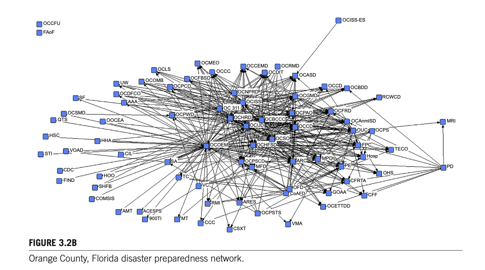
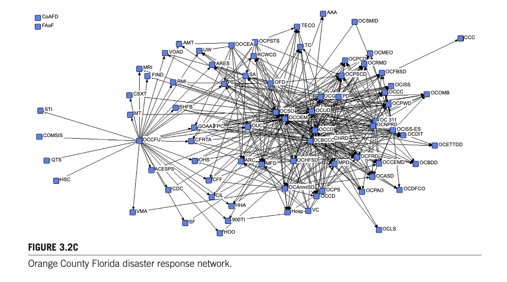
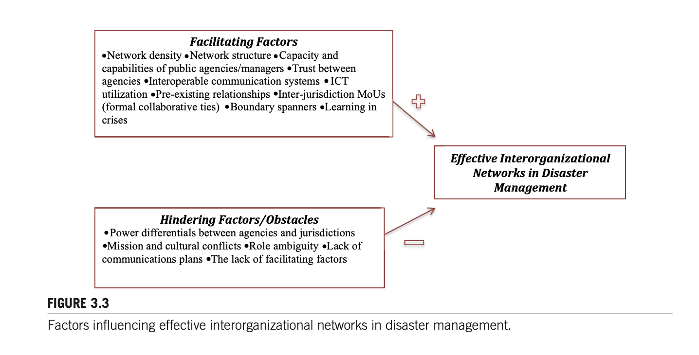
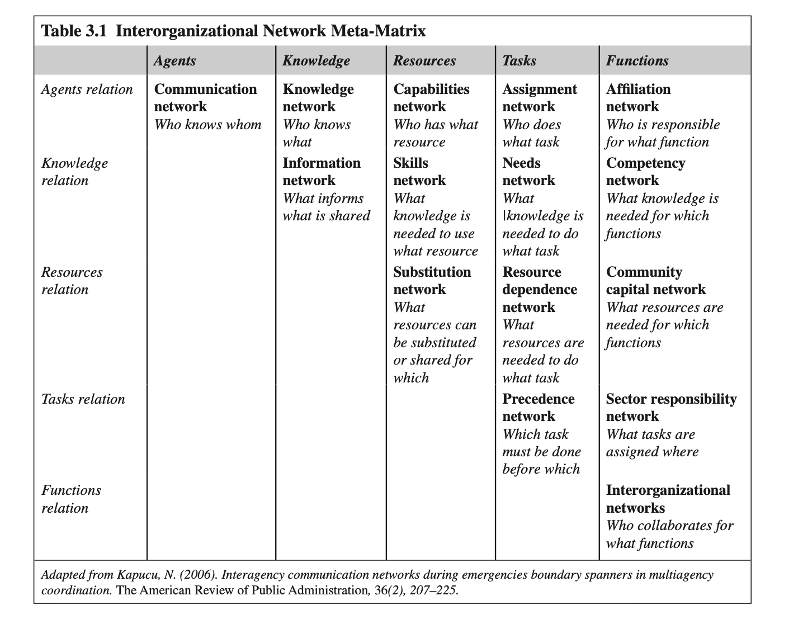

제3장 재난 관리에서의 조직간 네트워크

# 서론

제3장 원문의 **Introduction(서론)** 섹션(25~26페이지)에 해당하는 주요 내용은 다음과 같이 정리할 수 있습니다:

---

### 1. 재난의 복잡성과 조직 간 네트워크의 필연성

* **재난의 본질과 대중의 기대**: 재난은 복잡하고 다루기 까다로운(challenging) 상황이며, 사람들은 대체로 정부가 신속하고 효과적으로 문제를 해결해 줄 것이라 기대합니다.

* **일상적 응급상황과의 본질적 차이**: 파괴적인 대형 재난(catastrophic disasters)을 관리하는 것은 일상적인 응급 상황을 처리하는 것과는 근본적으로 다릅니다. 극단적 사건(extreme events)은 특정 지역에서 비교적 드물게 발생하지만, 발생 시 사회 전체에 막대한 혼란을 초래합니다.

* **재난관리의 표준으로서의 네트워크**: 대형 재난을 성공적으로 관리하려면 수평적·협력적인 관계망 속에 있는 다수의 이해관계자(multiple stakeholders)만이 제공할 수 있는 광범위한 기술(skills)과 자원이 요구됩니다. 따라서 조직 간 네트워크는 재난 대응에서 예외가 아닌 하나의 '표준(norm)'입니다.

### 2. 행정 서비스 전달 체계의 전환과 네트워크의 중요성

* **공공 부문 전반의 추세**: 조직 간 네트워크의 혜택을 받는 정부 영역은 재난관리뿐만이 아니며, 보건의료(health care)부터 사회복지 서비스에 이르기까지 광범위한 서비스가 분야 간(cross-sector) 네트워크와 파트너십을 통해 제공되고 있습니다.

* **관료제에서 파트너십으로의 이행**: 공공 서비스 전달 체계가 전통적인 계층제 관료제(직접 정부, direct government)에서 분야 간 파트너십으로 전환된 점은 재난관리 내 네트워크의 입지에 결정적인 영향을 미쳤습니다.

* **네트워크 동학의 이해**: 재난 전(before), 재난 중(during), 재난 후(after)에 네트워크가 어떻게 설계(designed)·형성(developed)되고 작동(function)하며 진화(evolve)하는지를 이해하면 네트워크 활용 시 더욱 우수한 재난관리 성과를 달성할 수 있습니다.

### 3. 자연발생적 네트워크 형성과 부문 간 협력의 필요성

* **협력 욕구와 자연발생적 네트워크**: 재난은 이타적 행동(altruistic behavior)과 협력의 필요성이 두드러지는 환경을 조성하므로, 극심한 스트레스 상황을 처리하는 과정에서 네트워크가 자연발생적으로 형성되기도 합니다(효과성 여부는 별개의 문제).

* **정부 역량의 한계와 민간·비영리 부문 협력**: 재난관리는 모든 정부 계층(연방, 주, 지방)의 노력을 필요로 하지만, 대형 재난을 해결하기에 정부 자체의 역량과 자원은 대체로 부족하므로 민간 및 비영리 조직과의 협력이 필수적입니다.

* **네트워크 연구의 최적 맥락**: 다수준(multilevel), 다부문(multisector), 협력적(collaborative) 성격을 띠는 재난관리는 네트워크를 연구하기에 가장 이상적인 맥락을 제공합니다 (McGuire & Silvia, 2010).

### 4. 제3장의 목적 및 구성 체계

* **연구 목적**: 본 장은 재난 대응 및 복구 단계에서 나타나는 조직 간 네트워크에 대한 이론적 개관(theoretical overview)을 제공하고, 다층적 네트워크와 다양한 부문 간 기관들이 참여하는 중층적(layered) 기능으로서의 재난관리를 개괄합니다.

* **장의 구성 순서**:
1. 재난관리 분야를 포함한 조직 간 네트워크에 대한 **간략한 역사적 관점** 제시

2. 조직 간 네트워크의 **다양한 유형**과 협력적 응급관리 맥락에서의 활용 설명

3. 재난 시 기관 간 효과적인 협력을 촉진하는 요인(facilitating factors)과 저해하는 요인(hindering factors)을 탐색하는 기본 틀(framework) 개발 및 제시

# INTERORGANIZATIONAL NETWORKS

제공해주신 본문(**CHAPTER 3: INTERORGANIZATIONAL NETWORKS** 섹션, 26페이지)의 주요 내용을 원문에 충실하게 핵심별로 요약·정리한 내용은 다음과 같습니다:

---

### 1. 정책 집행에서 네트워크의 부상과 역사적 배경

* **정책 집행에서의 중요성 증대**: 정책 집행(policy implementation) 과정에서 네트워크의 중요성이 점차 커지고 있습니다.

* **개념적 새로움과 실질적 존재**: 네트워크라는 '용어'의 사용은 비교적 최근의 일이지만, 미국 정부 체계 내에서 네트워크 현상 자체가 완전히 새로운 것은 아닙니다.

* 예를 들어, 정부 간 관계(intergovernmental relationships)나 정부의 서로 다른 부처·분과(branches) 간의 관계도 하나의 네트워크 형태로 볼 수 있습니다.

* **오늘날의 네트워크(부문 간 관계)**: 오늘날 미국 정부 체계에서 네트워크는 주로 '부문 간 관계(intersector relations)'를 지칭합니다.

---

### 2. 관료제 축소와 비국가 행위자(Nonstate Actors)의 역할 확대

* **전통적 관료제의 후퇴와 보완**: 정책 집행 및 공공 서비스 전달 체계에서 전통적인 관료제가 축소되고 뒤로 물러남에 따라, 비국가 행위자(nonstate actors)들이 네트워크 구조 안에서 작동하며 관료제를 보완하고, 어떤 경우에는 대체하기까지 합니다.

* **이러한 변화를 보여주는 주요 지표(Indicators)**:
* 민영화 (privatization)

* 서비스의 외주화/민간위탁 (contracting out services)

* 비영리 부문의 성장 (growth of nonprofit sector)

* 복잡한 문제 해결을 위한 파트너십 구축 (creation of partnerships for solving complex problems)

---

### 3. 조직 간 네트워크의 분류 기준

* 조직 간 네트워크 문헌(Kapucu, Hu, & Khosa, 2014)에 따르면, 네트워크는 다음 세 가지 기준에 따라 다양한 유형으로 분류됩니다:

1. **기능 방식** (how they function)

2. **달성하고자 하는 목표의 성격** (what kind of goals they try to accomplish)

3. **조직화 방식** (how they organize)

---

### 4. 네트워크의 형성 방식: 자발적(Voluntary) 형성 vs. 의무적(Mandated) 형성

* **자발적 형성 (Voluntary)**: 어떠한 강압이나 특정 인센티브 없이 조직들이 자발적으로 파트너십에 참여하는 형태입니다.

* **상위 정부에 의한 의무적 형성 (Mandated)**: 상위 정부 기관의 요건에 의해 강제적으로 형성되는 형태입니다.

* **대표적 사례 (미국 FEMA)**: 미국 연방재난관리청(FEMA)은 지방 응급관리 기관들이 특정 연방 지원금을 받기 위해 국가대응체계(National Response Framework)와 국가재난복구체계(National Disaster Recovery Framework)를 자체 계획에 반영하도록 요구합니다.

* 이러한 공식 체계(Frameworks)들은 응급관리 기관들이 **분야 간 파트너십(cross-sector partnerships)과 협력**을 구축하도록 의무화하고 있습니다.

# INTERORGANIZATIONAL NETWORKS IN DISASTER MANAGEMENT

제시된 본문(**INTERORGANIZATIONAL NETWORKS IN DISASTER MANAGEMENT**, 26~27페이지)의 주요 내용을 핵심 주제별로 빠짐없이 정리한 내용은 다음과 같습니다:

---

### 1. ‘총체적 공동체(Whole Community)’ 접근법과 재난 복원력의 필요성

* **총체적 공동체 접근법의 도입**: 최근 미국의 비상관리 체계는 ‘총체적 공동체(whole community)’ 접근법을 기반으로 개발되어 운영되고 있습니다.

* **단일 주체의 한계**: 재난은 매우 복잡한 문제이므로 단일 기관이나 단독 행위자가 독자적으로 해결하거나 관리할 수 없으며, 정부 기관뿐만 아니라 비정부기구(NGO) 및 일반 시민의 참여가 필수적입니다.

* **공동체 재난 복원력(Community Disaster Resilience)**: 재난은 통상적인 공무원 집단의 한정된 자원만으로 처리할 수 없다는 동일한 맥락에서 출발합니다.

* **협력과 도약(Bouncing Forward)**: 지역사회가 함께 협력하여 사회적·물리적 취약성을 낮추고, 자원을 공유하며, 비공식 네트워크를 활용함으로써 재난의 영향을 최소화하고 재난 이후 더 나은 상태로 도약(bouncing forward)해야 합니다.

* **취약성의 지속적 증가 요인**: 공동체가 진화함에 따라 이민자 유입, 취약계층(노인, 장애인, 미성년자)의 증가, 그리고 기후변화와 같은 위험 요소의 변화로 인해 지역사회의 위험 수준과 위험 유형이 계속해서 증가합니다.

---

### 2. 재난 복원력의 개념적 정의와 구성요소

* **복원력의 정의**: 노리스와 동료들(Fran Norris et al., 2008)은 복원력을 개인 및 조직 자원을 포함한 지역사회 자원을 일련의 ‘적응 역량(adaptive capacities)’과 연결하는 과정으로 정의합니다.

* **주요 구성요소**: 지역사회 자원과 적응 역량에는 사회적 자본(social capital), 조직 네트워크, 인적 자본, 경제 개발 동학, 지역사회 역량이 포함됩니다.

* **네트워크의 구축 주체**: 응급관리 목적의 지역사회 내 조직 간 네트워크는 주로 비상관리기관, 보안관실, 보건부 등 응급관리 조직들에 의해 구축되고 유지됩니다.

---

### 3. 비상관리 단계별 네트워크의 특성과 기능적 차이

* **전 단계에서의 작동 요구**: 네트워크는 비상관리의 전 단계(대비 preparedness, 완화/예방 mitigation, 대응 response, 복구 recovery)에서 작동해야 하지만, 각 단계마다 상이한 목표를 달성하기 위해 서로 다른 조직들의 협력이 요구됩니다.

* **대응(Response) 네트워크의 특성**:
* 비교적 짧은 기간 동안 즉각적이고 동시적인 상호작용에 의존합니다.

* 의사결정 지원 시스템과 네트워크 연결망을 통한 지속적이고 신속한 정보 흐름이 핵심입니다.

* **완화(Mitigation) 네트워크의 특성**:
* 홍수 보험, 건축 규정 적용, 고위험 지역 주민 이주 등 법률과 규정을 집행하기 위해 수십 년에 이르는 장기적인 조직 간 협력을 요구합니다.

* **플로리다주 카운티 완화 전략 사례**:
* 자연재해 및 인위적 재난의 영향을 최소화하기 위해 지역 완화 전략(Local Mitigation Strategies)을 수립·운영합니다.

* 이는 지역 경제 개발 계획, 종합 비상관리 계획, 업무연속성 계획(COOP)과 연계되어 수립됩니다.

* 주요 활동으로 대주민 공공 교육 및 홍보, 연방 보조금을 통한 핵심 시설물 보강, 엄격한 건축 규정 시행 등이 포함되며, 필요한 경우(특히 경제 개발 분야) 민간 부문 파트너도 참여합니다.

---

### 4. 신뢰 구축의 시간성과 임시 참여자(Ad hoc Participants)의 한계

* **신뢰와 조화의 축적 필요성**: 대응, 복구, 완화 등 모든 형태의 조직 간 네트워크는 참여자 간의 신뢰(trust), 상호운용성(interoperability), 조화(harmony)를 형성하기 위해 상당한 시간과 노력을 필요로 합니다.

* **단기 대응 네트워크의 역설**: 비록 실제 재난 현장에서 단 몇 시간만 가동되는 대응 네트워크라 할지라도, 성공적인 작동을 위해서는 참여자들 간에 사전에 축적된 오랜 파트너십의 역사가 뒷받침되어야 합니다.

* **임시 참여자의 역할과 위험성**: 임시 참여자(ad hoc participants)와 자발적 조력자(helpful bystanders)는 정보 제공, 새로운 연결 구축, 구호 활동 지원 등 재난관리에 일정한 기여를 합니다.

* **조정과 책임성 부재의 결과**: 그러나 이러한 임시 참여자들에게 체계적인 조정(coordination)과 책임성(accountability)이 결여될 경우 쉽게 현장의 혼란을 초래하며, 공식 네트워크 행위자들의 성공적인 대응 활동을 저해할 수 있습니다.

# NETWORKS OF NETWORKS: MULTILAYERED DISASTER NETWORKS

제공해주신 본문(**NETWORKS OF NETWORKS: MULTILAYERED DISASTER NETWORKS**, 27~29페이지)의 주요 내용을 핵심 주제 및 정부 수준(수직적·수평적 차원)별로 빠짐없이 정리한 내용은 다음과 같습니다:

---

### 1. ‘네트워크의 네트워크(Networks of Networks)’ 개념 및 기본 구조

* **하위 네트워크들의 총합**: 선진국의 재난관리 체계는 수많은 기관에 의존하며, 국가 전체 네트워크는 다양한 하위 네트워크(subnetworks)들의 결합으로 구성됩니다.

* **포함 주체**:
* 연방 수준의 국가 기관(FEMA 등)

* 주 및 지방/지역 수준의 비상관리 기관

* 1차 현장 대응 기관(소방서, 경찰서, 수색구조대 등)

* 비영리 및 민간 단체(적십자사, 시민단체, 종교단체 등) (Waugh, 2003)

---

### 2. 국가 수준(National Level)의 네트워크

* **범정부·비정부 협력 지침**: 미국에서는 국가대응체계(NRF)와 국가사건관리체계(NIMS)가 다양한 정부 계층과 비정부 주체들이 협력하도록 안내하는 기준 역할을 수행합니다.

* **국가 자금 지원을 통한 협력 촉진 (UASI)**:
* 미 국토안보부(DHS)의 도시지역 안보 이니셔티브(UASI: Urban Area Security Initiative)는 지역 협의회와 실무그룹 네트워크를 구축하여 지역사회의 대응 역량과 대비 계획을 발전시키도록 보조금을 지원합니다.

* **자금(Funding) 중심의 협력 동기**: Alexandra Jordan(2010)의 연구에 따르면, UASI는 도시와 주변 지역(교외 및 농촌) 기관들을 협력으로 이끄는 역할을 하지만, 주된 동기는 자금 확보에 있습니다.

* **권력 불균형(Power Imbalances)**: 대도시권은 많은 인구와 자산을 보호하기 위해 더 큰 몫의 자금을 요구하고, 소규모 지역은 재난 시 대도시의 자원에 의존합니다. 따라서 이러한 협력은 "공통의 지역적 필요에서 출발한 것이 아니라 도시, 농촌, 교외 공동체 간의 **권력 불균형에서 비롯된 것**"으로 분석됩니다.

---

### 3. 주/도 수준(State Level)의 수평적 파트너십: EMAC

* **비상관리상호지원협정(EMAC: Emergency Management Assistance Compact)**:
* 재난 시 주(State) 간에 자원, 장비, 정보, 인력을 원활하게 공유하도록 돕는 미국의 전국 단위 ‘주 간 상호 원조 협정’입니다.

* **효과성(허리케인 카트리나 & 리타 연구)**:
* Kapucu, Augustin, & Garayev(2009)는 EMAC과 같은 주 간의 수평적 파트너십과 네트워크가 행정적 감독(oversight)을 제공하고, 재난 대응 시 신속한 문제 해결을 위한 **자원 및 기술**을 동원하는 데 필수적임을 규명했습니다.

---

### 4. 지방 및 카운티 수준(Local & County Levels)의 네트워크와 3가지 구조

* **지역 네트워크의 자원 동원력**: 최초 대응자, 비상운영센터(EOC), 지역 비영리단체 등으로 구성되며, 전통적인 명령통제(command-and-control) 방식에서는 소외되기 쉬운 핵심 민간 기업과 지역사회 조직의 자원에 접근할 수 있게 해줍니다.

* **지방 재난대응 네트워크의 3가지 유형 (Kapucu & Garayev, 2014)**:
1. **수평적/탈중앙형 (Horizontal / Decentralized)**: 긴급지원기능(ESF: Emergency Support Function) 시스템에 기반한 구조.

2. **수직적/계층형 (Vertical / Hierarchical)**: 미국의 대표적 현장 대응 전략인 사고현장지휘체계(ICS: Incident Command System)에 기반한 구조.

3. **혼합형 (Hybrid)**: ESF와 ICS 체계가 결합된 형태.

* **플로리다주 오렌지 카운티(Orange County) 사례**:
* 종합 비상관리 계획에 ESF 체계를 적용하여, 재난 시 특정 지원 기능을 수행할 1차(주관) 기관과 2차(지원) 기관을 지정·운영합니다. (본문의 Figure 3.1은 사각형으로 표시된 기능군을 중심으로 원형의 참여 기관들이 클러스터를 이루는 친화 네트워크를 시각화함).

---

### 5. 재난 대응 네트워크의 특수 동학과 한계 (29페이지)

* **자연발생적 성격 (Emergent Nature)**: 재난 대응 네트워크는 사전에 계획된 것보다 현장에서 새롭게 형성·발현(emergent)되는 경향이 강합니다. 비록 이전 관계와 완전히 무관할 수는 없으나, 재난 현장의 실무자들은 사전에 마련된 제도적 배치를 그대로 따르기 어려운 경우가 많습니다 (Nowell & Steelman, 2014).

* **계층제의 한계와 적응성**: 재난의 혼란스럽고 불확실한 특성 때문에 하향식(top-down) 명령 체계나 표준운영절차(SOP)는 일정 한계까지만 작동하며, 환경 변화에 유연하고 적응적(flexible and adaptable)이어야 합니다.

* **상황 적합성**: 일반 공공 서비스 전달에서 효과적인 특정 구조(예: 중앙집권적 구조)라 하더라도 모든 재난 상황에서 긍정적인 성과를 보장하는 것은 아니므로, 네트워크 효과성을 평가할 때는 재난의 특수한 동학을 반드시 고려해야 합니다 (Raab et al., 2015).

# EFFECTIVE INTERORGANIZATIONAL DISASTER NETWORKS

제공해주신 본문(**EFFECTIVE INTERORGANIZATIONAL DISASTER NETWORKS**, 29~31페이지)의 주요 내용을 핵심 이론, 선행 연구 및 실증 분석별로 빠짐없이 정리한 내용은 다음과 같습니다:

---

### 1. 네트워크 효과성(Network Effectiveness)의 정의와 평가의 한계

* **네트워크 효과성의 정의**: 프로반과 케니스(Provan & Kenis, 2008)에 따르면, 네트워크 효과성은 "개별 조직 참여자들이 독립적으로 행동해서는 통상적으로 달성할 수 없는, 긍정적인 네트워크 수준의 성과를 달성하는 것"으로 정의됩니다.

* **전통적 관료제와의 차이점 및 평가의 어려움**:
* 전통적 관료제는 명확하고 비교적 경직된 구조를 지닌 반면, 네트워크는 **복잡하고 모호하며 유동적인(fluid) 구조**를 갖습니다.

* 따라서 단일 기관을 위한 전통적인 성과 관리 도구로는 네트워크의 효과성과 성과를 측정할 수 없습니다.

---

### 2. 투리니 등(Turrini et al., 2010)의 메타분석: 효과성의 3수준과 3대 결정요인

Keith Provan과 Brinton Milward(1995)의 연구 이후 출간된 93편의 관련 논문을 검토하여 네트워크 효과성의 수준과 결정요인을 도출했습니다.

#### 가. 네트워크 효과성 평가의 3개 수준 (Levels)

1. **수혜자/클라이언트 수준 (Client-level)**: 최종 결과에 대해 수혜자가 만족하는지 여부

2. **지역사회 수준 (Community-level)**: 지역사회가 네트워크의 운영으로부터 실질적인 혜택을 얻고 있는지 여부

3. **네트워크 수준 (Network-level)**: 명시된 목표의 달성 역량, 네트워크의 지속 가능성 및 실행 가능성(viability), 혁신과 변화 역량

#### 나. 네트워크 효과성의 3대 포괄적 결정요인 (Determinants)

1. **구조적 특성 (Structural characteristics)**:
* 외부 통제(이해관계자/유권자에 대한 의존성)

* 통합 메커니즘(공통 통신 시스템 구축, 서비스 전달 시너지 창출)

* 네트워크 규모 및 구성

* 공식화 및 책임성(공식 규칙·기능 마련, 자금 지원자 등 외부 이해관계자에 대한 책임성)

* 내부 안정성(참여 인력의 안정성)

2. **기능적 특성 (Functioning characteristics)**:
* 네트워크 내부의 ‘관리 기술(management craft)’

* 전통적인 관리 작업, 일반적 네트워킹, 불안정성 완화(buffering) 및 안정성 육성, 네트워크 프로세스 조율·지휘(steering)

3. **맥락적 특성 (Contextual characteristics)**:
* 네트워크가 작동하는 환경

* 환경의 안정성(Stability)이 핵심 요인이며, 환경적 안정성은 네트워크 효과성을 특정 지점까지는 향상시키지만 그 임계점을 넘어서면 오히려 저해할 수 있음.

---

### 3. 재난 대응 네트워크의 특수 동학과 도전 과제

* **자연발생적 성격 (Emergent Nature)**: 재난 대응 네트워크는 계획된 구조보다 현장에서 자연발생적으로 형성되는 경향이 훨씬 강합니다. 기존 관계와 완전히 단절되지는 않더라도, 현장 대응자들은 사전에 마련된 제도적 배치를 따르기 어려운 경우가 많습니다 (Nowell & Steelman, 2014).

* **계층적 구조의 한계와 유연성**: 재난의 혼란스럽고 불확실한 특성 때문에 하향식(top-down) 메커니즘과 표준운영절차(SOP)는 일정 수준까지만 유효하며, 참여자들의 유연성과 환경 적응성이 필수적입니다.

* **상황 적합성**: 일반 행정 서비스 전달(예: 중앙집권적 구조)에서 효과적인 네트워크 구조라 하더라도 모든 재난 상황에서 긍정적인 성과를 내는 것은 아닙니다 (Raab et al., 2015).

---

### 4. 재난 네트워크 효과성에 관한 주요 실증 연구들

#### ① 브란다 노웰과 토디 스틸먼 (Nowell & Steelman, 2014) — 산불 대응 통신망

* **연구 초점**: 산불 대응 통신 네트워크를 형성하는 요인으로서 제도적 매몰성(institutional embeddedness)과 관계적 매몰성(relational embeddedness)의 영향을 분석.

* **핵심 결과**:
* 참여자 간의 친숙도(familiarity)를 뜻하는 **관계적 매몰성**(재난 전 사회적 유대, 공통 이해관계 소속, 공유된 기능적 역할)이 산불 통신망 형성을 유의미하게 예측했습니다.

* 제도적 매몰성은 네트워크 밀도와 참여자 간 빈번한 의사소통에 기여하는 것으로 부분 확인되었습니다.

#### ② 최상옥과 랄프 브라워 (Choi & Brower, 2006) — 인지적 정확성(Cognitive Accuracy) 4유형

* **연구 배경**: 중심적인 주도 기관(leading central organization)이 존재할 때 네트워크 효과성이 높아진다는 Provan & Milward(1995) 모형을 기반으로 연구를 수행했습니다.

* **비교 분석 3차원**: 플로리다 델타 카운티 비상대응계획의 긴급지원기능(ESF)을 대상으로 ① 계획서상 주관 기관, ② 참여자들이 인지한 가장 영향력 있는 기관, ③ 실제 네트워크 위치(최고 중심성 기관)를 상호 비교했습니다.

* **인지적 정확성의 4가지 유형**:
* **유형 I (가장 일관됨, Type I)**: 계획, 참여자 인지, 실제 네트워크 중심 기관이 **3자 모두 완벽히 일치**.

* **유형 II 및 III (부분적 일관성, Types II & III)**: 계획과 인지, 또는 인지와 실제 네트워크 등 **두 가지 수준에서만 주도 기관이 일치**.

* **유형 IV (비일관형, Type IV)**: 세 가지 차원 모두에서 주도 기관이 **불일치**.

* **의의**: 비상관리자들이 실제 현장에서 작동하는 네트워크의 운영 현실을 얼마나 명확히 파악하고 있는지를 진단하는 유용한 도구입니다.

#### ③ A.J. 파스와 동료들 (Faas et al., 2016) — 유사성 가설 vs 비유사성 가설

* **산불 대응망 내 가교 행위자(Bridging Actors) 식별 연구**:
* **유사성 가설 (Similarity / Homophily thesis)**: 사람들은 자신과 유사한 주체(예: 지방 소방대와 연방 토지관리국 등)를 가교자로 선택할 것으로 봄.

* **비유사성 가설 (Dissimilarity thesis)**: 가교 행위자는 친숙함이 아니라 운영상의 우선순위(operational priorities)에 따라 형성된다고 봄.

* **핵심 결론**: 유사성과 친숙함은 사람들이 비상 상황에서 '어떻게 조직될 것인가'라는 사전 기대는 예측하지만, 실제 현장 네트워크 구조는 다르게 형성됩니다. 즉, "실제 실행(practice)에서는 비유사성 가설이 유사성 가설보다 더 큰 설득력을 갖는다"는 점을 입증했습니다.

# COMMUNICATION

제3장의 **COMMUNICATION(의사소통)** 섹션(31~34페이지)의 주요 내용을 원문에 충실하게 정리한 내용은 다음과 같습니다:

---

### 1. 불확실한 환경에서의 의사소통과 상호운용성(Interoperability)

* **네트워크 의사소통의 중요성과 연구 공백**: 불확실한 환경에서 네트워크 내부의 의사소통은 재난 및 위기관리의 핵심 요소입니다. 협력의 장애 요인을 규명하고 성과 향상을 위한 모범 사례들이 연구되어 왔으나, 대응 및 복구 맥락의 끊임없는 변화로 인해 관련 문헌에는 여전히 연구 공백이 존재합니다.

* **불확실성과 의사결정**: 재난 대응과 같은 불확실한 환경에서의 조직 간 의사소통과 의사결정은 네트워크의 연결성과 상호운용성(interoperability)에 크게 좌우됩니다 (Kapucu, 2006a).

* **경계 확장자(Boundary Spanners)의 역할**: 경계 확장자는 서로 다른 부문 간을 연결하는 다리 역할을 수행함으로써 네트워크 내에서 고유한 정보 공유 메커니즘을 제공하며, 이는 대응 및 복구 활동에 필수적입니다.

* **상호운용성 결여의 대표 사례 (9/11 테러)**:
* 9/11 여객기 납치 테러는 대응 조직들이 내부 및 외부 특정 조직 간의 의사소통 전략을 사전에 계획해야 함을 일깨워 준 사건이었습니다.

* 재난 대응에서는 '공유된 언어와 시스템'을 의미하는 상호운용 가능한 통신 체계가 핵심적입니다. 당시 뉴욕 소방국(FDNY)은 뉴욕 경찰국(NYPD)의 무전 시스템과 호환되지 않는 아날로그 무전기를 계속 사용하여 두 기관 간 효과적인 소통에 실패했습니다 (Kapucu, 2006a).

* **사전 대비 활동의 효과**: 훈련(training), 연습(exercises), 계획(planning)과 같은 재난 대비 활동을 통해 타 기관과 협업해 본 경험은 실제 재난 발생 시 원활한 협력을 촉진합니다 (Jordan, 2010).

---

### 2. 공식·비공식 네트워크와 재난 대응 협력의 형성 (Kapucu & Hu, 2014)

* **연구 배경 및 변수 설정**: 플로리다주 오렌지 카운티를 대상으로 우정 네트워크(비공식) 및 재난 대비 네트워크(공식)를 예측 변수로, 재난 대응 네트워크를 종속 변수로 설정하여 관계를 분석했습니다. (Figure 3.2A–C에 관련 네트워크 시각화 제시).

* **대응 네트워크에 대한 예측력**:
* 재난 대비 네트워크와 우정(friendship) 유대 모두 실제 재난 대응 네트워크 형성을 통계적으로 예측하는 요인으로 나타났습니다.

* 그러나 **재난 대비 단계에서의 협력 경험이 우정 유대보다 재난 대응 시의 협력을 훨씬 더 강력하게 예측**했습니다.

---

### 3. 정보통신기술(ICT) 활용도와 네트워크 중심성의 관계

* **대비(Preparedness) 네트워크에서의 양상**:
* 대비 네트워크에서 중심적 위치(central positions)를 차지하는 조직일수록 정보통신기술(ICT)의 활용도가 높았습니다.

* 반면, 우정 네트워크에서의 위치와 ICT 활용 수준 간에는 아무런 유의미한 관계가 확인되지 않았습니다.

* **대응(Response) 네트워크에서의 차이점**:
* 대비 네트워크와 달리, 재난 대응 네트워크에서는 영향력 있고 중심적인 조직이라고 해서 ICT 활용도가 반드시 높은 것은 아니었습니다.

* 또한 네트워크 내에서 중개 역할(intermediating role)을 수행하는 조직 역시 다른 조직에 비해 ICT 활용도가 더 높게 나타나지 않았습니다.

* **실무적 시사점**:
* 비상관리 네트워크의 주도적·영향력 있는 조직들은 자신들의 ICT 활용 수준을 조직의 고유한 사명 및 목표와 일치시켜야 합니다.

* 첨단 ICT가 급속히 발전하고 있음에도 불구하고, 이메일, 전화 통화, 대면 상호작용(face-to-face interactions)과 같은 전통적인 의사소통 수단은 여전히 매우 실효성 있게 기능하고 있습니다.

# TRUST AND SOCIAL CAPITAL

제시된 본문(**TRUST AND SOCIAL CAPITAL**, 34~35페이지)의 주요 내용을 핵심 주제 및 주요 연구별로 충실하게 정리한 내용은 다음과 같습니다:

---

### 1. 공식적 유대(Formal Ties)와 정부 간 협력 촉진 요인

* **공식적 유대의 형성 방식**: 정부 기관 간의 수직적(상·하위 정부) 관계, 동일 정부 계층 또는 타 관할권과의 수평적 업무협약(MOU 체결), 그리고 공공-민간 부문 간 파트너십을 통해 수립됩니다.

* **공식 네트워크의 기능**: 파트너 간의 자원, 정보, 그리고 인적 자본(human capital)을 공유하는 실질적 기능을 수행합니다.

* **정부 간 협력에 영향을 미치는 요인 (McGuire & Silvia, 2010)**:
* 문제의 심각성 정도 (problem severity)

* 과거 재난 경험 (past experiences with disasters)

* 공공기관 및 관리자의 역량·역량 수준 (다기능 분야 훈련, 주 자격증, 관리적·기술적 능력)

* 명확한 프로그램과 사명이 정립된 기관 구조 (agency structure)

* **신뢰와 협력 역량**: 효과적인 재난 대응을 촉진하는 데는 **신뢰(trust), 존중(respect), 정기적인 상호작용**이 필수적이며, 재정적·기술적·인적 자원으로 뒷받침되는 협력 역량(capacity to collaborate) 또한 매우 중요합니다.

---

### 2. 비공식적 유대(Informal Ties)와 리더의 사회적 자본

* **비공식 유대의 가변성과 역할**: 비공식 유대는 공식 유대보다 범위의 변동성이 큽니다. 재난 위험, 지역사회 역량, 미시·중범위·거시(micro, meso, macro) 수준에서 가용한 사회적 자본에 따라 유형, 역할, 규모, 참여자, 역량이 크게 달라지며 때로는 공식 유대와 융합됩니다.

* **리더의 개인적 사회적 자본**: 지역사회 및 조직 리더들의 개인적 사회적 자본은 조직들이 **신뢰를 신속하게 구축하고 원활하게 협력하도록 지원**하여 공식 유대를 보완합니다.

* **강한 유대 형성 요인**: 행정 관리자 간의 관계 분석에서 경계 확장자(boundary spanners)와 **신뢰**가 강한 유대를 촉진하는 핵심 요소로 확인됩니다.

---

### 3. 동질혼(Homophily)과 연결 공유(Transitivity)의 영향 (Siciliano & Wukich, 2015)

허리케인 카트리나 데이터를 활용하여 동질혼(동일 관할권 및 부문 조직 간 유대 집중)과 삼항 이행성(transitivity, 공통 친구를 통한 연결 공유)이 재난 대응 네트워크에 미친 영향을 분석했습니다.

* **부문 간·지역 간 동질혼 경향**:
* 비영리단체는 영리 기업이나 정부 기관보다 **다른 비영리단체와 협력할 가능성**이 더 높았으며, 특히 정부 자원에 제때 효과적으로 접근하지 못했을 때 이러한 경향이 두드러졌습니다.

* 공공기관 역시 유사하여 **지방 기관은 다른 지방 기관과 협력할 가능성**이 더 높았습니다. (카트리나 당시 연방 및 주 정부의 대응이 전반적으로 비효율적이었음을 감안할 때, 지역 조직 및 유사 부문 간의 조밀한 협력은 당연한 결과로 해석됨).

* **신뢰 기반의 네트워크 유지**: 조직들은 '공통의 친구'를 가진 상대와 유대를 형성하는 경향(transitivity)이 있었습니다. 이는 허리케인 카트리나와 같은 극심한 불확실성 상황에서 조직들이 **신뢰감을 느끼는 네트워크 내에 머무르려 함**을 의미합니다.

---

### 4. 공공-비영리 임시 협력과 성과 결정 요인 (Nolte & Boenigk, 2013)

대응 및 복구 단계에서 공공기관과 비영리단체 간에 형성되는 임시(ad hoc) 연결 속에서 사회적 자본이 미치는 영향을 연구했습니다.

* **임시 협력의 양면성**: 이미 반응적이고 급변하는 환경에서 지역사회를 지원해야 하는 조직에 외부 지원 서비스가 유입되는 것은 조정(coordination) 부담을 가중시켜 상황에 부정적 영향을 미칠 수도 있습니다.

* **재난 성과에 미치는 영향 분석**:
* **긍정적 영향 확인**: **과업 조정(task coordination)**, **상호성 정도(degree of mutuality)**, 그리고 사전에 형성된 긍정적 협력 경험(preconceived positive collaborative experiences)은 재난 대응 성과에 통계적으로 유의미한 긍정적 영향을 미쳤습니다.

* **예상 밖의 결과**: 연구자들의 초기 가설과 달리, **의사소통(communication)** 및 공통 관계(common relations)는 성과에 대해 통계적으로 유의미한 효과를 나타내지 않았습니다.

# LEARNING AND ADAPTATION IN DISASTER NETWORKS

제시해주신 본문(**LEARNING AND ADAPTATION IN DISASTER NETWORKS**, 35~36페이지)의 주요 내용을 핵심 이론, 구체적 사례(모이니한 연구), 그리고 학습 도구별로 빠짐없이 정리한 내용은 다음과 같습니다:

---

### 1. 위기 학습(Crisis Learning)의 개념과 저해 요인

* **위기 학습의 정의**: 재난 네트워크가 위기 대응을 더 효과적으로 만들기 위해 **새로운 실천(practices)과 행동(behaviors)을 인지하고 실행(recognition and implementation)하는 과정**을 의미하며, 일부 학자들은 이를 재난 대응 효과성을 판단하는 중요한 척도로 사용합니다.

* **효과적인 위기 학습의 주요 장벽(Barriers)**:
* 위기의 높은 결과 중대성 (high consequentiality of crises)

* 정부 간 학습의 필요성 (need for intergovernmental learning)

* 이전 관련 경험의 부재 (lack of prior relevant experience)

* 제한된 정보 환경 (limited information)

---

### 2. 네트워크 학습의 가능성 실증 사례: 캘리포니아 외래 뉴캐슬병(END) (Moynihan, 2008)

돈 모이니한(Don Moynihan, 2008)은 2003년 캘리포니아를 덮친 '외래 뉴캐슬병(Exotic Newcastle disease)' 대응 사례를 통해 재난 네트워크 학습의 가능성을 입증했습니다.

* **사건의 특징과 규모**: 가금류 및 조류 사이에 전염성이 극도로 높아 백신을 맞지 않은 무리 전체를 몰살시키며 백신을 맞은 조류조차 취약한 질병이었습니다. 이를 억제하기 위해 여러 주 및 연방 기관에서 파견된 7,000명 이상의 인력(네트워크 최고 정점 시 동시 근무 인력은 2,500명)이 약 1년간 네트워크 형태로 협력하여 932곳의 감염 현장(주로 뒷마당 사육지 및 상업지구)을 찾아냈습니다.

* **단기 재난과의 본질적 차이 (학습 촉진 환경)**:
* 토네이도, 지진, 허리케인 등은 순식간에 발생하여 대응할 시간을 거의 주지 않으며, 화학물질 누출이나 광산 사고처럼 대응 시간이 주어지더라도 혼란스럽고 불확실한 상태에서 운영됩니다.

* 반면 뉴캐슬병 사태는 약 1년 동안 지속(2002년 10월~2003년 9월)되었기 때문에, 참여자와 조직들이 상황을 숙고하고 의미를 파악(sense-making)하며 변화하는 조건에 **적응(adapt)할 수 있는 충분한 시간을 제공**했습니다.

* **신뢰 구축과 불확실성 감소**: 긴 대응 기간 덕분에 네트워크 참여자들은 시간이 지남에 따라 상호 관계와 신뢰를 구축할 수 있었으며, 상호의존성(interdependencies)을 인정하고 신뢰를 쌓음으로써 환경적·제도적 불확실성을 낮추고 네트워크 내 학습을 크게 증진할 수 있었습니다.

---

### 3. 위기 네트워크 학습을 위한 6대 도구 (Moynihan, 2008)

모이니한은 단기 재난(예: 토네이도)과 장기 재난(예: 뉴캐슬병) 모두에 적용 가능한 **6가지 위기 네트워크 학습 도구**를 제시했습니다:

1. **가상 경험 (Virtual experience)**: 사전 계획 수립, 시뮬레이션, 롤플레잉(역할 연기), 교육훈련 등을 통해 사전에 간접 경험을 축적하는 것.

2. **네트워크 내 타 조직으로부터의 학습 (Learning from other organizations in the network)**: 파트너 기관의 지식과 노하우를 공유받아 학습하는 것.

3. **정보 시스템을 통한 학습 (Learning from information systems)**: 상황 인식(situational awareness)을 위해 신뢰할 수 있고 상호운용 가능한 통신·정보 시스템을 활용하는 것.

4. **학습 포럼 (Learning forums)**: 지식과 현장 경험을 공유하고 성찰할 수 있는 열린 토론 플랫폼을 운영하는 것.

5. **표준운영절차로부터 기억 창출 (Creating memory from standard operating procedures)**: 현장의 학습 내용을 제도화하고 정형화하기 위해 일상적 업무 루틴을 개발하는 것.

6. **과거로부터의 학습 (Learning from the past)**: 이전 재난과 과거 사건의 교훈을 체계적으로 복기하고 반영하는 것.

---

### 4. 네트워크 효과성 논의의 범위와 전환

* **논의의 분석 수준 한정**: 이 섹션에서 다룬 재난 대응 네트워크의 효과성 결정요인은 앞서 언급된 Turrini et al.(2010) 및 Raab et al.(2015)의 결과와 유사하지만, 수혜자(client)나 지역사회(community) 수준은 제외하고 **순수한 '네트워크 수준(network-level)'의 효과성만을 다룹니다**.

* **후속 섹션 예고**: 이어서 다음 섹션에서는 네트워크 효과성을 저해하는 구체적 요인들(factors that hinder network effectiveness)을 다루게 됩니다.

# FACTORS HINDERING COLLABORATION IN FORMING DISASTER NETWORKS OF ORGANIZATIONS

제시해주신 본문(**FACTORS HINDERING COLLABORATION IN FORMING DISASTER NETWORKS OF ORGANIZATIONS**, 36~37페이지)의 주요 내용을 원문에 충실하게 핵심 요인별로 빠짐없이 정리한 내용은 다음과 같습니다:

---

### 1. 효과적인 협업을 저해하는 일반적 요인들

* **협업 저해 요인 목록 (Jordan, 2010)**:
* 공식적인 기관 사명(formal missions)의 상충

* 문화적 갈등(cultural conflicts)

* 역할 모호성(role ambiguity)

* 조직 간 불일치 및 상이한 응급관리 전략

* 부문 간 경계를 넘는 의사소통 지침/계획의 부재

* **공통 집단 정체성 형성의 난제**: 다양한 사명, 조직 문화, 운영 기능을 가진 이질적인 조직들을 한자리에 모을 때, 공통의 집단 정체성(common group identity)과 의사결정에 대한 공유된 이해(shared understanding of decision-making)를 구축하는 것이 가장 큰 도전 과제입니다.

* *예시 (문화적 격차)*: 국가안보 및 법 집행 기관은 '비밀주의적 행동'과 '중앙집권적 의사결정'으로 특징지어지는 반면, 비영리단체는 자원봉사자의 참여를 유도하고 '탈중앙화된 의사결정'을 활용하는 '개방형 시스템'으로 작동합니다 (Waugh, 2003).

* **동일 목적 조직 간의 협력 실패 (9/11 테러 사례)**:
* 유사한 목표와 기능을 가진 조직들 사이에서도 협력이 실패할 수 있습니다.

* 9/11 테러 당시 미국 정보기관들은 공격 전후로 상호 간 정보를 공유하지 않아 큰 비판을 받았습니다.

* 이에 대한 대책으로 효과적인 정보 수집 및 배포를 위해 지방, 주, 연방 수준의 통합정보센터(Fusion Centers)가 신설되었습니다 (DHS, 2015).

---

### 2. 협력 비용(Cost of Collaboration)과 소규모·농촌 조직의 한계

* **협력 구축·유지 비용의 부담**: 협력에 소요되는 비용은 조직들의 파트너십 구축 의지를 저하시킵니다.

* **소규모 조직의 자원 결핍**: 소규모 조직은 협력적 유대를 형성하고 지속할 직원(인력), 전문성, 자원이 부족합니다.

* **농촌(Rural) 지역의 현실적 소외**:
* 자원이 매우 희소하고, 응급관리를 전담 전문가가 아닌 비전문가(경찰, 보건의료 인력 등)가 겸임하는 경우가 많아 파트너십 구축은 정책 우선순위의 최하단에 놓이기 쉽습니다.

* 이러한 조직들은 공식 파트너십에 자원을 투입할 여력이 없기 때문에, 대형 비상사태가 발생하면 대도시 관할구역의 상대 기관과의 비공식적 유대(informal ties)에 의존하는 경향을 보입니다.

---

### 3. 관할권 간 권력 불균형(Power Imbalances)의 복합적 영향

* **유대 형성에 영향을 주는 요인들**: 조직 역량, 관할구역 규모, 가용 자원, 인구 동학 등은 협력적 유대의 발전에 복합적인 영향을 미칩니다.

* **권력 격차에 따른 협력 회피**: 관할권 간의 불평등한 권력 관계는 특정 관할권으로 하여금 의사결정에 비전통적 기관을 포함시키기를 꺼리게 만들거나, 기존 권력 구조의 변경을 거부하게 만듭니다.

* **권력 격차의 역설적 협력 촉진**: 반대로, "중심 도시(core city)와 주변 관할권(인근 교외 및 농촌 지역) 사이의 불평등한 권력에 대한 인식"이 오히려 협력을 촉진하는 계기로 작용하기도 합니다 (Jordan, 2010).

---

### 4. 조직 문화, 친숙도 부족 및 부처 통합의 부작용

* **문화적 장벽과 친숙도(Familiarity) 결여**: 조직 간의 친숙함 부족과 문화적 이질성은 협력과 네트워킹을 심각하게 방해합니다.

* **국토안보부(DHS) 신설 사례 (9/11 이후)**:
* 9/11 이후 22개 서로 다른 연방 기관이 신설 국토안보부(DHS) 산하로 급격히 통합되었습니다.

* 안보/치안 출신 집단(무기를 소지한 인력)과 비상관리·재정 등 비안보 출신 집단(무기를 소지하지 않은 인력)이 강제로 함께 일해야 했습니다.

* 서로 다른 조직 문화 간의 장벽은 긴장을 조성하고 협력 및 네트워킹을 크게 훼손했습니다.

* **지방 수준(Local Level)에서의 사일로 현상**:
* 지방 정부 수준에서도 문화적 차이, 조직의 일상적 관행(routines), 심지어 각 조직이 사용하는 고유한 전문용어(jargon) 등이 조직 간 장벽(silos)을 깨고 협력하는 것을 어렵게 만듭니다.

---

### 5. 촉진·저해 요인 개념도 (Figure 3.3 요약 도입)

* 본문의 Figure 3.3(개념 지도)은 재난관리 문헌 전반에서 확인된 효과적인 조직 간 협업을 '촉진하는 요인(facilitating factors)'과 '저해하는 요인(hindering factors)'을 종합하여 도식화하고 있음을 안내합니다.

# APPLICATIONS OF SOCIAL NETWORK ANALYSIS

제공해주신 본문(**APPLICATIONS OF SOCIAL NETWORK ANALYSIS**, 37~38페이지)의 주요 내용을 핵심 이론, 메타-매트릭스 체계, 연구 방법론적 활용별로 빠짐없이 정리한 내용은 다음과 같습니다:

---

### 1. 재난 연구에서 사회네트워크 분석(SNA)의 유용성 (5대 핵심 특징)

사회네트워크 분석(SNA)은 행위자(노드)의 개별 속성(attributes)뿐만 아니라 행위자 간의 관계(relations)에 초점을 맞춥니다. Kapucu et al.(2014)은 재난 대응에 참여하는 지역사회의 변이를 포착하는 데 네트워크 접근법이 유용한 5가지 이유를 제시했습니다:

1. **관계 중심성**: 프로세스에 참여하는 개별 실체의 특성뿐 아니라 행위자들 사이의 **상호 관계**에 집중합니다.
2. **전통적 경계의 초월(가교 및 경계 확장)**: 지리, 관할권, 소속 기관, 부문(sector), 전문성, 이념 등의 전통적 경계를 넘어 개인, 집단, 기관, 조직을 연결하는 도구로 기능합니다.
3. **가변적·적응적 시스템 (Volatile Systems)**: 네트워크는 끊임없이 변화하는 상황에 맞춰 구조와 구성원이 스스로 적응하고 조정해 나가는 유동적 시스템으로 개념화됩니다.
4. **사전 절차보다 '효과성' 우선 (유연성과 혁신)**: 사전 정의된 정형화된 프로세스보다 실질적인 효과성이 지배해야 합니다. 따라서 최소한의 유연성, 즉흥성(improvisation), 혁신성을 갖추어야 하며, 권위는 위계적 지위가 아닌 행위자의 **인정받은 지식, 기술, 경험**으로부터 발생합니다.
5. **상호성·호혜성·평등주의**: 상호성(reciprocity), 호혜성(mutuality), 평등주의(egalitarianism)가 핵심 요소로 작용하여, 행위자들의 공평하고 책임감 있는 참여와 기여를 가능하게 합니다.

* **복합 환경에서의 네트워크 발현**: 행위자, 지식, 자원, 과업, 조직 등 네트워크를 형성하는 요소들의 상호작용 방식에 따라 복잡한 환경에서 다양한 형태의 하위 네트워크가 나타납니다.

---

### 2. 허리케인 카트리나(2005)와 재난 SNA 연구의 확산

* **연구 급증 배경**: 2005년 허리케인 카트리나의 막대한 피해와 이에 대한 정부 대응의 총체적 실패는 재난 상황에서의 사회 네트워크를 다루는 학술 연구의 폭발적 증가를 촉발했습니다.

* **주요 연구 영역**:
* 복구 결정 과정에서 나타난 피난민들의 행동 패턴

* 이재민 및 지역 주민의 필요(needs)와 지원 체계

* 카트리나 당시의 긴급 재난 대응 네트워크 분석 (Comfort & Haase, 2006; Hurlbert et al., 2005; Kapucu, 2006b; Robinson et al., 2006; Varda et al., 2009)

---

### 3. 조직 간 네트워크 메타-매트릭스 (Table 3.1 분석틀)

재난 환경에서 행위자(Agents), 지식(Knowledge), 자원(Resources), 과업(Tasks), 기능(Functions)의 결합을 통해 도출 가능한 네트워크 유형을 5×5 격자로 체계화한 분석틀입니다:

* **행위자(Agents) 연계 네트워크**:
* **의사소통망 (Communication Network)**: 누가 누구를 알고 소통하는가 (Agents × Agents)
* **지식망 (Knowledge Network)**: 누가 어떤 지식을 알고 있는가 (Agents × Knowledge)
* **역량망 (Capabilities Network)**: 누가 어떤 자원을 보유하고 있는가 (Agents × Resources)
* **배정망 (Assignment Network)**: 누가 어떤 과업을 수행하는가 (Agents × Tasks)
* **소속/기능망 (Affiliation Network)**: 누가 어떤 기능에 책임을 지는가 (Agents × Functions)

* **지식(Knowledge) 연계 네트워크**:
* **정보망 (Information Network)**: 무엇이 공유 내용을 알려주는가 (Knowledge × Knowledge)
* **기술망 (Skills Network)**: 어떤 자원을 사용하는 데 어떤 지식이 요구되는가 (Knowledge × Resources)
* **필요망 (Needs Network)**: 어떤 과업을 수행하는 데 어떤 지식이 필요한가 (Knowledge × Tasks)
* **전문역량망 (Competency Network)**: 어떤 기능을 수행하는 데 어떤 지식이 필요한가 (Knowledge × Functions)

* **자원(Resources) 연계 네트워크**:
* **대체망 (Substitution Network)**: 어떤 자원이 서로 대체되거나 공유될 수 있는가 (Resources × Resources)
* **자원의존망 (Resource Dependence Network)**: 과업 수행에 어떤 자원이 필요한가 (Resources × Tasks)
* **지역사회자본망 (Community Capital Network)**: 특정 기능을 위해 어떤 자원이 요구되는가 (Resources × Functions)

* **과업(Tasks) 및 기능(Functions) 연계 네트워크**:
* **선행망 (Precedence Network)**: 어떤 과업이 다른 과업보다 먼저 완료되어야 하는가 (Tasks × Tasks)
* **부문책임망 (Sector Responsibility Network)**: 어떤 과업이 어디에 할당되는가 (Tasks × Functions)
* **조직 간 네트워크 (Interorganizational Networks)**: 어떤 기능을 수행하기 위해 누가 협력하는가 (Functions × Functions)

---

### 4. 메타-매트릭스의 데이터 수집 및 연구 방법론적 활용

* **아카이브 데이터 내용분석(Content Analysis) 도구**:
* Table 3.1의 메타-매트릭스는 정책 문서(policy documents), 사후 평가 보고서(After Action Reports, AAR) 등 기존 기록 문서(archival data)를 코딩하여 네트워크 데이터를 구축하는 유용한 원천틀로 활용됩니다.

* 다수의 조직 간 네트워크 실증 연구에서 데이터 수집 도구로 활용되었습니다 (Comfort & Kapucu, 2006; Kapucu, 2006a; Kapucu et al., 2009).

* **다양한 하위 네트워크 및 재난 단계별 적용**:
* 조직 자체의 네트워크뿐 아니라 의사소통, 지식 공유와 같은 기능·과업 기반 하위 네트워크를 추출하는 데 유용합니다.

* 재난 대응(response) 및 복구(recovery) 등 재난관리의 서로 다른 단계별 데이터를 체계적으로 수집·비교하는 데 광범위하게 활용할 수 있습니다.

# CONCLUSIONS

제3장의 **CONCLUSIONS(결론)** 섹션(38~39페이지)의 주요 내용을 원문에 충실하게 핵심 주제별로 빠짐없이 정리한 내용은 다음과 같습니다:

---

### 1. 역사적 맥락과 ‘협력적 공공관리’ 및 ‘총체적 공동체’ 접근법

* **역사적 전환**: 재난관리는 본질적으로 협력적 노력임에도 불구하고, 과거 냉전(Cold War) 시대의 특수성으로 인해 한동안 계층제적(hierarchical) 구조가 지배적이었습니다. 그러나 오늘날 조직 간 네트워크의 활용은 재난관리뿐 아니라 정부 행정 전반에서 필수적인 요소가 되었습니다.

* **협력적 공공관리(Collaborative Public Management) 틀**: Kapucu와 동료들은 협력적 공공관리 프레임워크 내에서 재난관리 네트워크를 다루며, 비상관리의 전 단계(대비, 완화, 대응, 복구)를 달성하기 위한 협력적 파트너십 구축에 주목했습니다.

* **총체적 공동체(Whole-community)와 복원력**:
* 이 접근법은 재난 대응을 위한 단순한 공식적 조직 간 파트너십을 넘어섭니다.

* 지역사회의 물리적·사회적 취약성을 줄이고 '재난 복원력 있는 공동체'를 구축하는 데 기여하는 개인적·사회적 요인들을 포괄합니다.

* 이러한 핵심 요인에는 문헌에서 자주 인용되는 **사회적 자본(social capital)**, **경제적 다양성(economic diversity)**, 그리고 지역사회가 보유한 적응 역량(adaptive capacities)이 포함됩니다. (적응 역량의 구체적 속성: 자원 풍부성 resourcefulness, 신속성 rapidity, 견고성 robustness, 자원 중복성 redundancy) (Bruneau et al., 2003; Norris et al., 2008).

---

### 2. 재난 대응의 맥락 의존성: “뿌리는 같으나 열매는 다르다”

* **맥락 의존성(Context-contingent)**: 재난 대응 및 복구에는 수많은 실무적 요령(tips and tricks)이 존재하지만, 모든 실천은 상황의 구체적 맥락과 가장 적합한 틀·모델·관행을 채택·적용하는 이해관계자의 역량에 따라 크게 달라집니다.

* **재난 관리의 보편성(유사점)**:
* 자연재해를 비롯한 재난의 발생 양상은 전 세계적으로 유사합니다.

* 재난은 행정 관할 구역에 얽매이지 않고 발생하며 단일 정부 단위를 쉽게 압도하기 때문에, **가장 위계적인 정부 체계(예: 파키스탄)에서조차 재난 대응은 자연발생적(emergent), 협력적(collaborative), 수평적(horizontal)으로 전개**됩니다 (Khosa, 2013).

* **재난 관리의 특수성(차이점)**:
* 반면, 사람들이 재난을 관리하는 방식에는 큰 차이가 존재합니다.

* 공동체의 사회적·물리적 취약성, 대비 문화(culture of preparedness), 사회적 자본 수준(Aldrich, 2012), 가용 자원의 풍부성(resource munificence) 등이 재난 관리 방식에 결정적 영향을 미칩니다.

* **핵심 요약**: 뉴올리언스든, 파키스탄이든, 중국이든 각 지역사회의 재난 경험은 **발생 원인(뿌리)은 유사할지라도, 그 결과와 관리 양상(열매)은 극적으로 다르게 나타납니다**.

---

### 3. 복잡성과 위기 학습(Learning)의 필연성

* **변화와 위기의 불가피성**: 변화가 불가피하듯 재난과 위기도 피할 수 없으며, 이에 따라 재난 및 위기 대응이라는 고도로 복잡하고 다층적인 영역 역시 회피할 수 없습니다.

* **학습의 핵심 역할**: 공동체의 대응 역량을 강화하고 피해 지역에 미치는 부정적 영향을 줄이기 위해 **네트워크 차원의 '학습(Learning)'은 필수적인 핵심 요소**가 됩니다.

---

### 4. 네트워크 효과성의 촉진 요인과 저해 요인 종합

네트워크를 구축하고 유지하는 것은 바람직한 목표이지만 실현하기 쉽지 않으며, 조직의 참여를 유도하거나 저해하는 다양한 변수가 상존합니다.

* **네트워크 효과성 지표 (촉진 요인)**:
* 네트워크 구조(network structure)

* 조직 역량(organizational capacities)

* 신뢰(trust)

* 정보통신기술(ICT) 활용 및 상호운용성(interoperability)

* 사전 형성된 기존 관계(preexisting relationships)

* 공식 협약(MOU 체결 등)

* 경계 확장 행위자(boundary-spanning actors)

* 네트워크 내 학습(learning in networks)

* **네트워크 효과성 저해 요인**:
* 기관 및 관할권 간의 권력 격차(power differentials)

* 사명 및 문화적 갈등(mission and cultural conflicts)

* 역할 모호성(role ambiguity)

* 공식 의사소통 계획의 부재(lack of communication plans)

* 협력을 돕는 촉진 요인의 결여